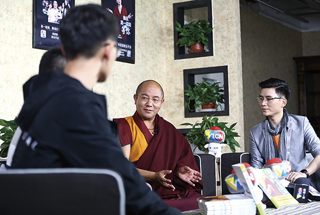
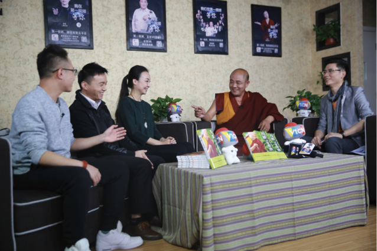
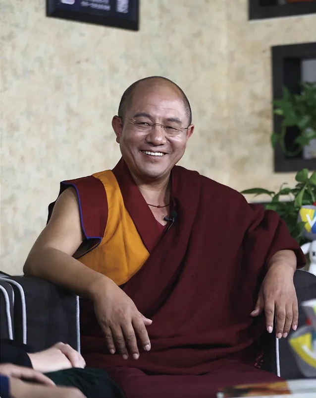
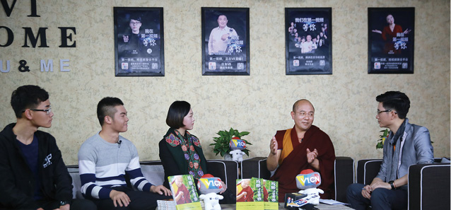
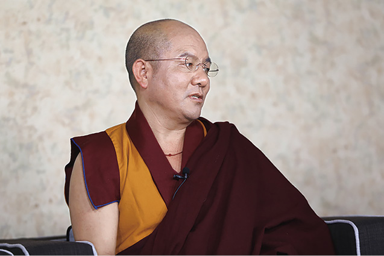
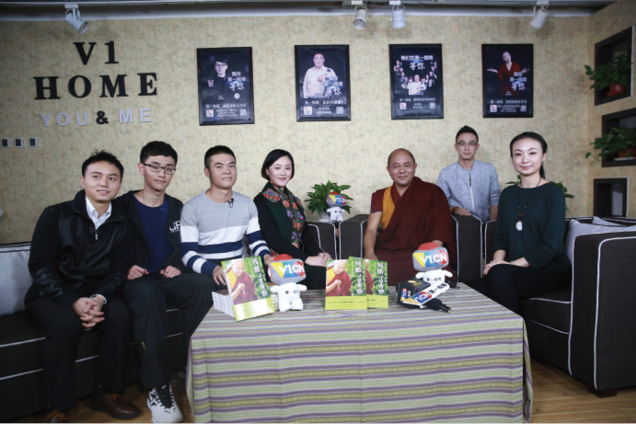

# 当90后“小鲜肉” 遇见藏传佛教“大咖”（二）

——第一视频对谈

2016年11月9日

平台：第一视频

## 东西方弟子学佛有什么不同

主持人：堪布您好。去年您有一段时间一直在国外弘法演讲，到访了美国、英国、澳大利亚、日本等国家，甚至还去了非洲一些国家。此外，您在汉地也有很多弟子。我有两个问题想请问您。第一个问题是：中西方的弟子和信众在佛法的闻思修方面有什么不同的表现？第二个问题：未来能够承载佛法并担负起弘扬与兴盛的使命，您觉得是在东方还是西方？

堪布：你提出的两个问题也是我很关心的。这几年我去过不少地方，尤其是西方，也去了非洲。从学佛的角度来说，东西方各有所长。

从闻思修方面看，东方的藏地一直都很不错；与以往相比，这几年汉地系统学习佛法的情况也很不错，越来越兴盛，尤其是年轻人对佛法的真正教义，有提问，有思维，还更重于修行。我个人觉得，现在汉地和藏地闻思修行的气氛非常不错。

再说西方的情况，在欧美等国家，佛法真正的弘扬大概是从上世纪五六十年代开始的。虽然有一些修行，但在闻思方面，尤其是显宗的大经大论并不太多。当然很多仁波切和高僧大德都在西方设立道场，道场里也有佛学研究机构，同时还有很多佛教的禅修和修行基地。从这方面来看，西方也有自己的优势。

接着回答第二个问题。我也思考过在弘扬佛法方面东西方各自的优势。西方很多人都有信仰，尤其是年长者，比如很多人都信仰基督教；年轻人中有一些没有信仰，在有信仰的年轻人中间，现在信仰佛教的比较多一些。西方人的信仰比较理性，会去研究背后的原因和道理；东方人则比较感性，听到佛号就热泪盈眶，或者看到某个上师就会生起信心。

佛教需要人们既有智慧又有信心，如果能将东方的感性和西方的理性结合起来会更好。西方人的信心产生得比较慢，比如他们不那么容易对佛像产生极大的信心，一定要通过自己的研究来明白其中的道理。

在某种意义上，对上师三宝有信心是很重要的。如果没有信心，就没办法真正地接受、转变和趋入正道。当然我们需要的是正信，如果只是迷信，只会盲目接受任何一个教派，恐怕也是不合理的。

主持人：是的，谢谢堪布。刚才堪布提及，东西方的学佛人士在刚接触佛教时，展现出各自不同的特点，这可能与他们所处的地域、生活习惯、思考模式有关。如果能将东西方的感性和理性结合在一起，可能会使内心更快、更好地产生对上师三宝的正信。

堪布：对。

主持人：我再问一个问题：堪布您这段时间去了很多国家，有没有遇到非常有意思的事情？

堪布：有很多有意思的事情。比如我去非洲的一些国家，当地也有佛教徒。他们去非洲完全是一种自我牺牲，抛弃了享受和自己的生活，在那里帮助孤儿和建立道场。这对常人来说是难以想象的。要知道现在非洲的某些地方并不安全，生活等方面也有很多不确定的因素。看到这些佛教徒在难以想象的地方或者群体中弘扬佛法，我个人认为，他们这种精神非常可嘉。

主持人：我们应该这么想：现在我们所处的环境相当祥和，同时也很宽容，让我们能接触各种知识，包括佛法方面的，我们要好好珍惜这样的机会。

堪布：对。

## “人间佛教”与“生活佛教”

主持人：今天我们非常荣幸能够请到堪布和广大的网友交谈，我觉得这是很好的缘起，也是一个很好的交流方式。还是那个问题，您去年一直在国外演讲，您当时与听众或者信众有没有互动？有没有哪些提问让您觉得很受触动？

堪布：现在有点想不起来。因为我去的地方比较多，被问的问题也特别多，可能有时很难被触动。

主持人：这也是堪布境界的一种体现。您所到之处，若有人与您结缘，都是非常有福报的，种下的善根种子也将慢慢成熟、开花结果。另外一个问题是，您在今年的多场开示中强调“生活佛教”这个理念，大家也都对此有所听闻。汉地有“人间佛教”的说法，不知道堪布您所提倡的“生活佛教”与“人间佛教”有何异同？

堪布：大家应该知道“人间佛教”，这个说法一直在社会上比较流行。“人间佛教”的前身实际上是太虚法师的“人生佛教”。当时是民国初期，佛教对普通人来说比较深奥。另外，当时的汉地还形成了一种特殊的佛教：人们信仰鬼神，并且只关心人死亡后佛教能够带来的帮助，而在日常生活中，人们并不觉得佛教能带来多少利益。基于此，太虚法师开始弘扬“人生”中的佛教，也就是说，佛教不仅适用于死亡的时候，也适用于人活着的当下。

太虚法师的倡导在当时算是一种改革，因此汉地的很多高僧大德都对他攻击得很厉害，其中包括与他同门的一些法师，后来大家就此走上了不同的道路。

其实太虚法师的“人生佛教”里既有初级、中级的层次，也有终极的比较深奥的助人解脱的层次。

“人生佛教”的概念传播到台湾后，星云大师将其更换为类似的“人间佛教”。如今“人间佛教”在全世界都弘扬得很不错，因为它涉及了人们关心的方方面面，也包括日常生活。

我提倡“生活佛教”，是因为我们的生活与善法息息相关。比如我们所生活的环境与环境保护相关。生活中，我们会和动物产生交集，因此动物保护，如放生和护生等也应该是我们生活的一部分。此外，“生活佛教”还应该要落实到日常生活的方方面面，比如幼儿教育、年轻人的闻思修行、对老年人的关怀、对病人的关爱，还有慈善事业，等等。

最终，我们希望“生活佛教”能趋入更深层次的道理，比如无常、空性、无我等。当然，这些道理对于普通人来说，很难在生活中运用。总之，我们不是仅仅宣传一些概念，而是希望人们在生活的各个方面都能真正用得上。

实际上，这些提法各有各的侧重点，并不会因为你弘扬了一种概念，其他宗派就不承认，不是这样的。“人生佛教”有它的理念和观点，“人间佛教”也有它的理念和观点，它们有各自适合的地方和人群，并体现出各自的价值和理念。

我们很希望通过“生活佛教”与信仰佛教的人结上缘。对于不信佛教的人，也希望他们由此了解佛教，也许能从中得到利益。不管是佛教徒、非佛教徒还是其他宗教徒，在生活中会遇到、会关注的各种问题，都可以在这个平台上互相交流、互相学习。这也是我们的一个目标。

主持人：是的，很多时候，面对自己不熟悉、不了解的领域，人们都会比较片面，用简单的二元对立的方式去表达自己的观点。这是不客观的。

堪布刚才提到，生活佛教涵盖了生活的方方面面。经常有人会问，如何平衡自己的修行与生活。我想这个问题堪布应该听过很多次了，您可以再给广大网友提供一些建议吗？

堪布：人生存在这个世界上，尤其是在家人，是离不开生活的。大家一定要关注生活，对自己的衣食住行，还有对自己的学习、工作、家庭、兴趣爱好等都要予以关注。不能因为修行就全部放下或舍弃，我一直都不赞同这种做法。

除非你真的到了一定境界，有能力看淡一切世间法，但要达到这样的境界，出家人都有一定的困难，更何况是在家人。

因此，我的建议是在生活中修行，将修行融入自己的行住坐卧和生活的方方面面。这一点，藏地和其他地方相比，做得比较好。一般来说，藏族人不管在工作还是生活中，随时都会拿着念珠念咒语或者在心里观想，做到随时随地修行。这是因为他们从小就养成了把生活和佛教连在一起的习惯。他们不会认为修行的时候不能生活，生活的时候不能修行。

如果你的修行比较好，你在任何时候都可以修行；如果你修行不好，即使舍弃了生活，什么也不干，可能修得更不好。有很多这样的情况，有些人不管工作也不管家庭，甚至穿得也特别邋遢，什么打扮都不做，但修行境界也没有提升。所以我们很有必要把修行和生活结合起来，对世间修行人来说，这是非常重要的。

主持人：是的。

我观察过身边一些闻思比较好的人，他们口头上说得头头是道，但落实到生活中的细节，似乎并不是那么一回事。我一直想问这个问题：有些修行人特别会说，谈论的道理似乎也很深奥，但是在待人接物上会让人感到很大的压迫感和紧张感。堪布您怎么看待这样的修行人？

堪布：有些修行不好的人给自己和他人带来了很多痛苦。说实话，一些修行多年的人在进入社会和人打交道的时候，境界可能还不如从来没有修行过的人——他们懂得为人处世的道理，和他人相处也有一定包容度。相比之下，有些修行人很糟糕。虽然修行多年，但是嫉妒心特别强，自己的心没有丝毫的改变，也不上进。他们可能口头上很会说，他学了多少多少年，他有什么什么样的上师，等等。我认为这样的修行人并不是很好。

一般来说，真正的修行是要减轻自己的烦恼，在任何情况下都有容人之心。修行越好的人越自在随意，越不会有烦恼；修行不好的话，不管你追随的是哪位上师，你自己是什么样的人，实际上都会越来越糟糕，其他人只要和你稍微接触一下就会发现问题。

所谓修行，光是口头上说说是不行的，一定要在实修上下功夫。如果下了功夫，而且功夫到位的话，短短的时间中，自己的性格会发生很大的变化。

主持人：对。作为普通人，我们没有办法看到他人内心的境界。正如堪布刚才所说的，作为一个已经步入修行门槛或修行多年的人，境界如何，不仅要看自己心的状态，还有一个标准是要看自己的烦恼有没有减少。

堪布：对。

主持人：此外，还要看自己在生活中是不是真的很随和，让人觉得很舒服，而不是标榜自己以及一些形式上的东西。

非常感谢堪布的开示。

## 媒体应该多多扬善抑恶

主持人：还有一个问题，是您刚才说到“生活佛教”的理念时我想到的。现在是互联网时代，您会不会经常上网浏览信息？有没有发现很多负面新闻或者错误的舆论导向传播得特别快，就像洪水一样扑面而来？对于网友来说，如果个人没有很坚定的正确知见，非常容易受到影响，在念头、语言和行为上产生不好的变化。

请教堪布，作为第一视频这样的媒体，在您倡导的“生活佛教”之下，应该怎么做，才能更好地服务和帮助广大网友呢？

堪布：当下这个时代，一方面来说，是一个非常好的时代，全球范围内人与人之间沟通、传递信息非常方便，而且每个人都有很多沟通工具，这种便利可以说胜过以往任何一个时代。另一方面来说，这也是一个特别不好的时代，充满不安定因素，所有人的内心都缺乏安全感。实际上，大多数人得到的信息很多都不是真的，假、恶、丑的信息特别多。

此外，我也看到很多媒体不得不去传播一些不良信息。因为现在的时代特征是，弘扬真善美的报道无人关注，反而那些不好的消息和事件，特别吸引人们的眼球，点击量也特别大。可见，各个媒介、媒体等传播平台，对信息的取舍和筛选往往都有着自己的目的和利益考量。

因此，我很希望，作为公共传播平台的媒体，能用智慧进行观察和抉择。尽管有时候我们对一些事情难以分辨真假，但大多数时候应该有这个专业能力。比如你发现一条新闻线索，至少应该进行多方的调研和了解，确认其真实性后，再分析和加工，最终进行传播。现在社会上充斥着很多假信息，尤其是很多对他人进行人身攻击的视频、音频，其实背后有很多操纵者，媒体很容易上当受骗。

作为真正传播正能量的平台，首先媒体要有自己的定位，这很重要；此外，观众也有必要去提醒、监督平台。对于现在很多信息，尤其是负面信息，我个人是不太相信的，其中有很多复杂的因素。现代社会，人们的嫉妒心旺盛，一看到别人成功或者境遇不错，就通过各种方式攻击、打压、摧毁对方，希望他们彻底消失于自己的视野。因此，自赞毁他的信息特别多。同时媒体有时会把这些信息放大到特别可怕的程度。我看到这些负面信息时会观清净心，不太会相信。

将来，面对网络上的海量信息，一方面可以去了解，另一方面也要有自己的主见和智慧进行取舍，这样就不太会导致不良后果。否则，为了吸引眼球和点击率，去大力传播这些恶臭的信息，这种行为并不是很好。

第一视频之前发布的很多信息，得到了很多不错的评价，在此也特别感谢你们为社会带来了正能量。现在世间很多正面积极的新闻没人传播和宣传，负面新闻却被极力扩散，整个社会的新闻舆论导向陷入恶性循环，这也是全社会和世界的灾难。

主持人：堪布您用不用朋友圈？会不会经常浏览朋友圈？我看到一个现象：学佛的人特别喜欢大量转发比如某某上师的开示、相关的照片以及传法、灌顶等信息，而且看的人特别多，传播得也特别快。您能否针对这个现象谈谈您的看法？

堪布：现在很多佛教徒会通过朋友圈转发上师的信息和自己的修行方法，应该是当下一种热门现象了。但它可能只会持续一段时间吧，毕竟现在的社交工具也在不断地变化。这几年是这种，再过几年可能又换一种了，更新得太快了。可能现在很多公司正在研发新的社交工具和传播方法。

不管怎么样，我倒不建议大家非要执著于宣传自己的上师，有时候甚至在转发上师信息方面，弟子之间进行攀比，这些都不太好。如果我们在信仰方面不偏袒，那么世界上无论哪一位上师、哪一个佛教宗派、哪一种真实的佛教教理都可以进行传播。对自己有恩德、有法利的上师的信息，偶尔转发也是可以的。一般来讲，没有必要把某个上师当作自己的私有财产那样拼命宣传。当然如果自己认为是很殊胜的教言，对众生有利，分享一下，也没有什么不合理的。

主持人：明白了，非常感谢堪布的慈悲开示。我想大家应该也从中得到了自己想了解的答案。最后，能否请堪布对第一视频的广大网友说一段寄语？

堪布：第一视频的网友们，我们其实应该认识很长时间了，特别感谢你们经常到这个平台来，大家一起修行、一起学习。今天在此，我也利用这个机会，希望大家不断学习——学习就是我们的人生。同时自己所学习的知识，应该不断地利益众生——利益众生就是我们的责任。

主持人：好，感谢堪布。

## 90后“小鲜肉”对话藏传佛教“大咖”

主持人：非常感谢索达吉堪布接受我们的专访，相信堪布智慧的话语一定会为大家带来很多收获和启发。最重要的是，给寻找答案的广大网友们一个正确的思考方向。

下面的环节我觉得是相当精彩且具有挑战性的。当得知堪布要来第一视频时，我们做了很多准备工作，比如收集部分网友的意见和呼声。在这个过程中，我们意外地发现，非常多的90后网友也曾拜读过堪布所著的很多畅销书，对堪布有一定的了解，内心也抱持尊敬、崇拜或好奇之心。同时，他们也有属于他们这代人亟需解答的问题。

今天是一个千载难逢的机会，非常稀有，我们也将几位90后网友请到节目现场，请他们与堪布进行面对面的交流。我个人对此非常兴奋和期待。话不多说，首先有请几位90后的小鲜肉们，欢迎。

当然，也特别感恩堪布来到我们的演播厅接受专访，感恩您的慈悲包容，欣然答应我们做一期与众不同的与90后的对话节目。我们希望通过这场真实轻松的对话，让90后对堪布产生进一步的了解，也希望堪布对他们有一个更深刻、更多面的了解。

我还不知道这些小朋友准备了什么问题，可能是纠结很久、困扰很久的问题，也可能是现场迸发的灵感。希望他们无论在生活上还是佛法上都能得到启发，也相信收看这个节目的广大网友同样能从中受益。

之前80后曾是大家关注的焦点，现在90后的你们才是受关注和被讨论的一代。接下来先逐个做自我介绍，好吗？

高语浓：大家好，我叫高语浓，是来自英国萨塞克斯大学管理与金融专业的在读硕士。很荣幸有机会与大师面对面地交流我们90后人生的疑问，也非常期待我以及和我有相同问题的朋友们能从中获得不一样的感悟和收获。

柯酩：尊敬的堪布，您好！亲爱的网友们，大家好！我叫柯酩，是一位在读生物学博士。我本身对哲学、心理学以及宗教都有比较浓厚的兴趣，也读过一些佛教书籍，认为其中一些观念与现代社会的理念有点格格不入。今天非常荣幸能与堪布面对面交流，也希望探讨一些相关问题，谢谢堪布。

年景阳：大家好。尊敬的堪布，我叫年景阳，今年26岁，在北京一家城市规划导向设计公司做推广和文案工作。我的家乡在遥远的青海，那里有辽阔的草原、湛蓝的天空，还有圣洁的雪山。那里还流传着这样一句话：比大海更辽阔的是天空，比天空更辽阔的是我们青海男儿的胸怀。

当我们处在一个物质发展如此迅速的世界，90后面临的压力既来自社会也来自生活，更来自我们的家庭。我希望通过这次节目，通过与堪布的交流，用古老的佛教智慧，解决我们现实生活中的问题。

主持人：之前在生活中有人说我像90后，我相信了。然而今天在现场，看到90后们朝气蓬勃的面容，不一样的微笑，我又不相信了。接下来，时间就交给你们和堪布，有什么问题，请放开，大胆地请教堪布，好吗？

## 前生后世·禅修·为什么学佛· 孝养父母·贫富差距·放下与坚持

高语浓：堪布您好，我的问题是关于国外的一种说法，也就是“UOLO”——“you only live once”，中文是“你只活这一次”。这句话强调的是个人意志，就是让大家怎么舒服就怎么活。我想请教堪布，佛教智慧会怎么分析这个说法呢？

堪布：今天很开心，在场的有80后、90后，我是60后的，年纪大好多，可能没法跟上，但我还是很乐意学习。

我在英国也听过“UOLO”这种说法，就是人只活一次，应该开开心心的，该玩就玩、该吃就吃。但是，这只是个别人的一种说法而已。实际上，无论是佛教还是其他宗教，都认为人并不是只有这一世，还有前世和后世。就像我们不仅有今天，还有昨天和明天。

如果人真实地存在前世和后世，那么只管今天、不管明天的做法是非常不合理的。反过来说，如果我们能非常确定，人只有今世，那么即生当中，你怎么玩都可以，都无所谓。

就我个人而言，我从小受藏地习俗影响，认为前后世是存在的，但长大后，在一些其他的思想影响下，也觉得人的前后世可能不存在。出家以后继续对此研究，我才完全明白，人确实是有前世和后世的，因为我找到了大量的理论依据，也进行了科学论证。目前来说，我找不到任何证据能证明前世后世不存在。当然，这不是我们今天讨论的话题。

总之，如果我们没有真正的证据否定前后世的存在，恐怕最好不要只关心今世，而要针对来世，针对我们长远的存在而多做善事——不多做善事恐怕也不行。

从佛教角度来看，有些年轻人可能想得比较简单，听到的一些声音也未必正确。当你到了四五十岁，才会知道我们年轻时听到的消息不一定是正确的，那时也许你会在这方面有新的理解和收获。

主持人：你对堪布的回答满意吗？

高语浓：我很满意。堪布是在告诉我们，要为我们的未来和下一世负责任。

堪布：对的。

柯酩：我提一个自己感受到的问题。我认为有些朋友的学佛动机是出于内心比较空虚、焦虑，但现代科学的发展已经能够从生理和心理两个层面，比较好地解决这个问题。那么在这种情况下，人们还有没有必要去学佛？

堪布：你的问题也是很多年轻人的问题。其实我也非常关心现代科学的发展，尤其是心灵科学和生命科学。

迄今为止，心灵科学诞生不到七十年，其中发展较早的是荣格的心理学，在此之前，这方面基本是一片空白。生命科学也即生物科学，目前对生命稍有研究，但这两门科学并没有找到生命的真相。也就是说，到目前为止，科学对生命的探索还没有结果——这一点不是我们佛教徒说的，是很多科学家在研究之后承认的。

如果科学能解决这个问题，我们当然不一定非要学习佛学，但是如果无法解决，而佛教刚好在心理层面有很好的干预方法，那么学佛恐怕是很有必要的。

我也建议你去看一下朱清时教授谈他为什么学佛的言论。我当初对他的说法很感兴趣，就是因为佛教徒这样说是常见的，但科学工作者为什么会这么说呢？毕竟他当过这么多年科技大学的校长。后来我也当面向他提出了一些问题。

现代科学从物质层面来说是很先进的，但在心理层面还没有什么建树。因此，很多科学家到最后依然很困惑，他们还是没有办法面对生老病死。

我认为，如果科学能解决人们的心理问题当然很好。但如果不能解决，大家还是要考虑用更好的办法——比如学佛来解决问题。

柯酩：谢谢堪布。

主持人：我得问你，听到堪布的回答后，对于该怎么做你有方向了吗？

柯酩：我之前遇到过一些困惑，通过阅读心理学方面的书籍，解决了不少问题，但感觉还是会有心理波动。我也曾尝试查阅佛学书籍，有一些作用，但没有更深入的了解。听了堪布的回答，我可以尝试去更多地了解佛学，尝试之后应该会有自己的答案吧。

堪布：对。

主持人：对，方向和实践很重要。

年景阳：据我观察，我周围有很多人对佛教特别感兴趣，但是因为工作太忙，所以没有太多时间去寺庙禅修。

我想请教堪布，有没有一种特别方便或者特别容易操作的禅修方式适合我们这些在城市工作的人？

堪布：禅修有多种。一种是在寺院或者寂静处打坐，完全不受一切干扰地修行。另一种禅修，就是行住坐卧时随时可以觉知自己的念头。还有一种最简单的禅修方式，比如我们平时随时都可以念“嗡玛呢巴美吽”，有念珠也可以，没念珠也可以。念咒对调整自己的心很有帮助。我们不能认为只有静坐才是禅修，其实任何时候都可以禅修。

禅修是一种对心的保护和观察，我们可以随时处于这种观察状态中。最广阔的是大地，比大地更广阔的是我们的心，心无所不遍。在任何时候，我们在这种广阔的心中参禅、念咒，都是很好的。

年景阳：好，我明白了。

主持人：虽然你明白了，我再复述一下。刚才堪布讲到了生活中可能的禅修方式。比如我们要经常去觉知自己的心、自己的念头；另外还可以通过念诵咒语的方式，保护自己的心。

堪布：念咒语是最好的一种禅修方式。在任何情况下，念咒语的时候都不容易发脾气——边念咒语边发脾气是不可能的。所以它是一种很好的随时保护自己的手段和行为。

年景阳：我还准备了一个问题。

主持人：好的，你最积极了。

年景阳：这个问题与我本身相关。当年父母送我来北京上学，希望我在大城市有所发展，现在快十年过去了，我也算学有所成。此时，父母也从壮年步入老年，得知这个状况后，我就在考虑，到底是应该继续在城市里谋求发展，还是回去陪他们？我不知道佛教里有没有什么好方法，帮助我做一下取舍？

堪布：这个问题，佛经里没有明确的授记或者预言。（众笑）

我对你的工作性质不是很了解。我是这样想的，在北京能找到这样的工作，你应该是很成功的，要结合你自己的工作情况和父母的情况，综合来做考虑。

总的来讲，父母把你养大、培养你成材，现在应该要关心他们，这是必不可少的。但关心的方式有很多种，现在的交通也很方便，不一定非要在父母身边待着。如果你在北京的工作很好，可以平时在北京，节假日经常回去看望父母。或者有条件的时候，把父母接过来一起住。

其实每个人遇到的状况都是不相同的，需要通过自己的智慧来观察。一方面，你在工作中要不断进步，这一点很重要；另一方面，对父母的关心也很重要。最近有一个新闻，一个单身母亲将女儿和外孙女抚养成人，之后都去了美国留学、工作，结果女儿再婚后不管母亲了，外孙女也不想和她住，已经80岁的老人决定回国，外孙女提前三天就把她送去了机场等待……

现在大多数的情况是父母对子女特别好，但当父母步入老年，子女就不管了。想想令人感到非常悲哀。

其实我非常担心90后这些年轻人，担心他们受到西方个人主义思想的影响，对自己的父母不管不顾。子女一定要照顾、关爱父母，直到他们安详地离开世间，这是每个人都应有的不可推卸的责任。

你能有这样的考虑是非常好的。

主持人：对，像我脾气不太好，和父母长期共同生活，就会有摩擦。

堪布：这种情况在藏地基本不会发生。藏族人会把家里的老人当作一种财富。假如一家有几个孩子，那么所有孩子都会争着抢着赡养父母、照顾父母。有些父母实在没办法，只能在这个孩子家里待一段时间，再到另一个孩子家里待一段时间，又到其他孩子家里待一段时间，不然孩子们就会不高兴。在这方面，藏族人跟西方人有很大的区别。

高语浓：我是从事金融和管理行业的，这是一个跟金钱打交道的职业，会追求利益最大化和生产力的利用等。那么，是不是如果我不换掉这份职业的话，永远都没有办法得到佛教所说的那种心灵的平静呢？

堪布：并不是这样的。你看乔布斯，领导着全球性的大企业，他也会寻求利益最大化，同时他每天都会禅修，每天都处于正念当中。日本的很多成功企业家也是这样做的。

在生产力发展过程中，年轻人有必要发挥自己的优势、智慧。同时最关键的是，自己有没有正知和正念。如果以你所说的这个理由就抛弃佛教的话，是说不过去的。

作为修行人，如果心里没有佛教的观念，那么虽然穿着出家人的衣服，实际上也没有任何用处。如果你是一个虔诚的佛教徒，即便白天要忙于工作，晚上也可以用来禅修，或者白天稍微有点时间，也可以念咒、看看佛书，做一些日常的修行等等。

在很多人的思想观念里，佛教徒或者是非常贫穷，或者是一定得到深山老林去，或者是一个很不成功的人走投无路时才会选择的路。其实这只是某些人的偏见罢了。

西方也好，东方也好，很多成功人士的修行都很好。关键在于自己的见解。如果对这方面有兴趣，那么不管工作多忙，都可以抽出时间修行；如果没有兴趣，那么即使再贫穷、再有时间也不一定会去修。

主持人：怎么样？

高语浓：明白了，我多问一句，您刚才提到的禅修，是不是就像乔布斯他们做的那种？如果他们都会禅修，是不是说明禅修跟商业还是有一定关系的？

堪布：对，其实禅修跟现代企业管理关系很紧密——最高级的管理就是对心的管理。我们可以学习这些西方企业的员工，在上班之前禅修一下，就像洗脸刷牙那样把心灵清洗一下，之后的工作效率会非常高。

当然在佛教中，禅修按不同境界有不同分类，这个我们暂且不谈。至少可以先去了解和行持一些调整心态的简单禅修，这是很重要的。

高语浓：我觉得帮助特别大。

主持人：是的，当我们对一件事情的想法特别多、思路特别混乱时，让自己的心静下来，让想法或思路变清晰。我觉得这也是一种禅修吧。

堪布：是的。

柯酩：我也问一个关于金钱的问题。网上有句话叫作“没有对比就没有伤害”，而现在的社会问题之一就是贫富差距特别严重。堪布您是怎么看待这个问题的？

堪布：对比在某种层面上是有必要的，但最有必要的是在学习、获取知识等方面的“攀比”。如果人们总是处于一种对比的状态中，很多苦恼也会由此而来。别人买了房子我没有，别人买了车我没有，别人找到朋友我没有……在对比的过程中发现自己的匮乏，能力不够、智慧不够或者福报不够，等等，然后把自己框在一个圈子里，自己打击自己，这种现象是比较普遍的。

在我看来，所谓的贫富差距的确跟个人的福报有关。同样做一件事，每个人的情况都会不一样。有些人非常努力，但是所有努力到最后都变成了泡影，什么也没有得到；有些人虽然努力的程度不够，但会获得很多机会。这跟佛学讲的命运、福报有直接的关系。当然，勤奋也很重要，这也占了很大比例。从这个角度来说，对比有时候也是需要的。

主持人：我要赶紧积累福报，同时又要努力，感觉就像心里装了三千个问题。

柯酩：对，不止三千个。

主持人：那你继续来。

柯酩：堪布您对同性恋是怎么看的？

堪布：（笑）

柯酩：您别笑啊。

堪布：同性恋的问题，我之前被问过很多次。不管怎么样，我认为同性恋就是一种爱情。

柯酩：既然是爱情，我们就应该去尊重和包容它，我这样理解对不对？

堪布：关于同性恋，每个国家、地区、民族都有不同的传统和规矩，应该根据当时所处的具体环境来衡量。

年景阳：我想问一下执著和坚持方面的问题。佛教里有一个观点特别好，就是要我们放下执著，我觉得很有道理。但另一方面，现代社会有一个观点：要成功就要对目标坚持不懈。那么我们在遇到问题时应该如何抉择呢？是放下执著，还是坚持目标，究竟该如何取舍？

堪布：我问你一个问题。你过河的时候需要一只船，但到了河对岸后又会放弃它。这种行为属于放下还是坚持？过河的时候船是不可缺少的，到了目的地之后，一定要放下船。

年景阳：就是说，刚开始的阶段要坚持。

堪布：对。到了最高境界也就是已经圆满的时候一定要放下来。也就是说，到了对岸后你就不需要这只船了，但在你还没有到达对岸之前，需要努力地把船划过去。很多人都把最终极的放下与暂时的放下搞混了。刚开始就放下——放下的话你就过不了河；开到中间放下，则很危险。佛教里从来没有让你在任何阶段都要“放下”，只是说到最究竟的时候，当一切都不存在的时候，要放下来，但那时前面所有的工作都已经完备了。

很多人认为，佛教不是要求全部放弃吗，你怎么不放弃？为什么还要修善？为什么还要执著？为什么还在拼命？还修什么呀，你们佛教徒不是要全部放下吗？我们佛教徒并没有说所有阶段都需要放下。修行的开始阶段要行善阻恶，包括佛陀在因地积累资粮这么长时间，都没有放下，但到了最后阶段，确实要放下。

主持人：感觉此刻你内心的疑问已经放下很多了，感觉很轻松是吗？

年景阳：对，而且我也能理解堪布之前的那个解释了，就是努力到最后，即便不能成功，也应该到了放下的时候。

堪布：对。

主持人：不要太执著。

年景阳：对，一定要去努力。

堪布：一定要去努力，没法努力的时候就放下，船开不动了，就把它留在那里。

主持人：换一只船嘛。

堪布：换一只船。（笑）

高语浓：我提一个关乎自身的问题。我回国以后，发现很多人都会给我贴上留学生的标签，认为留学生就应该比国内一些学生在某些事情上做得更好。如果做不好，他们就会有一些想法或者直接批评。说实话，这时我的心情就很烦躁。请教一下堪布，我应该用什么心态去面对这个问题呢？

堪布：其实不仅仅是你，我也要面对这样的情况。因为我身穿出家僧服，所以不管说什么、做什么，都会有人说“啊，你出家人说这句话”“啊，你出家人吃这个”“啊，你出家人去这里”……当然，我不会去一些不如法的场所。但是不管什么时候，人们都会在我身上贴出家人的标签，这种情况跟你是一样的。

这种时候，我们应该冷静判断。比如你留学回国，在某些方面应该会超越国内的学生，当然不一定是所有方面。人们这样看待你，实际上是对你的一种期待，也是对你的一种监督，在某种意义上，可能会有助于提升自己。

以我个人来说，别人都认为我是出家人所以要怎么怎么样，那么我出门一定会把僧服穿好，不然别人就会说“啊，你出家人穿着怎么这么……”表面上看，好像是别人对我指指点点，实际上也是我对自己的要求：我的身份的确是出家人，我更要注意自己的言行举止。

可能你很讨厌这种情况，觉得有点烦躁，但从某种意义上来讲，这体现了别人对你的更高要求。假设你是一位领导，如果别人对你提出要求，间接来讲，这也会让你进步。因为你对自己要求很高，别人对你的要求也很高，你就会获得更多的学习和提升的机会。但如果觉得别人对你提出要求，是在践踏你的尊严，你可能就会受不了，更不可能有上进的机会了。你认为大家都看不惯你，但实际上并不是。

当你在经历上稍微有一点与众不同，别人对你提出更高要求，还是应该珍惜这种机缘，这对自己也是有帮助的。

主持人：对，自己的态度要调整。

堪布：对。

高语浓：从正面来看待，这反倒是一种鞭策。

堪布：对，从正面来看待。表面上是批评，其实是对你的一种很好的鞭策，也是另一种方式的称赞和认可。

高语浓：我也受益了。

主持人：谢谢三位同学，也感恩堪布。

堪布：谢谢你们。

## 大龄单身女青年·创业之难· 学习最重要·微整形

主持人：刚才我们感受了三位90后各自鲜明的、共与不共的一些特点，让我有些感慨。就像堪布说的，好像考官在给我们出题一样，确实带来了挑战性和精彩度。接下来我们请到的这三位90后又是不一样的感觉。请大家先做下自我介绍。

耿笑：尊敬的堪布，亲爱的朋友，大家好。我叫耿笑，今年24岁，是一名白领。作为一名白领，每月的收入交了房租、水电费，买了油、米、泡面后，再一摸口袋，唉，苹果7系列双镜头手机又没啦（笑）。可以说骄傲的外表下是一颗破碎的玻璃心。

当大家告诉我有一个机会，可以跟一位知识渊博的老师、教授面对面交流的时候，我和朋友都特别激动，我们都觉得终于有了一个可以倾诉的地方，可以解决我们的烦恼了。因为我们的压力实在太大了，我的小宇宙都要爆发了，我已经迫不及待地要发射烦恼的小火箭了。

主持人：爆发的时候，我们要做什么准备措施吗？（众笑）

王科：尊敬的堪布，您好，亲爱的网友们，下午好。我叫王科，来自云南西南林业大学，是一名即将毕业的大学生。我在大二时创建了一个环保型协会——控烟协会。在我担任协会会长的一年中，开展了很多控烟方面的活动，收获很多，但也积累了一些烦恼。今天有幸在这里向堪布您请教，希望您能为我解疑，非常感谢！

主持人：紧张得特别到位。（堪布笑）

崔明淏：堪布好，大家好。我叫崔明淏，现在在高中读书，我其实算是提问者里最年轻的。我平常比较特立独行，不愿意按父母规定的套路走。以前也跟着父母听过一些佛经的课程，但一直也不太明白它讲的到底是什么，听得一头雾水。希望能通过这次和堪布的交流让我有所领悟。

主持人：我知道各位都有所准备，而且内心有很多能量准备在今天爆发。但我心里有些许的不平衡，因为大家一直在问堪布。我也应该有问题问你们：我在网上看到一些定义90后的关键词，我大概给你们读一下，看看你们是不是赞同。

比如有人说“你们是互联网的一代”，也有人说你们是“自私、自我的一代”，还有人说“你们是没有理想与精神信仰的一代”——不是我说的啊！你们怎么看？

耿笑：我先说，我们是这个时代的产物。因为我们特立独行，与80后、70后格格不入，我们实在适应不了他们，只有选择创业，自己干、自己挣钱。

王科：上个时代，大家也在说80后怎么怎么样。我相信到了90后该承担责任的时候，我们也一定可以肩负起肩膀上的重任。

崔明淏：在我身边，每个同学都有自己的理想，也都在为自己的理想付出努力。所以我认为90后也依然是有理想的一代！

主持人：掌声鼓励！

我觉得这是需要时间去证明的。同时，最重要的是，我们有一些机缘，得到一些能够在某个时刻、在当下能够改变我们人生的话语。接下来，请把你们的问题发出来。

耿笑：堪布您好。我的第一个问题是，我身边有好多大龄女性朋友，其实也不算大，二十六七岁，她们总是被家里逼婚。我想问一下：适龄女性是应该抓紧时间相亲、结婚呢，还是继续等待所谓的缘分呢？

堪布：嗯，这个怎么回答呢（众笑）？我觉得你们90后的孩子很多都非常有理想、有目标，这一点的确很好。

昨天我看到一个十二岁的孩子，特别关心美国总统大选，一直在讲里面的一些逻辑。似乎我们都不太关心的事情，他也在关心：全人类、全社会，国家和民族的未来，自己将来怎么创业，如何孝顺父母，等等。这么小的孩子会这样思考，确实是我们以前根本想象不到的。

我经常这样想，我们这一代可能很快要离开世间了。现在站上人生顶峰的是80后、70后了。再过十年，他们可能也会走到我们现在的位置，轮到新一代的年轻人去实现他们的理想。

人生都是这样的，是一种非常明显、快速、无常的延续和更替。不管怎么样，在座的各位都是有希望的。

刚才你提到的很多女性朋友遇到的情况，其实在很多城市里都有。我也经常看到一些佛教徒有类似的困扰——被家里人逼着成家。有一些人是自己不愿意走入家庭；还有一些人是忙于事业，忽略了家庭，一转头已经三十多岁了。还有一些其他的情况。我听到过很多不同的声音。

不管怎么样，我想人与人之间，确实有所谓的因缘存在。如果不考虑这一点，只因为父母要求或其他因素，被动地去完成一些世俗形式的话，人生不一定快乐，婚姻也不一定长久。

无论东方还是西方，与传统社会相比，现代人的生活模式发生了很大的变化。尽管有人不相信佛教的因缘理论，但缘分没到的时候，很多事情是无法推进和成办的。一方面，我们要随缘；另一方面，也要根据自己的情况作出调整，同时还要有一颗坚定的心。很多人生的抉择和改变对个人来说，要很慎重，还是要选择比较稳定的方向。这也是有智慧的人会做的事情。

耿笑：明白了。谢谢堪布。

主持人：王科你一直保持微笑。你是一紧张就会笑呢，还是一个特别爱笑的人？

王科：开心的时候会笑。

主持人：明白了。

王科：最开始创建协会的时候，周围的朋友和同学都不支持我，也很不理解我为什么要这样做。那一年，我做下来感觉很累，很孤单。

我想请教堪布：以后我们从事一项工作或者做一件事情的时候，虽然自己认为比较有意义，但周围的人都投来异样眼光的话，我应该怎样去平复这种心理落差和烦恼，怎样继续勇敢地往前走呢？

堪布：可能很多年轻人做的事还不够多，在这方面不一定有经验。人生经验是很重要的，经验的累积和沉淀对生活、工作等方方面面都会有非常大的帮助。

不管做任何一件事情，都不可能顺顺利利的，中间都会有很多曲折、障碍。所以，在一开始，你应该要思考清楚，到底要不要做这件事。如果确定要做，就要勇往直前，要有毅力。在做的过程中，实在行不通了再返回，但最好不要半途而废。

我的做事原则就是这样的。不管做什么事，世间事也好，修行也好，中间肯定会遇到挫折或者违缘，如果不坚强，一定进行不下去。

现在创业的年轻人比较多，但是能坚持到最后的不多。世间有一种说法叫作“成功的路上并不拥挤”，就是因为很多人走着走着就停下来了。很多年轻人以前没有相关的经验，做事遇到问题的时候，不相信自己，选择了放弃。在开始的阶段，年轻人很多，但善始善终的很少。

你刚才说的控烟协会是很好的，能做多少就做多少，就这样慢慢地做下去。

王科：我再请教一下，做这种活动或者工作时，是不是身边有同行者或者合伙人会更好？

堪布：如果你们在观念和价值观等方面都一致，那当然很好。很多人刚开始是同行者，最后就分道扬镳了，这种情况也很多。可能要先跟他签个协议。

在做事情的过程中，经常会发现同伴和你观点不同，不像刚开始想象的那样。我的原则是：如果要和谁合作，以三年五年为限，先合作一段时间看看，这样磨合一下比较好。在一起做事，人和人之间多多少少都会有观点的差异。

主持人：也祝福你的路越走越宽，不会堵车。

王科：谢谢。

崔明淏：我特别想问一个一直不太明白的问题：曾经在一本书里看到过一句话，类似于“布施三千大千世界，不如读四句佛经”。在我看来，布施三千大千世界应该比比尔·盖茨还要富有了，如果那么富有了，为什么还要去读四句佛经呢？

堪布：这里所说的读四句佛经的意义在于教育。从价值观的角度来说，与金钱相比，教育和智慧的价值更高。假如我们没有任何智慧，那么即使有再多的钱财也不一定能获得利益；但假如读了四句偈颂，真正获得了其中的智慧，那么即使没有钱财，在世间也会是很有能力的人。

因此，从财富的价值观上来讲，外在物质财富的价值不如内心精神财富的价值。这里主要宣讲、强调的是精神价值。佛经里面的教言有时需要用另一种方式来理解。

主持人：我有一个请求。您刚才不是说四句偈颂的功德吗，堪布能否在此为我们说四句偈颂，让我们积累一下福报，可以吗？

堪布：比如“诸恶莫作，诸善奉行，自净其意，是诸佛教”，这就叫“偈颂”。就此偈颂而言，它实际上包含了佛陀八万四千法门的意义。

如果一个人能做到不做坏事、多做善事，自己的心也调整得很好，那么即使一分钱都没有，他的人生也是最快乐的。而如果一个人有比尔·盖茨的财富，但是心不快乐，而且总作恶法、不行善法，那么人生也不一定有意义的。

我看到过一些富贵的人，他们的心态很糟糕，特别特别痛苦。虽然他们有着子孙后代都用不完的财富，但是一点都不快乐。所以心态的调整是很重要的。

崔明淏：我再问一个问题。我身边很多朋友都在打游戏，他们认为在打游戏的过程中可以得到自己想要的乐趣。但他们对于身边发生的事情或者遭遇的不公，抱持悲观的态度。您觉得他们应该怎样去调整这种心态呢？

堪布：其实这种情况是很悲哀的。作为学生，父母花钱把你送到学校，按理说应该好好学习知识。但是，很多学生不好好利用时间，反而用父母的钱去网吧打游戏或者去茶楼、酒楼玩乐等，每天都过得浑浑噩噩的。最终自己没有学到知识，也考不上学校。我特别希望，学生们一定要认认真真地学习。

以前，很多学生都在大学期间读了很多书。藏传佛教的大德，有人一辈子读了三千本书。而现在很多大学生都不爱读书，只看看学校规定的课本，最后就怨天尤人，认为社会不公等等。其实没必要抱怨。在大学期间，应该放弃不必要的游戏、娱乐活动，一心一意地投入学习，这才叫学生。但是很多人把“学生”这个概念搞丢了，我觉得特别可惜。

我去过很多学校，看到很多学生都不爱学习。像英国和美国的有些学校特别严格，如果学生没有好好学习，最后分数不够，就拿不到毕业证。所以他们的学生整天都在学习，连晚上睡觉的时间都很少。可是我们这里的有些学生天天在学校里玩，特别可悲。我特别希望90后的学生们好好学习。

有些人虽然已经毕业了，但是也不能放弃学习。人生离不开学习，一旦停止学习，我们的大脑和生活的方方面面都会受到影响。所以，学习佛法也好，学习世间法也好，无论学习什么知识，大家一定要有热情。

我特别特别赞叹爱学习的人。不管学什么都精进努力的话，这个人一定非常好。如果不爱学习的话，即使是佛教徒或者有其他什么身份，哪怕你是高僧大德，都是很可惜的。应该努力去学习，我是这样想的。

主持人：怎么样？

崔明淏：很满意。

我前段时间听过一个理论。比如这次谈话，我通过这一两个小时能解决一些短期问题，而学习是一个长期过程，是一个需要一年、几年甚至一辈子来实践的过程。在您看来，把这一两个小时也投入到学习的过程中是否值得？

堪布：如果能学到一些经典的格言、名言，又或者在一本书里读到了最重要的一句话，哪怕只花了一两个小时或者几分钟，也可以让你终身受用。

学习的关键在于能不能学得深入、能不能付诸实践。如果能在实践中用上之前短短的时间里学到的知识，或者在一个老师面前听了一堂感染力极强的课，那么你从中得到的收获和受到的影响也许是终生都不会忘记的。

有很多高僧大德，之前可能只在一个善知识面前听受过一两堂课，终其一生都将这些教言当作人生的镜子来观照自己，最终在修行道路上获得成功。所以学习主要看态度。如果一个人有很好的因缘的话，那么他通过一本书、一堂课或者一个理论都能受益匪浅。

我曾在美国遇到一个学生，他说自己因为听了一位教授的一堂课，从此以后人生就彻底改变了。他本来有点心术不正，通过那堂课获益很大，之后完全变成了另一种人。所以说，因缘有时是很巧妙的。

耿笑：我有一个疑问：不是说读万卷书不如行万里路吗，是不是我多出去经历的话，对我的影响更刻骨铭心、更深刻呢？

堪布：这要看你去的地方。读万卷书不如行万里路，这是另一种说法，的确有些人是通过行路、实践来感受和了解世界的。但我认为不能不学习，因为一旦放弃学习，那么行万里路时就可能会走错，一旦走错了也很危险，这一万里路就离目标越来越远了。

就实践和知识两者而言，知识的前导性还是很重要的，当然实践也重要，它们属于不同层面。

主持人：今天是一个很好的学习机会。你们的同学、朋友在屏幕前看到时，不知道该有多么羡慕！希望刚才我们的交流，在多年以后回想起来，依然觉得非常受用，甚至可以说指导了我们这一辈子乃至生生世世。我希望大家都能有这样的美好结果。

耿笑：现在“微整形”比较泛滥，因为找工作要看颜值，找对象更要看颜值。很多女性朋友出于不同目的，即使知道其中的痛苦和风险，还是要拼命地不断地去追求。甚至割了双眼皮发现还不够，还要再割一下。我想问，这算是一种执著吗？

堪布：肯定算是一种执著。所谓的整容或者微整形，可能在年轻时会去追求，但是从长远来看，对身体并不好，我们不是很赞叹这种行为。人体其实是人天合一的，如果在某些方面受到比较大的破坏，对未来身体的整体状况相当有害。

一般来说，女性朋友们注重穿着打扮、化妆，对自身没什么危害，还是值得的。我们平时对佛教徒的要求也同样是可以把自己打扮、化妆得漂漂亮亮，都是可以的。但如果是整容或者整形，就另当别论。听说很多明星经常做这些，还听说很多中国人在国外整容，这就有点可怕了。即使做了整容手术，从长远来看，到底是变漂亮还是变丑了也不好说。在这方面，可能还是要慎重一点比较好。

人们内在的涵养和智慧，暂时从表面上看不出来，找工作也好，找对象也好，也许会有一点困难。但是你做了微整形也不一定就能解决这些问题，也许会带来更多的问题和麻烦。所以，我们要从正反两面去衡量。

我认为这种社会现象对大家来说都是一种挑战，值得好好观察一下。否则年轻人人云亦云，自己没有观察，也没有长远思维，一旦发生了某些后果，是很可怕的。现在这个社会，很多广告和宣传并不可靠。等过了一些年后，后果才会比较明显地呈现出来。

从很多方面来看，整容或微整形不一定很可靠，不建议。

主持人：我曾看到一些新闻，一些人组团去国外整形。

堪布：对，到韩国去。

主持人：回来的时候就遇到问题了：身份证上的这个人是你吗？

堪布：做完听说要隐居几个月。

主持人：软禁几个月。

堪布：借口在外面学习、培训之类的，过了半年后出现，长相就不同了。某种意义上来说，还是慎重一点好一些。当然，如果确定整形是完全安全、没有副作用的，那么身体是你自己的，你觉得可以就可以。我们也不是完全反对。因为有些人确实是出于职业需要，而且也能因此获得很多快乐。

可能是我个人的主张比较保守，对任何事都抱持比较传统的观点。也不排除我对现在的各种科技手段不是很明白，也会有这样的情况。

主持人：正如堪布所说，我们应该多学习，为自己的内心做整形，那才会更美。

耿笑：对，升华心灵。

主持人：还有问题吗，两位？

王科：我再请教一个问题。当下这样一个发展特别快的时代，我们的内心都比较浮躁，从佛法角度来看，我们应该怎么做才比较好？

堪布：内心的浮躁可能是因为在互联网时代，我们得到的信息太多了。人人都在云里雾里，不知道自己应该接受什么样的知识，往往看过就忘了。

实际上，每个凡夫都有浮躁的心。我们看几百年、几千年前古人的心态，会发现他们也在抱怨当时的时代，也认为自己不快乐，压力很大。很可能几十年、几百年以后，人们依然有种种分别念，有痛苦、烦恼等等。

如果能很精进地修行佛法，的确会对心灵产生净化的作用。但这需要苦行，否则光是看看佛书也不一定能解决这个问题。还是要进行一种调整心态的修行。

主持人：时间关系，我们再问最后一个问题，谁来？

崔明淏：我来。我听工作人员介绍您的时候说到，您像我这么大的时候，有过打架斗狠、争强好胜的经历，不知道是不是真的？我现在到了这个年龄……

堪布：你现在多少岁？

崔明淏：我十七岁。

堪布：正是我喜欢打架的年纪。

崔明淏：这个年纪会产生一种以前没有产生过的感觉，可能因为一点事就有动手的冲动。其实我本身不想动手，但是身边的人都这样，出于合理自卫我也不得不动手。我想请教您，这种校园暴力现象您怎么看呢？

堪布：我以前觉得动手是很快乐的事情，那时我一天最多打五六场架，很好战，很有这方面的意乐和兴趣。但现在看来，确实不管什么理由都不能打架。因为暴力和某些行为是由自己的嗔恨心导致的。在嗔恨心的驱使下，我们所做的任何事情，不管是说话还是动手，都不会有好的后果。

一般同学之间，不会有什么深仇大恨，只是一些小摩擦，可能被身边人煽风点火，激化了矛盾。我认为还是应该以和平方式来解决，这样结果会很好。

暂时看来，以牙还牙好像是有意义的，但从长远来看，解决不了问题。比如你今天打了他，如果他输了，他会等着某一天再来打你；如果你输了，你心里不舒服，总想着再打他一次。就这样冤冤相报何时了。最好的方式还是我们去调整自己的心态，一直调心到所有的敌人都没有了。

我现在看自己以前的做法是很不好的，很惭愧。可能你到了我现在的年龄时也会有这种感受：哦，最好不要打架了。到时你也会跟十几、二十岁的孩子说：“你们不要打架，我年轻的时候也爱打架，但没有用！”

主持人：目前还有打架的想法吗？

崔明淏：现在少多了。

主持人：

在此非常感谢堪布的慈悲和包容，当然也非常感谢几位90后的率真可爱和直接。相信这场对话非常精彩，也具有很大的意义。我们也希望有更多机会，让堪布和更多网友一起分享生活、探讨疑问。我非常开心和感恩！

再次感谢大家的参与，也再次感谢堪布，我们期待下一次更美好的相聚。

与90后网友合影
