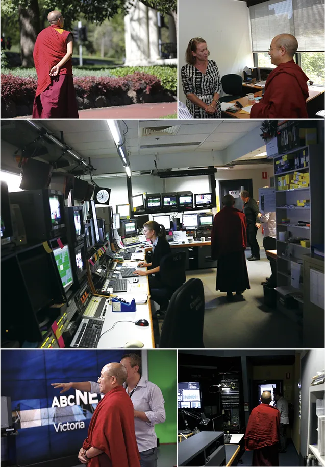
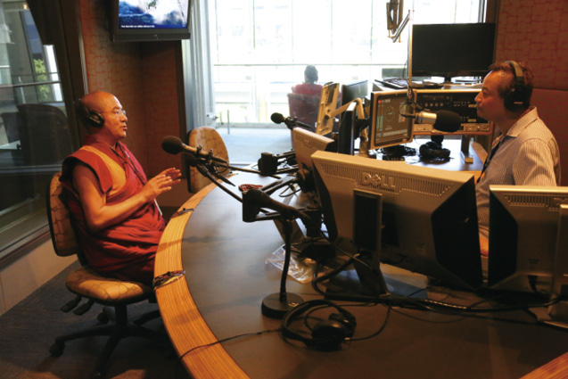
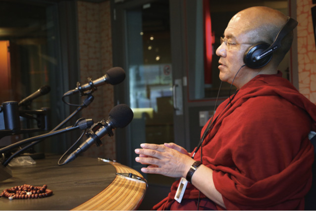

# 慈悲心与幸福

——澳大利亚ABC国际广播电视中心采访

2014年10月20日

主持人：

听众朋友们，欢迎您收听今天的《直击澳洲》节目。

前不久，来自中国四川藏区的索达吉堪布仁波切到达了澳大利亚的悉尼和墨尔本进行访问。他是享誉海内外的知名佛学家、翻译家和慈善家，也是当今世界上最大的佛学院的首席大堪布。堪布仁波切曾经应邀在全世界66个著名的高等学府进行演讲，与世界各地的专家、教授、学者进行各种主题的研讨、交流。2013年，堪布入选中国《人物》杂志“中国年度宗教面孔”，成为中国国内最具影响力的藏传佛教领袖。

在今天的节目中，我们特别请到了堪布仁波切，请他来谈谈藏传佛教中对慈悲心和幸福的定义和解释。

⊙ 问：堪布您好，非常欢迎您来到我们的节目。其实您到这里已经有一段时间了，去了墨尔本和悉尼。您第一次到澳大利亚来的感受如何？

堪布：是，我第一次来澳大利亚，感觉非常好！因为这里的整体氛围，包括自然环境和人文设施等都很好，给身心带来一种非常放松的感觉。同时这里也有很多宗教信仰，很多人对自己的信仰非常虔诚，很不错。

⊙ 问：昨天您在墨尔本大学举办了一个讲座，听众非常多。谈到了大家比较关心的一个话题，就是慈悲心与幸福之间的关系。我个人觉得比较震撼的一点是，您谈到了慈悲与爱是两个不同的概念。您能不能就此展开说说呢？

堪布：慈悲实际上是一种无私的奉献。比如说无条件地帮助别人——在别人感受痛苦的时候，无条件地让他从痛苦中获得解脱。是这样一个概念。而一般人所谓的爱，爱情或爱心，大多数是以自我为中心，是一种自私的情感。这样的爱会给人们带来各种痛苦。因此，我认为，慈悲心和爱之间最大的差别就是无私与自私。

当然，爱当中也有一种大爱无疆。这种大爱，就相当于佛教中所讲的慈悲心。但一般来说，世间的人们经常说的爱与奉献，多少还是带有一定的自私成分。

⊙ 问：那么，如何能够把自己的自私心放下？如何能够使自己不仅爱自己喜欢的人，也爱自己不喜欢的人，甚至是自己的敌人？

堪布：要想做到无私地爱他人，甚至是敌人，可以参考大乘佛教中慈悲心、菩提心的修法。

在这种修法中，首先从范围上看，爱的对境是自己和自己最喜欢的人，然后逐渐扩大为其他的亲朋好友，再不断地扩大范围到世界上所有的众生乃至自己的怨敌。其次，从时间上来看，原来自己对其他众生的爱只能持续一瞬间或者很短的时间，通过不断地修行，时间可以延长到一辈子乃至生生世世。

不管怎么样，都需要一种修行，先要有一种平等心的修行。没有的话，就很难做到。

⊙ 问：很多人都认为，在这样一个时代，去爱自己的敌人，确实是一件非常困难的事。再比如说，如果对方是恐怖分子，我们要用善心、慈悲心去爱他，大家觉得这是不可理解的。您怎么看待这个问题？

堪布：慈悲心的爱实际上是一种具有甚深意义的真理。如果我们的内心真正具有这种爱的力量，甚至可以感化恐怖分子。如果我们生活在具有慈悲心的爱的世界当中，很多敌人自然而然会消失。

如果我们以牙还牙去对待敌人，可能在这里消灭了一些敌人，其他地方又出现了一群敌人。所以，我们应当去推广这样一种爱的力量，它会带来一种非常良性的因果循环。

现在可能很多人接受不了这种观念，也是正常的。当你真正懂得了这种爱或者慈悲的力量，就会明白，世界上很多敌人是会消失的。以前有一些修行人，在没有修慈悲心的时候，他的世界里有很多仇人；当他真正运用慈悲的力量，不但没有受到敌人的打击，与他周围的世界也更加和谐了。

⊙ 问：在澳大利亚的社会中，判断你是不是成功，有一个标准就是看你挣钱的多少。有很多人都将挣钱的多少、财富的多少和幸福联系在了一起。请问您是怎么解读幸福的呢？

堪布：其实不仅仅是在澳大利亚，现在东西方国家的很多人都认为钱越多越幸福。实际上，当我们把自己的幸福完全寄托在钱财上，或者是将钱财与幸福画上等号，恰恰说明我们的综合素质还有待提高。

人们把幸福寄托在物质等外在事物上，却忽视了这些外在的事物是在不断变化的，它们不会永远都跟随你，终有一天会消失。那个时候你的幸福指数自然就降低了。但如果我们的幸福和快乐是来自于自己的内心，这种幸福可以一直跟随你。

同时，幸福也有不同的层次。从物质获得幸福感是比较低的一个层次。人们的幸福感还可以从文艺作品、信仰或内在的证悟中得到。这种幸福感更稳定，也不容易消失。

因此，只将幸福与钱财相关联，层次不高，也不是很合理。

⊙ 问：就像您在昨天的讲座中所说的，幸福有两种：一种是暂时性的，通过感官上的或者外在事物的刺激可以获得；还有一种是永恒性的，需要内心的平和与慈悲才能获得。我们应该希求后一种幸福，对吧？

堪布：对。我一直是这样认为的。不仅仅是这样认为，我还有非常强有力的证据可以证明。很多人都通过内心的修炼真正获得了这种幸福——远离了世间人所认为的种种幸福的因素，依然非常快乐。这样的人无论是在逆境还是在顺境中，在任何的自然环境和物质条件下，都会一直快乐，不会痛苦。即使有一些痛苦，对他的影响也不大。

如果我们只依靠物质来获得满足，就会发现这种幸福非常短暂，等过一段时间，物质消失后，你还是会绝望。这也是为什么现在越来越多的人选择自杀。如果我们一直向外求取自己的幸福，最终求得的是一种痛苦。心理学家荣格曾经说过：向外看，会做梦；向内看，会醒来。我很喜欢这句话。

⊙ 问：您刚才所说的藏传佛教中对幸福的理解，与西方心理学中的马斯洛需求金字塔理论很相似。金字塔的下部是人的生理需求、安全需求等最基本的需求，再往上就是希望能够有钱、有地位的需求，最高层次的需求则是自我实现、自我完善的需求。到了那个时候，就不再关心别人怎么看待自己，而是通过自我觉知来达到某个境界。

您觉得这个理论和您所说的是不是有点像？

堪布：对，非常类似。

我们也发现幸福的层次有三种。第一个层次是物质追求，这个层次的人比较多；再上一个层次是艺术、文学、学术追求，很多人通过这方面的追求获得幸福；最高层次的追求是在宗教信仰甚至证悟方面，这个层次的人比较少，但是他所得到的力量、获得的幸福感，也是一般人无法企及和想象的。

⊙ 问：不仅仅是澳大利亚，现在整个世界都在追求速度，人们也喜欢快餐文化，对很多东西都是浅尝辄止，看一下、抓一下就结束了。您能不能给现在的人们提供一些建议，比如在日常生活中，每天做哪几件事情，能够为人们带来永恒的幸福？

堪布：想要获得幸福，我觉得首先要给予。每个人拥有的不应该都牢牢握在自己手里，应当回馈社会和自然。

其次是安忍力。在生活、工作中会面临各种压力，我们要学会坚强面对。坚强的安忍力也是幸福的一个因。

第三个是道德。不管是过去、现在、未来，人们都需要有道德修养，有基本的道德底线。“人非圣贤，孰能无过”，犯错是难免的，但至少要有一个底线，最起码不能触犯现代社会的各种法律规定。同时也要尽力提升自己的良心并对抗自己的恶心。

第四个是努力。生活当中需要努力。我看澳大利亚的社会制度很好，给了国民很多福利。这种情况下，不能懒惰，什么都依靠他人是不合理的。每个人都要自给自足，最好还能照顾家人、回馈社会。我们要勤奋，不勤奋的人和尸体没什么区别。

第五个是安宁。追求幸福的时候，自己的心要安静下来、沉淀下来，获得一种安宁。现在的人都特别浮躁，每天东抓一点、西抓一点，抓完之后又放下。就像牛吃草一样，每天都在换来换去。其实这种频繁变化，改变自己的喜好，最后也得不到什么有价值的东西。应该要把握住那些最基本的对自己有益的部分，比如一些优良的传统文化、现代的知识和技能。此外，人至少也要有一个依靠处，就是信仰。

最后一个是智慧。不管做任何事情都需要有智慧。当智慧与幸福相伴随，你会获得满足，你自己的梦想也会实现。

⊙ 问：您说得特别好。

经常有人会说，做人要学会放下。意思就是人不能总是为一件事反复纠结，要学会放下。您怎么看待这种说法？

堪布：所谓的“放下”，并不是指我们需要承担的工作、家庭方面的责任，还有社会责任等等，所有的这些责任都要放下来，不是这个意思。佛教中也有“看破、放下、自在”的说法，和你们所说的放下有类似的地方。

放下也有很多不同的层次。在个人境界达到比较高的层次时，对世间没有什么执著了，确实可以选择放下。但在你还没有达到这个境界的时候，还是要勤奋、积极地面对人生。

我认为的放下是，该放下的要放下。比如说过多的欲望、嗔怒，还有过多的嫉妒、攀比等。这些应该放下。我们不能放下的是对于真善美的追求。比如在生活中保持种种善念，勤奋地学习、工作，追求真理，等等。

按照我个人的看法，人不可能做到全部放下，放也放不下来。即使暂时放下了，过一段时间又要去捡回来。可能回头去捡的时候，才发现物是人非，损失会更大。

我的建议是，人的放下应该量力而行。做不到的时候，想要强行全部放下，可能你的生命中也没有这个机缘。

⊙ 问：还有一种说法：人们应该学会与世无争——都不争了，可能你就已经自我完善了。您怎么看待这种说法？

堪布：其实合理的竞争，我觉得是有必要的。

⊙ 问：就是没有绝对的，是不是？

堪布：对，合理的竞争有助于自我提升。拿学习来说，大乘佛教中也有辩论和考试。如果这些竞争都没有，我们的智慧、悲心和信心可能都无法提升。在合理的范围内，我觉得需要竞争，该争取的也要争取。现在有些人认为什么都不做、什么都没有就是放下，其实并不是这样，佛教中也不赞叹这样的行为。

⊙ 问：关于命中注定您怎么看？比如命中注定这件事好或者不好，我就不做决定了，交给命运去做安排吧。

堪布：佛教中并不这么认为。虽然我们承认，生命中有不可逆转的业力，但当下的因缘也能起一些作用。就像一个农民种庄稼，种子固然很重要，但如果没有浇灌种子，或者没有阳光、温度等这些外界的因缘，种子也无法长出苗芽。

佛教的因缘观，就是有因，也有缘，缘也起到了一定的作用。是不是所有的事情都是命中注定呢？有一部分的事情可以说是命中注定，因的力量非常强大。但是也有一部分的事情，你不争取，就得不到；努力争取的话，完全可以得到。甚至有些看似命中注定的事情，通过一种强大的力量，也可以改变。

完全不能改变的事物，在佛教中是没有的。因此佛教不是宿命论，也不认为一切都是命中注定的，只是承许有一种强大的因缘力量的存在。佛教讲的是因缘和合，因缘而起、因缘而散，这个道理是不虚的。

⊙ 问：最近有一个中英文混杂的流行语，叫“no zuo no die”（不作不死），意思是说，不做负面的错误的事情，就不会有相应的后果；如果做了很多这种不好的事情，就要面对负面的结果。您怎么看待？

堪布：佛教的因果观也是这么认为的。一般来讲，你下了什么样的订单，就会得到什么样的货品。如果我下了一个正能量的、善的订单，最后会得到快乐；如果下了一个负能量的、恶的订单，最后得到的就是痛苦。

其实就是一种因果关系。刚开始做的时候可能不会觉察到后果，就像毒药和良药的种子，刚种下去的时候也不会立刻显现。经过一段时间，当种子成熟的时候，就会收获相应的结果。成熟的时间有迟有早，但最后明显的果一定会呈现。这也是世间的一种普遍规律，谁都没有办法否认。

当你去深入研究这个因果循环的过程，就会发现，其实不单是外在的物质层面存在因果，在我们的心识层面，还有整个生命中，都不可避免地存在因果关系。

⊙ 问：最后想问您的是，所谓善有善报、恶有恶报，听上去有一种复仇的意味。您怎么看待这句话？

堪布：其实并不是什么复仇，就是一种因缘关系。这种因缘非常奇妙。我们可以通过各种方式进行观察，就会知道并不是复仇，也不是无因而产生。

现在很多人所理解的“善有善报、恶有恶报”是在即生的范围内：即生中做善事，即生中成熟这个善的果报；即生中做恶事，即生中成熟这个恶的果报。这种想法的前提是只承认今生今世，而没有考虑到前后世。

佛教中所讲的因果和缘起规律，其实有许多甚深的道理。比如我们的内心和外在物质都遵循因果规律。从外在物质的角度来看，种子与果之间的关系是：种子不可能变成果，果也不会变成种子；种子生果既不是常有的，也不是无因的。同样，我们做善事和恶事，就是种了相应的因，自然而然会得到相应的果报。这种果报并不是由某个造物主或者谁进行操作得来的。我们会看到，现实中有些人就是特别苦，即生中再怎么努力和争取，就是得不到想要的。这就是他之前没有善业的缘故。另一些人，也不怎么勤奋和努力，无勤中就获得了很多回报。其中确实存在一种奥妙的因缘关系。我们只有通过更加专业深入的学习，才能了知这个道理。

这种因缘关系，也是一种自然规律，佛教中叫“法尔理”。它不仅仅体现在外在物质体系中，也体现在心识和生命的体系中。懂得了这种因缘关系，就会明白我们所在世界形形色色的景象，实际上无不以因缘而产生。

主持人：

非常感谢您今天来到了我们的播音室，和我们谈了谈藏传佛教中对幸福、慈悲心的看法。

以上您收听到的就是我对索达吉堪布仁波切的采访。
