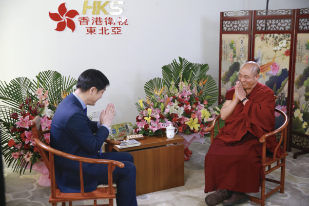
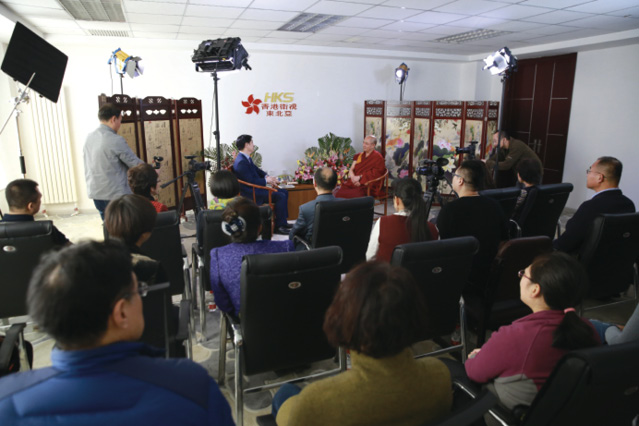
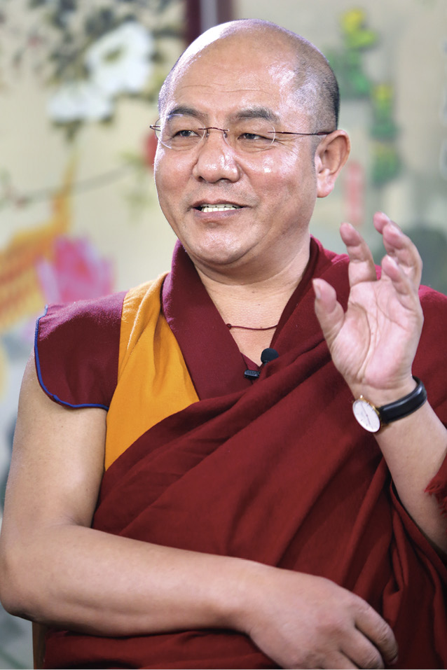
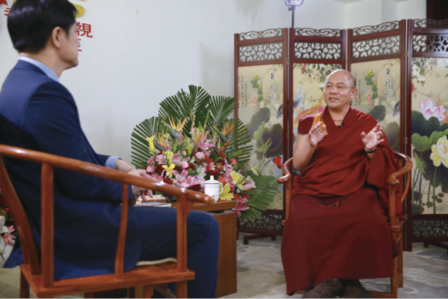
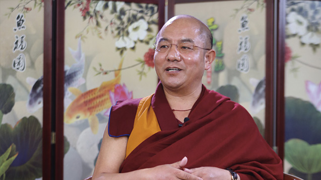
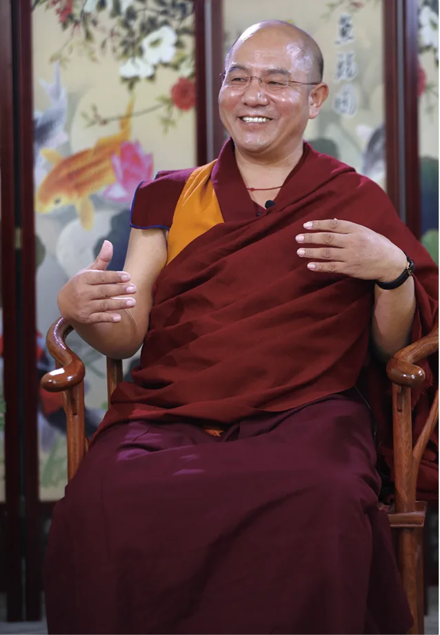

# 我们的时代

——香港卫视东北亚总部专访

2016年11月13日

地点：哈尔滨

简介：

《对话东北亚》是香港卫视一档高端访谈栏目，堪布是第一期的嘉宾。在香港卫视首播后，堪布的访谈受到很高关注。

## 信仰会改变人对幸福的理解吗？

主持人：

非常欢迎您来到我们香港卫视东北亚的总部。这也是我们第一次请到中华文化的大家，做这样一期中华文化海外传播的节目。

为了采访您，这段时间我做了很多准备，看了很多您的视频和著作，也听周围的朋友——和您直接接触过的朋友讲述和您接触的感受。在这个过程中，我最深的感觉是，您在不断地为大家讲解幸福密码。幸福是我们每个人都关注的话题，因为我们都在追求幸福。我对您所说的两句话印象深刻。一句是，藏族人的幸福来自信仰；另一句是，每个人对幸福的体验都是不一样的，是各自内心的感受。

主持人：首先我想请教您的问题是：您觉得信仰会改变人对幸福的理解吗？

堪布：这是一个很大的话题，我们可以从简单的层面来了解。实际上，一个人的信仰的确会改变他的人生。包括佛教在内的各种宗教信仰，会完全改变一个人的生活质量和状态。

没有信仰的时候，一般人在社会中随波逐流，浑浑噩噩，有的时候甚至会失去生活的方向和目标，乃至人生的愿景。后来找到信仰的时候，才恍然大悟：人生短短几十年，所谓的幸福不仅仅是外在的物质财富和爱情等所带来的。对外在的追求确实能带给人们一定的幸福感，但是这种幸福往往都很短暂，而且这些外在的物质和情感时时都在变化中。

如果我们有了信仰，通过信仰获得一种内在的深层次的幸福，这种幸福不太容易改变，也能不断地提高生命的质量。无论身处什么样的境遇中，无论生活条件的好坏，内心满满的幸福感，永远不会褪色，不会减损。

这种感受，没有信仰的人很难体会到。有了信仰之后，转而向内寻求幸福，会发现，所谓的幸福，很大程度上借助人们相信的力量就可以创造出来。当然，这种幸福只是比较普通的层次。在我看来，最高级的顶峰的幸福是一种非常大的觉悟。这种觉悟所带来的幸福是通过任何的物质财富所带来的幸福无法相比和替代的。

应该说，通过内心的信仰所带来的幸福，也是当前的社会所需要的。就拿我们藏地来说，一直以来外部环境都不太好，氧气稀薄、气候恶劣、物资匮乏，但藏地很多人都很健康，也很长寿。可见，人内心的状态非常重要。再比如，很多修行人终年都在山洞中、雪山上、森林里闭关，那样的环境里，一般人都承受不了，坚持不了。但修行人的内心有一种满足感，即使外面严寒冷冽，他们依然法喜充满，以一种欢喜的状态度过自己的一生。对比一下，就可以知道信仰的价值：为人们的内心带来真正的满足和喜悦。

## 苦尽必将甘来

主持人：谢谢！您的讲述非常有画面感，我前年到西藏去转山，也受到了类似的触动。您刚才讲到无论条件如何艰苦，内心的感受是幸福的。由此我想到，您也不断地在讲苦这个字，讲苦和人生的关系。我想请您解读一下，苦和幸福究竟是什么样的关系？是需要战胜苦痛才能得到幸福，还是可以直接把苦痛转化为幸福？

堪布：佛教中有不同的方法来面对痛苦。其中一种方法是暂时压制苦。就像我们吃止痛药，没有处理病根，只是暂时压制住疼痛。还有别的方法如战胜苦、转换苦。最好的一种方法是认识苦的本体、本来面目，真正了解苦的真相和究竟意义，这也是最高的一种境界。

在《苦才是人生》中，我也讲到，人生中可能有很多幸福，但其实这种幸福要么正在创造未来的痛苦，要么正在变化中。经历过幸福之后，最后会发现，原来我们最幸福的时刻实际上正在创造痛苦，只不过当时我们没有发觉。

按照佛教的观点，这种苦也可以战胜。就像西方国家之前流行的《心灵鸡汤》丛书，刚开始心灵鸡汤是一个很正面的词，通过它可以战胜痛苦。我也很佩服这位美国作家，他写作的一系列心灵鸡汤图书让很多人都得到利益。后来因为跟风的人太多了，内容上也良莠不齐，渐渐的，心灵鸡汤变成了一个负面的词。其实并不是这样，鸡汤确实有一定营养。每一个励志的小故事，都对各个国家不同人群提供了很大的帮助。这也是一种战胜痛苦的方式。

佛教中有一些修行如念经等，可以转化痛苦。比如认识到现在痛苦的因是前世的自己所造，在这个基础上，通过一些修行的方法去转化痛苦。藏传佛教中有一种修法，就是在痛苦的时候，去观察它的本体和来去。就像《金刚经》里所说的，“过去心不可得，现在心不可得，未来心不可得”。正在痛苦的当下，这个所谓的痛苦究竟在哪里呢？但这种观察和修法，没有一定的基础不一定能听得懂，不一定能起作用。

总之，我们需要运用不同的方法去面对痛苦、获得幸福。

主持人：您讲得非常好。现代社会中，人们面临越来越多的考验和苦。因为整体节奏变快了，人际关系更复杂了，各种技术日新月异，难以追赶。现代人的苦与之前的人相比，是不是发生了一些新的变化？

堪布：对，现代人有现代人的苦。很多研究认为，如今出现越来越多的综合征，都与现在的生活环境相关。

表面上看，人际关系越来越共聚，人与人的联系越来越方便了，可以随意地使用各种通讯工具和社交平台，如智能手机、微信、微博等等。但实际上，人与人之间的关系并不像原来那样默契和甜蜜，反而变得冷淡和疏离。

还有，现在的生活节奏确实很快，随之带来的压力也比较大。现在人们普遍都晚睡，睡得也不好，健康也受到影响，陷入一种恶性循环。虽然科技越来越进步，但可能我们的心用不上，也一直跟不上。

在我看来，最根本的还是应该从心态上去调整，同时为自己的生活做减法。比如人际关系上，保持必要的联系和交往，减少那些不必要、不重要的。在信息泛滥的时代，要学会进行信息的筛选和取舍。对自己的工作和生活有用的信息和知识，去了解和学习，其他的信息则尽量屏蔽——除非你的智慧很高，可以大量吸收各种包罗万象的知识。

对一般人来说，应该将精力集中在最重要的事情上，不过多地消耗自己。这样的话，有学习的时刻，有休息的时刻，也有工作的时刻和享受生活的时刻，对大家的身心比较好。否则的话，一直在各种各样的信息海洋中跟随别人的步伐，去寻觅和追求，最后可能忘记了自己的本心，也丢失了对自己最有价值的那些事物。那就非常可惜了。

主持人：丢失了最根本的东西。

堪布：对，根本的东西。

## 用微博传播佛法

主持人：您刚才讲到了微博，我最近也关注了您的微博，最近的一条更新到了11月9日。我希望您在哈尔滨也能发一条微博。

我觉得您特别善于运用现代技术手段去传播理念、传播文化，去跟青年沟通，因为微博的主要受众是青年人。您微博里的一些话讲得非常好。比如11月4日您讲了“三颗心”：“坚定的心”、“宽容的心”和“精进的心”。我也感觉受到点拨。

您是怎么想到用微博这样的手段来传播您的理念？您是有一个团队跟您一起来做这样的传播呢，还是主要靠您本人来做？

堪布：我的微博应该是2010年开始的——2010年9月22日天降日，开极乐法会的时候。开通微博的六年以来，今年是我写得最少的，最不成功的。一方面似乎没有什么新的想法，该说的这五年中已经都说了；另一方面是因为今年我特别忙。好多人都说你怎么不发微博。一直忙着的时候，就没什么感觉，随便写了、发了也没有什么意义。

在这个过程中，所有的微博都是我自己写、自己发的。

主持人：您自己写的。

堪布：对，自己写的。因为这件事别人也无法代替。前几年，尤其是2010年到2013年，我写得比较认真，他们把我写的微博翻译成藏语，每年都汇编成一本小册子。今年的微博可能连一本小册子都凑不够了。

主持人：我看您的微博早就达到百万粉丝量级了，是大V了。

堪布：我听说粉丝的数量有各种情况，我个人觉得粉丝数量的多或少都是一种假象，没有什么意义。我也很少关注自己的微博有多少粉丝，很长时间里，别人问我微博有多少粉丝，我自己都不清楚。

在当下的信息化时代，我对各种信息传播手段都很感兴趣。上世纪八九十年代，我们刚开始传播佛法，使用的是录音磁带的方式，后来演变成VCD、DVD等。到了现在的网络时代，可以网络直播、录播等，这样全球范围内任何对佛教文化、传统文化感兴趣的人都可以毫无阻隔地接收到。哪怕距离千山万水，大家都可以同一条心、同一个理念、同一个追求。有位思想家曾说过，“这是一个最好的时代，这是一个最坏的时代”。从传播便利的角度来说，我觉得现在的时代是特别好的。希望能有更多人通过现代技术来了解正能量的知识，尤其现在各种负面的思想和情绪纷至沓来，极大地影响、染污了现在的年轻人。

主持人：写微博不能长篇大论，您在写那些精短的感想和体会的时候，和您平时写长篇的文章或做长时间演讲的感觉，是不是不一样？

堪布：不一样的，短短的140个字当中，只能尽量表达简单的想法。有一位学者曾说过，人类的智慧就在于把最重要的事情用最简单的语言表达出来。我也反复观察自己的写作，发现要想达到这个标准，确实很困难。有时候可能啰啰嗦嗦地说了半天，对方也听不懂我说了什么，自己也不知道自己说了些什么。这样对一个演说家或者写作者来说，应该不太成功。

应该要用最精练的语言来表达自己的思想，这样会很精彩。尤其是现在的时代，人们都特别忙碌，在这样忙碌的时刻，如果能针对人们特别关心的一个重要问题，用最简短的语言，让他们在最短的时间里得到答案，这应该是最好的一件事情。

## “快餐佛教”

主持人：您在美国的一次演讲中，有一位学者向您提问，讲到一个带引号的概念，叫“快餐佛教”。您当时也积极地回应了。今天想请您再谈谈这个话题。

刚才您也讲了现在每个人的生活和工作节奏都很快，人们不可能有大块的时间阅读和倾听。那么在当下，我们的文化传播应该注意些什么？我觉得“快餐佛教”这个词是带引号的，您能再和大家分享一下您的想法吗？

堪布：那个时候大概是2013年，我是怎么回应的，其实现在都有些不记得了。

我觉得现在确实是一个快餐文化、碎片文化的时代，大多数信众和知识追求者们，可能每天在手机上刷一些简单的词句就当作学习了。不像以前，一个人要读很多本书。从前藏地的高僧大德一生要读三千乃至四千本书，还不仅仅是读一遍，是要深入地学一遍。但现在这个时代，一年能看五六本书的人都不太多了。

在这样一个快餐文化的时代，佛教的传播也好，其他文化的传播也好，都需要一种智慧和窍诀来适应当下的社会。针对现在人们所追求、所需求的，用适合他们的方式，传播文化理念，这样他们可能会特别欢喜。因为大家都很忙，需要在短短的时间里来满足他们的需求。

主持人：所以您也用微博这样的媒介来探索新的文化传播方式和佛教的传播规律。您开微博本身就具有探索的意义。

堪布：微博传播可能是针对部分的人，我自己更多还是按照传统的方式，比如我每天都是讲课一个多小时，每天都是不停地讲。

主持人：针对不同的对象用不同的传播方式。

堪布：三十年以来，不管有没有人听，我基本上每天都讲一两堂课，这是我对自己的一个要求。不过还好，目前来看，还是有一部分人在听。虽然现在大家都特别忙，我们也有一些类似快餐的内容来解决一时的饥饿，但为了长远的目标，还是需要更多的知识储备，从海量的千经万论中得到一些营养。

我的原则是：一定要系统性地正规学习一些大经大论；同时，佛教的“快餐文化”，包括微博、微信在内的各种传播平台对当前来讲，也非常有必要。

## 为什么如此看重大学生群体

主持人：我得向您学习，您每天都讲一两个小时的课。我也是大学老师，但我现在做不到每天都讲课。说到大学，您在国内外一百多所大学都有过演讲，国外的有哈佛大学、哥伦比亚大学等，国内的有清华、北大、浙大、中国人大等等。我也看了您的大学演讲系列，很想知道，为什么您对大学演讲如此看重，对大学生群体如此关注。您最初的想法是什么？

堪布：其实我很多年前就有进大学演讲的心愿，真正开始是从2009年。当时我在课堂上说，哪个大学邀请我都去，监狱邀请我也去，还有企业邀请——我放到第三位。

现在的大学生是未来人类社会的主人，他们的思想观念对未来的社会发展非常重要。反观现在的年轻人，很多人心态都很糟糕，自杀率也越来越高，尤其是年轻人对父母不孝顺，这种现象也越来越普遍。由此我对大学生群体也有一种责任感，想试试看用佛教的传统思想来挽救、扭转哪怕极少数年轻人的想法，让他们的心态稍微有所改变。

对大学生群体，我有两种心态。一方面是对他们充满希望，他们肩负着未来人类社会的重任。如果他们能够在道德和知识方面自我完善，有一种积极向上的思想，对自己的工作、家庭乃至社会都负起责任，那就非常有意义。我并不想让这些大学生都变成佛教徒，没有这个想法和目标，但至少他们应该成为好人，最好是对社会有所贡献的人，而不是成为社会的隐患。

另一方面，我对他们的前途特别担忧。很多大学生根本不去学习，每天都是玩乐，没有任何责任感，那未来又如何对家庭和社会负起责任呢？

以前的大学生很稀有，现在的大学生是一个数量庞大的群体，有时候看他们特别迷茫，作为出家人，我也起不到什么大的作用，只能旁敲侧击地提醒他们。

因此，我对大学生群体很感兴趣，从2009年开始，邀请我去演讲的学校也比较多，谁邀请我我都去，不管再累、再辛苦，都抽出时间去，每次去的时候心情也都很激动。

主持人：日程安排得很紧张。

堪布：我主要去的就是大学、监狱、企业。那天有人问，我们寺院请你你不去，大学请你就去，为什么？现在来看，需要和大学生进行一些交流。而寺院本身就是佛教平台，是讲经说法的地方，大家平时都在闻思修行。

主持人：同样是大学演讲，您的演讲主题是不一样的。比如在哈佛大学，您当时讲的是藏地幸福密码；在哥伦比亚大学，讲的是藏传佛教的包容性；在其他学校，还讲了现代宗教传播、现代生活和宗教、科学和宗教等主题。您刚才所说的社会责任感，帮助大学生去适应社会，未来担负起自己的责任，需要用不同的演讲主题从不同角度加以阐释。这些演讲主题是大学所要求的，还是您自己选择的？

堪布：我自己选择的比较少，如果校方实在提不出来，我会选择一个主题给他们参考，他们同意了，我再讲。一般来说，学校邀请我去做演讲，都会提出一些主题，有些是在学生中征集的，有些是老师们自己讨论、商定的。

对于校方给出的题目，我会先看看自己能不能讲。如果是特别专业的主题，我也不太会讲；有些不那么专业的可以和宗教理念相结合，我觉得可以试着讲。

主持人：您最愿意讲什么主题的内容？

堪布：我其实最愿意讲的是佛教。佛教对于我来说是专业，讲起来比较轻松。但我没有在大学里公开地讲过佛教。其他的主题包括科学、哲学、经济学等，这些我也要学习一下。我演讲的时候不会提前写讲稿，不会照着念。有时候，在交流环节，学生和老师问的问题也比较尖锐，需要一定的准备和智慧去应对。

主持人：但是我看您在现场真是举重若轻，驾轻就熟。举例来说，在讲佛教和认知心理学的现场，一位专家讲到一位国外学者的名字，您马上能说出他的专著。我觉得一方面是您博览群书的基础，另一方面就是您的视野。您每天都用很多时间来读书、看资料吗？

堪布：我非常喜欢看书。我的大半生都用在了佛教上，在这方面比较专业，对佛教方面的书最熟悉。同时我也特别喜欢看东西方的学术著作，比如哲学、心理学、经济学、量子力学等。对哲学领域各位知名学者和不同思想派别的著作，都会阅读。我在学院里有几个屋子的书。但是最近几年学院的事情有点多，我有点忙，能够看书的时间不多。

在学校里交流的时候，一般来说，学者提出的问题，大部分我都有相关的知识储备，心里有个概念，也会大致地对这位学者的思想有所了解。我自己有时也会分析，现在这样复杂的社会，思想如此多元和对立，要不是自己有所积累，遇到现场提问还是很有挑战性的。尤其是他们提的问题都是事先准备好的，甚至有些人是故意刁难你，看你这个出家人能不能回答得上来。

主持人：我忽然想起来，有一次，有一位外国的学者问您，植物的生命和动物的生命有什么区别。您还记得吗？我觉得这个问题肯定是有针对性的。

堪布：是，我记得。

## 科学和宗教

主持人：我记得您说过宗教通过和科学界的交流，有了一些共识，但还有一些需要激烈争论的争议，是会长期存在的。爱因斯坦当年也讲过科学和宗教的关系。我也想请您讲一讲，您认为科学和宗教之间的关系是怎样的？

堪布：对科学和宗教之间关系的思考，最初的缘起是在1987年，我当时在五台山的一个寺院里看到一本书，内容是一位科学家对佛教的看法。也就是从那个时候开始，我对佛教和科学进行了一些对比。当时还没什么人做这件事。十多年前，我专门写了一本书叫《佛教科学论》。中国佛教协会的赵朴初会长还为这本书题了词，他当时比较高兴，觉得这种对比有一定的空间和意义。从此之后，我也特别关心科学与宗教之间的比较。

现在的大多数人，对科学深信不疑，觉得科学是最权威的；对佛教，或是半信半疑，或是非常排斥，将它归入迷信的垃圾之中。因此，很有必要将佛教与科学进行对比。这些年来，我与国内外很多优秀的科学家做过对谈，有时是他们找到我，有时是我特意去采访他们。

前阵子，我和中国科技大学的前校长朱清时教授对谈，当时主要是我问他问题。过一段时间，我们约在上海再进行一次交流，他说这次主要是他来问我。朱清时教授任职校长多年，同时又是优秀的科学家，在他的眼中，佛教到底是迷信还是科学，对我来说，尤为重要。如果是从出家人或者佛教徒的角度，谈佛教与科学，有点像是我们自吹自擂，不一定有说服力。但是如果是从科学家的角度来看待佛教与科学，得出的结论就有一定的参考意义。

真理是很公正的，不会偏袒于哪一方。如果确实是真理，不管有没有信仰，大家都应该是可以接受的。所以我既不站在佛教的立场，也不站在科学的立场，力求在一个相对公正的立场，与科学家们进行对话与交流。应该是从很早以前，我就有这样一个心态，这么一种希求，后来也采访了很多大学生、老师、学者，去了解他们的心态。人们往往会在对话与沟通中碰撞出很多真理。

主持人：前几天，我参加了一个国际论坛，其中有一个话题是科学普及教育。论坛的参与者们很忧虑，认为中国人普遍的科学素养并没有随着社会的发展，有了同步的提高。因此，现在的科学普及也面临很多挑战。现在的孩子关注的东西很多，但对科学理论方面书籍的阅读反而还不如我们小时候。所以大家也都在探讨如何更好地进行科学普及教育。

宗教传播和科技普及，可能都面临一些共同的挑战，您对此有什么看法？

堪布：你说得很对。现在不管是中小学生，还是大学生，他们每天都在看手机、看iPad等电子设备，看的内容也都是比较表浅的信息，甚至还有一些色情和暴力的信息。成人也是如此，人们普遍使用各种电子设备进行沟通与娱乐，但是真正的研究和深入学习，却越来越少了。这也是现在整个社会所面临的严重问题。

人们通过各种电子设备所接收到的视频等信息，只是一种非常表面的感官刺激，而且很多是比较负面的。人们对正面信息往往第一反应是质疑，觉得不一定是真的，反而对负面的信息会比较相信。因此，负面信息更容易传播开。之前我和北京的媒体人交流时，也和他们说过，尽量还是要传播一些真正对人类生存有价值的正面信息。

目前佛教界也面临类似的问题，我也很是担忧。很多寺院里的喇嘛和修行人，也是通过手机和电脑在网络上看各种各样的信息。一方面，与以前相比，现在很容易获取信息，广闻博学；另一方面，现在的学习并不深入，以前都是一本书、一本书地去学。

我也提倡现在的寺院和佛教界，学一些生物学、生命学、量子力学方面的科学知识，并和佛教的内容进行比较。这样也有助于佛教自身的学习和研究。但真正能够这样去做的人并不多。

主持人：您之前讲过大脑和心识的关系，也讲到国外一些科学机构所做的实验，如无脑人等。您还提到，在认知心理学领域，主要的研究对象是心。佛教中主要也是研究人的心。这样来看，在认知心理学领域，科学和宗教是有可能互相交融、互相验证的。除此之外，您会花更多的精力去了解和研究新的生物学成果吗？

堪布：我是这样思考的。现在看来，生物学领域对生命的研究是很有希望的。很多人认为可以从科学的角度来验证佛教理论的正确性，比如前世今生，还有生命如何流转轮回得以延续，但其实是有困难的。因为科学的主要研究对象还是物质。生命学这个学科刚起步，研究时间也不长。德国、英国的心脑科学家们主要研究的对象是人体的神经系统、神经细胞等，他们所认知的心，只是大脑这个器官的感受、感觉，与前世今生没有任何关联。

应该说，目前的科学领域对于心识的研究和认识还处于一片空白。即使是西方最前沿的顶尖科学家，他们的研究工具也是十分有限的，如果能够借助佛学的知识，应该能够对他们的研究提供一些便利。比较而言，西方的基督教中关于前后世的理念比较模糊，只是在一些经典里面提到人有后世，后世的去处只有天堂和地狱。

您刚才提到的科学和佛教的融合，还有很长一段路要走。因为科学家没办法通过自身的力量去接触到非常深层次的真理。他们对于人心识的研究主要是通过各种仪器去了解和寻找，从人体简单的细胞到神经系统、消化系统等，都是这样去研究的。但心识恐怕没那么简单就可以了知。再加上人们普遍也都觉得人的生命只有一世。如果都是用这种只有一世的心态和前提去观察和研究，那么很多更深层次的理论就很难触及了。

在心识研究方面，我翻译了很多书。去西方国家的时候，也会特意去问心理学领域的科学家、生物学领域的科学家，他们是如何研究心识的。发现他们并不是特别关心佛教里对心识的研究成果，也不清楚相关的佛教理论。

主持人：谈到这里，突然想请您为我化解一个自己的心结。我能够回忆起来人生第一次深刻的恐惧感，是在十二岁的时候。那时候我读了很多天文学相关的著作，初步了解了宇宙，发现人这一辈子不过短短三万多天，和整个宇宙的时空观相比，太短暂了。一想到人生如此短暂，生命如此有限，记得当时自己深夜都会哭醒。现在想来，应该是青少年刚开始对生命和宇宙有所认知，将个体放置在宇宙中所产生的一种困惑和茫然。这种心理状态或者说心结可能是每个人在青少年时期都会遇到的。它实际上涉及到人生最根本的几个问题：我是谁？我能做什么？我能存在多久？

刚才您也谈到对整个人生和前后世的看法，如果您面对的是青少年群体，会向他们传达怎样的人生价值观？

堪布：我内心当中，非常希望青少年能够有智慧、有能力去研究人生的真相，比如人到底有没有前生和后世，等等。关于这个话题，我在不同学校反复讲过很多次。我也特别希望能让大家了解到，如果人生只是这一世的话，那么这几十年怎么样都能过去，但事实并非如此。因此，不仅仅要考虑今生的未来，还要去考虑自己生生世世的未来。有时候，我一讲到这些，下面很多人都开始打瞌睡了。

在西方的一些学校，情况也差不多，学生们好像都没什么兴趣，大部分人觉得所谓的前生后世只是佛教徒的一种说法而已，并不太关心。但也有一部分人就像你小时候那样，会思考自己的生命和人生的真相。如果我们的生命只有这一世，你的渺小的身体在宇宙中连一颗尘埃都算不上，你的人生的酸甜苦辣、悲欢离合也都算不上什么，忍一忍就过去了。

但真的是这样吗？我们确实需要进一步的对生命的认知。用一种反观自身的方式来提醒自己。基督教中也有让大家认识自己的说法，但是他们的认识自己的方式和佛教有所不同。我认为，不管是成年人，还是青年人，认识自己非常重要。如果自己对自己都没有清楚的认知，还要在社会当中扮演各种主人翁的角色，做各种各样的事情，确实也是挺让人困惑的。

前阵子看到德国思想家舍勒说到，我们这个时代的科学进步是前所未有的，但“在历史上没有任何一个时代像当前这样，人对自身这样地困惑不解”。这种情况是越来越普遍了。

主持人：我想跟您探讨一个问题。所谓技术的进步其实都是在延伸人的器官。最开始，我们用石器延伸我们的手，现在又有了各种交通工具延伸我们的腿脚，还有望远镜、显微镜等延伸我们的眼睛，还有计算机延伸我们的大脑。那么，我们的心依靠什么来延伸呢？当我们的肉体不存在于这个世界的时候，我们的心是不是还有可能延续，发挥我们的价值和作用？既然人的大脑都可以被延伸，心是不是也可以得到某种程度的延伸？

堪布：你说得非常对。佛教里所讲的六根，眼、耳、鼻、舌、身、意，在当下的社会体系中，依靠现代技术得到了和以往任何时代都不同的一些延伸和能量。但是，我们最重要、最根本的心，还没有得到足够的重视。如果我们去研究心，依靠佛教中的一些学习和修行方法，会发现，原来六根全部源于心、归属于心。通过修行，我们的心会得到一些延伸，现世也好，来世也好，不同的延伸。但这种延伸尤其需要人类自身道德水平的提升和行持善法。如果我们现在做了各种恶事、坏事，相应的，心的延伸结果也不会是快乐的。往往都是一念之差，导致了我们今生很多难以忍受的苦果，甚至来世都还要延续这样的业报，一直受苦。这其中有一些耐人寻味的道理，值得大家深入思考。

主持人：再回到您去大学做演讲的话题。您做过演讲之后，会通过什么方式得到反馈？就是说，这些学生听过您的演讲之后，您怎么知道他们的内心是不是改变了。他们会去您的微博留言吗？还是给您写信？或者去找您其他的课程去听。您如何得到大学生们的反馈？

堪布：其实我没有什么途径可以得到同学们的反馈。前一阵子，我把微博上的评论功能给关闭了，因为里面经常有各种各样的令人烦心的事情。我确实很希望大学生们有一些自己的想法，提出自己的问题，但我没有时间一一地回答。

曾经去过一些学校，让一部分人对佛教有了正面的认识。比如昨天遇到的一位大学老师，他告诉我，三年前我去过他们的学校做演讲，当时他对佛教很排斥，通过我的演讲，开始重新思考，现在正在研究佛教，他的学生也在研究。

我觉得，人的认知有时候需要被颠覆一下。对一些聪明的人来说，就起到了提醒的作用。但对另一些人来说，可能就没什么作用。不管怎么样，我还是很愿意去高校里做演讲，把自己喜欢做的事情持续地做下去。

主持人：您刚才两次提到去监狱里面做演讲。您曾经去过青岛、厦门、海南等地的监狱。您去监狱里会和他们讲什么？

堪布：一方面是安慰他们。人在迷失的时候，做一些坏事是难免的。世间有很多人虽然没有进监狱，但其实所作所为也具备了进监狱的条件。所以他们不一定就比在监狱外的人要坏。就算在监狱里了，也不要那么伤心。其实他们也是很可怜，很多时候都没有得到好的引导，在这个世界上非常痛苦，也非常绝望。

另一方面也是希望多少能够对他们有所帮助。一些监狱邀请我去，是发现我去过之后，犯人们在监狱里更加守纪律了，其他行为也有所改善，心态也转变了。我会告诉他们，监狱里的生活实际上就是佛教里的闭关，有很好的修行环境，是一个很好的机会。我这样说，他们会比较开心。

我和他们说，佛教徒专门要寻找这样的机会，好好闭关修行。你们在监狱里已经具备了这样的条件，利用这个机会可以好好调整内心，而不是一味地想：我进了监狱，以后再也没有希望了。

总之，我尽可能地为他们讲一些正能量的内容，可能起不到很大的作用，但至少也种下了一个善根。

## 信仰无国界，共筑人类文明

主持人：今天您所讲的内容包含了方方面面的智慧，有教育年轻人方面的智慧，也有科学和宗教关系方面的智慧，更多的是在生命认知方面的智慧，对我个人也有很大启发。

最后想和您探讨的是中西文化交流。您之前曾讲过佛学西渐，提到西方社会现在面临的问题实际上是未来人类共同面对的挑战。这些问题用西方的传统思想不一定能解决，需要东西方文化的交流。与此同时，东方文化也在借鉴西方发展中的经验，还有西方传统的思维方法和哲学理念等。

您也经常出国交流，您认为在中西方文化交流的过程中，宗教处于一个怎样的位置，发挥了什么样的作用？

堪布：实际上，在全球73亿人中，大概有83%都有宗教信仰。各个宗教的基本理念都是向善的。因此我认为，宗教对人类价值观的提升、对社会的发展有一定的帮助。在人类历史上，时间比较短的宗教也有一千五百年左右，多数宗教的历史都有四五千年之久。就像常青的松树一样，在人类的高原上千百年不朽，永不被摧毁。

因此，宗教一定有其价值。我们也一直不定期地开展不同宗教间的对话交流活动，在香港，在泰国，都有。

主持人：您主办的“世界青年佛学研讨会”？

堪布：对，今年研讨会的主题是“和平”。我们会请不同宗教的人士参与，伊斯兰教、天主教、基督教等等，从他们各自的视角来看待世界和平以及如何实现和平。虽然我们的力量比较薄弱，研讨也只局限在一个小范围内，但也传播了我们的想法和理念。

在某种意义上，宗教对东西方文化的弘扬和交流起到了很大的作用。尤其是现在，一方面有大自然带来的灾害，另一方面又有局部战争带来的难民，这些都成为了社会不安定因素。在这种情况下，宗教本身对社会稳定能起到一定的作用。更重要的是，佛教的和平观对整个世界的和平与东西方文化交流有所帮助。

我以前也看过汤恩比博士的著作，他曾说过，挽救21世纪的社会问题，唯有中国的孔孟学说和大乘佛教。如果大乘佛教的理念能够弘扬到世界上的各个角落，东西方文化能够融合互补，人们会获得内心的平和。

西方的科技已经十分发达，不需要其他帮助了，他们需要的是东方的道德理念和宗教观念。尤其是在为人处世方面，西方的个人主义盛行，对家庭和社会都产生了很多影响。

我在北京的时候和他们开玩笑：“你们都把孩子送到国外去念书，也是好事，可以学到很多技术和知识，但是如果也学了西方的个人主义，将来回来就不一定会报答父母的养育之恩了。你们辛辛苦苦挣的钱给孩子们付学费，将来却指望不上他们尽孝。”因为西方的很多孩子都不管父母的晚年，等年纪大了就送到养老院去。

主持人：我记得您讲过，一个孩子报警把父母抓起来了。因为父母打孩子，孩子就报警了。等父母被放出来的时候，孩子还觉得很有成就感。

堪布：对。除了对父母的态度之外，我对西方孩子对待老师的态度也很不习惯。这也是东西方文化不同的地方。老师在讲课的时候，下面的学生有的玩手机，有的戴着帽子，有的虽然在听课但流露出特别厌烦的表情。学生在课堂上可以随时打断老师的讲课，老师也都习惯了。这和我们东方思想里尊师重道的传统太不一样了。

作为学生，是接受教育和知识的人，用这样的态度去听课，好像老师是很卑微地为他们奉上知识。这样来看，西方的父母很可怜，孩子经常欺负父母；老师也很可怜，学生经常欺负老师。

东西方的教育理念不同，我们要有包容开放的理念来接受，但在接受的过程中，也要有所取舍，西方的一些理念不一定适合我们。有些人可能觉得西方什么都很好，或者觉得东方什么都很好，这也是不一定的。我们的教育理念有时候可能过于传统，趋向保守。比如父母一直严格地管束着孩子，要求孩子做这做那，可能会过于限制他们思维的发散和创造力。

主持人：有一位美国教授曾经和我说，中国学生是世界上最好的学生。所谓的最好也是有双重含义的。一方面是中国学生尊重老师；另一方面是他们不愿意向老师提问题。就像您刚才所说的那样，东西方各有各的传统、习惯和优势。

## 佛教如何看待环境保护

主持人：还有一个环保方面的话题。今年11月4日，巴黎协定已经正式生效了，应该说，这是人类第一次用一个有法律约束力的协定来约束各国碳排放等对环境造成危害的行为。您能不能从宗教的角度和我们讲讲环境保护的理念，人和环境之间所应有的良好关系。

堪布：巴黎协定生效之后，全世界范围内，很多人可能都会对环境保护产生不同的新的认识。实际上，地球的承载力是有限的。一直以来，人类因为自身贪欲的膨胀，肆无忌惮地去攫取大自然的资源，破坏了自然界的平衡，导致现在的各种环境问题，比如雾霾。可以说，空气污染带来了一系列的问题，如果不加以解决，后果会更加严重。这样下去，甚至整个地球家园都会被摧毁。

在环境保护方面，我经常提倡的就是，人类要知足少欲。佛教中认为知足少欲是很好的，尤其是对修行人来说。从前认为只有出家人才要少欲，但其实并不是这样的，作为在家人，也应当知足少欲。

个人所拥有的资源和财富，能用的就用上，用不上的应当尽量用于他人、帮助他人。实际上，钱财等并不是你想保住就能保住的。古人说，金钱如流水，一会儿流到这里，一会儿就会流到那里。现在看似是属于我们的钱财，今天在我们的手里，再过段时间就会属于他人，在别人的手里了。

因此，一味地攫取和占有并不是好办法。除了人类生存所必需的那部分，没有必要再去过度开发，要尽量保护我们的生态。否则的话，环境会被破坏得越来越多，现在全球暖化现象已经非常可怕了。我们每个人都是地球上的一员，都对地球负有一定的责任。

主持人：您刚才讲到欲望，要知足少欲。一般传统上的解读是有了欲望才能有所创造，才能有进步发展的动力。那么欲望的度到底应该如何把握？您所说的少欲的标准是什么？

堪布：追求知识的欲望越多越好，比如开发自己的智慧，做一些发明创造。但是追求财富的欲望要适度。如果对财富的欲望越来越多，就会像那些贪官一样。佛教的金钱观是中道的，既不要落于太富裕的极端，也不要落于太贫穷的极端。

其实，对知识的追求不应该叫欲望。我特别赞叹很多人对知识的追求，可以充分发挥自己的创造力，还有像很多西方科学家那样，废寝忘食、日日夜夜地去研究和探索。佛教中所说的如来藏，真的就像一个宝藏，其中的宝物应有尽有。只要我们去挖掘和开发它，很多智慧的珍宝都可以呈现。

比如我现在不是生物学家，但如果在有生之年，我拼命地在这个领域深入研究，未来有可能变成一位生物学家。我对自己是有信心的，因为我的如来藏中有生物学家的智慧种子，有相关的记忆，只不过自己没有开发出来。类似这样的追求不叫欲望。

总之，我们对财物的追求最好是适度的，对知识的追求应该无限。在有限的生命中做无限的事。

主持人：您的成就标签之一是翻译家。您这么忙，又要讲课，又要研究，还有很多活动，同时您仍然坚持做翻译。您为什么要亲自做翻译？

堪布：我们藏地的经典、论典中有一些是特别珍贵的——可能因为我自己在年轻的时候学过这些法，对我而言感觉特别珍贵。而汉地的人们因为语言的隔阂没有办法学到这些珍贵的法。因此，我每年在做规划的时候，都会计划翻译几部法。之前翻译得多一些，现在比较忙，但一年至少要能保证翻译两部。

我的翻译主要是从藏文译成汉文。汉族的人数很多，汉族人中有信心、有智慧的人也非常多，如果没有了语言的隔阂，他们自己去阅读经典、论典，也会明白其中的道理。相比之下，藏族人只有不到一千万，懂藏语的人就更少了。藏族有这么多特别珍贵的法宝，应该翻译出来，让更多人看到。不然的话，我觉得有点可惜。先翻译成汉语，再从汉语翻译成英语、日语等语言，也会更加方便。

主持人：您每天睡觉的时间很少吧？

堪布：睡觉的时间还是有的。外出的时候，可能会累一点。

主持人：现在和您探讨佛学的学者越来越多。您曾经讲过，佛学讲究自修，讲究修行。是不是研究佛学的学者一定要去信仰、去修行，才能做好研究？

堪布：学者中应该是有两种不同的人。有一种本身是研究者和学者，同时也会修行。我去维也纳、法国，见到一群研究者，他们本身是大学老师，是学者，但他们的修行也很不错。

还有一种就是纯粹的研究者，完全是从学术的层面进行研究，不会信仰佛教，也不会去修行。

佛教团体中也有一些人，只实修，念诵一些简单的咒语，也不去深入研究。是会有不同的状况。

主持人：您的普通话说得这么好，是从什么时候开始学习的？

堪布：我的普通话讲得特别糟糕。我是四川人，大概十六岁才开始读小学，之前没有受过汉语的教育。汉语是自己学的，算不上有语言天赋，学其他语言很费劲。

主持人：我经常听您提到十六岁之前在山上放牧时的一些想法。您为什么总会想到那个时候的事情？

堪布：好像是不知不觉就会想到，不管是在学校里还是其他任何场合。可能很多人都会这样吧。有些研究表明，五六岁前的孩童更容易保有前世记忆。十七岁之前的青少年时期也更容易保留在记忆中。我就有这种感觉，那一段时间的记忆经常会浮现在脑海中，比如讲课的时候，一个人走路的时候，看到蓝天白云的时候，也会想到以前和父母之间发生的事情。以前的事情都那样历历在目。

主持人：我看过您之前在儿童节给孩子们的寄语。能不能也请您给香港卫视的观众说一段话，也以此作为今天采访的总结。

堪布：不管做什么事情，一定要有包容的心态。如果没有包容的心态，斤斤计较，就会为自他都带来痛苦；同时也要有精进的心态，没有精进的话，自己懒惰、懈怠，就做不了任何事情；还要有一种长远的心态，没有它的话，很多事情都会半途而废的。

我希望人们在日常生活当中，做任何事情都要有信心、要有欢喜心、要有毅力。人生也许会有小小的波折，总的来说是很美好的——因为我们大家都活着。

主持人：

谢谢！非常感谢堪布！

今天我们从幸福聊起，讲到了虚拟空间的微博，也讲到了现实空间的大学课堂，讲到了您对东西方文化交流的看法，讲到了科学和文化、科学和宗教之间的关系，讲到了心灵的延展，还讲到了对知识无限的欲望和渴求。今天的话题无论是对我们的观众还是对更广大的人群都是有意义、有价值的。

再次感谢您这些年来为中华文化海外传播所作的努力。期望将来有一天再把您请回到我们的节目里来，请您到我们新创立的讲堂中来。再次感谢堪布！
