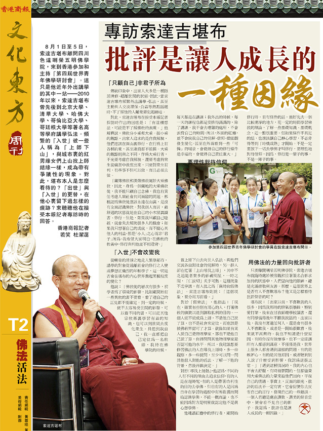

# 批评是让人成长的一种因缘

——《香港商报》专访

2014年8月10日

8月1日至5日，堪布离开四川色达喇荣五明佛学院，来到香港参加和主持“第四届世界青年佛学研讨会”。这只是他近年外出讲学的其中一站——2010年以来，堪布曾先后到北京大学、清华大学、哈佛大学、哥伦比亚大学、哥廷根大学等著名高等学府讲学弘法。

频繁的“入世”被一些人称为“上师下山”，与城市里的红男绿女们上山找上师结缘一样，成为带有争议性的现象。对此，堪布本人是怎么看待的？“出世”与“入世”的更替，在他心里留下了怎样的痕迹？来听听他在接受本报记者专访时的回答。

## “只顾自己”非君子所为

传统印象中，出家人大多是一种隐居清修、超离世间的状态，因此，当堪布频繁地外出讲学、弘法，甚至主动与人交流环保、公益等热点话题时，不了解他的人难免要犯起嘀咕。

对此，堪布在接受本报记者采访时作出的回应是：“有这种想法，可能是不了解佛教的表现。”他解释说，佛教分小乘和大乘。按小乘的观点，出家人追求的是自我解脱，他们应该在深山里修行，在行为上有各种约束，甚至连钱都不能摸。大乘的观点则与之不同，作为大乘行者，不光要考虑自我解脱，还要考虑将众生从痛苦中救度出来，只要对众生有利，有些事不但可以做，而且必须去做。

“藏传佛教和汉传佛教属于大乘佛教，因此，身为一个藏地的大乘佛教徒，我不能只顾自己念佛，我也有责任考虑人类社会共同面临的问题。那种认为佛教徒应该永远在山里的想法，是没有全面认识佛教的表现。对我个人而言，最舒适的状态就是在自己的小木屋里读书、修行。但是，如果我只顾自己念经，就会失去帮助很多人的机会；如果我只想着自己的成就，而不关心其他人的利益，那是‘小人’之心而非‘君子’所为。我希望大家明白，在佛教的教义中，修行与利他并不相违背。”

## “入世”不会改变我

从喇荣的清净之地走入繁华都市，讲学的对象从远离社会的修行之人变成梦想正炽烈的年轻学子，这一切是否会在堪布的内心世界激起某种程度的变化？

他说：“佛教徒的层次有很多，初学者很容易受到环境的影响，比如刚开始学习的阶段，异教的书不要看，看了连自己的正见都不能确定。到一定的时候，便不太容易受世间的影响，可以看不同的书，可以从其他宗教那里学习有益的知识，也可以到世间去度化众生。具体到我自己，我一直都把自己定位为一名教师，我待在佛学院的时候，基本每天都是在讲课；我外出的时候，每一天的课程也都是安排得满满的。除了讲课，我不会去嘈杂的处所，不会浪费自己的时间。所以，外面的红尘，并不会使我自己的见解、信仰、价值观发生变化。甚至在外面看到一些‘可怜’的场景，会觉得自己的修行条件是幸福的，会觉得自己责任重大。”

## 要理性对待信仰

当上师下山去向世人弘法，与他们交流各自对社会的见解时，另一群人却在忙着“上山寻找上师”，其中不乏追随者众多的影视明星，一时之间，“仁波切”炙手可热。这种现象不乏争议，有人批之为“真时尚、假佛法”。堪布则说：“这个现象，要分两方面看。”

对于“假佛法”，他指出：“现在，确实有些别有用心的人，打着佛教的旗号以达到谋取私利的目的。一个人能不能成为上师，不是他自己说了算，也不是社会来定位，而应该是被佛教界认可了才算。就像如果某人说自己是物理学家，那也不是他自己说了算，你得问问其他物理学家是否认可他的水平。所以，我建议想要修习佛法的人在寻找上师时，多一些观察，多一些提问，至少可以问一问其他僧人对他的看法，了解一下他的背景，然后再做决定。”

对于“寻找上师热”，他认为，不同的人有不同的理由去追求信仰，有的人是在赶时髦，有的人是带着功利性的目的去学佛，但也有的人是因为自身在学习的过程中有所收获而开始认真学佛，不能一概而论，也不能因为对方是明星就认定他不是真心想学佛。

他建议红尘中的修行者，刚开始修行时，若有条件的话，最好先去一个比较清净的地方，花一定的时间学习佛教的理论，了解一些基础知识、基础概念，这一点很重要。但如果条件不具足的话，也应该让自己静心学习，不必非得等到“时机成熟”才开始。不是一定要放下一切去学佛才叫修行，要理性地对待信仰，因为，修行是一辈子的事，不是一阵子的事。

## 用佛法的力量回向批评者

只要离开喇荣五明佛学院，堪布就随时处于被旁观和被拉着签名、合影、求加持的状态中，人们望向他的眼神，总是充满崇敬与友善。那么，这个世界上是否有人不喜欢堪布？他又是怎样看待批评的声音呢？

堪布说：“出家以前，不喜欢我的人很多，因为我那时的脾气很暴躁，特别爱打架，后来在甘孜师范学校读书，还有同学恼得几年不跟我说话的。出家以后，我没有害过任何人，还是会有很多人不喜欢我，或者是一开始很欢喜，后来就不高兴的。我也不知道是什么原因。有时你没有做坏事，也不一定能让所有人都感到满意，不仅仅是我，世界上很多人都会遇到这样的问题。有的是嫉妒心，有的是其他原因，或者听到别人说了什么受到影响。我认为这很正常。”

“遇到这种情况时，我的内心也会不太舒服，有时挺郁闷的，但都尽量用大乘佛法的力量来给他们回向，平复自己的情绪。事实上，反面的眼光、批评的看法不一定有害，它会促使你去反省自己的言行，发现自己的一些错误。一个人若总是处在赞叹、赞美的声音当中，便会看不见自己的影子。我认为，批评也是让人成长的一种因缘。”
