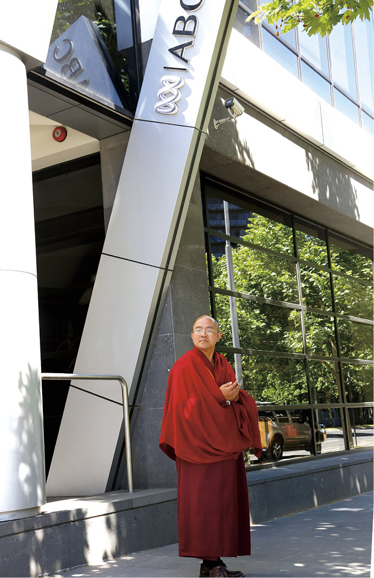

## 构筑内在的心灵蓝图

——《时装男士》杂志专访

2014年11月27日

导语：

见到堪布的时候，他状态欠佳，严重感冒伴随着头晕，因为前一天晚上刚从美国回到上海，强烈的时差导致一宿未眠，但他仍然很开心地接受了本刊的专访。

堪布2014年9月29日离开成都，11月26日回到成都，在59天内去了4个国家，12个城市，16所大学，在国外演讲42场。飞行里程56898公里。如果说地球赤道的长度是40080公里，那堪布这次的行程就接近绕地球一周半了。为什么他可以做到如此的奔波劳碌、不辞辛苦？“我不知道自己能活多长时间，但只要有一口气，哪怕只有一个人听法，我也会尽心尽力用佛法饶益他。”这就是堪布给出的完美答案。

⊙ 问：为什么很多人会觉得不幸福、不快乐？我们在工作和生活中遇到任何问题，都可以在佛法中找到答案吗？

堪布：按照佛教观点，是人就会有痛苦，人生的本质是苦大于乐，苦才是人生。明白这一点很重要。

在工作和生活中遇到不快乐的事时，要想改变，有些在佛法中可以找到答案，有些也不一定。就像药虽然可以治病，但并不能包治百病，有些病还是要自己承受。同样，我们遇到痛苦和烦恼时，有些通过修行能解决，有些则必须要自己承受。如同有的人犯了罪就要判死刑一样，这是他逃不掉的业力。

⊙ 问：有人认为，修佛的人具有一定功利心，因为有所求才去修佛；还有人说，佛教徒都是一些逃避人世、追求虚无的人。请问您怎么看？

堪布：现在很多人看到佛教的某个名词，就认为通达了佛教的所有精神，其实他们的理解是很片面的。任何事物都不能以偏概全。即使佛教的个别教义提到了有求，在某一个层次上，也可以说是有求必应，但不一定是佛教的究竟观点。

要想了解真实的佛教，只看一两本书，或者只听一两个佛教徒的话，是远远不够的。佛教的智慧浩如烟海，一碗水不能代表大海。

⊙ 问：我身边有一些佛教徒，我总感觉他们很怪，虽然也吃素、持咒，但做事很极端，有种走火入魔的感觉。而且他们也会做一些不道德的事情。我不明白佛教徒怎么还会做坏事？

堪布：很多人认为自己吃素、持咒，就成了佛教徒，其实真正的佛教徒不是只有一些表面形式。佛教徒的根本在于学习和修行。如果缺乏对佛教基本教义的了解，即便自称佛教徒，所作所为也不一定很如法。

其实，佛教徒也不是个个都如法，就算释迦牟尼佛在世时，也有一些佛教徒因烦恼深重而犯戒。但这些人的过失与佛教无关。在任何一个团体中，不能因为一两个人的行为有问题，就认为团体中的所有人都会做坏事。

⊙ 问：我身边的一些朋友非常愿意参与放生、念经，但就是还不敢皈依。因为佛教徒戒律繁多，他们怕学佛后会影响自己的正常生活，比如吃素或禁欲之类。这种情况应该怎么办？

堪布：很多人把放生当作一种自利的行为：自己可以长寿，对父母也很好。其实放生的意义远不止于此。放生其实是救助其他众生最宝贵的生命。

皈依确实是一种约束，但对人生来讲还是很有必要。如果我们要做一个好人，不杀生、不偷盗、不邪淫等是最基本的道德约束。就像开车时的红绿灯，虽然让人感觉不自由，但实际上是为了更好地保护我们。或者如同一个国家的法律，虽然对人有一些约束，但有了它，人们在很多方面都有了保障。

所谓的皈依，其实也没有太多戒条，基本上都是人类社会普遍的道德规范，对每个人来讲都很重要，只不过皈依之后更加明确了。而且从佛教角度来说，皈依之后，会有三十六位善神保护你。

当然，学佛也并没有要求你非皈依不可，不皈依就会受到惩罚，不会这样。

⊙ 问：佛教徒都知道放生的功德——想长寿，就要先把生命给予别人，就要放生。但是目前也有一些声音在说，在某些地方放生会污染环境、破坏生态之类。请堪布开示。

堪布：如果放生者没有智慧，放生之前也没有做过详细调查，不知道所放的物种是野生还是家养，适合海水还是淡水……就很有可能发生你说的这种情况。

实际上，我们在放生的过程中，一定要先研究好所放的“生”，对生态有没有影响，对生物链会不会有破坏。

即便发生了一些不太好的现象，也不能因此就放弃放生。目前全世界很多动物保护组织都在发出倡议：人和动物之间要和谐共处。这种和谐并不是口头上说说。如果见到任何水里游的、天上飞的、地上走的动物，都想要去食用或者夺取皮毛，这种恶劣的心非常不合理。人类不能因为自身力量强大，就认为自己有吃掉动物的权力。归根结底，还是缺少慈悲心。如果长此以往，人类会付出代价，终有一天会受到大自然的惩罚。

⊙ 问：有一些成功人士，他们的生活已经很好，有体面的工作、幸福的家庭、健康的身体。这些人会觉得，为什么我还要学佛。

堪布：很多人以为不成功或有痛苦才要学佛，但实际上，佛教不仅仅可以减少痛苦，还可以提升快乐。如果一个人的家庭、工作、生活都非常好，似乎不学佛也可以，但从另一个角度来看，佛法会提升他快乐的品质。

因为健康、青春、财富不是永远存在的，只是昙花一现。你今天拥有的快乐来自前世的福报，如果没有继续积累，这些快乐就像存在银行里的钱，用完就变成穷光蛋了。毕竟，任何美妙的东西最终都会消失。

对有智慧的人来讲，享受前世福报的同时，还需要未雨绸缪，为未来早做打算，通过善法积累更多的福报，这样你的快乐才能延续不断。

⊙ 问：我理解的是，修佛的话，能对原有的福报进行巩固和增加，而不会当福报没了，你就什么都没有了。

堪布：对。一个人当下的福报，会让他方方面面都很好，但再过几十年，健康、婚姻、地位等很多方面，很容易发生变化。到那个时候，可能就会意识到学佛的必要性了。

⊙ 问：我有一位在国内很有名的明星朋友对佛法很感兴趣，对自己也有要求，不抽烟、不喝酒，还吃素。他想从佛法中获得帮助，但又不想成为一个佛教徒，这样是可以的吗？

堪布：现在很多人说，学佛不用皈依，只要做个善良的人就可以了。其实，皈依和不皈依，对人生的作用还是有差别。皈依本身就有很大功德，皈依了之后，很多内在的功德会得以增上。就像一个公司注册了和没有注册，对做生意会有不同影响，或者像一对恋人，同居和结婚还是不一样，在法律层面也会有不同效力。

皈依表面上好像是一种形式，但实际上存在着不可忽视的意义。现在很多人对佛教的学习，只是看了一两本书，或者向佛学爱好者咨询一些问题。其实学佛并没有那么简单，就像学习开车，必须去驾校学，这样才比较安全。否则，只看一个驾驶说明就贸然上路，那很容易出问题。学习佛法也是如此，最好是先皈依再学习、修行，这样才能深入了解。

⊙ 问：无论是佛教徒还是普通人，都会时常生起我执和傲慢。当我有机会面对您的时候，第一个念头不是修行中遇到什么问题可以请教您，而是我可以采访到堪布，是一件值得在其他师兄面前炫耀的事情。请问，如何才能不生起这样的念头？

堪布：人都会有这样那样的傲慢。《俱舍论》把傲慢分为七种，其中最根本的傲慢，叫我慢，也就是对“我”的执著，做什么，第一个念头会想到“我”。

你说的问题不是很严重，在生活中是正常的，关键看自己是出于什么发心。虽然有时候会冒出来“我”，但同时也想帮助别人——这种发心很重要。

⊙ 问：身边时不时会传来一些朋友去世、罹患绝症等各种各样不好的消息，请问如何看待这些不好的事情？

堪布：佛教里讲，生老病死是非常正常的现象，世界上的所有众生，有生就会有死，只是死的方式不同而已。

大家可以多了解一下轮回的本性。若能懂得这一点，亲友和朋友去世，自己虽然会难过，但不会觉得是什么不幸，因为这一条路人人都会走。

⊙ 问：我以前会觉得，像堪布这样的高僧大德，怎么也会生病？

堪布：像我这样的人，会生病就不用说了。包括我认识的一些高僧大德，像法王如意宝、阿秋法王，他们也会生病住院，虽然他们的智慧已超越了生死，但显现上还是有这个假合的肉身。所以，生病是很自然的现象。

⊙ 问：一些刚接触佛教的人会觉得，他们是活佛，怎么可能有生老病死啊，应该永远活着才对。

堪布：有这个想法情有可原。因为他们对高僧大德有一种神奇的幻想，觉得他们是神、是天人，可以长生不老。但佛教告诉我们，即便是佛陀，身体也有生有灭的。所以，不管是哪个高僧大德示现圆寂，都是很正常的事。

⊙ 问：前一段时间，很多明星吸毒的事情被曝光，请问您如何看待这类事情？

堪布：从佛教角度来看，吸毒这种行为是很不合理的。究其来源，还是道德方面的教育不够充分。现在有些人的精神比较空虚和麻木，想通过毒品来刺激或麻痹自己，最后不由自主地堕入深渊。所以提升心灵和道德教育才是最重要的。

因为吸毒的人是明星，是公众人物，所以会被格外关注。毒品可以改变一个人，哪怕他再成功、再快乐，吸毒后也会慢慢失去这一切，不仅名誉扫地，心灵和健康也全部被摧毁。

去年我们在藏地召开一个防止艾滋病的会议时，发现藏族人因信仰佛教，基本上没有人吸毒。所以，如果大家有正确的信仰，可能吸毒的事情就会减少。

⊙ 问：是不是皈依的佛教徒不能吸烟？但我看到一些佛教徒仍然会吸烟，并说他们的上师没有要求戒烟，不知道这个说法是否正确？

堪布：按照藏传佛教的观点，吸烟确实不可以。相关的经典里提到，吸烟的危害非常大，过失也非常多。就算上师没有特别制止，佛教徒也不能吸烟。

我小时候放牦牛的时候，看见一位老人，一边持咒一边吸烟。他也知道这是一边做善事一边做恶事，但就是没有办法戒烟。

⊙ 问：那这位老人做的善事和恶事会抵消吗？

堪布：要看这二者力量的差别。善和恶是两种不同的东西，比如我们做菜时，一边放糖，一边放盐，那糖和盐会不会抵消？善恶要看他的发心，哪个力量更大，这可能要具体分析，不能一概而论。

⊙ 问：如果一个富翁或贪官，他的财富是非法所得，但他也会去布施或供养，这样也能获得福报吗？如果他供养您，您能接受这种供养吗？

堪布：在我的印象中，还没有遇到过这种情况。一般来讲，行善、作恶各自的业是不同的，“种瓜得瓜，种豆得豆”，瓜和豆无法抵消，所以，不同的业力会带来不同的果报。

佛教中有一位永明延寿禅师，在家时挪用国库的很多钱，拿去放生。被发现要斩首时，他坦然受之。国王被感动了，就放了他。虽然他的偷盗行为是非法，但把这些钱财全部用来放生，并没有占为己有，过失会相对小一些。

现在很多人讲起佛法来，都非常笼统，其实，佛教里的分析比世间的会计学、经济学还要细致。如果一个人做过善事，那要看他的动机是什么，有没有自私的成分；造一个恶业的话，也要观察最初的发心和具体的行为。只有仔细剖析了，才能衡量他的功过。

⊙ 问：严格来讲，其实善和恶是抵消不了的。

堪布：应该是这样，各有各的业力和果报。但很多人不明白，也有边杀生、边放生的。

⊙ 问：佛教中如何来定义一个世间的好人？如果一个人爱护家人，对动物也很友好，但对亲人之外的人就会用阴谋来算计。那么从佛教的标准来看，他算不算是一个好人？

堪布：佛教中有不同的标准，如基础的人天乘的标准，中等的声闻乘的标准，比较高的大乘的标准。以基础的标准来看，一个人只关心自己和家人，这种行为也符合佛教的理念，但用大乘的标准来衡量则远远不够，因为你只以身边亲近的人为帮助关心的对象，大乘的理念是将所有的众生，包括人与动物都纳入关心帮助的范畴。

佛教中的理念与观点有不同层次，看你从哪个层次的标准来衡量这个人。

⊙ 问：如果对亲人以外的人都很不好，这样的行为也是不对的吧？

堪布：一般来说，在佛教中，害众生是不允许的。这是佛教的基本观点。

⊙ 问：作为这个时代的修行人，房子、车子这些世间福报，也是别人看待你的一种表法。福报好的修行人，应该如何长时间保持自己的心不贪执这些世间福报？有什么诀窍可以让他时时不忘度众生的最初发心？毕竟业风难挡，谁也无法保证自己不随波逐流。

堪布：《毗奈耶经》里讲过，如果你没有贪执，就算享用最好的饮食、住最好的房子、穿最好的衣服，也完全可以。但前提是要对这些断除贪执，明了万法皆空。

佛教中空性的智慧是非常尖锐的，懂得它的人，就不会贪恋世间一切，也不会贪执自己的利益，而会去利益无边众生。如果没有这方面的基础，光是说“不能贪、要利众”，这也只是口头禅而已。

当然，达到这种境界，并没有那么简单，需要花大量的时间和精力。

⊙ 问：有一些非佛教徒不相信有轮回或者放生功德之类的，甚至还质疑一些仁波切的能力，认为“你要证明给我看，我才会相信”。如果堪布遇到这种问题怎么办？您会显现一些神通来让对方信服吗？

堪布：他们这种行为比较幼稚。像放生的功德，不需要用神通来看，只要换位思考，知道生命有多么可贵，就可以得出结论。还有轮回中都是生老病死的流转，都是痛苦的自性，这些也都可以从现象观察到。

现在有些人认为神通很重要，但在佛教中，最重要的不是神通。就像现在很多魔术师，看起来也能变出很多东西，但这对你有什么利益？

佛教从两千五百多年前到现在，带给世人的，主要是它的教义、它的智慧。而且，这些智慧连科学家也无法推翻。1954年，美国普林斯顿大学出版过一本书，里面有爱因斯坦的一句话：“如果有一个宗教能与科学共依共存，那就是佛教。”从这句话看，很多科学家都相信佛教所揭示的生命奥秘。

其实，看不到的并不一定不存在，如卫星信号、磁场、无线电波等，虽然肉眼无法看到，但我们却相信它的存在。

⊙ 问：现在是一个信息时代，有微信、网络等这么方便的传法利器。我们虽然只是普通的修行人，没有上师们的智慧，但很想用自身的行为去影响他人，期望朋友圈的好友通过长时间的耳濡目染来加入修行行列。在这方面，我们该注意什么？

堪布：应该传递正能量。只要对佛教的教义有所了解，有正确的见解和观点，还是可以通过类似朋友圈的平台去分享自己的真实感受和佛教给自己带来的利益。这样慢慢地，会对身边人产生一定的积极影响。

像一些名人，他们的一句话会影响很多人，但他们往往都不发表什么有价值的内容。现在有很多人追星，每天关注明星在做什么。如果明星正面引导粉丝，会对他们帮助很大；如果只发些穿什么衣服、吃什么饭等，粉丝们耳濡目染，肯定也会效仿。

⊙ 问：我认识不少明星朋友，他们都在一些高僧大德面前皈依了，但是我觉得大部分人没有真正去修行，只是追求一种时髦、一种宗教的时尚，觉得皈依了某某仁波切，很厉害。你要是问他对佛法了解多少，他也不知道，从来不持咒，也不持戒，似乎觉得有这样一个身份就够了。

堪布：现在有些明星还是比较有心的，他们会佩戴念珠，按照佛教传统，这有很多功德，但我希望他们能发挥更大的作用。

当然，有些表象的东西也很重要，他们承认自己信佛，虽然没做什么事，但很多人通过这些话语，也能得到许多帮助。这一点还是值得肯定的。就算只是佩戴念珠，也是一种很好的示范。

⊙ 问：如果明星们可以传递一些佛法的内容，会更大化地利益众生。

堪布：是的。像我花很多时间到处去讲课，唯一就是希望改变一些人的心态，改变社会上的一些行为。希望明星们也能传递出这样的发心，这对他们来说轻而易举，有时候一句话就可以。

⊙ 问：一个干过很多坏事、犯过罪的人，有没有资格去学佛？这样的人应该怎么做？

堪布：按照佛教观点，哪怕杀害过很多众生、业力非常深重的人，也可以改邪归正，通过忏悔等修行，最终获得圣果。有很多这样的公案。

如果一个人最初因为迷失，做了很多坏事，后来意识到自己的错误，可以通过佛教里的忏悔法门来清净罪业，如金刚萨埵心咒“嗡班匝儿萨埵吽”，力量十分强大。其实很多人也是被现实所迫，身不由己地做了错事，也可以用这些方法来忏悔和补救。

当然最好是不要造罪业，实在做不到，也要及时改过自新。

⊙ 问：我在工作或生活中遇到困难时，会在一段时间内持咒或拜佛，祈求佛菩萨的加持，当事情圆满解决后就不持咒了。这种临时抱佛脚的行为是不是有很大过失？

堪布：过失倒是没有，但不应该把修佛当“止痛片”，需要时行持，安乐时就抛到脑后了，这不是一个虔诚的佛教徒应有的做法。最好是保持一种持之以恒的修行态度，这样功德会更大。

⊙ 问：忙碌的生活中，很难每天有太多固定时间去诵经等，也许一直都在路上，在忙各种事情，只有散碎时间可以利用。那么，最简单有效又容易坚持下去的方法是什么？具体该如何去做？

堪布：比如可以念《心经》，至少一天一遍；或者，每天念108遍或1000遍观音心咒“嗡玛呢巴美吽”。这对很多人来讲，再忙都可以做到。

念《心经》有很大功德，佛陀的第二转法轮，也就是传法第二个阶段的智慧精华，都包括在里面。“嗡玛呢巴美吽”，这个咒语功德也非常大，最好坚持每天念一定的数量，不管是走路、开车或坐飞机，任何时候都可以念。这样持咒对自己如同一种心灵按摩，时间久了，就会看到效果。

其实，学佛不用那么害怕，有些初学者觉得做这个会有过失、做那个会有过失，修行不好可能会被惩罚……其实这些顾虑没有必要，佛菩萨是非常慈悲包容的。

⊙ 问：有些佛教徒的佛珠不允许别人摸。如果摸了，会有什么问题？

堪布：没有什么问题。我这串念珠是法王如意宝加持过的，谁想摸一摸都可以。

⊙ 问：有一个敏感的问题。苹果公司的CEO库克公开宣布了自己的同性恋身份，将这个敏感话题展开在公众视野里。在我所处的时尚圈里，有很多公开的同性恋者，他们大多数人在工作上很出色，为人也很善良，但他们仿佛不被社会接纳。他们也向往佛法，会做善事，如放生等。但有一些学佛的人，视他们为异类。

请问堪布，佛法普度众生，是否也包括同性恋者？这样的人是否可以学佛？他们的生活方式与佛法有冲突吗？他们该如何开始走入佛法？老师们会平等慈悲地对待他们吗？其他佛友应该以何种态度对待他们？

堪布：我也看过库克的很多演讲，他非常优秀。前一段时间，我在美国演讲时，有些大学生也问过这个问题，我很直接地回答了：库克只是坦率公布了自己的性取向。实际上佛教中认为，同性恋者是一种不同的情感取向，正如有些人贪执异性，有些人贪执同性。佛教并没有把他们排除在外，用什么特殊态度去对待，更不会把他们看作异类。作为佛教徒，更不应该对他们另眼看待。

⊙ 问：感谢堪布今天接受采访。最后希望堪布能为杂志的读者送上一段寄语。

堪布：我特别希望，每个人无论在生活或工作中，都要经常关注心灵，这样，很多负面情绪自然会销声匿迹。外在的时尚和完美形象很重要，但更重要的是内在的心灵蓝图。要想自己过得快乐，让别人也过得幸福，就需要多反观内心。
