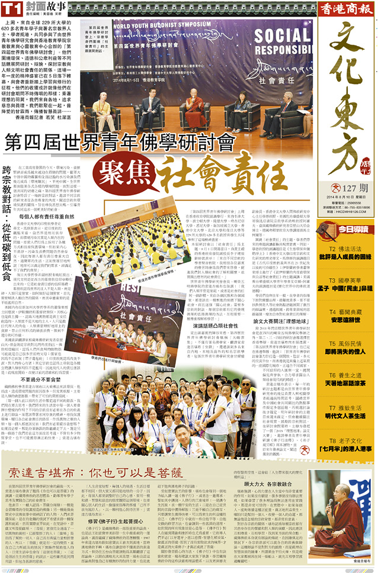

# 第四届世界青年佛学研讨会聚焦“社会责任”

——《香港商报》专题

2014年8月10日

上周，来自全球229所大学的620多名青年学子与著名宗教界人士、学者抵港，共同参与了由世界青年佛学研究会与香港教育学院宗教教育与心灵教育中心合办的“第四届世界青年佛学研讨会”。他们围绕环保、道德和公众利益等不同话题展开研讨、辩论，探讨宗教与人类文明社会责任的关系。这场一年一度的精神盛宴已在5日落下帷幕，与会者重新踏上学习与修行的征程，他们的收获或许就像他们在研讨会期间不时传唱的那样：乘着理想的羽翼，我们来自各地，追求慈悲与真理，我们欢聚在一起，普降爱的甘霖雨，传播智慧真谛……

## “第四届世界青年佛学研讨会”在港圆满举行

“第四届世界青年佛学研讨会”上周在香港教育学院圆满举行。来自牛津大学、波士顿大学、隆德大学、弗吉尼亚大学、悉尼大学、新加坡国立大学、香港中文大学、北京大学和复旦大学等229所大学的620多名教授与学生共同参与了这场精神盛宴。

本届研讨会以“社会责任”为主题。8月1日开幕当日，负责主礼的香港教育学院副校长李子建致辞时表示：“来自不同宗教的学者聚首教院，我相信各位嘉宾的发言将会为我们带来启发，促进我们对人类社会的了解和关怀，并实践出应有的社会责任。”

世界青年佛学研究会会长、喇荣五明佛学院的索达吉堪布也强调：“我们人类不管是家庭，或者是社会的任何一个群体，来自各个民族和各个国家，都应该在一种利他的前提下关心社会，而且这个‘关心社会’需要多宗教的对谈。每个宗教都有它的真理和弘扬真理的方法，互相之间需要一种尊重、理解和学习。”

## 演讲话题凸显社会性

从出席嘉宾的阵容来看，第四届世界青年佛学研讨会堪称“大咖云集”，不仅有著名佛学家、翻译家堪布“坐镇”，还邀请到多名来自内地、本地及海外的知名宗教学者，包括世界青年佛学研究会甘耀权副会长、香港中文大学人间佛教研究中心主任学愚教授、美国乔治华盛顿大学哥伦比亚书院宗教学系助理教授阿维夫、资深藏传佛教研究者亚历山大·伯金博士、德国弗赖堡教育大学讲师汤马士·柯尔等。

围绕“社会责任”的主题，学者们带来的专题演讲都极具现实意义。例如：学愚教授的演讲题目是《生态环保与弥勒净土》；香港中文大学印度宗教和文化研究助理史蒂文·马修斯的演讲题目是《古代印度教教义与其在21世纪及以后的可持续性》；伊斯兰教学者萧伟乐博士进行了《从伊斯兰的角度看环保与公益等社会责任》的主题演讲；美国乔治华盛顿大学青年学者艾亚尔·阿维夫的演讲题目是《变化世界中的佛教道德观》。

学员们也与往年一样，在学者的指导下针对雾霾治理、最难就业季、要不要扶跌倒老人等社会热点话题展开了激烈的辩论赛，通过跨国、跨专业领域的思维碰撞，增加自身对社会责任的理解。

## 论文大赛关注“理想地球”

除2011年的首届世界青年佛学研讨会是在四川的喇荣五明佛学院举办之外，第二、三、四届的研讨会都选择在中国香港举办。堪布向本报透露，“第五届世界青年佛学研讨会”也已定在香港举办。他说：“世界青年佛学研讨会着力于打造一个开放、包容、多元的交流平台，而香港就是具备上述气质的一座国际化城市，正适合不同国家、不同信仰的人汇聚一堂，抛开偏见与争执，合力寻求医治人类社会现代病的路径。”

堪布表示，每一年的研讨主题都是由世界青年佛学研究会的几位负责人与相关学者经过长时间思考，围绕世界及中国社会共同关注的热点事件拟定多个话题，再经过讨论后才确定。明年研讨会的主题目前还未确定，但会继续关注社会现实、鼓励跨宗教对话。在研讨会闭幕时，主办方发起了“2015‘理想地球’论文大赛”，邀请学者及青年学员研读《佛子行浅释》《弟子规另解》两本读物，并于来年发表论文，阐述各自的观点。

## 跨宗教对话：从低碳到低贪

在工业高度发展的今天，环境污染、资源紧缺却成为越来越迫在眉睫的问题，笼罩大半个中国的雾霾和全面泛滥的水污染让我们几近成为“环境难民”。不光中国，全世界都面临着各式各样的环境问题。面对这样一个共同的切肤之痛，第四届世界青年佛学研讨会特设了一场跨宗教对话，邀请不同宗教的研究者从各自专业的角度，阐述宗教与环境保护的关系，旨在寻找思想共鸣，引导青年共同追求一个更美好的社会。

## 每个人都有责任尊重自然

香港中文大学的印度教学者史蒂文·马修斯表示，从印度教的观点来看，自然界是相互依存的，而环境污染其实是人类内在的问题，即使人们行为上采用了各种方式和技术保护环境，但如果内心不清净，污染及浪费问题仍然会存在。因此每个人都有责任尊重大自然，过简单的生活，正如圣雄甘地所说，“地球可以满足我们的需求，却满足不了我们的贪婪”。

复旦大学哲学系副教授朱晓红提出，现代文明是从西方的基督教信仰中孵化出来的，它是社会责任感的信仰基础。基督教认为世界的主人不是人类，而是神，人类只是管家。如何做好这个管家，首先需要解决人和自然的关系，而其中最重要的是不能滥用自然。

美国内布拉斯加州大学哲学系的萧伟乐博士回应说，伊斯兰教和基督教类似，其核心也是真主独一，认为天地万物都是真主安拉创造的，人类并不是天地的主人，人只是担任代理人的角色。人类要管理好地球上的资源，禁止任何形式的铺张浪费，做到不过分和可持续。

美国资深翻译家和藏传佛教研究者亚历山大·伯金则从宗教对比的角度指出：佛教相信轮回，认为人们所食用的动物很可能就是自己很多世前的父母；儒家也因为不忍而说“君子远庖厨”；印度教则认为肉食不洁，对人的身心有害，其他宗教也认为上帝创造各种生物让人类享用但不是滥用。因此现代人的责任应该是：从现在开始，改变以前的思维和行为习惯。

## 不要过分，不要贪婪

藏传佛教学者索达吉堪布以大乘佛法来谈环保。他指出，造成环境问题的原因很多，但究其根源，主要是人类的贪欲膨胀，带来了可怕的资源损耗。

堪布说，“每一个人在以前的生活中都犯过不同的错误，我们现在要去思考，我们将来的生活当中，每一个人要发挥什么样的作用？不同的宗教没有必要在各自的教义上进行辩论，而应该带着求同存异的精神，寻找保护环境、履行各自社会责任的路径。作为万物之灵的人类，每一个人都应该反省：我们有必要纵容贪欲吗？如果没必要，那是沿着错误的路继续走下去，还是另换一条路？我们若在这方面没思考过，不管有多少物质享受，也不可能获得真正的快乐”。

## 堪布：你也可以是菩萨

在第四届世界青年佛学研讨会的最后一天，堪布发表了题为《你也可以是菩萨》的演讲，从藏传佛教的思想体系，劝导青年学子思考及实践自己的社会责任。

他表示，一般人认为，菩萨分两类：一种是金碧辉煌的寺院里塑造的佛菩萨像；另一种是漫长历史中，流传下来的故事中被神化了的人物。人们求菩萨保佑，是在有危难的情况下希望求得一种保护和庇佑。然而事实并非如此。

在梵语中，菩萨又叫菩提萨埵：“菩提”意指完全通达了一切万物的真相，已经觉悟了的人；“萨埵”是指为了帮助一切人，具有勇猛力量和智慧的人。所以，“菩萨”就是有一定的觉悟，并在自己力所能及的情况下无条件帮助他人的人。日常生活中也会有“这个老菩萨”“这是个活生生的菩萨”的说法，这些虽然是民间用语，但包含甚深的意义。

“人生非常短暂，每个人的境遇、生活目标都不相同，但大家又都同是地球的一分子，因此，每个人都要调整好自己的心态，要用一种和谐、智慧和慈悲的态度观照这个环境，也要关心别人的生活，像儒家倡导的那样‘己所不欲勿施于人’，以一颗利他心对待世界。”堪布表示。

## 修习《佛子行》生起菩提心

《佛子行》是藏传佛教一部很重要的论典，也是法王如意宝晋美彭措一生中最重视的一部论典，里面蕴含了藏传佛教的思想精髓。

1987年，堪布跟随法王如意宝首次到汉地，当时汉地佛教不兴，堪布自谦当时不懂汉语的表达方式，但仍在五台山菩萨顶，勉为其难地翻译了这部论典，以期在汉地光大其思想。堪布自认这部论典对自己有一种无形的加持力量，也从此结下他与汉地佛子的因缘。

受法王如意宝的影响，堪布每到一个地方，就给人讲一遍《佛子行》，或者念一遍传承。《佛子行》中讲到人修行的三重境界：一是讲今生因果，求一种平安的生活；二是自己从世间的轮回苦海中获得解脱；三是不顾自己的痛苦，只要让众生获得快乐，可以为众生的利益牺牲自己。

《佛子行》中有一些自他平等、自他交换的修习方法，也讲到一些甚深的道理，如世间的所有现象皆是心所造，等等。在遭遇违缘和挫折时，《佛子行》显得尤为重要，它教导人们不必“以牙还牙”，应以悲悯、智慧化解戾气，做真正的菩萨。而到了没有索取和欲求的境界，才是真正的大乘佛子，才真正成就了菩萨果位。

关于发菩提心的方法，《佛子行》中也有窍诀和密意。堪布建议大家放下执著，学习藏传佛教中的这些诀窍和理论体系，了解更深层次的智慧与空性，这会给人生带来很大的变化和利益。

## 愿大力大，各宗教融合

堪布强调，心的力量在人生当中有非常重要的作用，如果没有愿望，很多事情没有办法实现。如果学习了很多理论而无法应用在实践中，那是非常可惜的。在现实生活中，如果每个人都能够传播这种正能量，真正地发心利益众生，哪怕只是帮到一个人，改变了一个人的命运，无论他是怎样的宗教背景，都非常有意义。

对于各宗教之间的关系，堪布认为，每种宗教都有其自身存在的价值和对人类的贡献，因此应该互相尊重、互相学习，找到某些方面的契合点。藏传佛教本身就有辩论的传统，在因缘具足的情况下，各宗教教派可以就各自的教义做辩论，这种辩论不是对对方的诋毁，而是真理在智慧面前的锤炼——所谓真金不怕火炼。现在，大家都被困在同一条船上，更应该互相学习，渡过难关。
