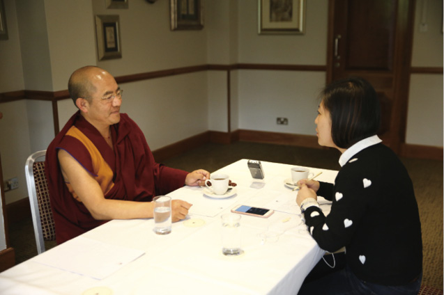
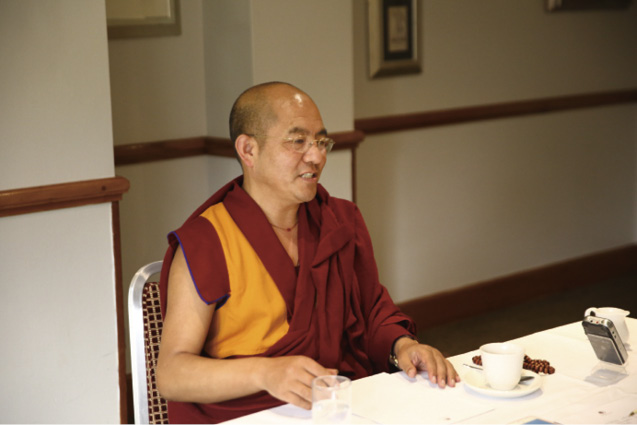
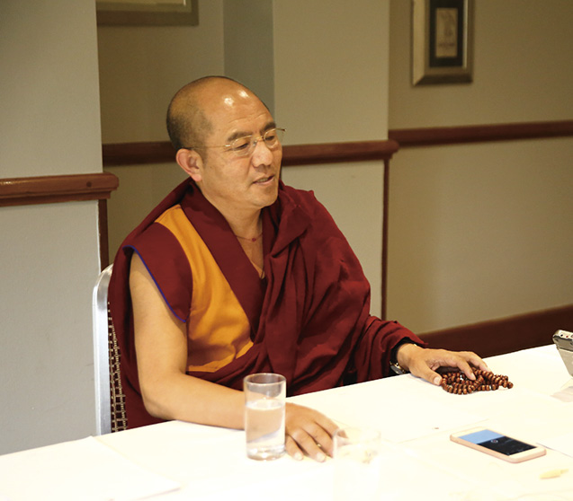
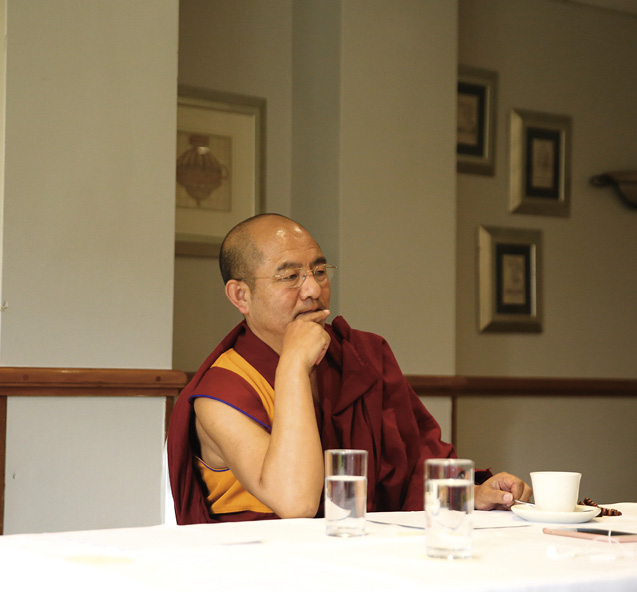

# 藏传佛教不仅仅是 藏族人的瑰宝

——BBC中文网采访

2015年10月18日

采访者：

我是BBC中文网记者。BBC中文之前曾做过广播电台，但现在只做网站——网站是十四五年前建立的。现在有两个中文网站，一个是BBC中文网，一个是BBC英伦网。前者大部分是时事新闻，后者则主要提供为留学生服务的生活资讯、文化教育等内容。

采访之后，我会将发布在这两个网站上的相关文章发给主办方，到时您在这两个网站上都能看到中文报道。文章链接也会出现在BBC英文网站上——BBC英文网站的网页上可以找到二十多个国际主要语种的网站链接。您有兴趣的话，还可以直接从那里找到我们的网站链接。

那么，我们现在开始。

⊙ 问：我之前查了一下您的资料，上面介绍您早年开始在全球弘法。那时您就曾到过欧洲，此次重游此地，您是否有一些新感受？或者觉得有什么不一样的地方？

堪布：早年我曾来过欧洲。怎么说呢，一方面，感觉这里的建筑没有发生什么变化，和二十年前基本相同；另一方面，在人心和人们的精神方面发生了一些变化。现在的西方人普遍都会有一些心理问题，像抑郁症之类的心理疾病。心理不健康的人越来越多了。

此外，欧洲各国和美国的经济状态，似乎也不如之前，都不太好。

最大的不同就是通讯变方便了。之前通讯很不方便，当年我们在法国时，与家里联系特别困难。现在的通讯是全球一体化了。这个变化特别明显。

我觉得在这二十年里，人类外在的物质和生活方式有着翻天覆地的变化，但内心却变得不怎么快乐，或者说不怎么理想了。

⊙ 问：您觉得西方人变得没有以前开心，是吗？

堪布：对，当时不管是去欧洲国家还是美国，我们都很羡慕当地人，因为他们的物质条件比其他国家都要优越，而且内心也都很快乐。现在就外部的经济状态而言，各个国家和地区都呈下滑趋势，同时也给人们的心理带来了很多负面影响。

全球化在很多方面都带来了高效和便捷，但这种高效和便捷似乎并没有给人们带来快乐和幸福。

⊙ 问：您认为这种现象属于全球现象，是吧？不分发达国家和发展中国家，大家都有这个问题。

堪布：我这次去了好几个发达国家，感觉各个城市都没有正在修建或者新修建的建筑，许多建筑都是百年前建造的，现在还在使用。而发展中国家正在拼命地建造，拼命地追求发展。可能因为发展中国家的物质条件不足、生活水平不高，人们追赶的脚步比较匆忙。发达国家的人们就相对比较轻松、安逸。但不知道是什么原因，人与人之间，不管是亲友之间还是同事之间，关系都比较冷漠，大家也感觉越来越寂寞和孤独，没有以前的那种人情味了。

⊙ 问：是，我正好也想问您这个问题。您提到人和人之间比较冷漠，人们有孤独感。其实好多从中国来的留学生的体会可能更深，因为他们在这边没有亲人，朋友也很少，刚来的时候就会有这种孤独感。您觉得是因为他们没有信仰吗？还是其他什么原因？应该如何解决这个问题呢？

堪布：应该有各种原因。其中之一是很多留学生来之前只想到了很多美好的地方，认为到了西方国家后，各种情况都会很完美，没有考虑到饮食不习惯、文化背景不同等现实问题，没有做好充分的心理准备。

我也听说了在这里的很多中国留学生的各种情况。不管有钱没钱，多少都吃过苦，甚至还有相当一部人出于各种原因，没办法完成学业。出国之前，很多孩子只看到了一些光鲜亮丽的正面情况，没有想到会有负面状况——可能觉得一边享受一边就能轻松地完成学业，完全没想到会吃苦。其实西方的高等学府往往是宽进严出，越往上读越难，如果这些常识和概念都没有，往往会面临巨大的心理落差。

我和一些认识的留学生说，不要把国外的生活想象得过于美好，其实留学是很辛苦的，要做好思想准备。比如饮食上就会很不习惯。

这与信仰肯定也有关系。在人生地不熟的情况下，面对各种问题，一定会需要有一个依靠处。如果没有这样一个依靠和寄托，内心会很空虚，也会有很强烈的孤独感。

⊙ 问：刚才您也提到现在社会的信息技术越来越发达，全球联系也越来越紧密，您会使用微信或者微博吗？

堪布：微博和微信我都在用。

⊙ 问：我特别想看看您的朋友圈。（堪布：可以呀。）我挺好奇的，是不是出家人也都会使用各种通讯工具？您觉得现在的通讯越来越发达，对社会有什么影响？

堪布：作为一个出家人或者修行人，很重视自己的修行，在山洞或者其他寂静的地方闭关实修的话，最好不要使用这些通讯工具。因为毕竟会给你的修行带来一定散乱。

但如果你想将一些佛教内容和真理分享给更多的人，或者从别人那里学一些知识，使用各种通讯工具和网络平台会非常方便。

作为大乘佛教徒或者修行人，所拥有的佛教知识不能只吞到自己的肚子里，更重要的是要将其最大化地分享给他人。出于这个目的，我觉得现在的信息化社会特别方便，也很有意义。

⊙ 问：使用通讯工具还是很有必要的，是吧？

堪布：对。

⊙ 问：您可能也注意到了，在西方国家，藏传佛教特别受尊重，发展情况也很好。您认为主要原因是什么？

堪布：原因比较多，最主要的原因我认为是藏传佛教历来都特别重视理论研究，是非常理性的宗教。西方人和东方人有些不同，东方人比较感性，西方人则很理性。藏传佛教对理论的重视，恰好符合西方人的心态。

比如藏传佛教中的理论体系，允许你怀疑、反驳和批判，你也可以不接受。而西方的一些宗教，则不管怎么样都要求信徒深信不疑，如果信徒有所怀疑，又会担心对自己的今生来世都不利。现在很多人都愿意秉持一种开放平等的思想去观察、了解，这种心态很符合藏传佛教的教义。

还有一个原因是，藏传佛教虽然是一种古老的宗教，但它的思想与现代人非常契合。它完全可以与现代大都市里的年轻人的生活相结合。比如佛教中行住坐卧的观想方法，会为年轻人的生活和他们自身带来很大改变。

我认识的很多中国人和西方人，他们很现实，会观察宗教对他们的生活有没有帮助，如果有，就愿意接受；如果没什么帮助，不管别人怎么强调和劝说，他们就是不愿意接受。

现在的人普遍很现实，而佛教教义会为他们的生活带来改变和提供帮助。比如，有的人本来很痛苦，后来接触到由颠扑不破的真理作为后盾的佛教理论，进而了解到一些建立在这些理论基础上的修行方法，他们发现这些修行方法很人性化，可以直接对治日常生活中的烦恼与痛苦。

尤其是当他们发现，生活中难以解决的问题用佛法很容易就能解决时，就会觉得：“这么长时间以来，我都觉得人生很痛苦，干什么事都没有意义，但原来生活还可以这样！”很多西方人接触佛教后，很惊讶地发现人生确实是如佛教中所说的那样，既然如此，他们就有了勇气面对痛苦，勇敢地活下去。

因此，我觉得西方的藏传佛教热并不是一个短暂的热潮，而应该是越来越多人真正了解藏传佛教之后的一种结果。汤恩比博士也说过，21世纪人类最大的希望就是大乘佛教。大乘佛教的利他思想对于东西方民众来说，是一种莫大的依靠。有了这种思想，很多人都好像有了希望，不管自己的人生成功与否，都可以从中得到力量。

⊙ 问：我前两天刚去阿坝那边做了一些采访。之前没有去过藏区，对藏传佛教不是特别了解。这次去了以后，觉得特别震撼，印象特别深。我身边很多朋友，成都的和阿坝当地的，不管是汉族人还是藏族人，都特别信奉藏传佛教。尤其成都的汉族朋友，他们特别虔诚。

我想问您，和藏族人相比，汉族人在接受藏传佛教方面有没有什么障碍或者区别？

堪布：区别倒是也有。可能是藏族人与生俱来的基因，也可能是他们的业力或者种子习气，藏族人一直对轮回和前后世的存在深信不疑，对善有善报、恶有恶报的道理也都觉得是天经地义、理所当然的。因此，他们特别容易接受佛教理念。即使是没有受过藏族传统文化和佛教教育的藏族年轻人，也很容易接受这些理念。

汉族人和西方国家的人们对这些理念则半信半疑，多少都会有一些怀疑。甚至有些已经学佛十几年乃至二十年的人，在前后世和业因果方面，内心还会有一些解不开的疑团。

我在与大家交流沟通时，如果对方是藏族人，就可以直接说来世如何如何，不用担心他能不能接受；如果对方是其他民族或者国家的人，需要先用一些理论来证明前后世的存在，再在这个基础上去交流。

⊙ 问：先打好理论基础。

堪布：对。在其他方面，比如说对理性内容的接受，汉族人比藏族人要更容易些。尤其是与数字、数据相关的，藏族人包括一些知识分子，半天都反应不过来。汉族人对这些反应特别快，马上就推演出来了，对他们来说特别容易。

在最关键的因果正见方面，汉族人的接受程度和藏族人是有点不同的。但现在很多年轻人通过对佛教理论的学习，深信不疑的人也越来越多。应该说，与藏族人相比，汉族人是有一些障碍，但并不严重。

⊙ 问：就是说，不会说藏语也不影响？

堪布：懂不懂藏语都没关系，最关键是要懂得藏传佛教的教义。

⊙ 问：我去藏地也认识了一些新朋友，好多都是藏族年轻人。我感觉藏族年轻人和汉族年轻人有很多不一样的地方。

堪布：也有很多一样的地方。

⊙ 问：对，有很多一样的地方，但我觉得他们普遍更淳朴、单纯，特别容易交朋友。

我有些藏族朋友是政府工作人员，我发现他们现在都不太会讲藏语了。我跟一个朋友说：“你教我两句藏语。”他说：“我只会听，不会讲也不会写。”

堪布：你对此有什么感受呢？

⊙ 问：我觉得民族文化是不是应该保留和传承下去。他跟我说，他爸爸会讲也会写。他还给我看了他爸爸在看的经书。

堪布：他是不是纯正的藏族人？

⊙ 问：是纯藏族人。他的名字是藏族名字，父母也都是藏族人。

我发现，政府现在招聘公务员，如果你是藏族人，并不要求你必须会藏语，可以选择用汉语考试或者藏语考试。您了解这个现象吗？您怎么看？

堪布：我有了解到这种现象。我一直对藏族和其他民族、国家的传统文化非常关心。

前阵子，我去学校演讲时也说到，国际化的今天，可能全世界的人都在讲英语、讲汉语，普遍都在使用一些比较大的民族和国家的语言，这个现象的背后可能是很多少数民族的语言传统都消失了。这是一个比较严重的全球性问题。

作为一个藏族人，我对自己民族的文化和宗教都非常执著，也高度重视。我很担心很多藏族人将来连自己的名字都不会说、不会写。我所在的佛学院有很多来了二十多年的汉族人，他们一直使用汉语，根本没有忘记自己的语言文字。在英国，也有来了二十多年的汉族人，他们精通英语，同时也没有忘记汉语。

很多藏族年轻人已经被汉化或者西化了，不觉得自己民族的文化多么有价值，也不会引以为豪。这些年轻人不会藏语，反而觉得这是很时髦的事情。所以我们很担心，未来藏族的语言文字和文化慢慢地失传了。你刚才说，你的藏族朋友连父亲的念诵法本都不会念，那他的孩子就更不用说了。这样经过一两代人，一些珍贵的民族传统就慢慢地消失了。

有些藏族常见的念诵经文和法本，在别的国家反而很受重视，比如英国和美国的博物馆就收藏了很多。这些藏品也不能随随便便地看到。我们想看的话，不能进去看，要通过一些手续，拿出来看。

⊙ 问：对啊，西方人特别重视文化保护，把各种文化的精华都当作宝贝。

堪布：有些珍贵的宝贝，我们自己可能很便宜就卖给别人了，有这种趋势。我经常很心痛，但是也没有办法。很多年轻人确实有点玩物丧志。现代的文化潮流席卷而来，很多传统的东西可能自然而然地就在其中被淹没了。

⊙ 问：您觉得是因为藏族文化是一个少数民族文化或者小众文化，才会遇到这样的危机吗？

堪布：可能有各种各样的原因。世界上任何一种事物的灭绝，或者任何事物的新生和发展，因缘都非常复杂，有很多原因。

藏文化的衰落也是如此，自己不够重视，再加上我们现在所处的信息化时代，大趋势使然。你看现在各种各样的信息中，藏文的信息很少，但英文和汉文等大语种的信息就很多。这些强势文化可能慢慢地就把一些弱势的小的文化抹去了。有这样的客观原因。

这个趋势目前看来很明显，大家都察觉到了，但是束手无策，不知道应该如何挽救，做什么都无济于事。一旦某种文化和语言在这个世界上消失，确实是很遗憾的事情，就像古埃及文化的消亡。古埃及的象形文字一度失传，出土后没有人能辨认出来，后来经过很多专家学者的研究才得以破解，埃及才能重新传承古文字。

⊙ 问：我身边的汉族人大部分都是在家居士，带发修行。现在年轻人的工作特别忙，很多人都无法长居寺院，只能在家修行。您觉得这是一种好的修行方式吗？他们需要注意些什么？

堪布：这种在家修行的方式我是很赞叹的。佛教真正的教义也并不要求大家全部出家。比如释迦牟尼佛在印度出世的时候，他周围的在家弟子最多，出家人只是其中的一小部分。

在现代社会，出家人虽然在戒律、修行上的层次比较高，但是不可能要求每个人都做到。佛教实际上是一种真理、一种教育，并不是所有人都要出家。佛教中有很多在家修行的法门和方便方法。在家修行最好的地方是可以自己掌握时间、灵活安排。所以我们建议大家以在家身份做一些修行。

如果没有任何信仰，也不做任何修行，可能人生会很苍白。我希望大家都能通过修行，做一个好人、一个善良的人。做善良的人也需要一定的学习。因此，在修行前，一定要系统地学习。否则的话，很多佛教徒都没有佛法的正知正见，自己盲修瞎练，这样不是很好。

总之，我们鼓励在家人好好修行，但在家人不要盲目地修。现在很多在家人只是皈依了，表面上看起来在学佛，实际上对佛教的基本教义、基础理论、修行次第等都不明白。应该先系统学习理论，进而再去修行。本来的次第就是先学再修。

⊙ 问：我这次在阿坝时特别想去色达，想去看看您所在的佛学院。

堪布：为什么没有去？

⊙ 问：因为实在没有时间。我在阿坝去了好几个县，采访大骨节病患者。大骨节病最近防控得挺好的，我们想去拍一个片子，要走访好多家庭，我们去了壤塘县、阿坝县、红原县和金川县。

堪布：你们的联络方是谁？

⊙ 问：是阿坝州州委宣传部带我们做的采访。当时我们在壤塘，离色达已经很近了，就特别想去。但他们说不行，没有时间。我们三天里跑了1500公里。您也知道那里根本就没有路，我在车上经常会被弹起来。他们说这次时间太赶，实在去不了色达，等明年夏天再去。我觉得色达这个地方特别有神秘感，非常向往。

我看过一篇文章，说那里的人生活得特别开心，幸福感特别强。我想问问您，是有这个说法吗？

堪布：可能见仁见智吧。有些人与佛学院的因缘比较好，觉得那里很美丽，待着很开心，也非常有意义；但另一些人会有不同的看法和想法。并不是所有人都觉得非常好。

我在色达待的时间比较长，也比较了解那里的情况。

总的来讲，学院的学习氛围确实比较好，有着完整的佛教次第性教育。就像我们世间的学校教育，从基础的中小学课程到大学本科甚至博士课程，次第非常分明。如果在佛学院完成了基础阶段的课程和“本科”的课程后，会对佛教有全面认知。也会对包括世间知识在内的综合性知识，有一定的了解。我觉得这是色达的佛学院在学习方面的优势。

此外，大家可能会觉得，在那里的生活比较简单，不像城市里充满竞争和攀比。在车子、房子、衣服等方面，那里没有任何攀比，大家最重视的是学识和人品。可见，在价值观和人生追求方面，佛学院与世间其他一些地方有所差别。

一些比较乐观的人都觉得那里比较不错，也有极少数悲观的人会觉得色达的冬天太冷了。

⊙ 问：冬天很长是吧？有半年时间？

堪布：对，基本上是半年。

⊙ 问：我当时到那里已经变天了，九月二十几号就开始下雪了。我就觉得这个地方的冬天好像挺难过的。

堪布：是的，冬天确实比较冷，零下二三十度左右。

⊙ 问：怪不得当地人让我明年夏天再来，今年已经入冬了，去不了了。

堪布：是的，有人要过来的时候，我们也经常建议他们夏天来。

⊙ 问：您平时会在那儿吗？

堪布：我大多数时间在那里。

⊙ 问：好，我下次去的时候一定要去拜访您。明年夏天，一群信仰藏传佛教的朋友打算一起组团过去。

堪布：可以。

⊙ 问：我在这里的时候，朋友也带我了解了基督教。这里的教堂特别多，我周末的时候会去教堂，但就是心里没有什么感觉，也不感动。

不知道为什么，我去藏区时内心真的挺震撼的。这两种不同的感受，是因为文化差异吗？

堪布：前段时间，我也去了一个教堂供灯。观察自己的心，发现也是比较空：没有什么好的念头，也没有什么不好的念头。教堂里本来就特别空，我看上方很空旷，下面的座位也都是空的，只有一些画像，其他什么都没有。

当然基督教的思想是很包容、很开放的。所以，有时候感觉可能并不代表什么。藏传佛教从前有位大德，曾去其他宗教的教堂里合掌祈祷，眼泪自然而然地流了下来。人和人的因缘是不同的，哪怕在相同的地方，可能也会有不同的感受。

现在藏传佛教不仅在西方国家，在东南亚国家也很兴盛。它的兴盛不仅仅是表面上的理论，更多在于其中的一种力量，或者叫加持力。这种加持力很难解释，有时候很莫名的，你遇到一个人、见到一尊佛像，或者去了一座寺院，自然而然地感受到一种吸引力。

一些理性的学术界人士认为，这是一种奇怪的现象，并不承认其中的意义。而另一些研究超自然现象或者灵性、心理学的学者，则认为这种力量存在且非常奇妙。确实，我们很难从学术角度来研究这种感应，也很难说得通。比如大家同样来到一个宗教场所，一个人的内心有感觉，另一个人则没有感觉。学术界无法很好地解释这件事。

这种感觉或者说感受，如果从心理学层面来分析，是一种真实的情绪反应。因此这是一个客观且现实的问题。当我们去了解一些事情的时候，需要结合主观、客观两个层面，并综合不同学术研究角度和实际事件，才有可能得到比较完整的答案。

现在的情况是，一部分学术界专家完全在说理论；另一部分特别感性的人完全在说个人感受。我认为这两者都有些偏颇，如果能结合起来，也许能得出一个完整的结论或者答案。

⊙ 问：最近国家领导人刚好也在访问英国。您怎么看待中英两国的交流和互访？

堪布：对他们的会议情况、交流目的等，我也不是特别清楚。

今年中国的经济形势以及对外贸易等方面，应该很不错。作为一个佛教徒，我有时候也会看看新闻，看看国内外的形势，但对政治和经济这些不是特别关心。最近没怎么看，只是听说国家领导人也过来了，英国的欢迎仪式很隆重。

另外，习主席的一些佛教思想，还是很不错的。不管是他当时在联合国教科文组织的讲话，还是他在国内的几个讲话，其中提及佛教的相关历史和典故，都很有说服力。同时他也对佛教的教义予以了肯定和赞许。

⊙ 问：我这次去阿坝采访，州委宣传部的工作人员跟我说，第六次西藏工作会议对藏族人来说非常重要，其中的一些决定也产生了很大的影响。您怎么看待这次会议和决议？

堪布：会议的决议从物质方面来说是很好的，有着与以往不同的更进一步的推进，比如在加快建设等各方面。此外，在文化传承方面也有一些推进，我觉得这些更重要。

⊙ 问：您觉得这个会议的决议是积极的，是吧？在藏族的发展和文化传承保护方面。

堪布：我没有特别细致地看。

⊙ 问：您不是特别关心政治方面吧？

堪布：有时候会关心，但我比较忙，有时候来不及关心。

⊙ 问：我相信您肯定特别忙，一直在各地讲学弘法。

我还有最后一个问题，我跟朋友聊天时，如果遇到什么不如意的事情，或者有一些过不去的坎，他们就会说一句话：“一切都是最好的安排，你只需要随遇而安。”我不知道这句话是不是来自佛教，您觉得这句话有道理吗？

堪布：这句话听起来是很好的。如果不管遇到什么事情，都能把它当作是一个很好的安排来调整自心，是很好的。但并不是所有的人都能做到。有一些不愉快的事情发生了，人们心里还是会非常难过，过不去那一关。

我认为，生活里遇到的一些小事，不应该一直耽著它。就像我们在路上，不小心被绊住，摔倒了，站起来继续走就可以了，不应该一直去看那个坎。

人生中发生的一些事情可能是必然的，也是一定要经历的，但之后就应该越过去，不要一直停留在原地。这样可能会好一点。

⊙ 问：您觉得这是一句包含佛教教义的话吗？还是一句普通的金句？

堪布：其实“一切都是最好的安排”这句话，是西方国家一位学者写的一本书的书名，主要内容是当时的一些社会状况和文化传统等等。

⊙ 问：您最近有什么新作品吗？

堪布：我有一本讲解《弟子规》的图书快要出版了。主要内容是我以前现场讲的一个课程，对《弟子规》做了一些不同角度的解说。这次在正式出版的过程中，对内容做了一些修改和调整。不知道对大家有没有利益。应该最近就可以问世了。

⊙ 问：一定要读一下您的新作。今天就这些问题，谢谢您，耽误您的时间了。

堪布：没有，挺好的。

⊙ 问：我跟您合个影好吗？我跟朋友说，要来采访您，他们都特别兴奋，让我一定要跟您拍张照片。

堪布：可以，没问题。
