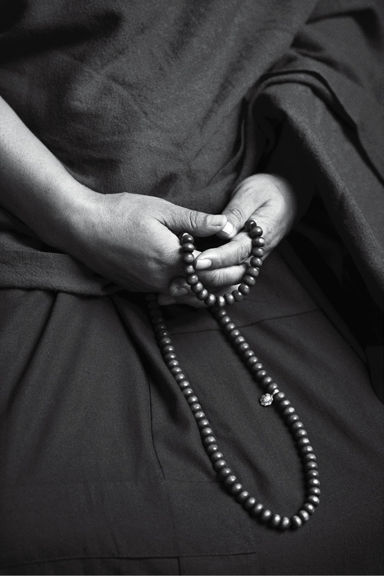

# 佛教的低贪生活

/

“人定胜天”这个成语，多年来一直被人误用。

其本意是，人心安定高于一切。并不是说人一定能战胜老天。

“定”是安定，不是一定。

很多人没弄懂它的意思，

就打着“人定胜天”的旗号去征服自然。

结果呢？

/

本章为索达吉堪布在广西大学的演讲

2012·02·27

来到这里，既难过，又开心。

难过的是，15年前我随上师来过广西，并担任他的翻译和侍者。上师在邕江边住了几天，给有缘人传讲佛法，在青秀山举行放生……如今，故地重游，脑海中浮现出当年的情景，而上师却已不在，心里有种说不出的感觉。

开心的是，20年前，广西大学的几位老师就在研究佛法，寻找心灵奥秘，我们也有过交流。现在看到他们依然在这条路上探索，我非常欣慰。学佛，就要这样长期坚持。只是一时热情，不会有什么成就。

## 出家人也入世

有人可能想：“出家人应该待在寺院里，为什么要跟世人交流？”

这是不了解佛教的表现。佛教分小乘和大乘。按小乘的观点，出家人追求的是自我解脱，应在深山里修行，行为上有许多约束，甚至连钱都不能摸。大乘与之不同，不但考虑自我解脱，更要将众生从痛苦中救拔出来。只要对众生有利，有些事不但可以做，而且必须做。

对我来讲，作为大乘修行人，不能只求自己解脱；作为地球人类的七十亿分之一，面对当前的人类问题，自己也有一份责任。我跟你们没什么不同，只是装束、价值观等略有差异。对于环保，多年来我一直关心，参加过环保论坛，跟国内外专家做过交流，独自一人时，也经常思考当今环境的变化。

## 这个地球生病了

现在的地球出了什么问题？

首先，水污染非常严重。以中国为例，70%的河流受到了污染，而且是严重污染。我在上海看到一种水质净化器，经它处理过的自来水，30%是沉淀物。如果天天喝这种水，那么多杂质要通过肝肾解毒，身体的负担会有多重？

从太空看，地球是个蓝色星球，四分之三的面积覆盖着水。其中，能喝的淡水只占2.53%，而且还在逐渐减少。比如青藏高原，被称为“亚洲水塔”，长江、黄河、恒河全都发源于此。可是随着气候变暖，青藏高原的冰川已经明显消退。长期来看，水资源的未来令人担忧。

其次，森林面积也在迅速缩减。砍一棵树只要几分钟，种一棵树却要花十几年、上百年的时间。对森林的大规模砍伐，直接导致森林覆盖率大幅下降，进而引发气候反常。像云南大旱，数百万人受灾，有人认为，这与全球最大造纸企业进驻云南有关。

干旱进一步会引发粮荒。在撒哈拉沙漠以南的非洲萨赫勒地区，1000万至1400万人陷入粮食危机，100多万5岁以下儿童严重营养不良。

此外，臭氧层空洞、土壤破坏、物种灭绝、过度开采矿藏……让昔日的青山绿水、蓝天白云，变成了故事里的神话。

或许是杞人忧天吧，我经常想：假如人类继续不尊重大自然，在我们这一代，会不会出现更大的灾害？

## 20个地球够用吗？

之所以环境出现问题，原因有很多。究其根源，主要是由人类贪欲膨胀所致，尤其在衣食住行各方面，不知节约，损耗得可怕。

前不久我去某城市，正好赶上除夕之夜。按理来讲，过年是为了合家欢乐，可震耳欲聋的爆竹声，却让人有不舒服的感觉。短短一夜放鞭炮，对空气的污染特别厉害，大量烟花爆竹残屑，也给环卫工人增加了很多压力。

还有许多人，觉得在餐桌上浪费是件极有面子的事，一顿饭动辄几千几万元，吃掉的却不过几百元。在穿衣服方面，他们也颇为讲究，认为是身份的象征。我见过一个有钱人，名牌衣服多得穿不完，很多只穿一两个月就扔了。

在佛教中，对惜福极为重视。比如，佛经中说，僧众不可以随便扔掉旧衣服，不能穿了，可做成坐垫；坐垫用烂了，当抹布；抹布用坏了，再跟白灰混合在一起，用来涂墙。

在一些老修行人中，至今还保留着这种传统。喇荣五明佛学院有位老法师，一件衣服从1987年穿到现在；有位堪布，茶壶用了30多年也不舍得换。

但现在的人以浪费为荣、节俭为耻。谁若生活节约，大家就看不起他，认为他太吝啬、太小气。甚至他自己也觉得很丢人。

一粥一饭，当思来之不易；一丝一缕，须念物力维艰。试想，假如人人追求奢侈的生活，那要消耗多少自然资源？

有专家指出：如果全世界的人都要达到美国人的生活水平，至少需要20个地球。

## 你不是地球的主人

美国前副总统戈尔在《濒临失衡的地球》一书中说过，世界文明和地球上的生态系统相冲突，主要是源于三点：人口爆炸、科学技术革命、自然观的改变。

人的自然观出了问题，这是讲到点儿上了。

过去，中国提倡天人合一，对大自然十分敬畏，随处可见青山绿水。后来，在“人定胜天”的口号下，人们为了满足增长的欲望，不加节制地掠夺资源，令环境遭到了严重破坏。

拿捕鱼来说，早期的方式是用鱼钩垂钓，一次只能钓一条鱼。如今却是用长达几十公里的拖网，将整片海域的鱼一网打尽。

现在这个地球，平均每天有70多个物种灭绝，每小时有3个物种被迫与我们“永别”，成为生态破坏的祭品。假如海里游的、空中飞的、地上跑的，有一天都灭绝了，人类自己还能生存多久？

有人认为：人类是地球的主人，有权主宰这一切。

此观点有欠考虑。据估算，地球的年龄有46亿岁，而人类的出现，只是近几百万年的事。可见，人类并不是地球的主人，没有资格对地球为所欲为。

## 低贪才能低碳

为了保护地球，现在许多人提倡低碳生活。但怎样才能实现这一目标？

方法很简单：低贪，才能低碳。

在我们藏地，人们吃得随便，住着平房，几年穿一件衣服，因为没有太多欲望，脸上总是挂着笑容，歌声时常回荡在山中。这种低贪的生活，就很低碳。

当然，要做到这一点，光是想想还不够，最好能懂一些佛理，心甘情愿地放下贪欲。

这样一讲，有人可能立马警惕：“他在搞传销，想拉我们都去学佛！”这种戒心是多余的。佛教讲的有没有道理，你可以自己分析。如果有理，能给人带来快乐，即使不学佛，也可以听听。

佛陀曾于2500多年前，以智慧揭示了万法真相。比如，他在印度南方宣说了《时轮金刚》，按其历算方法，不必依靠任何仪器，即可准确算出日食、月食的时间。此外，量子力学发现的一些道理，佛陀也早在“缘起性空”中阐明过。

这说明什么？

佛教不像有些人想的那么简单。

其实，我们现在的各种问题，无论是外在的，还是内在的，都可以从佛教中找到答案。就以环保而言，当今时代，佛教中提倡的心灵环保，比环境保护更重要。

为什么？

造成一切环境问题的根本原因，不是“碳”，而是“贪”——别人穿香奈儿，你也想穿；别人买iPhone，你也想买；别人有宝马，你也想要……但你想过没有，这些要用掉地球上的多少资源。

印度的甘地说：“地球所提供的，足以满足每个人的需要，但不足以填满每个人的欲望。”

贪欲真的非常可怕。在它驱使下所做的一切，暂时看不出什么危险，但如同煮在水中的青蛙，等意识到问题严重，就来不及了。

当然，克制贪欲，并不是让所有人都剃光头，去寺院出家。其实，人只要有中等的物质条件，就可以活得不错。我们这一辈子，有几件衣服蔽体足矣，吃穿住用不必奢华，差不多就行。在我们佛学院，一间小小的土房，修行人可以住上二十多年。

所以，每个人应该反省：有必要纵容自己的贪欲吗？

## 幸福是什么感觉

人们不停地追求各种享受，只是为了快乐。但方法若没有认清，拥有再多，也不一定快乐。

在美国某海滨城市，有位事业成功的华人女企业家。一次，她的高中同学打电话来，说自己在美国办事，想顺道看望她。她非常开心，开着宝马把同学接来。

同学到了她家，映入眼帘的是游泳池、网球场、花园、别墅、豪华跑车……走进室内，有几十个房间，每间都挂着一些名贵字画。

看到空荡荡的屋子，同学有点不解：“你的家人呢？”

她黯然神伤道：“丈夫前几年有外遇，离开了我；孩子大了，有自己的理想，也搬出去了。我现在什么都没有，穷得只剩钱了……”

可见，幸福不是家财万贯、锦衣玉食，它是知足平和的心态，是一种不需要太多物质的感觉。

一切快乐，源自内心。保护环境，也要从心入手。现在环境遭受的破坏，本质上都跟人的贪婪有关。若没有控制内在的“低贪”，再怎么提倡外在的“低碳”，也不过是隔靴搔痒。

只有抓住问题的根本，才能减少对环境的破坏，人们才会真正快乐起来。

现场互动

⊙ 问：我是林学院的。近几年全球气候异变，引发了各种次生灾害。专家分析，这是几百年来工业发展造成的。那抑制人类的欲望，能阻止环境恶化吗？

堪布：想完全阻止，不可能马上做到，但只要尽力，还是会有效果。

联合国报告指出：全球暖化的主因，就是肉食。为满足人类对肉食的贪婪而大力发展畜牧业，是造成气候变化的元凶。倘若大家都吃素，能减少80%的全球暖化，从这个角度而言，吃素就不只是佛教的行为了。

⊙ 问：我是计算机与电子信息学院的。大学生的环保意识还可以，但企业家的不太强，环境污染多是他们造成的。怎样才能提高企业家的环保意识？

堪布：“环保”是后来才出现的话题。记得我小时候，根本不需要环保，空气和水非常干净，我连垃圾桶都没见过。最近几十年，随着经济的发展，出现了各种环境污染，人们才越来越重视环保。

若想提高企业家的环保意识，需要学术界的帮助。当今社会有政、商、学三个主体，很多问题都是学术界首先发现的。商界和政界虽然有钱财和势力，可他们忙着赚钱、做事，无暇考虑这些，因此，学术界要把关键问题揭示给商界和政界。

比如，大学可以开一些环保论坛，邀请企业家和官员参与，让他们认识到环保的重要性。如果他们找到感觉了，操作起来就容易了。

⊙ 问：我是材料学院的。通过今天的学习，我增强了环保意识。不过，我的心比较浮躁，几天后可能又像从前一样破坏环境了。我该怎么办？

堪布：如果你真正意识到环保的重要，也许一辈子都不会忘。我个人就有这种经历，有时候听上师讲一节课，内心有了极大转变，从此便会牢牢记住。

如果没有这么强烈的意识，就需要反复思考。否则，你当下的感触，过两三天就会烟消云散，什么印象都没有了。

我给大家讲这些，也只是提醒而已，关键要靠你自己下工夫。

⊙ 问：再过两年，我就要毕业了。世间竞争如此激烈，人人都在追逐金钱，如果我保持善良的心，可能赚不到足够的钱养家，这种情况该怎么办？

堪布：有良心，不一定赚不到钱。有些企业家很有利他心，对社会有强烈的责任感，他们赚的钱不比别人少。并不是非要通过不合理的途径才能生存。

在谋生过程中，用损人利己的手段，即便赚到钱，也不会长久。以善良的心做事，内心坦然，福报也会与日俱增。退一步讲，哪怕暂时赚不到钱，还是不能失去善心，从长远看，这才是对自己最有利的。

07
