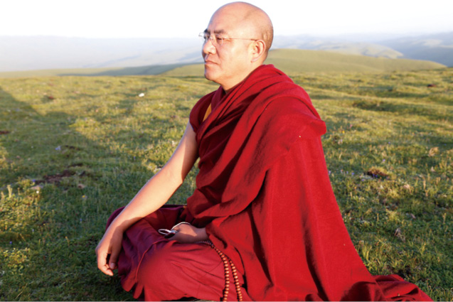
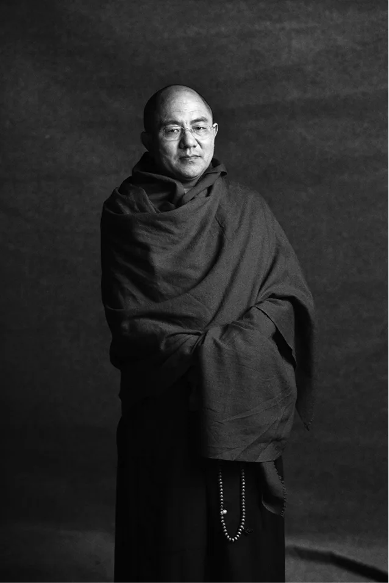

# 佛陀眼中的利他

/

学佛是为了成佛。

成佛是为了利他，不是为了自己快快乐乐。

/

本章为索达吉堪布在山东大学的演讲

2011·11·16

提起“佛陀”，有人以为是神话中的人物。其实，佛在历史上真实出现过，是一个经得起学术界考证，万人景仰的历史人物。

最近，佛牙舍利迎请至缅甸供奉，该国举行了隆重仪式：副总统率2000多人到机场迎接，总统与6000多名政府高官在供奉地恭迎。48天中，朝拜的人络绎不绝。

佛指舍利当年被请到台湾地区瞻礼时，也是规模空前。短短十一天内，每天的朝拜者超过十万，先后朝礼之人超过百万。

现在已是21世纪，人们有较强的辨别能力，不可能盲目信仰一种事物。那为什么仅仅是佛陀的一块遗骨，就得到这么多人尊重？人类发展到今天，也曾涌现过许多名人，他们有没有受到如此崇拜？

比如，爱因斯坦要求死后不建坟墓，把骨灰撒在不为人知的地方。但一个叫哈维的美国医生，偷偷把他的大脑切下研究，42年后才交给普林斯顿大学医院，让它回到爱因斯坦逝世的地方。虽然这个大脑令很多人着迷，但它既没有佛陀遗骨那样的加持，也没有得到人们的崇信。

或许因为我是佛教徒，所以，对佛陀有种特殊的情感。不过，大家也应该思考：跟历史上的名人比起来，佛陀有哪些超胜功德？后人为什么给予无上尊崇？佛陀为众生广演八万四千法门，留下浩如烟海的三藏教典，到底讲了什么道理，令无数人为之折服？

今天在座的人，有些信仰佛教，有些不一定。但即便你不信佛，也可以试着去了解，因为佛法不单是一种信仰，更是一种智慧。

## 连佛陀都无法衡量

大家都清楚，由于一些原因，传统文化受到重创，我们这一代人是首当其冲的受害者。不少人的人生信条，除了追求金钱、地位、美色，基本不关心道德理念。有人甚至认为，心肠越狠，就越会成功，在欲望的推动下，为了自己的利益，无所忌惮地损害大众。

这样做，结果其实非常可怜。他们不想痛苦，痛苦却一个接一个降临；想要快乐，快乐却像仇人一样被彻底灭掉了。

追求快乐是人之天性，但方法错了，也会南辕北辙。

获取快乐的方法，佛陀早已明示，就是要实行利他。若更进一步，则最好能拥有一颗菩提心。《无畏授所问大乘经》说：“菩提心功德，是胜妙良药，一切病能治，施有情安乐。”

什么是菩提心？

究竟意义上讲，就是愿一切众生离苦得乐，获得佛果的心。这是最上等的善心，常人很难生起。有些人即使一辈子学佛，若没有修过菩提心，遇到关系不好的人，不要说帮他获得快乐，就算是“愿他快乐”的善心也生不起来。

菩提心是大乘佛教的根本，不了解它，想认识大乘无从谈起。有些学佛人，口头上虽然常说“菩提心”，实际上连字面意思都不会解释，反而将它与慈悲心、善心、慈善混为一谈，这是相当遗憾的。

所谓菩提心，分为两种：愿菩提心、行菩提心。愿菩提心，是为利益一切众生而希求无上佛果的发心；行菩提心，是在此基础上，于行动中真正去做，行持六度万行。

这种心一旦生起，哪怕只有一刹那，功德也相当巨大，即便佛陀也无法衡量。《涅槃经》讲过：“何人一刹那，观修菩提心，彼之诸福德，佛陀不能量。”

当然，如此境界，并非人人都能马上做到。如果你无法一下子达到，那可以先从慈悲心开始修——慈心是愿众生获得快乐，悲心是愿众生远离痛苦。

利益他人的生活，并不是自我牺牲，

而是自我实现。

现在国外不少大学，都开设了修慈悲心的课程。有些教授让学生在上午、下午各用十分钟修心。一两个星期后，通过仪器检测，发现他们的心态变得柔和、调顺。即使脾气暴躁的人，心情也十分轻松。所以，他们把这种训练称为“轻松治疗法”。

## 解脱最快的一条路

关于菩提心的功德，有个故事对我启发很大：

公元11世纪，印度有位班智达，叫阿底峡尊者。他是东孟加拉国的王子，本应继承王位，但有一天度母在梦中告诉他：“你已当过五百世的班智达，解救众生脱离轮回苦海是你的使命，不可以半途而废。”他醒来之后，认清了过去的愿力，于是离开王宫，舍弃红尘出家，依止罗睺罗尊者为师，并在上师的教导下，很快精通了三藏。

有一天，他在看书时，突然产生一个困惑：“直接通往开悟，哪一条路是最迅速的？如果遵循大乘菩萨道，必须在无量劫中救度他人，才可达到涅槃彼岸，那么，我何时才能开悟？”

为此，他去请教上师。上师告诉他：“你太关心自己的成就了。长养菩提心，忘却自己的利益，多关怀他人的福祉，才是解脱的唯一途径。执著自我是痛苦的根源。”

此后不久的一天，他转绕佛陀的成道地——菩提迦耶时，听到两个美丽的女子在对话。一个问：“什么是达到开悟的最好方法？”另一个回答：“无我的菩提心，是成佛的大道。”

第二天，他去佛塔及塔旁的菩提树绕行，又听到一个老乞妇告诉一个麻风病人：“菩提心是超越苦海、获得开悟的最好方法。要设身处地多为他人着想，放弃自私自利的想法。”

他听了以后，心想：“这里的每一个人，从最高贵到最卑贱，似乎都知道开悟的最好方法，和我上师说的一模一样，只有我一个人还迟疑不定。”

第三天，他手持念珠转绕圣殿，看见一只小鸟栖息在观世音菩萨像的膝上，菩萨像开口对小鸟说：“具备舍弃自己、爱护他人的菩提心，是圆满证悟的最好方法。”就在这一刻，他所有的疑惑全部烟消云散。

了知菩提心的重要性后，尊者前往印度尼西亚依止金洲大师，在12年中唯一修菩提心，最终获得开悟。

后来，藏地因朗达玛灭佛，佛教遭到毁灭。国王智慧光为重振佛教，多次派人去印度迎请阿底峡尊者。尊者请求度母给予指示。度母告诉他：“前往藏地，你能利益无量众生，但寿命会减少20年。原本你可以活到92岁。”想到能够利益众生，尊者义无反顾入藏弘法，扭转了藏传佛教的混乱局面，并开创噶当派，撰著了《菩提道灯论》——著名的《菩提道次第广论》就是对这部论的注释。最终，他于72岁示寂，被尊为藏传佛法的中兴祖师。

阿底峡尊者传下来的菩提心修法，一直到现在，在藏地仍保存完好，所有教言、修行次第不但在寺院里随处可见，在人群中也广为流传。与汉传佛教相比，藏传佛教在修菩提心方面有不共的优势，很大程度上是尊者的功劳。

如今，国内外有许多学者，对菩提心的教言很感兴趣。可是，纯粹学理论还不够，若没有实修，遇事就派不上用场。所以，道理一定要在实践中运用，所作所为要经常想到利益别人。

很多人一天大部分时间都在想自己，从未想过为大众做些有意义的事情。当然，完全不管自己，身为凡夫也做不到。但有时候你越是想自己，越得不到什么利益；心里越是装着别人，福报反而不期而至。

近几年，道德下滑的事件层出不穷，究其原因，就是人们缺少利他心。在藏地，一个人若是被车撞了，99%以上的人肯定马上停车，全力以赴去抢救他。不要说是人，就算一头牦牛，大家也会想办法救它，或者给它念经，不可能看众生受苦却视若无睹。

藏地有一位著名的大成就者，叫华智仁波切。他有一次徒步去石渠举办法会，途中看到一位寡妇，艰难地带着三个孩子，也准备去参加法会。他见孤儿寡母可怜，便背起孩子一路同行，甚至去化斋分给大家，一直送到目的地。

这样的事，若是被我们遇上，也会如此出手相助吗？

对多数人而言，假如亲友有难，伸出援手义不容辞，但受苦者若是素不相识的人，好像就跟自己无关了。这即是缺乏利他心的表现。

## 虚空也装不下它

佛教的核心，就是利他，希望所有众生离苦得乐。

或许有人认为：“这根本做不到，所以没什么了不起。”

先且不论你能否做到，仅仅是生起这一颗心，其功德如果有形有色，连虚空也装不下。《宝积经》说：“菩提心功德，若有色方分，周遍虚空界，无能容受者。”

佛经的这些字句，望大家细细体会。它是佛陀的智慧流露，即使文字不多，但里面的深义，许多人穷尽一生也不一定能完全领悟。

可能有人又提出疑问：“佛教若真如你所说那么好，为什么很多人不信？”

其实，任何高深的学问，无论是尖端科技，还是佛教道理，懂得的人只是少数。就像精通珍宝价值的人，在这世上也只如凤毛麟角，普通人很难辨其优劣。

但不管是否懂得它的价值，只要是人，就难免会遭遇不幸、烦恼。若能掌握大乘佛教的调心方法，比如自他平等、自他交换、自轻他重，或者阿底峡尊者所传的知母、念恩、报恩等，不要说来世，在今生中就可以化解许多痛苦。

有人可能担心：“学佛知道一点就行了，千万不要学得太深，不然就会出家。”

这有点过虑了。每个人缘分不同，学佛不一定非要出家。在佛教历史上，即便是释迦牟尼佛住世的时代，学佛者也很少出家，大多都是在家人。所以，佛陀为在家人传讲的经典，数量是非常多的。

## 菩萨就是勇士

我们生而为人，应该有自己的信仰；即使没有，最少也要了解利他的可贵。

大家应该听过“菩萨”一词。菩萨是菩提萨埵的略称，意思是勇敢的心。勇敢在哪里？敢于放下自己，万难无畏地去利他，这是一般人做不到的。

不少人以为菩萨只是寺庙里的雕像，其实，为了他人而不顾自己，就算遭受白眼、挖苦、不理解，只要能帮助别人，自己也甘愿承受，这才是活生生的菩萨。

青海有一位出家人，许多人说他是菩萨。为什么？因为他的生活极为简单，但只要有人需要帮忙，自己必定不遗余力，哪怕被冤枉也无所谓，一生都是如此。

这种精神，每个人都需要。现在的教育总是教我们怎样成功、怎样赚钱，却很少提及怎样利益别人。久而久之，这个社会将变成怎样？不难想象。

当然，利他心的内容非常多，在这么短的时间里，很难让大家完全明白。即便如此，仍然希望你们能意识到：利他心正如摩尼宝，它所散发出的光芒，能遣除人类内心的愚痴黑暗，照亮人生的正确道路，故不可不重视。

现场互动

⊙ 问：我是生命学院的研究生。请问，菩提心应该怎么修？

堪布：菩提心的修法非常多，有愿菩提心、行菩提心的修法，也有自他平等、自他交换等修法。具体在《大圆满前行》《心性休息》中有介绍。

简单地讲，你可以随时随地这样观修：把自己的快乐全部给众生，众生的痛苦全部由自己代受。

有人认为这太可怕，别人有传染病的话，会不会也传给自己？实际上，大可不必有此担忧。这样修，可以减少对自我的爱执，依靠菩提心的强大威力，反而能获得不可思议的利益。

⊙ 问：怎样才能找到正确的人生方向？

堪布：人不是只有这一辈子，生命会延续至生生世世。所以，建议大家了解一些佛教理论，这不会有什么危害。

我翻阅过佛教的《大藏经》以及古今中外很多书籍，通过对比发现：佛教对人生有难以想象的指导作用。因此，从佛教中寻找人生之路，是值得推荐的一种方法。

⊙ 问：我是佛教专业的研究生。您能否通过对汉地、藏地的见闻，比较一下汉、藏佛教有何不同？

堪布：以前，汉地对藏传佛教的认识比较少，直到1987年，法王如意宝前往五台山，很多汉族人才开始广泛接触藏传佛教。

汉传佛教历来推崇吃素、参禅、念佛，这方面做得比藏传佛教好。而藏传佛教，提倡辩论，以此可消除对佛法的各种疑惑；它拥有系统的修学体系，用十到二十年的时间，对佛法由浅至深学下来，这样修行比较扎实；还有藏传佛教的法师们，必须经过长期的讲经、辩经、造论等各方面训练，以及戒律方面的严格审核，才能具备一定的弘法资格，所以在佛学方面有较高的水准。

总体来讲，汉传、藏传都是大乘佛教，没有太多的差别。只不过希望汉传佛教今后不仅要在寺院里弘扬，还应该在老百姓中、大学里，传播佛法的教义。

汉地很多人学佛特别虔诚，但到寺院里只是拜佛、烧香、皈依，却不明白为何这样做，这可能有点盲目。

还有些佛教徒，别人问他学的是大乘、小乘，他很自豪地说是大乘。但以什么标准来判断？他却一无所知。其实，大乘与小乘的区别，唯一看有没有利他的菩提心。若没有这颗心，就算你修很多寺庙、做很多善事，也谈不上是大乘。

现在的佛教徒，搞形象的有点多，通达佛理的比较少，这是令人遗憾的地方。

⊙ 问：在藏地，其他宗教与佛教有没有冲突？藏传佛教内部有许多宗派，彼此之间有没有矛盾？

堪布：藏地除了佛教，历来很少有其他宗教。近几年虽然也有极少数，但到目前为止，其他宗教在藏地并不兴盛。

而佛教，是从公元333年起，兴盛于藏地的。时至今日，尽管它经历风风雨雨，比如历史上有朗达玛灭佛，但其清净传承依然保存完好，并吸引了国外很多学者前来求学。

藏传佛教的内部，分为格鲁、萨迦、宁玛、噶举、觉囊等八大教派。以前个别地方由于教派不同，有过不和的现象，但现在各教派之间非常和睦，大家都承认修行之道是最初发菩提心、中间积累资粮、最后获得佛果。所以，各派教义在大的方面，应该说没有任何冲突。

⊙ 问：我们是山东大学的藏族大学生，非常感谢堪布来这里讲法，也感谢学校提供这样的机会，我们特别激动！认识您，主要是通过网络。您放生等好多视频，我们看了感同身受，也经常学习您的讲法视频。请问，我们在内地读大学，应该注意些什么？另外，我们对在网上学佛非常热心，也很认真、积极。可否请您在网上多放些藏文方面的资料？

堪布：你们为求学而远赴异地，非常不容易。山东是儒教的发源地，而儒教，数千年来是汉地的主流文化，就像藏地的佛教一样。大家有机会在这里学习，应该好好珍惜，不要虚度时光。

前不久，我在青海的一所大学里提过，现在有些藏族学生，对自己的传统文化——佛教不太重视；反而汉地很多学校的师生，对藏传佛教颇有研究。这是令人惭愧的。希望你们在读大学时，既要研究汉地的优秀文化，也不要舍弃藏传佛教。

还有一点值得提醒的是，有些藏族学生，包括我资助的大学生，到汉地读书以后，把藏语忘得一干二净。其实，就算是汉族学生出国留学，回家跟父母说话也讲汉语，不会满口英文，藏族学生为什么这样？对此大家要引起注意。

关于藏文资料，我的藏微博、藏博客中有一些。此外，我还开了藏文版的智悲佛网，希望借此弘扬藏传佛教这一传统文化，同时将现实问题与佛教结合起来，做些适合年轻人看的东西。

⊙ 问：我读过一些佛教书籍，但在遇事时，经常第一念还是想自己，以自我为中心，对此我挺苦恼。怎样才能真正将菩提心运用到日常生活中？

堪布：这是非常非常难的。但即便如此，我们也要慢慢练习。

我本人学佛那么长时间，遇到一些事时，也往往第一个念头就是“我”，特别惭愧。所以，我们应该多看些阿底峡尊者等前辈大德的传记，一点一滴学习他们的行为，逐渐减轻对自我的爱执。刚开始的时候，我们可能会天天想着“我”，但只要了解到利他的重要、我执的危害，对“我”就不会那么看重了。

当然，这不是一两天或一两年就能做到的。只有循序渐进、持之以恒，最终才能无论何时何地，都会自然而然想到众生，而不是“我”。

自古以来的许多大德皆是如此。包括我们佛学院的一些大德，最初也是下了很大功夫，训练自己不管是说话、做事，时时把利益众生放在第一，久了，菩提心的境界才能运用自如。

⊙ 问：我是传媒专业的。我学习您讲的《大圆满前行》时，一开始还能坚持每天五点半起来观修，但过一两个月，惰性、厌烦心就生起来了，对此我特别自责。有师兄说：“这是正常的，发心越大，违缘越大。”我想知道，这种说法怎么来的？

堪布：首先，很赞叹你的修行精神，但我不承认发心越大，违缘越大。

虽然是有“道高一尺，魔高一丈”这种说法，世人也讲“树大招风”，一个人的事业越大、修行越成功，出现的违缘可能就越多。但这不是千篇一律的，也有些人修行越好，一切违缘反而统统消失了。

学佛刚开始非常精进，慢慢就有点懒惰，这是正常现象。但只要明白修行的重要性，修行也给自己带来了真实利益，此时你不会放弃的。我相信，一个人修行越精进，违缘就会越少，成就也会越快。

⊙ 问：我来自山东中医药大学。我常看到路边有卖鱼、鳖的，本想拯救这些生命，但俗话说：“没有买卖，就没有杀害。”放生也是一种“买卖”，对此我就产生怀疑，甚至更极端地想，会不会有人专门去捉来给你放生。我该怎么做才是对的？

堪布：买卖，不一定都会带来杀害，像放生便是如此。所以，有些问题要具体分析。

当然，确实也有人为了我们放生，专门去捕鱼、捉鸟。但即便如此，生命也是最宝贵的，不管在什么情况下，都应把救护生命放在首位。

放生时，我们需要注意一些问题，例如不一定非要定期放生。否则，别人就会摸准规律，在初一、十五或佛教节日里，抓很多动物来高价出售。因此，放生应避开这样的时间，随时都可以。

毕竟放生是种偶然行为，每个月若随机放一两次，别人猜不出你的计划，也不会为了你放生而去抓。如此，你所担忧的问题就不存在了。

06
