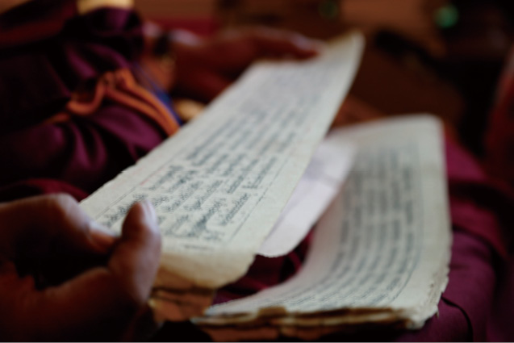
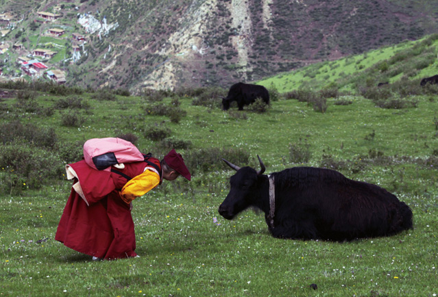

# 减轻压力的智慧

/

发明机器，本想有更多休息时间，结果人越来越累；

发明手机，本想交流越来越多，结果人越来越孤单；

发明网络，本想让人更有智慧，结果智慧日益迟钝。

人们猜到了开始，却猜不到结果，这是因为忽略了什么？

/

本章为索达吉堪布在广西师范大学的演讲

2012·11·02

一进校园，在最醒目的地方，我看到了孔子雕像，也看到你们的校训“尊师重道，敬业乐群”，可见你们是个重视传统文化的学校。

这个时代，人心浮躁、混乱、复杂，非常需要传统文化知识。

尤其是如今科技太发达，有用的知识都在电脑里、手机中，存在大脑里的非常少。人们看到珍贵的教言，经常根本不记，只是把它拍下来存好，最关键的时候又用不上。曾在一次世界性的研讨会上，几乎所有发言者都在用PPT。中途突然停电，一位很有名的教授由于PPT放不了，在他拥有的时间里，也没有讲出该讲的内容。

科技能给我们带来方便，但太过依赖于此，只能让人心浮躁，有种非常危险的趋势。所以，传统文化也不能放弃。中国的传统文化，主要有儒释道三家，今天我用佛教的观点和大家谈谈，现代人应以什么方式减轻压力。

## 生命不能承受之重

现在的大多数学生，除了考试、学习，感受不到什么压力。但毕业后，到了社会上，压力就会纷至沓来。

首先到来的，是就业压力。找到工作不够，还要找一份满意的工作。在工作中，要处理上上下下的各种关系，解决层出不穷的问题。接下来，是成家，供孩子、供老人、供房子、供车子……佛教中讲供养三宝，世人却要用一辈子“供养”这些，始终处于压力和不安中。

这些压力，能不能听一次讲座就荡然无存呢？

不可能。

那学了佛教等传统文化，对减轻压力有没有帮助呢？

的确有。因为我们的压力，有些必须要面对，有些则是自己添加的，在某种意义上，不一定要去承受。

认识到了这一点，就会明白传统文化对自己的意义。

现在很多年轻人，外表光鲜靓丽、神采奕奕，身上有各种高科技装备，似乎一副坚不可摧的样子。可在他们的内心中，承受力比较弱，面对痛苦和问题时，经常会显得力不从心。这种现象，其实是可以改变的。虽然现在是21世纪，但最适合他们的方法是，往前追溯，向古代先哲们学习。

你们校园里有孔子的像，他就是古圣先贤的代表之一。

孔子是公元前500年左右的人物，那一阶段，是整个人类文明崛起的时期。在中国，除了孔子，还出现了老子、孟子、荀子等一大批思想家。在西方，涌现了苏格拉底、柏拉图等诸多智者。当时的印度，诞生了佛教的创始人释迦牟尼佛。他们的思想主张，都有文字可查，至今仍深刻影响着世界文明。

在物质和科技方面，古人肯定无法与现代人相比，但心灵方面，我们越向前行，越需要往回看，学习古人在做人、做事方面的智慧。当然，通过一个讲座或一本书，不一定能让你变化很大，但至少，也许会改变你对生命的某些看法，人生由此发生转变。

## 你不会因为美景而少了压力

最近，很多城市的发言人说，自己所在的地方是“最具幸福感城市”。事实上，真要去住在那里，幸福指数也不一定很高。就你们而言，桂林山水甲天下，外人会觉得生活在这么美的地方很幸福，可长期住在这里的人，也许并没有特别的感觉，不会因为美景而少了压力。

有资料显示，中国是当今世界上压力最大的国家。前不久十一假期时，大概有七亿多人出门旅行。但因为人太多，有人长时间堵在路上，有人到了地方找不到住处，本想借假期放松一下，结果反而更疲惫。

这就是佛教说的“有漏皆苦”，很多东西看似快乐，本质上却是痛苦。就像一些有钱、有地位的人，外表看起来令人羡慕，但只有他们自己知道，自己有哪些不为人知的苦。

佛教中讲“苦”，并不是逃避，认真思维会发现，它所揭示的智慧符合人心，是一切万法的真相。即使不信佛，若能以此对待人生，也会活得自在、洒脱。否则，不懂这些的话，即便是不值一提的压力，也可能会把你压垮。所以，缓解压力需要一定的见识和方法。

当然，缓解压力的方法有很多，世间有世间的方法，出世间有出世间的方法。

世间的方法是什么呢？

有些人在压力非常大时，会找个善解人意的朋友或亲人，打电话倾诉一下；有些人干脆挑一本好书，沉浸其中，忘却烦恼；有些人则会听听音乐，用快乐的节奏驱除烦躁；也有人把事情放下，出去旅游，散散心。

还有一些不太好的方法。比如拼命喝酒，想一醉解千愁，或者去些不清净的场合，赌博、找刺激，用非法的方式让自己忘掉忧恼。

这些方法，其实只是在暂时转移压力，没有真正消除它。假如不能从根本上解决问题，长此以往，也许会出现一些不明智的举动。

曾有一则新闻说，有位大学教授，非常宠爱自己的女儿，但给她的压力也特别大，经常跟她讲，你一定要为我们家争光。女儿学习很努力，从小学到中学，成绩都名列前茅，高三的时候，稍微有点下降。高考时，她本想选个喜欢的专业，但这样可能考不上一类院校，二类院校完全没问题。父亲坚决不同意，说：“我一个大学教授，女儿考不上一流大学，我岂不很没面子？”在这样的压力下，女儿闷闷不乐，话也越来越少。临近高考时，一天早上，父亲发现女儿吃安眠药自杀了。枕边放着一封遗书，上面写道：“不孝的女儿离开了！我实在达不到你们的要求，没办法面对你们。感谢你们18年的养育之恩……”这样的结果，给家人带来的痛苦可想而知。

现在有些年轻人，不管是在感情上，还是在其他事情上，遭到一些不公平和挫折时，经常会想到自杀，或者做一些伤害自己的行为，这是很不理智的。要知道，获得人身非常不容易，假如没有好好运用，动不动就轻生，这实在是最糟糕的选择。

压力，是谁都必须面对的，对此没有必要逃避，而应用正确的方式解决。尤其是年轻人，工作后，会遇到更多让自己承受不了的事，这时一定要懂得如何调心。否则，心不受控制的话，很可能一直与痛苦相伴，甚至会得抑郁症。或者即使没生病，做的事情也非常过分，最终不但自己受苦，周围的人也跟着你一起痛苦。

## 压力让我与这个时代不脱节

其实，有压力不一定就是坏事。正常的压力，还是需要的，否则，一点压力也没有，每天过得浑浑噩噩，人生不一定有什么收获。毕竟人的潜能和智慧，25%可依靠自力开发，75%则要靠压力挖掘。

就像有些老师，如果没有讲课的压力，不一定会看很多书。有些学生，没有考试的压力、将来就业的压力，也不一定去认真学习。所以，适当的压力需要具足。

过于依赖外在的一切，

内心就会迷失自己。

压力越大，有智慧的人收获越多，这叫“拍球效应”——皮球压力越大，弹得越高。对此我就深有体会。

我为什么经常出来讲课？如果不愿意，谁也无法强迫我。但我觉得，与各种人见面的过程中，可以学到一些东西，对我而言，稍微有一点压力会让我与这个时代不脱节。

因此，在压力当中成长，是非常有必要的。人生就像钉子，若没有任何东西对它锤打，钉子不可能自己钻进墙里。同样，没有压力的话，人也激发不出潜在的智慧。

当然，压力如同气球，在一定范围内可以转化为动力，就像气越多、球越大。但气球容量是有限的，人对压力的承受也是，超过了这个限度，气球会爆炸，人也会倒下。

如果是一棵树倒下了，没把它扶起来，它会一直躺着，不像人那样有灵魂。而人在生命的旅途中，如果倒下去，这时候一定要自己爬起来，心要坚强，要有抗压能力。

## 人死并不如灯灭

面对压力的方法，在佛教中有很多。

一提起佛教，有人也许会想到迷信，这是认知上的一个误区。你们都有独立思考能力，佛教讲的是否有道理，可以用自己的智慧观察。

有些人认为，佛教承认前世后世、业因果等，这不符合科学。

我要说的是，佛教的这些道理，一部分科学已经论证过，一部分正在论证中。比如前世后世的问题，佛教中讲，我们今生的福报，一部分源于前世积善，一部分则是即生努力而得到的。前世的“因”怎么在今生成熟“果”，就牵涉到人有前世后世。这个问题我经常讲。因为现在很多人，对生命中如此重大的事情，完全是迷糊的。我虽然没有神通直接看到，但通过推理和很多现象，相信人一定有前世后世。

有些人认为，这一点只有佛教徒承认，科学家不会认可。那么，我们先来谈谈科学。所谓科学，至今有600年左右的时间。这600年要分两个阶段，前一阶段的科学家并没有否认前世后世存在；后一阶段由于某些思想的流行，有些科学家对这一结论有所反叛。然而，到了20世纪后期，很多科学家对此又予以否认，他们通过医学、心理学、量子力学等论证，人死后并不是什么都没了。

比如，1963年得诺贝尔生理和医学奖的约翰·艾克尔斯爵士，他在一本书中写道，人身体里有一种没有形状、没有颜色的心识，它就像人控制电脑一样，会控制我们的大脑。当大脑死亡后，这种心识或“自我”永生不灭。

他经过分析认定，人死并非如灯灭、水枯般毫无延续。

美国加州大学医学院史柏理博士，是1981年诺贝尔生理和医学奖得主。他认为，所谓的“自我”，是超越身体等物质以外的一种非物质，它可以控制大脑等复杂的结构。

科学起源于西方，西方智者们对前后世的真正看法，非常值得我们研究。比如，近代科学的奠基人牛顿，也承认后世的存在。还有现代科学之父爱因斯坦，晚年开始对佛教理论感兴趣——前些天，海外佛友送给我几本书，里面提到，爱因斯坦晚年时讲到释迦牟尼佛的功德以及佛陀如何看待世界。

一些不承认前世后世的人，其实既不懂传统文化，也不懂现代科学的来龙去脉。他们认为，人是突然来到这个世界上的，来了以后死了，死了什么都没了。这样推论下去，就是自己今生中遭受的压力、痛苦，全都来自无缘无故。

尤其多数人认为，人的心识是大脑产生的。其实，很多诺贝尔奖得主不承认这种说法，科学领域也没有对此进行认定。科学界发现，世界上有许多没有大脑的人、没有大脑的鸡、没有大脑的其他动物，但也有感受、意识和心态。所以，在大脑之外，还有一种心识存在。

否认前后世的人，需要学习一下传统文化，包括多看看西方哲学家、古希腊哲学家的论述。中国的儒家思想里，虽然没有着重强调前世后世的存在，但是也有文字记载。我在其他书中引用过部分公案。

## 不同时期，人们对幸福的定义不同

知道前世后世存在，就会明白一切皆有因果，有些事情无法强求。佛教说缘聚则生，缘散则灭。因缘具足时，不管怎样都会发生；因缘不具足时，无论如何也挽留不住。懂得这一点，很多痛苦就不会有。

有些年轻人在恋爱时，根本不讲因缘，只是一味追求。结果越是执著，失去越快，就像手握沙子，抓得越紧，流失越多，最后可能什么也得不到。若能明白凡事都有前因，那在面对有些问题时，心态和处理方法，会跟没有这种概念的人完全不同。

你们在学校里学到的知识，以后在人生中能用上的不一定多，据统计只有15%左右。关于如何调心，教科书里也讲得比较少，但这些是最基础、也是最需要的知识。年轻人一定要补充这部分内容，若能掌握其中的窍诀，就会减轻很多压力，而且是从根本上解决。这种缓解压力的效果，是看书、听音乐等其他方式所达不到的。

此外，还有一种减轻压力的方法，就是要常有满足感。

现在许多人喜欢攀比，其实，很多东西并不是你真正需要的，攀比和虚荣导致了过高的需求压力。比如，普通的房子、车子就够用了，但多数人认为这些要越贵越好，为了满足虚荣心，给自己造成巨大的压力。

相比之下，也许农民更快乐。虽然他们物质上可能不如城市里的人，但也没有那么大的压力。城里人住豪宅、开好车、穿名牌，内心却没有安全感，他们的幸福不一定真的多。

当然，不同时期的人，对幸福的定义也不同。

有人曾问获得诺贝尔文学奖的作家莫言，刚开始写作的原因是什么。

莫言说，当年他听说济南的一个作家比较“腐败”，一天竟然吃三顿饺子——那是1957年的中国，多数人一年吃不上一次饺子。他想，作家的生活这么幸福，如果自己能写本小说，是不是也能一天吃上三顿饺子。这就是他写作的起因，也是当时对幸福的理解。

几十年前，物资匮乏的时候，人们觉得最幸福的事就是随时可以吃上东西，各种食物唾手可得。但物质所带来的幸福，一旦得到就会变淡，甚至慢慢消失。这种幸福，是相对且不恒定的。

1993年我去美国时，50%以上的美国人有私家车，去哪儿都自己开车，我觉得他们很幸福。但后来跟更富有的人聊天时，发现这些人也有苦恼，因为没有买私人飞机的能力。

人的物质生活水平越高，对自己的要求就越高，这时候，压力会越来越重。或许对有些人来说，只有到死的时候，所有希求才能真正放下。

当然，佛教讲“放下”，不是让你什么都不做，而是让你别太执著。

有一则寓言说，有只狐狸看见一个院子里有葡萄，很想进去美餐一顿，可是因为太胖，钻不进栅栏，就三天三夜不吃东西，最后终于钻了进去。到了里面，它大吃特吃，可当要离开时，又钻不出来。只好故伎重施，三天三夜不吃东西。结果，出来的时候，肚子跟进去时一样。

人何尝不是如此，赤条条地来到人间，又两手空空地前往后世，没有人能带走一生苦苦经营的名与利。

所以，适当的时候，我们还是要学会放下，让自己有一种随缘的心理——“得之我幸，不得我命”。得到了，是自己的幸运；得不到，要么是今生能力不行，要么是前世业力所致，有因才有果，也没必要特别痛苦。

## 让人生不那么苦的第一步，是看破放下

我们的痛苦大多来自压力，而压力，往往是自己制造的。

有一个大学生，对自己要求非常高。他的目标是，毕业后，一定要进入世界五百强企业，月薪八千至一万；三年内，一定要事业有成；三年后，一定要买辆好车……他给自己设定了很多的“一定”。事实是，毕业后好长时间，他连份工作都找不到。朋友劝他：“要求先别太高，从月薪两千做起。等有了基础，慢慢才能越来越好。”现实让他明白了理想和现状之间的距离，如果没有一颗随缘心，这个距离中间存在着的，就是巨大的压力。

世界上最真实的东西，

往往是很多人看不到的。

人生这几十年，压力无处不在。因为学业压力，学生想尽快毕业；毕业进入社会后，工作、感情、生活等方方面面的压力接踵而至，又开始怀念学生时期的生活……如此心态反反复复，压力起起伏伏，确实正如佛教所说，人生皆苦。

让人生不那么苦的第一步，是看破放下，这时，压力才可能减小。若再深入，生起了佛教中的出离心，自我解脱也不会困难。

减压还有一种方法，就是要经常帮助别人。

有个成语叫“助人为乐”，这种表达很到位。加拿大麦吉尔大学的研究人员也发现，人在利他的过程中，痛苦能够明显减轻。

或许有人说：“我又没钱，怎么帮助他人呢？”其实，帮人不一定非要钱，哪怕只说几句关爱的话，或者用表情鼓励，也能够帮到人。

美国有本畅销书《29件礼物：一个月的布施如何改变你的人生》，故事大意是，一个女士由于长期的工作压力，患上了神经系统疾病，多方求医不见起色。后来遇到一位非洲医生，医生给她开了个奇怪的“药方”——29天内捐赠29件礼物。她感觉很为难：“我连床都下不了，怎么给别人送东西？”医生告诉她：“礼物不需要是物质的，说一些关爱的话语也算。”她抱着试试的想法，开始每天做一件力所能及的布施，当然，你们肯定也猜到了，她的身体慢慢好了起来。

所以，当你不只关心自己的得失时，压力和痛苦会越来越少。

## 人类最大的痛苦源于自私

人类最大的痛苦源于自私。有些女孩特别爱哭，但有多少眼泪是为悲悯他人而流的？是为非洲儿童的饥饿哭泣吗？是为遭受飓风的灾民难过吗？恐怕不是，绝大多数人的眼泪都是为了“我”。某人对“我”态度不好、对“我”不公平……“我”字当前，很难不痛苦。

因此，佛教极其珍视无私的慈悲心。这种心，不管是西方人、东方人、非洲人都需要。世间上的绝大多数理念，往往只能盛极一时，但有一种理念，不会因时代的变迁而褪色，它就是慈悲。

慈悲是人类最珍贵的宝物。没有慈悲心的人，在任何一个时代、任何一个群体中，都是大家想要远离的。有慈悲心的人，且不说能给别人带来利益，自己的压力也会减轻。比如，当你身体不好、心情不好时，如果忙于帮助别人，自然会忘记烦恼和痛苦。

还有一种减轻压力的方法，是具有无我空性的智慧。

佛教讲“万法皆空”，现代物理学将量子力学与空性对比后，也证明了2500多年前佛陀宣讲的这个道理是正确的。当然，这并不是说量子力学所推断的物质的终极属性，与佛教讲的空性完全相同。事实上，物理学家只抉择了空性的一部分理论，并非全部。但对于只接受科学的人来说，这种对比，或许可以帮你们找到一个了解佛法的入口。

若真懂得空性之理，对减轻压力有很大帮助。地位也好、名声也好、财产也好……当我们用智慧观察、抉择后，会发现全是假象，包括“我”也并非真实，万法就像虚空一样。有了这种心态，一切痛苦自然会消失。

所以，现在西方，包括日本，很多人喜欢修行佛法来减轻压力。他们的修行有两种：一是学习空性法门，通过理论认识到万法不真实，如《黑客帝国》里的虚幻世界。还有一种就是通过禅修，让心安住。一切痛苦从心上解决，这个方法特别管用。

很多人常会感到身心疲惫不堪，这时，依靠禅修就可以调节。

平常，我们每天早晚可以抽出点时间打坐，或者，一年中抽出几天参加禅修。不少高校都有禅学社，禅修对修心养性有很明显的效果。若能懂得调整心态，不仅自己身心安乐，也会给周围的人带去温暖。

下面给大家讲两种禅修方法：

一是有缘的禅修，即观佛像的方法。

在面前摆上释迦牟尼佛的画像或塑像，身体端坐，两手结成释迦牟尼佛的手印，或者结定印，专注凝视佛的身相。凝视一会儿后，闭目观想佛像。当印象模糊或心散乱时，睁开眼睛继续看，再闭眼观修……如是三四天后，原来烦躁的心态，就会慢慢改变。

二是无缘的禅修。

当你感到痛苦时，当下观察它的本体，寻找这颗痛苦的心在哪里——在身外还是身内？如果在身内，又在哪个部位……最后，心也找不到，痛苦也找不到，在这样的境界中安住。经常这样修，到一定时候心态就能恢复。

调心对现代人来讲非常重要。心态摆好了，无论遇到什么样的压力，都不会痛苦、崩溃、受折磨。

## 心静下来时，想法会自然呈现

许多人希望事业成功，若懂得佛法，成功的可能性也会大大增加。

“苹果”创始人乔布斯就是非常虔诚的佛教徒。一个日本禅师曾跟他讲，千百年前，有两个僧人针对风吹幡动进行辩论。一个僧人说，是风在动；另一个说，是幡在动。六祖听了他们的争论后说，不是风动，也不是幡动，是心在动。

如果没有佛教基础，会很难接受这种说法。事实上，六祖讲得很有深义，这就是“万法唯心”的道理。简单说，当你讨厌一个人时，他做什么都让你看不惯，而当你对他的看法改善了，他做的一切又会让你觉得顺眼。再比如，当你心情烦躁时，看桂林山水也没什么感觉，心情好了，看到一般景致也会觉得很美。所以，外境上没有绝对的好坏。

禅师的提醒让乔布斯了解到，一切都是心在作怪。此后，在工作和做决策时，他尝试用一颗禅心去完成，结果收获了许多天才的创意，创造了与众不同的“苹果”帝国。

日本“经营之神”松下幸之助也是一名学佛的商人。他在95岁接受记者采访时说：“像我这种才能的人在这个世界上比比皆是，我之所以能成功，其中关键一点就是对禅的领悟。”

有位日本禅学家听到他的言论后，总结成了两句话：“不通禅理，生活乏味；不明禅机，难成大业。”意思是，生活中一定要有禅的妙味，否则，每天忙碌、盲目、苦闷，这会活得非常乏味；若能通达禅的智慧，用禅来调整心态，可以成就广大的事业。

依靠这些道理，希望你们能够减轻压力和痛苦，获得真正的快乐。

现场互动

⊙ 问：我是一名研究生。每种文化要不断变化，才能更好地适应时代发展。在21世纪的今天，佛教需要哪些新的变化？

堪布：佛教至今已有2500多年历史，我认为，它的内容不需要任何改革。因为佛法完全是人类的思想精华，并非因为我是佛教徒就赞叹，包括荣格、鲁迅等东西方智者对此是如何评价的，不少人应该比较清楚。此外，历代高僧大德通过自己的修证，也证明了佛法所讲真实不虚。

当然，随着时代变迁，弘扬佛法的形式可以改变。像以前，佛教传入汉地后，与汉文化融合形成汉传佛教；传入藏地后，与藏文化融合形成藏传佛教。这些形式都很好，是随顺时代因缘的一种产物。但佛教的内容，不管在什么时候，都经得起历史的考察，也经得起后代智者们的剖析。

⊙ 问：我也是本校的研究生，听了您的讲座受益匪浅。请问，佛法的核心价值是什么？

堪布：佛教分小乘和大乘。小乘的核心价值是追求自己从烦恼中解脱；大乘对自己的解脱不是特别重视，核心价值是利他，虽然也希求佛果，但成佛是为利益一切众生。

现在的社会比较缺少利他精神。不管是提倡马克思主义，还是社会主义价值观，都应该让每个人减少一点自私心，增上一点利他心，这样，社会才能真正和谐。所以，佛教与这个时代不相违，不但不相违，而且是当今非常需要的。

⊙ 问：佛教的精髓，您能否归纳为三到五个字？

堪布：烦恼即菩提。

⊙ 问：以前我去云南松赞林寺，看到一个卖香的佛堂旁边，是个卖烤香肠的小商店。佛家本应倡导吃素，僧人们却没有制止这种行为，这是不是对佛祖的亵渎？

堪布：以前我去普陀山，看到有个饭店外面写着“佛光普照”，一进去，他们却在杀鱼。对此你怎么看？

⊙ 问：在公共场合而不是寺院的话，可能没办法吧，因为不是每个人都信佛。

堪布：不是公共场合，是一座寺院的门口。

⊙ 问：难道是要强调每个人都自律吗？

堪布：对，这个时候我们要知道，有些清净寺院的周围，可能也会有不清净的现象。

现在的社会比较复杂，有些现象不一定是寺院的本意，主要是很多人把寺院当成赚钱的场所，而且这种现象越来越严重。

不仅仅是在云南，如今汉地的四大佛教名山，都面临着这种问题，也发生了许多不太愉快的事情。这一点，有些佛教徒可能不知道，或者，知道了也无力制止。

以卖门票来说，这种行为我们非常反对，但汉地这个传统也有历史原因。其实，在国外，寺院卖门票是很少见的。所以，现在许多佛教徒也在呼吁，希望商业与宗教分开，清除各种不合理现象。我所在的五明佛学院，是不允许这些的。

⊙ 问：我是教育科学学院的研究生。刚才您讲“烦恼即菩提”，请问，菩提到底指的是什么？它来源于何处？它所表征的又是什么？

堪布：我今年在讲《六祖坛经》，对这个道理也做了一些分析。关于菩提的本质、来源，还有烦恼如何转为道用的方法，需要比较系统的学习，才能真正明白。

⊙ 问：我发现，藏传佛教的仪轨比汉传佛教更多、更规范。佛在《金刚经》中说“无我相、人相、众生相、寿者相”，又说“知我说法，如筏喻者，法尚应舍，何况非法”。请问，仪轨是不是一种相？仪轨太多，是否违背不着相的精神？

堪布：佛陀说法，不是只针对一个众生、只讲一种境界。

有些人对佛法了解得不是很深，看了《金刚经》《心经》里的一句话，就开始断章取义，否定佛法的其他内容。这显然不太合理。

所谓“无我相、人相、众生相、寿者相”，是就究竟实相而言的，站在世俗现相的角度，修行仪轨不可缺少。事实上，不仅藏传佛教，汉传佛教、南传佛教也有仪轨。比如，寺院每天有早晚课诵，出家人要受持比丘戒、比丘尼戒……

虽然仪轨本身是一种相，但修行人还没达到最高境界之前，不能舍弃它。这个道理很简单，就像吃饭也是一种相，但你若做不到不吃饭，那饭还是要吃。

⊙ 问：我在寺院常看到有人在佛前许愿，您怎么看这种行为？

堪布：许愿最好是为了众生，不能光想自己的工作和家庭。当然，若实在发不起这种心，也可以为自己许愿。只要心清净，依靠佛的加持，愿望会比较容易实现。

⊙ 问：我是外国语学院的老师。虽然看佛书好多年，感觉自己还是比较愚钝，运气也不太好。请问怎样才能转运？

堪布：佛教认为，只要因缘具足了，命运就可以改变。

如果你想转运，最好多看《了凡四训》，常怀善念、常行善事，命运就会逐渐好转。

当然，如果往昔造的恶业太重，想马上转运也有困难。就像一个人犯了法，已经被关到监狱里，想让他马上恢复自由，这也不太现实。但不管怎样，都不要对人生失望，也不要对自己失去信心。

⊙ 问：我母亲是佛弟子，她现在有一个困惑：每当看到亲友行为不如法，她就会去劝，如果对方不接受，还会严厉批评，结果让别人起嗔心；不劝的话，又会良心不安。请问有什么办法可以帮她？

堪布：身为大乘佛子，理应尽力饶益众生。如果自己付出了，效果却不理想，也要有随缘的心态。我很喜欢“得失从缘，心无增减”这句话。什么事情都要看开一点，没必要因为一件小事，自己的心起起伏伏，苦恼半天。你可以用这个道理开导母亲。

⊙ 问：这个时代比较浮躁，以后有时间，我想用禅修让心静下来。除了观佛像等方法，您有什么更好的建议吗？

堪布：如果你想禅修，不要等到“以后”。

要知道，有些念头是不容易生起的。一旦生起了，就要把握当下，让自己尽量在生活中修行，在修行中生活。

有些人禅修、做慈善，非要找个专门时间，比如“明年放假我再修”“等退休后再学佛”，这样一直拖着，以后不一定还有机会。

⊙ 问：佛说众生平等，但世上有许多不平等，佛教对此如何看待？

堪布：佛教所谓的平等，不是简单的一刀切——所有人个子一样高、皮肤颜色都一样……佛教的平等主要是指，众生本性是平等的，都有如来藏，具足成佛之因；众生感受也是平等的，包括动物在内，都喜欢快乐、不愿痛苦，所以要慈悲对待每一个生命。

这种平等观，现在的人比较欠缺。许多人只管自己，不顾众生死活，结果自己也不会真正快乐。

⊙ 问：面对一些不平等，我们怎样保持心态平和？

堪布：要想到这是前世的业力所感，或是自己福报、智慧、能力不够所致，不要将过错推在他人身上，应以感恩心来对待一切。

05
