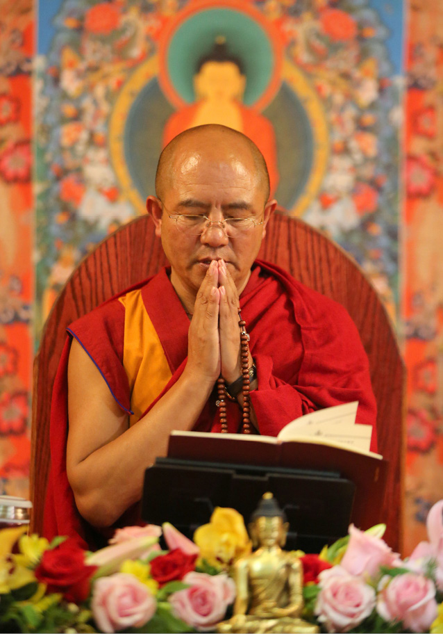
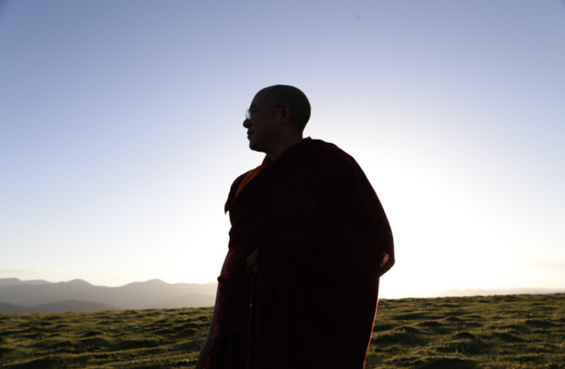

# 只为一颗心

/

莎士比亚说：“怀疑，是大家必须通过的大门口。

只有通过这个大门口，才能进入真理的殿堂。”

所以，怀疑并不可怕，关键是如何对待。

/

本章为索达吉堪布在中国文化书院的交流活动

2012·12·22

现场互动

⊙ 问：我曾帮助过一个人，他若是伤害了别人，我有过失吗？

堪布：你如果没有害其他人的心，就没有过失。

我曾帮过一个贫困学生，希望他有前途，但没想到他用学到的知识伤害了很多人。我帮他有过失吗？没有，因为我的心是想利益他。他做坏事只会害自己，对我不构成损害。

⊙ 问：这个业由他自己承担？

堪布：对。我帮他是一颗好心，好心不会有恶报。业依赖于心和行为，我的心和行为清净，没想过让他造恶。他要造恶，就自己承担。

⊙ 问：也就是说，是从发心的那个点来判断？

堪布：是的，判断善恶主要看发心。

⊙ 问：有些人长得不帅，但你就想亲近他，这是因为他的魅力还是什么？

堪布：可能是因缘吧。

佛教认为，初次见面时，如果你对某人有不同的感觉，“好像以前认识他”“怎么如此亲切”……那很可能有一些因缘在里面。

这种因缘分两种：你面对的若是一位高僧大德，真正的善知识，你对他有欢喜心、清净心，这种善缘会给你带来解脱和快乐。

若是个一般的世间人，你对他的执著，也许是来自前世的共同发愿：“愿我们生生世世在一起”；也许没那么幸运，他是你前世的仇人，彼此间有宿债，“你欠了我、我欠了你”。

是亲是怨，难以确定。因缘很复杂，有时要牵扯很多世。

纵然你无法得到渴望的一切，满足现在所拥有的，

也是第一富翁。

最近，我在翻译明珠多杰的传记。传记中说，他是宁玛白玉派中天法派的创始人，能回忆两百多世。在这些世中，他有时变成动物，有时变成人，什么样的情形都有。其中，他跟自己的上师乔美仁波切，前世也有好多关系，比如有一世上师转生为马，他就转生为一匹小马，诸如此类。

现在我只译了一百多世，还有一百多。每一世的故事很短，不像《百业经》那么广，例如“当时他变成什么，我变成什么”，“当时他是怎么死的，我是怎么死的”……一段一段的，很精彩。

看了以后，你会感受到业的力量。再看今生中自己与他人的相遇，不管是遇到上师还是其他人，你会相信，这背后一定有很多世的因缘在。

⊙ 问：汉地弟子选择上师很难。戒律严格的上师，形象比较保守，不好接触；有才华的上师，涉猎广泛，又特别开放，请问该怎么选择才恰当？

堪布：保守的也好，开放的也好，先观察很重要。

凭一时冲动不观察就依止，往往会发生不愉快的事：弟子的信心变了，上师的加持没了，弟子诽谤上师，上师辱骂弟子……这就是之前没有观察的结果。

观察后再依止，人不容易退。如果是具相的上师，无论他怎么显现，自己都应以信心依止，随学《华严经》中依止善知识的公案。

戒律清净的上师，可能会有点保守，藏地寺院里有很多。他们来汉地的机缘不多，即使来了，因为语言不通或性格严肃，显得不太好接近。不过，如果能找到这样的上师，时时敲打你、监督你，对你的修行很有好处。

开放的上师比较随和，如果他有些善巧方便，也精通佛法，那么你在依止时，一方面比较轻松，一方面能学到佛法，这是很好的。

总之，上师的行为不重要，重要的是，依止他能不能得到佛法。

遗憾的是，许多人不了解这一点。他们依止上师，只是依止上师的微笑或行为，有点像感情依赖。但感情会变。如果你依止一段时间，始终没学到佛法，感情一变，信心也就没了，那时候很可能依止不下去。即使不是这样，一旦无常显现，既见不到上师，又没得到佛法，就悲惨了。

所以，一定要在佛法上结缘，这才是依止的真正意义。

⊙ 问：放生过程中，放鱼的时候，有些鱼死了，有些被人捞去了；放鸟的时候，有些不走，他们就往空中抛，这样会不会不好？这是积福还是造业？

堪布：我发愿放生、劝人放生，已经有二十多年了。我特别喜欢这件善事。

你说的这些情况是有，社会上也有人不提倡放生，认为放生有弊端，但我们不能因此说“放生没有意义”。我认为放生百分之百是善法，功德非常大。只不过，方法上确实要注意，否则就是对生命不负责任。

放生前必须观察好：地点对不对？在这里放能不能存活？有些人在大路上放鸟，一些刚出笼的鸟飞不起来，结果车一来，好多就被轧死了。

真正有经验的人，放生之前会找个好地方，甚至为此花上几天时间，这样就会比较安全。

⊙ 问：我们放生群发愿吃素，但“佛法不离世间觉”，有时也会坐到荤桌上。请问，该怎么解决类似的矛盾？

堪布：平时能吃素最好，实在不行，放生时也一定要吃。否则，一边放生一边吃肉，善法就不清净了。

“佛法不离世间觉”，是让我们在修行过程中，懂得随顺世间，学会从世间觉悟真理。这并不是说，世间人吃肉，我也吃；世间人偷东西，我也偷；世间人干坏事，我也干……不是这个意思。

有些事可以随顺，有些事不能随顺。

⊙ 问：现在市面上有您的书，我在读，也推荐给朋友。仅仅读这样的书，可不可以修行究竟？

堪布：《苦才是人生》《做才是得到》等，是我把平常讲课时说的道理、讲的故事集合起来，用适合世间人的语言汇编成书。每一篇都不长，很快就能看完。

看这些内容，改变一些观念是可以的，知道我们以前哪些行为不好，将来怎么为人处世，怎么变得善良，甚至可以学着积福累德。书中还提到了死亡问题，这对现代人也有警醒作用。

至于能不能让一个人修行究竟，这要看根基。像禅宗中的利根者，听个简单教言就可以明心见性，如果是这种根基，也并非不能开悟。

⊙ 问：我是做管理工作的，压力很重。当我专注佛法时，工作就使不上劲；专注工作时，佛法又疏离了。请问，工作和修行如何协调？

堪布：这是个很实际的问题，也是很多人的问题：不修行吧，人身难得，一定要修；修行吧，工作又太忙，顾不上。所以，我经常建议大家：在修行中生活，在生活中修行。

其实这事不难。对我们藏族人而言，从小的时候开始，修行就被很好地融入生活，成为习惯。一旦习惯了，也就容易了。

认为二者水火不容，修行时不能工作，工作时不能修行，那可能永远没有修行的时间。作为在家人，谁都有家庭、工作，完全放下不太现实，想抽出一个星期或一个月专门修行，也很难。

所以，你要习惯在工作的同时，完成一定的修行。比如，每天看三四页《大圆满前行》，或者走路、坐车时，念够一定数量的咒语。习惯以后，就不至于中断修行。

有些人比较极端，修行的时候舍弃工作；等家庭和生活的压力承受不住了，不得不去工作，一工作起来，又把修行全部放下。

我不赞成这种做法。除非你像学佛之前一样，做个一般的世间人，或者干脆出家，两者都做不到的话，那最好兼顾——在修行中生活，在生活中修行。其实，释迦牟尼佛住世期间，佛弟子也大多是在家人，他们就是这样兼顾的。那时候都是如此，何况现在？

把工作做好，把家庭照顾好，与此同时，你可以每天抽出一段时间学修佛法。

每天一两个小时，肯定空得出来。我认识一些企业家，他们特别忙，去这儿出差、去那儿开会，但一有空就学佛法、做功课，天天如此。久了，两边都兼顾得很好。特别是修行，不会退失。

我也是这么过来的。平时要翻译、要传法、要管理、要搞建筑、要办学校，同时还要跑出来跟你们交流，但我的功课从来没落下。出来的车上或飞机上，我会念一部分功课，中间一有空就翻译，哪怕两三个偈颂也行，就这么坚持下来了。

要想坚持，最忌讳的就是冲动，一会儿热情高涨，什么都不管，一心修行，一会儿又心灰意冷，什么都不修，这样既做不好工作，也修不好法。我们应该有一颗恒常心，对于做好的决定，永远也不放弃。

不必放弃工作，因为你要生活；不能放弃修行，因为你要解脱。只要不放弃，总能找到一种平衡方法，让生活和修行同时进行。

⊙ 问：我现在学佛了，不喝酒、不吃肉，也不去卡拉OK。但一聚会就被边缘化，别人觉得你另类。这个时候应该怎么对待？

堪布：学佛的人不喝酒、不吃肉，圈子变小了，对待起来有两种方式：

一是随他去。如果因为这种行为，减少了一些不好的朋友，生活反而简单、正常了，这是好事。现在人“无酒不成席”，你不喝就不够意思，不玩就成了怪物：“你是不是受刺激了？”“最近受了什么奇怪的教育？”……我们学佛有什么问题？只不过人们的认识已经是这样了。

还有一种是，你可以用健康为借口跟朋友解释，比如，“医生说，我再喝酒就没命了”“要是我继续吃肉，血压肯定降不下来”……渐渐地，周围的人也会理解。

其实吃素很时尚。有些藏族老乡劝我：“你不吃肉不行，营养不够。”我开玩笑说：“知道吗，奥巴马也吃素，他身体很好。”不过，奥巴马是为了环保，他的妻子和女儿也在各大学校推广这种理念。

眼下在一些圈子里，喝酒、吃肉、KTV仍然是重要内容，但慢慢也在变。你们可以试着转变别人的观念，即使做不到，也要善巧自处。

⊙ 问：晚上我要去修行，一下班就得走，但领导看你不加班，就会找你谈话。怎么才能既不得罪领导，又能继续修行？

堪布：这个也得善巧。看来佛教里强调“善巧”，还是很有道理。

在这种情况下，你要反反复复观察、思维和祈祷，借用文殊菩萨的智慧、观音菩萨的大悲，再加上你自己的善巧，一定会有办法。

⊙ 问：为了修行，跟领导撒个谎怎么样？算妄语吗？

堪布：这叫方便妄语。准备说什么？（众笑）

⊙ 问：有个师父跟我讲，做事时念咒语不计功德，必须坐下来静心念才计。我已发愿念某个咒语十万遍，但他这么一说，我就气馁了。对此您怎么看？

堪布：我的观点是，做事也好、走路也好，都可以念。也许对一般人而言，这么念不如静下来专注，但对修行纯熟的人来讲，就不同了。

藏地有许多大德，他们在行住坐卧中都能念咒，已经习惯了。以前有位格西，他每天一边看因明、俱舍，一边念咒，法义完全领会，咒语也念得有质有量。我的上师法王如意宝在睡梦中也能念咒。我亲眼见过几次，就在旁边看着，他人已经睡着了，但手还在一直拨念珠。

我们没有这个境界，但在做事时念咒，肯定有功德。那位师父说一定要坐下来念，可能是从严格角度讲的，这样念心比较静，功德大一点。

⊙ 问：您能不能说说自己一天的起居情况，比如几点起床？都做些什么？这样我们也好随学。

堪布：就说今天吧。早上我五点半起床，念了半小时咒语，禅坐了一会儿。接着念了一小时经，这是我的功课。念完后，磕了一百个头。接下来，我喝了点五台山的文殊茶，一边喝茶一边看书。之后写微博，吃早餐，然后就到这里来了。

⊙ 问：那您一般几点睡觉？

堪布：以前有资料说，人晚上要睡足八小时才行，但今年有新的报告说，每天睡八小时的人死得快，四五个小时足够了。所以，睡眠时间太长对健康不利。

平时我十二点钟以后睡。昨天要晚一点，我们那边有个病人，说要我念经，让我等着。但我等到一点钟，还没来电话，就睡着了。

⊙ 问：那您什么时候写作或翻译？

堪布：一般是在下午。

⊙ 问：《普贤行愿品》说要“恒顺众生”，这对我们来讲很难。众生有善有恶、有正有邪，面对善的时候，可以从善如流，但面对恶人恶事时，该怎么办？还要随顺吗？

堪布：恒顺众生，是指一切时候都要随顺。这是《华严经》等大乘经典中教诫菩萨利益众生的殊胜方便。

法王如意宝的《胜利道歌》里说：“言行恒时随顺友。”针对这句，曾有人问：“如果对谁都随顺，那对贪心大的人，是否也要随顺他生贪？对嗔心大的人，是否也要随顺他生嗔？”

法王说：“当菩萨随顺众生时，一定要有度化他们的智慧和能力。比如，文殊菩萨在度化国王的嫔妃时，首先就是随顺她们，然后才让她们皈依，引导她们获得解脱。”

不仅是文殊菩萨，许多菩萨也都有自己的善巧方便，并在各种场合中随顺世人，度化有情。

所以，在接触所谓的“恶劣众生”时，如果你有能力、有方便，不妨先顺着他，以赢得信任。比如，你想帮助一个有邪见的朋友，可以先听听他的观点，甚至适时地表示认同，到了一定时候，再恰当地提出你自己的看法，慢慢引导他。

当然，如果你没有这个能力，就不要随顺了。否则，说不定被别人吸引，度不了别人，还跟着人家跑，这不成了“同流合污”？

⊙ 问：我是做媒体工作的。现在有些人披着“上师”的外衣，我也看到了他的私心及不如法行为，请问这时候该怎么做？是视而不见，还是揭露出来提醒身边的人？

堪布：这个问题要分开看。有些不如法的现象，如果危害面比较广，让大家知道也好，有个提防。但要注意的是，不能因此给整个佛教带来负面影响。

现在许多藏传佛教的上师在汉地度化众生，劝大家皈依、发心，让大家行善，而很多人也皈依了，懂得了法理、得到了摄受，这非常好。

与此同时，也有来谋私利的。汉地一些比较单纯的人，因为没受过佛教教育，加之心急，见到上师也不观察，直接冲上去依止、供养。等出了问题又生邪见，甚至闹着打官司。这种现象是有，就像工业革命后，市场上出现各种商品，真的假的都有。

看到这些问题，要不要说出去？这要观察我们有没有制止的能力，制止的话，效果好不好。

如果你有能力，确信效果会好，那就制止。但如果你观察到，这对他个人不利，你度不了他，对佛教更加不利，那装着不知道也好。

为什么？因为一旦你报道了，现在人你们也知道，一个人的问题，他们不会怪罪这个人，而是说“藏传佛教怎么怎么”“汉传佛教怎么怎么”……本来这个人代表不了任何教派，但“丑闻”一出来，就会损害整个佛教的形象，也会伤及很多人的善根。

所以我认为，现在我们更需要的，一方面是法律，法律对佛教的保护；一方面是多些正面报道，以赢得社会对佛教的普遍认同。

⊙ 问：我一位朋友的母亲刚过世，心情很悲痛。我给她推荐了您的《苦才是人生》，她看完后，特别特别想见您。您今天在这儿上课，她很想来听，但碍于书院的规定，来不成，非常难过。我也很不开心，就向您诉诉苦，没有别的。

堪布：书院在管理上有些规定，非常有必要。但她处在这样的困境里，想要见我的话，可以单独安排个时间，晚上或明天早上都可以。

亲人死了，是最悲痛的时刻，很需要帮助。没有感受过的人不知道，“为什么哭得这么厉害，为什么这么难受……”但正在感受的人，很难摆脱这种痛苦。

在佛学院，以前有人请我念经，我很少去。但后来我父亲死了，我去请一些上师、活佛念经，有些答应了，有些没答应。我知道他们忙，但还是沮丧：“我家人死了，请您念个经，为什么不答应？”

我感受过，就知道她的痛苦。用自己的感受来为别人着想，也是一种修法。

⊙ 问：禅一般是静着修的，但能不能动着修？比如我打球，打一下念一句“嗡玛呢巴美吽”，再打一下，再念一句，能这么修就方便了。

堪布：这个主要看修行的熟练程度。初学者一般先安住修比较好，念咒也好、观想也好，在身心寂静的状态中容易修。

等境界提高了，稍微有点散乱也没关系。像密乘里的有些修法，有一定境界时，还要求你奔跑、唱歌，做各种行为，这时也能专注，可以成就很高的境界。

每个人的根基不同，如果你有这个能力，一边打球一边念“嗡玛呢巴美吽”，当然好。如果打着打着就忘了，不如多抽些时间静修。

⊙ 问：您说念咒一定要计数，但我经常不知道自己念了多少遍，这样行吗？

堪布：念咒还是要计数。光是口头上念，不一定很踏实，念了十遍，可能你觉着念了很多。如果你一个一个计数，念多少是多少，对修行是一种动力和压力。

⊙ 问：我在学佛时，不少同事对此感到好奇，也找我聊佛法。他们是自己看书，也常说些自己的见解，但我一听就知道在谤法。我不好直接反驳，怕他们烦恼，请问如何善巧引导他们？

堪布：要引导别人，自己先应该学好教理，培养佛教方面的综合素质。

听说有个大德来这里讲显宗密宗，有人问旁边的人：“什么叫显宗密宗？”那人回答：“显宗就是显宗，密宗就是密宗。”

可能很多人确实不知道这个差别，所以很难作答。佛教徒要系统学习佛法，最好有善知识引导，这跟你没学过或者自己看书差别很大。

自己看书，可以了解点知识，但很难通达教理。不通教理，就像你所说，一说话可能在谤法了。所以，你最好建议他们，在有师承的情况下学习佛法。

没有师承，不说一般人，就是永嘉大师也不被认可。当年他对玄策禅师说自己读《维摩诘经》时，悟到了佛陀的心宗。玄策说：“无师自悟，是天然外道。”

他请玄策为自己印证，玄策说：“我的境界不够，曹溪有位六祖大师，你可以找他。”就这样，永嘉大师参礼六祖，得到了印证。

因此，见到有人自学佛法，我们应该启发他的善根，让他接受一些正规的佛教教育。开导时要善巧，不必加些什么“罪”给他，免得人家生烦恼，但是在道理上，你一定要有破斥他观点的能力。

这个不必客气。他觉得自己对，你就用佛教理论跟他辩，让他知道什么是对，什么是不对，理论上不要留余地。否则，他会觉得专业佛教徒都答不上，自己的观点更厉害了，还到处宣扬。这对他不好。

我们自己要好好学。学好了，方式上善巧一点，那些断章取义的说法很容易破。

⊙ 问：烦恼怎么转为道用？

堪布：《六祖坛经》说：“烦恼即菩提。”这句话的意思若能通达并做到，就是把烦恼转为道用了。

比如，当你生起贪心或嗔心，就用智慧观察这个烦恼的来龙去脉：它从哪里产生？住在哪里？去了哪里？……这样观察下来，你会发现，其实烦恼是不存在的。

不仅烦恼，生烦恼的人和烦恼的对境，也都不存在。如果我对这个人生嗔心，“我”的本体存在吗？这个人的本体存在吗？嗔心的本体存在吗？反复寻找以后，结果了无一法：找不到“我”，找不到敌人，也找不到嗔心，里外都找不到。所以说“了不可得”。

一切唯有空性，显现也不过是智慧的妙用。

当你学着观察，并真正认识这点时，也就是把烦恼转为道用了。因为你已经了解到它的体——体是空的，既然如此，也就没什么可烦恼了。

当然，这个一定要修，只是道理上懂、口头上说，是不管用的。试想，怨敌来了，你边跑边喊“没有怨敌、没有怨敌”，行吗？烦恼来了，你边生烦恼边叫“没有烦恼、没有烦恼”，有用吗？

所以，一定要认识烦恼的本性。认识了，也就无害了。

⊙ 问：我公司很多人在学佛，天天“我上师是谁，你上师是谁”，但我一直没皈依。不过您的课讲得好，我喜欢听，特别是您说要用五六年观察上师，这挺对我的脾气。而且您不是那种把自己摆得很高的感觉——不好意思啊。我想问的是，是不是每个学佛的人都要皈依？

堪布：大家一起交流，有什么想法就说出来，这点我很欣赏。你在皈依上这么谨慎，比不知道观察、听到一个名字就去皈依的人，要明智得多。

暂时不皈依也好。有人皈依后，以为皈依的是人，把上师当私有财产，“这是我的上师，不是你的”。听说某位上师有两拨弟子，他一下飞机，弟子们都去抢，结果一拨抢到人，一拨抢到衣服，闹得很不愉快。

基督教没这种事。他们共同信仰上帝，神父不会说“这是我的信徒”，信徒不会说“这是我的神父”，这样就团结。其实我们也一样，大家皈依的是三宝，所以我每次都说：“我代表佛法僧三宝给你们授皈依，你们皈依的是三宝，不是我。”

我这么说有我的考虑。一方面，一旦我做了什么坏事，不会染污别人；另一方面，也是让大家不要有“你的、我的”这种分别，我们都是佛教徒，是佛的弟子，应该要和合。

当然，人的意乐、根基不同，我们选择的路，并不是所有人都要这么走，别人可以自由选择。今天我们聚在一起，信仰什么都可以，不妨碍大家共同开拓一种事业。所以，皈依看因缘。因缘成熟了，瓜熟蒂落，也就皈依了。

不过，人身难得，以后因缘成熟了要把握好。要知道，皈不皈依在功德上有很大差别，约束力也不一样。

⊙ 问：不知道为什么，我一看《金刚经》就想睡觉，这是怎么回事？

堪布：是不是这部经的加持让你的心安宁？以后我睡不着也试试。

⊙ 问：在依止上师的问题上，您说要观察五六年，这肯定非常如法，也最踏实。但是，如果每个人都花这么长时间去观察，会不会影响佛教发展？有没有特殊情况？

堪布：观察五六年，应该不会影响佛教发展。就像九年义务教育，这不仅不妨碍中国发展，还会促进社会进步。所以，在一些重要问题上，长期准备是有必要的。

其实，观察上师还有更长时间的，按宗喀巴大师《事师五十颂释》的观点，需要观察十二年。

特殊情况也是有。一些非常公认的大德，你可以不经观察就依止。以前德巴堪布对我说：“按理来讲，长时间观察上师是对的，但像法王晋美彭措那样对弘法利生具有极大功德、举世公认的大成就者，你们没有能力观察，也不必观察，直接依止就可以。”

听了这句话，我马上去喇荣依止了法王如意宝。

⊙ 问：大圆满教法里有三个概念：本体空性、自性光明、大悲周遍。而现在的“人间佛教”常说无缘大慈、同体大悲，禅宗也只强调空性，那是不是说，大圆满才是将这三者整合在一起的教法？

堪布：宁玛巴里讲的“本体空性、自性光明、大悲周遍”，是从觉性的不同侧面上讲的，这三者本来就是一体。

所以，这不是指所有宗派观点的最终圆融，而是当一个人证悟心性时，自然会呈现这三个融合一味的特点：本体空性，这是法身；自性光明，是报身；大悲周遍，则是在不同众生面前示现种种化身。

⊙ 问：我经常组织给亡人助念的活动，但个别师兄有顾虑，担心会把亡人招来，给自己及家庭带来不良影响。请问，这种顾虑有没有必要？

堪布：一般的亡人，像病死的、老死的，这些不会。按照藏地民间的说法，横死的可能稍微有一点，但这个通过念咒，也都能遣除。

你们助念者发心大，功德也大。虽然民间有各种说法，但不必有什么顾虑，因为佛菩萨的名号及咒语完全有守护自己、防止危害的能力。而且，以清净的发心去助念，对亡者的利益不可思议。

⊙ 问：弟子以前在一年当中，都是五点起床，然后学习、上早殿。后来我发愿受四十九天八关斋戒，希望再早起一点，多些时间学法。谁知道已经三十天了，还是不到五点起不来。我现在好像起不来了——

堪布：你这不起来了吗？（众笑）

修行佛法，也要根据自己的身体条件。这个要长时间调节，偶尔性的过于精进，不一定合适。

如果你想多些时间修法，一是要减少睡眠，睡太多只是习气而已，这个可以慢慢减下来。还有一个就是要减少散乱，很多人说没时间修行，其实时间都用到散乱上了，并不是没时间。

⊙ 问：我是慈慧基金会的志愿者。在实习过程中，我接近了一些老人，才体会到他们的孤独无助。同时也看到，有些人做志愿者时，觉得这只是世间法，和自己追求的出世间法不一致，还有人不愿意接受制度的管理。但我认为，亲自做慈善，是能够实践菩提心的。请上师开示，该如何通过做慈善完善自己的心灵？

堪布：我做慈善的时间不长。刚开始，是一个女孩的信触动了我。

那时候她在读中学，家里没钱，读不下去了，于是给我写了一封信，并托人转交。当时我在汉地，回去后没见到那封信。为了读书，她又写了第二封信，这次我收到了。

信里说：“我很想用自己的智慧来过自己的生活，但家里实在太穷，没办法供我读下去。听说您是一位堪布，能不能帮帮我……”信末，她留了隔壁的座机号码。

此前，我没有资助过贫困学生。读了信，我辗转找到她，并开始给她资助。现在她已经毕业，在甘孜州白玉县做医生，对我非常感激。

这件事改变了我很多观念。以前我认为，只要自己修行、自己行善就可以，是她让我开始做起了慈善。那天我还对她说：“你的那封信，让我后来资助了一些人，也改变了一些人的命运。”

那这些是不是世间法？是。你去看望老人，去关怀他们，这些也是。但一个追求出世间法的人，有没有必要做这些？有必要。

虽然你修的是空性大悲，但要落实它，无非是落实在这些地方。

当你去落实时，可能会发现自己的悲心远远不够；当你偶有所得时，又会激励自己继续修行。所以，世间与出世间并不矛盾。当然，我们也不是天天做这些，不修佛法。

做慈善要不要管理？

我认为，合理合法的管理是需要的。大家虽然都是佛教徒，都是行善的人，但不管理也不行。以前法王如意宝在世时，对佛学院的堪布、活佛以及所有出家人，都有相应的管理。所以，合理的管理很重要。

没有管理，即使行善，也不会做得尽如人意。“六一”儿童节大家都去给孩子送花，“老人节”又都去照顾老人，完了以后呢？没人管了。所以，行善也要用管理保证大家那颗助人之心，如此才能细水长流。

我常说“慈善是心”，当你有了行善之心，做慈善也就顺理成章了。大家都有行善的能力，身边也有需要帮助的人，可是，如果你没有一颗利他心，即使擦肩而过，也看不到那些可怜人，看不到他们的痛苦。

佛教徒若都这样，还有谁会关心他们？

我们常认为自己是大乘菩萨，但是不是菩萨，不是口头上说，而要见诸行动。基督教的教理没有佛教广，但实际行动却在为宗教、为众生奉献，这比我们为自己修行更有说服力，更能体现一种善的力量。

刚才有个人说，他在印度金刚座前发愿做善事，这非常好。不管是病人、老人，能帮多少算多少。如果你只有帮五个人的能力，那就把这五个人的事情做好，用五年十年，把事情做圆满；你能帮十个人，就帮十个人……什么都不做的话，天天为自己，人生也就过了。

其实我们拥有的财富和地位，一方面是自己前世的福报，一方面也跟众多人的帮助有关。得到以后，只是独自受用不回馈社会，因果上是说不过去的。

⊙ 问：我骑自行车进藏时，见到一座山叫冈仁波齐。当地人说，它被印度教、藏传佛教等奉为神山，转一圈可洗清一生的罪业。我转了两圈。不知道这种说法是否可信？

堪布：转神山有很大功德，特别是冈仁波齐，我也很想去朝拜。在许多上师的传记中记载，作为修行的一部分，他们就常常转绕冈仁波齐，还有匝日神山、湖心山等，这些地方加持力很大。

至于当地人的说法，如果是了义的，确有其事，那只要你的心清净，也像大德们一样完全具足相关的对治力，就一定可以清净。即使做不到这么圆满——毕竟每个人的业力不同、修行力量也不同，但清净相当一部分罪业是没问题的。

⊙ 问：我家里有两个孩子，一个八岁、一个两岁。请问，在小孩教育方面，您有什么样的建议和叮嘱？

堪布：对于孩子的成长，现在人们普遍认为，胎教、家庭教育、学校教育、社会教育一个都不能少。尤其是家人的影响，是很重要的一种教育。

教育是为了培养人。但汉地自传统文化受损之后，怎么为人处世、怎么做人，没人教，也没人重视。所以我建议，家人可以安排孩子学一学《弟子规》《三字经》，甚至是佛教的《业报差别经》，从小为他们种下道德理念和因果观念。

学校里也有这些就好了。有这种意识的老师，可以给孩子讲讲故事，如孝顺父母、关爱他人的故事，古代的、现代的都可以，这对幼小心灵会有很大启迪。否则，光是盯着ABC或考试分数，孩子日后很难有大的出息。

现在的“人才”，人很多、才很少。招的是本科生、研究生、博士生，学历不错，但一做起事来，与人相处的能力都没有，这不是个小问题。他们自己也苦恼：读这么多年书，知识学了不少，但有些东西一点都不懂，一面对社会就这么受挫。

所以，要教些什么，还是要考虑。

如果在家里、学校里能推广儒教和佛教思想，让孩子从小有个善良人品，其他的就不用操心了。

⊙ 问：仓央嘉措的诗里，有一些关于情爱的内容。我不明白，请问怎么理解？

堪布：一个人若有真正的菩提心，随缘度化众生时，犹如佛菩萨的化身，可以作种种示现。他们的爱，不带任何占有，虽然这样做，却不会执著，“犹如日月不住空”，这是利他的一种方便。

而我们凡夫，没有圣者的境界，爱总是要占有，有自利心，所以不能效仿。

⊙ 问：自您号召爱心行动以来，我积极参与动物保护活动，也救助了很多流浪动物。在这个过程中，我发现很多人不关爱动物，甚至去伤害它们。请您对他们做些开示，也为我们提些建议。

堪布：保护动物，是因为它跟我们一样有感受，有苦有乐，甚至有爱有恨。

前不久有则新闻：重庆一户人家的阳台上，来了只母野猫，生了五只小猫。母猫天天出去找吃的，回来喂它的孩子。就这么过了几个星期。

有一天，这家主人起了恶念，把那些小猫从阳台上推下去，全部摔死了。母猫回来后，不知道为什么，竟然衔着那些小崽的尸体，一个一个摆在他家门口，然后就离开了。一个月后，那人得了皮肤癌。

这是真事。有人认为这是母猫的报复，谁杀了它的孩子，谁就会得到报应。

说这是因果，很多人可能不理解。那我们不说这个，只是想想母猫的感受，它会不会痛苦？会不会恨？现在有许多人，总以为伤害动物、杀死动物无所谓，吃掉它也天经地义。但是动物也有感受，当你体会到这一点，应该能引起些许反思。

很多人常说救人有功德，其实救动物也一样。若能帮助那些流浪动物，保护它们、喂养它们，这是非常有意义的善事，做得越久越好。

在一个项目上做久了，人就会有经验，方方面面考虑得比较周到。功夫下到了，十年八年甚至几十年以后，会出现真正的成效。否则，今天做这个、明天做那个，到头来可能一事无成。

总之，你们帮助动物，我很随喜。西方的动物保护观念比较成熟，像法国、西班牙，去年就以裸体示威的方式，抗议人类虐待动物。

我认为，这是在捍卫一种平等——动物和人一样。他们已经明白了，但我们有些人还不知道。

⊙ 问：我有一只藏獒，把它当儿子一样。前不久，它从四楼跳下去，抢救过来，又开始自残，把骨头都咬出来了。医生和朋友建议给它安乐死，但我非常矛盾。请您简单告诉我，是让它继续活着，还是让它去？

堪布：让它活着吧。直接了断它的生命，有很大的过失。

⊙ 问：我吃饭应酬时，同席的人一般不信佛，要吃肉，点活鱼活虾。我劝过几次，很少有人接受。请问，怎么避免这种饭桌上的杀戮？

堪布：这个问题很难解决。我们身边不信佛的人还是占多数，肉食的诱惑那么大，让他们不吃肉、不杀生，可能不太现实。六祖大师曾在猎人堆里吃肉边菜，没办法的话，你们也只能这样。

不过，吃久了“肉边菜”，慢慢地，会不会吃“菜边肉”也不好说。我理解你们的苦恼，一边要学佛，不能吃肉，一边又要工作，不得不随顺大家。但即便如此，建议大家还是坚持吃素，这是个好习惯。

这个传统是从梁武帝时代开始的，符合大乘教义，对生命也是最直接的保护。否则，像我们今天一百人吃饭，要是都吃肉，杀一头猪也不够。你们想想，生活里顿顿吃肉，要威胁多少生命？有本书里说“吃肉就是吃生命”，这不是危言耸听。

人的观念是可以改变的。在藏传佛教中，因为藏地的条件恶劣等原因，吃肉的习俗一直存在，但如今很多大德也提倡素食，学习汉传佛教的传统。我们佛学院开法会时，好几万人一起吃素，平时吃素的人也越来越多，这是前所未有的。

如果说在佛教群体中，吃素是因为慈悲，推广起来不难，那我们让身边人吃素，可以从素食符合医学、营养学理念的角度来劝导。有很多医学报告说，肉食并不适合人类的生理结构，而且，素食的营养足够。

“牦牛吃草，但长得很壮”，这虽是我常说的玩笑话，但时下很多人的素食经验足以说明：吃素的体质很健康。

不愿吃素的人，主要是吃肉的习气重，一顿不吃都不行。我在家乡办学校时，和县领导开了几天会。他们天天吃素，最后实在受不了了：“陪你们吃三天素，都吃拉肚子了，你们佛教太苦了！”我笑笑说：“不会吧，汉地那么多佛教徒天天吃素，身体都很健康，跟这个没关系。”

⊙ 问：佛教中说：“佛说一切法，为度一切心。既无一切心，何用一切法？”那到了最后，是不是就不用佛法了？

堪布：对，这是从本质上讲的，因为心不存在，所以也谈不上用佛法。但在显现层面，还是要用。

⊙ 问：什么时候就不用佛法了？

堪布：真正证悟的时候。

⊙ 问：有了出离心的人，怎么看待对子女和父母的责任？

堪布：不少人以为，对家人不管不问就是有很强的出离心，其实不是。《三主要道论》中说：修人身难得、寿命无常，会对今世生起厌离；修轮回过患、因果不虚，会对来世了无执著，这是真正的出离心。

有这种出离心的人，不会贪执荣华富贵，也不会计较荣辱得失，而是甘于过平淡生活。在这种生活中，他也会按世间规则行事，该承担的都会承担。更进一步地，他会生起菩提心，那时候，对父母、子女乃至所有生命，都会像对待菩萨一样恭敬随顺。

所以，出离心不是冷漠，它是一种智慧，甚至是家庭和合的顺缘。

⊙ 问：发了菩提心的人，怎样提高心力和能力？

堪布：愿大，力大。龙猛菩萨说，真有菩提心的人，哪怕行为上没有在利他，也是真正的大乘行者。

菩提心是大乘佛法的根本。我们心力弱，主要是因为自私自利心的牵制。多了解利他的功德和自利的危害，心力慢慢就大了。心力一大，能力也就大了。

我有这种感觉，不管做慈善还是办学校，一发大心，好像各种资源和因缘就来了；不发心的话，这个也不行，那个也不行，什么都做不成。

⊙ 问：有个年轻人失恋了，得了抑郁症，想自杀。请问，这是否来自前世的因缘？

堪布：有些的确是前世的因缘，但并非百分之百，今生的因缘也有。但不管是什么，失恋后不需要自杀。我常说，人生的路并非只有一条，这边走不通，再往那边走走试试。

《释尊广传》里有一则公案：一个痴情女人因为丈夫死了，便神智失常，背着他的尸体在尸陀林游荡，尸体变成了骨架，还背在身上。当时佛陀转生为一名医生，叫革夏巴。他见到这个女人，心生悲悯，于是背上一具女尸，来到她面前。

彼此熟悉后，他趁女人睡去，把女尸和她丈夫的尸骨绑在一起扔进河里，然后大叫起来。女人醒了，他朝着她喊道：“你丈夫把我妻子拐走了！”女人见状，嗔心大起。革夏巴安慰她一番，她就恢复正常了。

所以，人和人的感情，如果了解其本质，不过是一种暂时的缘分，十年、二十年后回头看看，有些执著是非常可笑的。

⊙ 问：我最大的心愿，是在川藏云贵那里建一所希望小学，但不知道他们长大后能否皈依佛教。有师兄说还是供养上师和建寺庙好，这才是弘法利生。请问，我该把精力放在哪方面？

堪布：是建学校，还是造寺庙，你最好自己决定。如果要建学校，孩子们长大后皈不皈依不重要，重要的是，他们可以学到文化知识，有前途，有个快乐人生。我自己建学校的目的就是这个。

不过建学校不容易。刚开始要建，建好后要运行，运行过程中要维护……方方面面要投入很多。建寺院也一样，但主要看对弘法利生是不是有利。

⊙ 问：无常说起来简单，面对起来特别难。尤其当父母子女突然离世时，好像完全没有准备。希望您为我们开示一下这个道理。

堪布：的确，我们知道无常就在身边，自身也好、周遭也好，谁都逃不过它的威胁，但有些无常真的来了，还是很难面对。不过，时时刻刻有个无常观念，修行人也好，非修行人也好，总归是好的。

乔布斯说过：“我把每一天都当最后一天过。”

我个人而言，其他修法不敢说，但无常是天天修。每次看到历史上高僧大德圆寂、帝王将相作古，我都会修无常；看到身边的黑发人送白发人、白发人送黑发人，我也会修无常。

倓虚大师在《影尘回忆录》里说，有家人正在结婚时，一个人死了，婚礼成了葬礼；前不久我一个同学突然去世，本来过得很好，说没就没了；这两天我和你们聚在一起，分别后有些还能见面，有些再也见不到了……这就是无常。

人生是一本无常教科书，每个人都在扮演无常的角色。只要常常这样观修，提醒自己，自然会有一种面对无常的能力。这是境界，不是简单的认识。

所以，古德说：“如果要专修一法，就修无常。”修无常，最初可作为你进入佛法之因，中间是你精进修行之缘，最后成为你证悟诸法等性之助伴。
