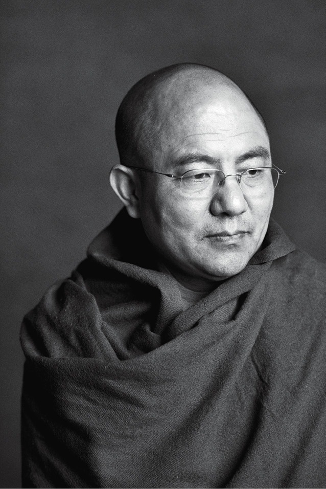

# 幸福的根本是心

/

幸福的根本，不在于你拥有了多少东西，

在于你减轻了多少欲望。

苏格拉底曾站在百货市场里开怀大笑：

“看哪，天底下有这么多我不需要的东西，我真幸福！”

/

本章为索达吉堪布在上海交通大学的演讲

2012·10·24

前不久，央视记者在各地采访，向大家提出一个问题“你幸福吗”，得到的回答可谓千奇百怪。趁着这阵风，也有记者问莫言：“你幸福吗？”莫言干脆回答“不知道”，随后解释：“幸福就是什么都不想，一切都放下，身体健康，精神没有任何压力。我现在压力很大，忧虑重重，能幸福吗？但是我要说我不幸福，你就会说太装了吧，刚得了诺贝尔奖还不幸福。”

在一般人看来，诺贝尔奖让一个人有钱、有名、有地位，肯定非常幸福。然而，莫言却说不知道。对此反思，自然就触及了今天的主题——“幸福的根本是心”。换言之，幸福不在外境上。

当然，幸福也并非与外境完全无关，而是主要取决于心。

## 有财富就幸福吗？

对没钱的人来说，得到一定的财富，确实可以带来幸福。然而，当基本生活得到满足后，财富的增长不会带来幸福的增上。

比如，从没有房子到拥有一套房子，你会有强烈的幸福感；可如果继续买第二套、第三套，甚至不满足于在国内，还要去加拿大、美国购房……房子带来的幸福感就越来越不明显。

不少人常想：“如果我有一大笔钱，所有的问题就都解决了，绝对会幸福。”实际上没有这么简单。伊丽莎白·泰勒曾说：“我这一生，拥有财富、名声、成功、容貌，但从来没拥有过幸福。”

有了财富，有时候非但不会幸福，还会招来痛苦。打个比方，原来住平房，现在搬进高楼，物业费就增加了；以前开桑塔纳，现在换成宝马，保养费也水涨船高……各种额外的负担，会让额外的烦恼随之而来。

佛教认为，财富与痛苦形影不离：最初辛苦操劳，有积财之苦；中间担心财富贬值，有守财之苦；最后财富被无常吞没，有散财之苦。所以，有句话说得好：人世间80%的幸福与金钱无关，80%的痛苦与金钱息息相关。

奥地利有一位百万富翁，因感到财富没有带来预期的快乐，反令自己痛苦不堪，于是把所有钱都捐给慈善机构。自己搬进一幢小木屋，过起了普通人的生活。

对我们而言，一分钱都没有，生存下去确实困难；但钱太多了，也不一定就幸福。可惜的是，好多人不明白这一点，只是一心想赚更多的钱，结果，迷失了人生方向。

这种现象，其实与现代教育有很大关系。现代教育过于强调物质，很少提及心灵。事实上，不论是个人成功，还是社会发展，绝不只是物质增长。假如以心灵堕落为代价，实在得不偿失。

## 有权位就幸福吗？

权位，也同样没什么可信赖的。把幸福寄托在这上面，相当不明智。

历史上有过无数地位显赫的人。当他们身居高位时，一呼百应，身边的人络绎不绝；一旦下台，连亲朋好友都会远离。就像一棵大树，枝繁叶茂时百鸟来集，枝叶凋零时全部飞走。

世态炎凉一再上演，又有几人愿意看破？

在明眼人看来，地位越高，压力其实越大。顺治皇帝在《出家偈》中曾感叹：“我本西方一衲子，缘何落在帝皇家？十八年来不自由，南征北战几时休。”

然而，对于虚幻的地位，世人总是特别执著，生怕一不小心被人抢走。

庄子有个幼时好友叫惠施，在梁国高居相位。一次，庄子去探望他。他以为庄子是来要官做的，担心庄子智慧德行高过自己，会威胁到自己的地位。庄子知道了他的心思，嘲笑说，自己视官位如“腐鼠”，连看都不会看一眼，根本不可能产生兴趣。

如今像惠施这样迷恋权位的人，太多了。以佛法的智慧来看，想凭借高位赢得幸福，完全是行不通的。为什么？因为轮回本性是痛苦，身陷其中的我们再折腾，得到的也仍是痛苦。

这个道理，古印度的圣天论师在《四百论》中讲得很清楚：“胜者为意苦，劣者从身生，即由此二苦，日日坏世间。”

“胜者”就是有地位、名声、钱财的人。他们的身体无须吃苦，内心却苦不堪言，每天有各种担忧。有人甚至为此辗转难眠，不得不服药以维持生活。

“劣者”是指生活在社会底层的人，没有地位、名声、钱财。他们的痛苦多是身体上的饥饿、疲累等，经常为维持生计而挣扎。

因权位而痛苦，就属于“胜者”之苦。其实反思一下：权位再高，最多只是几十年，有必要为此付出一生吗？佛教说“得失从缘，心无增减”，所以，我们对权位应该看开点，没必要因为一点得失，就让心起起伏伏。

## 有爱情就幸福吗？

还有人把幸福建立在爱情上，这更是错的。

自己的心应由自己主宰，把幸福寄托在他人身上，注定会大失所望。

有时候，爱情不但不会让你幸福，还是痛苦的源头。有了贪执，就会患得患失，就有担忧、害怕。诚如《涅槃经》所说：“因爱生忧，因爱生怖，若离于爱，何忧何怖？”

现在许多年轻人的痛苦，都是源于爱情。他们认为，来人间走一遭，最重要的大事，就是找个对的人轰轰烈烈爱一场。假如爱情以种种原因夭折了，他们甚至没有活下去的勇气，极端者会选择自杀。

当然，人们对爱情的过分执著，与媒体引导也息息相关。时下无论电影、电视、文学，情节都离不开爱情，天天宣传爱情至上。浸染在这种氛围中，如何让人不在情感的漩涡中越陷越深？

其实，爱情只是人生的一小部分，远非全部，对此不必看得太重。否则，把幸福系在所爱的人身上，对方稍有一点变化，自己的幸福指数就大幅下跌，这样的生活太苦、太累、太不值得。

## 幸福在哪里？

从小到大，我们了解的幸福，全部来自于外在，而这一切并不稳定，随时可能发生变化。佛教所揭示的幸福，唯一建立在内心上，一旦认识了它，才知道何为不变的幸福。

遗憾的是，大多数人不知道这一点，由于没有认清幸福的方向，追求的越多，痛苦就越大。据调查显示，中国上班族的压力高居全球第一，过劳死的人数也是世界第一。还有资料说，中国每十个人中，就有一个患精神障碍疾病。

为什么会这样？

说到底，就是因为人们的心没有得以调伏。总是不满足，看别人有什么，自己马上也想要。这并不是因为缺什么，只是一味地想占有。每次到了大城市，触目所及，熙熙攘攘的街道上，无数人在盲目地奔波，此时我就不禁心想：这样的生活，真能带来快乐吗？

美国摇滚巨星“猫王”曾绝望地哭喊：“尽管什么都尝试过，可是我还得不到满足。”

德国哲学家叔本华说：“财富就像海水，饮得越多，渴得越厉害。”

佛经中更是一针见血地指出：“多求不遂，发生热恼。”

所以，痛苦的大小与贪欲成正比。若想远离痛苦，就必须减少贪欲。

## 欲望越小，幸福感越大

前不久，有记者在微博上问我：“你幸福吗？”我说：“幸福。”他追问：“为什么？”我回答：“因为知足。”

若想获得幸福，关键不是天天口说幸福，让大家关注幸福，而是要懂得怎样才能幸福。如同一个病人，光知道自己有病还不行，还应该到一个好医生那里去，找出病因，然后按时服药。

知足，就是获得幸福的药方。有了它，哪怕人生过得平淡无奇，照样可以品味幸福。

我看过一本书，《塔莎奶奶的美好生活》。书中描述了塔莎奶奶住在乡间的农庄，精心种植花草，慈爱地饲养小动物，自己纺线、织布、缝衣，过着朴素的田园生活，她的幸福令无数人羡慕不已。

我家乡有一位修行人，他在深山里盖了间茅屋，每天以诵经、禅修度日，身边只有点干粮和几套换洗的衣服。因无须担心被盗，二十多年不用锁门。有一次我去探访他，刚到门口就陶醉了：头顶是蓝天白云，四周的树林郁郁葱葱，旁边有小溪潺潺流淌，到处是鸟语花香，令人感觉置身世外桃源，一切烦恼了无踪迹。

这种幸福，看似让我们望尘莫及，可若懂得知足少欲，当下就能拥有。莲池大师说过：“人生解知足，烦恼一时除。”佛经中也说：“少欲无为，身心自在。”

相反，如果你不满足现状，自己月薪2000元，看别人涨到3000元，就开始不平衡：“他挣的凭什么比我多？不行，我要超过他！”攀比心一起，痛苦马上就与你形影不离。

## 有信仰，就会离幸福近一点

想活得幸福，方法其实有很多。从宗教中寻求答案，说实话，是一条不错的途径。

国外报告表明，笃信宗教的人比无宗教信仰的人幸福指数更高。2010年1月至2011年12月，盖洛普公司在全美国进行了67.6万次电话采访，调查幸福与宗教信仰的关系，结果显示，笃信宗教者幸福得分为69.2，无宗教信仰者为65.3。

当我们面对挫折时，信仰宗教者更易走出困境。一位佛教徒曾向我坦言：“因为种种不幸，我一度痛苦万分，好几次想去自杀。幸亏遇到佛法，才摆脱了那段阴影，否则，真不敢想象我还在不在人世。”

我无意为佛教做广告，但就事实来讲，佛教在增上幸福方面，确实表现得极为出色。

以全民信奉藏传佛教的不丹而言，它被公认为世界上最幸福的国家。2008年，有位美国记者通过环球考察，写了一本《世界上最幸福的地方》，书中提到十个最幸福的国家，不丹就是其中之一。

不丹人的生活，我也有所接触。1990年，法王晋美彭措应不丹国王邀请，前往该国弘法，我随行在那里待了半个月。印象中，不丹并不太富裕，全国的车辆不多，飞机也不过几架，可每个人都少欲知足，身上洋溢着快乐的气息。

我还记得，在不丹，随处可见意味深长的小诗。有一首诗是这样写的：

“当最后一棵树被砍倒，当最后一条河被榨干，当最后一尾鱼被捞出，人类这才意识到：原来，钱不能吃。”

简短的诗句，说出了不丹人对生活的态度，对破坏自然的反对，对人类行为的反思。

在藏传佛教盛行的青藏高原，人们的幸福感也很高，如果有人去调查，会发现他们的幸福指数应该不低于不丹。在这块最偏僻也最接近天空的土地上，不管老人、年轻人还是孩子，始终洋溢着灿烂的笑容，内心的满足都挂在脸上。

相反，现在城市里的很多人，物质上虽然极大丰富，心中却有说不出的愁苦。对于他们，我建议从传统文化中汲取调心之道。有空的话，试着出去走走，看看修行者的生活，感受另一种人生态度。人若不跳出狭隘的圈子，一直重复过去的思维、生活方式，到一定时候，就会感觉极度乏味，甚至彻底迷失。如果换个角度体验，或许会有一些新的感悟。

调心的方法在佛教中数不胜数。譬如禅修，目前已得到了广泛关注，美国有上万人依此提高了生活质量，很多大学和企业都有禅修中心。你们有压力、痛苦的话，不妨也试试，若能每天打坐几分钟，肯定有不一样的感受。

作为现代人，不忙是不可能的，但光顾着忙，把自己搞得疲惫不堪，甚至累出一身病，就得不偿失了。我非常推崇古人的生活：该吃饭就吃饭，该工作就工作，该休息就休息，生活简单而有规律。

不像有些人，所有时间都被占满，就算有点空闲，也全贡献给了手机。走路、坐车、上班、聚会……随时随地在低头看手机，忙些可有可无的东西。早上醒来，第一件事马上去开手机；晚上睡前，最后一件事就是关手机。也许在临终前，最放不下的还是手机。

## 生从何来，死向何去

人并非只有一世，相较于眼前的安逸，我们更应该追求永久的幸福。

很多人认为：人死如灯灭，死后什么都没有。这种想法是错的。死亡只是此生的结束，却是漫长来世的开始。然而，今天的大多数人，对此并不知晓，他们从未思考过生从何来，死向何去。

佛陀告诉过我们：在无尽的生死轮回中，每一世的身体终会消失，但心识不会。只有懂得这个道理，我们才会为自己的未来打算。

否则，认为人生不过几十年，那最后得到的，充其量只是几十年的安乐。

现场互动

⊙ 问：一个人若能做到“无所住而生其心”，还需要重视因果吗？

堪布：“无所住而生其心”出自《金刚经》，意思是，不住一切而住于心性光明中。六祖就是听到这句话开悟的。

虽然万法本性皆空，但世俗显现是不灭的，就像做梦，梦境固然虚幻，可梦里照样有苦有乐。所以，我们还是要重视因果、断恶行善。否则，坏事做多了，阿赖耶识就会积累恶的种子。这些种子也许今生成熟，也许来世成熟，迟早会让自己感受痛苦的果报。

在现实中，有些人遇到治不了的病，或者改不了的命运，这都与宿世的业力有关。

⊙ 问：福报大的人拥有财富、地位，可往往不幸福，反倒是一些普通人感觉更幸福。如此说来，财富和地位岂非无用？

堪布：财富、地位只是暂时的福报，它是否有用，取决于自己如何运用。运用得当，福报大的人会比普通人更有机会接近幸福。

比如，假如我有财富和地位，用这些资源去帮助他人，就会为自己和他人带来幸福。但若用来做不如法之事，注定会带来不幸，那还不如没有这种福报。

所以，有些福报是否有用，要从它的结果来分析。

⊙ 问：如何让众生相信轮回？

堪布：如果不相信，最好能举出可靠的理由。若只说“因为我不相信，所以不承认”，这种理由不充分。

假如死后真的什么都没有，不信也罢。但万一有来世呢？

现在有不少关于前后世的书籍，多看看就会明白轮回是怎么回事。实际上，轮回并非佛教一家之言，许多宗教都承认，甚至非宗教人士也承认——世界上能回忆前世的人中，相当一部分就没有宗教信仰。

有些人可能会问：“如果前世存在，为什么我记不起来？”

因为众生入胎时有胎障，让前世的记忆隐没，只有个别人例外。且不说前世，我们小时候的经历，现在也多已淡忘，但是，不能因为忘了就说它不存在。

否认前后世，必须要有依据。我关注这个问题已有二十多年，通过翻阅古今中外的资料，确信前后世必定存在，不存在的依据绝对找不到。这是生命的真相，并不是相信就有、不信就没有。

⊙ 问：轮回与心是什么关系？

堪布：按照佛教的观点，轮回有六趣，其中天、人、阿修罗是三善趣，地狱、饿鬼、畜生是三恶趣。今生造恶，来世会堕入恶趣；今生行善，来世会转生善趣；行持出世间善法，就可以超离轮回。

轮回的主体就是心。这颗心从无始以来，被业力所牵引，在六道中起起落落，转生为不同形态的生命。因为前世的经历不同，众生今生的习气也不相同。比如双胞胎，先天的父精母血一样，后天所受的教育也一样，但由于宿世业缘不同，可能一个善良，一个邪恶，习气、特长、能力有天壤之别。

如果再进一步分析，根据佛教第三转法轮的教义，这颗心有光明的一分，它在成佛后会转为佛的智慧，但在凡夫阶段，这种光明被各种烦恼覆盖。就好比金矿中的黄金，起初它与泥沙相杂，通过反复提炼，才能成为无垢的纯金。

对我们来说，通达心的奥秘十分重要。若能认识心的本来面目，对外在的一切就不会那么执著，遇到问题容易想得开，很多事情该怎么做，自己也会明白。

⊙ 问：您怎么看《弟子规》《三字经》等国学文化？

堪布：我是一个藏族人，从小接受的是藏地的佛学教育，对汉地的国学文化没有学过。但后来我看到这方面的典籍，很吃惊，觉得这些道理非常殊胜，年轻人一定要学。学了以后，社会的未来才有希望，否则，人心彻底变坏了，物质再发展也没有意义。

像《弟子规》《三字经》《论语》《道德经》等，不学的话，太可惜。十年“文革”是一场浩劫，它断了传统文化的根，现在一代代都是受害者。

那如何才能恢复传统文化？一方面需要教育部门大力呼吁，同时，每个人也有责任学习并弘扬。只有这样，有些现象才能得以扭转，社会风气也会从根本上改善。

当然，这个不是说说就行，必须有实际行动。哪怕你做不了什么，也可以从弘扬《弟子规》入手。《弟子规》的内容比较简单，假如你实在找不到“弟子”听，也可以给自己的孩子讲。

⊙ 问：当今是商业时代，影视、网络、艺术都鼓励贪欲，在这种大环境下，佛教所起的作用会不会非常有限？

堪布：佛教不是禁欲主义。对大多数人来说，佛教并不是让你完全断除贪欲，而是告诫你不要贪得无厌。这种提醒相当重要，就像学开车，一旦自己刹不住车，旁边有个教练可以帮你把控。

现在的媒体宣传，确实有一些不良导向，对人们的价值观有极大影响。此时此刻，大家更需要提醒的声音，不然，就会陷在欲望的泥坑里爬不出来。

所以，作为佛教徒，我只要有机会，就特别愿意出来讲课，哪怕人数极少也可以。为什么？因为佛教的教义，当今社会非常需要，很多人心里很空虚，欲望特别大，必须有人在一旁提醒：“你的欲望不能太过分，否则，很可能带来痛苦。”

当然，佛教也不是让你不要赚钱，统统辞亲割爱，去山里出家。包括释迦牟尼佛，也没有这样强调过。佛陀只是告诉我们，在家人有在家人的行为，出家人有出家人的行为，但不管你是什么身份，精神层面都需要一种很好的指引。

⊙ 问：我特别喜欢吃肉，但肉又会涉及杀生，我是不是应该改变一下饮食习惯？

堪布：从健康的角度讲，吃素对身体是很好的。专家也发现，人类的生理结构，天生适合吃素。如果吃肉，不说别的，动物身上携带有许多病菌，很可能会传染给人类。

哪怕你不能吃素，最好也不要点杀活物。不幸的是，在一些错误观念的影响下，许多人认为动物本就该给人吃，却没有意识到动物跟人一样害怕死亡，渴望生存。

其实，吃肉就是杀生，这辈子你大口吃肉，似乎很满足，下辈子就不好说了。不懂因果的人，也许觉得这种说法很可笑。但在因果面前，可笑之事却往往成为残酷的现实。

⊙ 问：您怎么看待爱情？

堪布：爱情不一定是幸福，把幸福寄托在爱情上，肯定是错的。但它能给人们带来一些快乐，这也不可否认。

佛法不离世间，对于世间感情，佛陀也会承认。可是它存在的方式和相关理念，我们有时候需要反思。

有些人，爱情一旦出问题，就想不开、放不下，把自己弄得特别苦恼。这种现象，实际上是一种执著。真正用智慧去观察，你、你所爱的人、你们之间的爱情，本体都是空的。

有了这种境界，对于如梦如幻的爱情，你可以拥有，但不会当真。

⊙ 问：很多人喜欢算命，现在流行测八字、改姓名、补五行，据说有助于改变运势，您怎么看这些现象？

堪布：算命、打卦、观风水等，在佛教中也有。通过特定的方法观察一些缘起，这有一定的合理性。

但现在世上各种算命方法，可以说真真假假，有原汁原味的，也有后人假造的，关键看你选择的对不对。

当然，就算你选对了，也不能沉迷于此。因为命运虽有规律可循，但并非一成不变。若把精力用于培养自己的智慧、慈悲、信心，即使不用算命，命运也会往好的方向发展。所以，我们更应该追求这些。

⊙ 问：南怀瑾先生刚刚仙逝，您如何看待他的弘法事业？

堪布：南老一生弘扬释道儒等传统文化，我发自内心地随喜和尊重。我几次有机会可以拜访他，可惜因缘不凑巧，都错过了。那天得知南老圆寂，我特意带人为他念了经。

我看过南老的书，他确实是一位博通古今、学贯中西的大师。尤为难得的是，直至九十多岁高龄，他还在不懈地传道授业。今天，这样的大师非常罕见。

在复兴传统文化方面，南老可以说居功至伟。上世纪90年代，传统文化在内地刚刚升温，南老的《金刚经说什么》等著作风靡全国，许多人依此重新认识了佛教。

现在南老虽已离开我们，可他的著作依然留存于世，所以大家也不必过于伤心。

当然，也有个别人对南老持不同看法，这很正常。自古以来，当一个人有名望时，旁边总会有人议论纷纷，这不足为奇。

⊙ 问：如果想学修中观，应该从何入手？您能否介绍一下学修次第？

堪布：可以从《中论》《入中论》《四百论》这三部论典入手。

学修中观要经历四步境界：首先万法抉择为空性，再将空性抉择为双运，之后双运抉择为离戏，最后离戏抉择为等性。

若想达到这种境界，有两种途径：一是直接安住空性，就像《六祖坛经》所讲的那样；还有一种方法是通过反复观察，抉择万法皆空，然后安住于此。

⊙ 问：我有个朋友笃信佛教，但在现实中，苦难一个接一个，把他打击得差点崩溃。后来他对佛法的信心没那么强，反倒没什么灾难了。这是什么原因？

堪布：你这位朋友的不顺，并非是源于对佛法的信心。

现实生活中常有看似矛盾的现象：造恶时，一切都顺利；行善时，则违缘重重。这并非因果错乱。一般而言，人在精进行善时，将来的恶报会提前成熟，此时往往会出现不顺；而从善法中退失后，生活虽重归平静，不过这不值得庆幸，因为恶业并未消失，依然在前面等着他。

因果非常复杂，只有系统学习佛法，才会明白这些道理。

⊙ 问：您的人生使命是什么？

堪布：我原来认为自己的使命是看书，因为从小学、初中到师范，我最大的乐趣就是看书。但出家之后，我的想法变了，觉得只要有一点点能力，就应将多年看书和修行的点滴收获分享给他人。

所谓“堪布”，有把知识传给他人的意思。既然自己是堪布，就要将掌握的真理传递给众生，哪怕只剩一口气，哪怕只有一个众生，也要尽心尽力。这应该就是我的使命。

其实，每个人都要有自己的使命。哪怕做不了太多，若能不害众生，尽量饶益身边的人，或者一天做一件好事，这也非常有意义。

当然，这要由自己选择，只是我说，你不一定听。

09
