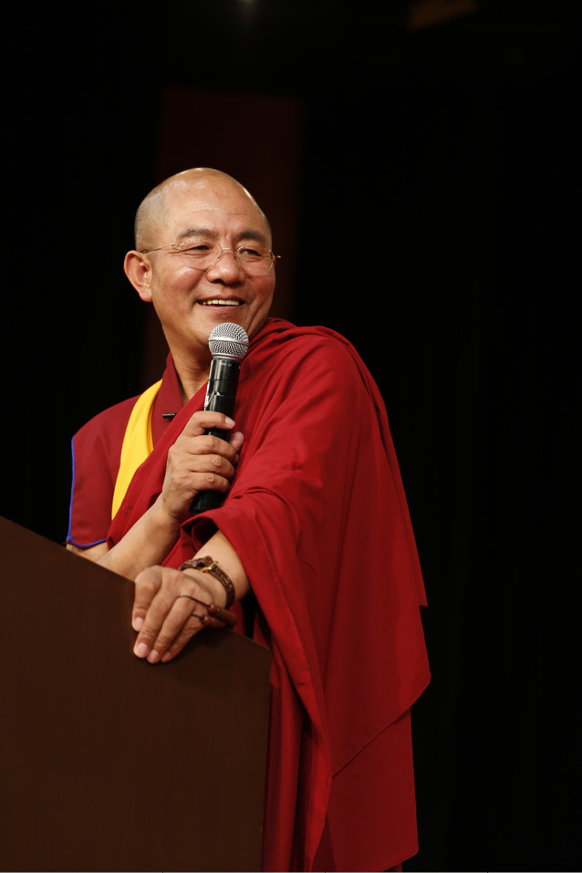
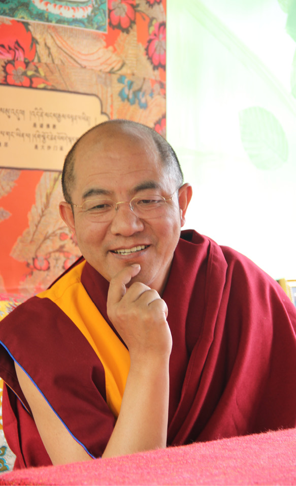

# 心地无私天地宽

/

学佛，不是为了保佑自己，是为了舍弃自己——

不是让佛保佑自己多发财，是保佑断除对财物的执著；

不是让佛保佑自己长命百岁，是保佑不要贪爱这个身体；

不是让佛帮忙铲除鬼魔，是加持自己对鬼魔不要起嗔心，

而以大悲心善待他们。

/

本章为索达吉堪布在兰州商学院的演讲

2012·07·03

提起佛教，许多人马上想到影视剧中听到最多的一句话：“人生皆苦。”那么，我们人生的一切苦，到底源于什么？

印度寂天论师给出了答案：“执我唯增苦。”

你可以观察一下：当自己痛苦时，不管是身体上的，还是心理上的，也不管是感情上的，还是工作上的，它来自哪里？

对“我”的执著。

《修心七要》也提到，自己遇到的一切痛苦，应该归罪于我执，而不是外在的人、事、物。

这一点，以前我上学时不懂，只是模模糊糊觉得，痛苦应该跟心有关。直到出家后才明白：痛苦不但跟心有关，更与“我执”息息相关。

作为一个人，谁都不愿意受苦，愿意快乐，可命运很少会按着这种轨迹前进。当我们遇到坎坷不公时，与其怨天尤人，倒不如试着了解痛苦，找出它的根源，然后想办法解决它。

## 都是“我”惹的祸

若想根除我执，首先要观察一下：每个人执著的“我”，是不是真的？

对这个问题，柏拉图在《理想国》中，讲了一个很好的比喻：

有群人世世代代住在一个洞穴里。从出生起，他们就如囚徒，被铁链锁在固定的地点，甚至还被锁住脖子，不能回头或四下张望，永远只能面壁。

在他们背后，一群人每天举着火把来回走动，身影投到墙壁上，成了大家唯一能看到的精彩世界。

他们每天看着影像，久而久之，认为这些是真的，从不知道外面还有一个光明世界，更没人想要脱离这种困境。

一天，有个囚徒偶然挣脱了锁链，沿着光走出洞穴，生平第一次见到光亮。他克服了最初刺眼的痛苦，看到阳光下的一切，才知道洞壁上所见都是假的。

他庆幸自己的解脱，并怜悯同胞，义无反顾地回到洞穴，解开同伴身上的束缚，向他们说出真相。没想到，所有的人都不相信，大家嘲笑他，认为他疯了，最终用乱棍打死了他。

这个故事说明什么？

人们一向认为真实的东西，可能最不真实。

走出洞穴的人，明明见到了真实，为什么不被大家相信？这正应验了《红楼梦》的一句话：“假作真时真亦假，无为有处有还无。”我们一旦把假当成真，真就成了假；一旦把没有当成有，有就成了没有。

众生执著的“我”也是如此，看似存在，但只不过是洞壁上的影像。

既然“我”是假的，什么才是真的？

无我。

或许有人问：“只是我一人执著有‘我’，可以说我错了。但世上所有人都执著有‘我’，难道每个人都弄错了？”

月称论师在《中观四百论释》里讲过一个公案：

从前有个国王，婆罗门通过占星告诉他，几天后要降一场毒雨，谁饮用就会发疯。几天后，果然下雨。全国百姓喝了，都疯掉了，只有国王一人没喝。可是因为与众不同，大家认为他不正常，说他是疯子。国王不得已，喝下毒雨，变成跟他们一样了。

这种情况，有人听后觉得荒唐。不幸的是，现在的我们就是如此。

## 心地无“我”天地宽

断除“我执”，不但可以减少痛苦，还能接近万法的真相——空性。

对于空性，有些人不理解：“佛教天天讲空，如果一切都空了，生活、事业是不是就别管了？”

并不是。所谓空性，是指我们身边的一切，包括我们自己，本体是空，但显现上仍存在。所以，该做什么，还是要做。但在做的时候，因为懂得空性，私心少了，天地就宽了。

《吕氏春秋》中说：“天无私覆也，地无私载也，日月无私烛也，四时无私行也。”意思是，天无私，才能遍覆世界，如果它有私，只能遮盖部分地域；地无私，才能承载万物，如果它有私，只能负荷少数器物；日月无私，才能普照世间，如果它有私，只能偏照一方；春夏秋冬四季无私，才能正常运行，如果它有私，四季就错乱了。

人应当效法天地，断除执“我”的私心。

其实，不论小事大事，小到家庭内部的争吵，大到国家之间的战争，都是为了“我”。

古人发明的汉字，实际上很有趣。“我”字里，就藏着一把伤人的兵器——“戈”。只要有了“我”，既会“戈”别人，又会“戈”自己。

我执大的人，心量特别小，一点委屈也忍受不了，动不动就大发脾气。常言道：“君子量大，小人气大。”一个人心量大还是脾气大，问题就出在“我”上面。

假如对“我”执著强烈，眼里不容半点沙子，哪怕给他全世界的一切，他仍有诸多不满；假如对“我”不太在乎，什么事都不计较，就算生活条件差，家里只有一张床，他依然心怀感恩。

正如日本的梦窗禅师所说：“眼内有尘三界窄，心头无事一床宽。”

## 放下“我”，不会失去，而会得到

既然“我”是假的，执著它唯有痛苦，那快乐的唯一途径，就是放下“我”。而放下“我”的所有方法中，最好不过的，是利他。

利他心被强化了，自利心就淡化了；自利心越淡，利他心越明显……如此，在增上利他与弱化自我的交战中，痛苦会日渐减少。

这种境界起初可能难一点，但只要经常放下自己，多考虑别人，久了，你会感觉到：这是最快乐、最放松的心境。

一个人活着的意义，不是看你是否有钱，而是看你能否利益他人，乃至一切众生。

怎么样利益？

没有快乐的众生，带给他快乐；正在受苦的众生，消除他的痛苦。

当然，作为凡夫俗子，谁都有对“我”的执著，完全利他不太现实。即便如此，我执也不要过大，否则，白天想自己，梦里想自己，从来不为别人着想，你的生存空间不会宽广；对别人而言，你的存在，不一定有价值。

什么样的人有价值？

利他的人。

利他让人感动，而最让人感动的，是大乘佛教的利他——没有任何条件、利益一切众生。

普通人利他，是我帮了你，就希望你回报，相互间像一种交易。大乘佛教不是如此，它的利他不谈条件，只要众生有苦难，就全力以赴地帮助，付出一切也愿意。

对我们来讲，这有些望尘莫及，但的确让人景仰。

现场互动

⊙ 问：如今网上有大量色情内容，以裸为美；现代人穿着也很暴露，能露的都露。这让我很迷惑，您对此怎么看？

堪布：现在东方人以裸为美，应该是受到西方影响。

假如以佛教的不净观剖析，不管是女人的身体，还是男人的身体，再美也不值得贪求。只不过凡夫都有“贪”的习气，商家就抓住人的这一弱点，以裸露身体来吸引眼球，营造商机。

但到了一定时候，人还是会回归传统的。为什么？有些现象多了，弊病就日益明显，人们也会重新思考一些问题。

⊙ 问：有些佛教徒热心劝人学佛，但他们常讲因果报应，劝导也带有强迫性，这往往起到反效果。年轻人喜欢文艺性的、轻松的东西，他们劝人学佛时，一定要死板地灌输吗？

堪布：这种现象确实有，但并非人人都如此。

佛教的教义很丰富。像藏传佛教中的“十明”（大五明：声明、工巧明、医方明、因明、内明；小五明：修辞学、辞藻学、韵律学、戏剧学、历算学），很多就与当今艺术、学术相衔接，只要懂得运用，方式并不单一。

实际情况也是这样。不论在东方、西方，大德们为了让更多人了解佛法，根据他们不同的喜好，采取种种善巧方便。而且，这些也都被很好地接受了。

弘扬佛法的人，其实要具备一定的条件。在世间做事，有学历、资历就可以，对德行一般不观察。而在佛教中，除了要精通佛法，更要具备戒律、修行等真实境界，不是嘴巴会说就够了。

⊙ 问：我来自甘肃中医学院，研究传统医学与传统文化。我去过一些藏医院，知道藏医学是藏传佛教的重要组成部分，可否请您简单介绍一下藏医学？

堪布：藏传佛教中有“五明”，其中的医方明，就是藏医学。

藏医学在国际上很受推崇，从配方到治疗都有其独到之处。我读书时对它很感兴趣，学过诊脉、配药，还亲自上山采药。藏地的药材资源很丰富，有句俗话说：“山上所有草木，在高明的医师眼里无不是药。”那时候我很想成为一名医生，不过到佛学院出家后，就没怎么学了。

古代的藏医学，有成熟的医疗技术。青海西宁有一所藏医药文化博物馆，里面就陈列着许多精制的医疗器械，有些已有上千年历史。

如今，这些都在藏医院里得以继承。藏医院，在格鲁派中比较多，宁玛派等其他教派也有相仿的机构。我们佛学院，就培养了很多医师，与一些卫校、高等医学院建立了合作关系。

时下的有些疾病，吃西药、中药不见好的，看看藏医、吃吃藏药，说不定会有效。我生病时就喜欢吃藏药，没有副作用，效果也不错。

若想研究藏医学，《四部医典》是一部重要典籍。如果能掌握其中的理念，不但可以调理自己的身体，给别人治病也很简单。

⊙ 问：我是兰大民族学院的藏学博士，感谢您的鼓励，我才考上了博士。儒家的人性论中，孟子持“性善论”，荀子持“性恶论”，那么，佛教如何看待人性？

堪布：儒家与佛教的思想，在某些层面上是相通的。比如，都认为有一种不可见的人性。

有学者以比喻说：就像暗室中本来有东西，没有灯时没发现，灯一照，就看见了。人性也是如此。

孟子、荀子讲人性，或善或恶。在佛教看来，究竟而言，人性超越了善与恶，因为诸法平等，远离二元对立。

不过，在接引初机时，佛教也讲人性本善。为什么？人人都有佛性，都可以成佛，这在《如来藏经》和《宝性论》中说得很清楚。

如果人性本恶，再怎么努力向善，终究会退失。但成千上万的觉悟者，如释迦牟尼佛、六祖大师，用自身的境界证明这是错误的。当心回归到本位时，会显露出至善的一面。

⊙ 问：我来自兰州大学的科学学院。儒教说“三人行，必有我师”，佛教也认为人人是我师，怎样才能达到这种境界？

堪布：有修行境界的人，看任何人的言行，都对自己有利。甚至有人骂他，他也不觉得受伤，反而把谩骂当作最好的指点，有错就改。能做到这样，人人都成了他的老师。

若没有这种境界，不仅是批评，赞叹也听得像嘲讽，如此，把谁当老师都难。即使是你的老师，你也不一定承认。像有些学生，下课就嘲讽老师，在他们眼里，老师也不成为老师。

“三人行，必有我师”的境界不低，这有点像佛教里的观清净心。阿底峡尊者说过：“三人之中，必有一个是菩萨。”菩萨的比例很高，可惜我们发现不了。谁是，谁不是？不知道。

有了清净心，看谁都是菩萨。没有清净心，看谁也不如自己，如此只能带来痛苦，不会快乐。

⊙ 问：我跟有些老师学过佛法，也看过他的书，但他们后来诽谤密法。对这些老师，我该怎么看？

堪布：他们诽谤密法，只是因为不了解。

密法不是简单的学问，藏传佛教中有浩如烟海的续部及其注释，如果去研究，十几年下来都不一定懂；一旦你懂了，肯定瞠目结舌：“啊，以前我太愚痴了！”

不说一般的老师，就连弘一大师等大德，起初也不了解密法。不过，在他们看过密续及藏地大德的言教之后，都忏悔了。

我也理解这些老师。因为环境和朋友的影响，加之没有深入修学过密法，随随便便就诽谤了。我倒希望他们能去藏地的佛学院，与那里的佛教徒面对面辩论一场。你赢了，我们认输；若连基本的因明推理都不懂，只是口头上不承认，这有点说不过去。

⊙ 问：佛教最重视对上师三宝的信心，但初学者生起稳固不退的信心很难，您有没有比较好的建议？

堪布：对上师三宝生信心，有两个途径：

一、靠前世的缘分。如果前世学过或修过善法，今生中产生信心不会太难。

二、多看诸佛菩萨和前辈大德的传记，并认真学习佛理，尤其是空性法门。《中观四百论》说：你若对佛陀宣讲的法义心存疑虑，通过学习空性法门，可以生起真实的信心。

为什么？空性法门是最深的学问，世间上再聪明的人，凭自己的力量也无法揭示，唯有佛陀才能洞察、宣说。

一旦你从理上说服自己了，自然会生起不退的信心。

⊙ 问：法王曾劝大家念一千遍《普贤行愿品》，说这样功德非常殊胜。现在法王已圆寂，是否还可以发愿念？

堪布：可以。

⊙ 问：我是大二的学生，平时学业比较忙，怎样才能抽出时间多念些经咒？

堪布：鲁迅说：“时间就像海绵里的水，只要愿意挤，总还是有的。”在不影响学业的同时，你利用早晚空余时间，还是可以学佛。

学佛，不单单是念些经咒，更要了解佛法讲了什么。现在汉地对佛经的研究不够，《大藏经》被束之高阁，很少有人愿意深入探索，这是比较遗憾的。

学佛，就要学释迦牟尼佛的智慧。只要你去看，一定会受用无穷。

⊙ 问：婚外恋有什么因果？

堪布：如今婚外恋的现象多之又多。其中的因果，看一看《增壹阿含经》《善生经》《十善业道经》，就知道了。

⊙ 问：如何破“我执”？有没有行之有效的方法？

堪布：寂天论师在《入菩萨行论·智慧品》中，通过理论抉择过无我。比如，逐一观察身体的各个部分：头发、牙齿、肢体……都不见有“我”。“我”既然不存在，又哪来对“我”的执著？这样就破了“我执”。

或者也可以参话头。像禅宗让大家参“我是谁”，藏密中观察“我在何处”，依此，利根者会恍然大悟：“我”和“我”执著的一切，原本就没有。

当然，若想生起这种境界，一定离不开长期修学。

⊙ 问：从古到今有许多宗教，不同的信仰之间如何相处？

堪布：不同的宗教之间，乃至宗教与非宗教之间，应当彼此尊重、理解，甚至相互学习。但凡一个宗教，能生存至今，足以说明它的生命力与魅力。如果跟其他宗教水火不容，自己的宗教也不一定有生存之地。

⊙ 问：怎样看待梦境？

堪布：人生就是一场梦，看待人生就是看待梦境。

⊙ 问：我是甘肃联合大学的老师。如果有条件，我想在学校开办一个灵修中心，让学生正确认识佛教，培养他们的慈悲心。这样的灵修中心应该开设哪些课程，举办哪些活动？

堪布：这样的中心，跟禅文化结合比较好。北大、复旦有禅学社，华中师大有心灵与认知研究中心，你们要开设的话，也可以从禅入手。

此外，藏传佛教的菩提心修法也很实用。菩提心提倡利他，有了这种精神，人心会变得宁静。为什么？一个人的浮躁、烦恼和焦虑，都是源于执著“我”。若能生起利他心，我执弱了，痛苦就少了。

至于活动，可以举办讲座，请一些对汉藏佛教比较精通的老师来讲。若能培养学生的慈悲心，这对社会很有利。

最近，几所大学的老师就在开会讨论，希望提升学生的综合素质，尤其是传统的道德素养。

这才是对学生负责！

有了这样的教育，学生找不到工作，也能找到人生目标。否则，单凭高分来解决人生的许多问题，可能有点难。

⊙ 问：我是西北师大化学专业的研究生。我对佛教感兴趣，找来许多书看，但收获不大。怎样才能对佛教有完整的了解？请您推荐一些佛教书籍。

堪布：无论学什么，都不能只是走马观花。若无法深入其中，不要说佛教，连一般的世间学问，也很难让自己有收获。

我每看一本佛教书籍，常会先提醒自己：“书里肯定有我不懂的内容。”因此，看的时候很专注，哪怕只看一小段，也会反复琢磨：“为什么这样说？”假如心很散乱，就品味不到其中妙处。

若要全面地认识佛教，我的建议是，想了解大乘佛教，学习《入菩萨行论》；想了解般若空性，学《中观根本慧论》或《入中论》；想了解藏传佛教的修行次第，学《菩提道次第广论》或《大圆满前行》。

如果长期钻研这些教理，我相信，你的身心一定会有很大变化。

⊙ 问：念经回向给受灾的人，真能化解灾难吗？

堪布：认为不起什么作用，这不对；认为绝对起作用，也不敢说。

就像病人吃药，医生无法断言：“这药一定有效，百分之百能治好你。”毕竟每个人的病情不同，能治到什么程度，要视情况而定。但一般来说，吃药总会有效。

同样，为化解灾难而念咒、做佛事，有些确实能起很大作用；有些却因业力过重，即使念经回向，也看不到明显效果。

既然如此，还要不要念经？要的，就像病了仍要吃药一样。

08
