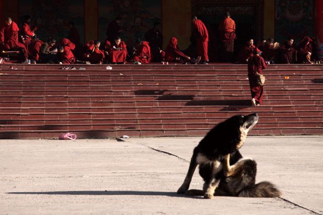
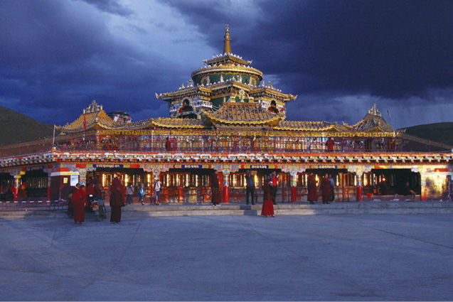

# 快乐的八个秘诀

/

佛教，会给每个人带来不同程度的快乐。

如果它没有这个作用，我们不必弘扬和修行，但事实证明它可以。

在压力过大的今天，或许，它比钱更重要。

/

本章为索达吉堪布在上海交通大学的演讲

2012·10·24

唐朝皇帝武则天写过一个偈子：“无上甚深微妙法，百千万劫难遭遇，我今见闻得受持，愿解如来真实义。”意思是，佛法甚深微妙，又极难得闻，有缘听到的时候，务求通达。

今天讲的快乐秘诀，就出自一部“极难得闻”的论典——《修心八颂》。

《修心八颂》问世已八百多年。当年，藏地佛教被国王朗达玛所灭，为了重振，印度阿底峡尊者应藏王邀约，不顾一切入藏弘法。于是，大乘正教再兴于藏。尊者的再传弟子，朗日塘巴尊者，就是本论作者。

## 生而为人，谁不想快乐

在藏地，无论是寺院、学校，还是一般人的家里，这八个快乐秘诀随处可见。它看似简单，但其中的深意，我们毕生也学不尽。

记得刚出家时，上师给我传了这个法，当时自己还年轻，也比较傲慢，觉得这很好懂，没有什么了不起。可是后来，我才发现错了。在之后的近30年里，每次重温它，都有不一样的收获。

你们第一次接触《修心八颂》，可能也觉得：“这有什么？我可以写出更好的。”但事实上，它是圣者的智慧流露，不同于凡夫拼凑的文字，它可以让我们获得快乐。

生而为人，谁不想快乐？然而，光是嘴上说说没用，快乐需要一种调心方式。只有掌握了这个，幸福感才会与日俱增。

《修心八颂》就是这样的快乐秘笈。在藏地，大德们极为重视这一秘诀。我所在的喇荣五明佛学院，出家人必须背诵三部论典，《修心八颂》就是其中之一。

当然，这里面所说的，百分之百做到并不容易。《修心八颂》讲的是圣者行境，不说俗务缠身的在家人，连我们出家人，完全做到也特别难。

但即便如此，也要尽力去做。实在不行，可以按里面的内容发愿，祈愿在未来做到，或者将它贴在显眼的地方，经常用这些提醒自己。

或许有人怀疑：“短短八个秘诀，有那么殊胜吗？”答案是肯定的。这些秘诀的加持不可思议，它用简练的语言，开显了最深的道理，就像一把小钥匙，能开启宝藏的大门。

由于时间关系，这次无法广讲，只能给大家简单地介绍一下。如果在藏地，讲的时间会比较长。我家乡有位八十多岁的老法师，他讲经的时间，是从下午一点到七点半，中间没有休息，不管听众多累，他都一直慢慢地讲——不过你们放心，我没有这么厉害。

## 快乐秘诀一： 把爱“我”变成爱“他”

[原文]

愿我以胜如意宝，饶益他众之意乐，

时时刻刻倍珍爱，轮回一切诸有情。

[注释]

利益他人之心，比如意宝更珍贵。愿我以此心时时爱护一切众生。

如意宝，是龙族的宝珠，有着特殊的能力：无论向它求什么，皆可如愿。世人通常认为，这样的宝贝十分难得，但实际上，拥有一颗利他心，比拥有如意宝更珍贵。

这个时代最需要的，就是利他心。若都惦记着一己私利，社会必然不安定。只有不分地域、国家、种族，平等关爱一切众生，我们周遭的环境才会更好。

几年前的一则新闻让我记忆深刻。在一次网球公开赛中，最后一局，双方长时间处于比分相同的状态，胜负就在一球之间。

此时，一只小鸟突然飞进场内，被高速飞行的网球击中，当场坠地而亡。

误打死小鸟的选手，不再关心比赛输赢。他放弃迎战对手毫不客气的进攻，当着万千观众的面，跪在小鸟面前，为自己的过失忏悔……

有人不理解这种行为，为一只已经死了的小鸟，丢掉了可能的冠军宝座，值得吗？

当然值得。因为尊重生命的心，比什么奖杯都珍贵。

从佛法的角度讲，这种心若进一步升华，就是大乘佛法的心髓——菩提心。《入菩萨行论》中说：宁可失去钱财、名誉，乃至生命，也不能失去利益众生的菩提心。

要知道，一切众生都对我们有恩。且不说无始劫来，仅仅是眼前，我们的吃穿住行，哪一样背后没有众生的汗水？只有时时念恩，多想众生，少想自己，才符合道理。也只有这样，快乐才会不求自来。

其实，一个人的痛苦全部来自于爱“我”，如果把爱“我”变成爱“他”，痛苦自会减少很多。

有些人固执地认为：“凭什么要爱他，他又不是我家人？”

且不谈佛教中的观点，现在科学家通过DNA技术也发现：人类拥有同一位祖先。也就是说，地球上所有人都是一家人。

既然如此，我们何不放下执著，试着去爱每一个人？

用智慧来观察，现在的一切苦乐，都是虚幻。

但我们往往把它当真，为它哭、为它笑，不愿意从幻境中醒来。

## 快乐秘诀二： 被人尊重是幸福，能尊重人更幸福

[原文]

愿我交往何人时，视己较众皆卑下，

诚心诚意又真挚，尊重他人献爱心。

[注释]

无论与谁交往，愿我无有傲慢，心怀诚意，时时想到利益别人。

《礼记》中说：“夫礼者，自卑而尊人。”

可是，现在许多人不懂“礼”，不管是走路、说话，经常一副目中无人的样子。其实，尊重他人，是做人的基本素养。若不懂得尊重别人，自己也不会得到别人尊重。

有些人想不通：“明明我身份地位比他高，为什么要对他谦卑？”要知道，任何人都有值得尊敬的地方。而且，身处高位而谦卑有礼，才不会骄横过分。

无论做世间事，还是学习佛法，人最容易有的问题就是贡高我慢，这点会阻碍我们在学业和道业上进步，做事情也不容易成功。

一个人暂时有点福报，其实没什么了不起。世间一切皆为无常，财富再圆满，也可能一夜沦为乞丐。前些日子，广州某位有22套房产的贪官遭爆料后，立即被免职，查封全部财产。谁能知道哪一天，我们会不会也身陷极其悲惨的境地？了知无常，还会轻易看低谁吗？

不少人总以为自己拥有某种资本，进而生出莫名的优越感。龙猛菩萨说，有人以才华傲慢，有人以美貌傲慢，有人以财富傲慢，有人以地位傲慢。假如你有类似的心态，不妨多翻阅史料，了解一下这种人的结局。

人生在世，不但要学知识，也要学做人。所谓的做人，不是表面上待人进退有度，而是要发自内心地尊重别人。

这方面，大乘佛教中有更深层的宣说。

大乘最重要的理念，是大悲心、大慈心、菩提心。大悲心是想拔除众生痛苦；大慈心是想给予众生快乐；菩提心是在二者的基础上，希望众生获得永远的解脱——佛果。

有了这些善心，不用学表面功夫，也会尊敬众生，这从很多大德的言行中即可看出。

当然，大成就者的有些境界，我们不要说一辈子，一百辈子也遥不可及。但即使做不到100%，做到20%，10%，甚至5%，也是可以的。不能因为做不到最好，就彻底不做了。

## 快乐秘诀三： 将烦恼消灭在萌芽中

[原文]

愿我恒常观自心，烦恼妄念初生时，

毁坏自己他众故，立即强行而断除。

[注释]

愿我恒常观察自心，每当烦恼、妄念刚生起时，意识到它将毁坏自己和他人，立即强行将之灭除。

现在的人烦恼极其炽盛，诚如《地藏经》所形容的，“起心动念，无不是业，无不是罪”。

当一个人生起烦恼时，常会丧失惭愧心，甚至无恶不作。培根在《论贪婪》中描述得很形象：“贪婪者为了煮熟自己的一颗鸡蛋，不惜烧掉邻居的一座房子。”

打开网络，这样的新闻比比皆是，豆腐渣工程、毒奶粉、地沟油……人们连走路、吃饭、喝水都已没安全感。造成这种悲剧的原因，一方面是许多人不懂因果，一方面就是贪婪等烦恼过盛所致。

在烦恼的驱使下，还会爆发个人、家庭、民族乃至国家间大大小小的战争。在上海街头，我看到两个小贩为蝇头小利而打架，虽然打得不厉害，只用苹果互砸，却也算是一场“战事”。

灭除烦恼，最好的武器是利他心。不管做什么，若以他人的利益为出发点，尽量减少自我爱执，烦恼很快会灭尽。烦恼灭尽，痛苦也就不复存在了。

## 快乐秘诀四： 可怜之人，必有其可爱之处

[原文]

愿我目睹恶劣众，造罪遭受剧苦时，

犹如值遇珍宝藏，以难得心爱惜之。

[注释]

若有人因造过恶业，如今正在受苦，愿我犹如遇到宝藏一样，以难得心珍惜眼前的机会，帮助这些可怜众生。

这个时代太缺少爱，许多人为了自己，不愿意多管闲事——前面讲的小贩打架，当时围观的人不少，可没一个人去劝。这件事虽然没引发严重的后果，但从性质上讲，跟“小悦悦事件”是一样的。

按照大乘精神，见到这种情况，包括看到饥饿者、残疾人、乞丐等可怜众生，我们应该怎么做？

要如同挖到金矿般欢喜，觉得利益他人机会难得，想方设法去帮助他们。

有人虽然也会付出爱心，但往往是遇到灾难时才想起。比如汶川地震期间，许多人都向灾民伸出援手，可是灾难一过，就不管他们了。站在大乘的角度，这种偶尔的爱心远远不够。

还有人看见可怜众生时，无动于衷、袖手旁观，甚至会想：“可怜之人必有其可恨之处，活该！”这种心态，就跟大乘发心相去甚远。

当然，要一下子转变积习已久的观念，达到大乘境界，也有一定困难。不过我希望，大家今后尽量要往这方面努力，以善心对待一切人和事。

善心，应从点点滴滴培养。哪怕你做不了太多，不妨试着“日行一善”，每天至少做一件有益于自他的善事：看到腿脚不便的人，过去搀一下；别人骂自己，稍微忍一忍；生起嫉妒了，马上调整心态……时间长了，善心一定会成为习惯。

## 快乐秘诀五： 别人诽谤你，是对你最大的恩惠

[原文]

愿我于诸以嫉妒，非理诽谤本人者，

亏损失败自取受，利益胜利奉献他。

[注释]

若有人因嫉妒诽谤我，愿我心甘情愿接受一切亏损、失败，将利益和胜利奉献给他。

这个偈颂加持非常大。

《大圆满前行》中记载：昔日，恰卡瓦去甲向瓦格西家做客，见到一个小经函，顺手翻开，看到一句话：“亏损失败自取受，利益胜利奉献他。”他感觉非常稀有，忙问：“这是什么法？”

格西答道：“朗日塘巴尊者造的《修心八颂》。”

恰卡瓦迫不及待地想求此法。遗憾的是，朗日塘巴尊者已圆寂。

后来，历经艰辛，他终于在夏日瓦格西面前，求得此法传承。之后的六年中，他一心修持《修心八颂》，最终获得了殊胜成就。

在世人眼里，听到诽谤自己的语言，正常的做法是以牙还牙，秉持的原则是人不犯我，我不犯人，人若犯我，我必犯人。但站在大乘的角度，就不应该有这种心了，而要做到失败都归我，胜利都归他。

乍听之下，有人可能会想：“如果干什么都是‘亏损失败自取受’，那还怎么活呀？”

这种顾虑是多余的。修行讲究次第，对凡夫来说，可以根据自己的接受能力来行持，暂时并不需要所有的事情都吃亏。

在此过程中，若善于运用各种窍诀，烦恼便会无从生起。比如别人骂你时，你可以将骂声观为空谷回声，它对自己无利无害。

昔日，寒山问拾得：“世间谤我、欺我、辱我、笑我、轻我、贱我、恶我、骗我，如何处治乎？”

拾得回答：“只是忍他、让他、由他、避他、耐他、敬他、不要理他，再待几年，你且看他。”

这不仅是修心的窍诀，也是为人处世的良方。试想，假如你没做对不起别人的事，人家非要诬陷你做了，此时你是针锋相对地回击，还是以这种方法化解？聪明人一想，就知道后者效果好。

不过，这些秘密只掌握在少数智者手中，大多数人不知道。就算偶尔知道了，也很少有人做得到。

佛法重在行持。“亏损失败自取受，利益胜利奉献他”这一理念，刚开始去做，肯定比较困难，但能长期坚持的话，自然会得心应手。如果一心行持，哪怕只是这一句话，也可以让你根除痛苦。

## 快乐秘诀六： 恩将仇报的人，是我的上师

[原文]

愿我于昔曾利益，深切寄以厚望者，

彼纵非理而陷害，亦视其为善知识。

[注释]

如果我曾帮过某人，并对他寄以厚望，他却反过来陷害我，愿我也能将其视为善知识。

当今社会，恩将仇报的人特别多。有些老板费心栽培一个人，此人在有能力后，不但不报恩，反而将客户拉走，把老板逼得走投无路。

以世间眼光看，这种人非常可恨。大家小时候学过《东郭先生和狼》吧，这个寓言就告诉我们：忘恩负义者该千刀万剐。

可是按照大乘的理念，不但不应该记恨，还要把他当作上师。

对很多人来说，这有点匪夷所思。但在佛教历史上，许多大德的确以实际行动展示了这种境界。

广钦老和尚有个弟子，被人陷害后，跑到老和尚面前哭诉。老和尚听后说：“俗气，没脱俗！俗人才感觉别人在刺激我。如果是修行人，心放在道上，人家说我不好，是在帮我改进修行。”

对修行人而言，别人陷害你，是对你最大的恩惠。

我们即使达不到这种境界，也应多记别人的恩德，忘掉别人的伤害。现实中许多人恰恰相反：别人帮了自己，转眼就忘得一干二净；几年前别人说的一句重话，至今还记得清清楚楚。这样不太好，大家今后要改变习惯，心里不要装太多怨恨。怨气大了，伤人伤己。

## 快乐秘诀七： 你一生做的好事，全是为自己做的

[原文]

愿我直接与间接，利乐敬献诸慈母，

老母有情诸苦厄，自己默默而承受。

[注释]

愿我以直接或间接的方法，将一切快乐奉献给众生，默默承受他们的痛苦。

利他有直接、间接之分。直接的，像医生治疗疾病、老师解答疑惑等；间接的，是通过一些途径让众生远离痛苦，比如不吃肉。

人如果没有自信，也不信任他人，

这种生活是一种孤独。

利益众生，看似在帮别人，实际上是帮自己。

有个美国人叫克雷斯，在一个风雪交加的夜晚，他的汽车抛锚，被困在野外。正当焦急万分时，有个骑马的男子路过，见此情景，二话不说，用马将汽车拖到了附近的小镇上。

感激不尽的克雷斯掏出钱，准备酬谢对方。男子拒绝：“这不需要回报，但请给我一句承诺——当别人有困难时，你也尽力地帮助他。”

后来，克雷斯主动帮了许多人，每次他都将这句话转述给被帮助者。

多年后的一天，克雷斯被爆发的洪水困在孤岛上，一个少年冒着危险救了他。当他感谢少年时，少年居然说出了那句克雷斯曾说过无数次的话：“这不需要回报，但请给我一句承诺……”

克雷斯顿时明白：他这一生做的好事，原来，全是为自己做的。

利他即利己，这在大乘佛法中有全面、透彻的宣说。如《入菩萨行论》就告诉我们：“所有世间乐，悉从利他生；一切世间苦，咸由自利成。”

你们头一回听大乘的利他教言，也许感觉比较陌生，但只要用心观察，就会知道这种理念的可贵。

## 快乐秘诀八： 一切万法似梦似幻

[原文]

愿此一切我所行，不为八法念垢染，

以知诸法如幻智，无执离缚而解脱。

[注释]

愿我的一切所行不被世间八法染污，了知万法本体皆空、显现上如梦如幻，远离执著与束缚，获得解脱。

世间八法，即称、讥、毁、誉、利、衰、苦、乐。

作为普通人，喜欢赞美，不喜欢批评；喜欢被关注，不喜欢被忽视；喜欢得到，不喜欢失去；喜欢快乐，不喜欢痛苦。

但修行人了知万法皆空，“一切有为法，如梦幻泡影”，并不会把得失看得太重，以此可摆脱世间八法的束缚。

断除了对这一切的执著，才能真正远离痛苦。

## 谁有了它，谁就有了快乐

这八个秘诀，从各个角度宣说了利他的道理。依此行持，不管你是否学佛，都可以拥有快乐。

利他，其实不仅是大乘佛教的根本，也是全人类不可缺少的财富。现如今是21世纪，就算到了30世纪，人类照样需要它，它依旧不会被淘汰。

为什么呢？

我们所有的不快乐，全部来自对“我”的执著。只有转变心态，将短暂的一生用于利他，才有可能减少痛苦、增上幸福。

这一点，不单佛教如此提倡，其他宗教也不例外。像特蕾莎修女，付出一生帮助他人，自己的生活极其简单。但在她的生命中，没有痛苦，唯有喜乐。

许多人不知道这个秘密，总抱怨自己太倒霉，老天不公平……如果你不想快乐就另当别论，想快乐的话，请停止怨天尤人，从现在开始培养利他心。

我本人虽然修行很差，但也看过大量的经论，从中深深体会到：人最需要的是利他心，谁有了它，谁就有了快乐。

这其中的奥妙，只有你做到了，才能有所领悟。

当然，凡夫的利他心，跟菩萨比有一定距离。我们即使达不到太高的境界，若能在减少自私、增上利他方面有所进步，哪怕只前进一步，也是个好的开端。

现场互动

⊙ 问：我去过很多汉地寺院，几乎都有被骗买高香的经历。请问，藏传佛教的寺院是否有类似情况？佛教怎么看待这个问题？

堪布：如今，汉地寺院商业化的倾向比较严重。在有些地方，甚至有寺院已经上市。对此，许多人议论纷纷。这种情况如果继续下去，佛教确实会面临危机。

不过，最近国家统战部、发改委等部门联合下发文件，制止寺院“被上市”“被承包”。如果这些政策能落实，对佛教应该是好事。

到目前为止，藏地还没有出现这种情况。除个别著名的寺院外，绝大多数寺院仍保持着传统特色。

我个人认为，寺院不应该卖门票，否则，就分不清寺院和旅游景点了。作为佛教道场，应该保持清净、安宁，给人带来一种祥和。

⊙ 问：出世间快乐与世间快乐有何区别？怎样才能获得出世间快乐？

堪布：世间快乐源自感官享受，出世间快乐超越了感官享受。

获得出世间快乐，首先要生起出离心，了知轮回是痛苦的；之后生起度化一切众生的菩提心；最后证悟万法皆空。若如此，就能获得无法言表的大安乐。

自古以来，无数高僧大德证得了这种境界。只要具足信心和精进，我相信人人都能得到。

⊙ 问：有世间经历后出家和从小就出家，这两种人在开悟方面有区别吗？

堪布：对开悟来说，从小出家还是半路出家不重要，关键要看自己的信心和精进。如果精进和信心不足，即使从小出家，也不一定开悟；若具足了这二者，即使很晚出家，也能迅速开悟。

⊙ 问：您说，前世的因，造就今生的果。那现在做善事，能否改变今生的命运？还是必须等到来世？

堪布：这要看你行持善法的程度。佛法中讲，如果在佛陀、圣者、僧众等严厉对境面前行持广大善法，今生很快就会感召果报。

业果是极其复杂的，只有系统学习，才能通达其中奥秘。简单讲，今生造的业，感果有三种情况：一是今生成熟果报，即现世现报；二是下辈子成熟果报；三是第二世乃至千百世后受报。

就像世间犯罪，有人立即被判刑，有人过几年被判刑，有人这辈子都不会受惩罚。

⊙ 问：既然诸法是空性，我们何必执著于幸福？

堪布：确实一切法是空性，证悟了这种境界，就不必执著幸福，因为你已获得最究竟的幸福，如同获得博士学位的人，肯定已掌握了小学知识。但如果没到这个境界，就必须执著幸福。

万法皆空是就实相而言的，追求幸福是就现相而言的，二者不能混为一谈。

打个比方，以物理学家的眼光观察瓶子，它是由原子等组成，但物理学家不会以此认为瓶子不存在，更不会否认瓶子能盛水。同样，学佛的人也不能以实相来否定现相。

永嘉玄觉禅师说：“梦里明明有六趣，觉后空空无大千。”六趣众生的苦乐就像做梦，但没有从轮回的迷梦中醒来之前，一切感受是无欺存在的。只有完全证达了万法皆空，才不需要追求幸福、逃避痛苦。

⊙ 问：被人爱和爱别人，哪一种更幸福？

堪布：这要看你自己。所谓幸福，是内心的一种感受。不管被人爱，还是爱别人，哪一种让你得到满足，哪一种就让你更幸福。

⊙ 问：我有一个朋友患抑郁症失去了工作，一个朋友总想自杀，这是前世的业障造成的吗？他们该怎么办？

堪布：无论遇到什么，要有面对的勇气，不能选择自杀。生命是最宝贵的，留得青山在，不怕没柴烧，暂时没钱、没工作不要紧，这些可以慢慢来。

心理疾病的成因十分复杂。若是前世业力所致，这种比较难以对治；若是暂时非人制造违缘，则可念莲师心咒“嗡啊吽班匝儿格热巴玛色德吽”，只要经常持诵，就会对治疗有帮助。

藏医认为，在所有的疾病中，相当一部分是非人引起的。遇到他们作祟时，不管你是否信佛，只要念诵莲师心咒，就会遣除一些莫名其妙的心态。

不仅如此，在生活中遇到违缘，也可以多念莲师心咒。我自己就是这样，有时候做了恶梦，醒后马上念100遍莲师心咒，心情很快会平静下来。

⊙ 问：身、口的克制，比如戒杀、吃素，很容易做到，但起心动念较难控制，如何消除不清净的意念？

堪布：相对于身、口，心确实更难控制。正因为如此，佛陀才依次说身、口、意，先从调整身体入手，再调整口业，最后才调整心。

若想调伏心，必须有一个过程。若按照佛陀的教言，长期地训练与对治，心就可以慢慢调柔，达到最清净的境界。

⊙ 问：帮助别人是一种快乐。可由于自己的力量渺小，有时候无法帮到对方，这反而让我非常难过。既然自己的力量微不足道，这种付出有意义吗？还值得坚持吗？

堪布：做善事也许会违缘重重，造恶业往往非常顺利。但即便如此，帮人的心也不能退，我们能做多少，就做多少。

有这样一个故事：退潮后，沙滩的水坑中留下很多小鱼，在烈日的炙烤下，它们即将死亡。此时，有个孩子一条条捞起小鱼，把它们扔回大海。有人问：“这么多小鱼，捡得过来吗？这样做，谁在乎？”孩子一边往海里扔，一边说：“这条在乎，这条也在乎……”同样，我们在帮人的过程中，或许能帮到的并不多，而且经常遇到阻碍，但不能就此灰心，因为，总有人在乎。

我认识一位法师，他的寺院有五百多人。在弘法利生时，别人对他的做法不理解，他感觉很为难。一天晚上，他找我谈心，说准备放下一切，不当寺院的住持了。我劝他：“还是继续干吧。如果是为了自己，可能会有痛苦；但若没有自私自利，而是以饶益众生的发心做事，即使事情不成功，也不会有什么。”最终，他听从了我的建议，坚持了下去。

在利他的过程中，不要轻言放弃。只要有一口气，一定要帮助众生。

⊙ 问：在家居士怎样才能保持精进？

堪布：如今诱发散乱的因缘相当多。作为皈依三宝的人，对每天的生活要有规划，早起晚睡，少接触令人散乱的环境，尽量挤出时间修学佛法。

没有慈悲，纵然微笑也是恶；

怀有慈悲，即使怒目也是善。

⊙ 问：我是学藏传佛教的，每天都修上师瑜伽。请问，上师瑜伽是否相当于禅修？

堪布：禅修有两种，一是观察修，一是安住修。

修上师瑜伽时，在自己前方观想上师，把他当作三世诸佛的总集，并且虔诚地祈祷，这相当于“观察修”；之后，观想上师放光融入自身，上师的智慧与自己的心融为一体，安住在这种境界中，相当于“安住修”。

所以，上师瑜伽就是禅修。

⊙ 问：每天花两个小时念经磕头，不闻佛法不读佛书；每天花两个小时听闻佛法阅读佛书，不念经磕头，哪一个更有功德？

堪布：每天吃饭不吃菜，每天吃菜不吃饭，哪一个更有营养？

⊙ 问：六道轮回像一台巨大的机器，众生像机器里的部件，慈悲的佛陀站在机器旁边，不断地将苦难众生救拔出来。我想问：谁制造了这个机器？是什么动力使它不停运转？

堪布：轮回是无限的，用有限的机器比喻它，不太恰当。

轮回没有一个推动者，众生流转是种自然规律，如同播下毒种会长出毒果，造了有漏业，必定会转生轮回，乃至没有停止造业，就会不断地流转下去。在此过程中，没有一个外在的主宰者。

若想了解轮回，必须学习佛教的四谛、十二缘起。明白了这些道理，就会知道轮回是怎么回事。

⊙ 问：过去心不可得，现在心不可得，未来心不可得。那么，追求幸福的心可得吗？

堪布：在实相中，三心不可得，追求幸福的心也不可得。如果有了这种境界，就会像藏地的米拉日巴尊者、汉地的济公和尚一样逍遥自在，没有任何约束。

但没有证悟这种境界之前，了知幸福的心还是有，害怕痛苦的心也是有，因此，追求幸福并不矛盾。

所追求的幸福有两种——暂时的幸福是满足内心；究竟的幸福是断除烦恼障和所知障，获得圣者的果位。

⊙ 问：我看过一段话：“人生有三重境界，第一重是‘看山是山，看水是水’，第二重是‘看山不是山，看水不是水’，第三重是‘看山还是山，看水还是水’。”请您解释一下它的意思。

堪布：没学佛时，对万法有强烈的实执，这就是“看山是山，看水是水”；学佛之后，以中观理论观察，一切法皆为空性，这是“看山不是山，看水不是水”；学佛到一定境界后，虽然体悟到无一法可得，显现上仍要随顺众生，这是“看山还是山，看水还是水”。

拿幸福来讲，也可以相应这三重境界：首先，没学佛时认为，幸福是真实的；中间，学习佛法后，明白幸福是空性；最后，虽然有了不可思议的境界，可在随顺众生时，还承认幸福是存在的。

需要指出的是，随顺众生非常重要！佛陀已证悟了最高境界，但在众生面前，仍像普通人一样托钵、吃饭。许多大成就者也是如此，内心有常人望尘莫及的证悟，但外在的显现还和普通人一模一样。

⊙ 问：何为小乘佛教？何为大乘佛教？我们应该信仰小乘还是大乘？

堪布：小乘佛教，常被认为是南传佛教，在斯里兰卡、缅甸等国比较兴盛。大乘佛教，往往被认为是汉传佛教、藏传佛教。

阿底峡尊者说过：“大小乘的差别，看是否具足菩提心。”具有菩提心叫大乘，不具足菩提心叫小乘。

只想自己离苦得乐，这种发心属于小乘；不仅自己求解脱，还想度化一切众生，这是大乘的发心。

有些人念佛求往生，目的是什么？为了自己到极乐世界好好享受。如此，你修的虽然是大乘法，却有一颗小乘心。

选择大乘还是小乘，主要看自己的心态。如果心力强大，自己能否解脱不要紧，唯一希望众生解脱，就可以选择大乘佛教。

⊙ 问：在修上师瑜伽时，是否要将根本上师观为莲花生大士？

堪布：有两种观想方法。无垢光尊者在《大圆满虚幻休息》中说：“修上师瑜伽时，上师的形象无须改变，上师是什么样，就直接观想那种形象。”也有经论中说，可以观想本体为上师，形象为莲花生大士。

具体采用哪种方式，看你对上师有没有如佛般的信心。如果有，可直接观想上师的形象；没有，最好是观想上师的形象为莲花生大士。

⊙ 问：为什么梦中犯错不算犯错，现实中犯错却算？

堪布：按别解脱戒的观点，梦中犯戒虽有一定过患，但因为不具足真实的对境，所以不算真正犯戒。

月称论师说，人有三层梦：一是晚上睡觉的梦；二是现在的人生大梦；三是觉悟前的一切都是梦。

现在我们还没从轮回的迷梦中醒来，如果哪一天你觉悟了，就会发现，自己所造的罪业犹如梦中的罪，从来没对你造成过真正的伤害。

⊙ 问：我感觉自己上半辈子太苦了，有没有办法改变下半辈子的命运？

堪布：做善事是改变命运的唯一方法。佛教认为，人生的主线是命定的，但也并非一成不变，如果大量做善事，命运就会朝好的方向转变。学过《了凡四训》的人，应该明白这个道理。

知道苦是人生的底色，苦的感受就不那么明显了。比如身体患了疾病，病苦虽然难忍，但由心态而导致的痛苦，完全可以消除。

实际上，你们是非常快乐的，如果去监狱看看，才知道什么是痛苦。我去过一些监狱，在许多犯人的心中，唯一的愿望就是跟亲人交谈一个小时。如今，你每天能跟亲人朋友聊天，这时候不但不珍惜，反而经常吵吵闹闹，若是在监狱里，有一次机会和他们聊天，就非常满足了。

大家应该反思，不要总觉得自己苦。有这样的怨气，会给生活平添许多不开心。外境的好坏、事情的成败，我们应抱着随缘的心态。

当然，随缘不是消极。对于有意义的事，不能轻易放弃，还是要努力去做。

⊙ 问：我长期吃素，但经常被动杀生，比如朋友请吃饭时要点杀，这该怎么办？

堪布：佛教徒一般不会主动点杀。不过，现在的人结婚、过年时大量杀生，有些佛教徒不得不应酬，结果染上了罪业。如果是这种情况，应该多忏悔。

在我一生中，最不愿意看到的，就是杀生。小时候，只要碰到杀牦牛的场面，我会尽全力阻止，阻止不了，只好跑开，实在不忍心看到那种惨况。

从因果上讲，杀生的后果非常可怕。倘若经常杀生，且不说本人会感召不幸，子孙后代也受影响。因此，希望大家尽量不要杀生。

⊙ 问：吃素的人可否食用鸡蛋和牛奶？

堪布：若是严格的素食者，鸡蛋和牛奶不应该吃。不过，一般来讲，有些鸡蛋不是受精卵，无法形成真正的生命，所以有些素食者也吃鸡蛋。

轮回皆苦，在这个世界上，完全没有罪业的食物是找不到的，甚至吃米饭和蔬菜，在种植过程中也难免造业，多多少少有一点过失。

总之，吃鸡蛋和牛奶，间接会给动物带来痛苦，但与吃肉比起来，后果不算很严重，比较容易忏悔清净。

⊙ 问：佛教提倡出世，儒教提倡入世；佛教追求精神上的财富，儒教追求现实的东西。您如何评价儒教？

堪布：佛教不仅讲出世，也讲入世。像今天的演讲，我就将二者结合了起来，否则，只讲出世的道理，比如空性、菩提心，你们不一定能接受。

儒教也并非不重视精神财富，不过相对于佛教，儒教偏重于现世的关怀，更多是讲如何为人处世、孝顺父母，而对于来世的解脱和度化一切众生，并没有深入剖析。

其实，儒教、佛教都是传统文化的精华，少一个也不行。南怀瑾先生说过：“只有儒释道结合起来，才能给中国人带来全面的提升。如果儒释道缺少其一，就不会圆满。”

我本人对传统文化非常感兴趣，平时看书也偏重看古人的书。希望大家也多了解一些传统文化，从老祖宗的智慧中汲取营养。

12
