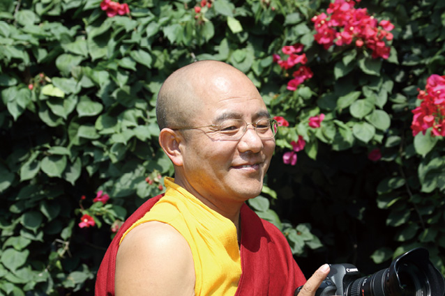
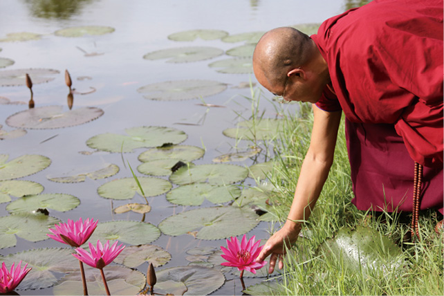

# 怎样面对痛苦

/

医生给你治病，

你把药方背下来却不吃药，病也好不了。

有些人为你指明人生道路，

你记住了却不去做，痛苦也难以消除。

/

本章为索达吉堪布在香港理工大学的演讲

2011·07·29

进了校门，看到这里的建筑，我觉得非常亲切。这种风格跟我们寺院相似，听说它拷贝自英国剑桥、牛津的建筑模式，带有工业革命时代的气息，给人以开放包容的感觉。

佛教讲“诸法因缘生，诸法因缘灭”，世人也说“有缘千里来相会”，我们在这里聚会，并不是无因无缘的，这种因缘来自于大家对佛教的敬仰，所以才产生了今天的交流——“怎样面对痛苦”。

痛苦，是每个人都不陌生的字眼。

我本人虽然也没有出离痛苦，夸夸其谈不一定合适，但因为从小对佛法就有兴趣，多年来依止善知识，在学习、修行上下过一番功夫，所以，从某个层面讲，可以简单汇报一下自己的心得。

## 有钱也苦，没钱也苦

三界六道中，痛苦可谓数不胜数。仅从人类而言，就有三大根本苦、八大支分苦。

印度圣天论师还将人类的痛苦归摄为两种：身苦与意苦。大人物的痛苦，是意苦，如工作上的压力、竞争、焦虑；小人物的痛苦，是身苦，比如缺衣少食、高强度劳动。所以，有钱也苦，没钱也苦。

不少人以为有钱就快乐，但有了钱才发现，快乐没有如期而至，痛苦反而层出不穷。

对此，美国盖洛普民意调查所用数据作了证明：按满分100计算，中国消费者在1994年的幸福指数是69分；1997年最高，达到71分；十年后的2004年，降至67分。

这说明什么？随着经济发展，人们刚开始觉得越来越幸福，但过不了多久，幸福指数日渐下挫，最后还不如没钱时幸福。

有统计说，在全世界，每年自杀和自杀未遂的人数都十分惊人，相当于每分钟都有人自杀身亡。

可见，许多人虽然穿得漂漂亮亮，看起来开开心心，但他们一直被痛苦逼迫着。

## “谁说人生皆苦？我就挺快乐”

人生在世，苦多乐少。你若不信，可以看一下《中观四百论》前八品，里面专门讲了人世间的痛苦。看完之后就明白，人生的苦无处不在，正如《法华经》中云：“三界无安，犹如火宅。”

有人可能不认同：“谁说人生皆苦？我就挺快乐。”有个酗酒成性的人跟我说：“佛教讲轮回痛苦。其实不苦，我喝了酒特舒服。”但醉后的舒服，是失常、颠倒的意识，根本不能算是快乐。

美国史学教授达林，写过一本书《幸福的历史》。他花了六年时间翻阅史料，研究人类的幸福到底是什么，什么能给我们带来幸福……最终，他的结论是：“极致幸福可能只存在于我们的想象中。”换句话说，真正的幸福是得不到的。这种观点，与佛教讲的“三界无安”不谋而合。

所以，人生本来充满痛苦，这点务必要认清。否则，遇到一点挫折，就抱怨老天不公平，“怎么这么倒霉，不幸全落到了我的头上”，却不知轮回的本性即是如此。

有人觉得：“轮回中并非全是苦，还是有一些快乐。”话虽不错，但这些快乐是无常的，随时可能变成痛苦，它只是偶尔的点缀，却不是人生的底色。

还有人认为，快乐存在于感官上，身体的触碰、美妙的音乐等都能带来乐受。但这种快乐比较肤浅，通过药物亦可获得。

真正的快乐，来自于内心。若想除苦，必须从心下手。

## 世人面对痛苦的方法

现在有些人在痛苦时，拼命地抽烟、喝酒。我认识一个佛教徒，他说烟酒戒不了，每当他很烦的时候，就会躲到咖啡厅吞云吐雾，再不就去舞厅借酒消愁。他说一醉可以解千愁。但真能如此吗？这只会让自己越来越愁，清醒过来，事情仍要面对，想躲也躲不掉。

有些人心情不好了不是花天酒地，就是去KTV狂吼，或者通宵达旦地打麻将，这都是一种逃避。

有些人把痛苦列在纸上，点火烧掉，看着字迹灰飞烟灭，想象痛苦随之消失，这有点自欺欺人。

还有些人跑到山谷里大叫，或者用头撞墙，把锅碗瓢盆砸烂，这样发泄才觉得轻松。

更有甚者，还以杀人取乐。美国有一个17岁的孩子把父母杀害后，在尸体仍在房内的情况下，通过Facebook邀请几十名年轻人来家中，通宵喝酒进行狂欢。

有些人失恋后，要么把自己杀了，要么把恋人杀了。找不到恋人，就找相似的人代替。据媒体报道，某地有个大学生，专杀一些穿红衣服、长发披肩的女学生，以报复前女友对他的无情。

稍微好一点的人，选择游山玩水，或找有智慧的人聊聊天，再不做一下心理咨询，看看“心灵鸡汤”等励志书。

这些方法，就像吃止痛片一样，可以暂时压制痛苦，让它不再折磨自己。但毕竟治标不治本，要想从根本上解决问题，应该从佛教的智慧中寻找答案。

## 生命的另一种选择

不要在一帆风顺的时候，装成修行人；

不要在遇到挫折的时候，变回普通人。

下面，我将佛教的方法与你分享。这些很容易消除痛苦，即使有些习气根深蒂固，无法一下子断除，只要持之以恒地练习，痛苦也会渐渐离你而去。

### 1．利益众生，断除自利

我们的痛不欲生，多数是为了自己，为众生的寥寥无几。若想断除痛苦，就要斩断它的来源——自私自利的心；要想做到这一点，需要学习佛教经论，以大乘的无我观改变心态。

有些人平时有各种苦恼，但学了大乘佛法后，做一些有利于众生的事，痛苦不知不觉就消失了。所以，第一个除苦的方法，就是利益众生。

假如你有大乘的慈悲心、菩提心，那再好不过；即使没有，也应该有仁爱的传统美德，它是挽救人类的妙药之一。

1988年，据说75位诺贝尔奖获得者在法国召开会议，探讨21世纪人类面临的问题。他们共同发表了一个宣言：“人类要在21世纪生存下去，必须回到2500年前汲取孔子的智慧。”

外国对中国文化抱有希望，遗憾的是，在中国，孔孟思想遭到了极大破坏。我小的时候，1974年，全国开展“批林批孔”运动，对孔子的思想进行批斗。尽管这个运动不到半年就结束了，但后患相当严重。从那时开始，中国的传统文化一蹶不振，有识之士即使想力挽狂澜，它也像个奄奄一息的病人，完全恢复非常困难。

前几年，传统文化基本处于被冷落的境地。“孝顺父母”“尊敬师长”等美德，往往看不见了。老一代的教师，虽然还保留一些长辈传统，然而因认识不到其中价值，不会着重去教育下一代。这样，中间一代的教师受的这种教育就非常少，想教学生也无能为力。如此，再下去之后，中国人的文化素养慢慢会变成什么样？

所以，我们的教育需要完善，不能只追求分数就够了。如今大学的录取标准，往往只看分数高低。其实，一个人考了多少分不重要，人格才是决定一切的关键。有些人就算再聪明，人品特别差的话，对社会也不会有利，反而贻害无穷。

教育最重要的一点，是教学生怎么做人。在古代，一个人能否得以重用，不但要看学问，更要观察德行。假如人格高尚、众望所归，即使学问不高，也会被委以重任；反之，若没有慈悲善良的心，纵然才高八斗，也不可能造福天下苍生。

联合国总部的大厦里，挂着孔子的一句名言：“己所不欲，勿施于人。”可惜，这句话知道的多，做到的少。当人的生命受到威胁时，往往贪生怕死，很多人却没有想到，自己经常吃的动物，又何尝不是如此？

断除自利、利益众生，并不是口头上说说，能否真正做到，需要多方面观察。假如你做到了，必定会断除痛苦。

### 2．把违缘转成顺缘

遇到逆境时，佛教中还有种方法：将它转为道用。也就是，不把痛苦当痛苦，而将其利用起来。

无著菩萨曾说，无论发生什么，都应该让自己快乐——没病是快乐，用健康的身体多做善事；有病也是快乐，以此消除往昔的业障。有钱是快乐，用它来上供下施，积累善德；没钱也是快乐，可以断除对财物的耽著。

这方面，我有个中学同学就做得不错。他是一个领导，有次在竞选某职位时，一直无动于衷，好像跟自己没有关系。旁人见了都急，劝他赶紧做做工作。他笑了笑说：“万一没选上也很好，正好有空修修佛法；选上也很好，有更多机会利益众生。不管结果如何，我都快乐。”

遗憾的是，很多人不懂这个道理，总是患得患失，抱怨这个不够、那个不行，结果顺缘都成了违缘。若能换个角度看问题，纵然是违缘，也可化为顺缘。

贝多芬说过：“最杰出的人，总能用痛苦来换取欢乐。”

### 3．修自他交换

当你卧病在床，或名声受损，或穷困潦倒时，可以发愿：“世上也有许多跟我一样的受苦者，愿他们的苦难成熟于我身，由我代受，他们都离苦得乐。”

然后，向外呼气时，观想自己的一切安乐变成白气，施给众生；向内吸气时，观想他们的一切痛苦变成黑气，融入自己。

这是除苦的最佳方法。

我们在遭受磨难时，若能这样观修，所受的痛苦就有了价值，对自我的爱执也会日益减少。

### 4．认识痛苦是空性

痛苦是从分别念而来，分别念依靠证悟空性能断除。圣天论师在《四百论》中说：“虚妄分别缚，证空见能除。”

为什么？

感受痛苦的“我”与所受的痛苦之间，是种互相观待的关系——离开了一者，另一者必然不存在。《中论》也说：“离法何有人？离人何有法？”有些人经常叫苦连天，但痛苦的“我”在哪里？通过中观正理一观察，就知道“我”根本不存在，如此，“我”的痛苦只是虚妄分别而已。

没有证悟空性，就会看不破、放不下，将虚妄执为实有。若像大成就者那样，依靠空性断除了我执，一切痛苦都将烟消云散，开悟会带来不可言说的快乐。

当然，我们不一定有那样的境界，但至少也应对“万法皆空”稍有了解。认识这一点，最好从《中观根本慧论》入手。此论开篇第一句是：“不生亦不灭，不常亦不断，不一亦不异，不来亦不去。”短短几个字，将万法真相揭示得淋漓尽致。不管是内在的痛苦，还是外在的诸法，其本性确实不生、不灭、不常、不断、不一、不异、不来、不去。

如果想深入佛教，必须一步一步、踏踏实实地修学。有些人皈依佛门十几年，只是随便看了几本书，对佛教的道理一知半解，这不一定是真正的佛教徒。

如今，佛教徒有两个误区：

一是有些知识分子研究佛教，不像藏地修行人那样在讲辩著、闻思修上花很多时间，以为得个佛教硕士、博士的头衔就可以了。他们对佛教的认识相当肤浅，写的很多论文也没有实义，傲慢却与日俱增。

二是有些信众比较迷信，到处求灌顶、求加持，以为解脱有捷径可寻。世间义务教育尚且需要九年时间，读完后只是初中毕业，佛教如此甚深，又怎么可能短期通达？假如没有系统学习，光是办个皈依证、求个灌顶，就自称为佛教徒，这只是徒有虚名罢了。

我跟一位教授交流时，彼此有种共识：对于佛教，只是研究理论不够，还要有实际修持；只是盲修瞎练不行，还要有理论依据。这两者，都值得下一番功夫。

曾有个大学老师问我：“给大学生讲佛教故事，他们不相信，怎么办？”

我说：“不用讲故事。他们听惯了神话、看惯了动画，很容易把佛教故事当成这些。一定要从中观和因明下手，先把他们的傲慢摧毁了，再讲这些故事，他们才能体会到佛教的伟大。”

2009年7月，国际联合宗教会在日内瓦召开会议，世界五大宗教为主的各大宗教、200位宗教领袖，通过投票表决，佛教获得“世界上最好的宗教”荣誉。在此过程中，很多宗教领袖没有选自己的宗教，把唯一的一票投给了佛教。为什么？历史上，没有一场战争是以佛教名义发动的，它的慈悲无偏利益一切众生，它的智慧对万法研究得极为透彻。

我在复旦演讲时，引用过中国科技大学前校长的一句话：“当科学家千辛万苦爬到山顶时，佛学大师已在此等候多时了。”不管是哪个领域的学问，在佛教中都诠释得极为圆满。当然，有些人不了解的话，这是他的问题，不是佛教的过失。

### 5．学会安忍

安忍，就是世人说的坚强。有了它，面对痛苦不会轻易低头。

美国著名盲聋女作家海伦·凯勒，用坚强的一生，创造了不可思议的奇迹。

居里夫人也说：“我的最高原则是不论对任何困难，都决不屈服。”当年她求学时极为贫穷，经历了难以忍受的苦行——因为营养不良，她一次次晕了过去；天冷没有被子，就把所有衣服盖上，甚至将椅子压在身上取暖。

藏传佛教中，有位伟大的祖师叫龙钦巴。他在桑耶修行时，全部家当也只是个牛毛口袋。每当下雪时，他就钻进口袋里。这个口袋，是他的被子、坐垫，还是唯一的衣服。

提到“唯一的衣服”，我想起一个护生短片中的小狐狸，它告诉人类：

“我有件美丽的衣裳，一年四季穿身上。我一辈子只有这么一件衣裳，是妈妈生我的时候送我的。我从此天天穿着它，晚上睡觉也不脱。

人呀，我的衣裳只一件，而你的衣橱已满又满。我的衣裳是我的毛皮，失去毛皮，我只有血肉一团。你的衣服可以一天三换，我衣服脱下，就命丧九泉。”

我们不穿动物皮，还有很多衣服可穿；不吃动物肉，还有很多蔬菜可吃。对许多人而言，吃一块肉不算什么，但你可曾想过：动物只有这一块肉，你吃了，它就会因此丧命。

西方有不少动物保护组织，我们这边虽然不多，但每个人最好能从自身做起，关爱所有的动物。假如你特别爱吃肉，以后尽量少吃点，这也算是一种“安忍”。

### 6．心情愉快法

藏传佛教中有个实修法，若能经常修持，有助于天天好心情，改善人际关系，诸多不顺迎刃而解。

方法很简单：双目直视虚空，不执著一切自然放松，心胸尽量放大，在此境界中坦然安住。然后念诵“达雅他 嗡 措姆迷勒那 德卡踏母索哈”，7遍、108遍都可以。

这个方法，我修过一段时间，效果非常好。当然，你没有信心的话，效果不一定明显，毕竟修任何一个法，信心特别关键。

有些人认为这不理性。其实，过于理性和过于感性，都会阻碍你涉入许多甚深领域。

有些搞学术研究的人，对“信心”“加持”完全否定，一提起就嗤之以鼻，除了自己的分别念，什么都不相信；有些人又太过盲目迷信，对理论从来不研究，这也是一种极端。若想认识这个世界的真相，应当住于中道，不堕两边。

### 7．放下执著

有位画家在纸上画了个黑点，装在相框里。旁人看后有各种猜测，不知道这代表什么。

其实，它的喻意很深：当我们执著于一点时，往往会忽略很多，全然不觉还有大片的空间。

我认识一个人，家庭出了点问题，她就不想活了，包个车去了壤塘大草原。那里特别辽阔，十几公里看不到边。她下车后，打发司机走了，开始大叫发泄痛苦。喊着喊着，心也随之开朗起来。看看天空，看看草原，她感觉自己像只小蚂蚁，死命执著一个小窝，有什么意思？瞬间她就放下了，痛苦也销声匿迹了。

在修行人眼里，有痛苦并不值得大惊小怪。《入菩萨行论》中讲，事情若尚有转机，用不着痛苦；没有转机了，痛苦也无济于事。比如亲人离开了人间，如果有办法让他活过来，那不必痛苦；倘若已无力回天，再哭又有什么用？不过，真能这么想的，没有几个人。

当然，我不是说自己就能如此，遇到什么都坦然面对，但通过长期学习大乘佛法，现在看到家人去世，跟以前的心态完全不同了。

不少人也有这样的体会：没学佛时，生起一点烦恼就难以面对；但学了佛以后，解决了生活中很多问题，内心也感受到了快乐。这一切，是金钱无法带来的。

你们当中，也许有佛菩萨的化现。如果有人是圣者，就另当别论，但若是像我这样的凡夫，建议还是学修一下佛法。若能如此，你的痛苦定会慢慢消失。

### 8．认识觉性

以我个人的体会，这个方法最简单、最直接，不需要以中观理论分析，只靠上师的一个窍诀，即可认识痛苦的本性，当下将烦恼转为菩提。

这是密宗最深的窍诀。

要注意的是，这个窍诀，必须要得过灌顶、修过加行才能学修。不具备条件的话，连法本也不让看。有些人偷偷去翻阅，但没有上师接引，即使看了一些文字，也不懂里面在说什么。

以上方法不一定要全部尝试，每个人根基不同，选择适合自己的就可以。犹如生病的人，吃中药能好，用西药也行，还可以选择藏药。不管选择哪一种，目的都是为了除苦。

痛苦由心而生，故也要由心而灭。想用金钱让自己快乐，解决不了什么问题，只有依靠佛法来调心，才能从根本上拔除它。

现场互动

⊙ 问：仁波切您好，我代表美国朋友问一个问题：佛教的传承为什么重要？如今有先进的科学记录手段，还需要强调传承吗？

堪布：佛教任何一个传承，包括戒律的传承，都非常重要。

像我们藏地，比丘尼戒的传承历来没有，女众出家的话，就无法受比丘尼戒；而在汉地，这个传承一直存在。不过，《大藏经》和论著的传承，在藏地始终完好无损、代代相传，这是极为难得的。

这些传承有什么用？起到承接加持的作用，也就是说，能将佛陀的加持无有间断地传递给我们，这对修行人来说至关重要。

不单单佛教强调传承，世间也是如此。比如美国总统，第一个是华盛顿，到现在是奥巴马，这也算是一种传承。既然世间的传承都十分重要，佛教的法脉更不用说了。

⊙ 问：您说受苦时要想到别人，不断地发愿、回向，以此培养慈悲心。这样就不再有痛苦了，对不对？

堪布：这要看每个人的修行功夫。

⊙ 问：但这样也会非常痛苦啊。比如看上师生病了，希望他马上康复。

堪布：《宝性论》中讲，真正的圣者超离了生老病死，身体上是不会有病苦的；但在众生面前，出于某种利他的必要，也会示现生病等。

所以，弟子为上师生病而痛苦，是凡夫对圣者的一种“担忧”。

⊙ 问：那么说，上师生病是为了度化我们，就像维摩诘居士？

堪布：如果上师是大成就者，是；上师若是凡夫人，那也值得弟子关心。

⊙ 问：我是香港公开大学工商管理的硕士。去年，我恭请上师为部分弟子开了个法会，这样做对吗？还有什么可做的？

堪布：你们举办法会，具体情况怎样，我也不是很清楚。但不管开什么法会，最好不要经常募捐，搞些不如法的形象，这对上师不利，对整个佛教也不利。

我们每个佛教徒，应该对佛教负责、对上师负责、对自己负责。如果有些行为容易引起他人误解，就应该尽量制止；对弘法利生真正有利的，哪怕遇到生命危险，也要尽心尽力去做。

以前在特殊年代，我的上师法王如意宝为了护持佛法，再危险的境遇也坦然面对。所以，法王传承下的很多弟子，在弘扬佛法、利益众生方面，有很坚强的意志。我非常希望大家也能做到这一点。

现在的学佛环境这么自由、开放，你们一定要好好珍惜。不但自己要对佛教有正信、正见，同时，也应让世人了解佛教的本来面目。这是每个佛教徒的责任，大家要在这方面下功夫。

⊙ 问：我是噶举派的弟子，参加您的网络学习班可以吗？不同传承有没有冲突？参加网上学习，要遵守哪些密乘戒律？

堪布：可以。网上的那些课程，主要是《入菩萨行论》《大圆满前行》等，没有讲密宗的不共修法，故不涉及密宗戒律。

佛教各派，不管是噶举、萨迦、宁玛、格鲁，都是圆融一体、互不相违的。听说在香港，以前不同宗派的弟子，包括一些佛教中心之间，互相有冲突，这是很不好的。无论哪个教派的法，都是首先发菩提心、中间积累资粮、最后成就佛果，这些理念完全一致，不分什么你我。

大家在学佛时，心量应该放大。包括对佛教以外的宗教，也不能随意排斥，彼此应当求同存异，和睦相处。

⊙ 问：我是香港公开大学的博士。这个世界，是释迦牟尼佛的刹土。佛的刹土一般很美好，但我们的世界充满了痛苦，这是否意味着释迦牟尼佛在因地时没有发好愿？

幸福是短暂、有限的美丽。

若知道这一点，你幸福了一阵子，一旦它消失也很正常。

否则，把所有希望都寄托在肥皂泡上，结果可想而知。

堪布：不是。《白莲花论》中讲，释迦牟尼佛在因地时，发下了五百大愿。在当时一千位发愿者中，释迦牟尼佛的愿力最殊胜。

为什么？

其他发愿者都选择了清净刹土，而释迦牟尼佛看到浊世众生非常可怜，于是选择了这个恶浊的刹土。

佛经中有一部《白莲经》，专门记载了这些如白莲花般的发愿，说释迦牟尼佛的大愿超过贤劫其他佛。

对我而言，经常会忆念释迦牟尼佛的恩德。若不是他发愿摄受浊世众生，我们这些人岂有机会得度？所以，一定要感恩释迦牟尼佛。

⊙ 问：往生极乐世界，是不是一定要具备空性智慧？带业往生，是否也要证悟空性？

堪布：不一定先要证悟空性才能往生。依靠阿弥陀佛的发愿力，带业往生之后，可以在极乐世界证悟空性，然后获得菩萨的果位，度化众生。

⊙ 问：我看了很多佛教的哲学，对四法印也有了解。但在工作中被人批评时，许多道理仍用不上，怎样才能使我不受环境影响？

堪布：你在工作中，受到领导批评或别人谩骂时，可以把它当成空谷回声，这在《虚幻休息》以及阿底峡尊者的教言中有讲。

或者，还可以把谩骂当成赞叹，这也是一种境界。以前在释迦牟尼佛面前，有人赞叹、有人诽谤，但佛陀对所有的毁誉一视同仁，不随外境所转。

推荐你学一下《入菩萨行论》，即使没时间全部学完，只学其中的《安忍品》也很好。若能如此，以后遇到什么痛苦、不平，都可以忍受，活得会比较开心。

当然，学佛不能只停留在文字上，从来不去修行。想当个佛教徒，还是要有点实质，不能只是空架子。

要修佛法的话，应从皈依、发心等加行开始。这些简单的法修好了，修高深的法才比较稳妥。现在很多人不是这样，非要先求大法，修不上去了，再进入简单的法，如同先读博士、再读小学，顺序已经搞错了。

11
