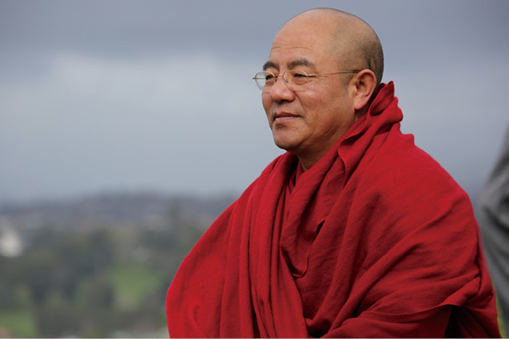

# 禅与财富

/

障碍我们的，不是财富，

是对财富的执著。

/

本章为索达吉堪布在北京大学的演讲

2012·07·14

刚才一位老师给我献了条哈达，作为缘起。

献哈达是藏族的传统，藏族人如果做重要的事情，一定离不开哈达。也许你们对藏地的文化不太熟悉，若能对此，尤其是藏传佛教，有一定认识，应该会对你的人生有利。

当然，这样说，并不是劝你去学藏传佛教，信仰是个人的自由。不过，在遇到一些新鲜事物时，随时保持好奇心和探究的态度，这一点很有必要。

## 对心有驾驭能力，才叫成功

今天的主题，也许有人会想：“禅是佛教境界，财富是世间话题；一个要远离执著，一个要锐意进取，二者怎么能达到统一？”

其实不难。因为企业管理，最高层是精神管理。如果以禅的思想管理好自心，财富管理很容易成功。

现代社会，人人都想成功。但你是否想过，成功的真正标准是什么？

所谓成功，不单单是有钱、有地位、有名声。对心有驾驭能力，经常有满足感，方可称得上成功。这一点，修禅就很容易获得。

什么是禅？

《六祖坛经》这样定义：外离相，内不乱。简单讲，就是让心远离外境纷扰，处于平静中。

这样的状态，什么人可以得到？任何人，无一例外。

## 不做让自己后悔的决定

试想，假如我们时常心绪不定，浮躁、焦虑、悲伤、欢喜……各种错综复杂的心态此起彼伏，此时，处理任何事情、做任何决策，都可能出现偏差。而心平气和下所做的抉择，通常比较明智。

许多人都有过这种经历：与别人吵架时口不择言，过了两三天，冷静下来又后悔莫及：“唉，那天在气头上，言行太离谱了，现在怎么找个台阶下？”

如果把禅当成习惯，就不容易犯这种错误。虽然严格上讲，安住于法性才叫禅，但对一般人而言，心境平和，行住坐卧不离这种状态，无论坐车、上班、在家都能如此，也可称为是禅。

禅对身心调整有极大的作用。如今在西方国家，人们对此十分关注。有些人通过禅来调整心态，不但身心愉悦，事业也取得了成功。像苹果之父乔布斯，提起他的成就，不得不提到禅。他每天坐禅，启发灵感，增加决策力。在做重大决策之前，都先打坐一会儿。当心定下来后，直觉会非常清晰、敏锐。

## 狂心歇了即快乐

禅，分为世间禅、出世间禅。

出世间禅是一种高深境界。只有大成就者，像汉地的惠能大师、藏地的米拉日巴尊者、印度的龙猛菩萨等，才可以证得。这种禅，我们或许望尘莫及，这辈子再努力也不一定能到达。但世间禅，只要自己肯付出，完全能够获得。

有了禅的境界，很容易认识万法的真相。当然，认识万法真相有两种途径：一是依靠自己的智慧，再加上师的指点，经过漫长时日的研究，最后发现真理；另一种就是凭借禅修，让心进入最细微的状态，从而显露出本有的智慧。古代禅师们选择的多为后者，像六祖惠能，一个字也不认识，更谈不上广闻博学，却依靠禅的力量而大彻大悟，获得了无与伦比的智慧。

禅为什么有这种力量？

《楞严经》中讲得很明白：“狂性自歇，歇即菩提。”我们的心犹如大海，巨浪滔天时不可能映现出月影，风平浪静才可以。同样，当内心躁动不安、妄念此起彼伏时，智慧也无法呈现，只有以禅修令心性平息，才可能瞥见本具的菩提。

当然，这种境界，并非人人都有。假如你对此感兴趣，可以看看与禅有关的经典，如《金刚经》《法华经》《楞严经》。同时，每天尽量抽出时间禅修，观一下自己的心。若能如此，慢慢也有现见心性的机会。

## 心理垃圾不要积太厚

其实，现代人应该说有点可悲。跟过去相比，如今物质条件是极好的，像我小时候喜欢吃的糖，现在的孩子根本不放在眼里。但遗憾的是，人们的内心却不如以往平静了，焦虑、浮躁、抑郁等此起彼伏。

尤其现在是商业时代，人人都在追求财富最大化。然而，世事无常，有些人在投资得利时，能日进斗金，但失利时，一夜间也可以血本无归。人生的大起大落，有多少人可以从容面对？

禅在此时正是灵丹妙药。

日本京都大学的佐藤幸治教授，在《禅的效验》一文中说：禅可以安定情绪，增进思考力，增强内心的忍耐力。

我们若能在晨起后、入睡前，稍微打坐几分钟，让心安住，久了，心就会处于积极的状态中，安乐时时充满，连做梦都会是美梦。反之，假如没有这种境界，只有一颗狂心的话，纵然你钱财再多、地位再高、事业再大、相貌再美，也不可能真正快乐。

现在大多数人忙忙碌碌，为的是什么？无非就是为了快乐。可他们在追求的路上，往往事与愿违——生活琐事多、工作压力大……一堆说不清的烦恼。

这时候该怎么办？

龙猛菩萨在《大智度论》中告诉我们：“禅为清净水，能洗诸欲尘；禅为金刚铠，能遮烦恼箭。”意思是，禅就像清净的水，能洗净欲望的尘埃；禅又像金刚铠甲，可以遮挡烦恼的毒箭。

所以，适当地禅修，能有效化解这一切。

我们在日常生活中，早晨起床后先要洗漱，晚上睡觉前也要洗漱。身体都需要如此洁净，那心在一天中受的染污更多，为什么忘了给它也洗个澡呢？若能养成禅修的习惯，心的垃圾就不会越积越厚了。

## 拥有一个修禅的身体

禅修不但对心有好处，对身体也有显著效果。它虽无法保证你不衰老、不死亡，却能极大地提高身体素质。

日本的医学博士长谷川卯三郎在《新医禅学》中写道：禅修对治疗高血压、胆结石、结核病、胃下垂、失眠症等12种疾患有帮助。

医学家也发现，心态会直接影响健康。生活中曾听人说，有人原本没什么大病，但被医生误诊为癌症后，万念俱灰，最后竟真的死于癌症。

如今，中国已进入老龄化社会，如何提升老年人的生活质量，是人们非常关注的话题。很多人年老后有孤独感，物质上虽然富足，心却很难快乐起来。假如能养成禅修的习惯，平时经常观心，心就不会那么孤寂无聊，身体的健康指数也会提高。

尤其对于老年痴呆这一疾患，禅修有极好的预防和治疗作用。目前在美国，六十岁以上的老人中，老年痴呆患者越来越多。若以禅修来刺激大脑，能够开智慧、安心神，令记忆越来越增上。

我有一位上师，今年已是八十高龄，但依靠禅修的力量，思维依然敏捷，头脑十分清晰，最近还完成了一部30万字的佛学巨作。

在青藏高原，常可以看到七八十岁、年逾百岁的老人，身体非常健康。就气候、物质等方面而言，藏地远远不如汉地，可是，因为藏族人喜欢禅修、持诵心咒，内心相对清净，直接或间接避免了许多疾病，从而拥有健康和长寿。

再过几十年，我们都会步入老年行列。到了那时，我们会是什么样？这个问题也该尽早考虑。

## 欲望，满足了也是苦

禅修与身心的关系，其实十分深奥，蕴含着人类的许多秘密。若能对此有所认识，我们定会受用无穷。

过去有许多哲学家、文学家、科学家，在各自领域有着不同成就。他们这一切，多多少少离不开“禅”。

为什么？

浮躁的心只能认识浅显的事物。当心静下来之后，进入细微的状态，才可能触及深邃之理。这与禅定非常相似。

“禅”来自梵语，中文意思是“静虑”，即波动的心达到平静状态，如此会见到事物的真相。你若不信，晚上也可以静坐一会儿，在此过程中，或许会领悟一些平时觉察不到的东西。

如今许多人一生都在奔波，从来没有观察过自己的心，也从未留出时间想想：人活在世上，除了成家立业、功名利禄，还有什么更值得追求？

很多时候，他们为了名利，像蚂蚁一样忙忙碌碌。自己的欲望得不到满足，会心生痛苦；得到满足了，新的欲望又继之而起，如此欲望永远无法止息，这也是一种苦。

在此过程中，许多人纷纷倒了下去。这样的命运何时会轮到自己？谁也不清楚。

据保守统计，二十多年来，成功企业家中有1200多人自杀。这是什么原因？就是他们的心比较脆弱，不懂福祸相依的无常之理。

其实，福与祸是不定的。当你特别痛苦时，好像一切已没有希望，但过了一段时间，或许又柳暗花明；当你特别风光时，似乎阳光都很灿烂，但这种美好也可能转瞬即逝。如同一些成功人士，得意时，无数人围绕承事；失势时，又有几人肯看一眼。人生至此，真的需要内心有一种力量。

我们如果注重禅修，对增强心力就极有帮助。我认识一位老修行人，曾蒙冤入狱很多年。他说这是一段非常好的修行经历，因为无人打扰，每天可以自在地禅修，心特别快乐，遇到任何逆境都能坦然面对。可是，当他被释放出来后，经常有人恭敬、供养，见的人多，琐事也多，道心反而不如以前了。

所以，大家也应该反思：到底什么才是有价值的？

## 毒蛇和黄金

人人都认为有钱是好事。实际上，钱有好的一面，也有不好的一面。比如，没钱的时候，和家人的感情特别融洽；有了钱后，关系反而大不如前，各种烦恼此起彼伏。

钱给我们带来的问题，有时候会比想象的多。佛经中就有一个故事，讲到了金钱的过患：

一天，佛陀和阿难外出化缘，看到路边有一块黄金。佛陀说：“毒蛇。”阿难见后也说：“毒蛇。”随后他们就离开了。

附近一个农夫听后，好奇地去看，发现他们口中的毒蛇竟然是黄金，大喜过望：“这些沙门真愚！你们不要，我要。”非常开心地将金子拿走了。

从此，农夫再也不去种田，每天和朋友们吃喝玩乐。好景不长，因为这块黄金，他惹上了官司，被关进监狱。此时，他才幡然醒悟：原来黄金真是毒蛇。

可见，钱是个复杂的东西。当我们拥有时，一定要对它有正确的认知，如此，才有可能妥善管理。

早在2500多年前，佛陀就对如何管理财富有详细说明。如《善生子经》中，佛陀告诉我们，应当将收入的50%用来经营事业，25%用于衣食生活，25%储蓄以备应急。

遗憾的是，很多人不懂这个道理。他们投资比较冲动，事先没有合理规划，凡事只看好的一面，不看坏的一面，以致最后血本无归。更可悲的是，还有些人就像赌徒一样，本钱不多，却举债投资，亏本后没能力偿还，最终把自己逼上了绝路。

所以，管理财富需要智慧。遇到任何问题时，既要有最好的期盼，也要做最坏的打算——凡事都应退一步想：若是失败，我该怎么办？

这种智慧，以禅修可以激发出来。美国高盛集团的高管乔治，在理财方面极为出色，之所以如此，归功于他三十多年的禅修史。他每决定一项重要投资之前都要禅修。他有一部私人飞机，常利用乘机时间闭目打坐。他还鼓励下属亦如此，并专门为他们建立了禅修中心。

在国外，许多大企业都有禅修中心。要知道，现代企业若想具备强大的凝聚力，只靠物质刺激，效果比较有限。优秀的企业文化，尤其是对心灵有益的禅，会更好地调动大家的积极性。

曾有人问我：“禅修不是要闭关吗？企业搞这些，不影响经营吗？”其实，禅修不是让你放弃工作，天天闭门打坐，它不但可以跟工作结合起来，而且，能让你工作得更惬意。

## 你赚的钱，70％是给别人花的

人有了财富后，不能只顾自己享受，还应该想到帮助别人。

佛经中说：财富是五家共享的东西——“王臣以法令取之，盗贼以非法夺取之，不肖后人以放逸衰败之，水火溺焚而毁坏之，由人共取由天没收之。”所以，我们一辈子拼命积攒的钱，死后会落到哪儿去，谁也说不准。

我看到网上有一段话，写得很有道理：一部高档手机，70%的功能是没用的；一款高档轿车，70%的速度是多余的；一幢豪华别墅，70%的面积是空闲的；一屋漂亮衣物，70%是闲置没空穿的；一生赚再多的钱，70%是留给别人花的。

可见，累了一辈子，争了一辈子，自己能用上的也不过30%。明白了这一点，趁我们还有掌控钱财的能力时，应将它尽量用在有意义的事上。

什么是有意义的事？

帮助他人。

当然，像比尔·盖茨、李嘉诚那样，把身家的一大半拿去做慈善，一般人可能做不到。但如果你赚了100万，拿出5万、10万去帮别人，这还是可以考虑的。

假如你信不过一些慈善机构，那不必假手于人，可以亲自去做。千万不要因为各种信任危机，就轻易放弃自己的爱心。

在我们平时不太关注的地方，贫穷的人非常多。对你来说可能不算多的钱，却可以改变有些人的命运。比如，没钱读书的孩子，有了你的帮助，他的人生或许从此不同；交不起医疗费而挣扎在死亡边缘的病人，有了你的帮助，他的生命或许会得以延续……

其实，钱的价值就在于运用，是当金钱的主人还是奴隶？这是值得思考的事。

现场互动

⊙ 问：我们应该怎么打坐？

堪布：佛门有句话：“念佛不在嘴，参禅不在腿。”形式不是最重要的，关键在于心。

当然，姿势调得好，禅修的效果会更好。打坐时，可以采取毗卢七法的要诀：双腿跏趺坐，两手结定印，身体挺直，两肩放松（两臂展开，不要内收），头稍前倾，眼睛微睁，舌抵上颚。以这种坐姿禅修，心比较容易调伏。

我们在起床后或临睡前，若能抽出五到十分钟禅修，烦乱的心就能逐渐调整过来。

⊙ 问：我在寺院经常看到四个字：不二法门。请您开示一下“不二”的涵义。

堪布：所谓“不二”，是超离了有无、是非等二元对立，开悟境界就是如此。这种境界不可思议，说“有”也不对、说“无”也不对，不能用思维分别，无法用语言描述。

⊙ 问：您一直鼓励我们修行，我想知道，修行是为了什么？

堪布：我希望大家通过修行，让此起彼伏的分别念停下来，认识到万法实相，之后利益一切众生。

成佛，不是为了自己幸福，如果为了自己而修行，这没有太大意义。幸福是建立在利他基础上的，所以，希望你们以实际行动利益众生。

⊙ 问：怎样才能做到“参禅不在腿，念佛不在嘴”？

堪布：这句话是从究竟上讲的，但对初学者而言，参禅还是要盘起双腿，佛号也要一句一句念。

到了最高境界时，可以不必执著这种形式，只要随时不忘观心，行住坐卧都是修行。

⊙ 问：在我看来，禅是一种境界，禅修是达到这种境界必需的过程。这种理解对吗？

堪布：对。禅确实是一种境界，这种境界有高低之分，有世间的四禅八定，也有出世间住于空性的禅定。禅修的目的，就是要达到禅的境界。

对于禅，现代人有各种描述，甚至还将其用于茶文化、炒股票等。虽然佛法本来就可以融入生活的方方面面，不过，禅是什么味道，还需要自己去品尝。

⊙ 问：我想提高自己的语言能力，请问，如何才能做到心、脑统一侃侃而谈？您是用大脑还是用心说话？

堪布：不用脑，嘴巴是说不出话的；不用心，也说不出有感觉的话。我在演讲时，心、脑都用了，但主要是心。

我今天讲的，就是从心发出的肺腑之言。希望大家通过禅修，让疲劳的心得以休息，不要每天忙碌地活着。心安宁了，才能快乐。

美国人做过一项研究，得出的结论是，学者用脑说话，修行人用心说话。这二者有什么区别？用脑说话，没有自己的体验，只是强记各种数据、案例，然后加以复述；用心说话，引用的案例不一定多，依靠的是自身体悟的境界加以发挥。

我尽量向后者看齐。

02
