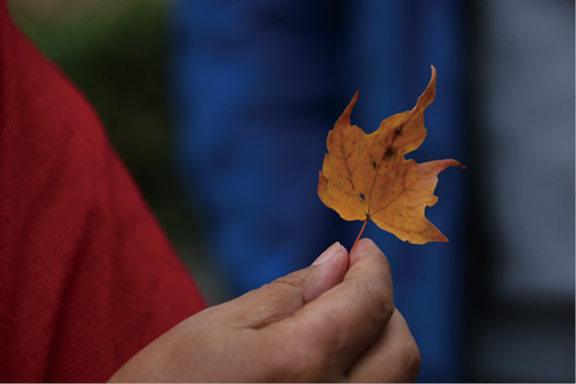

# 科学怎样让人更幸福

/

有些人认为，宗教不合乎科学道理。

我是一位研究科学的人，我深切知道，今天的科学，

只能证明某种物体存在，而不能证明某种物体不存在。

/

本章为索达吉堪布在西安交通大学的演讲

2011·11·12

很高兴跟大家交流，你们的校园环境有种特殊氛围，让人一进来感觉很舒服。今天就在这儿探讨一下：科学怎样让人更幸福。

## 什么是科学

首先，界定一下什么叫“科学”。

科学的定义有多种，世界各国的百科全书中，也有许多不同的说法。不管如何定义，所谓科学，应该就是要客观反映万事万物的真相。

科学分为自然科学、社会科学。现在又新兴起一种心灵科学，也叫认知科学、心智科学，它探索的是甚深的心灵奥秘。

前两种科学，人们已经研究得很好，在特定范围内，发现了这个世界的许多规律，如万有引力定律、相对论、量子力学等。而心灵科学，20世纪末才开始起步，并没有引起社会的广泛关注。

在西方，二十多年来，越来越多的人对心灵科学产生浓厚兴趣。其中有些学者发现，佛陀在《大藏经》中描述的内容，是最深刻的心灵科学，揭示了心灵世界的终极实相。

## 古代的汽车、飞机没流传下来

作为人类文化的一部分，科学究竟给人类带来了什么？

在物质上，它为我们提供了极大便利。古代没有网络、手机、电脑，而现在，这一切时刻改变着我们的生活，从这个层面而言，科技的确可以造福人类。

同时，它也是一把双刃剑，没有控制好的话，有可能带来不可思议的危害。20世纪的两次世界大战，已经证明了这一点。当前尽管没发生毁灭性的大灾难，但科技产生的危害给人带来的不安全感，仍然随处可见。

古人早就明白这一点，所以对科技发展多持反对态度。

中国古代，也有过非常先进的发明。比如，春秋末年，鲁班造出了汽车、飞机的雏形。《酉阳杂俎》记载：鲁班制作的一只木鸢，高飞三日不落，他父亲偷偷骑上之后，一飞竟飞到了苏州。鲁班的母亲，骑上鲁班造的木马车后，《论衡》中说：“一驱不还，遂失其母。”

如此高明的技术，为什么没有留传于后世？

这是因为，古人认为这些发明是奇技淫巧，钻研多了，会玩物丧志。尤其儒家看重的是“道”，认为下等人才迷恋“器”，有“形而上者谓之道，形而下者谓之器”的说法。而现代人恰恰相反，把目光都盯在科技上。利用各种科技，许多人看似活得很舒服，可是心里的迷茫，只有自己最清楚。

人生是一场戏，死亡不是生命的断灭，

只是这场戏演完后，进入下一场戏的换场过程。

受现代潮流影响，藏地有些牧民也向往汉地的生活，他们用掉所有积蓄，到汉地分期付款买房子，将此视为一生的荣耀。相反的是，汉地有许多人却厌倦了纸醉金迷、车水马龙的生活，羡慕藏地的清净，渴望远离一切尘嚣。这种有趣的现象，就像钱钟书在《围城》里说的一样：城外的人拼命往里挤，城里的人拼命往外跑。

其实，不管是城里人还是城外人，所做的一切，无非就是为了幸福。然而，这种幸福又在哪里？

## 有了四“千万”，才会赚到“四千万”

如今现实中，不幸福的因素越来越多。

前不久有报道说：10月31日，全球人口突破70亿大关。人类的数量从10亿到20亿，用了100年；从20亿到30亿，用了30年；而从50亿到70亿，只用了短短20多年。地球只有这么大，随着人口的不断膨胀，资源危机、生态危机和环境污染势必会愈演愈烈，地球的负荷也会越来越重。

为此，有些国家实行计划生育，试图缓解这个矛盾。然而，这样一来，年轻人身上的负担肯定会加重，生活的压力也会迫使他们一辈子追求钱，不再有什么远大抱负。我曾去过一些大学，看见很多学生都在琢磨毕业后怎样挣钱，却没把心思放在学业上。年轻一代若都如此，未来的社会将变成怎样？

当然，学生的心态，有时候也跟老师有关。北师大有一位教授，对自己的研究生说：“40岁前赚不到四千万，就不要来见我。”这件事被报道后，引起轩然大波。有人评论：你学生是搞房地产的，四千万，是四个“千万”——千万要暴利，千万要心黑，千万要行贿，千万要强拆。有了这四“千万”，才有希望在40岁之前赚到“四千万”。

可想而知，这四“千万”的背后是什么？

唯利是图。

为了赚钱，许多人已无所不用其极。拿地沟油来说，不知从何时起，成了一些人致富的捷径。有资料说，中国每年约有300万吨地沟油流向餐桌，通过买卖地沟油，一年形成的利润近20亿元。这种劣质油，对人类健康有极大危害。

佛陀曾说，若是欢欢喜喜地造业，未来必定悲悲戚戚地受报。诚如《正法念处经》所云：“如是罪业，作时喜笑，得殃报时，号哭而受。”

## 别当衣食无忧的穷人

或许有人问：“钱不能带来幸福的话，那幸福到底是什么？”

马克思认为，幸福是“欲望得到满足的心理状态”，这跟佛教讲得很相似。佛教告诉人们，如果内心知足，一贫如洗也非常快乐；假如贪得无厌，富可敌国也不会有幸福可言。《遗教经》云：“知足之人，虽卧地上，犹为安乐；不知足者，虽处天堂，亦不称意。”

幸福其实是一种内在的满足，跟外在物质的关系不大。

爱因斯坦曾说：“单靠知识和技巧，不能使人类步入幸福和高尚的生活。”苏格拉底也主张：“善就是知，知就是德，德就是福。”意思是要想获得幸福，方法是先求知，再行善修德。

求知，需要求关乎心灵智慧的知识。只有这种知识，才能带来幸福。

实际上，汉地有非常优秀的传统文化，完全可以让人找到快乐。以佛教而言，如果懂得其中深义，对今生来世都有利。现在不少人对佛教感兴趣，这是很好的事。不然，把幸福完全寄托在钱财上，只会让自己越来越苦。

为什么？

欲望是无有止境的，哪怕你一人占尽天下一切财富，也不一定心满意足。佛经中说：“世人求欲，不知厌足。假使一人得一切欲，无厌无足。”

实际上，一个人拥有的再多，享用的也非常有限。常言道：“家有豪宅万千，夜寐仅需七尺；纵有良田千顷，日食不过三升。”因此，我们应将生活的目标降低点，没必要竭力追求自己用不上的东西。

生命宝贵，何不用来追求智慧和德行。如果没有这两者，纵然拥有再了不起的权力、名气、财富、才华，也不会拥有快乐。金庸先生形容这种人，充其量只是“衣食无忧的穷人”。

## 让幸福自己来敲门

想真正幸福，在佛教中，其实是有路可循的：

### 1．明白凡事皆有因果

今生中衣食无忧，按照佛教观点，这是源于前世的福报——假如前世造了善业，今生不需要太多努力，名利也会纷至沓来；若是前世没有积善业，如同沙子不能榨出油一样，今生再怎么勤奋，也很难达成心愿。

这一点，无论你信不信都会如此。

前世的行为对今生苦乐有直接作用，同理，我们下一世是什么样，也取决于今生造了什么业。所以，命运不是别人支配的，一切取决于自己，自己是自己的怙主。

虽然现在相信“善有善报、恶有恶报”的人并不是特别多，但这不妨碍它成为真理。以人数多寡来判断一件事是否正确，这本身就不能成为真实的根据。正如同，对科学高等理论一窍不通的人不在少数，而他们不知道、不认可，根本无法否认科学的合理性。

### 2．以禅修调整身心

国外很多研究机构发现，将禅修运用于日常生活中，可以让心离幸福更近。

1967年，哈佛大学的赫尔伯特·本森博士做过一项冥想实验，研究结果证明：禅修可缓解人体的压力。到了1997年，美国60%的医学院都在传授这种“放松疗法”，许多大医院也提供此疗法，而且效果非常好。

美国某医疗中心，曾让实验者每天禅修27分钟。一个星期后，仪器检测发现，实验者的快乐指数远远超过禅修之前。

还有个研究中心，用仪器测试一些藏地的仁波切，实验显示：仁波切们在禅修后，幸福感增强了700%，以致科学家们差点以为机器坏了。他们同样又将一群对禅修完全没有概念的大学生，分成两组进行测试，结果是禅修与不禅修也有明显区别。

目前，禅修已成为美国主流社会的风尚，多达一千万美国成年人经常打坐。他们觉得这种习惯很酷，并从中得到了真实受益。

这样的心理疗法，在西欧、新加坡等地也得到了广泛关注。

现如今，已有越来越多的人意识到，钱财换不回内心的自在。所以，他们宁愿每天禅修5分钟以上，从佛教中寻找心灵的宁静、快乐。

### 3．思维佛教法义

如果学佛、禅修只停留在表面形式上，内心没有多大改变，这是远远不够的。

当然，并不是说形式不重要。有些人比较极端，认为佛教中的念佛、参禅、皈依、出家都没有必要，完全是一种形式，这种想法不对。在某些情况下，特定的形式还是需要。如果说所有形式都多此一举，世间男女只要心中有爱就可以，又何必大费周章地登记、结婚？

不过，只是停留在形式的层面上，也不行。作为佛教徒，还应该有一些内证功德；即使没有，也要对佛理有所了解。这样，烦恼和痛苦才会日益减少，就如无门禅师所形容的：“春有百花秋有月，夏有凉风冬有雪，若无闲事挂心头，便是人间好时节。”

这种快乐，是一种真实的快乐，是开豪车、穿名牌享受不到的。为什么许多修行人住在荒无人烟的山中，却依然自得其乐？就是因为他们通过长期修行，心得到了自在，明白万法如梦，不像世人一样处处执为实有。

看看每天的新闻，我们就知道世人活得特别苦。这些苦源于什么？就是执著。如果了解万法是无常、空性的，对很多事看明白了，不管是什么人，没钱也好、有钱也罢，心都会非常自在。

像著名慈善家李嘉诚，虽然家财万贯，却没有被金钱束缚，他的生活非常简朴，对衣服和鞋子的牌子并不讲究，一套西装穿十年八年是平常事。

他母亲是位佛教徒，从小教他善恶必有报，要多行善举。后来李嘉诚教导子女时，也常用佛学启发他们做人的智慧，三分之二教如何做人，三分之一教如何做生意。

他本人曾说：“是我的钱，一块钱掉在地上，我都会去捡；不是我的，一千万块钱送到家门口，我也不会要。我赚的每一毛钱都可以公开。”

相比之下，有些人为赚钱而不择手段。如此，钱越多，自己越不快乐。

我们这个人生，说长也长，说短也短。但不管是长是短，到我们死的那一天，回顾这一辈子，最好不要有太多对不起良心的事。

## 从心灵科学中找答案

人生几十年，若能认识到生命的真相，真的非常有意义。

你们西安的兵马俑举世闻名，被称为“世界第八大奇迹”。在我看来，这不算最稀有的。最稀有的是什么？是2500多年前的佛陀智慧。它揭示了宇宙世界、人类本源、心灵世界的秘密，一直被保存在《大藏经》中。但遗憾的是，兵马俑这样的名胜古迹，每天参观者络绎不绝，而对一切生命真正有利的智慧，常常被束之高阁，愿意去研究的少之又少。

听说你们这里有不少人，对佛教比较感兴趣，有些人还在修学“心中心法”。这个法门，我认为非常好。之所以这样说，一是我读过元音老人的书，里面讲得相当不错；二是他的传承弟子中，很多人对三宝有信心，对上师懂得感恩，对众生也有大悲心，这是学修正法的验相。

现在有些大德，如本焕老和尚、噶玛巴，对“心中心法”也有正面的认可。判断一个法门是否可以接受，关键看它能否给我们带来真实利益。若是可以，不管哪一个法门，都值得去学习、修持。

如今，人们在物质上不断地往前赶，可是在精神上，需要不断地往后退，退回到古人的智慧上。汤因比说：“拯救21世纪人类社会的，只有孔孟之道和大乘佛法。”我特别希望更多的人，今后不能只研究自然科学、社会科学，更重要的是，还应该从心灵科学中寻找幸福。

现场互动

⊙ 问：有一道哲学考题是，请反驳你现在并非在梦中。大家讨论时很难找到答案，请给我们一些指示。

堪布：找不到答案就对了。我们确实在梦中，正如《金刚经》所说：“一切有为法，如梦幻泡影。”

藏地大德麦彭仁波切写过《醒与梦之辩论》，里面通过拟人的方法，把醒、梦各安立为一个人，然后互相辩论谁是真、谁是假。对一般人来说，醒者应该会赢，但结果没有。

我刚到佛学院不久，上师如意宝传过这部法。当时，我感觉人生真的跟梦没什么差别，因为找不到任何理由可以推翻其中观点。比如，我认为自己不是在做梦，理由是醒时有些东西看得到、摸得着，可是在梦中，也会有这种情况；我觉得醒后的时间长，做梦的时间短，所以梦不真实，但在做梦时，有些经历也非常长，像南柯一梦、黄粱美梦就是如此。所以，从各方面观察，醒时的一切并不真实。

当然，若想进一步证实这种观点，需要深入解读佛经，尤其要看《华严经》《三摩地王经》。

⊙ 问：我从小就觉得佛法对人类有很大帮助，希望尽自己一点力量，影响周围的人。我该如何去做？

堪布：首先，自己不要故意伤害任何一个众生，小至蚂蚁。然后在此基础上，力所能及地利益周围的人，帮助社会。

当然，每个人的因缘不同，利他的能力也有差别。但只要你有一颗想饶益别人的心，将来它一定会发光。

⊙ 问：我对佛教了解不多，但对一些简单道理，如善有善报、恶有恶报，还是很相信。我想过朴素的生活，但在这个城市里，经常有地沟油、毒奶粉、豆腐渣工程……造恶业的现象实在太多，我是不是只能逃离这个城市？

堪布：你说的还是很实在。现在佛教徒与知识分子之间，需要一些沟通。其中，对于“善有善报、恶有恶报”，有些知识分子是比较相信。但他们相信的，也仅限于今生，好多人今生做了善事，就希望很快成熟善果，至于来世，一般人从不考虑。

要知道，轮回是个漫长的过程，有些善事你今生做了，果报也许在今生成熟，也许在很多世之后才成熟。但不管什么时候成熟，因果报应都丝毫不爽，所以一定要断恶行善。

如今这个社会，造恶业的环境太多，对此，我们不能一味地逃避，而应负起相应的责任，从自己做起。

当然，在工作中，有些事情的阴暗面不容易发现，你可能无意中做了一些错事。但如果并非故意，佛经中说，这不会有太大罪过，就像不小心踩死了小虫一样。

⊙ 问：我是西安交通大学的老师，也是陕西省道德文化研究会的工作人员。佛法非常好，但藏传佛教、南传佛教、汉传佛教的《大藏经》那么多，作为普通人，应该怎么样学习，才能使佛法入于心中？

堪布：佛经确实浩如烟海，在短短一生中，要想学尽恐怕很难。所幸许多前辈大德把《大藏经》的内容，以简短的窍诀归摄为一些论典，若能学习这些，极容易通达佛法精髓。

那么，哪些论典便于我们学习呢？以我个人的体会，最好先学《入菩萨行论》和《大圆满前行》。

《大圆满前行》里面，从最初观修“人身难得”，到最后往生净土，全部的修行次第讲得非常透彻。虽然它只有一本书，却涵摄了显宗、密宗一切教典的精要。这几年我详细地讲过一遍，整理成文字，也有八本书了。若能好好学一下，佛法的框架基本就理顺了——怎样皈依？怎样发菩提心？怎样行持十善、取舍因果？……诸如此类的关键问题，你会完全明白。

系统学习一些佛典，真的非常有必要。否则，佛教会沦为一种表面形象。当然，有些形象也需要，但若不懂它背后的教义，就丧失了佛教的根本。

⊙ 问：现在社会道德沦丧，我作为陕西省道德文化研究会的工作人员，很想尽力提升自己的道德水准，并为提升社会的道德水准做点工作。请问，怎么做才是最好的？

堪布：你们研究会的宗旨，包括一些运作方式，我不是很了解，所以无法提出有针对性的建议。总体来讲，做任何一件有意义的事，短时间都不一定有立竿见影的效果，但若能持之以恒、坚持不懈，并辅以一些现代的管理模式，星星之火是可以燎原的。

在此过程中，我们不要遇到一点挫折就放弃。很多人在推广道德文化时，遭受几次白眼和质疑，就开始动摇了，这是不行的。要想真正拯救这个社会，除了有一种兴趣，更要有一颗勇敢、勇猛的心。只有这样，才能结出丰硕的果实。

⊙ 问：您小时候是个经常打架的孩子，而现在，语言、仪态中却充满了梦幻般的温柔。这种变化最重要的影响因素是什么？

堪布：我小时候是很爱打架。记得在中学，最高纪录是一天打过五次架，自己也挂了彩，老师还差点把我开除。

读小学时，我也经常打架，现在回到母校，想不起自己学了什么知识，只记得在这里打过架、在那里打过架。有时候在学校打不方便，我就约别人“等会儿吃完饭，到某某地方去”，然后开始打……周围的山上、河边，都留下了我打架的身影。我的小学，就是这样度过的。

但自从学了佛法，尤其是以《入菩萨行论》为主的大乘佛法，我的变化特别特别大。我相信，这是佛法的殊胜加持。

不仅是我，我们佛学院也有不少这样的人。原来有个和尚，跟另一个人发生冲突时，我听到他恨恨地说：“不跟你一般见识。要不是学了大乘佛法，按我以前的脾气，肯定揍你！”所以，一个人的恶劣性格，通过修学大乘佛法，会有翻天覆地的改变。

当然，学佛也要靠缘分，有些人特别契机，有些人则不一定。佛陀时代也是如此。没有缘分的人，就如《现观庄严论》所说，天上虽然下雨，烧焦的种子却不能发芽，同样，诸佛虽然降临于世，但无缘之人很难获利。

所以，学佛能否改变自己，跟各人的缘分和善根有密切关系。

10
