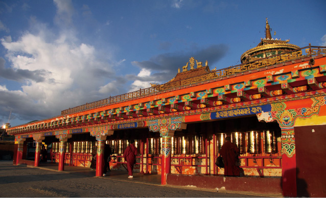
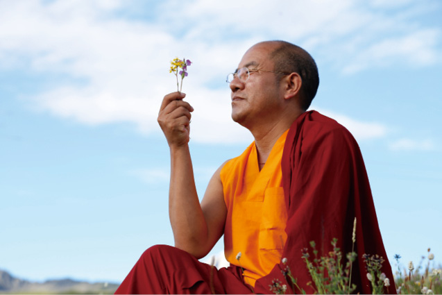

# 科技时代的佛法

/

佛教不是神秘主义，是现实主义。

它并非充满玄妙的神话，而是指出如何面对情绪、

衰老、疾病、死亡，让我们乐观，不再忧郁。

/

本章为索达吉堪布在香港科技大学的演讲

2011·11·24

今天的主题，我很喜欢。现在是科技时代，你们是科技大学，此时此地探讨科技与佛法，有不一般的感觉。

爱因斯坦讲过：“没有信仰的科学是跛子，没有科学的信仰是瞎子。”他为什么这样说？

以我的理解，科学若离开信仰的引导，对人类会弊大于利，最终，它走不快也走不远，犹如跛子；反之，假如信仰经不起科学验证，其教义很难令大众信服，学修者也常有各种疑惑，如同盲人。

这位科学先哲在那个年代说的话，我认为，在当今时代，也有必要引起重视。若能体会其中涵义，或许，有助于解决这个社会的失衡。

哪方面的失衡？

人们追求物质的节奏太快了。不少人声称“时间是金钱，效率是生命”，结果怎样？不说别的，就人的步速来看，英国一份报告说，现在比10年前快了10%。若是这样快下去，可能连休息时间都没有了。每天如此忙碌，人们却没得到预料中的安逸，反而越来越不快乐。

缺少内心的引导，在追求物质的过程中，许多匪夷所思的事情也会发生，比如毒奶粉事件、苏丹红鸭蛋事件、孔雀石绿鱼事件……尤其是科技一旦掌握在不信因果的人手里，为了满足自己膨胀的欲望，什么事情都做得出来。

若想扭转这种现状，佛教可以提供一些方法。

作为一个佛弟子，我不管去大都市，还是偏僻地方，都会给大家讲佛教道理。之所以这样做，主要是自己从中得到了利益，同时也很清楚，我得到的这一切，正是现代人最需要的。

## 爱因斯坦的回信

今天的社会，人心纷纷投向名利，对生命的思考日渐减少，烦恼越来越多。那么，解决之道在哪里？

1950年，有位19岁的大学生给爱因斯坦写信，提出一个疑问：“我不知道是谁把我降生于世，不知道世界是什么，也不知道我自己是什么……我发现自己被缚在这个宇宙的一隅，不知道为什么把我放在这里，而不是那里……”

收到来信后，爱因斯坦很快回了信。他肯定了这个年轻人的思考，但同时又告诉他，这样提问“不可能有合理的答案”。

爱因斯坦说，一个人活着，重要的是问自己“怎样度过一生”，这才合情合理。他认为，答案应该是：“在力所能及的范围内，尽量满足所有人的愿望和需要，建立人与人之间和谐美好的关系。”

若想达到这一目标，他说：“需要大量的自觉思考和自我教育。不容否认，在这个重要的领域里，开明的古代希腊人和古代东方贤哲们所取得的成就，远远超过我们现在的学校和大学。”

爱因斯坦认为，“古代东方贤哲们”的思想可以解决人生问题。这其中，我最熟悉的，就是释迦牟尼佛。

## 我最怕的，是对伤害我的人失去慈悲心

我学佛的时间很长，虽然学得不好，但看的佛教典籍比较多，显宗的、密宗的，藏传的、汉传的、南传的都看。越学，越觉得佛的智慧不可思议。

不管时代如何变迁，佛陀的理念都适合每一个人，永不过时。

比如说“慈悲”。佛陀的慈悲，遍及任何众生，不论人或是动物。（有人认为：“植物也有生命。佛教不让杀动物，对植物也该如此。”其实，动物与植物的差别很大，二者虽然都叫“生命”，但植物并非由五蕴组成。）

人的天性中，与生俱来就有悲悯心，即使你不信佛，当看到一个众生被残害，也会自然流露出不忍。所以，佛陀的慈悲观很适合人类。纵然科学再发达，也不可能离开它。

当你富裕的时候，不要得意骄傲，因为一切都是无常的；

当你贫穷的时候，不要伤心沮丧，因为一切都是无常的。

慈悲引申出来，可以说非暴力。它并不带有政治意味，是佛陀对修行人的教诫。《毗奈耶经》中说：“人若打我，我不还打；人若骂我，我不还骂；人若嗔我，我不还嗔；人若毁我，我不还毁。”这种处世原则，就是非暴力。人类需不需要呢？答案应该是肯定的。

有人认为这样做太懦弱，被欺负就应该反抗。其实，以暴制暴，只能让争斗升级，在今天看来，战争不论对国家还是个人，有百害而无一利，安忍才是解决争端的最佳方式。

甘地曾说：“我的价值观很简单：真理，非暴力。”所以，在世界的任何角落，慈悲都是需要的。

当然，慈悲是一种境界，不是每个人都有。只有明白了为何要慈悲、怎样拥有慈悲，才能真正做到慈悲，坦然放下仇恨。

有一位堪布，曾蒙冤入狱很多年。被释放后，一位大德问他：“你在监狱里，最怕的是什么？”他回答：“我最怕的，就是对那些伤害我的人失去慈悲心。”

这句话令人动容。换成是我们，身处那样的环境，最害怕的会是什么？

青海也有一位大德，在那个年代天天被批斗。每次他去接受批斗之前，都默默发心：“愿我以今天安忍的功德，利益打我的人，乃至一切众生。”被打的时候，守护自己的心不生嗔念。打完以后，再将功德回向给那些人，有时间就默念一遍《普贤行愿品》，实在没时间，就念一些短的回向文。

他把磨难当作一种修行，并以“三殊胜”摄持——最初发菩提心、中间不执著、最后回向善根。如此，那一段批斗和折磨，反而令他的修行迅速圆满。

可惜的是，这种理念，当今很少有人懂得。

## 勿待老来方学道，孤坟多是少年人

今年QS亚洲世界大学排行榜中，香港科技大学位居亚洲第一（香港大学第二，新加坡国立大学第三，日本东京大学第四，香港中文大学第五，北京大学第十三，清华大学第十六，台湾大学第二十一）。从排名来看，你们在教育方面是顶尖的。但只要是人，就离不开生死，除了科学知识，不知你们对操控生死的心性可有什么认识？

前美国总统尼克松说：“我们已经征服外太空，却无法征服人们心里的太空。”

的确，科学工具再发达，也只能观测外在的物质。而对于内心领域，不借助修行，根本无法解开其神秘面纱。

我很羡慕寂静山林里的修行人，他们舍弃了舒适的生活，每天处于觉悟中，享受着心灵的快乐。虽然我们暂时还没有这种条件，但若懂一点佛陀的教义，譬如利他心的道理，并用于生活当中，就会减少很多执著，遇到什么都想得开，这也算一生最大的收获。

所以，对每个人来说，了解佛理，都是极为必要的。哪怕以好奇心也可以。

有人说：“我现在忙于家庭、事业，暂时没有时间，等老了再说吧。”

但到了那时，你精力不济、心智糊涂，因缘可能已经消失了。古大德曾谆谆告诫后人：“勿待老来方学道，孤坟多是少年人。”

这个时代，不少年轻人已开始对佛教感兴趣。前不久，我们举办了第一届世界青年佛学研讨会，有来自于全球各地的学生参加。其中很多人通过信仰，的确体验到了一些不可思议的事实。

当然，作为一个理智的人，若想认识佛教，光凭这些是不够的，还应该寻找理论支持，最终达到智慧的提升。

## 学与修的离与合

佛教最重视的是智慧，然而许多人却不知道，学佛仅停留在形象上，只不过是为了保平安。这是相当遗憾的。

学佛能不能保平安？

当然能，但这不是根本。最根本的，是了知佛陀的独特智慧，而不是办个皈依证，参加个佛教仪式。

要想了解佛陀的智慧，离不开佛典。我推荐大家学习《入菩萨行论》《大圆满前行》《菩提道次第广论》等。若能边学边修，这是最好的方式。

如果不学就修，很容易走偏。萨迦班智达说：缺少听闻佛法，只是盲修瞎炼，来世会变成没有智慧的旁生。因此，我们首先要明理。比如打坐，就要先弄清楚：为什么要这样做？怎样才能让心静下来？静下来有什么作用……道理上明白了，再修就会非常稳妥。

如果只学不修，也体会不到佛法的深层境界。《楞严经》中讲：听闻很多佛法，若不修行，跟没有听是一样的，犹如口中念着食物的名字，不吃终究不会饱。就像有些人，把佛经讲得精彩绝伦，却从没有实修过，甚至都没有认真思考过。这样，即使是讲了一辈子，习气也很难改变。

因此，若想领悟佛法，一定要实实在在地学，踏踏实实地修。

最后，借用虚云老和尚的一句话，祝福大家：心田不长无明草，处处常开智慧花。

现场互动

⊙ 问：生长在21世纪的年轻人，对佛法没有太大兴趣。怎样让年轻人了解佛法、接受佛法？

堪布：让他们感受到利益很重要。

当今学佛的人群中，确实中老年居多，年轻人看重眼前的生活，大多数觉得佛法跟自己无关。不过，在我看来，即便想过好眼前的生活，佛法的理念也必不可少。

这几年来，我去一些大学推广佛法，并不是想用教义控制哪一个人，也没有政治、经济等目的，只想与大家分享佛教中的真理——不了解佛法的，尽量让他了解；已经了解的，劝他不要停留在表面上，要不断深入。

其实，年轻人接受佛法也分阶段：刚开始，比较排斥；中间，稍微有点好奇，半信半疑；最后，得到了利益。若能真正感受到利益，谁还不愿意接受？

⊙ 问：我对佛法很感兴趣，但您说只感兴趣不够，还要修行。我该怎么修？

堪布：修行要有次第。

你可以学习《大圆满前行》，里面有细致的讲解。比如先修“人身难得”，把握好这个人身的定位；再修“寿命无常”，知道人终归一死，死期又不定，如此就会有紧迫感，精进修行；接着是“因果不虚”，人死后随业力而投生善趣、恶趣，故一定要断恶修善；然后是“轮回过患”，不论生于善趣、恶趣，统统是轮回，不是解脱，所以要从中出离……就这样，一步一步往上修，打下稳固的基础。否则，直接就修最高的法，听起来是不错，但很难从根本上断烦恼。

要断烦恼，乃至解脱轮回，一定要有空性智慧。这种智慧，依靠上述基础才生得起来。只是烧香拜佛、做善事，虽然是有功德，却无法断除我执，仍要在轮回中流转。

藏地有部论典《三主要道论》，其中讲了解脱的三个要点：出离心、菩提心、无二慧。无二慧就是空性智慧，这才是最重要的。

如今很多人学佛，只注重一些表面善行，这远远不够。想解脱的话，还是要学习和修行一些窍诀。

⊙ 问：我是科大的学生，对佛法半信半疑。我想问：人是怎么来的？谁创造了人？是佛吗？

堪布：根据佛教《俱舍论》，人并非如“进化论”所说，是从猿猴演变来的，没有那么简单。一个人或者一个生命，都是经历了漫长的流转，才呈现出现今的这种状态。

当然，人也不是谁创造的。不是神，也不是佛，是随各自的业力而生。

⊙ 问：我现在的研究不顺，很心烦，怎样用佛法来帮助自己？

堪布：祈祷佛应该会有帮助。但祈祷是不是一定能达成所愿？也不一定，还要看你的因缘。

就像去医院看病，有些病医生能治好，有些病则效果不大。既然有些病治不了，那还要不要看医生？当然要。祈祷佛也是这个道理。

我们在遇到不顺时，祈祷佛一定有加持。至于能改善多少，就看自己的信心和福报了。

⊙ 问：我是商学院的。在这样一个越来越复杂的时代，西藏文化、藏传佛教会不会受到冲击？

堪布：这个时代，不可否认，外来文化对西藏的文化和佛教确实有冲击。不过，短期内应该不会有大的问题。

因为藏地的文化主要保存在寺院里，而这些寺院，大多在深山里，没有对外开放。而且，它的传承持有者——许多德高望重的格西、堪布，也一直住世。加上藏族人本身就重视学修佛法，不管是出家人、在家人，都把佛法视为如意宝一样，不可能轻易舍弃。

当然，也有一部分藏族人，去了汉地或国外后，羡慕那里的生活，整天摆弄自己的衣服、头发，信仰慢慢消失。与之相反，西方倒重视起这些来，开始关注藏地的文化及佛学。

到最后，我想这些藏族人的心，还是会回来的。从汉地到西方，再回到自己的故土。

⊙ 问：我是工学院的。您在书上说：佛教的精髓是大悲和智慧。如果“大悲”是指大悲心、菩提心、恻隐心、同理心，那么，“智慧”又是指什么？

堪布：智慧有两种：一是懂得取舍并接受真理的智慧。比如你们大学生，有了智慧才能求生，否则连工作都不好找。佛教中也提倡这种智慧。

但最根本、最重要的，是通达万法实相的智慧。跟了解不同，它是一种大彻大悟。这种悟道的智慧，才是最高深的。

⊙ 问：佛教讲业力、讲因缘和合，那业力是怎样发挥作用的？

堪布：佛教认为，一个人的苦乐，是以善业和恶业作为“因”，与众多复杂的“缘”结合以后形成的。你种下什么因，就会生什么果。

恶业，好比有毒的种子，它会产生有毒的果——苦；善业，好比妙药的种子，它会产生妙药的果——乐。果的不同，来自于“因”。起辅助作用的，则是“缘”，就像阳光、水、土等。

举个例子：兄弟姐妹几个人，他们的父母都一样，但各自的性格、才华、工作、遭遇，却截然不同。这些差别的“因”在哪儿？就是他们从前世带来的业力，而不在父母身上。父母对他们来说，只是“缘”而已。

这个道理若想弄明白，需要深入佛教的典籍，在理论上思考清楚，再从实际生活中，方方面面地观察一些现象，这样你会有进一步的认识。

⊙ 问：对年轻人来讲，四谛、十二因缘以及空性观等哲学思想很有吸引力，可是一看到经典里这个佛、那个菩萨，就觉得离我们很远，不太相信。请问，这些是真的吗？

堪布：是真的。释迦牟尼佛在2500多年前，确实来过这个世界。不过，他不是神，而是来传法的，把真理介绍给世人。他的思想也留在文字上，被后人称为佛经，这些你们都看到过。所以，佛陀一生的事迹不是神话。

四谛、十二因缘或空性观，就是佛陀的代表思想。从古到今，许多人依此学习、修行而开悟，看一些大德的传记也知道，他们的境界绝非凡夫可比。追随者尚且如此，佛陀、观音、弥勒等佛菩萨的功德，又怎么会是假的？如果你一边学着佛的思想，一边又否认佛的存在，这好像有点矛盾。

当然，怀疑是可以理解的。由于不了解佛法，加上环境的影响，对一些超胜境界很难生起信心，这也情有可原。但年轻人学佛，不应止于自己可以接受的部分。对于未知的领域，不能因为不相信，就否认它的存在。

束缚你的，是你自己，

所以解开它，也只有靠自己。

⊙ 问：我是香港中文大学哲学系的，一直想全面了解“如来藏”。请问，应该从哪里着手？

堪布：你可以先看几部最根本、最精要的经论：《如来藏经》以及弥勒菩萨的《宝性论》、麦彭仁波切的《如来藏大纲狮吼论》、觉囊派的《山法论》。

这些显宗经论中，都对如来藏做了细致阐述。

⊙ 问：我是金融系的职员。在香港这个大都市，人人都忙着赚钱。生活虽然享受，但压力很大，我们该如何对治心里的烦恼？

堪布：不仅香港，内地也是一样，人们越来越忙，每天都在接电话、打电话，想静一静也很难。其实，每个人应该放慢脚步，看看自己在做什么。人生的意义并不只是赚钱，许多人在为钱忙碌的同时，生命不知不觉就走到了尽头。到那时再回头一看，以前追求的好多东西，原来都是虚幻无实的。

要减少烦恼，最好的方法是知足少欲。其实，快乐并非来自于钱财，现在大多数人的苦恼，不是因为没有钱，而是因为不满足。俗话说“知足常乐”，这的确是至理名言。

知足并不是一种消极，而是一种不强求。假如你没有赚钱的缘分，就随遇而安；有机缘，也可以多赚点儿。但赚钱不要只为自己享受，还应该帮帮吃不上饭的人。

有了这种心态，你会快乐地生活，该做的做，该赚的赚，但烦恼肯定少很多。

⊙ 问：我是机械工程系的。请问，“境由心生”是什么意思？

堪布：“境由心生”是唯识的观点。意思是，内外的一切显现，都是由心产生的。这就相当于做梦——梦里没有真实的东西，一切都是心的造作。那“境”存不存在？存在，但只是幻象而已。

若要弄懂这一点，可以研究一下《唯识二十颂》《唯识三十颂》，还有《楞严经》《楞伽经》等。懂了以后，你会知道“三界唯心，万法唯识”，万事万物是我们的心被无明遮蔽后呈现出来的一种迷乱相。

⊙ 问：佛教说“色即是空，空即是色”，如果色是空的，比如说蚂蚁这个色相，既然是空的，为什么要对它生慈悲心？慈悲心本身也是空的，又何必执著善恶？

堪布：因为“空”即是“色”——空并非什么都没有，还是会显现一切色法。

“色即是空，空即是色”，是中观的基本思想，也是《心经》的核心内容。

在实相中，也就是在佛菩萨的境界面前，在万法本体这一层面上，色与空无二无别。但从现相的角度，在世俗的一般显现面前，色不是空，空不是色。所以，对于实相和现相，一定要分开层次理解。

这就像在量子力学中，观察瓶子时，它是由夸克、亚夸克等微尘组成，但在显现上，也就是当我们用眼睛看的时候，看见的是不是微尘？不是，是瓶子。眼睛为什么看不到？因为这是两种层面，不能混为一谈。

所以，当看到蚂蚁时，它的本体是空，但我们还没有证悟空性之前，应该缘它的苦乐修慈悲心；慈悲心的本体也是空，但在显现上，善和恶会导致不同的果报，因此要断恶、修善。这是世俗层面的规律，每一个人活在世上，都脱离不了这个规律。

这方面的道理，如果对佛教有全面的了解，理解起来会比较容易。

⊙ 问：我是人文学部的。听您讲座、看您的书，我有种感觉：您是把藏传佛教、汉传佛教、显宗、密宗结合起来，进行传播和交流的。请问，您是出于什么因缘来做这件事的？

堪布：说到“因缘”，唯有佛陀的智慧才能彻底了知，所以我也不清楚。像你在香港科技大学读书，这件事看似简单，但在它背后，也有很深的因缘。这种因缘让爱因斯坦来说，不一定说得明白。

站在这里，我只想把佛法介绍给大家。太虚大师说过：“科学愈发达，佛教的真意愈显。”当佛陀所揭示的真理因为科学证明而变得更加明晰之时，人们会发现内心的真实需要，此时，佛教对人们的利益也最为深刻。

尤其是年轻一代，如果没有佛教理念的加持和约束，我担心有些人会做出极端的事情，甚至危害整个社会。虽然我做不了什么，也利益不了谁，但算是一种小小的使命感吧，我常常去一些大学做交流。

在此过程中，我一直觉得自己是个学生。有人叫我“老师”“堪布”，很惭愧，不要说老师，即使当学生，我也不太合格。只不过一想到佛教这么好，现在人们又这么需要，就不由自主地站了出来。

⊙ 问：不同宗派之间，对佛法的理解有差异，您有没有遇到过别人的反对或攻击？您是怎么面对的？

堪布：有，但乐意接受。

假如我确实错了，你反对，我不会执迷不悟，一定恭恭敬敬地接受，这是佛教训练中的基本素质。可是，你若举不出合理的依据，我还是会很自信地坚持自己的观点。

如果由于观点的争执，升级到对我本人攻击，我也不会生烦恼。在我看来，在开放的心态中交流，是一种享受。即使有攻击，我坚持的若是真理，也不害怕。伽利略说过：“真理就是具备这样的力量：你越是想要攻击它，你的攻击就越是充实和证明了它。”

实际上，反对或攻击有时也是一种机遇，可以反省并提升自我。

04
