## 序

这几年，我偶尔在下课之后，会抽出一点时间让道友们提问，自己则随力解答他们心中的困惑。因为是随机提问、当场回答，故不可能像造论一样特别严谨，有充足的时间去思考、分析，只是给大家打开思路，起个抛砖引玉的作用而已。

毕竟在学佛的过程中，许多人由于闻思尚浅，所以内心中有不少怀疑。俗话说：“智者以问而修，愚者以不问而修。”修行的时候有疑惑不解，提出来与大家探讨，是智者的行为。正如大文豪莎士比亚所言：“怀疑是大家必须通过的大门口，只有通过这个大门口，才能进入真理的殿堂。”因此，怀疑并不可怕，关键是自己如何正确对待。若能在有缘的善知识、善友面前，通过提问的方式，廓清纠缠心头已久的困惑，今后则可避免走许多弯路，也不会在懵懵懂懂的情况下误入歧途。

当然，这些回答是我以分别念当场所作，难免会漏洞百出、不堪推敲，故原本不打算将其整理出来。但后来应道友的再再劝请，想到这些问答也许对个别人有些许利益，为今后的修行能提供一些借鉴，大致指明一些方向，才同意将其付梓成册，提供给大家。

但愿这本《闲谈问答录》，能对你有点滴的帮助！

索达吉

2012年5月15日

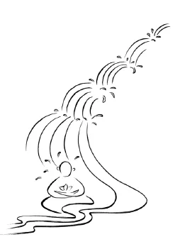

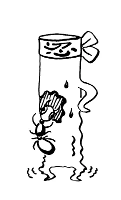

⊙ 问：寺院的柱子里长了白蚁，按照戒律又不能杀生，如果不杀的话，怎么保护寺院的柱子呢？

堪布：没事，再修一个水泥的（众笑）。众生的生命更宝贵！

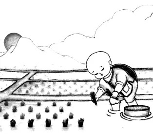

⊙ 问：汉地有些寺院是自己耕种，您怎么看这种现象？

堪布：这要从两方面来分析：一方面，历史上的百丈禅师、虚云老和尚等高僧大德，为了使僧众远离喧嚣繁杂的红尘，确实提倡寺院自己种植粮食、蔬菜，此举有利于护持清净戒律，保证修行圆满成功，故有一定的殊胜之处。且戒律中也明确规定：耕地属于轻罪，若在耕地之前念一些仪轨，心里作意如来教言，以惭愧心去做，罪业能够得以清净。

但另一方面，假如明明知道这种行为犯戒，自己也有条件不这么做，但为了打发时间而辟地耕种，不事闻思修行，以轻毁心去触犯学处，这样可能不太好。

因此，寺院耕种是否有过失，关键在于以什么心态去做。如果是惭愧心则过失不大，但若以轻毁心而为，看一看翳罗叶龙王的公案，就知道自己的下场如何。

⊙ 问：即便以惭愧心去耕地，也会杀死很多小虫，这该怎么办？

堪布：建寺院、修佛塔也会杀很多小虫，但若不是故意去杀，而且所造的善根大于过失，这些行为戒律中也有开许。

⊙ 问：一个人觉得活着的痛苦大于死亡的痛苦，他该怎么办？

堪布：叔本华不是说过嘛，该自杀！（众笑）

⊙ 问：但自杀并不能获得解脱。

堪布：是不能解脱，但活得那么痛苦也不能解脱啊。开玩笑！要祈祷三宝。若能好好地祈祷三宝，今天虽然这样觉得，也许明天的心态就变了。我们藏族有句俗话：“晚上睡觉时的心态，早上醒来后就没有了。”

⊙ 问：那为什么有的人会想自杀，这是前世的串习吗？

堪布：也许是暂时的违缘造成，也许是前世的恶业成熟，有两种可能性。

⊙ 问：日食、月食是怎么形成的？它跟佛菩萨有关吗？

堪布：按照大乘的说法，太阳和月亮是两位天子，我们现在所看见的光，有些经论说是他们发出的，也有些经论说是他们的无量宫和大地发出的。而罗睺罗是一种非常庞大的旁生，它觉得这种光芒很刺眼，就用手来遮挡，以致形成了日食和月食。当然，密宗《时轮金刚》、小乘《俱舍论》等经论中，也有不同的说法。

至于它是否与佛菩萨有关，在一些经典中没有发现过。

⊙ 问：日食、月食时，修善法的功德极大，这种说法对吗？

堪布：以有关经典来观察，确实功德极大。

以前我随法王去印度时，得到过一本书，里面就引用了很多大乘经典宣讲这方面的道理。后来我很想翻译，但不知道书放在哪里了，到目前为止还没找到。不管怎么样，一般来说，月食时修法，功德增长十万倍；日食时修法，功德增长百万倍。当然也有其他说法，这在经论中讲得非常清楚。

⊙ 问：上师应该如何对待在家弟子？

堪布：那是上师的事情，在家弟子不用关心。

⊙ 问：上师与上师之间应保持什么关系？

堪布：应该和睦相处，不要勾心斗角，不要像牛角放在口袋里一样。

⊙ 问：作为在家居士，应如何对待自己的根本上师？

堪布：以三种欢喜来承事上师，尤其是给上师作法供养，天天背《入行论》！（众笑）

⊙ 问：那怎样圆融上师、佛菩萨、本尊三者的关系？

堪布：本尊、上师、佛菩萨全部观想为释迦牟尼佛。麦彭仁波切的《释迦牟尼佛仪轨》中也讲了，浩瀚如海的寂猛圣尊全是释迦牟尼佛的化现，应当观作释迦牟尼佛来恭敬祈祷。

⊙ 问：苦乐由自己的业力决定，他人无法代受，那为什么仁慈瑜伽可代狗受打？既然如此，那佛陀大悲周遍，为什么不代众生受苦，让一切众生都脱离轮回？

堪布：仁慈瑜伽的行为，是自他交换的一种境界，但并不是所有众生的痛苦都可以代受。

打个比方说，一个人犯罪后，某领导帮他化解了牢狱之灾，使他没有受苦，但不能说这个领导能这样的话，国家主席的权力更大，为什么不帮助全国的人不受苦？

要知道，众生业力现前时，如果因缘具足，可由别人代受痛苦；因缘不具足的话，就像《现观庄严论释》中所说，纵然是大慈大悲的佛陀，也无法以大悲手进行救护。因此，每个众生的因缘不同，凡事不能一概而论。有些业力，自己造了，自己必须要承受！

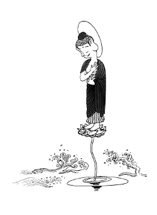

⊙ 问：圣者通过自他交换代众生受苦，那众生还有没有痛苦？

堪布：有些也有痛苦，有些会减轻痛苦。

⊙ 问：众生减轻痛苦后，他自己会不会知道呢？

堪布：不一定知道。

⊙ 问：不知道的话，他就不会生起感恩心，善根也不会增长。

堪布：那不要紧！大成就者并不希求感恩，我们凡夫才需要感恩。你看佛陀给我们宣讲佛法，很多众生并不知道感恩，但佛陀也从来没有这个希求。

⊙ 问：有人看《米拉日巴尊者传》后很感动，但是对“上师没说一句法，弟子也没修一座法，却能得到殊胜成就”不能完全理解。

堪布：米拉日巴的上师马尔巴说过：“像我这样的上师很少，像你这样的弟子也很少，你以后摄受弟子时，不要采用这种方法。否则，一句法都不说，单单依靠苦行来证悟，这种根基的人犹如凤毛麟角。”

⊙ 问：那我们应该如何依止上师，才能尽快得到加持？

堪布：最好是通过各种途径先了解上师的不共功德，然后以三种信心来依止，以三种欢喜来承事上师，这个比较重要！

⊙ 问：倘若看了这些大德的经论后，也发了利益众生的菩提心，不知道是否具有菩萨戒？

堪布：佛教中的皈依也好、受菩萨戒也好，还是要依止仪轨，有了仪轨以后，才算是比较如法。就像世间上有些事情一样，有了那些仪式，才会产生法律效益，同样，依靠仪轨而受菩萨戒，这种功德才会很大！

⊙ 问：现在广泛流通的某些经中，多处地方把“阿耨多罗三藐三菩提”缩短为“三藐三菩提”，不知道这样是否如法？

堪布：“阿耨多罗三藐三菩提”的具体含义，我们讲《金刚经》时也解释过，若去掉了前面几个字，肯定是不合理的。比如佛陀的十种名号，删掉几个肯定不如法。

前苏联的“戈尔巴乔夫”，光是叫他“乔夫”也不行啊！

⊙ 问：“坛城”的含义是什么？应该如何认识？

堪布：坛城是密宗的十种事之一，在《大幻化网》中讲得比较清楚。

坛城可分为外、内、密三种。外坛城，指大幻化网坛城、时轮金刚坛城等建筑物；上师在灌顶的时候，从了义上讲，上师的身体与佛的坛城无二无别，故上师的身体是内坛城；密坛城就是自然本智，也即心的本性。

⊙ 问：怎么样使佛法很快融入自心？

堪布：很多道友在悄悄告诉你：“好好地串习修行。”我也表示赞同：如是、如是！善哉、善哉！

⊙ 问：《开启修心门扉》中说：正法没有融入自心，如同肺叶漂于汤面上。那正法真正融入自心，它是一种什么状态？

堪布：华智仁波切说，身语意三门就像脚踩在棉花上或者米粥里加入酥油一样柔软、调和。

此时他深信因果，不希求世间八法，对上师三宝有坚定不移的信心，内心堪能，遇到任何违缘也不会退失道心。

⊙ 问：如果没有出离心，是否可以生起菩提心？

堪布：一般来说，没有出离心的菩提心是不能生起的。即使生起来了，这种菩提心也不稳固，不具足菩提心的所有法相。

⊙ 问：但如果这个人证悟了空性，是否可以生起菩提心？

堪布：这倒是可以。因为众生有两种根基：一种是通过菩提心而证悟空性，另一种则是通过证悟空性而获得菩提心。倘若你已经证悟了空性，这个空性不可能在“孤独林”里住很长时间，菩提心马上就会生起来陪它。所以二者是俱生的，只不过有时间先后顺序而已。

⊙ 问：一个人既没有出离心，也不具菩提心，是否可以在上师的加持下往生？

堪布：那要看这个上师的成就如何。

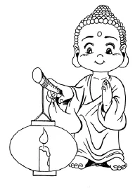

⊙ 问：藏传佛教、汉传佛教、南传佛教之间如何取长补短，以弥补各自的缺陷？

堪布：藏传佛教：向来对小乘、大乘、密乘三乘的戒律格外重视，但由于地理环境等因素的限制，素食只为少数行者所受持。相比之下，汉传佛教的素食观实在很殊胜，自古以来的素食传统，不知饶益了多少众生。若能学习这种慈悲为怀的素食观，则可减少现今藏传佛教中的诸多过患。而与南传佛教相比，藏地许多活佛、大德的住处过于奢华。我见过南传僧人的寮房，屋里除了法本和零星的生活用具以外，并无其他器物，整个房间自然透露着一种知足少欲的修行气息，这些行为都值得我们借鉴和学习。

汉传佛教：虽有许多古代大德的论典与教言流传于世，也有许多寺院与佛学院，但像藏传佛教这样系统闻思修佛法的道场却极为罕见。佛法的见修至关重要，如果缺乏对见解和修行的次第引导，即使有修行之心，恐怕也难以找到入门之处。若能像藏传佛教这样树立起闻思修的体系，出家人一生的修行就会很有把握。而与南传佛教相比，除了个别律宗道场以外，很多地方的威仪似有欠缺。南传佛教中的托钵乞食在汉传佛教中实现，恐怕有些困难，但除此之外的诸多威仪，如果能够借鉴，汉传僧人的形象会更引发人们的信心。

南传佛教：一直以来秉持人无我的小乘见解，缺乏大乘空性见与菩提心的教授。若能像藏传佛教这样进行广大的闻思，必可真正步入自利利他的菩提之路。而与汉传佛教相比，其素食观念也略显不足。虽然“三净肉”并未违背小乘戒律，但与大乘悲悯有情的精神仍是相违。并且，尽管南传中也有利济社会的善举，但与汉传中广大弘法与饶益社会人群的善行相比，显得过于狭隘。

如果三大传承的高僧大德能聚集一堂，共同协商并学习彼此的优势，对整个佛教的发展应该有很大利益。有了沟通和理解后，即使不能百分之百地完善自他教派，至少也可消弭彼此的排斥与诽谤。

三大佛教的交流是一个历史性问题，消除隔阂是整个佛教界和合与发展的基础。除了彼此的见解以外，交流本身并不困难。如果是在过去，即使在散居村落之间开个小型会议也很困难，但当今时代各种条件都极为便利，上百个国家的大型会议也是频频召开。因此，佛教界具有能力并真正对佛教前途深入思考的大德，举行一次这样的佛教交流，并非难以成办之事。当然，何时能具足如是因缘，也是一个未知数。

最后我想强调一点：南传佛教、汉传佛教、藏传佛教三大体系，包括了整个世界的一切佛教，这是不争的事实。只有三大佛教互相团结与学习，才能真正促成佛教的发展。鉴于此，本人合掌祈请所有关心佛教的有智之士对此三思！

⊙ 问：怎样以理证成立“一切众生皆为我们的父母”？

堪布：这个问题无法以理证成立，只能用教证成立。《释量论》中说：“倘若属于第三处[^1]，则当采用圣教量。”无始以来众生当过我们的父母，这是现量无法触及的隐蔽部分，就像三世因果一样，凭我们的理证智慧也观察不出来。所以因明中说：现量的对境以现量成立，比量的对境以比量成立，对于特别隐蔽的部分，应以圣教量来成立。

⊙ 问：可是对于初学佛的人，不相信佛陀说的话怎么办？

堪布：那没关系！在这部分人面前，我们先以理证成立“释迦牟尼佛是量士夫”，如此一来，佛陀所说的话就真实无欺了。

⊙ 问：我们平时有两种说法：一是众生都做过自己的父母，还有一种是“如母有情”，众生如同父母一般。这两种说法有一些差别，哪一种更准确呢？

堪布：“如母有情”的说法，在藏文中没有这样确切的字眼。

⊙ 问：那就是说，众生确确实实都当过我们的父母？

堪布：对！

⊙ 问：作为一个修行人，要知惭有愧，也要有佛慢，这二者应该如何圆融？

堪布：什么样的佛慢？“我是释迦牟尼佛”吗？

⊙ 问：不是，我们具有如来藏，都可以成佛。但又要知惭有愧，我不知道该怎么圆融。

堪布：这个不相违吧。我们都有如来藏，总有一天肯定会成就，所以在修行时对自己有一种信心，也即《入菩萨行论》中所说的信力，这就是佛慢。而知惭有愧是无惭无愧的违品，无惭无愧是一种烦恼的心所，《二规教言论》中讲了很多这方面的教言，我们应该尽量避免。

傲慢和佛慢应该区分开，我们不要傲慢，但应该有佛慢。

⊙ 问：有些上师说：“放生可以代替修五十万加行，这种善行功德更大，磕大头只不过是为了锻炼身体。”这种说法对吗？

堪布：不太对吧。释迦牟尼佛并不需要大家锻炼身体，佛陀在经中说：“磕一个大头，将感受自己身体以下乃至金刚大地以上所覆盖的所有微尘数的转轮王之安乐。”难道锻炼身体会有这种果报吗？

放生虽然是一种善举，但如果要代替传承上师所传下来的五加行，这可能需要充分的教证或理证。在我们宁玛巴当中，从来没有这种传统，如果将这些善法混为一谈可能不太好。

当然，放生是很好，这一点我赞叹！

⊙ 问：您如何看待台湾的佛教界？有些人说台湾佛教就像泡沫经济一样，只有一些表面形式，缺少真正的实修实证，您怎么认为？

堪布：总的来说，台湾的佛教与其他地方相比，要自由得多。那里大概有六个佛教电视台，白天、晚上二十四小时都有讲经说法。报纸上也经常宣传：今天哪里有讲经、明天哪里有灌顶等等。所以从某个角度而言，台湾的佛教比较繁荣昌盛。

1993年上师如意宝从法国回来时，路经台湾，并在那里住了七天。当时台湾还不像现在这样开放，但与我们这里相比，言论还是比较自由。当然，这种情况也有利有弊，有利的是各大宗派没什么约束，有很广阔的发展空间，大家可以畅所欲言。但也有一些真真假假、鱼目混珠的局面存在。

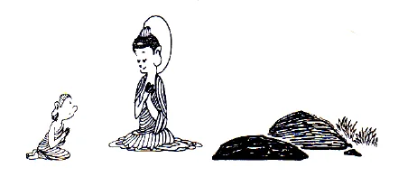

不管怎么说，在行持佛法方面，台湾远远超过其他大城市。以前星云大和尚将佛指舍利迎请到台湾，每天的朝拜者都超过十万；证严法师创办的“慈济功德会”，所做的一切令整个世界瞩目；海涛法师广纳众长，为各教派互相沟通做出了极大贡献……台湾有许多非常了不起的大德，那里的佛教徒听得多、看得也多，有机会接触小乘、大乘、密乘等不同佛法，应该说是相当有福报的。

至于实修实证方面，不仅仅是台湾，现在普遍来讲都比较缺乏。其实台湾也有很多清净的道场，有些修行人在那里长年累月地修持，也取得了不可小觑的成就。

⊙ 问：显宗很多佛教徒，对密宗最大的怀疑就是即身成佛。有些人的理由是：显宗经典中说，一个人成佛前会得到授记，说他将来的佛号叫什么。但密宗很多大修行者，并没有自己的佛号，比如莲花生大士不叫“莲花生佛”，米拉日巴尊者也没有称为“米拉日巴佛”，所以很多信徒生不起信心。

堪布：所谓的佛，梵语为布达，《入中论》说是指断除障碍、获得智慧的圣者。因此，即身成佛中的“佛”，有佛的意思，也有菩萨的意思。

其实，只要是获得一定境界的成就者，也不一定非要称呼佛。禅宗的很多祖师，也是公认的开悟者，获得了最高境界，但并没有称呼六祖是“六祖佛”，其他祖师也没有自己的佛号。我问过很多显宗的出家人：“禅宗的开悟者、净土宗的往生者，到底是佛的境界，还是菩萨的境界？如果是菩萨的境界，那是几地菩萨？比如六祖是几地菩萨？五祖是几地菩萨？……”这个时候，他们往往答不上来。

所以在藏传佛教中，莲花生大士等大成就者不一定要有佛号，如果非要有佛号的话，那么请先给我一个明确的答复：禅宗的祖师们到底是什么菩萨、什么佛？

⊙ 问：如果不喜欢佛像的颜色和面容，把它改成自己喜欢的样子，是否有过失？

堪布：佛像的颜色和面容，不是凭自己想象力来随便改的。你不喜欢红文殊，就改成白文殊；不喜欢红阿弥陀佛，就变成黑阿弥陀佛，这可能是不行的。

⊙ 问：那该怎么忏悔呢？

堪布：可能要重新造一个比较如法的佛像。

⊙ 问：在汉藏历史上，有许多佛菩萨的化身示现为帝王，如藏地的松赞干布，都曾亲自到战场上杀敌，那他们是为了利益众生而发动战争，还是为了自己的利益而发动战争呢？

堪布：有些文殊菩萨、观音菩萨化现的帝王，当时确实发动过战争，但诸佛菩萨的化现肯定没有自相烦恼，不会执著自己的国家而消灭别人的国家。《大圆满前行》中也说过，松赞干布在位期间，虽然守护了南赡部洲三分之一的国家，却连一个众生的一个汗毛孔也没有伤害过。

这些皇帝尽管发动过战争，但应该是佛菩萨为了利益众生而示现的，就像格萨尔王一样。据非常可靠的经论和上师教言中记载，格萨尔王是莲花生大士的意化身，也是文殊菩萨的化现，虽然《格萨尔王传》里面处处都有战争，但法王如意宝也讲过，这是在众生面前的一种示现，实际上他并没有自相的贪嗔烦恼。

⊙ 问：您讲《入行论》时说，纵然为了自己的国家、民族、上师、寺院，也不能去伤害众生。但有个法师讲过：“国家受到外敌入侵时，到前方抵抗侵略，使后方的百姓安居乐业，属于大乘无畏布施。”这两者是否有矛盾？

堪布：我上课时的说法，是根据佛陀《教王经》和龙猛菩萨《亲友书》的观点。《如意宝藏论》里也说：“甚至为了自己的上师，亦不应该造恶业。”《释尊广传》中记载：佛陀在因地时，有一次转生为一国王，其他国家侵略他的国家时，他想：“如果与他们交战的话，恐怕会杀害很多众生，所以我宁可舍弃王位，一个人流浪到别的地方去，也不愿为即生利益而造恶业。”然后他为了避免战争而离开了皇宫。

那位法师所讲的，不知道他的密意是什么，但我觉得作无畏布施可能有点困难。为了人们安居乐业而杀害很多人，到底是保护自己的国家而无畏布施，还是杀害别人而无畏布施？那位法师的观点，可能有其他解释方式，不然按照佛法的教义来衡量，无论是为了什么理由，最好都不要造恶业。尤其是杀众生、害众生，是任何大乘教言都极力遮止的。除非是对众生有非常大的利益，就像大悲商主杀短矛黑人的故事一样，否则一般不开许伤害众生！

⊙ 问：超度亡者是用七天好，还是四十九天好？

堪布：最好是四十九天。

⊙ 问：是不是最好四十九天之后再处理尸体？

堪布：不是。处理尸体是三天之后。

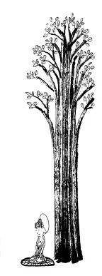

⊙ 问：自己本来在听闻佛法，后听说某处有灌顶，去灌顶的话又要断传承，这该怎么办？

堪布：灌顶虽然很重要，但法王如意宝从不提倡断传承去灌顶，他老人家反复强调：“故意中断传承的话，有摧毁一千座佛塔的过失。”但若不去灌顶，过失应该没有这么大。因此，不断传承可能好一点。

⊙ 问：众生都具足佛性，为什么学坏那么容易，学好那么困难？

堪布：这也不能一概而论。从具足佛性的角度来讲，众生在修学佛法的过程中，肯定越学越有进步，从凡夫位开始，逐渐圆满资粮道、加行道等五道十地的功德。

但由于无始劫来的实执严重，很多人在修行时难免一进三退，改变习气相当困难，俗话说“学坏三天，学好三年”，原因也在于此。

当然，这并不是固定规律，从历史上来看，许多修行人身处逆境时，无论环境再怎么恶劣，对上师三宝的信心也不退转，宁舍生命也不舍弃菩提心，这些情况都足以说明学坏不太容易，学好也不困难。

⊙ 问：常与无常不可能同时并存，但经中又说众生的佛性常有不坏，而众生的色身是无常坏灭的。这不是自相矛盾吗？

堪布：没有这个过失。虚空是不是常有的无为法？

⊙ 问：是。

堪布：云是不是无常的有为法？

⊙ 问：是。

堪布：这样的话，常和无常不是在我们眼前并存了吗？有首歌不是还唱道：“蓝蓝的天上白云飘，白云下面马儿跑……”

这一点，其实在《如来藏经》中讲得很清楚。麦彭仁波切的《如来藏大纲狮吼论》中也说，如来藏是一种不可思议的常有，已超越了常与无常的分别。我们讲《中论》时也提过，世间的常与无常属于分别念范畴，而如来藏的常，远离了任何分别念，故绝对不会有这种过失。

或者说，常与无常的并存，可从如来藏的现相和实相来分：实相中如来藏是常有；但现相上，也有具烦恼、没有烦恼、成佛的阶段，这样来看如来藏也不是常有。这些道理，因明《释量论》中也有一定的分析。实际上，如来藏不仅仅是现相的部分，它如同虚空一样，虽有云雾遮障和不遮障的时候，可是有永远不变的恒常部分。

故而，从不同的角度来安立，绝对不会自相矛盾。

⊙ 问：为了利益众生而流通法物，在此过程中赚取基本的生活费用，也是造地狱的因吗？

堪布：卖佛像佛经得来的钱，最好不要自己享用，否则，佛经中已经说了，这样有很大的过失。虽然很多人发心比较清净，但依靠买卖三宝所依来维持生活，我认为可能不太好。发心是发心，但自己的生活，除了卖佛像、佛经以外的其他途径来解决，可能是最好的！

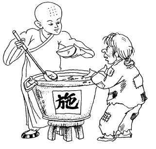

⊙ 问：为让世间人广泛地了解佛教，社会慈善事业势在必行，但从另一个角度，若是成天忙于帮助他人，定会影响个人的修行，对此您持什么态度？

堪布：我自己认为，所谓的实修实证，不一定非要在山洞里面修持，如果有能力的话，应该去做一些慈善事业。有了这些善举，世人也会对佛教产生好感及信心。可以看到，时下的台湾、新加坡等地，都有一些佛教的慈善机构。

关于慈善事业，我以前很少去想，不过这几年也发了愿，经常去一些学校，对贫困学生做点帮助。这也是学习外面一些法师的做法，我觉得这样挺好。为什么呢？我们作为佛教徒，如果只管自己吃好、穿好、修行得好，跟世间人一点也不沟通，那在他们的眼里，佛教就会遥不可及，所谓的慈悲，也只是修行人的口头禅而已。假如我们有钱的时候，帮助一些因贫困而辍学的学生，对他们一生会有不可估量的作用。

前段时间，我在炉霍资助了一些大学生，我对他们说：“作为一个出家人，我的钱不会随随便便乱花，但在你们最困难的时候，我还是拿出来帮助你们。供养你们读书，并不是让你们以后找个好对象，自己过着快乐的生活。只希望你们回来以后，一方面为我们民族文化着想；另一方面，如果有能力，一定要利益众生，哪怕一个众生也可以。”

当然，他们之中或许会有忘恩负义的人，但我想：当多数人忆念起佛教的慈悲时，会不会引发一点点感恩之举呢？若能这样的话，那我们出家人的慈悲，便成了他们利益人群的原动力。所以，佛教的慈悲不是仅蕴含于自己的修持中，也不是稍微投射到周围的旁生身上，而应真实关照到每一个可怜众生。

我并不是在极力提倡“人间佛教”。如果将佛法的全部精神淡化成人间佛教，显然深度不够。我只想让大家明白：利济社会人群的慈善事业，不仅是我们内心修行的体现，也是我们修积资粮的方便和助缘。或许有人害怕社会，不敢接触人群，所以就去独自修行。如果你确实能安住于寂静深山中独修，这非常好；如果不能，为何不以实际行动去关怀整个社会呢？倘若所有的修行人一辈子都待在寺院中或山沟里，与社会没有任何瓜葛，那在世人眼中，佛法不就成了社会的副产品，不具任何实义了吗？

所以，面对复杂的社会和可怜的众生，我们应做好两方面的准备。

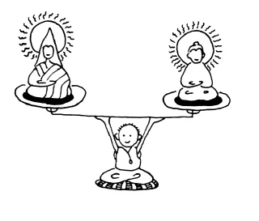

⊙ 问：对上师生起真佛般的信心，是在凡夫位还是圣者位？

堪布：凡夫位。

⊙ 问：怎样才能生起这种信心？

堪布：经常思维上师的功德，经常忆念上师的恩德，经常看如何依止上师的教言、上师与佛无二无别的教证，若对这些经常串习，自相续就会逐渐转向清净，对上师能生起真佛般的信心。

⊙ 问：有的出家人还俗了，他的出家衣服该怎么处理？是否可以给刚出家的人穿？

堪布：应该可以。即使人还俗了，但僧衣没有“还俗”，毕竟它是出家人的衣服。

我刚来学院时，有一件人造毛的出家衣服，就是从一个准备还俗的喇嘛那儿买的。他在学院待了一段时间后想还俗，便买了一套在家的西装，想把出家衣服卖给我。当时，那件衣服他也穿了好多年了，说是卖三十元，后来我跟他讲了半天，最终花二十元买下了衣服和一个糌粑箱。那时我也没有其他的衣服，白天晚上都穿着它，一直穿了三个冬天。

所以我觉得，不管是谁还俗了，但衣服是佛的袈裟，没有什么过失。

⊙ 问：很多活佛、堪布、上师经常到大城市里传法，却很少光顾偏僻贫穷的农村，那农村的众生怎么办？

堪布：应将上师、活佛们请到农村去！（众笑）

现在的确有这种情况。新疆、蒙古、宁夏、甘肃等经济条件差、气候恶劣的地方，诸佛菩萨的化身可能去得少一点。而在北京这种大城市，据国家情报局私下统计，一年中来的活佛就有2442位。有些上师喜欢摄受文化程度高、经济条件好、长相也不错的眷属，而农村等偏僻地方，基本上都不愿意去。

其实，越是贫穷的地方，越需要佛法。以前我到武汉时，去过一个特别穷的地方，那里的人们非常虔诚，虽然不可能接受一些大法，但让他们念观音心咒还是可以的，以此也能种下殊胜的善根。

所以，大家今后应发心到一些偏僻的地方去传法，我们不需要什么供养，也不需要其他条件，只要提供一个说法的场合，自己出一些费用，去给可怜的人传法就可以了。尽管他们文化程度不高，经济条件也不好，但他们毕竟是众生，如果讲一些简单的法门，他们肯定会行持的！

⊙ 问：风水对我们修行有影响吗？

堪布：对初学者来说还是有影响的。一般来说，凡夫人最好能选择大成就者加持过的圣地，莲花生大士也讲过：“在别的地方待一百年，不如在我加持的地方住一晚。”莲花生大士的《密咒宝鬘论》还引用《时轮金刚》的教证说：“看风水虽然是一种著相，但二取执著没有消于法界之前，修行还是离不开风水。”

那找什么样的风水呢？以前法王如意宝说：“应该是高僧大德加持过的地方，若在该地修行，一般不会出现违缘。”比如我们喇荣山沟，就是法王如意宝所加持的圣地，有了这种加持，其他的山形地貌不观察也可以。

关于风水的问题，不要特别去执著，外在的风水不重要，内心的风水才重要。在不执著的情况下，风水也没有特别大的利害。

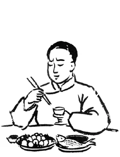

⊙ 问：《梵网经》中说：“食众生肉者，断大慈悲佛性种子。”如果断了大慈悲佛性种子，对大乘行人来讲是很严重的，为什么戒律中只将其安立为轻罪呢？

堪布：吃肉并不能将相续中的大悲心全部瓦解，如果能的话，佛陀早将其立为根本罪了。之所以说它断大慈悲佛性种子，是因为能部分损坏大悲心，从性质而言非常严重。但从戒体的角度来讲，吃肉并不是罪无可赦。

⊙ 问：有一位居士吃素多年，但他妻子极力反对，为了不让他吃素，她提出一个要求：“如果你能吃肉，那么我初一、十五也吃素。”他很想度化自己的妻子，到底该不该答应她呢？

堪布：这要看他的发心。如果发心完全是利他，没有一点一滴想吃肉的成分，就像大悲商主杀短矛黑人一样，纯粹是舍己利人的心态，则没有过失。但若是以此为借口，自己也贪著这些肉味，那就不好说了！

⊙ 问：有个居士修行非常好，常做慈善、放生、行持善法，但他对密法有严重邪见，并且影响了很多人。这样的人，来世的果报会上升还是下堕？

堪布：密法是非常严厉的对境，《二观察续》等密续中都讲过，只要一开口诽谤密法，必定会堕入地狱。因此，表面上行持一些善法，不一定能救护他。

⊙ 问：有些道友念《助念往生仪轨》给亡人助念时，偶尔会见到阴间的众生；或者念了之后头晕、嗜睡，第二天的精神各方面受到影响。请问在助念时是否有一些注意事项？

堪布：何时、何地、何人皆可助念，勿受一切阻拦也。（众笑）

我认为助念时应该不分什么，即使有一些障碍、有一些晦气，对发了大乘菩提心的人来讲，也不必太过在意。一般来讲，遭遇横死、被非人所害身亡的众生，给他超度或者助念时，有时的确会遇到一些违缘。但我们作为发心利益众生的大乘行人，应当舍弃自己，尽心尽力地去助念。

不过，念了《助念往生仪轨》以后，据说许多地方都出现一些验相，包括亡人托梦道谢，非人及战争亡魂得到不同程度的利益等，这也是事实。外面很多人通过文字、电话等途径，经常给我传递一些消息。可见，诸佛菩萨的功德和加持不可思议。过去汉地没有这样单独的助念仪轨，现在有了以后，希望大家依靠它在四十九天内，尽量给亡者念经超度。

当然，这个仪轨不仅对亡者有利，对活人也有很大帮助，因为它里面收录的，都是佛经及诸佛菩萨的圣号、明咒。因此，我特意把它做成一个念佛机，取名为《吉祥平安曲》，让很多人可以随时在车内、家里播放，以保出入平安、家庭和合、消灾免难等，希望你们今后多听听！

⊙ 问：这个仪轨中有莲师的中阴愿文，是属于密法部分，如果有人听后产生邪见，那该怎么办？

堪布：众生的业力和思维千差万别，我们所作的任何一个仪轨，都不一定能相应每个众生的根基。甚至对显宗没有信心的人，可能只想听密宗的中阴愿文，而不愿意听显宗的名号。

所以，总的来讲，只要对众生没有害，并且百分之百有利益的愿文，我们就应该念诵，这肯定是有功德的。

⊙ 问：给亡人助念期间，需要做火施吗？

堪布：如果需要做火施，我们会加上火施仪轨。但是，我们没有在《助念往生仪轨》中安排烟供，所以，没有必要做火施。

在其他时间和地点，是否需要做火施，可根据你的情况来决定。

在助念的时候，《助念往生仪轨》里怎么要求，我们就按照它的要求去做，不要在它之外，加上很多其他的内容。

⊙ 问：有些居士常做会供，道友们也喜欢参加，但是没有统一的标准。请问，会供需注意哪些细节？

堪布：会供是比较特殊的密宗仪轨，一般而言，要有密宗的基础后才可以行持。

当然，光是念仪轨并不难，麦彭仁波切的七句《简供》也比较简单，但若要做到如理如法，圆满所有的观修方法，恐怕不是很容易的事。

你们最好还是做简单的会供，不然，真正观修仪轨的话，可能有一定困难。不过，很多地方的人比较著相，特别喜欢火供和会供。

⊙ 问：个别学员在集体学习时爱说神通，以显示自己的境界不同一般，这种学员应该怎样对待？

堪布：自己拥有超越的神通，我也不会否定，但在集体学习的场合中宣扬，我是坚决反对！

不说世间人的相似神通，即便是佛陀在世时，圣者们以神通来炫耀也是没有的；像上师如意宝那样的大成就者，在大众场合中从来没有说过神通。因此，不管是什么身份的人，最好不要在集体学习的场合中，宣扬自己所谓的神通。否则的话，我们可能会采取一些不太好的措施，劝他离开这个团体。

现在末法时期，很多人明明没有神通，却声称自己有超胜的功德，并以此为借口，经常违越小乘戒律和大乘学处。因此，我不赞叹在任何场合中宣传自己有超胜功德。

其实，修行人都有一些不可思议的功德，但大多数人很谦虚地不显露出来。如果自己非要证明给人看，那应该从行为上虔诚学习佛法，没有必要这样宣扬！

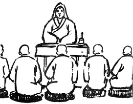

⊙ 问：如果一个人证悟了，是否就一定会讲法呢？

堪布：按照华智仁波切的观点，既然证悟了如所有智，他的尽所有智不应该“很笨”。虽然证悟了以后不一定会传法，但他肯定可以讲法。反过来说，如果他不会讲法，说明这个人根本没有证悟。

当然，有些大德尽管已经证悟了，但由于为人谦虚或者众生因缘不成熟，而说自己不会讲法，故也不能以这种表面现象来判断一个人是否证悟了。

⊙ 问：在修持佛法的过程中，专修金刚萨埵可不可以？这对现世和未来有什么好处？

堪布：修金刚萨埵当然很好，但不应该只修一个，其他什么法都不修，这样的念头不合理。若能在不排斥其他法的同时，着重修持金刚萨埵，这才是最明智的选择。

此外，通过修金刚萨埵净除罪障后，还应该发愿往生极乐世界或者度化无量众生，这种发心不可缺少。若能如此，即生中可以清净一切罪障，来世的生生世世中，也能以金刚萨埵的愿力来利益无边众生，暂时、究竟都有很大的功德！

⊙ 问：有些书中讲，放生时若是吉日就可以念诵“皈依”，不是吉日就不能念诵，这种说法是否可靠？

堪布：不管是任何众生，什么时候对三宝生起信心，什么时候就可以皈依。所以，放生的众生什么时候因缘具足，应该都可以皈依三宝，平等地得到救护。

⊙ 问：菩提心来源于大悲心，那大悲心来源于哪里？

堪布：来源于福报。没有福报的人生不起大悲心。

⊙ 问：那么出离心又从哪里来？

堪布：出离心也需要福报。

⊙ 问：生起大悲心和出离心都需要福报吗？

堪布：对！

⊙ 问：净土宗的临终助念，与六中阴有何不同？

堪布：六中阴的“临死中阴”部分，要求在亡者耳边念宝髻佛等诸佛名号，以获得不可思议的功德和加持，与净土宗的临终助念应该有相同之处。

但其中的“法性中阴”“禅定中阴”等窍诀，若想在净土宗中一一对应，恐怕有一定的困难。

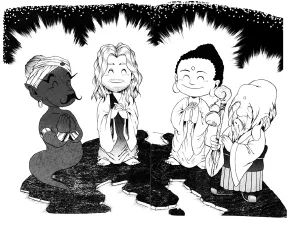

⊙ 问：除佛教以外，目前各大宗教的代表人物，老子、孔子、穆罕默德、耶稣，他们当中谁证悟了空性？

堪布：我并没有他心通，不知道谁证悟了空性。但总的来讲，这些宗教所提倡的善妙行为，对社会起到了相当大的作用。比如西方国家如果没有宗教的约束，对人类的生存会有极大危害。正由于美国为首的西方国家对自己的宗教有虔诚信仰，社会各界人士也有一定的宗教水平，所以做事情会想起祖师所传下的教言。

至于他们有没有证悟空性，世界上有各种说法。一位法师在接受西方媒体采访时，讲道：“从证悟的见解方面讲，肯定释迦牟尼佛是最究竟的，但其他宗教导人向善的道理，对社会也有很大的贡献。”我觉得他的说法有一定的实在意义。

⊙ 问：破密乘戒是极重的罪业，但许多忏悔法门中都说“五无间罪也能忏净”，却没有提过破密乘戒，是不是五无间罪比破密乘戒更难忏悔？

堪布：不是这个意思。他所看到的经典，应该大多数是显宗经典。在显宗的一切罪业中，五无间罪最为可怕，因此显宗经典中常会提到，忏悔力度特别强的时候，即使五无间罪也能得以清净。

而密宗的话，破誓言是最严重的罪业，所以在密宗续部中，常有“破根本戒也可以清净”的字眼。如《威猛三调伏续》中就说：“念十万遍金刚萨埵心咒，纵然破了根本誓言也能清净。”

此外，《喜金刚》中还讲过：“显宗中造过五无间罪的人，入密宗坛城后即可得以清净，但若违背上师教言、与上师产生严重矛盾，这种罪业不能如是忏净。”《集密意续》里也说：“显宗的五无间罪，入密乘之后可以忏悔，但个别罪业却没有这么简单。”

因此，并不是说造五无间罪的罪业胜过破密乘戒。

⊙ 问：生起菩提心的一刹那，所有罪业都被烧得干干净净，那五无间罪、舍法罪、失坏密乘戒是不是也能清净呢？

堪布：虽说生起一刹那的菩提心，就像是烈火烧尽干柴一样，会将所有罪业统统焚毁，但这里所焚毁的对象，应该指比较粗大的罪业。至于五无间罪等能否清净，必须依靠经典的教证来衡量。

其实，以嗔恨心能摧毁善根、以菩提心能摧毁罪业，这方面的问题唯一要靠教证来说明。否则，仅凭想象或依靠推理的话，因果问题比较深奥，不一定能得出正确结论。

我们讲菩提心的功德时，也用了《华严经》金刚钻石的比喻，说明过这个问题。实际上一个人若能生起无伪的菩提心，罪业最终必定会被遣除，但它的程度怎么样？还是要通过经论进行分析。

⊙ 问：可不可以说“只要能忏净五无间罪的法门，就可以清净失坏密乘戒的罪业”？

堪布：那不一定。我刚才引用《喜金刚》也讲过，入了密乘的话，依靠某些方便法门，可以忏悔五无间罪，但与上师发生严重矛盾的罪业，就不一定那么容易清净了。

⊙ 问：有人说修行理应一门深入，以一句佛号摄心一处，学习《入行论》是绕大圈子。您如何评价这种论调？

堪布：我想先问一下：是一切讲经说法都是绕圈子，还是唯独学《入行论》是绕圈子？

如果说一切讲经说法都是绕圈子，那净土宗的有些大德为何还要宣讲《法华经》《华严经》《金刚经》《楞严经》等等？

如果单单说学《入行论》是绕圈子，《入行论》主要讲的是菩提心，试问，若没有菩提心的摄持，一味以自私自利的心来念佛，能不能往生极乐世界？

⊙ 问：《前行》说：“出现死相后，五根隐没次第，上师需要为他直指心的本来面目，这是超度的最佳时刻。”但此时耳识灭尽，只是听到一片嗡嗡声，那如何接受上师的引导呢？

堪布：这有两种情况：如果自己有听受能力，则可直接接受上师的引导；倘若已丧失听受能力，上师可用口对着你的耳根，大声指示心的本来面目，如此也能达到这种效果。此乃无垢光尊者在一些大圆满修法中的教言。

⊙ 问：《华严经》云：“忘失菩提心，行诸善根，是名魔业。”那世间上的慈善事业不一定以菩提心摄持，这是否都成了“魔业”？

堪布：《华严经》的这个教证，是从大乘角度来讲的。大乘佛法必须建立在菩提心的基础上，如果忘失了菩提心，始终以自利的心态来行持善法，那跟魔的事业没什么差别。因为在利益众生的过程中，最大的违品就是自私自利。但从小乘或基本的佛教概念来讲，不具足菩提心的行持善法，也不一定都是魔业。

不管怎么样，严格来说，弘扬大乘佛法时，如果离开了菩提心，而是为了世间八法来做一些慈善事业，实际上跟魔业没有两样，因为这种心态与利他心没有任何关联。

⊙ 问：有位大德说，我们造了罪业以后，不能再去想它，否则，想一次就算再犯了一次。这种说法对吗？

堪布：那不一定吧。任何一个罪业若要成立，必须圆满基、加行、意乐、究竟这四种支分。如果你以前杀害过众生，后来又想起这件事，就算当时生了恶心，想再去杀生，但毕竟没有真正去做，这个罪业是不会全部圆满的。

⊙ 问：做梦偷东西犯不犯盗戒？

堪布：《根本律》云：“梦如无也。”意即梦境只是一种虚无。所以，按照别解脱戒的观点，做梦偷东西也好、邪淫也好，都没有罪过。而在菩萨戒和密乘戒中，梦境中这样做也有些罪过，但并不是犯根本戒。

⊙ 问：什么叫做金刚道友？在金刚道友之间制造矛盾、破坏和合，会有什么严重后果？

堪布：明朗大师在《三戒论注疏》中引用《誓言光明续》的教证说：“所谓的金刚道友，是从获得灌顶乃至菩提果之间永远不分离，犹如灯油和灯芯一样密切。”也即是说，从初发心到成佛的漫长道路上，大家一直是非常好的“同学”。

假如在金刚道友之间挑拨是非，导致彼此之间不和睦，从密宗的角度来讲，会有破坏密宗大僧团的严重过患；十四条根本戒律中的第三条中说，对金刚道友生嗔恨心，也间接损害了根本上师；此外，还违背了在一个坛城内灌顶时所发的誓言“乃至菩提果之间互相和合”。

⊙ 问：道友之间平时应该怎样和合？

堪布：小乘《毗奈耶经》中规定，对一切众生以慈悲心来对待；从大乘来讲，视众生为自己的父母；从密乘而言，对总的金刚道友、近的金刚道友、密的金刚道友，应该像兄弟那样对待，心中应想：“在修行过程中，没有他们我不可能成佛，所以平时不能对他们起嗔恨心，不应该观他们的过失。”《前行》中也说，应将道友观为勇士勇母及男女本尊之自性。若能如此，道友之间的和合应该可以做得到。

⊙ 问：金刚道友不和睦，会不会影响上师长久住世？

堪布：会影响。佛教中有一种说法：“弟子不和合，是上师圆寂的征兆。”以前观音菩萨的化身也说：“金刚道友之间和睦，对上师的长久住世有很大利益。上师住不住世，关键是看他老人家的愿力，但如果道友之间和合，对上师长寿会制造一种很好的缘起！”

⊙ 问：在密乘誓言中，诽谤金刚上师的罪过极为严重。那这个“上师”是指赐予大圆满灌顶的上师，还是一般结缘性灌顶的上师？

堪布：金刚上师有很多种：如果你受的是事部、行部等外密续灌顶，比如只有单身像或宝瓶灌顶，那你诽谤上师的话，就是破了外密续的誓言，而没有破无上大圆满的誓言。

如果你受的只是黄财神、释迦牟尼佛等一般结缘性灌顶，而没有真正进入外密，那么诽谤上师的话，则不会构成破密乘誓言。

我们平时所讲的诽谤上师罪过极重，按照《三戒论》的观点，主要是指无上密乘的上师。就像金刚道友分为总、远、近、密四种一样，金刚上师也相应分为许多种。而唯有赐予大圆满四灌顶，尤其是第四句义灌顶的上师，才是最严重的对境，被称为“无上金刚阿阇黎”。如果你诽谤这样的上师，罪过是最可怕的！

⊙ 问：密宗念诵咒语时，为什么要规定数量，而且还要在念珠上做记号，这样是为了达到一心不乱吗？

堪布：不是，这是为了约束自己，让每天念诵有一个数量。如果没有做记号，念三遍和念一万遍的感觉都一样，对自己就没有鼓励的作用了。如果发愿念一亿遍心咒，每天规定一个数量，并在念珠上做记号，这样一来，平时就不容易散乱，也不会无意义地虚度时光。

⊙ 问：《喇荣课诵集》里有藏、汉二种语言，以这两种方法念诵都一样吗？

堪布：仪轨最好用藏语念，如果实在不行，法王如意宝以前也开许用汉语念。

⊙ 问：人死之后，用天葬的方式处理尸体，这个有罪过还是有功德？

堪布：天葬的习俗在印度和藏地都有，这是对尸体的一种处理，其实有很大的功德。

如果尸体只是被火烧了，却没有念一些仪轨，不但会污染空气，还有害于非人。当然，你若能具足会供、烧施的种种物品，并持诵相应的咒语和仪轨，火葬也有相当大的功德。这些仪轨，在藏传佛教的《闻解脱》里就有。

那么，若是天葬的话，最好也能念一些断法仪轨。我们学院前不久就再三要求，在尸陀林做天葬时，必须先念断法仪轨，然后再把尸体布施给老鹰。这样的话，亡者依此定能积累极大功德。

⊙ 问：现在汉地都是用火葬，如果不懂一些仪轨，最好是能念些什么？

堪布：念观音心咒和《地藏经》。《助念往生仪轨》也很好。

⊙ 问：为什么佛经中经常讲女众的过失？

堪布：因为女众的烦恼比较深重，佛经中说，女众有五种过失是男众没有的。这主要是针对女众身体低劣而言。有些人尤其是西方人不喜欢听，一听到讲女众过失，女士们就站起来反抗。有位美国的上师曾说：“千万不能讲她们的过失，尤其是《宝鬘论》和《入行论·静虑品》，你要讲的话，下面就没有人听了。”但实际上，《宝鬘论》中也说：“女众的过失，如身体不净，男众同样也有。”但心理上有些复杂的习气，女众确实比男众多一些。

尽管佛陀在《药师经》《妙法莲华经》中讲了女众的诸多过失，但若知道这些过失后精进修行，女众也能获得成就，这一点没有任何怀疑。早在十多年前，我就写过一篇文章，专门引用教证来说明女身能即身成就。在《密宗断惑论》《密宗虹身成就略记》中，我也摘录过这方面的一些事迹。从历史上来看，不管是汉传佛教、藏传佛教，女众如果精进修行，不会比任何男众差。所以佛陀呵斥谴责女众，也是针对不同的众生，这是佛陀教言的一大特点。

⊙ 问：女众若发愿弘扬佛法，应该怎么做？

堪布：首先威仪很重要，应时刻以正知正念来守护根门，然后自己的见解不可动摇，因为女众的心变得比较快，很容易随外境而转，所以见解和性情要稳定。第二要有利他心，希望将自相续中的智慧、功德无条件地传递给众生。第三要有能力、有智慧。如果具备了这三个条件，凡是与自己有缘的众生，都是可以利益的。

如果弘法不是贪著自利，出发点纯粹是利他之心，世人也不得不认可你。因为整个世间特别需要善良的人，不管是女众还是男众，只要有能力帮助众生，大家都不会排斥的。

现在也有一些非常了不起的女众，如台湾的证严法师、汉地的隆莲法师，对弘法利生起到了相当大的作用。相信在不久的将来，某些道友弘法利生的发心也会成熟的！

⊙ 问：弟子感到心不安，请上师用密宗的方法帮弟子安心。

堪布：你需要达到什么程度？

⊙ 问：没有分别念，处于一种光明的状态中。

堪布：那你学灯泡就可以了！（众笑）

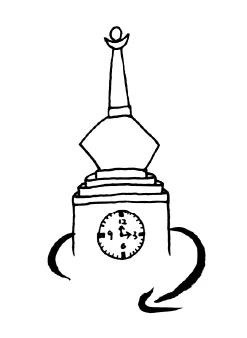

⊙ 问：有居士在绕佛塔时，左绕感到身心轻松，右绕觉得有压力，不是很舒服，这是什么原因？

堪布：他业力现前。

⊙ 问：但那里每个人都左绕，这是否与佛经的说法相违？

堪布：对。每个人必须右绕！

⊙ 问：左绕佛塔会怎么样？

堪布：没有功德，反而有过失。

⊙ 问：靠杀生、偷盗得来的财物，可否用来造坛城或经堂？

堪布：做善事最好不要掺杂罪业。帕丹巴尊者也说过：“善法不要杂染恶法。”如果你杀害一些众生，是为了赚钱建佛塔、印经书，此举不但没有功德，反而过失相当大！所以，即使你实在没有福报为建经堂捐钱，也千万不要杀害众生，这个利害关系要弄清楚。

当然，如果你在做生意时，虽然会造一些罪业，但这种罪业不太大，那么你用所赚的钱大量作供养、造佛塔、印佛经，功德应该会超过罪业。所以这个问题要详细区分。

⊙ 问：佛法浩如烟海、广大无边，您可否用三个字来概括它的真谛？

堪布：戒、定、慧！

⊙ 问：听说有人出家后，十多年都不受沙弥戒，或一辈子都不受比丘戒，那我们作为出家人，什么时候受戒最合适？

堪布：我们学院中的出家人，如果年龄没到16岁，建议最好不要受比丘戒，因为在此之前，许多人看破世间的出离心不一定够。但过了年龄以后，如果还一直不受戒，甚至连沙弥戒都不肯受，那住在僧团中享用僧众的财产，肯定是不合理的，这种人最好是离开寺院。然后，受了沙弥戒后，倘若自己觉得调伏心等各方面不错，就可以去受比丘戒。

这是没有特别要求的。历史上的高僧大德，有些是比丘身份，有些是沙弥身份，所以也不一定要求每个人都受比丘戒。你如果觉得自己因缘、条件具足，尤其在守戒方面没有任何困难，那就可以受比丘戒。

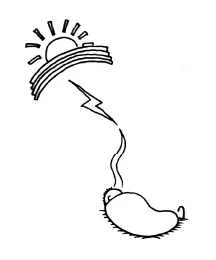

⊙ 问：以什么样的验相来判断一个人是否往生了？

堪布：有些往生并不一定有验相，比如在中阴时获得成就便没有验相，但显宗中很少提及这种现象。还有一种就是临终往生，这种往生的验相，一些大乘教典中说，会出现各种舍利。但法王如意宝曾说：“有舍利也不一定就是往生，即生做过很多善法的人，临终时也会出现舍利。”对此，乔美仁波切也持相同观点。

假如一个人在临死时，对佛陀有不共的信心，一边虔诚地念佛，一边在诚信中往生。死了以后，头顶上出现一些黄水（开顶），外面出现彩虹、光、巨响等等，这些都可以说是往生的验相。

⊙ 问：凡夫人有没有资格讲法？

堪布：有！以前汉地有个法师常说“凡夫人没有资格讲法”，但这种说法非常不合理。释迦牟尼佛在经典里讲传法者的法相时，就讲了很多凡夫人的相。如果说凡夫人没有资格传法，那佛陀只要在经中规定“一地菩萨以上才可以传法”就很简单了，没必要讲那么多上师的法相。

当然，密宗中的最高窍诀，比如大圆满的直指法，假如没有证悟一定的境界，则不能随便给别人讲。就像一个老师没有学过物理的话，很难给别人讲物理课。同样，我们若一点境界、觉受都没有，给别人传讲密法也不太合理。

但除此之外，只要自己具足各方面法相，就可以给别人传法。退一步说，由于佛法的功德不可思议，即使有些人不具法相、相续没有调柔，可是如果讲得特别好，就像聋子弹琴可以取悦众人一样，也可以用佛法利益无量的众生。

⊙ 问：那凡夫人讲法时，讲错了怎么办？

堪布：但也有没讲错的地方啊，不可能所有的都讲错了吧！而且，谁说讲错一点就不能开口？佛经里没有这么要求。

⊙ 问：汉地有些人说《维摩诘所说经》是伪经，这种说法对吗？

堪布：让他们说出伪经的理由。

⊙ 问：第一个理由，维摩诘是在家居士，却把佛的出家弟子如舍利子、目犍连、阿难都训斥了一顿，作为在家人，这样做是不如法的；第二个理由，经名是《维摩诘所说经》，并不是佛陀所说。因此，这部经是后人所造。

堪布：第一个理由不成立，因为这样的公案在佛经中相当多。第二个理由也不成立，比如《心经》就是观音菩萨所说。因此，我认为伪经的理由不充分，而且这部经在藏文中也有。

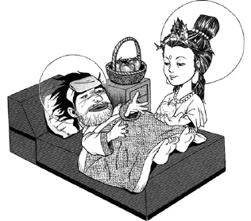s

⊙ 问：伪经的说法主要来自于出家人，他们说在家人没有资格训斥出家人。

堪布：佛陀在经中说，如果有智慧的话，并不一定以出家身份为主。《三戒论释》中也讲过：“一般而言，出家人胜过在家人。但在特殊情况下，具有智慧即相续中具足得地等殊胜功德者为主。”

⊙ 问：那这部经是真的？

堪布：对！

⊙ 问：为什么有的经论中说，有些人法尔是大乘种性，有些人法尔就是小乘种性或不定种性？

堪布：所谓法尔，可从两方面来理解：一、在名言中，火是热性，水是湿性，河水往下流，太阳从东方升起……这都是法尔理的规律；二、在实相中，声闻缘觉所证悟的无我空性，菩萨所证悟的离四边八戏的空性，都是胜义法尔的一部分，所以，只有佛陀的如所有智才彻底通达法尔的实相。

虽然按照《俱舍论》的观点，众生俱生有利根、钝根之别，但无论被称为不定种性，还是决定种性，小乘的声闻、缘觉入定多劫之后，诸佛都会放光劝请他出定，然后入于大乘。故依照《经庄严论》的说法，小乘中所谓的“决定”种性，在大乘中全部是“不定”种性，因为决定是修小乘而不会入大乘的众生，在这个世界上根本找不到。同样，麦彭仁波切讲《经庄严论》时也说了，有些众生被称为断佛性者，其实他并不是真的断了佛性，只不过成佛的时间比较漫长而已。

⊙ 问：那这种说法是不了义的？

堪布：对。

⊙ 问：有个学佛精进的检察官，所接触的犯人几乎都有人命在身，最后要被判处死刑。他不知道该不该做这种直接涉及到人命的工作？

堪布：让他在工作过程中，事关人命的案件，多放宽一些政策。不管是什么样的情况，一个人被判无期徒刑就足够惩戒了。在不影响工作的前提下，还是应该尽量救护人的生命。

⊙ 问：有个妇产科医生，因为工作原因，一天要碰到几次损害人命的事情，这种情况该怎么办？

堪布：这个问题恐怕没有好的办法，除非她改行。

⊙ 问：现代心理学如何看待佛教？

堪布：很多心理学家对佛教理念很感兴趣。比如加拿大曾发生过这样的事情：有个小孩从墙上摔下来，当他母亲看到后，从远方快速跑过去接住他。事后人们发现当时二者的距离相当远，一般的速度根本做不到。对于这种现象，心理学家百思不得其解，但在佛教的《俱舍论》《智者入门》等论典中，对此就有充分的说明。

现在有些学者，通过最微妙的观察方法也得出一种结论：佛教既不是唯心，也不是唯物，而是中道的一门宗教。

⊙ 问：作真实供养，感果肯定是真实的，但如果是意幻供养又没有等持力，感果会不会是虚幻的呢？

堪布：佛陀并没有说，意幻供养必须要获得一地菩萨的等持。

⊙ 问：那会得到真实的果？

堪布：对！

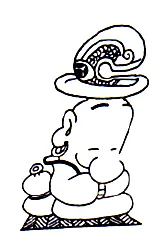

⊙ 问：怎样将佛教与社会结合起来？

堪布：当年太虚法师弘扬“人间佛教”，是以比较浅显的理念打动人心，对社会净化起到了很大作用。所以，若真有人愿意去研究，佛教可以在心理学、神经学、医学、营养学等方方面面利益人类。

然而，佛教中比较深奥的境界，世人可能很难以理解。且不说密法的甚深奥义，即使《心经》对空性的诠释，跟世人沟通也有很大的困难。

⊙ 问：佛教徒应如何与基督教、道教等其他宗教人士相处？

堪布：秉持佛教的见解和修行，同时与其他宗教和睦相处。

这个问题，国外的高僧大德有不同看法：有些法师提倡宗教合一，有些法师则不赞同。我个人的意见是，作为佛教徒，至少要把握两点：首先，皈依三宝的原则坚决不能变，尤其是自宗的见修，更应珍惜，不能舍弃；与此同时，可以赞叹他们某些善举，学习他们的长处和优点，以此也可利益社会，并与众生广结善缘。

因为我们是皈依三宝，不论从内心的见修，还是表面威仪，都应有别于其他宗教。在见解方面，必须坚持佛教的观点；在修行方面，可以学习他们的世俗善举；在行为方面，佛教的威仪不能与他们混在一起，但可博取众长，借鉴他们的优势。

在此基础上，佛教徒应与所有的宗教和睦相处，这一点非常重要！

⊙ 问：在骨灰盒旁边放转经筒，对死者有没有利益？

堪布：有。

⊙ 问：那神识已经离开的呢？

堪布：有时候他会回来看一看。（众笑）

真的，会这样的。一般对于生前的财物、房子，或者骨灰等，他觉得这是自己的东西，有时候就会回来。那个时候，如果骨灰处有一些经旗、转经轮，他就不会害怕，不然的话，他会有恐惧感。

所以，我们藏地在尸陀林等埋骨灰的地方，往往会插一些经旗、刻一些观音心咒。因为众生的业力各种各样，有些变成中阴身或鬼神后，有时候会回来看一看自己死的地方，或者他所拥有的骨灰等东西。

因此，亡人的骨灰不管放在哪里，都要注意这些问题。

⊙ 问：藏地有没有比丘尼戒的传承？

堪布：没有。现在藏地、印度有很多大德，希望有机会与汉传佛教互动，将藏传佛教比丘尼戒的法脉接上。曾有一位宗教领袖在接受记者采访时说：“现在藏传佛教中，断绝了比丘尼的法脉。许多人为此做过努力，希望这种情况能得到改变，多年来我也希望三大佛教传承中的高僧大德们，能聚集一堂，共同商讨这个问题，可计划一直没有得到实现。”

以前上师如意宝在世时，我也问过是否有必要恢复比丘尼戒的传承。上师后来在课堂上说：“佛陀在世的时候，女众业力比较深重，所制戒条也相当多。尽管我们藏地没有比丘尼戒的传承，但沙弥尼戒的戒条也很细微，末法时代真正能守的又有几个？”上师当时的密意不知如何，但原话是这样说的。

⊙ 问：《六祖坛经》中说“前念著境即烦恼，后念离境即菩提”，对此应该如何理解？

堪布：无垢光尊者在《上师心滴·正行光明藏讲义》中也有相似的教言：前念还没有认识时，是烦恼的本体；后念通过上师的加持、直指以及自己的观心，在前念灭尽的当下认识烦恼的本性，这就是佛陀的本来面目。

但上师如意宝以前讲《文殊大圆满》时说：“认识烦恼的本性或者说灭尽烦恼，不一定都是成佛。有些属于资粮道的认识，有些属于见道的认识，也有些像国王恩扎布德那样，直接获得无学地的佛果。一般而言，认识烦恼的本性只是资粮道的认识。”

这种说法与有些法师的观点也不相同，如慧律法师认为六祖已经获得了佛果，境界上跟佛没有什么差别，只不过是他不成佛而已。

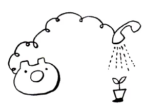

⊙ 问：远距离灌顶是否存在？

堪布：一般来讲，灌顶必须具足一定的因缘，但有信心的话，应该能得到相应的境界，可是跟现场灌顶完全一模一样，这可能有点困难。

当然，有些大成就者例外。以前莲花生大士在藏地灌顶时，包括小虫以上的众生都得到了灌顶，所以大成就者的行为，是我们凡夫人难以测度的。

⊙ 问：用电话灌顶可以吗？

堪布：要看这个上师和这个弟子。如果上师非常了不起，弟子也非常了不起，那有可能！

⊙ 问：如果上师仍健在时，把上师的照片做成唐卡供奉，这是否会对上师的寿命有影响？

堪布：佛教的有些缘起也不好说。但以我的分别念观察，一般做唐卡，最好是用莲花生大士、阿弥陀佛、释迦牟尼佛等佛像。这些佛像的度量比例，佛陀在经典中也有专门宣说，若能依此来做唐卡，肯定有特别大的功德。

至于上师们的唐卡，跟照片应该没什么差别，只不过是被加工了一道而已，不应该对他们的寿命有害。但将其供奉的话，则有两种说法：一、上师若是成就者，许多人对其供养顶礼，不但对上师没有影响，而且可直接赐予悉地和加持；二、上师若是一般人，如此供奉对他稍微有一点不利，甚至假如他烦恼深重，是个地地道道的凡夫人，这样做就更不应理了。

就拿我来说，我很清楚自己到底是什么样的人，所以别人用我的照片做唐卡，或者放在佛堂直接供养，心里总是不舒服，觉得对自他肯定没什么意义。因此，做唐卡也好、做像章也好，最好是用佛像。

藏地曾有位特别出名的活佛叫图登尼玛，他在英国时就要求弟子或随学者，最好是做莲师和释迦牟尼佛的唐卡，这样对谁都有利益。否则，如果只做自己上师的唐卡，本传承的弟子可能很喜欢，但其他传承的人不一定会起恭敬。

因此，能不能用上师的照片做唐卡，这要视具体情况而定，可能不能一概而论。

⊙ 问：一位学员因学《入行论》而对佛法生起极大信心，准备出家修行时，遭到父母极力反对，并将一起学习佛法的道友告到了公安局，阻止其他人继续学习。请问此事该如何对待？

堪布：悄悄地学习！（众笑）

告到公安局也没有什么，学习《入行论》是个好事，对社会稳定不会有任何破坏，反而有非常大的利益。所以，很多公安人员都觉得大乘佛法对他们的工作有很大帮助，我们附近的公安人员就非常感谢我们。

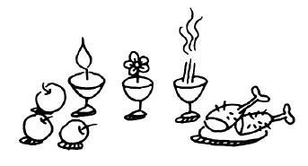

⊙ 问：会供时可以吃肉吗？

堪布：如果不是贪执肉味，完全将其观想为诸佛菩萨的供品、自身观想为坛城，以这种作意而享用肉食，没有任何过失。但若想趁此机会一饱口福，对供品的肉食大快朵颐，那是不合理的。

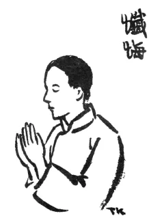

⊙ 问：假如起了恶念，但没有去做，会不会受到果报？

堪布：如果以正念来摄持，就不会受果报。但若既没有正念，也没有忏悔，产生贪心、嗔心等都有果报。

⊙ 问：如果自己忏悔了，还受不受果报呢？

堪布：看你忏悔的四对治力具不具足。

⊙ 问：某人尚处于临死状态，瑜伽士说他已转生为狗；某道友的爷爷刚刚去世，瑜伽士说他已转生为某地县长。这种说法可靠吗？

堪布：现在很多神通是假的，靠不住！这些所谓的“瑜伽士”“空行母”，总是乱猜，有时猜得准，有时猜不准。

一般来讲，凡夫在生命未终结前，不可能转生为其他众生。一期生命的体现，必定有神识存在，如果一息尚存，神识岂能去别处投生？因此，人还没死的话，不可能已经转生为狗。

当然，如果是圣者则另当别论。听说藏地就有上师尚未圆寂，别处却出现了他的转世活佛。此现象有两种可能性：一、诸佛菩萨的示现不可思议，他于生前即可显现另一化身；二、通过某位大成就者不可思议的加持，受加持者便成了化身。法王如意宝就曾自谦地说过：“我并不是列绕朗巴的转世，只不过受过尊者的加持，人们才称我是他的化身。”

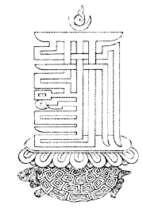

另外，爷爷刚死就跑去做了县长，这绝无可能！凡是胎生的有情，必定有住胎期和成长期。牦牛也要住胎几个月，然后才出生，慢慢长成大牦牛。一个人刚死不久，马上就变成另一个地方的县长，这完全不符合逻辑。尽管华智仁波切在《前行》中讲“寿命无常”时说：“死亡会突然降临，谁也无法确定明天会不会转生为头上长角的旁生。”但这是从湿生角度而言的，湿生的有情不需要住胎，马上即可转生，可如果变成县长的话，这个逻辑不合理。

当然，死者若是诸佛菩萨的化身，这些显现也有可能。但如果不是这样，那瑜伽士的神通不准，不要到处去问！

⊙ 问：弟子发了菩提心以后，行持时很困难，怎么办呢？

堪布：再次发愿！再再发愿！

⊙ 问：《开启修心门扉》中说：“若没有以出离心、菩提心来摄持，所行的一切善法都是造恶业。”这是从哪个角度来讲的？

堪布：从严格的角度来讲的。严格地说，超离轮回才算真正的善业，其他一切善业都是有为法。仲敦巴曾请教阿底峡尊者：“如果以贪著今生的幸福安乐、恭敬利养而闻思修行，其后果将如何？”“仅仅获得此等后果。”“来世又将如何？”“深堕地狱、饿鬼、旁生三恶趣。”因此，若未以出离心、菩提心来摄持，所行一切并不是真正的善法。

⊙ 问：自己在发心的过程中，无意间损坏了三宝物，应该怎么样处理？

堪布：照价赔偿好一点。

⊙ 问：有些居士的佛堂里，老鼠闹得很凶，把供佛的水果都吃了。赶也赶不走，这该怎么办？

堪布：不用赶！学习大乘佛法的人，有机会的话，连身体都要布施，吃一点水果又有什么可吝啬的？

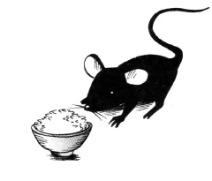

⊙ 问：如果害怕老鼠，要不要忏悔呢？

堪布：害怕老鼠不用忏悔，但是想害老鼠要忏悔！

⊙ 问：如果平时对父母很孝顺，但梦中却恶口谩骂父母，这个有没有罪过？

堪布：有。

⊙ 问：那该怎么忏悔？

堪布：嗡班匝儿萨埵吽。

⊙ 问：一个人没有受别解脱戒，但他证悟了空性，那他证悟的一刹那，是否具足别解脱戒的戒体？

堪布：看他证悟的境界如何。如果是一地菩萨的智慧，肯定具足。

⊙ 问：开悟和证悟有什么区别？

堪布：可以说是一样的，只不过名称不同而已，二者都有从资粮道到佛地的次第差别。

⊙ 问：许多具德上师都给我传过法，但哪一位是我的根本上师呢？

堪布：所谓根本上师，第八世噶玛巴在论典中讲过，如果对自己证悟心性有帮助，那无论是否见过这位上师，他都可以立为根本上师。

还有一个，赐予密法、灌顶、窍诀的上师叫三恩德上师，三恩德上师之一也属于根本上师。

⊙ 问：在佛法弘扬方面，您对自己及弟子们有什么期待和展望？

堪布：我没有弟子，不过有很多金刚道友。我对自己没什么希求，但对道友们的弘法利生，的确有一些期待。

当今时代，法王如意宝弘法利生的发心与事业，完全体现了他老人家对浊世众生的眷顾。藏传佛教中，颇具名望的大德不胜枚举，不论是修行成就还是闻思智慧，他们都可谓极其超胜。但从讲经说法住持佛教，以及提倡放生饶益有情的方面来看，法王及其传承弟子的事业，无有能与之比肩者。这是事实，并非自夸之语。

法王教法的兴盛，在这个时代尚不明显。我已四十多岁，还能存世几年不得而知，所以，法王一脉相传的佛法能否兴盛于汉地，完全取决于你们这一代。在你们当中，可能会出现一批真正有能力的僧才。不管是男众、女众，这种潜质现在有些人还不明显，但是到了将来，也许他们会成为非常了不起的高僧大德。据我了解，现在有些道友到了汉地以后，在弘法利生方面还是起到了很大作用，而且这样的道友为数颇多。

再从学院在汉地的影响，及汉人对佛法的期待来看，时间成了佛法兴盛的唯一因缘。去年至今，我本人与汉地一些净土道场、禅宗道场、中国佛协等佛教界具有名望的高僧大德，经常进行一些谈话。在谈话期间，他们从内心中流露出对学院的赞叹。不论是佛法的造诣，还是一直以来讲经说法的传统，他们都给予了肯定和承认。另外，学院某些法师到了汉地寺院，由于他们的智慧和修行，也自然赢得四众弟子的恭敬。大家只要听说是“喇荣五明佛学院的修行人”，都会生起仰慕和信心，许多道场想让他们留下来，但师命难违，道友们只是作了短暂停留便回到学院。

由此可知，汉地非常需要僧才。只是由于历史的缘故，藏汉佛教界的交流尚未完全开放，许多佛学院及佛教徒只能默默地等待。据说从今年开始，政策有了新的突破，如果是这样，藏汉交流可能会越来越方便。因此，我们可以推测：一旦内因外缘全部具足，学院的显密教法将得以推广，对佛法兴盛所起的作用也是不可估量的。

我作以上分析，并非没有依据。从目前的闻思状况来看，像学院这样再再闻思大经大论的道场，可谓绝无仅有；具缘道友们个个具有殊胜见解及向道之心，这也极其罕见。因此，只要是具明目者，都会做出同样的推测。

至于具体到每位道友的发展，恐怕谁都难以预料。我想，绝大多数道友需依靠自己的因缘而定。有些人前世有弘法宏愿，今世的利生事业也能顺利展开；有些人由于前世愿力欠缺，即使今生具足智慧、戒律清净、人品极佳，弘法事业也可能会出现夭折现象。

所以，我想再次强调：不管大家闻思修行能力如何，一定要再再发下弘法利生大愿。这一点极为切要！

⊙ 问：上师经常教导我们要担当弘法利生的重任。如果我们具备弘法利生的能力，那时主要弘扬宁玛巴自宗的教法，还是弘扬汉传佛教呢？

堪布：先应观察所调化对境的因缘。假如他们不接受宁玛巴的教法，那讲《金刚经》《心经》来利益众生实际上是一样的。

如果他们对藏传密法有信心，则应先用他们能接受的佛法来打基础，然后再深入一些密宗教言。当然，这也要视具体情况而定。

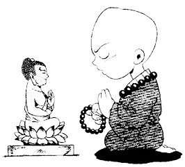

⊙ 问：可不可以说“念佛法门就是闻解脱”？

堪布：可以，实际也是这样！

⊙ 问：密宗是纯正的佛法，当我们身处不信密法的人群中，该如何护持密乘戒？

堪布：自己默默守护就可以，对别人不会有丝毫影响。守护密乘戒并不需要当众唱歌、跳舞，也不需要公布于众嘛！

⊙ 问：如果寺院住持或当家师反对密法，发现我们供养密宗上师或本尊像，是否会带来负面影响？

堪布：不要紧！我们修学密法，不舍弃上师是最根本的誓言，所以应当时时供养，再再祈祷。在一些显宗道场，公开供养自己的密宗上师或本尊不太方便，则可将上师或本尊像夹在书里，默默地行持意幻供养。实在不得已的话，也可将世尊像与上师像、本尊像合在一起，纵然被人发现，只要对方是佛教徒，决不会把佛像撕烂的。

再说，伴随显密教法的普及，过去排斥过密法的人，也都渐渐有所改变。去年我去了杭州的几个寺院，虽然他们对密法不感兴趣，但来过学院的道友在寮房里公开供养密宗佛像，也无人过问。我们都知道，上师如意宝是藏汉公认的大德，即使有政治地位的人，也对法王非常恭敬。在学院受过灌顶的许多道友，经常在汉地公开供养法王如意宝的像。其实，我们供养莲花生大士、无垢光尊者、麦彭仁波切以及法王如意宝，就像汉地供养自己的历代宗师一样合理合法。

除了供佛像之外，我们也不应舍弃自己的修持，恒时默默地持诵咒语。这样的供养和念诵又会影响谁呢？不论在汉地何处，令我们舍弃上师、舍弃密法的理由是不存在的。以前“文革”期间，手拿念珠或供养佛像者会马上遭到严厉惩罚，那个年代的修行人，时时为恐怖气氛所笼罩，但就是在那种可怕的环境中，仍有许多密宗行人默默念诵修持，最终获得了殊胜成就。现在处于开放时代的我们，就算公开修持密法有些不便，但在房中默默供养、心中默默行持，应该也不会有什么妨碍。所以，以后不管住在哪个寺院，修持密法都不会与任何人发生大的矛盾。

但如果你自己心中有障碍，那就不好说了。

⊙ 问：普贤王如来、五方佛、释迦牟尼佛之间是怎样的关系呢？

堪布：普贤王如来、五方佛、释迦牟尼佛三者一味一体，并非别别他体，他们仅是观待不同有情而分别作的安立。

普贤王如来，乃心的实相本体，是法身佛。他并无报身、化身那样的刹土，是五方佛面前所显现的境界，并非凡夫六根识的所缘。冠以“普贤王如来”的名号，只是在我们分别心面前进行表示而已。

五方佛，是登地菩萨的境界，是报身佛。

释迦牟尼佛，住持不清净刹土，显现于凡夫面前，是化身佛。

普贤王如来是无上密法的来源，对于他的本体，虽以言语无法诠释，但并不等于虚无，他是甚深离戏、超离言思的真实存在。

⊙ 问：释迦牟尼佛是一个化身吗？

堪布：对！世尊是以化身佛的形象来度化我们的。

⊙ 问：伴随着改革开放和西部大开发，藏传佛教是否会受到其他宗教和外来文化的冲击？

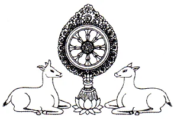

堪布：自古以来，藏传佛教始终保持着纯洁的传统，并保留了许多古老道场，但这一切是否会受到冲击，一方面看来很难说，因为在当今时代，西方文化已遍及世界的每一个角落，尤其在强调文化多样性的此时，藏传佛教很有可能受到冲击并卷入其中。现在国家拨巨款支持西部开发、发展旅游景点，所及之处必然受到不同程度的波及。由于众生业力日趋深重，佛教受到冲击也是正常现象。

但从另一方面来看，其他宗教的殿堂或场所，在藏地几乎从未真正形成过。为什么密法在藏地可以长盛不衰？首先源于密法本身的威力所致。自莲花生大士入藏降伏外道及魔众以来，密法被弘扬至雪域每一个角落，每一寸土地都获得了加持。在这种情况下，即使有一些不同宗教进入并发展，也不会有真正的市场撼动藏传佛教的稳固根基。更何况，藏传佛教以自身的优越性，对未来发展的探索也从未停止过。

其次，以藏族人的特性来看，天生就不喜欢接受外来宗教。藏人对佛教尤其是密法的信仰根深蒂固，可以说90%信仰佛教。他们从小就念诵观音心咒，懂得转绕与祈祷，除了对佛陀的虔诚信仰以外，几乎不可能信仰其他宗教。尽管现在也有年轻人去了汉地和国外，但据我所知，没有一个纯粹的藏族人后来改信了道教或基督教。只不过唯物论的影响还是比较严重，但是唯物论并非真正的外道，虽然它的见解类似于裸体外道，但不能算作真正的外道。

因此，其他宗教或文化要在藏人心中扎根，一段时间内恐怕相当困难。当然，未来的漫长岁月中，藏人将变成什么样子？我作为一个凡夫人，也是很难预测的。

⊙ 问：现在有些传密法的上师不强调闻思，甚至说自己从来没看过书。遇到这种情况，我的选择是暂时远离他、保持恭敬心，这样对吗？

堪布：一般来讲，不管在禅宗中还是密宗中，都有未经闻思而开悟的大德，这是不能否认的。但对大多数修行人而言，由于根基与普通人没有差别，所以次第闻思修行是最安全、最可靠的。否则，个别上师虽然自己不必闻思，通过简单方式即可开悟，但弟子们如果都按他的路线去走，有些人可能会成功，然而大多数人都比较困难。因此，先好好地闻思，到一定时候再精进修行，并遣除修行的各种障碍，这样比较保险一点。

所以，众生的根基和意乐各不相同，这个问题也不能一概而论。如果统统要求“一定要闻思、不需要修行”，或者“一定要修行、不需要闻思”，这都是堕入两边。当然，从总体来讲，闻思对大多数人确实非常重要！

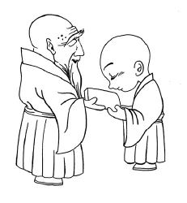

⊙ 问：学院的师父们何时能回汉地弘法利生？

堪布：这要观待每位道友的因缘而定。道友们的根基、意乐、闻思进度各不相同，有的可能要待久一点，有的则会稍短一些。但总的来讲，在学历圆满以后，他们就会去汉地各寺院或佛教团体弘扬佛法。我们有两种学历：一种是六年制，这是一般学历；一种是十二年制，这是特殊学历。

我们不鼓励道友们刚来不久就回去，因为闻思需要时间。当然这种情况也不太多，即使有，有些回去不久又回来了。我们也没有规定：你们何时必须回去！没有这种安排。上师如意宝住世期间就是如此，现在也不会改变。

⊙ 问：东北的“出马仙”，就是狐黄长蟒这些动物，经过修炼能附在人身上，给别人打卦、察事、看病等。我们作为佛教徒，如何看待这种现象？

堪布：我以前去过东北，那里的仙儿似乎特别多。但有些只是民间说法，有些是确有其事——非人附在人的身上，这种现象是存在的。我们作为佛教徒，当遇到这种情况时，最好是念些佛菩萨名号，去帮助它们。

要知道，非人附在人身上，给别人说神通、打卦、算命，这里面也有真有假。在藏地，像紫玛、单坚等护法神，也会降临在人身上，授记一些未来的事情。但还有些人身上没有护法神，也没有这样那样的感应，却执著自己的分别念，经常在别人面前说神通，所以这是比较复杂的问题。

不过总的来说，对待附体的非人，我们要发大悲心，念些佛号令其得到暂时、究竟的利益，并引导它能皈入佛门，为众生做些有意义的事。若能如此，它也不会伤害众生的。

⊙ 问：死后被超度到极乐世界的众生，生前都发过愿吗？

堪布：一般来讲都发过愿。即使有些没有发过，但以他自身的福德力、与上师之间的因缘力，再加上上师不可思议的悲愿及加持力，可强力将其超度至极乐世界。

⊙ 问：有些众生罪业深重，这样能得到超度吗？

堪布：要看这个上师。如果上师的加持力很大，那可以！

⊙ 问：极乐世界有新生婴儿吗？

堪布：有啊！刚往生的都是“新生婴儿”，但不会哭！《极乐愿文大疏》中说：他们由莲花苞中化生，身体无有大小、美丑等差别，一律具足金黄色，有顶髻等妙相随好严饰，并具足五眼六通。

⊙ 问：若看到一个人得了癌症等重病，自己很想帮助他，那么应该修自他交换，还是念咒回向其冤亲债主？哪种方法的效果更明显，且对自己不会伤害太大？

堪布：境界比较高的人修自他交换，对自己一点害处也没有。比如，那若巴依止帝诺巴时经历十二大苦行，每当他奄奄一息时，上师摸摸他的身体稍作加持，他马上就能恢复如初，而且上师的身体也没有丝毫损害。此外，玛吉拉准空行母每次一入定，旁边眷属的分别念就会当下灭尽，这种情况也是直接把别人的痛苦自己代受，并且不受任何损害。所以，境界超胜的人通过忆念或加持，对周围的一切会起到很大作用。

而我们作为普通人，虽没有这种禅定能力，但可以把自己的善根回向给众生。当然，在回向的时候，千万不能一直有保护自己的念头——“要在保全我自身的基础上，再帮助一点众生”。其实，这种念头越严重，越保护不了自己，这是一个必然规律。反之，若将自己的身心全部付出、全部布施给众生，有了这样的心态，不但害不了自己，对别人也会有明显的效果。

不过，这要通过长期修持方可达到，短期内不一定能够“速成”！

⊙ 问：供灯的功德文里说：“不能将空器供在佛堂上。”但我们外出办事、晚上睡觉时，如果灯油燃完了，空的灯器摆在佛堂上，这样会有过失吗？

堪布：如果不是故意的，这不会有很大的过失。但一般来讲，如果油灯是空的，或者用空器供养上师，则是有过失的。

以前，米拉日巴尊者供养马尔巴上师一个空的灯器，后来，虽然他的修行获得了成功，有了很大的功德，但因为供养空器的原因，他感召了饥饿的果报。

所以，灯燃完以后，暂时放在那里是可以的，但不要一直空放着，还是要弄干净，放一些灯油，重新点亮。

⊙ 问：您对藏地的佛教发展充满信心，还是对藏地的经济发展充满信心？

堪布：我对今后藏传佛教的平稳发展充满信心，对藏地的物质发展没有信心。以前阿底峡尊者不是说过嘛，藏地是一个“饿鬼世界”，要想变成“龙王世界”，可能也不太现实。

⊙ 问：现在西部大开发，有了好的马路，也有许多飞机场，这样便利的交通是否会令外来文化长驱直入？

堪布：所谓的西部大开发，我觉得对藏地也开发不了很多。交通的改善，只不过是在兰州通了一条铁路而已，至于飞机场，在雪山环抱的藏地，到底能有几个也很难说。县与县之间确实通了柏油马路，但从50年代以来就有车辆来回跑，新的路面似乎也难以带来新的变化。再者，藏地的气候不太适合外国人和汉族人居住。这么冷的天气，你觉得什么文化能在我们这里有生长的余地呢？

也许有人担心藏地旅游业会带来一些新的文化。以前济群法师就担忧地问我：“我去过一些藏地寺院，他们也开始卖门票了，以后会不会像汉地那样啊？”其实，卖门票也只是少数寺院，我的家乡那里有五百多座寺院，卖门票的一个都没有。因此，短时间内，恐怕很难有其他文化真正进入藏地。

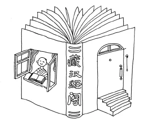

⊙ 问：但有一种说法，精神文明必须建立在物质文明的基础上，您怎么看待？

堪布：两个文明能平衡当然很好。但在物质文明极度猖狂的当今时代，精神文明早就被忽视、淘汰了。所以，现在需要真正的教育！

⊙ 问：汉地很多人接受了密法灌顶，但往往修不下去，这是为什么？

堪布：汉人的想法过于简单。他们认为灌一个顶就可以修，修了以后马上就能成就，但事实并非如此。没有打下教理的基础，连皈依、发心都不明白，修行是不会上路的。因此，初学者必须长期依止善知识，深入闻思教理。

然而，现在人往往欠缺这一点。他们喜欢吃“快餐面”，求了黄财神的灌顶，立即就想发财、现前一些感应，这就是他们所谓的“成就”。如今这种现象相当普遍，一下子扭转过来比较困难。

其实真正修密法的人，不能急于求成，应当首重闻思显宗教理。见解已经稳固后，出离心、菩提心生起时，再修密法则不会有任何困难。现在不仅仅是格鲁派，宁玛派的许多道场也开设了五部大论的闻思课程。所以，要想修习密法的话，以显宗教理为基础非常重要！

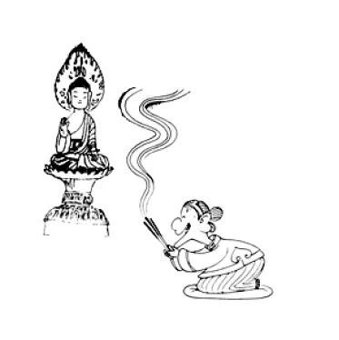

⊙ 问：不学空性，能否往生呢？

堪布：如果信心具足，也可以往生。历史上不是有很多老太太、老公公，从来没有学过空性，但依靠念佛法门都往生了嘛！这主要是与阿弥陀佛的愿力和自己的信心力有关。

⊙ 问：净空老法师在汉地影响非常大，但近年来许多人对他很有非议，请问他是不是具德的善知识？

堪布：哪个是善知识、哪个不是善知识，我没有这种辨别智慧。但净空老法师这么多年来，非常慈悲地传授了净土宗法要为主的许多教言，让世界上很多人对净土法门产生信心，这是不可否认的事实。

至于他早期对密法有些不同看法，对一些法师的见解也有直接或间接的驳斥，这对我个人来讲，全部都观清净心，把所有这些法师都当作佛的化现。

当然，有必要的时候，为了澄清自宗，建立清净的佛教见解，我们也可以互相辩论、探讨，这在佛教中是允许的。但作为学佛的人，最好不要评论谁是邪知识、谁是魔知识，否则，以讲经说法的法师为对境这样称呼，很担心会造恶业。

所以，大家应该观清净心，看到任何一位对佛教、对众生有贡献的高僧大德，尽量要看他们的优点。至于自己不能理解的地方，最好是去慢慢观察，这样的话，逐渐可能会了知他们的甚深密意。

⊙ 问：作为凡夫，选择极乐世界比较有把稳，那若是即身成就者，可否自由选择刹土呢？

堪布：一般来讲，即身成就者选择哪个刹土都可以。但依照各自发愿力的差别，趋往的刹土也会不同。

比如说，大圆满传承中的有些高僧大德，即生获得大圆满的果位后，也前往了极乐世界。而布玛莫扎，他成就以后，暂时以虹身安住于世间，同时发愿：“贤劫千佛皆成佛之后，我将到印度金刚座示现成佛。”

所以，以不同的发愿力，圣者们所趋入的刹土也不相同。

⊙ 问：在念佛时，印光大师提倡以心计数，不用念珠，对此应该如何看待？

堪布：印光大师开示的方法，不用念珠，只依靠心来计数，这需要一定境界才做得到。

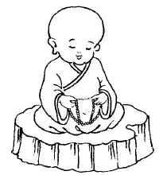

⊙ 问：那我们应该如何计数呢？

堪布：作为一般的修行人，用念珠计数，每天规定一个念诵数目很重要。比如你每天念两万阿弥陀佛圣号，然后就像藏传佛教每个修行人所做的那样，手拿一百零八颗的念珠，一边念一边拨。

以前我遇到一些汉地居士，他们手里拿着念珠，我就问：“你们念了多少？”他们有的说“一直在念”，有的说“念了一些”，似乎没有任何压力。当然，计不计数也不是特别重要，就像憨山大师、华智仁波切所说：若仅仅重视念诵的数字，而不注重调伏自心，也没有任何实义。但作为一般的修行人，我们还是应该对自己有一个约束。

当然，至于具体是否用念珠念佛，这要根据自己的根基。根基很高的人，不用念珠也可，但一般根基者，按规定数目用念珠计数，可能要好一点。

⊙ 问：法王如意宝睡觉时念咒也可以计数，这是如何做到的？

堪布：上师睡觉时也在拨念珠，到了一百零八时还会特意计数，我想只有成就者才可以这样任运行持。作为凡夫人，包括我自己在内，不要说睡觉时念咒，就算白天心很清净时，念起咒来仍会胡思乱想，不用念珠的话，不到一百肯定就记错了，又要返回去重新念。

总之，不管是汉传佛教、藏传佛教，用念珠来念佛持咒非常殊胜。像印光大师那样已获得很高境界的，不用念珠只靠自己的修行力也可以，但一般人还是很难如此行持。

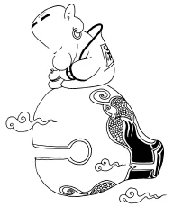

⊙ 问：您如何看待“短期出家”这一现象？

堪布：最近，我从一本佛学杂志上看到了“短期出家”的文章，我觉得这种形式很好，也很感人。

在文章里面，有位东北居士想短期出家，最初妻子不同意，但他说自己只是想种下一个善根。后来，他真的去了黄梅五祖禅寺作短期出家，在法师面前落发以后，就过起了出家人的生活。有一次，许多居士问他：“请问师父，请书的地方在哪里？”他特别不好意思，因为不是真正的师父，所以也不敢给人回答，就跑开了。七天的出家生活之后，他开始进行舍戒仪式，这时许多短期出家的人一直在哭。之后，他又重新穿上了在家衣服。

关于这一现象，泰国、新加坡比较多。但这种形式，可能许多藏传佛教的大德不一定承认，以前上师如意宝对此也未置可否。不过，以我个人的分别念来抉择，如果有些人的确不具足终生出家的缘分，为了让他暂时体验一下出家生活，短期出家也有合理之处。而且，最后进行舍戒，这在别解脱戒中也有开许。

但有点疑惑的是，一切有部中，出家戒全是有生之年受持，并没有“受持多少天”的这种仪轨。所以，我不太清楚他们用的是何种仪轨？不知有没有充分的律藏教证依据？是否像八关斋戒那样在佛经中有明确记载？如果真有这种合适的仪轨，那功德会非常圆满，对很多人来讲，确实也可以在相续中种下善根，并依此对出家生活有所了解，有很多好处和必要性。

以前我去泰国时，那里短期出家的时间比较长，一般都是两三年。当时汉地没有这种现象，但最近几年，有些寺院也在尝试七天的短期出家活动。

⊙ 问：汉地与泰国的短期出家，性质上相同吗？

堪布：应该相同吧。不过，泰国没有女众的短期出家。

⊙ 问：短期出家后再舍戒，是否会形成等流果，对后世的出家造成障碍？

堪布：那不会吧！比如我今生受了一日的八关斋戒，来世的异熟果和等流果都应该很好。

⊙ 问：科学对人类起源的解释，与佛教的说法有所不同，这该如何理解呢？

堪布：有人说人类起源于一百万或数百万年以前，也有人说人类只有一万年的生存历史。但这都是一些假说，是科学家们以各种仪器作为标准，依不同考古资料所作的推测。有谁现量见到人类起源于一百万年以前呢？或者在哪一本书籍中，有当时古人所写的“人类之史”的明确记载呢？因此，科学的认识最多只是一种假说，即使不去置疑他们仪器和推测的准确性，但“万年”“百万年”，这种知见本身也过于狭隘。

佛陀认为，众生无量劫来就始终存在，或转生为人类，或堕落为旁生，恒时在六道中流转不息。这是佛陀的现量所见，并非臆测之辞。许多大乘经典中也记载：佛以无碍智慧恒时观照一切众生，此世界众生刚刚形成，彼世界众生已转向他方……因此，按照佛教的观点，整个法界有无量无边的世界，无量无边的众生。

那么，到底多久前才有了人类、有了众生呢？佛陀说是“无始”。众生无始以来就存在着，无始以来就流转于轮回，直至今日，乃至将来。

《释迦佛广传》和其他显宗经典中都记载：佛陀从因地起，历经三大阿僧祇劫方圆满佛果。所谓的“阿僧祇劫”，以《俱舍论》来解释，是无可计数之意，而若以数字计算，就是在一后面加六十个零。

科学家以万年、百万年来推算人类历史，而《俱舍论》认为：成住坏空一大劫中，有八十个中劫。每个中劫，又有减增二劫，减劫当中，人寿从无量岁降至八万岁，再从八万岁每一百年减一岁，直至人寿十岁；增劫当中，又从十岁增至八万，如是循环不已。对于这样的人类历史，最好的表示就是“大劫”。在佛教圣者中，阿罗汉可照见八万大劫，诸地菩萨的所见又层层增上，而佛陀则可彻知本源。这些都是圣者们的现量所见。

众生之所以如是流转，皆以业惑为因，有了如是之业，则导致转生为狗、人等。《百业经》《贤愚经》中多有这样的记载：佛陀为众眷属宣说，此比丘于多少劫前曾造何业，以此业缘而于今世转生为人，并于佛前出家。这些公案中的时间、事件，均是佛以智慧现量照见并如实宣说，并不用依靠什么仪器，也没有不可靠的推理揣测。因此，与科学相比，佛教是否更为科学呢？

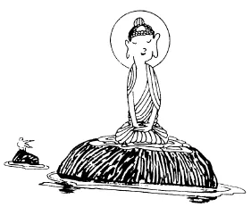

⊙ 问：什么叫“现空双运”？

堪布：蕴界处等一切诸法的基，即是现空双运。比如我们人类见一碗水，饿鬼见为脓，地狱众生见为铁水，天人见为甘露……六道众生虽各有不同所见，但它有一个共同的现分——光明。实际上，这个现分的本体仍为空性，这就是所谓的“现空双运”。在圣者的根本慧定面前，离戏大空性现前的同时，这个光明也是不离开的。

现空双运这一本体，虽然以教理可以成立，但无法在我们的分别心中建立。

⊙ 问：对于“见修成正比”与“见比天高，行比海低”，应如何理解才互不相违？

堪布：所谓“见修成正比”，是指在理论上有怎样的见解，才会摄持怎样的修行，修行不会超越见解。

“见比天高，行比海低”，是指在行持的过程中，即使见解再高深，也不能废弃最细微的取舍因果，正如莲花生大士所云：“是故见比虚空高，取舍因果较粉细。”

要知道，即使见解再高，行持也应最低，即使见解是中观空性见或无上大圆满，行为上也应小心翼翼，从小乘的行住坐卧诸威仪和断恶行善等取舍因果做起。在行持的过程中，行为不一定要跟随见解，尽管见修行果成正比，但若不考虑周围环境，以很高的见解去显现超胜行为，他人可能会接受不了。当然，假如一点见解都没有，只是在行为上“高”，别人更是受不了！

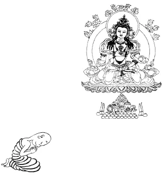

⊙ 问：有人认为在忏悔方面，念阿弥陀佛与持金刚萨埵心咒无别，只要念佛就可以了。是这样吗？

堪布：佛经里有没有这样的记载？

⊙ 问：他说从究竟而言，二者是一样的。

堪布：从究竟而言，阿弥陀佛的极乐世界也是空性，又何须念佛求往生？

观待世俗的缘起，念修金刚萨埵心咒忏悔业障，是极为超胜的。尽管《阿弥陀经》中说过，念佛名号可以清净罪业，《极乐愿文》中也有类似教证，有些祖师大德还说：“即使造了五无间罪、谤法罪，只念阿弥陀佛，也有清净的机会。”但作为一个修行人，最好的修行方式就是：传承上师怎样做，我们也怎样做。这是非常可靠的！

传承上师让我们观想金刚萨埵，念诵金刚萨埵心咒，那我们就应当如是忏悔。金刚萨埵于因地时曾发愿：“我成佛时，凡持我心咒者，可令一切罪障皆得清净，五无间罪与谤法罪，也能无余清净。若不清净，我不取佛果。”

因此，我们应深信念修金刚萨埵的不共之处。虽然念阿弥陀佛是一种忏悔，发菩提心是一种忏悔，修习空性也是一种忏悔，但对一般凡夫来讲，在不具这些超胜境界之前，念修金刚萨埵进行忏悔，是最可靠的！

⊙ 问：如果一切唯心，上师也是心的自现，为什么还要报答师恩？既然心外无有众生可度，还需要发菩提心吗？

堪布：三界是唯心，但现相上不是唯心。

这个道理，《中观庄严论释》等大乘论典中讲得比较清楚：从名言实相来讲，三界都是唯心所现；但从名言现相而言，包括唯识宗的论师们，也不承认除了自己以外的屋子不存在、除了自己以外不同业感的众生不存在。

所以，这个过失是没有的，只要多看一些《中观庄严论释》等大乘论典，里面讲得非常广。如果分开现相和实相，这个问题就很容易回答。其实不要说中观，连因明也不承认现相是自己的心。

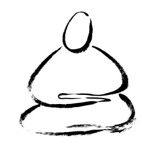

⊙ 问：有居士认为，学了大圆满以后，最后仍要走禅宗之路。这种说法对吗？

堪布：众生的分别念无量无边，我没有时间一一回答。

⊙ 问：他的想法是不是不太合理？

堪布：对！不合理。

⊙ 问：那该怎样劝导他？

堪布：好好地闻思修行。实学，实修，才能实证！

⊙ 问：没有菩提心可以往生吗？

堪布：不可以。

⊙ 问：那杀牛人在地狱相现前时，猛厉念佛即得往生；打铁人在“叮当”声中念佛，命终也得往生，这怎么解释？

堪布：你怎么知道杀牛人在猛厉祈祷时未生起菩提心？你怎么知道打铁人在“叮当”声中没有菩提心？

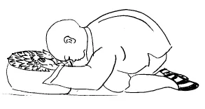

⊙ 问：顶礼哪一尊佛的功德大？

堪布：“顶礼哪一尊佛的功德大”，我在有关经典中并未见过。不过我想：不论你顶礼哪一尊佛，若能观想十方诸佛菩萨与此佛同一本体，这样修就很好。《释尊广传》中也讲过，要将所有忿怒、寂静本尊等诸佛菩萨，全部融入一尊佛的本体中，而行顶礼。

听说有些人在家里设佛堂时，将藏传佛教与汉传佛教的佛堂分开，每一尊佛像前的供品也一定要相等，否则就好像过意不去。其实不需要这样，只要对一切殊胜对境都怀有清净心供养，功德是平等的！

⊙ 问：有位居士请了《大圆满心性休息大车疏》，未经您开许，可以看吗？

堪布：他看了还是没有看？

⊙ 问：已经看了。

堪布：看了以后再请示，不太合理吧！

⊙ 问：那这个过失大吗？

堪布：显宗部分可以看，但密宗部分必须要得灌顶。如果他得过灌顶就可以看，不一定要开许。

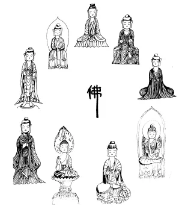

⊙ 问：粗大的五蕴怎么样转变为清净？

堪布：云怎么消于虚空中的？云表示我们的身体，虚空表示法界。我们经常看到云漂浮在虚空中，很漂亮、很好看，但以一些偶然的因缘，云全部消于虚空中，为什么？

云可以，我们的身体为什么不可以？一样的道理！

⊙ 问：一张DVD光盘能刻很多观音心咒，将几张这样的光盘做成转经轮，功德会更大吗？

堪布：因果的关系，用分别念推测是很困难的。如果真有这种传统，或者能了知因果的上师特意开许、加持，功德应该是有。

以前上师如意宝所做的转经轮，在藏地是有传统的，而且上师强调：“观音心咒转经轮是最好的，因为很多佛经中都有明确记载。而其他心咒做成转经轮，若有大德或经论开许是可以的，否则，凭凡夫的想象不一定有很大功德。”

把心咒刻在光盘里，以分别念来看，应该会有功德。我自己也在枕头上放了一张光盘，藏文和汉文的《大藏经》都在里面，每天晚上对它磕三个头，心里很舒服。

但不知道这能不能转，因为DVD上的旋转轨道不一定符合转经轮的旋转方式，弄不好的话，也许方向完全相反。转经轮的操作方式，是每个心咒都竖立着，这样转起来比较如法。但DVD好像跟这个完全不同，如果方向是倒着转，那是什么样的状态，我也不太清楚。所以，这些方面可能要考虑。

⊙ 问：抉择现空双运，对我们最关键的指导在哪里？

堪布：见、修、行都很重要。

⊙ 问：那为什么修的时候没有提到显现？

堪布：怎么没提到呢？所有的中观修法，都不会离开现空双运，绝不会只是一个单空的修法。如果你觉得这根柱子是空性的，但没有显现，这说明你还没有懂得中观的道理。

对于任何一法，虽然在原文中不一定提到它是现空双运，但你在见解上要了知它是现空双运，修行上也要修持现空双运。全知麦彭仁波切在《定解宝灯论》中讲得很清楚：见解上，离开显现抉择不出空性。见解若没有抉择好，怎么修呢？在修行上，虽然见解已抉择了现空双运，但修的时候只修一个单空，这合理吗？对格鲁派的观点，全知麦彭仁波切怎么说的，你还记得吗？

⊙ 问：中阴身比活着的时候迷惑还是清醒？

堪布：莲花生大士的教言及某些经典中说：一般来说，中阴身的意识要比生前敏锐七倍。当然，也有迷惑的情况。

⊙ 问：一个人要往生，若有亲人拦阻，怎么办？

堪布：进入中阴时，若有正见要往生，途中遇到有人来劝阻：“我是你的某某亲友，你不能去啊！”“你应该考虑我们的痛苦，回来啊！”此时应想：这是我往生的一种障碍，不能听他们的！然后就勇往直前。

乔美仁波切在《极乐愿文》里有一则比喻：往生极乐世界时，对一切都不要贪恋，应像从网中解脱出来的老鹰一样，义无反顾地冲向天空。

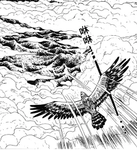

⊙ 问：人在临死之前，还需要有哪些准备？

堪布：如果有一些财产，则应尽量舍弃，比如用来供养僧众、供养三宝等；倘若实在来不及，就从内心里放弃，这也很重要！

有些阿弥陀佛的修法要诀中说：我们在临终时，里里外外的死相已经出现，自己也知道肯定活不了了，那时候不要执著任何财产，也不要执著这样那样的东西，假如来不及舍弃，就在心里想：“我从无始以来于轮回中一直流转，今生终于遇到了往生法，我一定要舍弃对眷属、财产的贪恋，唯一希求往生！”

这就是上师们的教言，是非常重要的教言！临死时，我们很可能贪著“我的亲人”“我的房屋”“我的资具”等等，如果出现了这些念头，就不可能真正往生。所以，不能贪恋任何事物，要全部放弃！

现在所学的教言，有些可能用在临终时，有些用在中阴时，但不论是临终还是中阴，大家都要尽量忆念这些教言并实际起用，这是相当重要的！

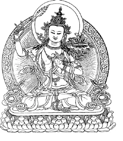

⊙ 问：《宝鬘经》中说：“念诵文殊菩萨名号及心咒的功德，超胜于念诵千百万亿佛陀的名号。”这该如何理解？

堪布：从不同的功德而言，某些佛号的作用也不相同。比如说，在临死众生的耳边念诵“宝髻佛”名号，这个众生就不会堕入恶趣，而其他佛号没有这一作用。当然，并不是其他佛不具有这样的功德，而是因为宝髻佛以不共愿力所成就的这一功德，佛经中对此也作了宣说，对其他佛则未作明述。

同理，从开启智慧而言，文殊菩萨的名号及心咒更为超胜。文殊菩萨虽现为菩萨身份，但实乃古佛再来。《宝鬘经》云：“文殊菩萨早已成佛。”《文殊菩萨净土庄严经》中也说：“文殊菩萨以菩萨形象利益众生。”另有经典言：“文殊菩萨于未来成佛。”由此可知，文殊菩萨是过去佛、现在佛、未来佛。同样是佛，诸佛名号的功德自然平等一味，但从文殊菩萨因地不共的愿力而言，若要开启智慧，念诵文殊心咒的威力，决定超胜其他诸佛名号。

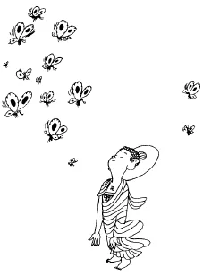

⊙ 问：有些人破斥带业往生，这合理吗？

堪布：怎么破的？

⊙ 问：他说应该消业才能往生，带业往生违背因果。

堪布：带业应该可以往生。为什么呢？因为即使你已得菩萨位，相续中还是有业，至少有所知障尚未断尽。因此，带业往生并非不成立，只不过按照某些净土宗的教言，带业往生只能得下品位。

⊙ 问：跟法王结缘的众生都能往生极乐世界，请问是何时往生？

堪布：即生也可以，临终也可以，中阴也可以，后世也可以。

⊙ 问：什么才叫跟法王结缘呢？

堪布：所谓的结缘，有各种方式。比如，按法王的要求念阿弥陀佛圣号、获得法王的灌顶、得过法王的教授，以及对法王见闻忆触等，这些都算是结缘。

⊙ 问：与东方琉璃世界、兜率天、莲师刹土相比，极乐世界是否有超胜之处？

堪布：从教证上来看，对于极乐世界，佛经中确有“持念阿弥陀佛名号，即可获得往生”的字句，而兜率天、莲师刹土、琉璃世界等刹土，佛经中没有类似的明确记载。

从器世界来讲，有些刹土不如极乐世界那样庄严。比如，莲师刹土在某些持明者面前虽显现清净无染，但从外观上看，那里就是一个罗刹世界；而兜率天，仍属于三界中的欲界天，虽有弥勒菩萨等清净圣众，但也住有一些不清净的众生。东方琉璃世界尽管功德很大，与极乐世界一样庄严，但要往生彼刹特别困难。

所以，历来高僧大德所推崇的，多是极乐世界。

⊙ 问：往生琉璃世界如何困难？是不是登地以上才可以？

堪布：有一部经专门讲了琉璃世界的功德庄严，上师如意宝圆寂前的六七个月，曾让一位堪布在身边诵过这部经典。当时我也阅读了一下，感觉在庄严方面，琉璃世界与极乐世界无有差别。

但要想往生这样的刹土，是否需要登地，倒没有听说。只不过像极乐世界那样唯念佛号即可往生，这样的记载在经中没有提及。所以，要往生到那里，还是很困难的！

⊙ 问：神秀大师说：“身是菩提树，心如明镜台，时时勤拂拭，莫使惹尘埃。”六祖说：“菩提本无树，明镜亦非台，本来无一物，何处惹尘埃？”对这两首偈子，您怎么看？

堪布：禅宗将身体喻为菩提树，将心喻为明镜台，这些比喻非常好。神秀大师所体会到的，六祖大师所悟入的，都通过比喻很好地表达了。这种方式在藏传佛教中也有，如莲花生大士师徒之间的对话，就用过类似的比喻表达了如是见解。

关于这两首偈子的意义，从抉择空性的角度而言，第一偈的前两句是抉择见解，后两句讲修的光明；第二偈则分别讲了行和果。

此外，对《六祖坛经》的解释，我觉得可以有不同方式，尤其是第二品，可从见、修、行、果或基、道、果方面来讲。也就是说，结合中观的抉择方式来理解，可能会更好！

⊙ 问：三界导师法王如意宝以大圆满教主的身份，弘扬净土法门的密意何在？

堪布：净土法门出自了义的大乘经典，不管是密宗还是显宗，都奉之为殊胜修法。作为利生广大的大菩萨，法王如意宝这样弘扬净土法门，天经地义、理所当然，法王在做自己家的事，此举实属情理之中。

法王本人学修弘扬的，虽然主要是无上密法，但在藏传佛教中，单学密宗而不学显宗的传统从来没有，几乎任何一个寺院都是显密兼修。尽管法王已是大圆满教主，但也发愿往生极乐世界，他老人家从发愿到往生之间，一直都强调并弘扬净土法门。不仅如此，法王还培养了无数高僧大德，也在国内外励力弘扬净土法门。

因此，不管是汉传佛教、藏传佛教，大家都应遵循法王如意宝的意愿：“显密圆融互不排斥，共同受持如来教法。”只有如此，才算是真正荷担如来家业。

⊙ 问：在一些寺院的旅游景点，常有卖印《心经》的T恤，这些衣服可以穿吗？

堪布：不可以，有非常大的过失！衣服是用来遮体取暖的，而佛菩萨及经咒是要恭敬顶戴的，世尊说过：“末世五百年，我现文字相，作意彼为我，尔时当恭敬。”如果将文字印成的《心经》穿在身上当装饰，可能只有不懂因果的人才敢这样做。

现在这种现象比较普遍，许多厂家为了赚钱，就琢磨现代人求保佑的心理，投其所好，将佛菩萨像、《心经》、咒轮等做成工艺品，或者印在衣服上。以前也有人供养过我印《心经》的杯子、笔筒，但这些我都不敢用，也不知道该怎么处理。

倘若这种趋势不改，以后会不会将《心经》印在裤子上也不好说！

⊙ 问：但穿上这种衣服，走在大街上，可以给看到的人种下善根。

堪布：种善根可以用其他方法，这样做的话弊大于利。而且，你穿这种衣服，发心是否完全为利他也不一定。

⊙ 问：如果有这些衣服或工艺品，应该怎么处理？

堪布：尽量供在佛堂上，不要自己用！

⊙ 问：定业经过忏悔之后，还会不会承受果报？

堪布：这个问题，要从大乘、小乘两方面来分析：按照小乘的观点，所造的定业不可能转变；但按照大乘的观点，无著菩萨在相关论典中说，所造的定业是可以转变的。

比如一个人造了五无间罪，依照小乘教典的说法，来生必定堕入无间地狱。但依据大乘的有关教言，通过四力忏悔或者依靠密宗的灌顶和依止坛城也可以忏净，并且在忏净之后，不会再受这种罪业的果报。即使有些罪业非常严重，只需在地狱中感受瞬间的痛苦，马上也会获得解脱。

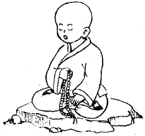

⊙ 问：平时应该如何打坐？眼睛要闭上吗？

堪布：每个修法的仪轨、要求各不相同，所以不能一概而论。

有些法要求毗卢七法坐式，有些法要求眼睛微闭，有些法要求眼睛不能闭……不管修什么样的法，一定要按照高僧大德的教言去做。如果将这个法的仪轨与自己的分别念混在一起，就会有很大的过失！

⊙ 问：为什么念《心经》能遣除违缘？

堪布：因为《心经》所讲的是空性精华。我们之所以会遭遇恐怖、灾难、违缘等侵扰，其根本在于对人我和法我的执著，倘若证悟了无我空性，断除了人我执和法我执，一切魔障就没有猖狂的余地了。

《心经》宣讲的是最殊胜的般若空性，以此空性的威力，再加上《心经》的加持力，内外密的一切违缘都能被遣荡无余。所以，佛教中专门有《般若心经回遮仪轨》，里面就讲了往昔帝释天怎样祈祷、持诵《心经》，我们也如是行持的话，魔王波旬等一切违缘都会化为乌有。


⊙ 问：往生的障碍有五无间罪和谤法罪，而《入行论》说过“菩提心如劫末火，刹那能毁诸重罪”，那菩提心是否可以摧毁这两种罪呢？

堪布：真正生起菩提心的话，那可以！如果有了菩提心，五无间罪和谤法罪皆能得以清净，从而往生极乐世界，获得解脱。

⊙ 问：修行人越精进，违缘障碍越多，一方面是魔王在干扰，另一方面，是来世恶趣的果报提前成熟，重罪轻报。但《了凡四训》中说，只要学佛并改过迁善，不好的命运就会变成好命，这两种观点应如何圆融？

堪布：对有些人而言，的确是修行越精进，魔王波旬造的违缘越多，来世的果报也会提前成熟。但也并不是所有精进的人都一定会有违缘。

而且，《了凡四训》所说的改变命运，是改变今生的命运还是来世的命运，这个应该值得分析。我们在精进修行时，《了凡四训》也不敢保证100%的人一生都会顺顺利利，不受任何违缘。虽然学佛肯定可以改变命运，肯定对自己有利益，然而《了凡四训》里所讲的，并不是说只要学了佛，就会从开始到成佛之间不遭受任何违缘，这是谁也不敢承认的！

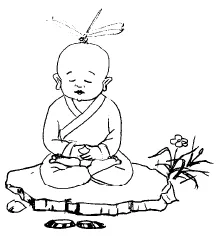

⊙ 问：在念佛持咒时，出现昏沉、散乱怎么办？

堪布：出现昏沉的话，不要坐在屋子里，而应该到外面散一散步，稍微清醒以后再回来观想。如果心向外散乱，则应稍微放松一下。有条件的话，最好在寂静的地方，心专注地念诵和观想，这样效果会好一些，加持力也会更大。

总之，心不散乱很重要，心不昏沉也很重要，若能遣除这两种障碍，念佛持咒才会事半功倍。

⊙ 问：如果摧毁了佛像、佛塔、佛经，用什么方法来忏悔呢？

堪布：一般来讲，这些罪业属于近五无间罪，是非常严重的！智悲光尊者在《功德藏注疏》中说：“依靠三宝而造的罪业，叫做无与伦比的罪业。如果毁坏过佛像、佛经和佛塔，则应按照两倍以上进行修复，然后再在三宝面前忏悔。”

比如说，自己以前毁坏过佛塔，就要造两座以上比以前更殊胜的佛塔，造完之后再在三宝面前忏悔。忏悔的方式，最好是以四对治力念诵百字明或金刚萨埵心咒，在条件允许的情况下，应念十万百字明或者四十万金刚萨埵心咒。

假如能这样行持，依据佛经里的教证，应该可以忏悔清净。

⊙ 问：通过什么方式才能得到传承？

堪布：得到传承必须要依靠声音，不管你听MP3，还是看VCD、DVD，声音最好不要间断。有些道友只看法本而没有听法，虽然可以领悟到一些法义，却不能获得真实的传承。

所以，听受声音非常重要。无论是集体学习，还是个人学习，只有听到传法的声音，才能够得到传承。

⊙ 问：作为一个世间人，怎么样将世间法与佛法圆融？

堪布：严格来说，世间法和出世间法有许多相违之处，真正要做一个非常好的修行人，必须要看破世间的很多东西。

但若没有这么严格的要求，作为一个在家人，也可以将佛法与日常生活结合起来。比如说，每天对自己有一个要求，尽量念诵一些咒语、作一些观想；同时，无论接触任何人、在任何环境中，都应以慈悲心来对待；即使遇到一些坎坷不平，也能以佛教的教言提醒自己，看得比较淡，不去特别执著……这样以后，就如《六祖坛经》所讲的那样，应该能做到世间与出世间的圆融。

其实，现在世间上也有非常了不起的修行人，一方面自己的修行特别好；另一方面，依靠佛教的慈悲教义，对社会乃至整个人类都做出了极大的贡献。

⊙ 问：在修行过程中，如何对待验相呢？

堪布：验相并不是很重要。我们如果通过修行，相续中的贪心、嗔心等烦恼减少，信心、慈悲心增上，这就是最好的验相。除此之外，表面上能看到什么东西、听到什么声音，并没有多大的意义。

学习佛法的时候，最好不要以求神通、求验相为目的，而应该努力让自相续变得善良，为了利益众生发菩提心！

⊙ 问：如何选择与自己有缘的法门？

堪布：你对哪个法门最有信心，就说明你是哪个法门的所化众生。比如你对净土宗最有信心，那么净土宗就是你的有缘法门；如果对密宗最有信心，密宗就是你的有缘法门。因此，要想选择与自己相应的法门，可以根据信心和欢喜心来决定。

⊙ 问：现在有些“高僧大德”，常说自己是某某佛菩萨的化身，可以看到别人的前世后世，能否以此来判断此人是假冒的大德？

堪布：我觉得他应该是个大德！因为只有大德才敢说自己的成就。

⊙ 问：可是在密宗戒律里，不是规定不能随便说自己的境界吗？

堪布：自己有的话，应该可以说。开玩笑！

不管是藏传佛教、汉传佛教，一个人若直接宣扬“我是某某大德的转世，能与天人鬼神等经常交流”，这种行为在佛教中不太赞叹。不但不赞叹，而且真正有法相的上师，据我所知，不会宣扬自己的成就如何。因为真正的大德用不着自我宣扬，别人通过他的清净戒律、超越智慧等，也能推知他的不凡。相反，假如一个人到处宣扬自己是某某的化身，这个人可能有一些问题。

不过，现在有些信众比较愚笨，对具有法相的大德不欢迎，却成天围着那些自我吹嘘的人转。包括在国外，这种现象也特别多。前段时间，有位修行人就说：“除了释迦牟尼佛没有转世以外，其他的大菩萨、大成就者，如莲师二十五大弟子、马尔巴、米拉日巴等，都已经出现了。如今的新活佛，都找不到自己的‘前世’了。”这种说法比较讽刺，但确实令人值得深思。

实际上，真正的大成就者不太宣扬这些，如观音上师、噶玛巴、法王如意宝，根本不承认自己是谁的化身。法王如意宝曾谦虚地说：“有些授记中说我是列绕朗巴的化身，但我认为肯定不是，只不过是得到一些列绕朗巴的加持而已。”还有国外的观音上师，也从来不说自己是第几世、有多么了不起的成就，他老人家在许多场合中，都说自己是藏传佛教的一名普通僧人，只不过对释迦牟尼佛有不共的信心。

通过这些智者们的语言，我们也可以看得出来，那些在外面拼命宣传自己的人，应该值得好好观察！

⊙ 问：有些人先皈依显宗师父，后来受了密宗灌顶，又担心被显宗师父知道，这种冲突应如何化解？

堪布：比较而言，老一辈大德与新一代大德的心态不太相同，由于和外面的交往比较少，有些老法师对藏传佛教不太接受。

但近几年来，藏地大德们不断提倡放生、吃素、念佛，有些法师也在直接或间接地了解藏传佛教，就像以前的弘一大师一样，虽然早年排斥过密宗，但后来逐渐认识到排斥密宗是不合理的。

从我几十年的感觉来看，现在汉传佛教的大德们对密宗的结缘、交往，跟过去是完全不同的。近年来，我去过净土宗的东林寺，禅宗五祖、六祖的道场，发现新一代的大德们虽然没有亲自来过藏地，但原则上还是能够接受密宗。即便有少数法师不能接受，但你自己可以暂时不说，悄悄地修法就行了。

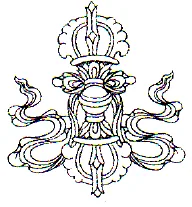

⊙ 问：如果很想学佛，但是家人非常反对，不让供佛，白天工作又特别忙，这该怎么办？

堪布：所谓的学习佛法，不仅是形象上做一些事情，关键是要对佛陀有敬仰心。当然，每个人的情况各不相同，有些人虽然很想学习佛法、研究佛法，以大乘菩提心来利益众生，但家里和单位经常制造违缘，在这种情况下，自己应尽量抽时间来念经、看书、放生，道心永远都不能退。

尤其是违缘越来越多时，发心越是要坚定。只要真正有信心，外在环境不一定能阻碍自己学佛。

⊙ 问：人死了以后，应该为他做些什么？

堪布：按照佛教的传统，遗体最少在3天之内不能动，在此期间，家人和道友应该为他助念阿弥陀佛、释迦牟尼佛、观世音菩萨等圣号。如果懂得其他仪轨，则应尽量为其念诵；如果不懂的话，一心一意念阿弥陀佛也非常好。

一般来讲，人死了以后，在四十九天内，每天为他做一件善事、在耳边念佛是不能断的，这种传统在显宗、密宗中基本上都相同。

⊙ 问：遗体柔软是否就表示往生了？

堪布：也不一定。按照大乘的某些教言，判断往生的标准，最好是看天象的变化，有些人的身体虽然僵硬，但也有可能往生了。

⊙ 问：对学佛者来说，利益众生重要，还是成佛重要？

堪布：华智仁波切在《现观庄严论修法》中讲过：“我们成佛实际上就是为了利益众生，并不是获得佛果后，自己过得快快乐乐。”学佛就是为了成佛，而成佛就是为了帮助天边无际的众生。

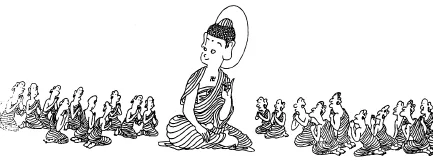

⊙ 问：这样的话，有些人破了密乘戒，我们是远离他还是帮助他？

堪布：从究竟而言，利益众生是最重要的。但暂时来讲，当我们遇到一些不如法的众生时，行为上可以远离他，否则若与之同流合污，对自己的见解、行为有一定影响。但心里的愿菩提心不能舍弃，智悲光尊者、无垢光尊者都讲过：“对于这些恶友，千万不能舍弃菩提心，但行为上尽量不要交往，自己没有达到一定境界之前，与之交往的话，很可能令自己的见修退失。”对此，佛陀在诸多论典续部中也阐述过。

⊙ 问：居士群体中可以建立佛学院吗？

堪布：我认为可以。虽然在家人的琐事比较多，但现在人为了达到世间的目标，尚且花很多精力和时间去学各种课程，那学习对今生来世都有利的佛法就更应该了。而且在汉地，现在学佛的在家人比较多，建立一个适合他们生活与行为的佛学院，为他们学佛创造一个良好的环境，能令许多居士从中得到极大的利益。

当然，他们的教师队伍不能全部是在家人，而应该请出家人来担任。如果出家人有能力、有智慧，也应为在家人专门建立这种佛学院。但至于具体操作，我本人没怎么思维过。

⊙ 问：有位老居士学密多年，突然疯狂地毁谤高僧大德，并把密宗的书籍和法器都送到汉地寺院去了。如果有居士以尊重心去请她这些法宝和法器，会不会受她破戒晦气的染污？

堪布：应该没有什么，法本和法器不可能被染污的。

当然，在密宗中，破誓言的罪业确实很严重。现在汉地有些人，以前入过密宗，后来因为各种因缘，不但做一些疯狂的行为，甚至还千方百计地毁坏佛法。最近我就听说有些人特别可怜，看到别人在印法本，马上主动到公安局检举，让他们一定要没收，不没收不行。那些执法人员都觉得奇怪：“听说你也是学密法的，为什么要这样做？”

所以，有的人在受到魔障干扰时，会做出各种非法的行为。如果是她的其他财物，比如衣服、资具，那在藏地来讲，大家都比较排斥，担心被她的晦气染污，但若是法本、佛像、法器，这些本身就具有三宝的加持力，只不过是从她手上传来的，佛像也没犯什么错误，法器也没犯什么过失，因此不会受到晦气染污的。

⊙ 问：如果接了一个法，上师明确地说这个法每天必须修，但作为一个在家居士，每天事情比较忙，这该如何把握呢？

堪布：修此法对你调伏内心起到什么样的作用，这个要值得观察。再加上给你灌顶传法的上师是不是公认的？他是不是按佛法的仪轨自己也在修？这些都要好好地了解。

⊙ 问：如果今天没有修，明天可不可以补上呢？

堪布：对任何一个法来说，这都是可以的。

⊙ 问：我今天没有修，明天也没有补上，这会不会违背誓言？

堪布：可以第三天修嘛！（众笑）

⊙ 问：也就是说，不管怎么样，每天都要平均修一次？

堪布：对！

⊙ 问：为什么不必舍弃烦恼，而烦恼自解脱呢？

堪布：是这样的。不管是禅宗还是密宗，根基比较好的人，都明白烦恼的本体是空性。比如生起猛厉的嗔恨心时，观察嗔恨心到底在哪里，是在身体里、心里，还是在外面……这样一经观察，嗔恨心当下就不存在了，若了悟到这一点，即是所谓的“烦恼自解脱”。但如果没有认识的话，嗔恨心就是自相的嗔恨心，不能叫做“自解脱”。

⊙ 问：米拉日巴尊者到牛角里去避雨，他身体没有变小，牛角也没有变大，我不理解这是什么样的境界。

堪布：怎么不理解呢？

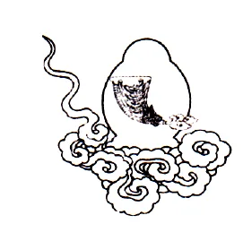

⊙ 问：好像超出我的想象吧。

堪布：这种境界就是超出我们的想象。《华严经》中说：一即是多，多即是一，一与多是一体的。在凡夫人的分别念前，这种说法似乎很不合理，但实际上，实相的境界不可思议，这种境界当中什么都可以显现，一个微尘上有十方诸佛菩萨也是可以的。

⊙ 问：既然造业是自作自受，为什么高僧大德可以替众生带业？

堪布：一般来讲，自己所造之业不可能成熟于他处，佛陀在《百业经》中也说：“一切众生之业不会成熟于器界的地水火风，也不会成熟于其他众生的相续，而是成熟于自身的界蕴处，即所谓‘纵经百千劫，所作业不亡，因缘会遇时，果报还自受’。”这是从总的业因果而言的。

但有些高僧大德、诸佛菩萨能替众生带业，是因为他们的加持力不可思议，在这种情况下，可以减轻众生所受的痛苦。定业转变的这些问题，智悲光尊者在《功德藏自释》中有广说，方便时大家可以看一下。

⊙ 问：在工作中大家一起贪污受贿，别人都已经拿了，但轮到自己时，因为学过佛而不想拿，可这样别人会嗔恨你，这时候该如何做？这个问题一直困惑着我。

堪布：你不要嗔恨就可以，尽量不要起烦恼！

⊙ 问：但具体要怎么做呢？是随波逐流，还是如理如法去做？如果真的如理如法，这在世间中是很困难的。

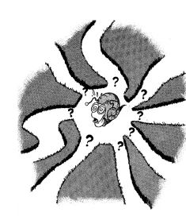

堪布：没事，首先有点困难，但慢慢会好的。你的行为若如理如法，一开始肯定有许许多多的人不理解，对你产生误解、成见等等，但是到了一定的时候，他们会慢慢认可的。

⊙ 问：自从学佛以后，周围人有一些说法，我不知道该如何回答。

堪布：大概有什么样的说法？

⊙ 问：他们说：“你为什么要学佛？它能带给你吃吗？”

堪布：你可以反问：“人活在世间上，难道就是为了吃吗？”

⊙ 问：但这样解释的话，他们还是会有疑惑。

堪布：没事，如果用道理给他们解释，他们应该会理解的。但若连道理都不听，那就没有办法了。学了佛以后，肯定有人对我们不理解，但通过学佛自己获得了今生来世的利益，以这种利益来感化别人，应该不是很困难！

⊙ 问：为什么舍弃了密法，就不能往生极乐世界？

堪布：密法是本师释迦牟尼佛所宣讲的最甚深、最精要的法门，可以说代表了佛法，若以嗔恨心来舍弃密法，依靠净土宗的任何修法也不一定会成功。因为《阿弥陀经》《极乐净土庄严功德经》中皆说：舍法罪不能往生极乐世界。所以，不管是密法，还是其他宗派的法，假如随随便便地舍弃，今生想获得往生是非常困难的。

⊙ 问：有个人在念佛持咒时，经常出现对佛菩萨的不净念头，他自己也是特别恐惧，害怕堕入地狱，请问怎么消除这种念头？

堪布：什么样的不清净念头？贪心、嗔心还是痴心？

⊙ 问：比如说，见到莲花生大士像时非常害怕。

堪布：那没有什么吧。最好多念一些金刚萨埵心咒！

有些众生前世没有积累福报，今生经常出现一些不如法的邪念，这完全是自己的业力和妄执现前。了知这些念头的来源之后，尽量地祈祷诸佛菩萨，进行忏悔，多看一些诸佛菩萨的传记，了知诸佛菩萨浩瀚如海的智慧和悲心，再观察自己有没有这方面的功德，如果没有的话，凭什么对他们生起不清净的念头？

所以，自己一方面要好好地忏悔，另一方面多观想诸佛菩萨的功德，渐渐地，这种念头会消失的。

⊙ 问：在学佛的过程中，以什么样的心态来对待外道徒？

堪布：他们也是众生，应该以慈悲心来对待！但是要知道，他们的宗教与佛法有着本质上的差别，故而见解上不能与他们混为一谈。应将自己的见解先稳固下来，然后在行为上，以慈悲心来对待他们。

⊙ 问：如果自己对佛教的见解还不稳固，那首先是稳固见解，还是帮助他们？

堪布：按照大乘修学的次第来讲，见解一定要先稳固，如果没有稳固的话，很有可能随外境而转，最终陷入无法自救的深渊中。

当然，见解稳固并不意味着要获得很高的境界或者成就，倘若你身处人群或外道团体中，对三宝、佛教的信心永不退转，达到这样的境界时，我认为就可以尽量地度化众生、帮助身边的人了。

⊙ 问：藏传的“净土四因”与汉传的“事持理持念佛”，如何融到一起呢？

堪布：不同的念佛方式不一定非要合在一起，尽管彼此并无相违之处。

汉地历来重视念诵，虽然佛经中宣说了受持、念诵、为他人说等十种法门，但许多汉地寺院似乎只强调念诵。不管去到哪个寺院，大家早晚都在念佛，而心之受持、观修或为他人说法，却少有人行持。尽管汉地有许多念佛法门的教言，但真正能受持讲闻的人并不多。而藏地历来重视见解的抉择，这样的“净土四因”，也不一定要与汉地念佛方式结合起来。

要知道，不同的传承，有不同的功德和加持！

⊙ 问：现在外面鱼龙混杂，如果遇到不太好的上师并已接上法缘，后来又不小心诽谤了，那能不能忏悔？

堪布：这要看自己的忏悔程度。如果诚心诚意忏悔，应该可得以清净。

⊙ 问：通过金刚萨埵、《普贤行愿品》都可以吗？

堪布：对！

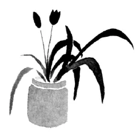

⊙ 问：有些人将自己的身口意供养给上师。身体供养上师的话，可以帮上师做事情、按上师的意愿修善法，但语言和意识怎么供养上师？

堪布：遵循上师所传的教言，语言尽量说利益众生的话语，心里经常忆念利益众生的事情。

在身口意三门中，意识是最关键的！

⊙ 问：有位大德说“禅宗是显宗的大手印”，您是如何看待禅宗的？

堪布：我说“禅宗是显宗的大圆满”！因为这位大德是噶举派的，我是宁玛派的。（众笑）

⊙ 问：显宗的大圆满和密宗的大圆满有什么不同？

堪布：显宗的大圆满不用灌顶！

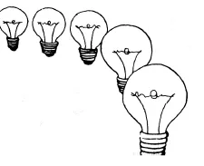

⊙ 问：那在见、修、行、果方面呢？

堪布：一般而言，在直指心性方面，禅宗有非常甚深的教言，这一点从很多证悟者的公案中也可以看出。但现在修禅宗的人有一些误区，有人一听说“万法了不可得”，就连世俗中的因果正见都舍弃了，没有开悟反而认为开悟了，这种现象不太可取。

我刚才是开玩笑，密宗和禅宗在见、修、行、果上还是有很大差别，并不仅仅在于灌顶。密宗本身有些超胜的境界，二者要一模一样，恐怕是不行的。但禅宗与密宗也有相同之处，比如《大圆满禅定休息》中一些明乐无念的境界和觉受，在禅宗的书里基本上也找得到。因此，“禅宗是显宗的大手印”，这样解释应该是可以的。因为大手印有显宗、密宗之分，显宗部分不需要灌顶，通过四种瑜伽将心一缘安住，这种境界如同法王如意宝在《直指心性》的前行中讲的那样，从起现分别念的角度来讲，要观察心的来源、住处、去处；从安住的角度来讲，通过大手印来安住自己的心。所以，没有经过大圆满的正行灌顶，这一点也是可以修的。

如果按传承上师的教言，禅宗属于大圆满前行中寂止的一种修法，也就是说，还没有正式修大圆满正行之前，心要修持安住一缘，这在《六中阴》《禅定休息》中均有阐述。当然，这种修法，对某些利根者来讲，在安住心性的当下就可能获得开悟。

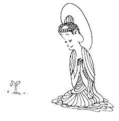

⊙ 问：怎样以清净心来调服自相续？

堪布：在佛教中，观清净心是很重要的。阿底峡尊者曾说：“三个人当中，一定有境界非常了不起的修行人，诸佛菩萨会显现各种身相调化众生。”我们平时觉得这个人很坏、那个人精神不好……很有可能面对的是诸佛菩萨的化身。因此，对任何一个众生，包括路边的旁生，我们也应当观清净心，将其视为诸佛菩萨的化身。

作为一个凡夫，有时候心态很难调整，这是我们每个人的通病。但如果以佛经的道理来经常要求自己，久而久之，心是可以改变的，清净心的范围也会越来越广。

当然，想做到这一点，关键还是靠自己的长期精进！

⊙ 问：福报可以消业障吗？

堪布：可以啊！

⊙ 问：那为什么有个演员把财产三分之一供养给佛教，她却因癌症死了？

堪布：开头是这样说的，但最近她的家人说慈善基金全部没有了，甚至还有人怀疑是他们自己享用了，所以她当初的承诺并没有兑现。

那天我讲《启动爱心》时也说了，人活着的时候，最好是亲自去上供下施，否则临死时只留一个交代，很可能会出现违缘。所以关于她的财产捐献，争论非常非常大。

⊙ 问：但是有位法师说，福报不一定能消业障。

堪布：“不一定”的话，那么有些福报不行，有些福报也可以。我的观点是：真正积累了福报的话，肯定会消业障。但消业障并不等于不死，世间人总认为有福报就永远不会死。

⊙ 问：《前行》中说：“获得密宗灌顶，比获转轮王位还难得。”但现在有些人没有皈依就去灌顶，后来又诽谤舍弃上师，这样的话，给他灌顶是利大还是弊大？

堪布：没有守誓言的话，过失相当大！戒律中也讲过：“如果对方不知取舍而随便赐予灌顶，犹如将宝剑交给屠夫让他杀生一样，过失极为严重。”

⊙ 问：对初学佛的人来说，依止一位上师好，还是依止多位上师好？

堪布：法王如意宝曾说：“如果清净心观得非常好，依止的上师应该多多益善，就像阿底峡尊者一样。但若在依止的过程中，喜欢看上师的过失，经常产生各种邪见，那依止的上师越少越好。”

因此，依止上师的数量多少，关键在于你的信心和清净心。

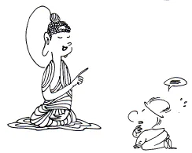

⊙ 问：什么才叫依止上师？是不是一定要见上师？

堪布：真正的依止上师，就是自相续中得到了佛法的利益。如果不懂佛法的话，依止了多少个上师也没有用。

我认为，见不见上师并不是特别关键，最关键的是将上师所传的法首先弄明白，然后在实际行动中去行持。如果你真正得到了佛法的利益，那么见上师也可以、不见上师也可以，从这个角度而言，这就是依止上师。

许多高僧大德的传记中常记载：他们并没有见过上师，但依靠上师的教言，最终获得了究竟的证悟。所以，见不到上师不是特别重要，最重要的是依靠上师通达佛法的意义。

⊙ 问：受了菩萨戒的在家居士，怎么样取舍细微的因果？

堪布：首先，要了知佛陀在有关经典中规定的菩萨戒条。假如不了知菩萨戒的根本学处、细微的支分学处，在日常生活中就根本没办法取舍。

然后，不管是学显宗还是学密宗，即使自己的证悟、见解非常高深，取舍因果也不能轻易舍弃，在缘起规律上，“善有善报，恶有恶报”是亘古不变的原则。莲花生大士也说：“纵然见解比虚空还高，取舍因果也要比粉末还细。”当然，具体怎样取舍因果，关键还是看修行人自己。

总之，大家先要懂得所有的戒律，对佛陀具有无比的恭敬心，然后在此基础上，尽量护持一切学处。假如不慎违越了，则应当去励力忏悔。

⊙ 问：如何判别相续中的菩提心是真实的，还是相似的？

堪布：这个界限比较好分。菩提心有世俗、胜义两种，胜义菩提心远离一切戏论，这是凡夫人难以获得的。但世俗菩提心却比较容易，如果没有别人劝你，你做任何事情都会想到：“我要度化众生，让一切老母有情获得佛果，为了他们我要精进努力。”这种没有造作的心一旦生起来，或者心心念念在这种心态的摄持下，就说明我们相续中生起了菩提心。但如果你只是偶尔想一下众生，大多数时间都是自私自利，这不叫真实的菩提心。

打个比方说，一个员工不愿意在某公司干了，下定决心要离开了，这叫做出离心；而在工作的过程中，时刻想要度化众生，除此以外，再也没有其他的事情了，这就是菩提心。因此，我们到底有没有生起菩提心，通过这个比喻可以衡量。

⊙ 问：既然一切众生本来是佛，又怎么会有众生呢？

堪布：从实相而言，一切众生本来是佛，这在《楞伽经》、弥勒菩萨的《宝性论》中均有明确宣说。但从现相来讲，众生在没有了悟心性之前，被无明迷乱所障，跟佛陀之间有天壤之别。

密宗中也有一个比喻：就像流落街头成为乞丐的王子，虽然他的种姓尊贵，将来会成为一国之君，但现在却身无分文、穷困潦倒。尽管如此，有朝一日他回到王宫、登上王位之后，本体上跟现在的乞丐无有任何差别。

同样的道理，众生在实相上与佛无二无别，但就现相而言，众生被迷乱实执所缚，认为“梦里明明有六趣”，可是一旦梦醒过来，才晓得“觉后空空无大千”，自己所执著的一切根本不存在。

对此若欲进一步了解，不妨翻阅《入中论》《宝性论》等教典。

⊙ 问：您对外面的在家居士有什么看法和期望？

堪布：他们非常需要佛教的基础教育！有些居士本身很有信心，上师怎么样说，他们还是很听话的。但我始终有种感觉：好多上师只是为了自己的利益，并没有认真地教他们。

作为上师，应该学会关心弟子，这种关心并不是给一个东西安慰安慰，而是要给他们佛法的利益。如果自己有能力，应开示一些取舍的道理，让他们守持哪怕一分以上的居士戒。在此基础上，再学习一些知识，修一些简单的法，如金刚萨埵、阿弥陀佛，每个人应该有自己专修的法门。

现在很多居士相当不错，但可惜的是，佛教基础太差了。如果懂得佛法的话，以他们的能力组织一些大大小小的团体，在社会上尽量宣扬佛教的真理，以佛法去影响别人，对社会应该非常有利益。

以现在的情况来看，在家人的文化素质比较高，他们通过各种方式传播佛法还是很有能力的，尽管即生中没有出家的因缘，但也可以成为一个很好的佛教徒。如今，美国有很多在家人举办的佛教中心，对整个佛教的影响相当不错。中国以前因为种种原因，这方面不是特别提倡，但我希望现在的居士们尽可能建立自己的学佛团体，此举对自他有极大的意义！

⊙ 问：现在有些女居士，对高僧大德的恭敬心有点过头了，对此您有什么看法？

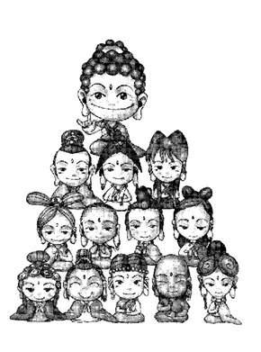

堪布：外面的女居士们，有些对上师的信心比较大，也有些比较痛苦——

前段时间，一位女居士跟她的上师开车到九寨沟，去的时候一路上谈笑风生，但到了那里以后，她不小心看到上师手机里有些不太正常的信息，心里就非常不高兴，在最美的风景区里，她的哭声是最大的。那位大德也十分尴尬，虽然住的是高级宾馆，但感觉上非常痛苦。那个女居士特别伤心，到处说这个上师不要说大悲心，连做人的基本道德都没有……诽谤得很厉害。前不久，台湾几家电视台也公开揭露有些上师的不如法行为，一些女弟子在记者面前发了言，给藏传佛教带来了一定的负面影响。

通过这些小范围的信息了解，现在有些女居士跟藏传佛教某些上师的关系，的的确确不太合理，今后这方面若不改善的话，恐怕会直接或间接影响整个藏传佛教。当然，短时间内马上改变也有点困难。1993年法王如意宝去美国时，当时的美国就像现在的中国一样，凡是去美国的出家人，出家身份几乎都保不住了。因此，去汉地传法的藏地大德们，如果没有正知正念，可能会有各种各样的情况发生。

对我而言，这种事情并非喜闻乐见，毕竟藏传佛教在汉地开花结果很不容易。在学院闻思多年的道友应该知道，真正的藏传佛教是纯洁无垢的。然而，这样无垢的佛法，也许就被个别“上师”染污了。

所以，女弟子在依止上师的过程中应该保持清净心。前段时间我讲课时说过：“现在有些女居士，信心和感情分不清楚，上师和丈夫分不清楚……”事后我对这些话有点后悔，但自己经常听到外面的一些事情，抱着对佛教负责的态度，也想发表一下内心的看法。当然，我没有名声，也没有地位，只是在小范围内讲，不一定起到很大的作用。但如果不讲的话，有些人就因为不注意，最后对佛教产生邪见，毁了自己的今生来世。

因此，在学佛的过程中，女居士应该在各方面注意，除此之外可能也没有万全之策了。

⊙ 问：自己平时什么都不修，死时将希望全寄托在上师身上，是否可以获得往生？

堪布：假如上师是非常了不起的大成就者，通过他的殊胜加持，再加上自己的前世因缘，可能会产生一些奇迹。但一般来讲，最保险的方法，还是按照佛法的次第，在自己没有死之前，该修的法一定要修，尤其是临终时想解脱的话，必须要修往生极乐世界的捷径法。如果你相续中具有正见，对极乐世界有不退转的信心，依靠这种捷径法门，必定可往生极乐世界，这是佛陀的无欺之语。

虽然将希望全寄托在上师身上也有一定的好处，但佛陀常说：“我为汝说解脱之方便，当知解脱依赖于自己。”大家最好还是按照佛陀或上师的教言，自己踏踏实实地修行！

⊙ 问：怎样在最短的时间内，将上师的一切智慧融入自己的相续？

堪布：按高僧大德的传记中所讲，要对上师具有无比的信心，将上师视为佛陀来对待。噶当派的金厄瓦格西说过：“心脏是身体的核心，除去心脏的话，身体就成了一个血淋淋的肉团。同样，上师瑜伽是所有修法的核心，没有了上师瑜伽，一切修法皆无法成功。”《华严经》亦云：“善男子，汝当令善知识生喜，以此可尽知福德与非福德资粮，故能尽除一切流转轮回之因。”又云：“善男子，如是依止承侍善知识，则恒常回忆宿世、利乐众生、值遇诸善知识、成就地道殊胜等持。”

因此，将上师智慧融入自相续的最快方法，就是修持上师瑜伽！

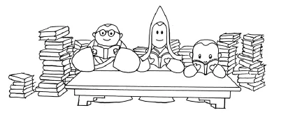

⊙ 问：刚入佛门的修行人，应该看什么书？

堪布：《大圆满前行》和《入菩萨行论》。

[^1]: 第三处：即圣教量。第一处为现量，第二处为比量。
