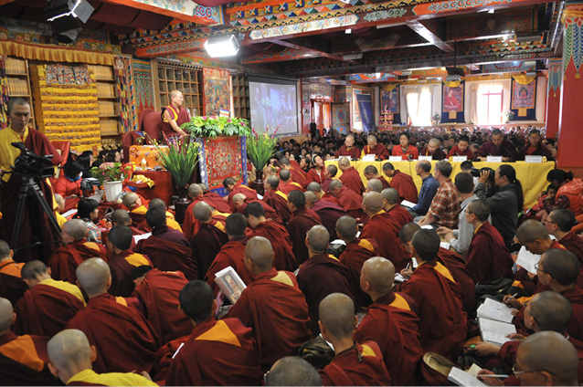
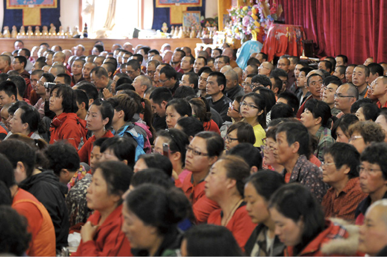
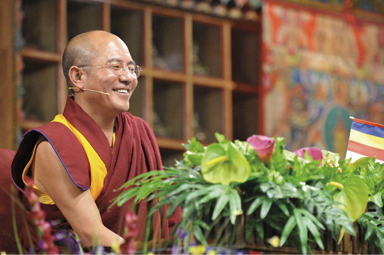
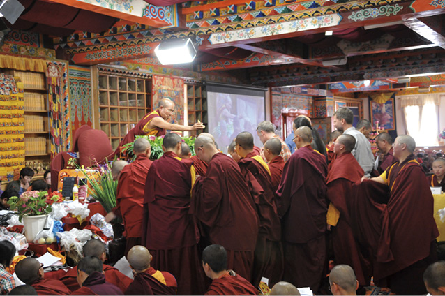
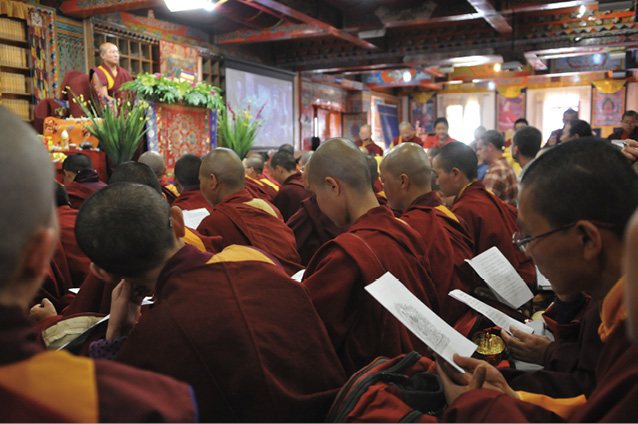

全球直播

1

莲师并非只是一个铜像，

而是自性的光明。

## 依莲师像加持法

2013年7月7日

今天是一个非常吉祥的日子。能通过网络、电视与不同国家、不同语言的人一起学习佛法，我非常欢喜。因为大家都对佛法感兴趣，所以我们交流的内容有两个。我先谈谈自己在学佛历程中的少许经验和体会，再跟大家分享一下莲花生大士非常殊胜的一个加持法。

莲花生大士叫“咕汝仁波切”——现在各个国家都这么称呼，“咕汝”是梵语，意思是上师，“仁波切”是藏语，意思也是上师。“咕汝仁波切”是梵语和藏语的组合。

为了表示一种缘起，今天现场有不同国家的语言翻译[^1]。之所以这样做，是希望佛教的真理有更多人知道。无论是东方国家的人，还是西方国家的人，我们的心都是相通的。大家希求的是什么？快乐。排斥的是什么？痛苦。也就是说，不管是现场的道友，还是网络和电视上的道友，大家都需要获得心灵的安宁与平和。只有得到心灵的安宁与平和，才能得到真正的幸福。

## 分享个人体验

### 1．以智慧摄持信仰

我从小就学习佛法，从中深深体会到：佛法确实能给心灵带来无比的快乐。不仅如此，佛教还能教会我们如何去体验生活、感悟人生。所以，无论你们在地球的哪一个角落，我都希望你们用正面的眼光进行观察：佛教到底在讲什么。

佛教分为南传佛教、北传佛教和藏传佛教。佛教的每一个分支和部派，以及世界上的每一个宗教，都有它独特的真善美。对每个人来讲，都很有必要信仰一个宗教，并用相应的智慧摄持自己的心。

尤其是藏传佛教，在如今这个世界，对人类的身心有着非常大的利益和帮助。昨天，我们这里来了一位西方的大学教授。他说：“20年前，一个殊胜的因缘，让我爱上了藏传佛教。从此以后，我再也没办法和它分开。”听了他的这句话，我觉得很有意思。

藏传佛教有着极为严密的逻辑体系，它在佛法传承中推行的辩论，值得全世界的人去学习。为什么呢？因为通过辩论而得到的真理，自己不会有任何怀疑，而且这样的辩论，能真正抉择到万法的真相。

我今年初去了美国和德国的几所大学，以前也去过别的一些国家。在这个过程中，我深深地感到，虽然现在全世界学习佛法和其他宗教的人相当多，但像藏传佛教的信徒那样，把闻思修行放在最根本、最重要的位置，以长期的激烈辩论和系统学习，来全面审视自己的宗教，还是比较罕见的。

每个宗教的信徒，对自己的宗教都有一定程度的信仰。但这种信仰如果没有契合宇宙人生的真理，很容易退失。所以我认为，所有宗教徒对自己的宗教都不但要有信仰，而且还要有智慧。一个人如果缺少了智慧，他的信仰会变成迷信。

### 2．以学习成就智慧

要成为真正有智慧的信仰者，必须经过长期的学习。整个佛教也好，藏传佛教也好，都是越学习，越懂得它的甚深意义，越能给生活带来大的帮助和利益。

我的老师法王晋美彭措，在30多年前创办喇荣五明佛学院的时候，提出的办学宗旨就是学习佛法、修行佛法、利益众生。这三个思想，是法王如意宝创办佛学院最主要的目标。正因为法王上师对佛教的教育、僧才的培养和佛法的传播非常重视，今天佛学院的法脉才能在世界各地都发挥一定的作用。

生存在这个世界上，不管是宗教徒，还是非宗教徒，学习和教育都是人生最有意义、最有价值的事情。今天，通过现场和网络的科技方便，我特别真诚地向各位提一点希望：不管你在东方，还是在西方，也不管你是佛教徒，还是非佛教徒，这一生都应该以学习来充实，在信仰中度过。

我们有些佛教徒，虽然对上师三宝很有信心，但却缺少系统的学习，这就很难通达佛教所讲的真理。而没有对真理的通达，暂时的信心很容易退失。

现在的社会风气很浮躁，很多人的内心躁动不安，倾向暴力，甚至比较疯狂。而学习是相对平静的一件事，也是比较艰难的一件事，跟如今很多人的心态有一定距离。事实上，这种群体狂乱的形象背后，有很多伤害身心、毁灭快乐的因素，所以，我特别希望在座的各位能长期希求正能量，获得身心的健康与快乐。

## 传授莲师修法

下面我简单地传授莲花生大士的一个修法。莲花生大士是众所周知的藏传佛教的主要奠基人。在国王赤松德赞时代，他把密法带入西藏，带入雪域高原，并让密法在这片土地上扎根、兴盛。他自己则是一位非常了不起的密宗成就者。

### 1．甚深的因缘，殊胜的法门

传授莲花生大士的法门，我自认为还是有点资格。很小的时候，我偶尔会看到莲花生大士的佛像。那时还在搞“文革”，公开信仰比较困难，我却经常渴望看到莲花生大士的佛像和唐卡。也许是那个时候结下的因缘，我对莲花生大士和其他本尊不同，有着特别大的信心。此外，可能还有前世的因缘和家庭的影响。在我的记忆中，父亲每年至少要念100万以上的莲师心咒。在这样的环境中成长，我的人生可以说是从祈祷莲花生大士开始的。

美国乔治敦大学[^2]的Bang教授说，20多年以来，他对莲花生大士一直有不共的信心。从刚开始得到这个法门，到后来去印度、尼泊尔、锡金、不丹等各国朝拜莲师圣地，并精进修持莲师法门，他的心有着非常大的转变。对此，我个人也深有同感。

今天给大家分享的莲师修法，经过我本人的“尝试”，确实非常好。好比我给大家推荐一种药，自己最好先吃，看看效果。如果自己都没有吃过，却给别人推荐，就成了不负责任的行为。对我本人而言，莲师法门具有殊胜的加持力，是自己终身修持的不变法门。在我的人生旅途中，每当遇到逆境，不开心，不顺利，甚至做了恶梦或者事情不成功，我都会真诚地祈祷莲花生大士和度母，而且总能感受到非常迅速的加持和力量。

对于这一点，也许有人有信心，有人没有信心。即使你没有信心，也无法否认藏地存在密法的事实。当年莲花生大士如果没有把印度的密法传到藏地，今天的藏地可能依然充满愚痴黑暗。依靠莲花生大士的发愿，藏地殊胜的密法如今传至地球的四面八方、五湖四海，全世界因学习密法而获得身心康宁的人可以说数不胜数。对此，稍微有点智慧的人都会明白。

莲花生大士的法门有非常深的，也有比较浅的。不管怎么样，凡是与莲师法门结上善缘的人都是非常有福报的。而且，莲师把这么殊胜的智慧和慈悲宝典留给人间，我们后学者应该特别感恩莲花生大士和历代的传承上师。

### 2．不可思议的伏藏

莲花生大士有25大弟子，其中一位叫做安楞·甲瓦确扬，他的第5次转世叫做多芒·多杰·德钦朗巴。今天我给大家传授的，就是德钦朗巴开取的一个伏藏。

莲花生大士的这个伏藏非常殊胜。今年我们去过的美国科罗拉多大学，有很多20多年来一直研究莲师伏藏的大学教授。在哈佛大学和哥伦比亚大学，也有很多教授一直在研究莲花生大士的伏藏。这让我特别随喜。

在座的大多数人，可能还不知道什么是伏藏。伏藏是一种非常神秘的事物，世界最顶尖的科学家也没法破解它的甚深奥秘。当年，莲花生大士把这些法藏在大海里，藏在虚空中，藏在岩石内，也藏在伏藏师的意海中，并授记在未来几百年、甚至几千年以后，由后代的有缘者开取出来，利益众生。对如今的西方科学界来讲，这是一种非常稀有的现象。

在欧美国家，很多大学教授和修行人非常关注莲师伏藏，有的专门研究伏藏品，有些专门修行伏藏法。比较而言，汉地研究伏藏的学者不算特别多，有些人即使进行了一些研究，也在坚持五六年或十几年后开始退失。

趁今天的机会，我表达一个特别的愿望：希望凡是对莲师有信心的人，都至少长期修一个伏藏法门；也希望有智慧的人，即生中好好研究伏藏法。我相信，你们对伏藏法越研究，会越生信心。因为，我就是这样的。

### 3．发愿终生修持

我前两天在想：“如果能活长一点，后半生我会好好学习莲师的伏藏法门，并且还要真正去实地修持，因为伏藏法真的太不可思议了。”

当然，现在的伏藏大师也有很多是假的，大家要注意。

今天传的这个伏藏法门，不同根基的人会有不同的收获。如果对莲师法门没有太大的信心，依靠这个莲师像不过是得个加持而已。如果对莲师法门有非常大的信心，那么，密宗的四级灌顶都可以圆满得到。对于这样的人，我希望你不要满足于听一个传承、得一个加持，而应该发愿终身修持。当你的人生遇到违缘时，祈祷莲花生大士绝对会有立竿见影的效果。

我说这些，没有任何目的，没有想过统治谁、控制谁或者推销什么。像推销产品一样，在你们面前打广告、做宣传的想法，我在梦中也不会有。只不过呢，在自己的佛法人生里，因为对莲师法门有不可改变的信心，得到了一些利益，所以想把这些经验与有缘的各位分享，如此而已。

莲花生大士的加持能不能入你的心，关键看你有没有信心。如果有上等的信心，会得到上等的加持；有下等的信心，得到下等的加持；如果没有一点信心，那什么加持都得不到。这是一种规律。

### 4．共同创造好缘起

大概在5年前，我开始在尼泊尔做莲花生大士像。后来做了1万尊，大约花了500万人民币。今年准备发放到世界各地，希望尽可能多的人获得莲师真正的加持。

在座的各位，为了保护自己的人生，为了修行顺利成就，为了身边所有生命都得到应有的帮助，也为了给末法时代增添一点真正的力量和智慧，今天我们一起来创造一个好的缘起。这相当重要。

什么样的缘起呢？今天所有听课的人，不管是现场的，还是网络上的——包括我自己在内，从今天开始，每天至少念100遍莲花生大士的心咒：“嗡啊吽 班匝儿格热巴玛色德吽”。我今天早上试了一下，以不慢不快的速度，3分钟之内一定可以念完。我们的人生有很多很多的“3分钟”，如果每天坚持，100天后每个人都将念满1万遍。

我昨天在网上也提了：凡是听课的人，都要在100天之内念1万遍莲师心咒；如果你是非佛教徒，不打算念，那建议你不要听；如果你不愿意念，又很想听，我也不排斥。不管是莲花生大士还是其他本尊，如果你想得到感应，首要的一件事就是虔诚地“追求”——“追求”的主要方法就是念他们的心咒。

这是我对大家的最低要求。在我们藏地，念1亿遍、3亿遍莲师心咒的人非常多。考虑到城市里的人非常忙碌，寺院里的人也要精进完成许多功课，所以只给大家布置了一道非常简单的“作业”。

### 5．有信心，莲师将亲临灌顶

接下来，我用莲师像来给大家——对信心大的人而言，叫灌顶；对信心中等的人而言，是加持；在没有信心的人眼里，是玩耍。不管是灌顶也好，加持也好，玩耍也好，希望大家都认真对待。现场安排了一些出家法师和个别具有特殊缘起的西方教授，为大家亲自做加持。下课以后，现场每个人都会得到莲师像的加持。

网络上的道友只要有信心，每一次观想都到位，莲花生大士像就不会只是一个铜像，而是自性的光明。当年莲花生大士在藏地灌顶的时候，全藏地连小虫以上的众生都得到了。现在有网络的方便，你们只要有信心，加上如理如法地观想，会和在莲师身边亲自接受灌顶加持完全一样。

另外，待会儿现场接加持的时候，如果有特殊的缘起和特殊的修证，出家人也可以在在家人面前得加持，大家要有信心。

下面我先用藏语念仪轨。汉文版和英文版的仪轨到时候会发给大家。这个仪轨本来是用来给别人灌顶和加持的，不过在以后的修行中，你们也可以用来给自己灌顶、加持，只需要把仪轨里的“你”改为“我”就可以了。

### 6．接受灌顶

（堪布念藏文仪轨）

先在空性的法界中，观想莲花生大士。再观想莲花生大士的额头“嗡”字发出白色的光，融入自己的身体，遣除无始以来自己身体所造的一切罪业，从此可以修莲花生大士为主的一切本尊，并种下将来获得化身的种子。

（堪布念藏文仪轨）

现在观想莲花生大士的喉间“啊”字发出红色的光，融入自己的喉间，遣除了自己语言的障碍，获得了秘密灌顶，将来可以念诵一切咒语，并在自相续种下获得报身的种子。

（堪布念藏文仪轨）

现在观想莲花生大士的心间“吽”字发出蓝色的光，融入自己的心间，遣除了自己意识的障碍，获得了智慧的灌顶，将来可以修持密法方面的一切禅定，自相续播下将来获得法身的种子。

（堪布念藏文仪轨）

然后观想莲花生大士的脐间“舍”字发出黄色的光芒，融入自己的脐间，遣除三门的障碍，获得了句义灌顶，将来可以修持大圆满，自相续种下了将来获得本性身的种子。

这个法很深啊，没想到那么深……今天太公开了？我刚才说要根据自己的信心，不过这个法太深了，没信心的人也肯定得加持。没事吧，护法神会开许的，等一会儿供个护法。

（堪布念藏文仪轨）

现在，不管是网络上的道友，还是在现场的道友，大家观想莲花生大士的四处，也就是从额头、喉间、心间和脐间，同时发出白、红、蓝、黄四种颜色的光，分别融入自己的额头、喉间、心间和脐间，再观想莲花生大士的身口意和自己的身口意变成无二无别，最后在这样的境界中稍许安住。

灌顶已经圆满了。以后你们要经常修，经常观想莲花生大士的身口意发光融入自己，得到莲师赐予的四灌顶，获得莲花生大士身口意所有的加持。有信心的话，应该把日常生活中看到的色法全部观想为莲师身体的游舞，听到的声音全都观为莲师的心咒或者空性的自声，自己所起的任何分别念都观为莲师的智慧。在莲师的身相、莲师的语言和莲师的无分别智慧当中生活，自然而然会获得不可思议的加持。

现在，我们需要供一下护法神。因为没有特意安排，所以没有供品，大家观想把世界上具足色声香味的所有欲妙，全部供养护法神。下面，简单念两三分钟的护法仪轨，再做结尾和回向。

（堪布带领大家供护法）

莲花生大士法门的开示已经圆满了。不管什么身份，你们牺牲了自己最宝贵的时间来聆听，非常感谢。以此缘起，希望今天所有与莲师结上善缘的人都身心康宁，吉祥如意，也愿世界和平，众生安乐！

[^1]: 此次开示的现场翻译有英语、法语、泰语、日语、韩语等多国语言。
[^2]: 乔治敦大学（Georgetown University），创建于1789年，美国最古老的大学之一，世界一流的私立精英学府，以社会科学见长，拥有出色的声誉，位列2019福布斯美国大学排行榜第15名。
