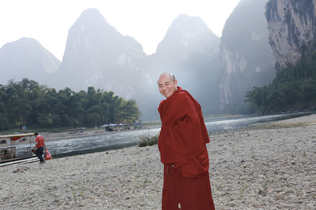
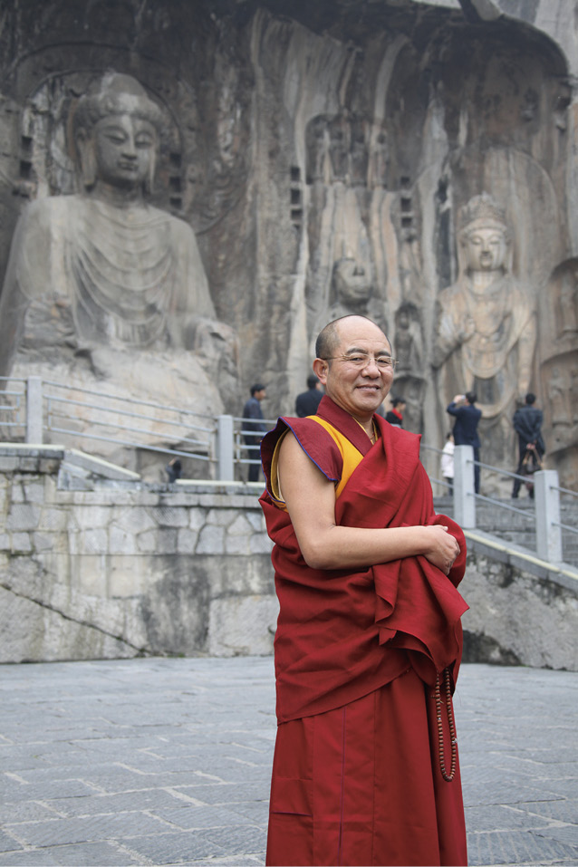

全球直播

5

动物跟我们人类一样，

有种种恐惧的情绪，

知道寒冷与饥渴，能感受开心和不开心。

## 动物，我们的朋友

2015年4月4日

有这么多人对“动物是我们的朋友”“动物和人类互相依存”的道理感兴趣，能和这么多人一起分享这个话题，我今天真的很高兴。

在座很多人可能认为，除了非常可爱的宠物以外，其它动物并不是我们的朋友。不少人还认为，动物是我们享用的食物，是供人类驱使的一种工具。除此之外，动物在我们生活中，很难再扮演别的什么角色。

所以，我今天在这里说“动物是我们的朋友”，会有很多人难以接受。“动物不是朋友，而是食物”，好像已成了人类坚不可摧的观念和习惯。而事实上，从生命平等的角度看，所有动物的生命跟人类的生命完全一样，凭什么要成为我们的食物？为什么不可以成为我们的朋友？

## 动物，不是天生的食物

这样的观点，实际上有很多理论支撑。我想，东西方的善良人士们，今晚可能都需要扪心自问一下：动物与人类之间，到底是什么关系？

中国有句古话：“蝼蚁尚且贪生。”意思是说，即便像蝼蛄和蚂蚁那么卑微弱小的生灵，也希望自由自在地活在这个世界上，不愿意死去。这说明什么？说明生命对每一个动物而言，都是极其宝贵的，谁都害怕失去。

而且，不管什么样的动物，都有苦乐的感受。它们被宰杀时的痛苦，跟人类遭受屠杀时一模一样。现在有一种说法，为了减少动物死亡的痛苦，应该尽量用先进的工具或方式来宰杀。其实，不管用什么样的工具，以什么样的方法，动物被杀时身心分解的过程都是极其痛苦的。关于这一点，很多人可能从来没有想过。而大量的广告或宣传，都有意无意地隐瞒了动物被残杀的悲惨事实。

人类到底该不该为了自己的口腹之欲而宰杀动物呢？关于这个问题，美国有一个非常著名的劳动联盟的主席，叫做查维斯先生（Cesar Chavez）[^1]，他曾专门进行过这方面的研究。他说，他本人之所以会变成一个素食主义者，是因为他通过研究，发现这些动物跟我们人类一样，有种种恐惧的情绪，知道寒冷与饥渴，能感受开心和不开心。由此，他深深地体会到人类的素食主义与动物王国之间的密切关系。他曾养过一只小狗，通过和小狗的共同生活，深深感动于小狗的智商和情商，并开始质疑人类到底该不该宰杀动物，到底该不该食用动物。

今天在座的所有人，可能都需要深思他的这番话。我认为，他这段话包含了三层意思。第一层意思，我们人类跟动物在感受上是平等的。动物害怕寒冷，害怕饥渴，害怕不开心，我们人类也是如此。动物和人类的很多感受都是相同的，所以应该平等。第二层意思，人类的素食主义跟动物王国有着密切的联系。如果世界上吃肉的人越来越少，动物世界的快乐就会越来越多。第三层意思，人类到底有没有权利吃动物？虽然人类有能力践踏动物的生命，因为他们的生命比动物高级，但这是否就意味着我们有权利吃它们呢？如果是，那么人类中也有一些身份低贱的人，是不是也应该让另一些身份高贵的人来食用呢？

他最后的深思和质疑，不应该只属于他一个人，我们都应该好好反省一下：我们一直认为该吃、该杀的动物，是不是真的该被我们吃、被我们杀？这种行为到底合理还是不合理？

关于这个问题，我在这里不作明确判断，不过，我希望每一个人都认真思考。如果你真的能拿出充分的理由来，当然可以无所顾忌地食用动物，相反，如果理由不具足，那你是不是应该再三地考虑？

## 萧伯纳：我不吃自己的朋友

著名的戏剧作家萧伯纳曾经说过：“动物是我们的朋友，我不吃自己的朋友。”这句话不仅仅引起了我本人的共鸣，也非常契合大乘佛教的经典意义，社会各界的很多著名人士也曾经思考过。

在大乘佛教的教义里，众生平等不是一个抽象的理论，而是我们要从内心真诚地认识到，动物在很多方面都跟我们人类一样，的的确确是我们的朋友，是我们的亲人。这一点，从大乘行人的实际修行和行为中可以看出来。

佛教有一部非常著名的经典叫《楞严经》。这部经里说：如果我们不吃动物的肉，不穿动物的皮，那将获得真正的解脱[^2]。这部经还讲：一个人故意去杀生，另一个人故意去吃肉，这两个人的罪过是同等的。我这里只是象征性引用一下，大乘佛教关于慈悲心和爱护动物方面的教义极为丰富，数不胜数。即使是从全世界的范围来看，这些教义都可以说是实实在在非常具有说服力的。

在座的人如果有兴趣，可以学习一些大乘论典，像《大乘经庄严论》《入菩萨行论》等。学习了这些论典，会进一步认识到，人类不仅和外在的器世界互相依存、彼此依赖，跟动物之间的依存关系也不可缺少。从某种意义上讲，后者更为重要。一个人对动物如果发自内心地怜悯和慈悲，自然而然会从心底引发这样的认识。

其实，人类并不是整个地球的主宰，也没有权利控制其他物种。根据进化论的观点，从时间上看，地球上最早存在的生命，是动物——动物才是地球的第一个主人。在它们的足迹踏遍世界很久之后，人类才开始逐渐形成。

所以，我们身边的每一个动物，都值得去保护，去关心。我16岁才开始读小学，16岁之前一直在山上放牛放羊，整天在蓝天白云下跟牛羊一起生活。牦牛生病的时候，我很伤心；牦牛死去的时候，我更伤心；牦牛开心的时候，我也跟着开心。看到牦牛吃草吃得很香，有时我也觉得肚子饿，便学着牦牛去吃草。可是，牦牛吃草吃得那么开心，我自己却怎么也吞不下……

上学之前，我一直过着这样的生活，天天和牦牛们在一起，形影不离。在我的心里，牛群就是家人，很亲很亲。一旦它们被别人宰杀了，或者被凶猛的动物吃掉了，我因伤心而流下的眼泪，总是很多很多。

## 叔本华：杀害动物的，都是坏人

现在城市里的很多人，可能没有机会看到动物在大自然自由自在生活的场景，所以认为动物的肉跟蔬菜没有什么差别。而养殖场里的动物特别多，好像真的跟农场种的蔬菜一样。我去新西兰的时候，有人告诉我，整个新西兰有一万三千0多个养殖场，每个养殖场至少养有几千、几万头牛。这些牛的命运，都是被送到屠宰场，分成一块一块，最后成为人类餐桌上的食物。

在这个世界上，每天都有数不清的宰杀因人类而发生。我们的行为真的很恐怖，我们每个人是不是都在扮演恐怖分子？我真的很怀疑，也许这就是事实。

在批发市场、商店、超市等出售食物的柜台上，摆放的大多是肉食品。不管东方还是西方，任何一个国家的任何一个小餐厅里，都发生着宰杀动物的惨剧。人类和动物共同生存在这个世界，而人类每天宰杀动物的数量却不计其数。无论走到哪里，似乎都可以看到动物们被宰杀的血迹和泪痕，可以听到它们痛苦的哀嚎和呼救……

我始终认为，掠杀动物的人不是好人，是真正的坏人。我个人的力量很小，说这样的话会令很多杀动物的人不高兴。但实际上，这句话出自著名的哲学家叔本华之口。叔本华说：“杀动物的人，都是坏人。”为了短暂的食欲，为了区区一口饭，人们断了多少众生极为珍贵的生命？吃肉，从某种意义上讲，就是吃众生的生命。

## 你吃的每一块肉，都曾被血淋淋地割下

如果你亲眼看到众生被杀的血腥场面，可能没有多少人会选择吃肉。大概七八年前，我去青海放生。由于因缘和合，进到了一家动物屠宰厂。本来不让进的，但最终还是进了，而且拍下了屠杀现场的一些镜头。后来，我把这个视频做成一部纪录片，叫《慈悲之旅》。听说很多人看了以后，再也不想吃肉。

我们当时看到，屠宰厂在杀牦牛的时候，用刀把它们的头活生生砍断，非常残忍，非常恐怖。过后很长时间，这样的场面一直都在我眼前浮现，不要说吃肉，就连其他食物也很难吞下去。晚上睡觉的时候，经常一闭上眼睛，就浮现出血腥悲惨的屠杀场面，就像令人恐惧的战场一样。有时候，换一个角度切入事情的内幕，会有触目惊心的效果。

现在的情况是，很多人看不到动物在屠宰场是怎么被杀死的。当它们出现在我们面前的时候，已经是被加工好的样子。在我们厨房里，不管是牛肉也好，羊肉也好，或是其它动物的肉，如果当着我们的面从动物身上一块一块、血淋淋地割下来，可能很多人都不敢吃。

## 所有的生命，都美得像梅花

对动物的关心，我并非最近一段时间才开始，而是多年以来一直如此。15年前我写过一本书，叫做《悲惨世界》，里面讲了很多宰杀动物的悲惨故事。我当时采访了国内的很多人，也引用了一些国外人的观点。人类伤害动物的手段是各种各样的，但都非常残忍。所以我当时想，就取名为《悲惨世界》吧。在这个世界上，吃动物的人太多了；因为人类的欲望，动物付出的生命太多了！

后来才知道，《悲惨世界》是以前雨果一本书的名字。不过我取这个名字，不是因为看过他的书。在出版的过程中，有些人说不能叫《悲惨世界》，我们现在的世界多么美好幸福，最好改为《善待生命》。尽管如此，这部书稿后来还是被翻译成了很多国家的文字。

在这本书里，我讲道：动物应该是人类的朋友，但我们为什么要肆无忌惮地摧毁它们的生命？动物的生命原本像美丽的花，如果让这些生命自由地呈现，将会多么灿烂。可是，人类却没有意识到这些生命的价值，只将它们视为自己的美食。

刚才我讲了，众生被杀的场面非常残忍，而工业革命之后，很多人对此却不一定清楚。我们每次得到的食物，宣传得非常到位，外面包装得很好，里面搭配着各种各样的美味。面对这些琳琅满目的美食，城市里的人很难想象，它的背后竟然有如此悲惨的代价。

## 猫与人的相互救赎

如果我们改变观念，把动物当作自己真正的朋友，它们给我们带来的快乐，会跟来自人类朋友的一样。现在，西方和东方都有一部分人爱养宠物，把宠物当成自己的家人，非常爱它们。这些宠物也用自己的行为，给主人带来了幸福感、安全感，化解了主人生活中的孤独、无助和挫败等消极情绪。

在座的很多人可能看过一本书[^3]，以前我也看过。书里描述了一个叫鲍恩的流浪汉，他从小被父母遗弃，长大后没有工作，没有家庭，没有爱情，没有正常的生活。他染上了毒瘾，开始吸毒，最后越陷越深，被社会彻底遗弃。

他内心极度痛苦、精神即将崩溃。这时，他在街头遇到了一只受伤的流浪猫。一个心灵受伤的人，遇到了一只身体受伤的猫，两个生命开始互相依偎。渐渐地，他的心灵创伤恢复了，过上了正常的生活；动物的伤口也恢复了，变得健康活泼。后来，鲍恩在世界上成了非常著名的一个人，猫也因此出名，获得了很多世界性的动物奖。

在某种意义上，我们每个人身边都可以找到这样一只可爱的“猫”。我经常在想：与人类相比，动物只不过比较愚笨而已。除此之外，它们还拥有很多灵感和觉受，这方面和人类完全相同。遗憾的是，关于这些问题，世界上大多数人从来没有想过。这也是我们人类的——不敢说愚痴，算是不足之处吧。

总而言之，我希望每个人内心都有一种爱，它不只是针对人类，而是遍于所有的生命。人类有了这样的爱，世界会变得更美好。

## 请，尊重所有的生命

今天，我要给大家布置一两个作业：凡是听我课的人，如果尊重我、尊重生命的话，希望你在2015年这一年，至少救一个生命——放生一条生命以上，这是第一个作业。第二个作业，2015年至少要吃一天的素。第三个作业，今天正好有月食，是一个特殊的日子。在喇荣沟，在佛学院，出家人都在共修观音法门。希望你们每个人在24小时之内念108遍“南无观世音菩萨”或者“嗡玛呢巴美吽”。

记住啊，是三项作业：至少放生一条以上，多则十万、百万、千万都可以；至少吃素一天，多则365天，更长的时间也可以；至少念观音心咒108遍，多则1080遍、10800遍。

特别希望，我们每个人都能善待所有的生命，就像善待自己的生命一样。大家仔细观察后会知道，所有众生的生命，都是那么美丽，那么珍贵。我们应该学会尊重每一个生命，这才是人类最高的庄严。

[^1]: 凯萨·查维斯（1927年-1993年），美国首个成功的农场工人联盟组织者，以领导农场工人争取个人权利而闻名。去世后一年，克林顿授予他总统自由勋章——美国最高市民荣誉。
[^2]: 《楞严经》云：“清净比丘。及诸菩萨。于歧路行。不踏生草。况以手拔。云何大悲。取诸众生血肉充食。若诸比丘。不服东方丝绵绢帛。及是此土靴覆裘毳。乳酪醍醐。如是比丘。于世真脱。酬还宿债。不游三界。”
[^3]: 即《流浪猫鲍勃》，作者詹姆斯·鲍恩，根据自己和猫的真实故事创作而成。之后又陆续出版了《鲍勃的世界》《鲍勃的礼物》，被翻译成40多种语言，畅销800万册。
