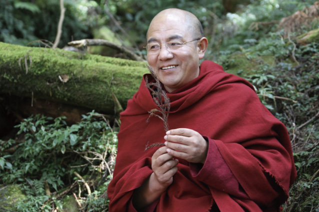

全球直播

9

各种灾难，各种痛苦，

对具有无我境界的人来讲，都是一种游戏。

## 四法印

——超越现象的真理

2015年12月6日

今天是2015年12月6日。这一年即将结束，下一年即将开始。在这个比较殊胜的日子，很高兴在智悲弘法大学的世界里，和大家见面并共同学习。

这段时间，在座的各位可以总结过去的一年，也可以展望未来的一年。在新的生命时段，你有什么愿望？现在可以做好各种准备。

## 世界充满痛苦，让我们彼此珍惜

即将过去的这一年，我们生命的每一天都在不断地变化。有微小的变化，也有巨大的变化；有好的变化，也有不好的变化。

好的方面，很多人获得了不同的财富、地位、名声以及自己需要和向往的各种东西。不太好的方面呢，有些人失去了很多东西，包括财富、生命、故乡等，从中感受了巨大的痛苦和沮丧。

从全球的状况来看，失去财富的，比如今年出现了前所未有的股市暴跌，很多人因此倾家荡产。失去生命的，像缅甸的山体滑坡夺走了很多人的生命，尼泊尔地震死了许多人，还有德国和俄罗斯的客机失事，世界各个地方发生的交通事故，以及大大小小的战争……

我们生存在这个世界上，需要有自己的国家和故土。然而，现在的叙利亚，有成千上万的人因为战争失去了自己的故土，好几万人流离失所，无家可归，被遣往别的国家当难民。如果站在他们的角度——失去生命的人及其家属、战争难民以及正在战斗的苦难者，我们会感受到这个世界种种复杂的痛苦因素。

我们这里今天比较冷，应该有零下10多度。虽然处在寒冷的藏地高原，我们心里却很温暖，因为我们的心有所归属。活在这个世界上，我们要珍惜自己的生命，同时也要珍惜别人的生命，多多地帮助他人，以及所有的众生。其中，最重要的是保护众生的生命——放生。

最近，我们也在提倡吃素。为什么要吃素？因为吃肉有很大过失。释迦牟尼佛在不同的经典中讲过，杀生者和吃肉者的过患完全相等：杀生者因为贪图金钱而杀，吃肉者因为贪图众生的身体而吃。

从健康学的角度来看，吃素的人可以长寿，而且心情舒畅快乐，高血压、高血脂等许多疾病不会产生。在保护环境和爱护生命方面，素食主义也非常有意义。我多年以来一直吃素，今年以各种因缘更坚定了这个信念，发愿终生吃素。希望大家也能这样发愿：终生不吃众生的血肉。不管从健康学、生命学、宗教学等各方面来讲，终身吃素对我们个人是非常有利的。

## 四法印：相对真理与绝对真理

接下来，给大家简单讲一下“四法印：超越现象的真理”。这是释迦牟尼佛在2500多年前给我们留下来的珍贵教言。不管有没有信仰，只要懂得了四法印的真理，你的生活、工作和家庭，一定会有非常大的收获。

所谓的四法印，就是“诸行无常，有漏皆苦，诸法无我，涅槃寂静”四句哲理。这短短四句话，含摄了所有的佛法，也可以包含所有的世间正理。“诸行无常，有漏皆苦”讲的是相对真理，而“诸法无我，涅槃寂静”说的则是绝对真理。

在座的很多人，不管过着怎样的生活，都一定经历过各种苦乐和无常。很多年前，佛陀就用他的智慧，为我们揭示了生活和生命的真相。学习这些珍贵的教言，我们可以更好认识生命的苦乐和无常。

### 1．诸行无常：世间没有永恒

什么是“诸行无常”？世间所有的事物，包括我们所依存的地球、地球上居住的人类以及我们渴望拥有的地位、财富、相貌、感情等，都是无常的。

这个道理说起来比较简单，生活中也每时每刻都在发生，但很多人却因为不懂，发现不了它的真正价值。很多有地位的人，突然之间失去了自己的地位——家庭的地位、工作的地位以及经过苦寻得到的其他地位，因为不懂无常，短时间内无法面对，非常伤心。

有些人年轻的时候青春美满，相貌端严，但经过几十年的岁月变迁，变得越来越丑陋，连自己都不想看，这时不免伤心失落。人与人之间的感情也是这样。两个人原本非常相爱，亲密无间，但也许过一段时间，就变得没有感觉了，甚至互相仇恨，再也不想见对方的面、听对方的声音。这也是无常的一种体现。

由于不懂得无常，当生活发生变故，人们无法接受，甚至因此而选择自杀。即便没有自杀，也流下很多很多泪水。这些眼泪如果全部收集起来，放在盆里，可以洗脸，可以刷牙——生活用水靠泪水就可以解决了。我们泪水其实很值钱的，不要轻易流出来。

如果真正了解无常的本质，生活中的任何变化都未尝不是一件好事。也许依靠这个变化，我们的生活会有新的开端。人生的路有很多很多，这一条走不通，还可以选择另一条。失恋时，不懂无常的人会伤心，懂得无常的人认为没必要伤心。因为无常，和这个人没有机会了，也许留出了空间，与更好的人机遇，从而选择更好的人生。

懂得无常对生活很有帮助。成功者如果懂得无常，不会傲慢。他知道，一切都只是暂时的，人人羡慕的成功不会长久，到一定时候肯定会衰败。因此，即便处于高位，也不会看不起别人——无常给了他谦虚的心灵修养。失败者如果懂得无常，不会沮丧。他知道，生活中遇到的逆境或者失败，只能暂时让自己处于糟糕低落的状态，这一切总会过去，一定还有重新开始的机会。

懂得无常对修行也很有意义。在我的身边，无论是出家人还是在家人，不管发生什么变化，我听到最多的还是他们的笑声。他们知道无常是一种自然规律，没有什么永恒不变的成功，也没有什么面对不了的失败。所以，不管怎么样，他们都一如既往地开心。同时，我身边也有一些不懂得无常的人。当他们遭遇亲人离世或事业失败等人生变故时，经常痛哭——我听到最多的，是他们的哭声。

总而言之，如果懂得无常，发生任何事都是正常的，都可以接受。明白这个道理，对我们的生活和修行有非常重要的意义。

### 2．有漏皆苦：人生没有真正的乐

“有漏皆苦”，有漏是佛教的专业术语。根据佛教《毗婆沙论》的观点，所谓的有漏是指有情，漏指烦恼。依靠这个“漏”，众生一直流转于欲界、色界和无色界三界中，不能获得解脱。也就是说，依靠贪心、嗔心和痴心等烦恼产生的世间万法，都是痛苦的自性——烦恼的本性即是痛苦。

有些人认为，佛教说“有漏皆苦”是一种悲观的态度，生活中明明有很多快乐，这种消极的说法实际上是在逃避人生。

然而，事实并不是这样。因为，苦就是人生的真相。

人生苦多乐少，并不是佛教的独特观点。世界上的每一个人，观察或总结自己的一生，对苦的感受应该都是很强烈的。人这一生，除了生老病死，还有许多必须经历的痛苦。其中最主要的是苦苦、变苦和行苦。这三种苦，也许我们每天都在感受。

当我们心情不佳、身体不好或者亲人死去，偏偏又遇工作不顺、遭人诽谤，一个苦还没有消除，另一个苦又接踵而至，这就叫“苦苦”，苦加上苦。很多时候，我们的生活被好几层苦压制，缠绕，喘不过气。不管东方人还是西方人，都可能同时感受多重的痛苦和压力。

所谓的“变苦”，是指我们现在虽然感觉不到痛苦——相反，正在感受快乐，但这种快乐可能很快就会消失。那时，原来的快乐马上变成了痛苦。这就是变苦。

我最近看到美国一位心理学家讲的故事。有个得抑郁症的女人，多年来身体一直不好，心情也不好，最后得了抑郁症——这个疾病伴随了她20多年。当她发现丈夫有了外遇时，更加痛苦。不久，她去买彩票，中了200多万美金。原本苦上加苦的悲惨人生，因为彩票中奖而顿然改变，变得特别开心。她给自己买了一栋很好的别墅，将两个孩子送进昂贵的私立学校，过上了快乐的生活。可是，过了一段时间，她的抑郁症又复发了……这个案例中，有苦苦，也有变苦。

还有一种苦，叫“行苦”。所谓的行苦，有两种意思。一种是，我们今天享受的生活、感受的快乐，背后都有许许多多看不到的痛苦。譬如，一个人在享受美餐——吃肉，却不知道这个肉的背后，有众生痛苦的挣扎和失去的生命。这是一种行苦。另一种情况是，我们今天吃肉吃得很开心，但从医学角度讲，不管什么肉，鱼类也好，鸟类也好，其他众生的肉也好，都很容易引起癌症。为什么现在有那么多人因为癌症而死亡？医学界观察和研究的结果是：跟吃肉有非常密切的关系。

懂得有漏皆苦的道理，对我们的生活而言，也非常有意义。我们每天都在向往快乐，向往永恒的幸福，可最终得到的却不是快乐，而是各种各样的痛苦。如果我们知道“有漏皆苦”的事实，知道世界上的痛苦多得数不过来，随时都可能被方方面面的痛苦所缠绕，那么，即使遇到了痛苦，也会有相应的智慧，找到解决问题的方法。

我们住在高原的人，知道高原非常寒冷，即便遭受寒冷之苦，也觉得很自然，很正常。相反，如果一个人住在高原，却不知道高原寒冷的事实，也许接触到一点点寒风，就觉得受不了。同样的道理，有漏皆苦原本就是人生的真相，每一个人都应该懂得。只有这样，才能从容面对生活的各种痛苦。

当然，所有痛苦的根源都在于对“我”的执著。如果懂得“我”的不存在，懂得“我”的空性，人间许许多多的痛苦、不幸和灾难，都可以迎刃而解。

### 3．诸法无我：物质与精神都不存在

每一个人都认为“我”是存在的。我在这里说“我”不存在，肯定会有很多人反对。但用智慧来观察，我们天天执著的这个“我”，可能真的找不到。

不仅所谓的“我”找不到，我们所看见的这个世界也是假象，也是不存在的。伦敦大学有位教授，经过多年的研究，写出了一本书，名叫《心智的构建——脑如何创造我们的精神世界》[^1]。这本书讲到，我们感知到的物质世界和独特思想，都不是真实的，大脑得到的所有信息都是幻觉——这个世界实际上并不是真实的。

这位教授认为，我们五官收到的外部世界的真相，经过大脑的不断筛选，会发生改变。因为眼睛、耳朵等感官接收的信息，会变成电子信号先传到大脑，再传递到各个神经元，神经元经过各种筛选之后传递给心识。心识所感知到的世界与真正的世界之间，已经发生了变化。这个变化的来源就是大脑，世界实际上是由大脑“创造”的。

这本书认为我们对外境的认识，是通过大脑所起的作用。虽然佛教不这么承许，但与他的观点也有相同之处，即大脑或心识所感知到的外部世界和内在自我，并不是真实的。我们按照大脑或心识的判断去执著、去追逐，最后得到的，与真正的本质会有很大差距。

比如，一个人在黄昏的时候，看见路上有一条毒蛇，心中充满恐惧。而另一个人看见的，却是一条由黑线和白线搓成的绳子。毒蛇其实并不存在，第一个人由于错误的认知，产生了恐惧。而当他知道真相的时候，便会离开恐惧和痛苦。世间人很难接受这样的无我道理，而一旦到达这种境界，会非常快乐，也会明白这是个道理其实很正常。

无我空性，是佛教独有的观点，也是全人类在精神领域追求的巅峰境界。自古以来，许许多多具有智慧的人，都用不同的语言赞美无我空性的境界。为了进入这样的至高殿堂，需要采取各种各样的方法。

在佛教的传统里，为了认识无我空性，有时会拿白水晶球给大家看，有时用澄净无垢的虚空来比喻，有时用广大无边的大海来比喻，有时甚至用非常特殊的一些绘画来指示，比如佛菩萨的忿怒相、慈悲相，等等。总之，以种种方法、种种比喻、种种表示，来认识空性，认识自我。

其实，这个世界已有特别多的人通过无我的修行，达到了无我的境界，证悟了无我的智慧。凭借自己的证悟，他可以饶益无边无际的众生。世间发生的自然灾害、宗教冲突、交通事故、疾病蔓延等，各种灾难，各种痛苦，对具有无我境界的人来讲，都是一种游戏。

最近我给大家讲的《大乘经庄严论》里说，证悟了无我空性的境界，一切显现都成了如梦如幻。即便处于六道轮回，也好像入于花园一样。人生中的种种兴盛和衰败，对他来讲都是无利无害。

我不管到哪个国家，看到街头熙熙攘攘的人流，都特别希望他们懂得内心世界的这些奥妙。

### 4．涅槃寂静：抵达修行的最高境界

四法印的最后一个，是涅槃寂静。这是我们通过修行，最后达到的最高境界，是一种没有痛苦的状态。这种状态，一般的世间人很难领悟。在不同的宗教中，有不同的说法。有些认为是天堂，有些认为是极乐世界，有些认为是更超越的境界。不管怎样，这是我们应该向往的目标。

以上我简单介绍了佛教的四法印。在佛陀宣说的所有佛法中，这是最甚深的精华，也是最重要的一部法。我们如果明白了四法印，对自己的人生会有很大帮助。

## 结语：依止真正的善知识

今天在线的人比较多，我按照佛教的传统，用藏语给大家念一些传承，包括祈愿和平与通达四法印的一些法。在我们佛教里，这叫种下善根，也叫“和大家结上善缘”。

（堪布念藏文传承）

最后还要给大家讲一件事：最近，藏传佛教的个别修行人，一些所谓的活佛，在世界范围内引起了一些话题，现在全世界都很关注。个别人的行为，不管是好的，还是不好的，都不能代表藏传佛教，更不能代表整个佛教。从个人角度讲，有些人有非常好的行为，有些人有非常不好的行为。这种现象，各个宗教都有，各个团体也有。现象不能代表本质。每一种现象背后，都有不同的复杂因缘，不能一概而论。

因此，愿意了解和亲近藏传佛教、依止善知识的人，希望你们不要看重外在的东西，比如上师的头衔有多大，眷属有多少，弟子有多少，法座有多高，他在Facebook上的粉丝多不多，讲课的场面隆不隆重，这些都不是很重要，跟他本人不一定有关系，都可以人为操作的。

我在这里要提醒大家，千万不要迷信。一定要观察这个上师的智慧，观察他的慈悲，甚至观察他的整个行为，了解他的一切。佛教里虽然有很好的教育，但我们必须依止具有资格的老师，才能得到真正的指点，法身慧命才能延续下去。

最后，我要特别感谢大家。今天是星期天，本来你们是可以休息的，但却放弃了休息，来和我们共同学习——这的确是个很好的机会。我特别感谢你们，但不知道你们有没有感谢我。不感谢的话，也没事吧。（众笑）

[^1]: 英国伦敦大学Chris Frith教授所著，2012年由华东师范大学出版社出版。
