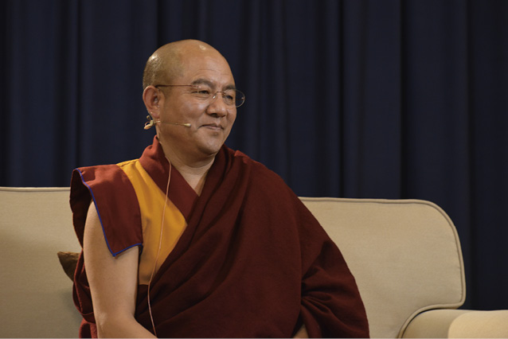
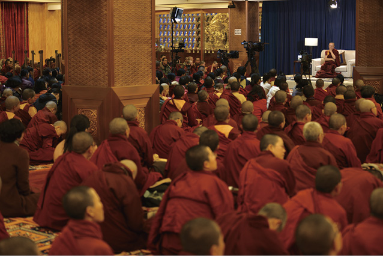
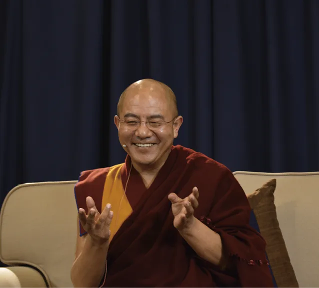
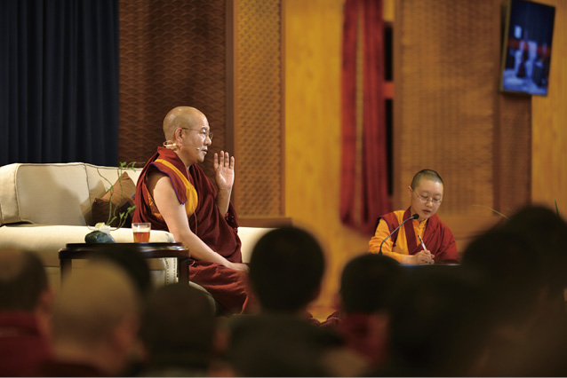

全球直播

11

所谓的成功，

不是有钱有势，

而是不被烦恼束缚，过得开心。

## 在平凡中成就不平凡

2016年10月9日

今天很高兴，在智悲弘法大学和大家进行双语交流。这是一个有助大家用英语学习佛法理论与修行的平台。当今时代，依靠以英语为主的其他民族和国家的语言来学习佛法，非常重要。

## 面向世界，多语种弘法

我特别建议年轻人通过汉语、藏语、英语、日语、阿拉伯语等不同的语言和文字，来了解甚深的佛教道理。因为，语言是文化的载体，每一种语言文字的后面都蕴藏着一个民族或国家的文化，每一种文化都传递着相应的知识和真理。

本来，佛教不需要用不同的文化和知识进行包装，因为它本身就是高度科学化的真理。但是，不同民族和国家的人了解佛法时，使用自己熟悉的语言和文字是最好不过的。

尤其是现在的21世纪，人类处于特殊的历史阶段，英语可以说是铺天盖地，覆盖了全球各个角落。这个时候，如果能用英语来学习优秀文化，传递佛教智慧与慈悲兼备的甚深内涵和真理之道，我相信，不同历史和文化背景的群体都会得到一定的利益。

现在的年轻人，很多都学过英语等不同的语言。你们掌握的语言，除了在生活和工作中加以应用，更重要的，还要用来传递文化和佛法。如果能够这样，一方面，你可以把学过的知识应用到实践中；另一方面，也可以报答曾经为你们付出过心血的很多老师的恩德。当然，通过英语等不同的语言文字来弘扬佛法，需要一定的基础，否则会有一定的难度。

各位都知道，如今这个社会快速发展，是追求高效率的时代，也是全球化、信息化的时代。每个人都愿意用最少的付出，换取最多的收益。很多消费者也想付出最少的钱，得到性价比最高的产品。这时候，我们也有必要去寻找一种智慧或者方便，来获得自己需要的东西。

现在人们对文化的追求也一样，喜欢用最简单、最便捷的方式来接受或传递自他需要的信息。正因为这样，所谓的“快餐文化”“碎片文化”，才会盛行于社会的各个角落。只要用手指轻轻地划一下手机或电脑的屏幕，瞬间便能获得需要的知识。现在人们的追求方式，和以往任何一个时代相比，都有很大的差别。

今天参与的大多数是佛教徒，而且精通双语，否则不一定来。当然，也有很多不懂双语、也没有信仰的。不管怎样，在快餐文化盛行的时代，修行也需要简单、殊胜和实用的窍诀，并且还要在最快的时间内得到。这是现在很多人的理念。

## 最实用的窍诀：三殊胜

今天讲的“三殊胜”，就是这样的窍诀。通过三殊胜的修行方法，能够帮大家实现“平凡中的不平凡”。所谓的三殊胜，就是发心殊胜、正行殊胜、结行殊胜。它并不是21世纪的新发现，而是几千年之前就已经存在了。这个发现和我们的生活息息相关，对我们的修行非常有用。

### 1．加行发心殊胜

从佛教的修行层面讲，开始任何一个修法前，都需要发大慈大悲的菩提心。这样的发心，不管做什么善事，都不可缺少。如果缺少了，即使花了很多时间，下了很多功夫，修行的实际效果也不会明显，起到的作用也不会很大，产生的意义也不会重要。所以，修行的时候，必须首先发殊胜的菩提心。

#### 1）三种动机

所谓的发心，不仅对佛教的修行很重要，在世间做任何一件事情，也是必不可少的——世间人常用的说法是“动机”。不管做什么事情，都会涉及动机，事先都要有相应的规划和筹谋，具足承办这件事情的意乐原动力。

从现代心理学的角度分析，动机有三种重要的因素。第一种叫激励，做任何一件事情，刚开始都需要鼓励自己，激发热情。第二种叫做毅力，无论遇到什么困难，都一定会加以克服，有一种坚定不移的意志。第三种因素叫专注，做事要一心一意、专心致志、孜孜不倦。

其实大乘佛教的菩提心也有这三种因素。首先，在修行之初，我们需要有鼓励自己趋入修行的决心；中间在修行的过程中，要有不怕任何困难的坚强意志；最后，修行不能三心二意，一定要专心致志。

发心或动机从本体上分，有三种差别：不善的发心、无记的发心和善妙的发心。首先，修行不能杂有不善的心念，如贪心、嗔心、痴心等。如果杂有这样的心念，修行不可能成功。在世间做任何一件事情也是这样，不能有非常严重的自私自利之心。如果自私自利的心太严重，会直接损害我们承办的事情，甚至招致失败。

不仅是修行上，我们的发心或动机如果有不善的意念，对个人和社会也必定会造成严重的危害。前一段时间日本发生的“毒点滴事件”就是如此。有些人表面上说是对社会负责，而实际上却并非如此[^1]。日本社会的老龄化非常严重，很多人80岁了还在上班。年轻人的生活压力很大，一些人便采取极端手段，在老年病人的点滴里加入毒药……据说在这起事件中，死了40多位老人[^2]。这件事引起了全球关注。在这起事件中，杀人者的动机肯定杂有不善。这样的心态用在修行上，也叫动机不善，被称为不善的修行。

第二个是无记的心态。无记心，没有主动的善或恶，是一种平庸的盲目状态。比如受周围的人影响，别人怎么做，我也跟着做。现在有些消费者就是这样，别人买什么东西，自己也跟着买，人云亦云。这也叫“羊群效应”，别人做什么我也跟着做什么，别人修行我也跟着修行。没有什么好的动机，也没什么不好的发心，反正跟着别人，随波逐流。这样的心态，虽然不一定给社会和个人造成危害，但却成办不了修行的成功。以世间眼光来看，这样的盲目心态也应该放弃。

第三个是善心，这当然是最好的动机。善心也有下、中、上三种分类。在佛教里，分别叫做下士道、中士道和上士道。

#### 2）三种发心

第一种是下士道，为了自己获得名声、健康、财富或其他暂时的利益而修行。在世间做任何事情，如果不顾国家、人民乃至整个人类的利益，一心只想着自己和家庭，这种心态不能称为高尚，是下等的。虽然有些西方人认为，考虑自己是最勇敢、最伟大的心态，但这只是从个人层面而言的，在社会和国家层面则不能这样。选国家总统时，谁也不会选一个自私自利、只想着自己的人来当总统。把这样的国家领导选出来，对国家和老百姓不一定有利。落实到修行上，最重要的是，修行不能只在意自己的荣华富贵等暂时利益，却不考虑其他众生的需要。

第二种是中士道，是为了自己从三界轮回中获得解脱而修行，也就是佛教里讲的声闻、缘觉。只为自己得到涅槃的境界，最终也是不究竟的。我最近讲的《妙法莲华经》里面，有一个典型的例子。舍利弗原来学的是大乘佛教，后来退失信心转学小乘，最终还是转回大乘道。这个故事非常精彩。

暂时来讲，通过修行自己可以得到永久的解脱，但这种永久的解脱却并不是真正的圆满——还需要想到和自己一样的众生。一个世间人在有生之年，只想把自己的事业全都做好，算不上高尚的目标。所以中士道的修行，在大乘行者看来，也不值得提倡。

第三种是上士道，也就是发菩提心，利益一切众生。这样的发心是最高尚的，也是最重要的，我们大家都应该选择。在座的很多人应该学过大乘佛教。大乘佛教的利他心含摄了一切善事，包括放生、讲经说法、念经、修行、朝拜神山等。我们做任何一件善事，前面都应该有这样的发心：“我要利益天下无边的众生！”这个发心看起来简单，却是最有意义、最有影响力的一种心态。

现代心理学认为，对生活影响最大的两种心态是希望和恐惧。不管做什么事，只要有希望，不绝望，就很容易成办。即使有一些负面的阻碍，比如身体不好、家庭变故等，但只要对生活充满希望，负面的东西同样可以带来正面的影响。

而在利他心的作用下，我们的心会一直充满希望，并逐渐变得开阔、广大，最后令负面情绪全部消除。所以说，从世间的心理学角度分析，菩提心有非常大的正面力量，对我们每个人而言，就像妙药一般。

相反，如果心中充满绝望或者恐惧，本来可以成办的事情，因为自己的态度过于消极，心的力量会慢慢萎缩，最后反而不能成功。生活中，健康等在有效范围内可以成办的事情，都可能因为我们的绝望和恐怕，最后走向反面。从心理科学的层面观察，拥有自信，愿意帮助别人，必定会给自己和他人带来双重的利益。

#### 3）为别人花钱，最快乐

佛经里讲，如果去利益众生，自己会获得喜乐。这个观点现在已经得到很多学者的论证。哈佛商学院的迈克尔·诺顿教授和哥伦比亚大学的伊丽莎白·德恩教授，经过多年研究，合写了一本书：《花钱带来的幸福感》。这本书现在已有中文译本[^3]。书中说，为别人花钱和消费，远远超过在自己身上花钱得到的快乐。因为，自己获得和使用的金钱再多，都含有很多痛苦成分，如果把这些钱用在其他人身上，让更多群体分享这些金钱带来的利益，自己感受到的快乐会更大，也更有意义。

作者在130多个国家进行了调研，最后得出了这样的结论：布施的确能带来快乐。当然，他们的研究只限于今世，布施带来的来世的快乐是测不出来的。不管怎样，利他心给生活带来的快乐，我们每个人都是可以享受的。

通过这样的发心，把心量不断扩大，很多人都可以做到。当然，普通人需要先扩大心量，再逐渐体现在行为上。拥有金钱和权力的实力派，做起来更直接一点。上个月，美国一位叫做扎克伯格的富翁，用自己30亿美金的资产建立了健康基金，希望为人类的健康提供医疗救助[^4]。他发愿在21世纪末让所有疾病都得到控制、预防或消失。因为这样的发心，他捐出自己的资产，过着非常普通、非常简单的生活。一心利他的人，在世间也大有人在。把这种理念用在修行上，就是大乘的菩提心。

大家要记住：以后做任何事情，都要有一种帮助别人的原动力。修行更需要这样，哪怕今天听一小时的课，也要想：“希望听这一个小时的课，对所有众生有利。”这就是所谓的发心殊胜。

### 2．正行无缘殊胜

所谓的正行无缘殊胜，按照佛教严格的解释方法，是指胜义中万法像虚空一样，远离一切边，远离一切相；在世俗中，则如梦如幻，若用智慧观察，则变成三轮体空。

什么是三轮体空？以布施为例，所谓的三轮，是指布施者、布施的对境乞丐、布施的财物。这三个法若缺少一个，布施都没办法完成。“体空”的意思是，这三个法只是在显现中存在，若用佛教的智慧进行观察，全都是空性、如梦如幻的，和梦中布施没有差别。以后我们布施时，不要刻意分别布施者、施物和受施者，而应以三轮体空的见解来摄持。没有学过佛法的人，会觉得这些内容比较难懂，所以今天不着重讲。如果想进一步了解，可以看《中观庄严论》《入中论》《大圆满心性休息》等论典。

这里讲的正行无缘殊胜，不一定是三轮体空，主要是一缘专注。比如今天听课的时候，不缘其他分别念，一心一意专注于课堂。身体按规定的坐式坐直，不要动来动去，低头做笔记是可以的。语言的专注，要停止一切言语，包括念诵，不能交头接耳说悄悄话。心的专注，指不昏沉，不打瞌睡，不掉举，不散乱。如果这一个小时的课身口意三门完全专注，叫做正行无缘。不仅是听课，做其他任何一件事情，中间都需要有非常专注的阶段。

“正行无缘”还有一层意思，即对人生的一切事情不去特别执著，全部观为如梦如幻。无论感情也好，生活也好，工作中遇到的种种不平等也好，所有没有安全感的心态，都只是一种显现，都没有真正的自性，很快就会过去的。

佛教总是跟大家说，不要执著，不要执著。不执著就是不缘，不去缘取它。没有执著的心，自然会生起快乐。在座各位因为生活和工作的压力，难免会有一些负面的情绪和浮躁的心态。其实，这些都可以用佛教如梦如幻和大悲空性的心态来调整，而且，这也是人生最快乐的事情。

现在世间流行一些热门词语，比如“经营”“管理”之类，倡导人们用智慧来经营生活，经营感情，经营商业，经营全部的人生。如果真正能用智慧来摄持人生的一切，我们最初的梦想肯定会圆满，不会半途而废的。

事实上，经营生活的确需要智慧。如果没有智慧，刚开始可能很好，却不一定善始善终。最近有一则全球性的新闻，说是好莱坞的一对电影明星，朱莉和皮特，因为离婚要分家产——有27亿人民币。刚开始他们发的“菩提心”可能很好，但中间的“正行无缘”修得不太好，最后的“回向”也就不是很成功[^5]。

作为一个世间人，刚开始的人生规划，中间的认真经营和操作，最后获得圆满的结局，这是一条重要的人生主线。所有的人生都有初期、中期和结局等不同的阶段，阶段与阶段之间如何链接和延续，是每个人都要考虑的问题。做慈善也一样，也要用智慧来摄持。

总之，正行需要智慧，前行需要大悲心，最后则需要智慧和大悲心双运。佛法的修行如此，世间的很多事也是如此。

### 3．结行回向殊胜

所谓的结行回向殊胜，就是将我们按照大乘教义行持的所有善根，包括刚开始的发心，中间正行的专注，等等，全部回向给众生。佛经里也讲：“一切诸善根，回向于众生。”回向的意愿是什么呢？让无边无际的众生全部获得圆满佛果。一个善根完成之后，通过念诵《普贤行愿品》或者其他仪轨，把善根回向给众生，这是最殊胜的方法。

如果没有及时回向，善根很容易被四种原因摧毁。一是嗔恨心，一刹那的嗔恨心会摧毁多生累劫积累的善根。二是炫耀心，自己做了怎样的善根，如何了不起，在别人面前四处炫耀。三是后悔心，后悔曾经做过的善法。四是颠倒回向，把善根回向外道，或只让众生得到暂时的利益，或希望某个众生倒霉、受苦等。以上四个都是善根的毁坏之因，因此在这类事情发生之前就要回向。回向以后，善根就不会被摧毁了。在佛教里，这是非常重要的一环。

有了如理如法的回向，哪怕只是听一堂课，放一次生，参一座禅，都能为自他积累无量的功德。总之，自己所做的一切善根，最后结束时都做一个圆满的回向，这是令修行获得成就的最快速的方便方法。

以上讲的就是三殊胜。三殊胜其实就是修行的三种方便法，它能让我们在平凡的日子里成就不平凡的人生。因为，一旦有了这三种方便方法，虽然没有花多少时间和精力，却能轻而易举获得最大的功德和最大的利益。我们的修行要圆满成功，特别需要注重这三个环节。

## 做成功的人，不被烦恼束缚

今天的听众中有很多修行人，我在这里再次强调：在以后的日子里，你们不管做什么善事、功德和修行，一定要以三殊胜来摄持。

就像我们在世间搞建筑一样，刚开始需要规划，中间需要修建，建成后为了延续寿命，还要不断地维护，这三个阶段都非常重要。做任何事情，初中后三个阶段都是不能离开的。对三殊胜这么重要的窍诀，大家没有引起足够重视的话，其他的善巧方便可能也很难用上。

最后，我再提一点希望：在座的各位，如果你是修行人，请按照接受过的教言，不断地修行，利益众生；如果你不是佛教徒，对生活不要特别执著，要学会开心，学会放下，学会做人——人际关系很重要，和任何人都要和睦相处。

不管怎样，我们要努力做一个成功的人。所谓的成功，不是有钱有势，而是不被烦恼束缚，过得很开心。这样的人生，才是真正成功的人生。

特别感谢智悲弘法大学所有的工作人员，也特别感谢东南西北的观众和听众——你们的时间很宝贵，但依然来到现场，在虚空云端跟我们见面。谢谢你们。接下来，我们一起回向善根……

[^1]: 7月26日，日本一位26岁的青年闯入神奈川县一家残疾人福利院，极其残忍地用刀刺死19人，刺伤26人。被抓的时候，他居然面露笑容，倍感光荣。他认为杀死这些无用的残障人士，是在给世界经济增添活力。
[^2]: 2016年9月，日本两名老年患者因“毒点滴”中毒死亡。其所在的横滨市大口医院4楼，2个月内共有48名老年病人死亡。据日本媒体分析，日本“少子高龄化”越来越严重，年轻人不仅就业压力大，还要承担赡养老人的重担。抛弃老人以减少负担，成了很多日本年轻人“不能言说的秘密”。
[^3]: 《花钱带来的幸福感》，2013年北京华章图文信息有限公司出版，作者是英国哥伦比亚大学心理学副教授伊丽莎白·邓恩（Elizabeth Dunn）和哈佛商学院营销学副教授迈克尔·诺顿（Michael Norton）。
[^4]: 2016年9月21日，Facebook的CEO马克·扎克伯格（Mark Zuckerberg）和妻子普莉希拉·陈（Priscilla Chan）宣布，在接下来的十年里他们将投资30亿美元资助科学家，希望可以找到治愈儿童所有疾病的方法。而大约1年以前，他们就已宣布成立一家名为“陈-扎克伯格倡议（Chan-Zuckerberg Initiative）”的慈善基金，并承诺一生中将捐出高达450亿美元的慈善资金。
[^5]: 朱莉和皮特曾是好莱坞最令人瞩目的一对情侣，他们的爱情长跑一直被奉为佳话。二人相知相守10年，共同育有6个孩子，却在结婚两年后分手。6个孩子归朱莉抚养，皮特只有探视权。据说离婚原因是他们“对孩子的教育问题存在不可调和的分歧”。
