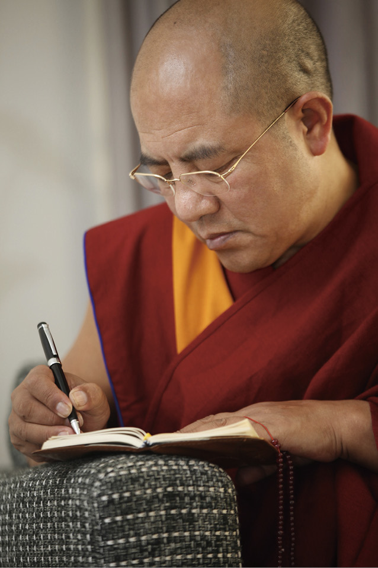
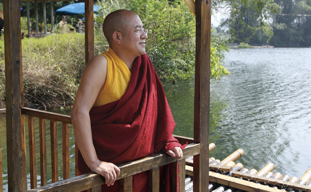

全球直播

10

我们活在一个虚拟的世界里，

做着无有自性的事情。

只是自己不知道而已。

## 在空性中绽放

2016年7月6日

今天跟大家分享的话题是《在空性中绽放》。我会围绕《心经》讲一下空性方面的意义。

## 这是一个无常的世界

### 1．气候难民与战争难民

现在的藏地雪域，正当夏季，满山盛开鲜花，雷雨阵阵，让人感到非常舒适和快乐。然而，在这个世界上，有些地方虽然环境优美，人们的生活也很快乐，但却不得不面对各种各样的天灾人祸。

最近，美国的弗吉尼亚州发生了特大洪灾，20多人死去。其中有一个叫戴安娜·桑德的女人，她37岁的丈夫被洪水吞没。昨天还好好地活着，今天就已经离开了人世。她说自己在梦里见到了丈夫——她很痛苦，无法面对现实。不仅是美国，最近中国正值雨季，也遭受了一些灾害。很多新闻都在报道，长江下游发生了水灾，很多人的住房被淹，生活面临种种困难，非常痛苦。

最近有一个数据，说是从2008年到现在，世界上出现的气候难民已有2亿之多。有专家预测，到2050年，世界上的气候难民会增加到10亿，占全人类总数的七分之一。再过30多年，会变成这样。

除了气候难民，还有战争难民。据统计，2015年全世界战争难民有6530万人。目前全世界有73.4亿人，意味着113人当中就有一个战争难民。这些难民，都是流离失所的，有些失去家园，有些失去国土，都需要庇护。6000多万人需要我们的庇护，基本上是现在人类数量的百分之一。

### 2．欧洲杯的尴尬

最近在法国马赛，英格兰足球队和俄罗斯足球队在比赛过程中，双方的球迷发生了冲突，造成了流血事件[^1]。现在，足球暴力已经演变成一种亚文化[^2]。比赛的时候双方球迷发生冲突，彼此进行攻击，本来是不文明的，但是因为每个人都要显示自己的身份——现在有个名词叫“身份认同”，正因为需要身份认同，我是这个队的，你是那个队的，所以必须为自己的球队而战。对于这次冲突的原因，俄罗斯总统普京也在思考。他说：200俄罗斯球迷怎么能暴打2000英国球迷？这本来应该是一场很好的友谊比赛……双方的斗殴是一件耻辱的事。

球迷冲突事件的不断出现，引起世界上很多人的关注。我从来没有踢过足球，看到人们的关注也觉得奇怪，为什么会这样？听说以前的很多大学生，如果学校不让看足球比赛，就要搞游行示威。之所以引起人们的关注，是因为球迷们的价值观，跟我们多数人的想法不太相同。他们所作所为体现的不是主流文化，而是一种亚文化，一种独特的价值观。当然，我们从佛教的某些角度，也许可以用另一种方式来解释。

### 3．英国脱欧

还有一件事情，最近大家都在关注，我也在分析。这就是英国脱欧。英国脱离欧盟这件事，震动了全世界。为了决定留欧还是脱欧，英国在国内搞了个公投，让全国的人都来投票。没想到，受这次英国公投的影响，短短的时间内，很多人的生活出现了巨大的变化。有些人以前特别富裕，公投后一下子就没钱了。

6月24日早上6点钟，投票结果出来，支持脱欧的投票超过半数。上午10点钟左右，英国卡梅伦首相请求辞职。整个英国社会陷入巨大的变化和各种不确性之中。

英国为什么要脱欧？很多老年人觉得加入欧盟40多年，没感觉到什么利益，继续待在欧盟不太合理，所以要求脱欧。而很多年轻人，因为跟很多欧洲联盟国之间，不管是做生意，还是做别的事情，都非常方便，所以投反对票。这次脱欧的投票支持率好像是51.89%。公投的结果，让英国最终决定从欧盟脱离。

我看过当时彭博亿万富翁指数的统计，说是全球亿万富豪榜上的富豪们，其财富总值在6月24日当天蒸发了990亿美元。光是李嘉诚的资产，这一天就缩水大概11亿美金，折合人民币73亿。

我有时候想，世间的万法真的太无常。李嘉诚在英国的总投资大概有520亿美元，约4034亿港元，占总投资的三分之一，几乎买下了大半个英国，但一天之内就缩水73亿人民币——这不是一个小数目。

佛教讲万法无常。的确是这样。昨天有的生命，今天已经离开了；昨天有的财富，今天已经没有了。刚才我说的富豪榜，只是财产1亿以上的，如果算上财产1亿以下的富豪，缩水的财产恐怕不可计数。

现在英国很多人要求重新投票，但是卡梅伦说：“不行，我们是民主国家。民主国家必须要民主投票，要发挥民主的作用。我不会再上台，你们也不要再投票。”从我们修行人的角度来看，这是一个很好玩的游戏。

不管英国脱欧也好，美国最近的总统选举也好，特朗普以及其他政要的观点，要么涉及地位和权利，要么涉及财富和资源，所以全世界的人都在关注。

## 什么是空性？什么不是空性？

不管怎么样，这个世间充满了烦恼、恐惧、焦虑以及不开心。按照寂天菩萨的观点，只要懂得了空性法门，世间所有的畏惧、恐怖、烦恼和痛苦才会消失。所以，我希望有更多人能用空性的智慧，去看待外部世界和自己身上发生的种种事情。

首先，我们要知道什么不是真正的空性。很多人认为，杯子里没有水，就是空性。暂时来讲，这可以叫做空性，佛教称之为单一的空性。而真正的空性，不是单一的“空”。无论“有的东西”，“无的东西”，还是所谓的“二俱”和“二非”[^3]，全部都是空性。《心经》中也说：“无智亦无得。”最究竟而言，没有真正的智慧，也没有所谓的“得到”和“没有得到”。这就是佛教所讲的真正空性的含义。

我去西方一些学校时发现，有些教授和老师把无常认作空性。他们认为，世间的花开花落、云卷云舒、生老病死、春夏秋冬等，这些瞬息变化的法都是空性。实际上是不是这样呢？我们可以说，细微的无常跟空性的关系的确比较密切，但是粗大的无常只是空性的一个妙理和现象。世俗中所有的这些变化，都不能称为真正的空性。

很多人认为自己已经证悟了空性，因为生活发生了变化之故。以前有钱、现在没有钱，以前年轻漂亮、现在特别难看——这就是空性。其实，这不叫空性，只能叫无常。无常跟空性是有差别的。佛教讲苦、空、无常、无我这四种法要时，对无常和无我，苦和空性，在反体上是明确区分的。

## 你感知到的世界，都是空性

要学习空性，首先对世界的认知要改变，要摘掉有色眼镜。因为用有色眼镜来看待世界，不一定看得到真相。我们的内心有很多偏见和假设，我们的眼耳鼻舌身等五根也靠不住——通过感官来取世界的真相，会有很多出入。世间人常说：“耳听为虚，眼见为实。”实际上，眼睛所见到的，也不一定就是真实。

### 1．佛教：眼耳鼻非量，舌身意亦非

我们总是很相信自己的感官。可实际上，眼耳鼻舌身这五根所获取的信息，往往是不正确、不真实的。《心经》也讲：无眼耳鼻舌身意，无色受想行识。其中，意的对境——法，也是不存在的。也就是说，包括六根六境在内的一切万法，如果寻找它们的本体，全都得不到，都是空性的。这种得不到，并不是名称上说说而已，而是用智慧观察后，色声香味触法的本体确实找不到。

在世间的名言当中，暂时可以认为六根得到的结论是正确的，这个佛教也承认。但是在究竟意义上进行观察时，六根的所得都是不正确的。《三摩地王经》有一个非常著名的教证：“眼耳鼻非量，舌身意亦非，若彼等为量，圣道复益谁？”意思是说，人们认为眼耳鼻舌身意是正确的，可它所获取的并不是万物的真相，所以不是正量。如果六根是正量的话，那圣道可以利益谁呢？

从这个层面讲，我们每天都在忙碌地生活，每个人都觉得自己听到的声音是真实的，看到的色法是真实的，接触的东西也是真实的，为了这些五欲六尘的享用或者生活，奔波追逐，疲惫不堪。可真正用细微的智慧去观察，会发现自己根本没有觉知事物的本来面目。

### 2．科学：一切都是组合的产物

感官和心识不可靠——这种无我的道理，不仅佛教这么讲，科学界也这样认为。美国有位非常著名的神经学家，叫做保罗·布洛克斯。他说：人们认为所谓的“我”，或者所谓的一个核心法，是甚深的，是拔不掉的，甚至是一直存在的，但从神经科学的层面来观察和衡量，所谓的核心运作根本不存在。化学中氢和氧原子的组合，虽然称为水，但是如果用智慧来观察，它只是化学元素的组合而已，并不存在真实的水。同样的道理，所谓的“我”也好——不过是五蕴的假合，所谓的杯子瓶子也好——不过是很多微尘的假合，从神经学角度讲，都没有一个真正的核心运作者。[^4]

### 3．哲学：你的手不一定是你的手

从哲学角度分析，我们对身体的认知同样没有真实的操控者。19世纪英国有一个著名的哲学家，叫做爱德华·摩尔[^5]，他有一个结论：“如果说这个世界上有什么确定无疑的，那就是，你的手就是你的手。”也就是说，19世纪的哲学家认为：我们的手确定是我们的手，自己对世界的感知和认识没有什么可怀疑的。

但到了20世纪和21世纪，很多科学家通过实验推翻了这个结论。他们让一个人把自己的真手放在桌子下面，一只假手放在桌子上面，然后用铁锤来砸。到最后，当铁锤砸在假手上时，放在桌子下面的真手会有感受和反应。这个时候，你的手不一定就是你的手。这个结论推翻了很多前辈哲学家的思想。

我们认为真实存在的很多东西，实际上都是不一定的。我们觉得某个东西很湿润，是因为用手触碰它，会得到这样的触受。但是，科学家们运用智慧分析后认为，人类感知到的湿润，实际上是由很多因缘组成的。哪些因缘呢？温度、质地、压力。当我们接触这个东西的时候，这几个因缘会综合起来，传递一种假信息：这个地方是湿的，那个地方是干的。真正用科学来观察，干湿其实是一种假象。和刚才讲的一样，眼耳鼻舌身所得到的结论，在人们平常的习惯和概念里，是根深蒂固的，是自己真正得到的，但实际上与事物的真相差得很远。

## 在空性中，绽放整个世界

刚才讲了，万法的本性是空性。但是在空性中，有一种显现，每个法都有显现。佛教著名的《金刚经》讲：“一切有为法，如梦幻泡影，如露亦如电，应作如是观。”这是一个非常著名的偈颂。意思是说，世间一切万法都如梦幻泡影一样，显而无自性。弥勒菩萨所造的《大乘经庄严论》也说：“一切有为法，如幻亦如梦。”用幻化的八种比喻和八种方法来说明，一切现象虽然显现在我们的根识前，但显现本身不一定真实存在。我们这个世界也好，我们自己也好，实际上都是虚拟的东西。

讲诸法如梦如幻，用的是佛法的道理，而这个道理科学家也承认。今年5月份的时候，美国自然博物馆开了一个专业性很强的研讨大会[^6]，主题是《我们的宇宙是虚拟的吗？》。来自科学界各个领域的专家教授，都在探讨这个世界到底是什么样的一个世界。其中，纽约大学的查尔姆斯教授（David Chalmers）很肯定地说：你无法得到我们“没有生活在一场模拟中”的证据，因为我们得到的任何线索都可以是被模拟出来的。

我觉得他说得特别好，就像我们看过的电影《黑客帝国》一样，这个世界到底是虚拟的还是真实的，很多人都分不清楚。现在科学家告诉我们，这个世界在真实中是找不到的，虽然有显现，但却找不到一个实有的东西——世界只是一种显现。

这样的证据，有千千万万。佛教有无数的比喻，科学界也有无数的证据。这些证据足够让我们认清现实：一直以来，我们每个人都活在一个虚拟的世界里，做着无有自性的事情，只是自己不知道而已。

## 越不执著，得到的越多

了知了空性的道理，我们在生活中就要学会放松和宽容。如果能够做到这样，所有的压力、恐惧和焦虑都会消失。藏地有个家喻户晓的故事：有一个修行人在乘船的时候，船坏了。他在水里挣扎，特别紧张：“现在完了，完了！”开始渐渐往下沉。等真正沉下去了，他想：“死就死吧，反正如梦如幻。”心里一轻松，人就开始浮起来。就这样，他一直在水里沉沉浮浮，浮浮沉沉。过一会儿，急救人员赶到，他也刚好浮了上来。被救之后，他给别人讲自己的感想：沉在水里的时候，如果有一种轻松感，就一定会浮上来。其实，在生活中也是一样。我们对一件事情越执著，越想抓住它，不但抓不住，反而会给自己带来痛苦；越不执著，越放下，我们想要得到的东西反而会自然而然得到。

修行空性法门，跟人的前世因缘也有一定关系。我以前看过第五世达赖喇嘛的传记。他说自己刚开始了解空性的胜观见解时，受到的触动很大，就像初二的月牙一样现前。最初听闻空性法门时，如果自己没有前世串习的空性习气，感觉好像丢失了什么东西一样；如果前世曾经学过空性法门，串习过空性的习气，会有获得如意宝般的感觉。所以，我今天讲这样的空性法门，有些人也许没有什么感觉，有些人也许感觉获得了如意宝，非常欢喜。

## 常念《心经》，除苦开悟

以上简单讲了《在空性中的绽放》的主题。在这个过程中，我有一个好的消息，一个不好的消息。好的消息是什么呢？据佛经故事讲，当年阿罗汉们听到空性法门的时候，有些突发心脏病，有些吐血而死，但是今天包括网上道友在内，没有一个发心脏病或吐血而死的，至少目前没有听到，所以是个好的消息。不好的消息呢，以前的利根弟子听了空性法门马上会有感觉，今天好像没有这样的利根者，很多人都没听懂——这的确是个不太好的消息。

最后跟大家传一下《心经》的藏文传承。希望今天听课的每个人都经常念《心经》，包括后面的咒语：“揭谛 揭谛 般罗揭谛 般罗僧揭谛 菩提娑婆诃。”或者“达雅塔 嗡 噶Dei噶Dei 巴拉噶Dei 巴拉僧噶Dei 布底梭哈。”念诵这个咒语，一方面可以减轻压力和痛苦，另一方面有助于证悟空性，有非常大的加持力。我没有要求大家每天必须念一遍，但是要经常念。能发愿经常念的，包括网上的道友，都举个手。

（堪布念藏语传承）

今天，很多人利用休息时间来听课，发心道友也给我们创造了很好的条件。谢谢大家，感恩你们！

[^1]: 6·11欧洲杯英俄球迷冲突事件：2016年6月11日，在欧锦赛英格兰队对俄罗斯队的比赛开始前几个小时，在法国马赛市中心老港，再次爆发球迷冲突，造成十多人受伤，其中一名英国球迷重伤。欧足联在随后发布声明强烈谴责暴力，并称“闹事者与足球无关”。
[^2]: 又称集体文化或副文化，指与主文化相对应的那些非主流的、局部的文化现象，属于某一区域或某个集体所特有的观念和生活方式。由于亚文化是直接作用或影响人们生存的社会心理环境，其影响力往往比主文化更大，它能赋予人一种可以辨别的身份和属于某一群体的特殊精神风貌和气质。
[^3]: 二俱和二非，即亦有亦无和非有非无两种情况。
[^4]: 见于TED演讲《真实的自己存在吗？》（讲者为Julian Baggini）：这是保罗·布洛克斯，他是一位临床神经科学家，他说过：“我们有一种根深蒂固的直觉，认为人有一种核心特质，这种核心特质轻易不会改变，我甚至怀疑是绝对不可能改变。但神经科学显示人的大脑中不存在一个中心，让所有的东西集合在一起。”水不外乎是氢分子和氧分子组合的产物。把手表的各个部件组合在一起，你就能得到一只手表。如果宇宙中的一切事物都是如此，我们又为什么会有不同？
[^5]: 乔治·爱德华·摩尔，OM（或G. E. Moore，1873年-1958年），英国哲学家，属于分析哲学学派，主要贡献为伦理学。
[^6]: 即一年一度的艾萨克·阿西莫夫纪念辩论会。艾萨克·阿西莫夫（1920年-1992年）是当代美国最著名的科普作家、科幻小说家，美国科幻小说黄金时代的代表人物之一。一生著述近500本，其中有100多部科幻小说，是20世纪最顶尖的科幻小说家之一。曾获代表科幻界最高荣誉的雨果奖和星云终身成就“大师奖”。
