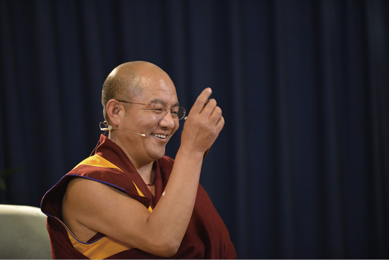
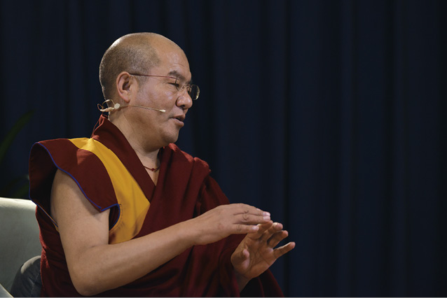
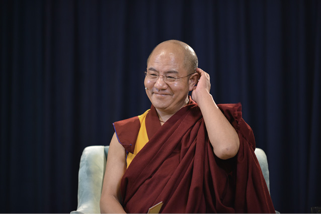
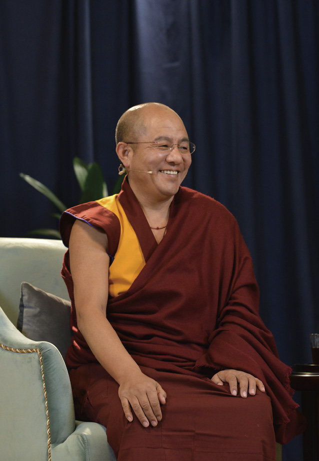

全球直播

12

依止上师并不是个人崇拜。

## 如何依止善知识

2017年1月1日

这节课我想从几个方面给大家讲一下如何依止善知识。

## 现状

首先讲第一点——现状。如今这个时代，人们依靠自己的努力，在物质、财物方面已经得到了一定的满足，但在内心追求方面却仍然空虚，甚至可以用苍白来形容。正因为如此，人们为了获得内心的安乐，开始拼命寻找心灵导师。

我记得2015年有一个报道说：美国现在追求心灵瑜伽的人数已经超过了两千三百万，而且他们还将瑜伽及其周边产品作为一种产业，产值高达93亿美金。看得出来，西方发达国家正在拼命追求内心世界。其实不仅西方国家，国内很多人也越来越重视内心的快乐，但却存在着非常多的乱象。2016年8月，《新京报》爆出一个非法心灵培训机构，它结合了一些心理学、成功学和心灵鸡汤的内容之后，就开始办班，大量地收弟子，最后敛财高达10亿元人民币。这以上是讲的现状。

## 依止善知识的类型

第二点，讲依止善知识的类型。依止善知识的类型很多，既有正面的，也有负面的，每个人都不相同。我们之前学过的《菩提道次第广论》[^1]中讲过九种正面的心态，如大地心、仆人心、金刚心——在依止的过程中，心始终如金刚一般坚固，永远不会变化，等等，讲了依止上师的九种心态。

那么，我结合目前的实际状况讲几种负面的类型。可能很多人喜欢的一些上师与真正善知识的标准还有一定距离。

首先是追星型。世间中有很多追星族，他们崇拜明星、歌星或球星。同样，佛教界也有很多人因为某些上师的外在形象，而对其产生了一种不共的信心，“这个上师特别庄严”“那个上师特别帅”“这个上师身体胖胖的”“那个上师瘦瘦的”……众生的业力不相同，吸引他们的特点也各不相同。很多人依止某个上师也没什么其他更多的理由，只是特别喜欢这个上师的微笑，或者说被他的表情以及行住坐卧的威仪所吸引。以这种心态依止善知识的弟子可以被称为追星型。

第二种叫作缺爱型。有些人没有安全感，所以把上师当作自己的父亲或母亲，甚至当作伴侣。比如说，有些男性弟子对于女性上师特别崇拜，而有些女性弟子则将男性上师当作生活中的伴侣和依靠处。这样的弟子追求的不是解脱，也不希望获得上师的智慧、悲心等出世间的功德，他们依止上师纯粹是因为生活中缺少了爱与依靠，所以需要上师为他们提供安全感。为了填补内心的空缺，他们将上师当作生活中最重要的依怙。

第三种是交易型。这种类型的弟子将上师当作工具，需要打卦、看病或是交念经钱时才用一用。也就是说，生活中偶尔有什么事情需要上师来合作时，他就会通过电话、微信或其他方式联系上师，“给我做这些佛事”“给我加持一下”等等，双方都有一定的实用性。像这样将上师当作佛教方面的工作人员来依止的弟子就是交易型。

第四种是跑跑型，也就是常说的“跑跑居士”。这种类型的弟子不会在一位具德上师那里求得正法然后踏踏实实地修行，而是像蜜蜂一样，经常在不同的花丛中飞来飞去，蜻蜓点水般地吸一下花蜜然后又飞走。虽然这种行为有时候开许，但如果刚开始选择依止这位上师，之后又舍弃他、诽谤他，然后再去另外的道场依止另外的上师，之后又旧戏重演，这样不断地换来换去，最后不仅一无所获，而且自己也会跑得晕头转向，特别累。

第五种是华妃型。可能很多人都看过《甄嬛传》，里面有一个华妃娘娘，性格霸道蛮横，对其他妃子的嫉妒心特别大。有些弟子就是这样，他们为了得到上师的独宠以及上师特别的“加持”和“开示”，会通过种种方式排挤其他弟子，不愿意让任何佛教徒接近上师，只想独自在上师身边维护上师——“弘扬”佛法。

第六种是权贵型。这种弟子将上师的经济、政治、学习、生活……全都控制起来，上师除了吃饭、睡觉可以自己做主，并没有很多其他权力。尤其是一些大施主，一些有权有势的弟子，他们经常让身边的上师感到孤独、不自在，因为上师的很多事情都要看弟子的脸色。这类弟子将上师的社交关系等方方面面的事情都掌控起来，而且控制得非常全面，上师什么时候能派上用场时才让上师出场。在权力方面，这种类型的弟子和上师之间的关系比较微妙。

第七种是毒药型。大家知道，毒药有害身体，这种类型的弟子依止善知识反而会害了自己，因为不管是自己的上师还是别人的上师，他一律诽谤，经常找过失，宣扬不利于上师的负面信息。他的“专业”就是诽谤、说过失，常常赞叹自己的功德，而宣扬上师的过失。无论谁跟这种人接触，都会觉得：“噢，这个人是很可怕的，他对谁都诽谤。”甚至跟他接触的人，也可能会染上不同程度的痛苦或招致不好的后果。

第八种是上帝崇拜型。有些宗教说“上帝是万能的”，而这种类型的弟子将上师当作今生和来世的依托，觉得自己不需要修行，依靠上师的加持、威力以及功德，就能获得今生来世的一切快乐。但实际上，佛陀告诉过我们：“吾为汝说解脱法，解脱依己当精进。”佛陀已经开示了解脱的方便法，作为弟子的我们理应如理如法地闻思修行，可是有些人却对上师说：“我已经依止了上师您，我一切的一切都拜托您了！”

这以上主要讲了八种负面类型的弟子，也许个别人从中找到了自己的影子。

实际上，很多人之所以无法做到如理如法地寻找上师，很可能是因为还没有认识到：佛教中的上师，其实是开示解脱之道的善知识。如果还没有找到真正的善知识，依止善知识的目的又不太明确的话，那么很多冒牌的“上师”也许会乘虚而入，因为你需要的不是解脱，只是为了缓解心灵压力、减轻生活中的痛苦以及避免感情上的折磨……而他们可以通过满足你这些暂时的需求，换取你情感上的依托，从而为自己谋取利益。因此，在寻找善知识之前，我们很有必要观察自心，要问问自己：“我为什么要依止善知识？”

几年前，有一部纪录片，名叫《库玛力：一位假先知的真实故事》，导演是印裔美国人。他看到当时的美国，很多人都热衷于所谓的心灵瑜伽，但许多瑜伽师并不专业，甚至有很多对瑜伽一窍不通的人，也将自己包装成瑜伽师的形象，以此满足人们的需求，并从中赚取利益。他看到这些现象之后，决定做一项社会实验——将自己假扮成瑜伽师，然后看看会发生些什么。

他将自己扮成印度的瑜伽师，满面胡须，头发长长的，讲话还带着他奶奶的印度口音。他跟着几位瑜伽老师学了一些瑜伽之后，就开始自己教授。虽然他知道自己既不是瑜伽师也不是印度人，教的也只是相似的瑜伽，但仍然假冒瑜伽师摄受弟子。出乎意料的是，他竟然教得特别“成功”，而且摄受的弟子也越来越多。最后，他才通过视频告诉他的弟子们真相：“我不是瑜伽师，也不是印度人，我是美国人。”知道真相后，很多弟子都特别伤心、失望，但有些能接受，而这也引起了他们的思考。

其实在寻找心灵导师的过程中，可能有些弟子只是在盲目地追求导师，而有些所谓的“老师”知道自己不具备作为心灵导师的资格，但为了牟利，仍然假冒这样的角色，以致双方都陷入其中，难以抽身。这类现象值得我们思考，这部纪录片也值得大家看一看，想一想。这部纪念片在2011年美国的South by Southwest电影节上获得了“最受观众欢迎纪录片奖”。你们以后也可以扮演这样的角色。

## 依止善知识的动机

第三点，我要讲一下依止善知识的动机。可能很多人就像刚才讲的那样，寻找善知识只是为了满足暂时的需求。实际上，依止善知识的目的，不应该是贪求短暂的今世，而应该是为了究竟的解脱，这才是佛教中最核心的心灵追求，以及依止善知识的最好动机。关于这一点，藏传佛教中有一部著名的教言，叫作《离四贪教言》[^2]。其中讲，贪著今生的不是真正的修行人，贪著轮回的人没有出离心……看得出来，真正的修行人，希求的是解脱，希望相续中能生起无伪的出离心。

仲敦巴尊者在热振寺时，有人请他讲法，他并没有答应，而是派他的弟子去讲。他常对自己说：“我是希求解脱者，莫为名闻利养缚。”这句话我们也经常引用。所以说，真正的善知识绝对不会被世间八法所染。

## 依止善知识的重要性

第四点，依止善知识的重要性。我们知道，学习世间中的任何技艺，像唱歌、跳舞、操作电脑、驾驶，都需要老师，甚至旅行也需要老师。比如说，当你攀登一座名山时，如果没有一位很好的向导，你不一定知道最好的登山方法，即使知道，但是这一路上会有哪些危险，你也不一定清楚。山顶的风景固然美好，但是你对自己能否到达目的地却没有太大的把握，心里也没有安全感。当你有了导师和引导者时，你就能掌握某个领域的知识，也能安全到达目的地。

既然学习世间的知识都需要导师，那么修学佛法就更不用说了，因为佛法中蕴含着甚深、广大的智慧。记得《华严经》中有一句话：“譬如暗中宝，无灯不可见，佛法无人说，虽慧莫能了。”千年的暗室中有一枚珍宝，可是如果没有灯，就见不到。同样的道理，虽然有些人很有智慧，但如果没有找到开示佛法的人，没有听经闻法，只是自己看书、自学，或是去寺院翻翻书，浅显地了解了解，这样可能很难真正懂得佛法中见修行果的相关道理。因此，在修学佛法的过程中，依止善知识尤为重要。毕竟，掌握世间知识都需要一位好的老师，那么要通达佛法中的深奥意义就更需要一位善知识的引导了。

另外，《增壹阿含经》[^3]中有一段关于善知识重要性的经文：

当时佛陀在舍卫国，阿难请示佛陀说：“世尊，我发现在佛教中，依止善知识非常重要，在修学佛法的过程中，善知识的重要性至少占了一半！依止善知识，与善知识结伴很有意义。”

佛陀纠正阿难说：“你说善知识的重要性占了一半，这是不对的。善知识是修学佛法过程中的全部，依止善知识涉及了佛法修学的方方面面。亲近善知识、与善知识相处是修行的关键。”这说明，我们在修行过程中需要上师的教言，以及上师智慧和慈悲的摄受，有了善知识的摄受，修行才会善始善终。

这段经文收录在汉文《大藏经》的《增壹阿含经》中，而在藏文《大藏经》中则是单独的一部经典，叫作《依止善知识经》。

## 观察善知识

第五点，观察善知识。在建立师徒关系之前，先要观察所要依止的上师，要通过不同的途径去了解，看他是否具足上师的法相和条件。莲花生大士说过：“不察上师如饮毒，不察弟子如跳崖。”弟子如果没有观察上师就去依止，这就像喝毒药一般，上师如果没有观察弟子就去摄受，这就像跳崖一样。

当然，佛法的显宗部分，谁传都可以接受，但如果传的是佛法的密宗部分，那就需要考核，上师和弟子都需要互相观察。比如说，当上师要传讲密宗中甚深的大圆满法时，如何才能知道哪些弟子能听，哪些不能听呢？就是让弟子们去修加行，以五十万加行作为试用期，考核过了才可以听，否则不能听。如果他连五十万加行都没办法完成，那在以后的依止过程中，他也很可能因为自身的懒惰或缺乏真诚性而半途而废。我觉得，让弟子修五十万加行既是上师观察弟子的一种方式，也是考核弟子的标准。

观察上师真的很重要。有些人刚开始不观察，还不了解的时候就去依止、皈依、受灌顶、听法……可是最后却反过来观察上师的过失，这种做法很不合理。正确的做法应该是先观察，再依止。就像世间中寻找合作单位或合作伙伴那样，交往之前肯定要先了解对方的社会背景以及个人身份等方方面面的情况，了解清楚之后才能跟对方签合同。同样的道理，我们也要通过一系列的测试，去观察所要依止的上师是否合格、是否具足真正的智慧，依靠他自身的智慧、能力以及修行，能否遣除我们心灵上暂时的痛苦，能否让我们从轮回中获得究竟的解脱？在依止一位上师之前，至少要对他有全面的了解。

密法中有一种说法，叫作“燕子入窝”：燕子找窝时很会观察，观察完如果没问题，就无有怀疑地直接入窝。因此，我们应该先观察所要依止的上师，如果他确实是一位真正的善知识，则可以直接依止。

如何观察呢？可以通过他外在的行为来了知他内在的智慧和悲心。《十法经》[^4]中有一则教证说，哪里冒烟可以推知哪里有火，哪里有鸳鸯则说明哪里有水。同样的道理，凭借圣者菩萨外在的语言和行为，能够了知他内在的智慧和境界。是不是善知识，依靠观察就能了知；只要善加观察，就能知道很多上师到底是不是真正的具德善知识。

## 别着急视师如佛

第六点，依止善知识。经观察，确认是善知识之后，就要去依止。刚依止时，先不要急着将上师看作佛。虽然佛陀在涅槃之际对阿难说：“阿难莫哀伤，阿难莫哭泣，我于未来世，化为善知识，利益汝等众。”但很多人因为这句话，就不管对方是真上师还是假上师，反正只要是上师就把他看作真正的金刚持佛、文殊菩萨或释迦牟尼佛，看作如佛一般，与佛无二无别，根本不观察所谓的“法王”“活佛”是否是真实的。也许他们是真正的佛菩萨，因为佛陀也说过，他将来会以善知识的形象示现，只要他们有佛的境界，就完全可以将他们视为与佛无二无别。但有些人不要说佛的境界，连菩萨、阿罗汉的境界也没有，甚至连世间标准的智慧和悲心都没有。所以刚开始依止一位上师时，最好先把他当作世间最好的老师、朋友或上级领导来对待，这样的话，即使他的所作所为，或是显现上有一些不如法的地方，你也不会因此而产生邪见。

1993年，我去过创巴仁波切在美国和加拿大建立的道场。他的弟子们对他的信心，给我一种新的感觉，让我非常感动。创巴仁波切是在1987年圆寂的，当时我们去的时候，他已经离开很多年了，但是他的弟子们在听到“创巴仁波切”这几个字的时候，我明显感觉到他们有一种很强烈的触动，就像电击一样，或者说有一种非常震撼的感觉。

我记得宗萨仁波切在《八万四千问》中也讲过，西方人本来特别聪明，但当他们看到上师示现的一系列过失时，不仅没有障碍他们对上师的信心，反而对上师更加生起信心。这一点，他特别钦佩。看到这段话时，我深有同感，因为他们每一位弟子对上师的真诚，以及对于弘扬上师法脉所做出的努力，确实让人钦佩不已。我前几年去他的中心时，虽然当时离创巴仁波切圆寂快三十年了，但他的弟子们仍在不断地弘扬他传承下的教法和真理。其实，这就是真正依止上师的方式。

然而，现在仍然有相当一部分西方人认为，依止善知识以及恭敬、崇拜上师是一种个人崇拜，他们对此并不认可，甚至有各种不合理的议论和看法。实际上，依止上师并不是个人崇拜。当某位上师达到了一定的境界时，他所能给予的，已经完全超越了世间老师，这时，人们自然而然会对他生起恭敬之心。为什么很多西方学者、科学家、医生、老师对他们所依止的上师有如是恭敬心呢？其实这里面有着甚深的意义。而部分西方人之所以会误认为依止上师是个人崇拜，只不过是因为他们受到了从小接受的教育理念的影响，但其实还有共同探讨和研究的余地。

另外，我也特别佩服索甲仁波切的一些弟子。我之前去过他在法国的列绕林中心，虽然他现在还住世，但只要一提起他的名字，同样能感受到下面的很多弟子会有一种与众不同的触动。在他们眼里，上师的重要性已经完全超越了世间的老师或公司的老板。包括当时索甲仁波切受到一些诽谤时，他真正的弟子们仍然记得上师是怎样以智慧引导他们的，上师为了利益众生又是如何奉献自己的一切。所以说，佛教中对于善知识，并非盲目地迷信，而是以高度的智慧去抉择。

我想说的第三位善知识，是上师如意宝晋美彭措。上师如意宝的传承弟子们之所以如此尊重、感恩上师，主要是因为上师如意宝的智慧和加持。包括我在内的成千上万的传承弟子们，只要听到上师如意宝的名号——晋美彭措，心里自然而然会有一种无形的触动，会感受到一种不可思议的力量。

再过几天就是法王如意宝圆寂13周年的纪念日，虽然他已经离开了这么长时间，但我们对他的怀念、感恩、思念之情却仍然强烈，也许有很多弟子经常在梦中面见上师的尊颜，并聆听上师的教言。

这以上讲的内容，无论是相对专业的依止善知识的方法，还是弟子对上师的信心，学术界的Academic（学者）不一定承认，也许他们反而觉得佛教徒太崇拜个人、太崇拜偶像了。其实并不是这样，想想看，为什么一个人能影响那么多人、那么多时代呢？因为这里面有一种不可思议的力量。

以前讲过，当米拉日巴听到上师玛尔巴名号的当下，忽然汗毛竖立，感受到强烈的触动。我自己倒说不上有这样的信心，这样说会觉得很惭愧。但我在出家之前，还在学校读书的时候，当时有一位藏文老师，他经常抽烟，上课的时候边抽烟边拿着茶杯喝茶，而且还戴个狐狸帽——不过他教得的确很好。有一次，他在课堂上讲：“现在一些所谓的上师，我是不太承认的，但听说在色达的一个山沟里面，有一位名为晋美彭措的堪布，他每天给五六十位出家人讲经说法，他，我确实非常佩服。”现在讲你们不一定相信，但我那时听到上师如意宝的名号时，心里忽然“轰”一下，有特别大的震撼。

后来我到了佛学院，第一次见到上师时我刚好23岁，那个时候什么都不懂，而且还满腹的傲慢和烦恼，现在回想起来还是觉得很惭愧。在之后依止上师如意宝的过程中，上师不断地给予我世间和出世间的智慧，虽然我现在仍然普普通通，但上师所给予的智慧与力量，确实是世界上任何人，包括父母在内也不一定能给予我的。人生中，谁的恩德都没办法和上师相提并论。

## 如何获得上师的智慧

这堂课马上就圆满了，最后我讲一点——如何获得上师的智慧。上师的智慧可以通过两种途径获得。第一种是依教奉行，如理如法地依止上师，按照上师的要求，次第系统地学习经论和佛教知识。第二种则是以恭敬心祈祷上师以及承侍上师，从而获得上师的意传加持。当上师相续中的功德原原本本、一滴不漏如满瓶倾泻般融入弟子相续时，弟子就真正获得了上师的意传加持，真正得到了上师的摄持和传承。

当然，这方面可以通过观修上师瑜伽来祈祷。我常念上师如意宝的祈祷文，每次念到祈祷文中“晋美彭措”这几个字时，确实感觉上师的名号有着更强的力量，这是任何咒语都无法替代的。其实，包括走路在内的任何时候，都可以念上师祈祷文。上师祈祷文给我带来的无论是遣除违缘，还是认识心性等很多方面的利益，都完全无法用语言来形容，这也可以说是获得了上师的加持。

《般若经》和《现观庄严论》中都讲过“内善知识”，也就是相续中的正念、悲心、信心等功德；按照密宗的说法来讲，如果修成了自己的心与上师的智慧融为一体的境界，这就叫作“觉性善知识”，已经获得了上师所有的加持。其实，当自己的心与上师的智慧无二无别时，就可以随心所欲地利益无量无边的众生了。

## 念《圣大乘金子经》传承

这堂依止善知识的课到此圆满。接下来，我再给大家念一下《圣大乘金子经》的传承。时间稍微超了一点，但古人有一种说法，“寸金难买寸光阴”，我这里有一些更有价值的金子送给你们，所以你们再稍微安住一会儿。

这部《圣大乘金子经》是我前段时间翻译的，内容不多，是佛陀和阿难在给孤独园关于如何修菩提心的对话。菩提心自性清净，如金子一般；工匠通过不同的方式可以打造出不同的纯金装饰品，虽然是不同样式的装饰品，但它们的本质仍然是金子。然后佛陀通过偈颂的方式宣说了以上的道理：“清净菩提心，精勤自他利，观修无实性，信解生慧因。”意思是说，胜义菩提心如金子一般清净，永远不会有任何改变；世俗菩提心则是缘佛果的智慧，以及缘众生的悲心，也就是智慧缘菩提，悲心观众生。智慧缘菩提是观修空性，对诸法无生的道理生起信解，以此产生佛陀的智慧；悲心观众生是以悲心缘无量的众生，希望自他都能从轮回中获得解脱。总而言之，《圣大乘金子经》既讲了胜义菩提心也讲了世俗菩提心。

对全球的大部分人来说，今天是特殊的日子，是新年的开始，那么我就将这个特别珍贵的“金子”作为新年礼物送给你们！

[^1]: 详见《菩提道次第广论》卷一《亲近善士》。
[^2]: 摘录自《阿弥陀经讲解》：“萨迦初祖根嘎酿波十二岁时修了六个月的文殊法，后来现量见到文殊菩萨，两位眷属居于文殊菩萨左右。文殊菩萨给他传讲了《离四贪教言》：‘贪今非教徒，贪世非出离，贪自非菩萨，耽著非见解。’意思是：贪执今世不是佛教修行人，贪执三有世间不是出离心，贪执自利不是大乘佛子，抉择究竟见解时若有耽著则不是正见。”
[^3]: 一时，佛在舍卫国祇树给孤独园。尔时，阿难白世尊言：“所谓善知识者，即是半梵行之人也，将引善道以至无为。” 佛告阿难：“勿作是言：‘言善知识者，即是半梵行之人。’所以然者，夫善知识之人，即是全梵行之人，与共从事，将视好道。我亦由善知识成无上正真、等正觉；以成道果，度脱众生不可称计，皆悉免生、老、病、死。以此方便，知夫善知识之人，全梵行之人也。复次，阿难！若善男子、善女人与善知识共从事者，信根增益，闻、施、慧德皆悉备具。犹如月欲盛满，光明渐增，倍于常时。此亦如是，若有善男子、善女人亲近善知识，信、闻、念、施、慧皆悉增益。以此方便，知其善知识者即是全梵行之人也。若我昔日不与善知识从事，终不为灯光佛所见授决也。以与善知识从事故，得为与提和竭罗佛所见授决。以此方便，知其善知识者，即是全梵行之人也。若当，阿难！世间无善知识者，则无有尊卑之叙，父母、师长、兄弟、宗亲，则与彼猪犬之属与共一类，造诸恶缘，种地狱罪缘；有善知识故，便别有父母、师长、兄弟、宗亲。” 是时，世尊便说此偈：“善知识非恶，亲法非为食，将导于善路，此亲最尊说。”“是故，阿难！勿复更说言：‘善知识者是半梵行之人也。’” 尔时，阿难从佛受教闻佛所说，欢喜奉行。
[^4]: 《十法经》：“相烟即知火，鸳鸯以显水，复相知诸性，菩萨大名称。柔和、不谄曲，舍离悭、嫉妒，愍念一切众，名之为菩萨。”
