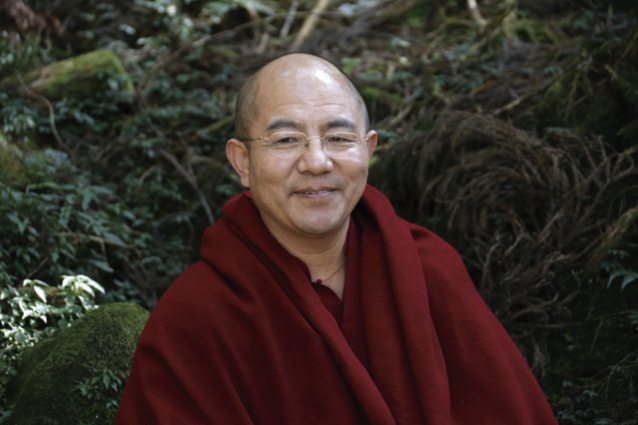
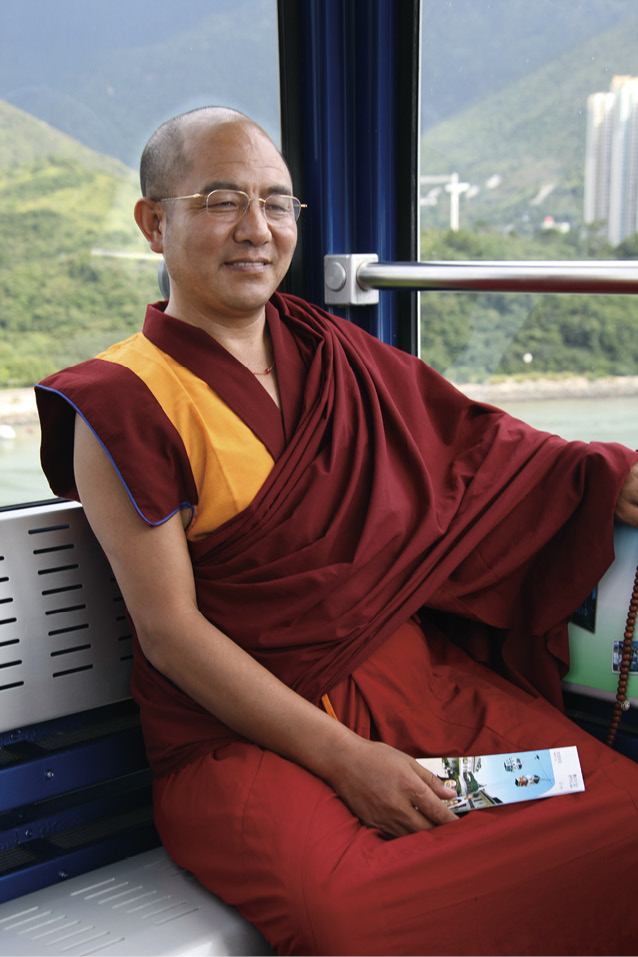
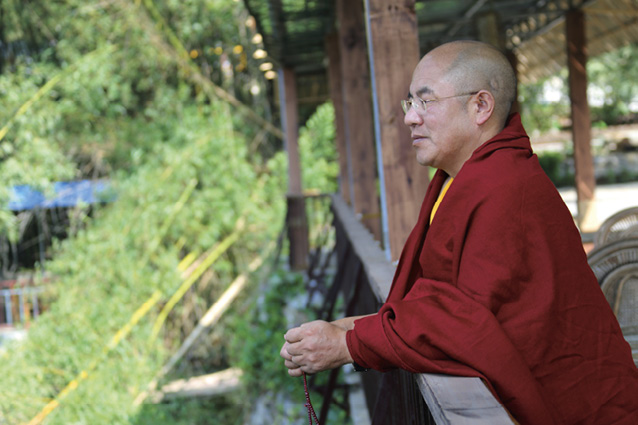
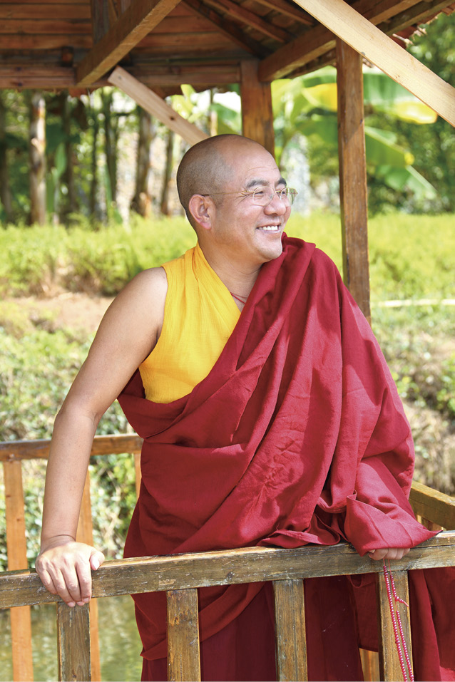
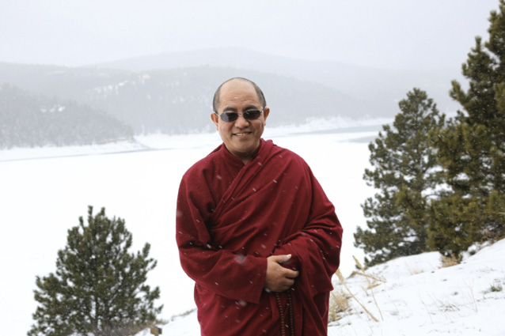

全球直播

16

学佛，

不是挂一张观音菩萨像、办一个皈依证、

穿一身海清就可以了。

## 学佛是一门技术活

2017年10月1日

今天开示的内容有两个，一是给大家念法王如意宝的《上师瑜伽》。修上师瑜伽能让自己的修行得以圆满，善始善终。很多道友都在念，非常好。另一个是给大家念宗喀巴大师造的《缘起赞》传承。

给大家念《缘起赞》，是因为明年世青会《理想地球》论文大赛的主题是学《缘起赞》。很多年轻人都想得到这个传承，以便更好地学习。《缘起赞》讲了缘起性空最根本的道理，学好了，会明白本师释迦牟尼佛的教法精华。现在的佛教徒，尤其是年轻人，相续中如果能生起缘起性空的正见，对胜义谛和世俗谛无二无别、互不相违的甚深意义生起定解，非常重要。

我好多年前讲过《缘起赞》，只有8堂课。这次国庆放假8天，如果每天抽空学一堂，刚好可以学完。也许从此以后，你就真正懂得了甚深、秘密、广大的缘起性空之理。当初讲这部法的时候，我自己觉得把缘起空性和中观的道理都讲到了，也许对个别初学者或者学了多年的修行人有所帮助。

先念这两个传承，然后围绕今晚的主题《学佛是一门技术活》，给大家简单谈一谈。

（堪布念《上师瑜伽》和《缘起赞》传承）

## 重要的道理，反复讲

接下来，我为有兴趣学习和修行佛法的人讲一讲佛教的基本道理。佛教的基本道理本来应该一而再、再而三地讲。不过，我现在每讲一次，就觉得大家应该明白了，以后尽量不要重复。我害怕有些人觉得自己听懂了，如果再重复讲，他们会生厌烦，失去信心。人都是这样，即使不懂，也觉得这个道理很简单，已经听过，不用再讲。虽然听过不一定记得住，记得住不一定能行持，但大多数人都有这样的毛病。所以我平时讲课，不管是公案还是教证，都尽量不重复。

其实这样做，也不一定真的好。以前，上师如意宝晋美彭措对有些重要的道理，会讲很多次。今天也讲，明天也讲，时间长了以后，心里自然而然就记住了。而当年上师只提过一两次的教言和公案，现在基本没什么印象了。所以我个人的体会是，听过很多次的道理，因为反反复复地熏染，最后会变成长期记忆的知识，或成为心相续中根深蒂固的智慧。

所以，我今晚会讲一点过去经常提到的道理，再讲一点以前没有讲过的内容。今天现场也有英语和日语翻译。虽然有些人不一定能接受，但这样做也是顺应时代潮流。现在有很多年轻人，特别希望在不同语种、不同文化和不同根基的众生面前，用适合他们的语言和方法来弘扬佛法。如果能够这样，大家在有生之年，也许能为需要帮助的人做一点事，让他们得到真实的利益。今晚不会讲很长时间，不过所讲的道理都是既简单又不简单，既甚深又不甚深。

## 学佛，学的是甚深智慧

前两天已经给大家提供了今晚的主题：《佛学是一门技术活》。为什么这么说呢？因为很多人认为学佛很简单，看个两三本书就觉得是在学佛了。其实不是这样的，看一两本书算不上真正的佛教徒，也算不上真正的学佛。

汪洋大海，无边无垠，虽然喝一口海水也可以说喝到了大海，但从根本上讲，不能算真正喝到大海，因为大海有多广、多深，从喝的这一小口中根本不可能了知。喝一口也算喝到了大海，只是说说而已。同样，佛教典籍浩如烟海，只看区区的几本书，也算不上真正的学佛。

### 1．做一个标准的佛教徒

到寺院里烧烧香，拜拜佛，或做一点简单的供养、转绕，这样的人是不是佛教徒？是不是在学佛？这些都是善法，都属于佛教的行为和仪式，但却不能代表真正的学佛。真正的学佛，学的是本师释加牟佛甚深的智慧，而不是佛教的某些行为，也不是单一的道德取舍。

所谓的佛教，可以说是一门宗教——世界四大宗教之一，也可以说不是宗教。从探索真理的角度讲，佛教更应该列为一门科学。按照世间的定义，能宣说客观真理的，就是科学。而佛教的智慧，已经无余揭示了宇宙人生的种种真理。所以，我们可以在众人面前非常确定地说：“佛教的根本，就是真理，就是智慧。”

有些人认为学佛是禅修。简单地在寺院或某个寂静地方，修修瑜伽，坐坐禅，就觉得自己在学佛。坐禅可以算学佛，但是不完整。那放生、做慈善、修慈悲心，算不算学佛呢？算。那学的是不是完整的佛教？不是。在世间搞再多的慈善活动，也不是真正的学佛。

现在有些名人和慈善家，因为经常做善事，就认为自己是佛教徒。这是不对的。佛教的根本并不是单一的慈悲心。《释量论》中讲：慈悲与无明并非直接相违。意思是，我们的慈悲心修得再好，如果不能断除无明，不能通达斩断轮回的智慧，也根本解决不了生死大事。所以，真正的佛教是一种智慧。

所以，归根结底，学佛是学什么？学智慧——对包括自心在内的万事万物的真相彻底通达的一种智慧。这一点，是佛教徒自己说的，还是别人说的呢？其实不管是谁，只要对佛法经过专门研究、深入学习以后，都一定会明白这个道理。虽然佛教有很多的行为、仪轨、仪式、道德观念和准则，但都只是支分，而不是根本。

佛教的智慧涵盖了人类所知的一切万法。用佛教的专有名词来讲，叫做世俗谛和胜义谛。用通俗的话来讲，就是万事万物的现相和实相。在不同众生面前显现的道理，叫现相。在现相的背后，还有一种符合真理的道理，叫实相。这两个道理如果通达了，也就通达了佛教的全部智慧。

那么，真正的佛教徒应该是什么样的？对佛教的甚深道理完全明白，完全精通。这是一个很高的标准。当然，这里面还有很多层次可分，不过大家应该知道努力的方向，而不要轻易认为自己已经是标准的佛教徒了。

一切万法的实相，有空性和光明两个部分。最近佛学院在讲很有深度的一些法，从光明、智慧和心性方面为大家深入指点。藏传佛教极为著名的论典都在讲这一类深法。如果要明白万法的实相，一定要讲到这样的深度。

### 2．缺乏智慧的信心，靠不住

我们正在考虑，学会的密法班可能需要延长学习时间。因为有些密法课一直听不完，前面没有修完加行的人，后面的很多课程可能也听不到。本来，学完全部的课程，学制是四年，不过以后可能会延长，有这个必要。我们原来想，学习因明、戒律、般若、俱舍、现观等五部大论的人，可能多一点，最后一观察，90%以上的人还是愿意修加行，愿意学密法。这跟我们最初的定位有一些出入。

另外，这几年我讲的佛经较多，比如《净土五经》《药师经》《妙法莲华经》《海龙王经》，等等。以后也许会开设专门的学经班，以供对大乘经典有兴趣的人选择。我想，对汉传佛教特别有信心的人可能会喜欢这样的课程。

总之，以后的课程会稍微有些调整。目的只有一个，让大家更好地学习佛法。学佛并不是学一两部论、学一两年就能完成的事。作为一个佛教徒，我们在深层智慧方面，至少应该有一点点积累和沉淀。如果没有智慧的积淀，轻飘飘的，随着内心的信仰起伏不定，很难长久坚持。

当然，在学佛的过程中，对上师三宝有极大的信心也是很好的。有时候，看到一些佛教徒特别有信心，见到某尊佛像或某位上师，态度变得完全不同，哭啊，顶礼啊，有各种感动的表情和行为，心里还是比较赞叹的。

不过，学佛的人刚开始一般都比较激动。“学佛一年，佛在眼前；学佛三年，佛在天边。”初入佛门，对上师有信心，对法有信心，对僧众也有信心，总之，对三宝好像都有特别坚定的信心。但是过了三年，佛也好，上师也好，都没啥感觉了。没有智慧的支撑，信心是不会坚定的，特别容易转变。

如果通过学佛，明白了事物的真相，信心一般都不会退。换句话说，我们坚持长期闻思，一旦对佛法揭示的万法实相生起了坚定不移的信心，那是不可能被别人夺走、抢走、偷走的。信心有两种，一种是随法的信心，一种是随补特伽罗的信心。其中随法的信心非常重要，因为它建立在对佛法的理性认识上。

### 3．佛教徒的种种心态

其实，在我们佛教内部，有各种各样不同的心态。一种是受伤的心。这一类佛教徒入佛门时，是带着伤的，状态不是很好。比如，离婚或失恋了，这是感情的伤；遭遇车祸或疾病，这是身体的伤；还有工作失败或心灵受伤，等等。现在有些人的心特别容易受伤，经常说：因为某人的语言，我受伤了；因为某人的眼神，我受伤了……

总之，他们有各种“内伤”，短时间内没办法恢复，觉得到处都没有依靠。想到佛教慈悲为怀，也许可以在这里找到怙主，帮到自己，于是入了佛门。有些明星就是在车祸、毁容之后，开始学佛，并慢慢找到人生真理的。这一类人在逆境中寻找真理，以逃避痛苦为皈依佛门的因缘，最后变成真正的佛教徒。

一种是自我实现的心。尤其是现代人，由于心灵的疾病，比如抑郁症、自闭症，以及精神上的恐惧、焦虑和压力，始终没办法找到相合自己的人生观和价值观，非常迷茫，非常痛苦，非常浮躁。为了自救，他们四处寻求：“世界上有没有一种真理，能解开我心里的疙瘩，让我从根本上得到快乐？”最后找到正法，皈依佛门。之后通过学佛，抑郁和痛苦真的彻底没有了。这时，再用佛教的修心教言，去观察以前对某件事的执著和担忧，觉得好没有道理。由此很快树立正见，拥有真正的信仰。

第三种是求福的心。这类人学佛是为了求世间福报，比如身体健康、长得漂亮、财富多多、家庭快乐、幸福美满。大多数佛教徒都是求现世福报的。据说2017年大年初一，为了烧新年第一炷高香，很多人早早就到雍和宫排队，有的甚至排了26个小时，最后终于烧到了高香，也得到了大家的羡慕。

虽然不敢说这是迷信，但确实让人有点遗憾。一个佛教徒真正的追求，不应该是靠一炷香、一盏灯或者某些加持品来解决所有问题。你今生的健康和幸福并不是依靠那一点香烛得到的，它们只是一个缘起而已。不管怎样，有很多人就是为了求福报而皈依的。

一种是学术型的心。这类人在现在的西方比较多，国内也有不少，一般是社科学者或大学老师。他们对佛教的中观、因明、般若等论典进行探索和研究，纯粹是为了搞学术。也有一些人通过自己的智慧观察，引发了对佛教的信心，最后变成真正的信仰者。有些则完全是学术型的，对佛教没有一点信仰和敬畏，甚至不顾密法的规矩和要求，一味从理性角度研究。学术界的这些人，大多只承认佛教所讲的道理，与信仰等感性有关的知识则不太承认。

最后一种是求真理的心。这是佛教徒真正应该拥有的心。求智慧、求真理，一定要闻思修行。没有闻思修行，很难变成真正的佛教徒。我们现在经常给大家提供学习的条件和方便，就是要让你们好好闻思修行。如果没有系统、严密和次第的学习，把信仰挂在口头上，放在书本里，算不上真正的佛教徒。

一个佛教徒真正需要的，唯一是智慧。能解决各种修行问题的，也只有智慧。而且，这种智慧不仅是佛教的精华，对世间任何一个国家、任何一个民族、任何一个地方而言，也都十分需要。一个民族、一个国家、一个地方的传统和文化，一般只对本民族、本国家和本地的人有价值，很难得到其他民族和国家的承认和接受。那全人类都公认有价值的是什么呢？寻求真理的智慧。这是人类生存在这个世界，共同追求的精神财富。

### 4．智慧，需要稳固的基础

佛教的经典和论典，处处都闪现着这样的智慧。任何教条主义，想依靠世间理论来推翻它，都绝对没办法做到。为了得到这样的智慧，每一个佛教徒都必须打好稳固的基础。否则，我们的内心就像空中楼阁，智慧和境界都不一定长久。

我们在一些佛教中心了解到，现在很多人对因果轮回等基础知识都不太感兴趣，只喜欢认识心性的最高法门，愿意直接听受高法。这样的想法和行为虽然也有道理，因为我们最终追求的的确是最高的真理，而不是基础性知识，但是不愿意经过基础训练，想一步登天，自己是不是这样的根机呢？很难说。

在世间，如果连中小学都没有读，就直接读大学，也许可以得到一张文凭，但基础没有打好，这种智慧恐怕还是很有局限。如果没有读大学，就直接读研究生、博士生，看似直接学到了最深的智慧，实际上内心的收获究竟有多少呢？同样，佛教徒追求真理的过程，尽管因人而异，各有差别，可大多数人还是需要从基础开始，慢慢积累。

当然，也有个别利根者很小的时候，真理就已经融入了心。汉传佛教的憨山大师，从小就对佛教的禅修和智慧有着特殊而超胜的意乐。五六岁时，别的孩子都在玩，他却在打坐。祖父经常说他：“你每天都像根木桩定住了似的，在干嘛呢？”随着年龄的增长，他从小就显露的智慧慢慢成熟，最终成为一代高僧。我们这里有些人也是，从小就对轮回有厌离心，后来看到某部佛经、某位上师或某个僧人的威仪，自然而然苏醒了前世的因缘。

### 5．三车和尚

也有一些人，刚开始根本不愿意学佛，后来因缘成熟，不仅入了佛门，还学得很好。这样的案例在藏传佛教中非常多，汉传佛教中也有。我给你们讲过三车和尚的故事没有？这个故事是关于唐玄奘的弟子窥基大师的，很有意思。

当年，玄奘在去印度取经的路上，遇到了一个修行人。由于多年闭关，他头上已经长草，草里还有鸟窝，而他的身体却一动不动。玄奘认为这是一具尸体，摸摸他的胸口，还有一点点温度，才知道他正入于甚深的禅定中。

玄奘引他出定后，他问：“你是谁？要到哪里去？”玄奘说：“我准备到印度取经。你在这里干什么？”他说：“我在这里等释迦牟尼佛出世。”玄奘说：“释迦牟尼佛早已出世，并且已经圆寂了。你入定的时间太久了。”他说：“那我继续入定，再等弥勒菩萨出世吧。”玄奘说：“弥勒菩萨出世还要很长时间，我建议你还是投胎吧。我这次去印度，就是求取释迦牟尼佛讲的经典，等我从印度回来，我们一起弘扬佛法，好不好？”他勉强答应了。由于以衰老的身体弘法有一定困难，所以玄奘让他到皇宫去投胎，跟他讲了大致方位，以及红黄房瓦等标记，然后就去印度了。

19年后，玄奘从印度回来，去找唐太宗：“您有没有一个19岁的太子？”结果没有。经过慢慢寻找，玄奘发现当年那个修行人投胎的时候搞错了，投到一个大臣家里去了。玄奘找到他，然而因为时间太久，他已经忘了当初的约定。

玄奘要他出家，他贪恋红尘而不肯。于是玄奘请皇帝下诏，令他出家。他没办法，故意提出要求刁难：必须有一车酒、一车肉、一车美女，跟随他到寺院去。玄奘嘱咐随从：不管他提出什么要求，你们都要满足。大家都觉得特别奇怪：这样一个出家人，进了寺院怎么生活啊。

但大家还是按他的要求，准备了三车东西，并遵照皇帝和国师的旨意，送他去寺院。结果，刚到寺院附近，寺院的钟声就敲响了。一听到钟声，他马上苏醒了前世的记忆，三车什么的全都不要了。

他出家后，法名窥基，通过精进修学，成了玄奘晚年弘法最得力的弟子，但仍被人们称为“三车和尚”。《宋高僧传》中记载了这个故事。不过，窥基大师晚年写自传时，并不承认所谓的“三车”之说。也许，他后来变成了大和尚，有点不好意思。

### 6．胎障与因缘

这个故事有几个方面值得我们深思。第一个，窥基大师的前世是一个老修行人，入定那么年，却一入母胎就把前世记忆忘得一干二净，直到19岁也没有苏醒。我们每个人虽然都有前世，但因为胎障太厉害，所以都被障蔽了，想不起来了。很多中阴法门都讲到了胎障：进入母胎后，除了极个别人——也许只有亿万分之一的比例，能想起自己的前世，绝大多数人都会在胎障中彻底迷失。这是一个自然法则，没有办法。

有些人说：“如果真的有前世，为什么我想不起来？”“我对前世一点儿记忆都没有，怎么办？”回忆前世并不是那么容易的事情，想不起来很正常。窥基大师前世那么了不起、能入定那么长时间，都不能想起前世，何况我们普通人呢？

第二个，不管出家也好，学佛也好，依靠前世的因缘，我们的善根总会在某个时节苏醒过来。只要因缘聚合，种子就会自然成熟。佛陀在经中讲道：“众生之诸业，百劫不毁灭，因缘成熟时，其果定成熟。”一旦因缘成熟，果会自然而然现前。比如，你遇到某个上师，今生从没见过，却有一种特别的感觉，可能就是前世的因缘。世间男女坐在一起的时候，也能感到一种特殊的缘分。在我们的阿赖耶上，有各种复杂因缘的种子。这些种子经过长时间以后，一定会成熟为果。这个道理，就是佛教所讲的因果不虚。

## 学佛，学的是因果正见

作为一个佛教徒，树立因果正见很重要。可是，现在很多佛教徒，甚至有个别出家人，对前世今生和善恶因果的道理并不是特别坚信。一个出家人，居然不相信因果，说起来恐怕自己也不好意思——邪见一直埋在心里。有些居士，虽然已经学佛多年，但有没有“做坏事的果报，今生不感受，来世必成熟”的坚定信念呢？这些人回答起来可能也比较尴尬。

### 1．谨慎取舍因果

麦彭仁波切曾经说过：“这一世是业的世界，下一世是果的世界。”意思是说，业力成熟的时候，必定会感受果报。因此，趁现在自由自在的时候，一定要谨慎地取舍因果，这个真的非常重要。

在诚信因果方面，我们能现量见到的，有两个不同的世界：一个是藏族人的世界，另一个是藏族人以外的世界。藏族人的因果正见树立得非常好。很多藏族人，尤其是老年人，虽然没有文化，连自己的名字都不会写，但从小受家庭观念和生活习俗的影响，却有着坚定不移的因果正见。

有时候，我去藏地的居士林，看见那些老爷爷、老婆婆，满脸都是皱纹，心里会忍不住思维：“人老了都这样，我以后也会变成这样。”藏族的老人和汉族不同。汉族老人不知道为什么，走路时背都很挺直，但藏地很多老人手里拿着拐杖，走路时身体弯成90度，看起来很可怜。

但是，他们心里却有非常坚定的因果正见。这一世的快乐跟下一世的相比，他们更重看下一世的快乐，因为下一世更为长远。今生杀1次生，未来会有500世在地狱、旁生中受苦，他们对这些道理坚信不疑，宁可自己挨饿，感受极大的痛苦，也不会去杀害众生。诸如此类，他们相续中的因果正见，还有很多很多。

这就是藏族人的世界——深信因果的世界。另一个世界是什么样的，我不用多说，大家都应该清楚。

### 2．狂热的信心，很危险

作为一个佛教徒，首先要建立坚定的因果正见。有了因果正见的基础，无论学习什么，密法、显宗、中观、净土都可以。如果没有这样的正见，光凭自己的信心行事，则不太好。我有时候觉得，没有正见的信心，其实是一种狂热。佛教徒中有很多狂热的人，他们对上师的信心只是一种狂热。

不过，狂热的信心不只是佛教里面有，有些世间人对歌星、球星、影星等，也充满狂热。有一个明星，他18岁生日的时候，全世界的粉丝都在为他庆祝。在美国洛杉矶，一共出动了五架飞机，在好莱坞上空喷出他的名字，祝他生日快乐。这些粉丝对他特别特别有信心，好像今生能看到他就值得了。

佛教里有些信徒，也跟这些粉丝一样，对自己的上师赞叹不已，狂热追捧。当然，如果上师的教言对自相续真的有利，这样依止善知识也无可厚非。遗憾的是，虽然佛教一直强调依止上师之前要用智慧观察，但有些人只看上师的相貌和声音好不好，眷属多不多。有些上师的追随者，真的就像世间粉丝一样。

现在是一个追逐明星的时代。前两天我讲了一堂课，刚到晚上10点，很多人就呵欠连天，瞌睡得不行了。听说有部电视剧叫《楚乔传》，晚上12点钟开播。有些佛教徒听一个小时的课，晚上10点就开始打瞌睡，但到了12点看连续剧时，一点瞌睡都没有，无比清醒。虽然都是信仰，一个是文化的信仰，一个是宗教的信仰，但大家追求二者的力度完全不同。

宗教的信仰一定要有智慧的摄持。否则，就和世间的信仰一模一样了。在这个特定的时代，对名人的追逐，比如追逐演员、歌星、球星，或者演讲家、理论学家、科学家、宗教人士，原本是一件很正常的事，也是一件很好的事。我自己也是一个追随者，追随我们的上师，被他们的智慧所慑服，希求他们的智慧。

人和人之间的因缘是不同的。某位上师和你有因缘，刚开始会深深地吸引着你，然而要和他建立长期、良好的关系，说千道万，还是像刚才讲的那样，内心需要有坚定而清净的智慧。有了这样的智慧，我们学佛会非常成功。

### 3．外在的形象，只是种个善根

佛教最根本的信仰，是对智慧的信仰。办个皈依证、放个观音菩萨像，并不代表学佛。我们有些道友，一坐上出租车，便问人家司机：“你学佛吗？是佛教徒吗？”司机很奇怪：“你为什么这么问？”“因为你车上有观音菩萨像。”

一方面，摆放佛像可以说是学佛的一种标志。另一方面，学佛也不是挂一张观音菩萨像、办一个皈依证、穿一身海清就可以了；出家也不是穿上藏传佛教的红僧衣、南传佛教的橙僧衣或汉传佛教的黄僧衣，再剃一个光头就可以了——现在很多球星也喜欢剃光头，觉得这个发型很酷。

有些人学佛只学佛教的形象。比如，很多名人喜欢盘念珠，走到哪里念珠都不离手，把佛教当成一种精神奢侈品。有些领导本来不学佛，但到了这里，却拿着一串念珠对我说：“你给我加持一下，吹一吹。”还有些人像印度姑娘一样，收藏了好多好多念珠。

这些行为是不是学佛呢？某种意义上讲，也可以说是学佛。这样的爱好在佛经里，叫“种善根”。能和佛法结上善缘，当然很好。但是从严格意义上来讲，并不是学佛。不要把学佛想得太简单了。

大家首先要建立因果正见，建立对三宝的信心、对轮回的定解，再进一步通达四谛的道理。如果能做到这样，就有了中等的信心。否则，天天跟着某个上师跑，或到寺院烧香拜佛，只能算是形象的佛教徒。

### 4．不要迷信，要正信

真正的佛教徒应该是智慧的教徒。然而，从人类有史以来直到今天，任何一种智慧都不是那么容易得到的。得到智慧有两种途径：一种是先天俱生，一种是后天努力。俱生的智慧来自前世的深厚积累，我们上师如意宝就是如此。他老人家这一生，真正闻思的时间不是很长，在江玛学院学了六年，在洛若寺学了几年，连九年义务教育都没有接受过。但老道友们都知道，法王如意宝的智慧实在令人惊讶。

1990年以后的15年里，上师的眼睛基本看不清文字，可是跟大家讲课时，每一个教证，每一个公案，每一段历史，都讲得清清楚楚。像法王这样拥有俱生智慧的人，在这个世界的确有。但我们绝大多数人，都需要通过后天的学习和努力才能得到智慧。所以，每个人都要下功夫。

现在我们有这么好的因缘，可以通过网络平台来学习。我没有把大家划给哪个上师，哪个教派，也没有要求大家必须学喇荣的课，或者某个中心、某个寺院的课。我唯一的希望是，大家能通过闻思变得有智慧，而不是盲目崇拜。有些佛教徒在世间法方面非常聪明，一遇到佛教的修行、佛教的见解、佛教的行为，就表现得特别迷信。这样的话，肯定会降低整个佛教徒团体的综合水平，不要说弘扬佛法，连自己的法身慧命都很难保住，误入歧途是很容易的事。

现在很多佛教徒对佛教的态度都属于迷信，盲目地搞出很多非法活动。这种事多了以后，不学佛的人会觉得佛教徒的言行举止很另类。不要说出世间修行人的高深智慧和高尚人格，也许连普通的世间人都不如。一个具有善良和智慧的世间人都不会做的事，有时却发生在我们某些佛教徒身上——比如欺骗，说起来真的非常令人遗憾。

当然，也有好的方面。不论在国内，还是国外，都有一些道友依靠自己的力量弘扬佛法，给整个社会乃至整个人类，都起到了示范作用。他们身上体现出来的大乘菩萨的利他心，让我特别佩服。

也有极个别人因为傲慢，不愿意出来做利益众生的事。孔子也曾在七岁孩子那里学过知识，我们有什么好傲慢的呢？不耻下问的精神值得我们学习。有些人，很想弘扬佛法，世间知识也还可以，但佛教知识远远不够，还需要继续学习。

今天在座的大多数是佛教徒，因此，我针对佛教徒的话讲得多一点。我自己不太有资格给大家讲教言，不过，我去过东西方很多地方，见过很多人，也算有一些体会和感触，想和大家交流一下。在外面的时候，我经常深深地感到，作为佛教徒，自己的行为和见解一定要跟随智慧——这条路要一直坚持走下去，这条路永远也不会错。

### 5．可以不做佛教徒，但不要做恶人

接下来，我给非佛教徒的建议是什么呢？不要盲目地皈依和出家，一定要用自己的智慧好好观察。我经常遇到这样的人：“我本来不信佛教，可今天突然想出家，您能不能给我剃一下？”手里端个盘子，里面放着一把红色的剪刀，热情地望着我。我剃一下也没什么不可以，但出家不是那么简单的事。如果不想学佛，我用剪刀把你的头发剃了，也起不了什么作用。你如果系统地学习佛法，即使我没有剃，你也会成为一个有智慧的人，尽管你的身份不是佛教徒。

前段时间，我发了一条“宁可不是宗教徒，也不要用恶心伤害别人”的微博。为什么要这样讲呢？因为有些佛教徒故意伤害别人，表面上戴着佛教徒的高帽，实际上连一个善良的非佛教徒都不如。相反，有些人不是什么佛教徒、宗教徒，但所做的事情都合情、合理、合法，而且有精进心、布施心、禅定心、安忍心等。他们尽管没有佛教徒的标签，但所作所为完全超越了某些佛教徒。

有些人一到喇荣圣地，马上生起皈依的心。但在皈依前，你要好好观察。有些人一到这里，就马上想出家，这也要好好观察。出家不是一件简单的事。而且出了家，也并不是马上就没有烦恼了。当然，如果你各方面因缘具足，我也不敢遮止。《佛说出家功德经》里说，出家有很大的功德，因缘成熟的时候，谁也没办法阻挡。每个人的人生之路都不相同，要完全转变自己的人生方向，有一定的困难，所以大家要三思而后行。

我今天再三强调，大家一定要打好佛教的基础，而且要长期地学习。即便你不那么有智慧，只要长期努力，至少也不会在死亡之前变成狂热的宗教徒。狂热的信徒，我觉得并不是真正有信心的人。

## 学佛，学的是时时观修无常

我们一定要有因果正见，并且要学会观修无常。我最主要的修行就是观无常，觉得自己修得还可以，因为看什么法都能看到无常的本质。比如今天天气很好，感觉很舒服：“哦，这是无常的，不要太得意。”今天听到不好的消息，心里很沮丧：“哦，这也是无常的，不要太在意。”

不管是非佛教徒还是佛教徒，对这个世界都不要特别执著，因为真的不值得。崇高的地位、显赫的权势、美妙的长相、丰富的财产、出众的才华……世间任何令人羡慕的东西，也超离不了“聚际必散，积际必尽，生际必死，高际必堕”的无常四际。

有些年轻人觉得自己是世界上最漂亮的人，走路的姿态都跟别人不同。可再过几年看看，自己都不敢相信，因为老得特别快。有些富贵的人特别傲慢：“我的钱真多，用都用不完！”现在美国中彩票的人特别多，不过他们都比较清醒，尽管突然有了很多钱，生活却并没有因此而改变。这样其实很好，不然无常到来的时候，再多的钱也没办法。有些领导，有些地位高的人，则觉得自己的地位如何显赫，事业如何了不起。其实，世界上有地位的人千千万万，再过几年会变成什么样子，大家都是很清楚的。

佛教最甚深的道理就是无常观。我们每个人的身体、心态、家人、财富、各种行为，一切的一切，都是无常的。无常也是佛教特别甚深的一个修法。在《开启修心门扉》中，有一个弟子请求上师：“请给我讲最甚深的窍诀。”他天天追着问，上师却一直不传。后来，上师在弟子毫无准备的情况下，突然给他传了最甚深的窍诀：“你也会死，我也会死！”

一般人看来，“这是什么窍诀？你也会死，我也会死，你不说我也知道”，但弟子对上师很有信心，认为这就是上师给他的甚深窍诀，反反复思维这个道理，不断地深入思考，最后对现世的一切法彻底断除了贪执，精进修行而成就。

世间各种各样的法，荣华富贵也好，贫穷潦倒也好，我好像都没什么感觉。这一辈子，从根本而言，成功也行，不成功也罢，无论怎样，都不过如此。我也希望大家在修行中，在生活中，对感情、地位、财富、相貌等，多观一些无常，少一些执著。

现在人们的执著特别大，因此痛苦也特别多。所以要刻意训练自己，看什么都要有无常的感觉。比如，这次在旅途中看到美丽的风景，要时时想到：这些都是无常的。听说今年国庆有7亿人出游，飞机、火车、动车、自驾，各种交通工具都人满为患。这个时候，最好的地方就是没有人的地方，因为到处都是人，而且越来越多。宾馆也贵，交通也不方便。本来出行是寻找快乐，但遇到的往往是痛苦。

这时，就要想到无常。堵车时不能想：“哎呀，怎么又堵车啦？”而要想：“这就是无常。”本来12点就该到的，结果下午4点还到不了，也要观无常。经常做这样的训练，我们的心态会变得很好。心态好了，世界会变得非常美丽。心态不好，这个世界怎样看都丑陋不堪。

佛教中有很多道理和方法，让我们的心态自然而然变好——不是像吃安眠药那样刻意地抑制。如果能通达一些佛教道理，我们人生的很多难题都会迎刃而解。这也是我们需要学习的新知识。

21世纪的今天，很多人特别盲目。特别是将来人工智能等前沿技术蔓延的时候，如果内心没有归宿感，没有依靠处，人类可能会活得更加痛苦。如果能像前辈的大德那样，拥有纯正的信仰——不是迷信，是正信，既能看到外面的世界，又能看到内心的世界，那么今生来世都会非常快乐！

