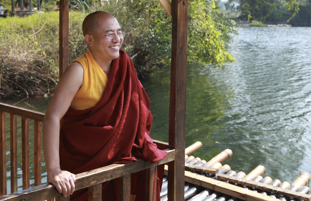

全球直播

6

人们只喜欢快乐、利益、赞叹、名声，

而不喜欢它的反面——

痛苦、衰败、讥讽、诋毁。

## 慈悲点亮人生

2015年4月26日

现场在座的道友，网络上来自各地的朋友，今天很荣幸，能利用这个时间，给大家简单解释一下八百多年前藏传佛教非常著名的朗日塘巴尊者的《修心八颂》，并给大家念诵传承。

在藏传佛教中，《修心八颂》非常著名，很多朋友应该有所听闻。它的词句看似简单，只有八个颂词，实际上意义非常深远。我个人在很早以前就得过这个法的传承，当年上师如意宝——晋美彭措法王亲自为我们传授过很多次，但我真正用于生活的，也只是其中的部分意义而已。

这部法我很早以前就接触过，一直是每日课诵最重要的内容。这个笔记本是1982年我初中毕业时买的，在法王面前得到《修心八颂》后，就将它抄在上面了。从上世纪80年代开始，这个法就一直陪伴着我，到现在已经很多年了。我对它很有感情，很有信心，充满欢喜。虽然在实际生活做起来比较困难，但我还是一直在努力。

各位应该都知道，对任何一个法而言，获得它的传承都是非常重要的。藏传佛教自古以来对法的传承极为重视，并严格要求传法者，如果自己没有得到传承，不能给他人传授。这一点，很像世间历史悠久的重要技术必须由前辈亲传亲授一样。现在的中医秘方或某些行业的秘诀，都需要来自前人的传承。

下面，我一边跟大家念传承，一边简单解释《修心八颂》的字面意思，这堂课总共8个偈颂。

## 珍爱诸有情

（堪布念藏文传承）

> 愿我以胜如意宝，饶益他众之意乐，

> 时时刻刻倍珍爱，轮回一切诸有情。

> 我发愿对天下所有众生都有爱心，时时刻刻想着帮助他人、付出自己。这种爱心的价值已超过了如意宝。愿这颗珍爱轮回一切有情的心，永远陪伴着我。

很多人都有一颗自私自利的心。将来某个时候，当我们把自私自利的心彻底放下，一心一意帮助别人，自己的人生价值就超过了如意宝。这是一个比喻。总之，愿我把所有众生都当作昂贵的珍宝来珍惜、饶益。

这里的“如意宝”，是古代一种宝珠。在古代，很多教言都以金刚、钻石、如意宝或者其他珍宝来强调珍贵的程度。在现代人的眼里，金钱才是最有价值的，才堪称最为珍贵的东西。不过，在大乘行人心里，众生才是最珍贵的。无有任何偏堕、一视同仁地帮助别人，这样一种平等的爱心，我们时时刻刻都需要保持、护持。

爱众生的心应该没有偏堕。太阳照耀大地的时候，不可能有所偏堕——所有的花草树木都会得到普照。我们爱众生的心也要像阳光一样，普济天下所有的众生。每个人都应该看看，这颗自私自利的心什么时候可以断掉，尽量提升自己珍爱众生的心。

## 较众皆卑下

（堪布念藏文传承）

> 愿我交往何人时，视己较众皆卑下，

> 诚心诚意又真挚，尊重他人献爱心。

> 愿我在任何地方，任何时候，接触任何人，总之，凡是和他人交往之时，都把自己放在最卑下的位置，而不是高高在上，心存傲慢。而且，这样的心态不是假装的，而是真心真意的。但愿每个人时时刻刻存有这样的谦卑之心。

无论接触什么样的人，都认为自己最卑下，这样的理念可能与21世纪人们的心态有些相违。现在很多人都认为，人际交往时需要展示自我的勇敢、自我的强大、自我的成功，如果让自己处于卑下、卑微或者弱小、谦虚的位置，就无法战胜自我的本质，对自我会非常不利，也与西方文化倡导的自我张扬的理念不太相符。

实际上，谦卑对自己来讲非常有意义。世间的很多错误往往是由傲慢和自满导致的。如果每个人都保持谦卑，人与人之间的摩擦和矛盾将大大减少。印度文学家泰戈尔是诺贝尔文学奖的得主，他曾说过：“当我们大为谦虚的时候，便是我们最接近伟大的时候。”

我经常观察自己，有时候觉得自己很谦卑，很不错，有时候则很傲慢，很惭愧。不管怎样，我觉得应该随时用修心教言来鞭策自己、监督自己。大家早上起来需要洗脸、刷牙、照镜子，这是对身体的观察。而对内心的观察，很多人都比较缺乏。如果能把《修心八颂》这面小镜子带在身上，则随时可以观照自己的心。

现代人只要一上网，各种知识就纷至沓来，展现在自己面前。所以说，我们现在不缺智商。那缺的是什么呢？情商和逆商。所谓的逆商，是指一个人面对逆境和痛苦的勇气、应对能力和超越方法。所谓的情商，就是我们做人的基本道德以及与人相处的基本能力。这两种“商”，现代人越来越欠缺。

我今天看到一则新闻：有一位女孩，成绩非常好，先在北京最好的大学读完了博士后，又在美国一所著名大学读完了博士后。这样一位双料博士后，毕业后因为在任何单位都没法和同事好好相处，最后长期失业，变成流浪者，在厕所、桥洞等地方过着凄惨的生活。她的护照过期后，被美国警察送回了国内。照片上的她，看起来非常可怜。

现在这样的情况越来越普遍。很多年轻人非常有智慧，却缺乏做人应有的谦卑，因为傲慢，因为得意，不愿意接受别人的批评和教诫，因而在生活中四处碰壁，困难重重，甚至到最后精神失常。

## 恒常观自心

（堪布念藏文传承）

> 愿我恒常观自心，烦恼妄念初生时，

> 毁坏自己他众故，立即强行而断除。

> 我们无论做什么事情，都要观察自己的身体、语言和心态。当发现心里生起贪心、嗔心、痴心、傲慢和嫉妒等烦恼，要当即断除。如果没有立即根除，不仅对自己有害，还会伤害他人。

嗔恨心的危害，很多人都知道。各位肯定都会承认发脾气不好，对自己不利，对他人也不利。而说起贪欲心，有些人却认为没那么恐怖。依靠贪欲，依靠爱，自他的生活能获得更多的幸福。在贪欲的价值观方面，人们有不同的观点。

实际上，如果用智慧进行观察，会发现贪欲给人带来的痛苦和危害并不低于嗔恨心。在座的各位，你们在生活中可能经常因为贪欲而苦恼，因为贪欲而恐怖，为贪欲而丧失曾经拥有的一切美好。是不是这样？

有时候，贪欲还会给人带来不健康——不仅心灵不健康，身体也不健康。很多年轻人贪执自己形体的美好，为了身材苗条，天天吃减肥药，甚至“过午不食”。不仅“过午不食”，还“上午不食”，甚至好几天不吃饭的人也非常多。本来，在佛陀的戒律里，要求出家人过午不食。但现在的出家人不执著身体，不害怕长胖，过午之后吃饭的人比较多。真的有点颠倒。

你们可能知道，现在西方国家的很多模特以瘦为美。为了长得瘦削一点，很多模特拼命地节食，听说甚至有六天只吃一两粒米的。当年释迦牟尼佛在苦行的时候，也曾几天只吃一粒米、喝一口水。模特因为执著自己的形体，行持不吃饭的“苦行”，会直接影响身体健康，甚至对生命构成危害。

最近法国准备出台新的政策[^1]，要以立法的方式改变这种观点，但估计会非常困难。这种现象的出现，和人们的贪欲直接或间接有关系。

## 爱惜恶劣众

（堪布念藏文传承）

> 愿我目睹恶劣众，造罪遭受剧苦时，

> 犹如值遇珍宝藏，以难得心爱惜之。

> 当我们遇到性格恶劣的众生，遇到被嫉妒和痛苦折磨的众生，要像遇到特别珍贵的宝藏一样，以难得之心予以帮助。不管什么时候，对那些特别可怜、特别野蛮、性格暴躁的众生，不能以愤恨的心态抛弃、舍弃，而应该用特别珍惜、难得的心态去接受、包容。

这个道理，可能不少人难以接受。现在很多人都认为，人格非常不好的人，就应该抛弃，不要接纳，因为他们会对我们构成危害。其实，另一个层面来看，这些人也非常可怜，需要有人去关注和爱护他们。在一个和谐的社会里，这非常重要。

我最近经常去一些监狱。你们也知道，关在监狱里的人，人格都不是太好，而且做过超越法律界限的过分之事。接近他们之后，我发现他们都是被烦恼驱使、没有自由的可怜之人，是最需要帮助的一个群体。

每个人身边都有很多恶劣的人，你有没有勇气来帮他们？按平常人的观念，不一定愿意。但如果你拥有一份高层次的心态，一定会承认，世间所有被遗弃的人、恶劣的人甚至造下重罪的坏人，都需要帮助。

## 亏损自取受

（堪布念藏文传承）

> 愿我于诸以嫉妒，非理诽谤本人者，

> 亏损失败自取受，利益胜利奉献他。

> 有人以嫉妒心或其他原因，对我们进行诽谤或者伤害时，应该怎么办？按世间的道理，别人无缘无故地诽谤我、伤害我，肯定要以牙还牙，想办法报复回去。但按照大乘佛教的精神，不但不应该损害他，还要主动把他所有的失败和亏损默默代受，并将自己的胜利和成功全部奉献给他。

这种精神，持世间观念的人不一定接受，但对大乘佛教的修行人却非常有意义。

学习过《普贤上师言教》也就是《大圆满前行》的人应该清楚，当年恰卡瓦格西在夏日瓦格西手中看到这个颂词时，觉得特别殊胜，想方设法四处寻找，并亲自步行，从康区去到拉萨。当他费尽周折，终于找到朗日塘巴的故乡时，朗日塘巴已经示现圆寂。于是，他在朗日塘巴的弟子面前修行了六年，并获得了成就。表面上看，这只是一个小小短短的颂词，实际上，它蕴藏的力量是我们无法想象的。

只为了一个偈颂，就从康区到拉萨，那时没有飞机，没有火车，没有汽车，连拖拉机都没有——只有马车。这样的条件，这样的苦行，这样的信心，真的是我们很多人没法想象的。

别人的所有失败由自己默默承受，这和现代理念也有些相违。但对真正能奉献自己的人来讲，却是非常有意义的。其实，世间很多优秀的人，也愿意奉献自我，愿意承受他人的失败。

刚开始，大家对大乘佛教的理念不太认可、不太接受，也情有可原。当你逐渐思维其中的意义，并经历了许许多多事情后，也许有一天，你会突然懂得：“哦，大乘佛教的教义确实非常伟大！”

## 视害如恩师

（堪布念藏文传承）

> 愿我于昔曾利益，深切寄以厚望者，

> 彼纵非理而陷害，亦视其为善知识。

> 我曾在生活中尽心尽力地帮助别人，可是他不但不报恩，反而以各种方式损害我，给我带来相当大的危害。即便这样，我也不会去报仇，依然把他当作于己有恩的善知识和根本上师，好好地对待。

这样的事，在生活中时有常发生。我们身边，有很多不报恩的人、恩将仇报的人、忘恩负义的人。这个时候，如果把他当作真正的善知识，会是最好的修行机会。修行不一定非要到山里去闭关，到不接触任何人的地方去禅修。其实，一个人躲在屋里禅修是比较容易的。直接面对社会上各种复杂的事情和人群时，自己的修行境界和修行机会可能才会真正现前。

## 代众受诸苦

（堪布念藏文传承）

> 愿我直接与间接，利乐敬献诸慈母，

> 老母有情诸苦厄，自己默默而承受。

> 我们要直接或间接把自己所有的快乐奉献给天下老母有情，而将他们所有的痛苦、困难、障碍甚至罪恶，自己默默地代受。

这是自他交换的一种修法。有时候，我们可以直接帮助众生，比如当我们身为领导、官员、商人时。有时候，我们没有机会直接帮助众生。这时，则可以通过另一种方式间接进行。总之，无有条件、自愿帮助众生的心态和行为，是大乘佛教非常重视、极为重要的菩萨行。

大乘佛教利益众生的精神，相当于母亲对孩子的爱，有时甚至远远超过它。在座的各位都知道，母亲对孩子的爱，是男女之情、朋友之情以及其他感情都无法相提并论的。

当然，也有极少数母亲不爱孩子，但这个比例应该不到1%，99%的母亲对孩子的爱都是无条件的。很多时候，即便孩子非常不听话，甚至做出非常过分的事，母亲也会一直包容。只要对孩子好，无论怎样，母亲都选择忍耐，选择原谅。

而世间其他爱却不是这样，都是有条件的：如果你对我好，我可以为你付出一切；一旦你对我不好，对我不生欢喜心，不再爱我，那我对你也不客气。这样的心态和母爱有很大的差别。因此，大乘佛教直接间接、无条件的利他心，各位应该深深地思维。

## 知诸法如幻

（堪布念藏文传承）

> 愿我所行此一切，不为八法念垢染，

> 了知诸法皆如幻，解脱贪执之束缚。

> 希望前面讲到的这些行为不要被世间八法所染污，了知一切万法如梦如幻，以此解脱贪执对自己的束缚。

世间八法，指的是人们只喜欢快乐、利益、赞叹、名声，而不喜欢它的反面——痛苦、衰败、讥讽、诋毁。从究竟实相而言，这样的世间八法其实没有染污，因为胜义中万法都是空性，世俗中一切都是如梦、如幻，如阳焰、水月等，以幻化八喻来摄持。这里讲到了空性，即大乘最高的中观见解。

关于中观的道理，因为时间关系，我不多讲，你们最好看看全知麦彭仁波切的《中观庄严论释》。幻化方面的道理，多看看全知龙钦绕绛的《虚幻休息》。对于中观和幻化的道理，这两部论讲得非常清楚。《修心八颂》是阿弥陀佛的化身——朗日塘巴尊者所造，今天讲解圆满。

还有两件事情。第一件，等会儿我用藏语传授宗喀巴大师的《三主要道论》，很多人不懂藏语，不一定听得懂。听不懂也没关系，只是念个传承而已。

另外，昨天下午尼泊尔发生了8.1级地震，死亡人数仍在不断增长。对于这次地震的遇难者、伤亡者、幸存者，我们一方面要保佑他们，一方面要超度他们。希望大家一起念108遍观音菩萨的心咒，祈求观音菩萨加持，救苦救难，解脱到彼岸。

（堪布带大家念诵观音心咒）

[^1]: 2015年3月16日消息，法国社会党籍议员韦朗（Olivier Véran）向国民议会提案修法，禁止媒体“教唆”瘦身，封杀提倡节食的“纸片”模特，并提议修改《劳动法》，要求经纪公司提供每名模特的健康证明，证明模特的身体质量指数（BMI）达到标准，否则重罚6个月有期徒刑和最高7.5万欧元罚款。
