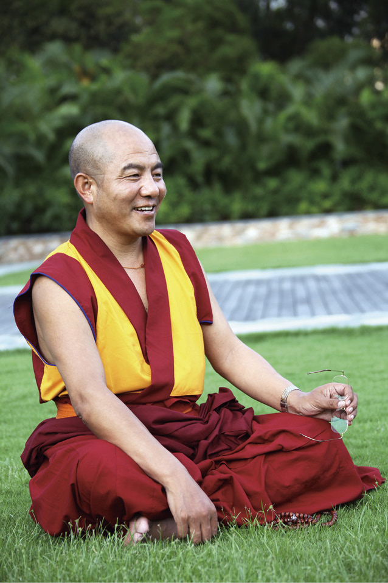

全球直播

3

无论什么样的爱，只要夹杂了自私心，

对自他而言，都必定意味着痛苦。

## 文殊智慧勇识灌顶

2013年12月28日

今天是我们第三次全球直播。首先，我们共同观看一个光盘，是法王如意宝以前传的文殊菩萨灌顶。这大概需要半个小时，之后我们简单交流一下。

## 有信心，看视频也能得灌顶

今天有英语和日语的现场翻译，可能会耽误一点时间。法王的灌顶视频，希望大家认真地聆听，因为今天是一个非常殊胜的日子，法王的灌顶也很有加持力。

观看文殊菩萨灌顶的视频，能不能得到真正的灌顶呢？我不做明确的说明。如果你信心非常大，也许能获得真实的灌顶。但不管怎样，通过这个光盘，大家一定会获得老人家的加持。法王如意宝离开我们很快就十周年了，为了纪念老人家来此世界为众生转无上法轮，我今天特意把他在国外传过的文殊灌顶，拿出来和大家共享。

当然，看这个视频是有要求的。如果你对密法、对佛法没有信心，最好不要看，看了也不一定得到真实的加持。我昨天在网上讲了，观看光盘的人最少也要念1万遍文殊心咒，中等的念5万遍，上等的念10万遍。如果在100天内不能完成念诵数量，也最好不听。今天纯粹是佛教徒的活动，对非佛教徒来讲，这样安排对你们是最有利的。

当年法王如意宝去美国的时候，没见过第一世敦珠法王，只在一个道场找到了敦珠法王留下的观音菩萨灌顶视频。法王如意宝非常认真地观看了视频，接受了灌顶。今天网上有好几万人，很多人也没见过上师如意宝。不管怎样，这是一个很好的缘起。大家在观看时，一定要观想自己真正见到了法王如意宝，老人家亲自为我们灌顶。带着这样的恭敬心、欢喜心和诚挚心，下面我们共同观看。

## 恭敬诚挚，接受灌顶

（播放法王如意宝的灌顶视频）

下面观想，为了度化天边无际的一切众生，接受甚深灌顶。大家先要发菩提心。今天所听的是文殊智慧勇识的灌顶。下面观想十方三世诸佛的本体是金刚上师，并祈祷金刚上师为我等灌文殊智慧勇识的顶。法王念一遍，我们跟着重复一遍。

祈祷金刚上师为我们灌顶，如是三遍之后，上师会开许说：“在座具有信心和智慧的各位弟子，对弘法利生有强烈的意乐，可以给你们灌文殊智慧勇识的顶。”这是上师对我们的一种开许。

下面是皈依和发心。大家心里想，“从现在开始，乃至菩提之间不舍弃文殊菩萨，并发愿今生乃至生生世世都要利益无量的众生”，然后念诵皈依偈和发心偈。

接下来，我们观想自己的身体是黄文殊，一面二臂，手持宝剑和经函，身上装饰着十三种报身服饰，坐在莲月上面，具有非常美妙的身体。

现在观想从自己这个文殊菩萨的心口发光，从五台山迎请无数的智慧文殊菩萨，融入自己的身体。

再观想，从上师加持的文殊菩萨身像中，显出第二尊文殊菩萨，融入我们的身体，我们由此获得了文殊菩萨的身金刚、语金刚、意金刚以及所有的智慧、加持、功德和悉地。大家一定要好好观想，从法王那里得到了真正的文殊菩萨的灌顶和加持。

## 灌顶之后，三个交代

### 1．会修文殊本尊

接受完上师如意宝文殊智慧勇识的视频灌顶后，我跟大家讲几件事情。首先，今天得到了文殊菩萨的加持，希望在座的各位都能开启智慧，获得和文殊菩萨无二无别的果位。文殊菩萨是三世诸佛的智慧总体，他的发心与其他菩萨截然不同。我们经常祈祷，一定会得到他的摄受和加被。

今天接受加持的人，一定要念文殊菩萨的心咒“嗡阿Ra巴匝纳德”。法王如意宝老的传承弟子，几乎都曾发过愿，此生念1亿遍文殊心咒。现在大城市里的人，能不能念这么多很难说，但不管怎么样，大家要会修文殊智慧本尊。念诵文殊心咒的时候，先在自己前面观想一尊黄文殊或者白文殊，他的身体发光融入自己，自己的身语意都分别得到了文殊菩萨身语意的加持。经常这样修持，将来利益无量无边的众生，不会有任何困难。

我们修文殊法门的目的是什么？为了得到和文殊菩萨无二无别的智慧。作为修行人，我们需要有智慧和慈悲心。智慧有很多层次，我们需要的是通达一切万法真相的究竟智慧。要得到这样的智慧，除了自己的努力外，我们还需要文殊师利菩萨的加持。

### 2．了知慈悲心的重要

第二个，我们需要用一颗慈悲心，去拥抱全世界所有的人和各类众生。这样的慈悲心是一种无私的大爱，而不是自私的执著。无论什么样的爱，只要夹杂了自私心，对自他而言，都必定意味着痛苦。在这个世界上，所有的国家、民族、种族以及小小的家庭和个人，需要的都是这种无私的慈悲心。

慈悲心和物质享受是不同的。物质享受，比如名车、豪宅或者Iphone，有些人需要，有些人则不需要。而这个世界的任何角落，都需要慈悲心，无论是国家、家庭，还是个人，甚至一只小动物。如果没有慈悲心的阳光和雨露，这个世界将是一片寒霜，满眼枯槁。

今天的网络和现场，有东方人，也有西方人。我们住在喜马拉雅山的脚下，感受着零下20多度的寒冷；也有一些人在海滨城市，享受着20多度的温暖。虽然住的地方不同，生活习惯也不同，但我们每个人都需要爱。这种无私的爱，就是佛教讲的慈悲心。

东西方的文化差异很大。我今年上半年去了美国和德国的学校，下半年去了新加坡和柬埔寨等国的学校。国外的很多学者和学生都特别向往藏地庄严的布达拉宫，对藏地独特的文化也特别感兴趣。凡是和我接触的人，我都对他们讲：藏地所有的文化和风景中，最美、最有价值的是大乘佛教的慈悲心——它能为任何一个人带来利益。

无论你们住在汉地的大城市，还是其他国家，我都特别希望，你们对藏地的渴求中，包含着慈悲心的精华。在藏人心目中，人生最重要的是修持慈悲心，藏传佛教的经论中也有许多关于慈悲心的修行窍诀。你们如果有机会来藏地，一定不要忘记这颗甚深的珍宝，一定要想办法得到。

如此珍贵的慈悲菩提心，依靠什么样的方法才能得到呢？如果它是一处矿产，可以用挖掘机挖出来；如果它是一片森林，可以用锯子锯下来。但它既不是坚深的矿产，也不是脆弱的森林，它深藏在我们的内心，只能依靠前辈大德的窍诀工具来开发、显露、圆满。

我一生遇到过很多人，其中有不少对我有很大的恩德。在这么多人当中，我最为感恩的，就是刚才你们在视频中看到的上师如意宝。因为他给我和我的很多朋友都传授了慈悲菩提心的窍诀。在这个世界上，最珍贵的东西莫过于慈悲菩提心，如此珍贵的教言是很不容易得到的。上师如意宝毫无保留地将菩提心的窍诀传给了我们，我发自内心地感激。

### 3．次第修学菩提心

我们对自己的家人、亲戚和朋友的爱，叫做相似的菩提心。真正的爱是无条件的，而且愿意帮助一切众生。真正的慈悲心没有局限，它广大，深厚，无边无际。它既不能用金钱交换，也不能用地位倾轧，更不能用权力抢夺，只能通过三种途径得到——藏传佛教所提倡的闻、思、修。你们如果想得到它，藏地有特别丰富的论典和窍诀等着你们。

在藏传佛教里，闻思修非常重要。像慈悲心等法门，如果没有依止具有慈悲心、菩提心的老师，没有在老师座下好好听闻，我们不可能知道菩提心的理论、实践和窍诀。藏传佛教的修行人学修任何一个法门，都要先在一个合格的老师那里聆听教言，然后进一步去思考、辩论、探讨。通过各个环节的反复思维，彻底遣除内心的一切怀疑和困惑，最终认定这个法很纯洁、很真诚，值得自己用一生去实践，再开始坐下来串习——不断地串习，长久地串习。

这样的过程，就叫做修行。就像世间学开车，先要到有经验的师傅那里去学，光一次还不行，需要不断地学，学会了还要继续修炼一段时间，才能离开师傅，自己单独上路。

慈悲心需要长期的修学。千万不要认为，短短两三年甚至几个月，自己就能像前辈大德一样生起无伪的悲心。我在这里特别祈求大家，一定要把慈悲心当作一辈子的修行，千万不能半途而废。

有了慈悲心，我们不论行什么善、修什么法，都很容易成功。相反，如果没有慈悲心，其他法都没办法行持——除非你不是大乘佛教徒。总之，不管什么身份的人，修慈悲心都有很大的利益。对个人来讲，你会成为一个善良的人；对周围的人来讲，你的慈悲心会给家庭和社会带来和睦、和谐和快乐。

## 结语：三个希望

最后，我再说三件事情。现在全世界的很多佛教徒，通过系统的学习，都变得越来越有智慧，越来越有悲心，越来越有信心。也有相当一部分人，没有系统学习，整天耽于佛教的仪式和形象。虽然仪式和形象也很重要，但作为一个佛教徒，最根本的是遵循善知识的引导，有次第地闻思修行。看到20年前的一些佛教徒，到今天没有一点进步，我心里十分悲伤。

因此，我特别希望每个佛教徒、其他宗教徒甚至无有任何信仰的人，每天都进步一点点。进步的根源在于学习，每天不断地学习。如果不学习，我们的大脑会退化，思维会迟钝。为自己、为他人，我们都需要学习。这是第一件事。

21世纪的今天，做恶事非常容易。有些人依靠因特网，整天沉浸在暴力和色情中，甚至搞到身心崩溃和分离的地步。这样的恶劣行为，如果要学，很快就能学会。

但通过科技便利，我们也可以学到正能量，学到善法。希望现场和网络上的道友，好好利用这样的平台，学好以大悲心为主的佛法思想和智慧。这对自己，对他人，都非常有利。

从现在起，我们每个人都有责任，运用自己的智慧和能力，发挥自己的作用和才华，管理好能为整个人类带来利益的一些组织。希望每个人都能这样发愿。这是第二件事。

再过两三天，2013年就成为历史了。崭新的2014年，即将来到我们身边。按照藏地的习俗，在新一年的开端，每个人都会发善愿，比如这一年要做一件大的善事，每月做一件中等的善事，每天做一件小小的善事，哪怕对别人微笑一下、赞美一句，等等。

我特别希望在座的各位在新年来临之际，好好发愿。从今天开始，乃至有生之年，每年年初都好好地发一下善愿。对人类、对社会有利益的事情，我们一定要在内心有计划、有步骤地推进。今天有非常殊胜的因缘，大家又相聚一堂，希望每个人都好好发愿。以后每次遇到这样的时候，也要记得发这样的善愿。这是第三件事。

今天我们有好几万人一起聚会，真的特别不容易。平时大家都很忙，每个人的时间都很宝贵。今天各位能空出时间来共同学习佛法，学习慈悲心，我个人觉得很有意义。

下面我念几个传承，一个是《文殊礼赞》，一个是法王如意宝在印度金刚座造的《愿海精髓》，还有几个咒语的传承。前面两个我单独念。后面念咒语传承的时候，我念一遍，你们跟着念一遍。然后用法王如意宝的《愿海精髓》——网上有藏、汉、英三种文字，大家一起回向，今天的活动就算圆满了。

（堪布念藏文传承）
