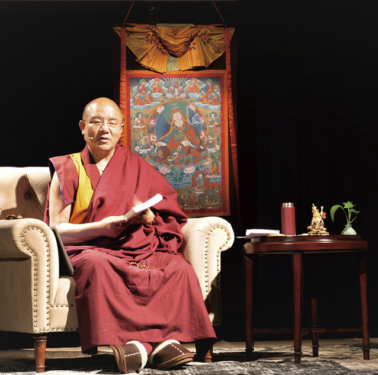

全球直播

15

“经常祈祷，获得加持”，

这句话我是深信不疑的。

## 殊胜的加持

2017年9月24日

今天是星期天，很多人放弃了修行和休息的时间，一起来学习《莲师七句祈祷文》，我个人非常随喜。不管怎么样，对内心的财富有所重视，是一件很好的事。今晚讲课的时间在一个小时左右，希望我们大家共同思考，共同分析。

## 关注内心，做一个有深度的人

《莲师七句祈祷文》有很强的专业性，是佛教内部一个特殊的祈祷文。今天在座的大多数是佛教徒，也有一部分是来观光旅游的，非常欢迎。不管有没有宗教信仰，在这个共享时代，我们彼此用包容开放的心态进行学习和思考，非常有意义。

今天讲的内容，与以往有一点点不同，因为涉及佛法的实际修持。现在这个时代，很多人都需要通过禅修、祈祷和念咒等来达到内心的平衡。这样的话，生活质量会提升，工作效率会提高，心情会越来越舒畅，外境也会变得越来越美好。因此，不管什么身份的人，关注内心都很重要。

同时，我们还要努力寻找神秘的力量。在这个世界，有很多不可思议的奥秘人类没有发现。有一部分，已经被发现了，但有些人还没有分享到。还有一部分，未来随着宗教和科学的发展，必定会不断发现。总之，有许许多多的境界和奥秘，等着我们去探索。

所以，我们很有必要在深度上下功夫，比如深入地学习、深入地思维，寻找有深度的行为。这对每一个人来讲，都很重要。虽然我们很多人希求的是整齐、秩序和统一，但仍然有一部分人走的路跟大多数人不同，并在自己的领域找到了不可言说的力量。

顺便跟大家分享一本书。我以前写过的《苦才是人生》，现在翻成了英文，名叫《转变逆境的故事》，9月19日在海外上架，副标题是“一个佛教徒对生活起落的感言[^1]”。不知道通过哪些途径可以买到，据说在很多英文平台上都有。我不是特意在这里打广告，这本书卖多卖少跟我没什么关系。

不过，我希望中文版的《苦才是人生》，能给学佛和不学佛的部分有缘人，带来一点点利益。现在藏文的版本也翻译出来了，不知道效果怎么样。

“苦才是人生”的说法在西方国家不一定受欢迎。在西方，无论是不学佛的人，还是以佛教眼光认识痛苦本质的人，他们的结论可能都是：“苦”不是人生，“乐”才是人生。所以，英译的书名特别强调了怎样在逆境中站起来或者如何在逆境中重生的问题。把它归于故事也好，教言也好，探讨也好，反正说的都是一个道理。

我这里也是在兑现给他们的承诺——这本书翻译出版以后，要在不同的场合告诉大家。我也希望西方人，或懂英语的人，通过这个版本的交流，给今生和来世带来一些利益，比如得到身心的少许快乐，乃至最究竟的解脱。

## 世界异彩纷呈，当观清净心

在座的大多数是佛教徒，应该知道佛教有很多不同的宗派。像基督教的话，基本上是同一个宗派，分支不是很多。虽然他们也有新派和旧派之别，由于国家和文化的差异，也有另外的一些分类，但总的来看，不像佛教的宗派那么多。

在佛教内部，大的方面分为藏传佛教、汉传佛教和南传佛教。每一个教派又分了很多支派。像藏传佛教，又分为宁玛派、格鲁派、萨迦派、噶举派、觉囊派等。汉传佛教分为禅宗、净土宗、律宗、天台宗、华严宗、密宗等，也有很多很多。

南传佛教我没有怎么研究，只听了他们一些高僧大德的演讲和修法，大概知道他们内部的一些差异。在缅甸、泰国和斯里兰卡，大德们传讲的教言皆不相同。虽然他们在四念处和四谛方面的修行基本一致，但在女众出家的开许和遮止、优婆塞的戒条、比丘戒的数量等方面都存在不同观点。

不过我认为，不管佛教也好，别的宗教也好，内内外外有一些不同很正常。如果因为彼此不同，就互相排斥，甚至拒绝学习对方的优点，则非常不合理。在座的各位虽然有些学的是藏传佛教，有些不是，但大家都要有一颗接纳其他宗派的包容之心。大海连百川都可以接纳，我们人类更要接纳不同的思想。

有了这样的胸怀，我们自然会收获更多的加持、智慧和慈悲。虽然大家都在学佛，但每个人得到加持、智慧和慈悲的缘分却有所不同。而缘分从哪里来？需要依靠自心的力量来创造。因此，大家最好不要因为内心的狭隘，堵塞自己善缘的门。

七句祈祷文虽然是藏传佛教最古老的宁玛派的祈祷文，但藏地大多数宗派都很重视。不管是噶举派、萨迦派，还是格鲁派等，很多大德都在念诵。汉传佛教各教派的修行人也有念诵的。同样，像格鲁派和萨迦派的一些仪轨和祈祷文，宁玛派也会念诵；汉地禅宗、华严宗和净土宗的法，我们藏地也会学修。比如汉地净土宗的阿弥陀佛名号，我们藏地没有任何分别，出家在家的修行人都在念。所以说，包容的观点和思想真的很重要。

前段时间我在课堂上也讲了，有些上师显现上比较排斥其他教派，不太愿意接纳不同的观点。上师这样，那弟子也会这样，这是一个自然的规律，有什么样的老师，就有什么样的学生。一个企业的董事长肯定会影响很多员工的思想，员工的愿景和思路必定会随上司的愿景和思路而转。在这个世界，佛教徒的人数本来就不是很多。我们现有的这些佛教徒，应该互相学习，共同进步，而不是嫉妒诽谤，甚至互相攻击。自古以来，因为嫉妒心，弟子和上师所做的很多事情最后都不是很如法。

我个人的话，由于受法王晋美彭措平等开阔、高瞻远瞩的知见影响，三十年以来，对每一个宗派都有清净心、恭敬心和欢喜心，甚至有生之年一直在力所能及地学习、祈祷和修行。藏传佛教也好，汉传佛教也好，我对两地大德们的教言一直都以恭敬心和欢喜心来接受。到汉地寺院去的时候，看到高僧大德的照片和塑像，我总是一视同仁、诚心诚意地顶礼、膜拜和供养。

今天在座、在线的所有佛教徒和非佛教徒，都应该有广大的智慧和心胸，不要以狭隘的心态，与各方面都不相容，对这个宗派看不惯，对那个宗派看不惯，甚至看到有些宗派比较成功和兴盛，就不断燃起嫉妒和嗔恨的火。这样的话，会焚烧自他所做的三时一切善根。

我们应该像前辈高僧大德所讲的那样，以清净心和恭敬心经常祈祷真正超越世间的高僧大德和诸佛菩萨。他们无缘的大悲直接或者间接融入我们的相续后，我们会不断开发出自己的智慧和悲心。一旦具足这样的因缘，我们这些渺小的区区凡夫，也可以影响身边的很多人。就像一盏明灯，虽然很小很小，但它发出的光也能遣除黑暗。如果有千千万万这样的小小明灯——慈悲，智慧，具有信心和恭敬心，对佛教的道理精通无碍，点亮在世界的各个角落，末法时代的五浊黑暗，也有遣除或者消于法界的可能。

作为佛教徒，宗派与宗派之间一定不要相互生嫉妒心，说一些不合理的话。虽然我最近没有听到互相排斥和嫉妒的任何事情，但提前说一下可能比较好。一旦事情发生了，再说可能已经晚了。我们藏地有一个说法：“水没有来的时候砌水坝很重要，风没有来的时候做围墙很重要。”总之，佛教徒之间也好，佛教徒跟其他宗教人士之间也好，最好不要有任何冲突，应该互相理解和恭敬，互相尊重和学习，互相谦让和包容。

想一想我们人类居住的这个世界。银河系无边无际、浩瀚无垠，地球是那么渺小。地球上的生物千千万万，人类是那么稀有。人与人之间，佛教徒与其他宗教徒之间，没有什么需要争执的东西，更没有什么扯不清楚的问题。我们共同居住在这个世界，可以有不同的见解，不同的文化，不同的生活方式。

不管怎么样，我们人类还有一个共同的究竟目标，那就是离苦得乐。这一点，世界的各大宗教也好，佛教内部的各个教派也好，大家的教义和主张都是一致的，可以说是殊途同归。所以，我们应该把心静下来，好好想一想。千万不要在佛教徒当中搞各种各样的分裂活动，制造不团结的因素。这样的行为，从因果层面来讲，会造下弥天大罪。人生很短暂，这样做没有任何必要和意义。

我们每一个人，都应该像佛经里讲的那样，守护自己的口，守护自己的心，守护自己的行为。总之，三门一定要守护好。这样一来，佛法会有弘扬的机会，自心也有调伏的可能。在观清净心方面，我大概就讲这么多吧。

## 简单的修法，不简单的力量

莲花生大士七句祈祷文的这个简单修法，我是刚刚翻译完的，今晚先把藏文念一下。这是伏藏大师格热秋旺[^2]的伏藏品。本来伏藏品的后边会有“印！印！印！”的文字，意思是保密、保密，但这个伏藏品后面却没有——既然没要求保密，我也就没有必要保密吧。

格热秋旺在伏藏大师中是非常了不起的。我前几年翻译的《藏密佛教史》里有他的介绍，大家可以看一下。他好像20岁到了五台山，依靠梦的境界，见到了文殊菩萨，得到了八万四千法门的加持，后来开启了很多伏藏法门。此外，他还到莲花生大士那里获得过灌顶。他一生开启了18个大伏藏品和1个意伏藏，历史上对藏传佛教的贡献非常大。这位伏藏大师应该是1212年出生，1270年圆寂，离现在有800多年。你们如果想进一步了解，《藏密佛教史》当中有。

（堪布念藏文传承）

希望大家经常念诵莲师七句祈祷文。它有内外密三种注释，全知麦彭仁波切造了一个，叫《白莲花》。我记得是2009年9月25日开始讲的，不知道讲了多少堂课。当时只讲了外修部分，内修没有讲，密修更没有讲。很多人因此对莲花生大士产生了极大的信心，经常念莲师的心咒和七句祈祷文。离现在已经七八年了吧。

刚好，现在也是9月份，我们再讲一遍。当时听过的道友应该知道莲师七句祈祷文的大概内容。不过今天跟大家讲的内容比较新，是伏藏大师格热秋旺开启的七句祈祷文的修法。

麦彭仁波切在《白莲花》中引用过印度的一个公案。有一次，印度那烂陀寺的佛教大德们，受到了其他宗教的攻击，情况十分危急。这时，一位班智达得到了胜髻空行母的授记，说这样下去佛教肯定会失败，最好恭敬祈祷她的兄长莲花生大士，他也许能打败对方。

班智达说：“祈祷莲花生大士恐怕没办法吧，他正在尸陀林中静修。”胜髻空行母说：“莲花生大士的成就不可思议，你们的祈祷可以如愿。”于是，班智达们一起念诵七句祈祷文进行祈祷，莲花生大士果然亲自现前，摧毁了对方各种见解，佛教最终获得了胜利。

你们看，印度很多班智达都曾异口同声念诵莲师七句祈祷文。《白莲花》中讲，如果经常念诵七句祈祷文，尤其是用动听悦耳的声音来祈祷，莲花生大士一定会从清净刹土，以最快的时间来到我们身边，对我们的身口语赐予加持。这是莲师前往罗刹国之前亲口承诺过的。

当然，你如果没有任何信仰，那今天这个话题则无从谈起。只有在信仰的基础上，大家才可能有共同语言：要么赞叹，要么批判。在世间办一个科学讲座，参加者对科学的态度也应该是要么排斥，要么接受。没有这样的思想基础，就没办法进行交流。在座各位的时间都那么宝贵，如果没有任何信仰，或者对佛法一点不感兴趣，也不可能来跟我们探讨这个话题。

## 莲师的深恩，生生世世

今天话题的根本，涉及生命中一些神秘力量。当年，是莲花生大士来到藏地，开创了藏传佛教的先河。当时藏地的邪魔外道极其猖狂，国王赤松德赞实在没办法，派人从印度迎请莲花生大士。莲师应邀来到藏地后，把人和非人的危害全部摧毁，建立了藏地第一座寺庙——桑耶寺。从此之后，旧派和新派所有的寺庙和教证二法，陆陆续续在藏地开花结果。

我们如果是知恩报恩的人，对藏传佛教的奠基人莲花生大士理应生起由衷的感恩之情。现在很多人经常对我讲：“如果没有当时的你，就不可能有今天的我。”当然，这也是一种感恩心。不管是回顾历史也好，观察自身也好，莲师对我们的恩德都是非常深厚的。当年莲花生大士如果没有来到藏地，没有降伏邪魔外道，没有建立第一座寺庙，如今藏地的佛法不可能受到世界的瞩目。现在不管是学新派的，还是学旧派的，在全世界信徒的心目当中，藏传佛教的真理光芒都非常耀眼。

依靠藏传佛教，许多人的命运从根本上得到了改变。这一点，每一个人真诚反观自己的时候，都不得不承认。原来没有信仰的时候，自己是怎样一个可怜的漂泊者；有了信仰，尤其是获得了藏传佛教具有强大力量的密法以后，自己如何将贪嗔痴等各种汹涌的烦恼和分别念无情斩断，无余斩断……这样的智慧，这样的力量，都来自莲师的教法，来自莲师的恩德。

我相信，有智慧的人通过历史记载，以及莲花生大士留下来的所有珍贵伏藏品和其他显密教法，完全清楚这些事实。释迦牟尼佛也曾经这样说过：“利根者通过我留下的《大藏经》的显密教言，就知道释迦牟尼佛真的曾经出现于世，但钝根者不一定通达，因此我特意在菩提迦耶留下脚印。”所以我们现在还能看到佛陀留下来的脚印。同样的道理，莲花生大士给我们留下了这么多的事迹、法本和教言，有智慧的人通过它们，应该知道这一切都是真实的，并非神话传说。

而且，依靠莲师留给我们的法本，在21世纪的今天，我们依然可以通过修持，断除自己相续中的烦恼，增上无漏的智慧。有了这样的人生经历和体验以后，大家应该知道莲花生大士无畏的智慧和悲心到底是什么。不过，对于有些钝根者，通过再多语言文字的描述也不一定能明白。

## 捧出最诚挚的心，与莲师相应

今天我很高兴，与如此殊胜的法结上了善缘，也与各位有缘人结上了善缘。有了网络平台，我们大家都不用特别劳累。以前，很多高僧大德为了求法，甚至为了听一堂课，会经受很多的艰辛和劳累。现在学一门世间知识，也需要有所付出，要么付出时间，要么付出金钱，要么付出其他代价。我们彼此都做些让步，能在共享时代和大家分享莲花生大士的教言，也是一个很好的机缘。

### 1．一心一意皈依

《上师密意集》是伏藏大师格热秋旺一个特别大的伏藏品，《宁提七句祈祷文》就出自这部大伏藏。接下来，我们一起来学习。

## 《宁提七句祈祷文》

格热秋旺尊者·开取

索达吉堪布·翻译

> 顶礼修行之本尊，后代具缘善男子，

> 若寻邬金我救护，自住寂静之圣地，

> 生起无常厌离心，厌弃轮回尤重要。

> 一心一意依附我，复思其余皈依处，

> 邬金我中悉圆满，苦乐指望您尽知，

> 不断供赞断积财，以身语意三恭敬，

> 依此七句而祈祷，屡屡祈祷而念诵：

七句祈祷文是莲师的修法。这里所说的上师，指的就是莲花生大士。首先伏藏大师顶礼本尊，然后说：“后代有缘的善男子，如果皈依我莲花生大士，你们最好集聚在一个非常寂静的地方。”修这个祈祷文，最好在寂静的地方，先在自相续中生起万事万物都是无常的观念。因为万法无常的缘故，我们对世间法才会生起极大的厌离心，从而希求从轮回中解脱。生起厌离心和出离心非常重要，因为不论修什么法，都需要这两种心。

接下来，真心诚意地观想莲花生大士。虽然世间有各种各样的本尊、天尊，但我还是非常真诚地皈依莲花生大士，祈祷莲花生大士。不管修什么法，都需要一心一意。修阿弥陀佛要一心一意，修释迦牟尼佛要一心一意，修观世音菩萨也要一心一意。

因此，我们要在心里真诚地思维：“莲花生大士，您是三界有情的皈依处，一切的皈依都圆满于您。生活中发生的一切，苦也好，乐也好，将来的希望也好，现在的担忧也好，所有的心态、生活和工作，您都以尽所有智和如所有智悉皆了知。总之，今生一切的一切，来世一切的一切，您的智慧都恒时观照。今天修这个法，不求名，不求利，不求财，只是三门恭敬地皈依您，身体恭敬地顶礼膜拜，内心恭敬地祈祷，语言真诚而欢喜地念诵七句祈祷文。”这是具体的修行方法，比较简单。一定要修，哪怕一天修一个小时也好。

### 2．一心一意祈祷

> “吽！

> 邬金刹土西北隅，莲花蕊茎之座上，

> 稀有殊胜成就者，世称名号莲花生，

> 空行眷属众围绕，我随汝尊而修持，

> 为赐加持祈降临，格热巴玛色德吽。”

接下来，我们要一心一意念祈祷文。祈祷文中的邬金刹土西北隅，是莲花生大士降生的地方。以前我讲过，阿弥陀佛心间的“舍”字，投射到了南赡部洲邬金刹土西北地方的一个湖里。国王恩扎布德到湖里去的时候，这个“舍”字在红色莲蕊上变成一个八岁童子。国王见了非常欢喜，便接回王宫养起来。童子长大之后，成就的功德自然而然显现。在莲花蕊上化生的这位殊胜成就者，在世间的名字叫做莲花生大士。这在莲师很多传记中都有记载。

莲师传记有各种各样的版本，我最近想翻译一部短一点的——以前放牛的时候，我天天都喜欢念诵。它的第一品讲莲花生大士在印度示现八大化身的状况[^3]，第二品讲莲花生大士到藏地弘法的情景，第三品讲莲花生大士前往罗刹国的整个经过。这三品把莲师在南赡部洲很多众生面前显现的事迹基本上圆满讲完了。有个伏藏大师叫做华沃·秋阳多杰，又名勇士法界金刚，这个短的莲师传记便是他的作品。

我在很小的时候，就对莲师有特别大的信心。那时每天都放牛，有时候牦牛找不到了，我就祈祷莲花生大士，千万不要让它被豺狼吃了。放牛的时候，丢失一头牛是生活中最大的痛苦。后来读书了，考不上学校便成了最大的伤心。每个人在不同的人生阶段，都有不同的痛苦。但不管怎样，我每次遇到痛苦，都会念度母和莲花生大士的祈祷文。

当然，当不可逆转的业力现前时，莲师也救不了。但凡师可以逆转的事情，莲师给到我们的慈悲加持，各人心里应该很清楚，正所谓“如人饮水，冷暖自知”。不过，对于这些道理，有些人尤其是邪见者，不一定明白。

后面四句，“空行眷属众围绕，我随汝尊而修持，为赐加持祈降临，格热巴玛色德吽”，意思是说，莲花生大士有很多眷属，勇士啊，空行啊，他们全部围绕着莲师。我们真诚地祈祷莲花生大士：“我们随顺您而修持，希望您降临此处，赐给我们加持。”通过祈祷，我们真的能感召莲花生大士降临。事实上，任何人祈祷，莲花生大士的智慧身都会降临。

“格热巴玛色德吽”，格热是上师的意思，巴玛是莲花生大士，色德是成就悉地，吽在这里是印持、祈祷。这句话的意思是，祈祷莲花生大士，请您赐予我们悉地，赐予共同和不共的成就。

七句祈祷文看起来很短，就像汉传佛教的“南无阿弥陀佛”“南无观世音菩萨”一样。没有信仰的人也许会觉得，这么简单的文字哪有那么大的力量？力量与文字多少没有太大关系。世间的很多真理，用的文字也很少。比如万有引力定律，只有六个字，很少很少，却归纳了宇宙真理的不共精华。所以，我们不要小看七句祈祷文，它里面含藏着不可思议的力量。

我2009年翻译过噶玛朗巴的《莲花生大士心咒功德文》。里面讲到，我们念诵莲师心咒“嗡啊吽 班匝儿格热巴玛色德吽”时，不单是在祈祷莲花生大士，包括五方佛在内的十方诸佛菩萨都包含了。念七句祈祷文也一样，也是在祈请以莲花生大士为主的十方诸佛菩萨。这是特别殊胜的一个迎请祈祷文，可以在很快的时间内把诸佛菩萨迎请到身边。

藏传佛教的修行人在闭关的时候，大修的时候——比如修长寿佛、修忏悔等法门，刚开始都要先念三遍七句祈祷文，迎请莲花生大士，再正式入关或修法。这样祈祷以后，得到的加持真的不可思议。

我希望道友们以后不管是闭关也好，课诵也好，进入修法仪轨之前，最好先念一下上师瑜伽，再念三遍莲师七句祈祷文。开法会或者其他场合，也要用这种方式来得加持。这非常重要。

纽约一个乐队，演唱了莲师七句祈祷文和观音心咒，给大家分享一下。在西方，也有很多人依靠七句祈祷文获得了加持。大家看的时候，不要像看电视节目一样，要用点心。西方人用他们真诚的信心，把自己的文化和七句祈祷文融为一体，迎请莲花生大士。我们平时以自己的方式迎请，今天派西方人用他们的方式迎请。希望莲花生大士的加持融入每一个人的心。大家体会一下，这是一种什么样的感觉。

（视频播放莲师七句祈祷文唱诵）

### 3．真诚的心，必有感应

> 强烈深情泪涌流，由信引生身颤动，

> 顿然安住清然中，澄然本然不散观，

我们在祈祷的时候，对莲师产生了极大的信心，最后因信心感召而泪流满面——真诚和信心会显现出各种不同的感应。我们的心很重要，通过信心，通过智慧，通过真诚来祈祷，肯定会有感应的。猛厉地祈祷以后，密法的一些境界也可以了然而住。也就是说，通过祈祷，最后上师莲花生大士跟自己的心无二无别，在清然和本然中，不散射、不散乱而观自心的本性。

最近，密法班一直在讲观心性的方法。如果说大一点，莲花生大士跟自己的自然本智觉性并非他体，而是无二无别，无离无合。如果没有这样的境界，也没有得过灌顶和这方面的甚深教言，那通过自己的信心，向诸佛菩萨的总体上师莲花生大士祈祷，也一样可以得到加持。“如是祈祷的善男子”，莲花生大士亲口说过：“我会永远救护你。”只要真诚祈祷莲师，很多地水火风的世间灾难都可以消除。

有时候看新闻，现在发生好多灾难，我禁不住想：大家确实需要共同祈祷莲花生大士。今年美国出现了三四次飓风，这应该是他们国家有史以来最大的灾难。经济损失已经上千亿美金，几百万人无家可归，流离失所。前一段时间，也就是9月3日，川普专门为此举行了祈祷。当然，他们是以基督教的方式祈祷的。

遇到地震、海啸的时候，大家如果共同祈祷，的确可以消除一些灾难。今年墨西哥发生了很多次地震。这个国家在1985年发生过一次特别大的地震，造成7000多人离世。今年9月19日，为了纪念那次特大地震，他们进行了一次地震演习，结果，演习结束大概两个小时，就发生7级地震，死了很多人。我们从电视里看到，在这场天灾前，人们非常悲痛，很多救援人员在手臂上书写自己的名字、血型、亲属电话等个人信息，以防不测。在大自然的灾难面前，人类的生命真的特别脆弱。

这个世界充满了各种各样的痛苦：战争，地震，疾病，内心的种种不安……现在很多年轻人，外面没有发生灾难，内心却掀起了飓风。最近美国有一对夫妇，离婚时因为互相争执，开枪杀了七八个人。

面对各种各样的灾难，我们最好把心静下来，一心一意祈祷莲花生大士。对世界的和平也好，家庭的和平也好，自己身心的和谐也好，祈祷都有不可思议的力量。这种力量用语言来说很苍白，用文字表示很无力，但依靠这样的祈祷，人类无法应对的大灾难来临时，的的确确可以消除我们的痛苦和恐怖。

除了七句祈祷文，莲花生大士的心咒也有非常大的功德，这在噶玛朗巴的伏藏品《莲师心咒功德文》里有详细介绍。说大一点，可以让所有众生都得到和平与快乐；说小一点，可以让我们的民族和家庭安居乐业、幸福和睦；再说小一点，可以让我们自己身心健康，心情平和，生活和工作不出任何违缘。

曾经有个记者问我：“你最大的成功是什么？”我说：“能够平安地活到今天。”我内心的确是这么想的。我们能够活到今天，在这么多灾难中都没有死去，真的是一件非常幸运的事情。

世上的灾难和不平都是依靠因缘而生的，其中有些因缘可以通过祈祷来遣除。为了全世界的苦难众生不再受苦，获得快乐，现在我们一起来祈祷莲花生大士。刚才西方人用他们的方式祈祷了，现在我们用我们的方式来祈祷。大家先念三遍七句祈祷文，再念100遍莲师心咒。

（堪布带领大家共同祈祷）

小时候，我家经常在晚上念100遍莲师心咒和几百遍观音心咒。有时候父亲当维那师，有时候母亲当维那师，有时候我和弟弟妹妹轮流当维那师——轮到当维那师是一件很荣幸的事。为了当维那师，我经常私下跟父母搞关系：“我今天好好放牛，晚上能不能让我当维那师？”如果不让当，就跟父母闹别扭。甚至轮到弟弟妹妹时，还会跟他们谈判：“我给你一颗糖，今天你可不可让我当维那师？”那时觉得维那师很有地位。今天我又当了一次维那师，带领大家念诵七句祈祷文。

世界上的人有这么多，如果大家都有一颗真诚的、没有杂念的心，应该可以为自己、为家人、为国家，乃至为整个世界，做一点力所能及的事。在这个世界，很多人本来不该死，却提前离开了；本来不该病，却因为福报和因缘不够，感受极大的病苦。作为一个大乘佛教徒，释迦牟尼佛和诸佛菩萨在传记中是怎么为众生付出的，我们虽然不能做到和他们一模一样，但还是有责任在自己的能力范围内，真诚地祈祷，真诚地修行。希望在座各位以后经常祈祷莲花生大士，祈祷十方诸佛菩萨。只要努力，我们每一个人的力量都是不可思议的。

今天我用汉语给大家讲授，同时开设了英语和日语的同步翻译。虽然人不是很多——我们不需要人多，哪怕有一个真诚的人，在为自己的国家祈祷，这个力量也是不可思议的。《莲师心咒功德文》中说：山上也好，村落也好，凡是念诵或看到莲师心咒的人，都直接或间接消除很多灾难和痛苦。

我以前喜欢念诵的莲师传记里讲，莲花生大士去罗刹国之前，给我们留下了一句话：“你们要经常修加持来源之上师瑜伽，时时刻刻修莲花生大士我，念莲花生大士我的心咒。这样的话，无论你们转生到六道哪一处，我都不会离开，一直在你们身边。”所以，“经常祈祷，获得加持”，这句话大家要记住。这一堂课所有的内容你们可能记不住，但一定要记得经常修莲花生大士，经常祈祷莲花生大士。

确实是这样。藏传佛教很多伟大上师的弘法利生事业非常广大，他们都有一个内在的秘诀：祈祷莲花生大士。当莲花生大士身口意的加持融入他们的心时，利益众生也轻而易举，自己证悟秘密的法性也轻而易举。“经常祈祷，获得加持”，这句话我是深信不疑的。虽然有时候忙，但即便是在走路的时候，我也会念两句，祈祷一下莲花生大士；供护法的时候，我也会作意以莲花生大士为主的十方护法。总之，在诸佛面前，哪怕只有短短一两分钟的意念，我每天也一直坚持在做。

每次听到有道友说：“我已经安住了两个小时。”“我已经安住了三个小时。”我总是很羡慕，因为自己根本没有安住的时间。每次想安住的时候，一会儿这个事情，一会儿那个事情，确实没有办法，只能用短短的时间来祈祷莲花生大士。可能自己的祈祷很真诚，我总感觉莲花生大士时时都在赐加持。所以，今天给大家传莲师法门，我自认为还是可以的。

### 4．莲师的加持，如明月

> 如是祈祷之弟子，我予救护何须言？

> 成为三世如来子，获大灌顶自证心，

> 等持力坚智慧增，以大自然之加持，

> 自熟护他除痛苦，令自心变之同时，

> 他心亦变事业成。一切功德自圆满，

> 广大本性之法身，成熟解脱大方便，

> 愿诸心子值遇此。

如是祈祷莲师的弟子，莲师救护你还用说吗？你会成为三世诸佛之子，心得到自证，获得大自在、大圆满或者不可思议的境界，禅定的力量会坚定，智慧越来越增上。以莲花生大士强大的自然力量的加持，自相续得以成熟，遣除众生的痛苦，令自心改变的同时，也令他众的心得到改变，成就一切弘法利生的事业。一切功德自然圆满，于法性大法身中成熟自相续，并依靠各种方便方法利益无量无边的众生。愿所有的心子，所有与莲花生大士有缘的人，都遇到这个法门。

“具有殊胜加持的七句祈祷文修法极为甚深的缘故，乃为意伏藏秘密教言，愿具智慧大悲心，秋戒旺修值遇彼。”这里授记此法未来由具有智慧和悲心的格热秋戒旺修通过意伏藏的方式开取。如授记所言，格热秋旺于800多年前开启了这个伏藏。

希望大家以后多念七句祈祷文，祈祷世界和平；多念莲师心咒，祈请自己和众生的各种违缘灾难全部遣除，获得与莲师无二无别的十方诸佛菩萨加持。我们应该以开阔和包容的心来接纳诸佛菩萨不共的加持。尤其要把莲花生大士的佛像供在自己佛堂，把心咒放在嘎乌盒里随身携带。这样做，确实有遣除违缘的力量。这种力量用语言没办法说，只能由你们自己去体会。

我也希望世界各个角落都能有莲师的唐卡或塑像。我知道的很多企业家、道场或个人，在佛堂里都供奉着从尼泊尔、成都等地请来的特别庄严的莲师像。莲师像在末法时代非常重要。上师如意宝经常引用一句话：“浊世衰败虽如暗迷乱，佛王莲师事业如月明。”意思是，末法时代，五浊黑暗，莲花生大士的加持犹如月光一样，能遣除一切黑暗。

我们用真诚的心经常祈祷，自相续一定会有很大转变。这一点不用给别人说，也不用和别人争，通过修持自己一定会有所体验。好比有一种良药治好了自己的病，身体越来越健康时，不管别人说这药好也好，不好也好，自己都会坚信药的疗效。同样的道理，通过修莲师法门遣除了自相续的违缘，获得暂时的验相和究竟的证悟，到时不管别人怎么说，自己对莲师法门的定解是不会转变的。

以上是今天讲座的全部内容，我的“汇报”已经完毕。谢谢你们，接下来，我们用法王如意宝的《愿海精髓》作回向。

[^1]: 英语副标题：A Buddhist Lama's Advice for Life's Ups and Downs.
[^2]: 格热秋旺（1212年-1270年），又名古汝·曲杰旺修、格热却旺、格热曲吉旺修、秋杰旺修等，五位伏藏师之王中的第二位，是法王赤松德赞的意化身。他发掘的伏藏法中最著名的是关于上师修法的《上师密集》。
[^3]: 为了利益众生，莲花生大士以八种不同形象现于世，又称莲师八相或莲师八变，八个化身分别为海生金刚、释迦狮子、日光上师、爱慧上师、狮子吼、莲花王、忿怒金刚、班玛托创咂、莲花生大士。
