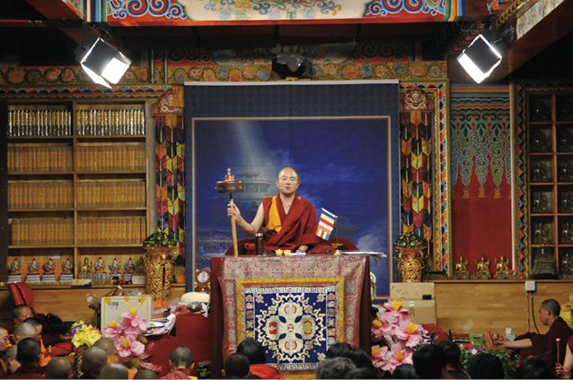
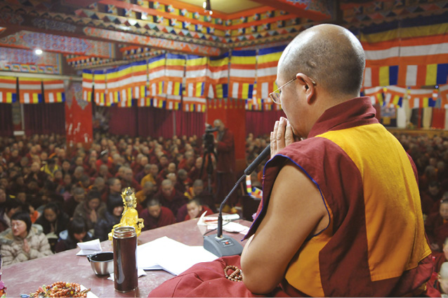

全球直播

2

一颗自私自利的心，

对自他就像毒药，有极大的坏处。

## 菩提心的修法

2013年8月31日

今天我们利用网络，在国际频道上跟大家一起学习甚深的佛法。这是我们国际法音的第二次传法，希望这样的活动以后长期举办下去。

今天给大家传的是菩提心修法。我先简单介绍一下菩提心的相关理论，希望国内外对佛教有兴趣的有缘者能从中获益。

## 菩提心，不是普通的利他

我为什么要讲菩提心的修法呢？大家都知道，人类社会已经进入了21世纪，这是一个高速发展的时代。现在有一种说法：什么叫现代人？就是能在短短的时间内做许多事情的人。还有一种说法，现代人就是面临着各种困惑和压力的人。的确是这样。现代社会的生存压力非常大，不仅人与人之间，国与国之间也经常为了各自的利益发生种种冲突，就像现在的叙利亚和埃及。除此之外，我们还要面对不同国家的恐怖分子的袭击以及人类为自由而进行的各种斗争。处于这样一个国际国内形势都非常复杂的时代，人类特别需要利他心和菩提心。

作为佛教的核心和精髓，菩提心不仅是佛教徒最重要的修行，也是当今时代每一个国家都极为需要的心灵甘露。菩提心跟一般的利他心或者大悲心有很大的差别。以基督教为主的世界上很多宗教都有帮助他人的善心，而佛教的菩提心不仅要暂时帮助他人，还要从根本上解决众生的大问题、大烦恼和大痛苦。解决众生的根本问题，是菩提心的殊胜意义和重要价值所在，也是它有别于普通悲心的重要标志。

一般来说，世间任何一个好的老师、上师或善知识都具足一定的悲心。当弟子主动亲近的时候，他们一般都表现得温和，慈祥，充满爱护，经常相助，不说弟子的过失。而菩提心的表现却不止于此。具有菩提心的上师，一旦发现弟子相续中有贪嗔、傲慢、嫉妒等烦恼，不会顾忌弟子内心的感受，弟子高兴也好，不高兴也好，他一定会以各种方式进行批评和调伏，根除弟子相续中的不良习气。对弟子而言，这是一个非常痛苦的过程，很有可能因此离开上师。但真正具有法相的善知识，不会考虑自己的利益，只一心一意解决弟子的根本问题。生活中我们经常发现，一般的慈悲心跟彻底帮助他人的菩提心之间，的确有着天壤之别。

一般来讲，所有好心态的老师，对学生和身边的人都比较宽厚和包容。而具有菩提心的老师，最关心的却是怎样帮学生拔出一切痛苦的根源。这是二者最大的不同。事实上，我们很难发现一个人具不具足真正的菩提心，因为生起菩提心不是一件容易的事。如果有了真正的菩提心，不管对自己还是对他人，都一定会摧毁我执和我所执。

所谓的我执和我所执，按佛教的教义来讲，是轮回的根本；从世间角度来讲，则是冲突和战争的根本——自我性和自私心太强的人，不会顾忌别人的利益。所以，菩提心的利箭，直接瞄准的是人类与生俱来的自私心。

## 菩提心的深广内涵

弥勒菩萨在《现观庄严论》中说：“发心为利他，求正等菩提。”明确提出了菩提心需要具备的两个条件。第一个条件是完全地付出、彻底地奉献、无条件地利益。为谁付出？为谁奉献？利益的又是谁？答案只有一个：全天下所有生命——不仅仅是人类。第二个条件，要真正探求到宇宙万物的真相，抵达究竟、圆满的快乐之地。这两个条件，都是一般的利他心和悲心根本无法触及的。所以说，全人类所有的思想和精神宝藏中，最闪亮、最珍贵的就是利他心和求证心。

菩提心的理论和修法，许多西方人非常喜欢，东方人也越来越重视。最近我们在选择网络开示的主题时，相当多的人要求讲菩提心的修法。前段时间我去美国，也有一些大学要求讲自他交换的菩提心。我很乐意跟大家共同学习这方面的内容。

下面我从三个方面来讲菩提心。第一个讲利他心，第二个讲求证心，第三个讲具体的修法。

### 1．彻底的利他心

#### 1）利他心的重要性

首先，利他心是一切佛法的根本。利他心不仅是大乘佛法的根本，也是小乘佛法的根本。我等大师释迦侔尼佛转第一转四谛法轮时，就在相关经典中讲到：大悲心是一切佛法的根本，是一切功德的基础。在座的各位如果想真正了解佛法，首先应该了解什么是真正的慈悲菩提心。世间的人也经常说：“佛教以慈悲为怀。”可见，利他心和大悲心是所有佛教徒和本性善良的人最基本的心灵准则。

每一个众生都需要利他心。因为所有的众生都跟我们一样，愿意获得快乐，不愿意感受痛苦。而且，别人经受的痛苦和我们自己遭遇的痛苦完全相同，如果我们能对别人的痛苦感同身受，并尽心尽力帮别人遣除痛苦，他会无比欢喜，无比感激。所以，佛教提倡众生平等，要求佛弟子广大地利益无量无边的众生，而不仅仅是人类。

再说，无论是自己的痛苦还是他人的痛苦，都源于自私。一颗自私自利的心，对自他就像毒药，有极大的坏处。要想获得真正的快乐，必须去除这颗自私心。现在的人经常讲：经过21天的努力，便可以改变一个习惯。习惯既然可以改变，这颗心自然不在话下。事实上，所有自私的心、害他的心、毒恶的心，只要肯下功夫，都可以逐渐得到遣除。具体来说，通过学习佛法，通过认识真理，通过修炼自心，我们所有自私的痛苦都可以断除，所有利他的快乐都可以增上。

第二，利他心最终会利益自己。表面上，我们自己好像应该比他人更重要。现在很多人都认为，活着就要体现自我的强大、自我的成功和自我的完美。为了达到这个目标，人人都应该有一种拼搏的勇气，有一种不服输的竞争心。

实际上，无论从世间层面观察，还是从佛法层面分析，利他的心都比自私的心更能利益自己。在世间，不管是在家庭内部，还是在社会的某个部门或集体，有利他心的人，人人都喜欢，都需要，都希望他加入自己的团体，加入自己的组织。

在出世间的佛法方面，一个人修任何法，念任何经，做任何佛事，以利他心摄持，与受自私心驱使，前者所得的功德，后者根本没办法相提并论。以利他心做一件小小的善法，其功德也远远超过以自私自利的心做一件很大的善事。

从以上两方面的分析可以看出，以利他心做任何事，都会给自己带来无比的力量，并直接或间接让他人获得无限的利益。

第三，每个众生都对我们有恩。在实际生活中，在修行道路上，如果没有其他众生，包括怨恨的敌人和素不相识的陌生人，我们的任何事业都难以推进。大家无论是坐汽车、乘飞机，还是去公司上班或跟家人一起享受生活，他人都是非常关键、无法回避的元素和因缘。另外，我们在修道的最初发菩提心，中间行持六度万行，最后成就任何一个果位，众生都是不可缺少的。

印度有位非常著名的论师，叫寂天菩萨，他有一部非常殊胜的论典，叫《入菩萨行论》。这部论里讲，一个人如果只尊重佛陀，而不尊重众生，是没有道理的。为什么呢？因为佛教的任何成就，都离不开众生的因缘，包括怨恨的敌人。如果修道中缺少了怨敌，所谓的修安忍、到寂静处享受静虑波罗蜜多等诸如此类的修证，都根本没办法实现。

刚才道友用德语讲考的时候说，我们应该把家庭、单位全部抛弃，到寂静的地方去修行。虽然很多论典都有类似的说法，但这只是针对初学者来讲的。初学者需要远离杂乱的环境和复杂的人群，是因为这种聚集之处，会给自己带来烦恼、困惑和危害。而当我们的修行到了一定的境界，或者说在佛法较高层次的修行中，一定是不能离开众生的。如果连一个怨恨的敌人都遇不到，自己的修行不可能成功。这一点尤为重要。

刚才讲了利他心的重要性，第一个是佛教的根本，第二个是自他的关系，第三个是众生的恩德。在座的各位应该结合这三个要点，好好地思考。实际上，当你真正用佛法的修行和真理来完善自己、净化自己、提升自己时，所有不好的心态、习惯和习气，都一定会有不同程度的改变。而这种改变，不是理论上、文字上和形象上的，而是人生的根本问题解决后，从内心深处自然引发的。

#### 2）利他心的现实意义

要从根本上解决人生的问题，先要从理论上认清人生苦短的深刻含义。我们来到这个世界，最多能活几十年。而这短短的几十年，却充满了各种各样的痛苦。除了感受痛苦，人生中还可以有什么样的价值？

对于这个问题，古今中外的人们一直在探讨。所有关于人生价值的思想学说中，最有意义、最有价值的是什么？诸佛菩萨和前辈的高僧大德都异口同声地说：“利他心。”作为一个后学者，我翻阅过世间和出世间的很多经论，也接触过不同领域的老师和长者。我把这些思想和理论进行了一番比较，最后得出的结论是什么？在人类的思想进程中，唯有利他心是真正的智慧醍醐。

世界上的任何一个争端，都可以归结为一个原因：自私。人类所有的冲突和矛盾，小到争吵，大到战争，都是凡愚们为了自己的利益和目标相互伤害的结果。家庭的争吵——虽然是一家人，都是由丈夫或妻子的利益在对方那里得不到满足而引发的。

至于国家之间的战争、地区之间的冲突、民族之间的矛盾，不管涉及的是日本、美国，还是俄罗斯以及其他国家，都不外乎是从自己的利益出发，以自己的目标愿望是否实现作为发动侵略的因缘和条件。

前辈的大德们都已经讲过，一切痛苦的来源，唯一是自私自利的心；一切快乐的来源，唯一是利他之心。如果全人类都能有一颗彻底的利他心，当今世界的所有冲突和战火都将熄灭，人与人之间所有的怨恨也将消融。

所以，日常生活中我们要经常修炼利他心。具体方法非常多，最主要的还是寂天菩萨那个非常著名的偈颂：“菩提心妙宝，未生者当生，已生勿退失，展转益增长。”意思是说，菩提心宝如果还没有生起，要努力让它尽快生起；如果已经生起，要努力让它日益增长。

这个偈颂，藏传佛教的很多修行人，无论是早上醒来、晚上睡觉，还是白天做任何事情，都经常念诵，经常观修，经常用来要求自己，反观自己；在利益众生时，也经常用来赐予加持和美好的祝福。希望大家也能做到这样。

### 2．究竟的求证心

刚才讲的是菩提心的第一个条件：“发心为利他”，下面讲第二个条件：“求正等菩提”。

1）什么是证悟？我们现在接触到的世界，不管是眼睛看到的，耳朵听到的，还是内心执著一个真实存在的“我”，或执著眼前有真实存在的事物，都只是我们的五根与分别念混合取境的因缘和结果。这样的执著和缘取方式有一定的误区，让我们没法深入万法的究竟实相。在当前的阶段，我们见闻觉知的一切都有不正确的地方。而当我们通过修行，从错误的认知中觉醒，见到了万法的本来面目，就叫做证悟。

2）为什么要证悟？人类的感觉、想法和追求，都存在一定的误区，与真相不太相符，不仅佛教这么讲，现代科学的观察和研究结果也是如此。必须承认，作为凡夫，我们的智慧现在还带有染污性，触及不到宇宙人生的真理。只有修行到一定的时候，这些染污才会消灭。当消灭了这种染污，获得了清净的智慧，我们就能真正通达一切万法的究竟真相。在佛教中，这叫断除业和烦恼，证悟万法实相。

佛教有一位非常著名的论师，叫做龙猛菩萨。根据相关的历史，他活了300年，也有说活600年的。不管实际住世多少年，他都是一位非常长寿的智者。龙猛论师曾经说过：只有当烦恼断除之后，我们才能现前真正的证悟智慧。

这样的证悟，我们这些凡夫众生都还没有获得。其根本原因在于，无明染污了智慧。就像一个纯净的水晶球，如果外面沾有垢染，则不能见到它的本来面目。由于无明愚痴的染污，我们也无法照见清净的智慧本面。因此，每一个人都需要消除相续中的无明，从而证悟诸法实相。

3）怎么样证悟？对万事万物的真相，我们不能照见的根本原因是无明。那怎样断除无明呢？实际上，无明只是一种非理作意，并非以实有的方式存在于我们的心性上。它是一种偶然性的东西，是后来染上去的，所以我们通过学习，通过修行，完全可以断除。

至于断除的方法，佛陀在经中讲过：一切因缘法，此法皆为空。意思是说，凡是由众因缘和合而生的法都是空性的。无明由因缘而生，自然也是空性的。我们什么时候证悟了一切万法皆是空性的真理，无明就会在什么时候彻底烟消云散。就像阳光照射的时候，迷雾自然消散，万物自然清楚一样。

4）现证佛果。证悟了一切万法皆是空性的真理，我们相续中的无明、习气、烦恼以及各种不合理的分别念都将全部遣除。佛教把这样的境界叫做断除障碍。在断除障碍的同时，我们还将认识到万事万物的本来面目，这就叫现证佛果。

万事万物的本来面目是什么呢？除了现象以外，所谓万法的本质丝毫也得不到，丝毫也不存在。这种不存在，并不是什么都没有的单空，而是佛教中观派所抉择的远离四边八戏的究竟真相。这种真相，到一定的时候，我们每一个人，包括今天在座的各位，不论你来自东西方哪个国家、哪个民族，都可以证悟。只不过，大家正在努力的道上而已。

所谓的证悟，汉传佛教的禅宗叫明心见性，藏传佛教的密宗叫认识心性或认识觉性，显宗的个别宗派如般若宗，则叫证悟空性。无论是哪个宗派的说法，都表示心完全达到了最究竟的真相，认识了一切万法本具的空性与显现无二无别的真理。这种真理的认识者是谁呢？最究竟的是佛，还没有得到佛果的圣者，叫做菩萨。

大家不要认为，佛好像是世间的天人或神仙——所谓的得到佛果，就是得到神仙的果位，菩萨好像是世间一个生命层次相对较高的灵魂。这些想法都不对。所谓的佛菩萨，在我们人类的认知里，应该是对万事万物的真相完全或部分通达的觉悟者——佛就是完全觉悟者的意思。佛教徒并不是空穴来风地称自己是觉悟者，而是佛陀留下来的这些经典，已经明确告诉我们，后学者应该追求的目标是觉悟万法的真相。

总而言之，我们要想给众生最大的利益和帮助，自己必须拥有两种菩提心：一个是究竟的利他，另一个是究竟的求证。后者尤为重要，利他的菩提心要解决的，是众生的生死痛苦或者实执问题，所以必须证悟空性。如果没有证悟空性，则不可能让众生从生老病死的痛苦中脱离，也就谈不上究竟的利他。

世间的好老师，会尽心尽力地给学生传授一些技术、职能或技巧，但这些只能解决暂时的生存问题，解决不了出生入死的根本问题。我以前在一个学校演讲时，有一个老师告诉我，他非常关心学生，天天都为孩子们的学习、生活甚至感情问题忙个不停。这是一个舍得付出的好老师，但他为学生所做的一切，解决不了大问题——他没法让学生获得真正的快乐。

最能解决问题的，唯一是让我们彻底通达自心的本性，了悟一切万法的真相。这就是最大的觉悟，也是我们每个人都需要抵达的彼岸。菩提心的最终目标，是让每一个众生都早点觉悟，认识宇宙人生的真相。

### 3．菩提心的修法

以上从四个层面给大家分析了求证的道理，下面简单讲一下菩提心的修法。

1）自他交换：菩提心的修法非常多，比如自他平等、自轻他重、自他交换以及显宗和密宗的一些窍诀性修法。我在这里给大家讲的是自他交换的修法。用世间浅显易懂的名词来说，所谓的自他交换，就是人们常说的“换位思考”。换位思考对社会和谐具有重要的意义，因而受到了人们的大力提倡和推崇。不同的是，自他交换不但要求我们换位思考，还要我们换位利他，换位做有意义的事情。

在藏传佛教中，自他交换是一种非常殊胜的窍诀性修法，其中噶举派的自他交换尤为出名。他们有一句名言，叫做“失败亏损自取受，利益胜利奉献他”。意思是说，在日常生活中，当自己遇到不公平的待遇，遭受亏损和失败时，内心不要有抱怨和怨恨，而要成熟、坚强、坦然，默默承受；当自己获得成功、财富和其他种种利益时，要直接或间接地全部奉献出来，尽心尽力去帮助他人。自他交换的精神，不论是过去的时代、现在的时代，还是未来乃至有人类生存的时代，都应该是最高尚的一种修行。

这种修心方法，跟我们平常的观念有一点冲突，很多人刚开始可能没办法接受。实际上，只要你坚持修学，久而久之，相续中的菩提心一定会成熟。当你的菩提心修得越来越纯熟时，你会知道，这个世界最可怕的就是一颗自私自利的心。因为一旦有了自利的心，就会不断危害其他众生。相反，有了利他的心，则会不断地饶益和造福人类乃至整个世界。

当然，这种心态需要长期的训练，甚至行住坐卧的威仪中也不能忘失。尤其是我刚才所讲的自他交换菩提心，简单易行，没有复杂的仪轨，任何场合都可以行持，便于实际操作。希望大家不断地修炼，尽早生起圆满的菩提心。

此外，大家还应该多多学习菩提心对自他的利益。《入菩萨行论》第一品在这方面讲得比较详细。懂得菩提心的功德之后，大家再好好学习整部《入菩萨行论》的内容，并进一步学习《学集论》、《摄大乘论》以及宁玛巴一些非常殊胜的菩提心修行窍诀，如《大圆满心性休息》第八品——其中有关于菩提心的广泛教理和窍诀性修法。

2）三殊胜：在大乘的所有法门里，特别强调三殊胜。所谓的三殊胜，是指刚开始修行的时候，一定要发菩提心——任何一个法都要为利益众生而修；中间，心不散乱地行持善法；最后，把修行的功德回向给众生。在大乘佛教中，这是最关键、最重要的一个法门。

我们无论修什么法，如果不具足大乘菩提心，那就只是形象上的修行。刚开始以自私自利的发心而修，中间以自私自利的心执著不放，最后以自私自利的心回向给自己。这样的修行，只能是小乘，或者说比较低层的修法，不能算是大乘法。因此，我要特别提醒在座的各位佛教徒，修行一定要以菩提心摄持。

至于在座的各位非佛教徒、非宗教徒，也希望你们能正面地理解菩提心的内涵。所谓的菩提心，并不是一种带有宗教教条的狭隘思想。如果你广泛深入地了解了菩提心，你会感到十分惊讶，感到无比震惊。因为，这种思想的微妙性和它蕴含的无穷力量，即便是在这个科学极为发达、欲望都能得到满足的时代，也是不可思议、极难寻觅的。

我今天讲了一个多小时，这么短的时间很难讲出什么包罗万象的人生哲理。但这并不重要，重要的是，我以简单的语言为大家阐明了菩提心利他和求证的两个关要。这两个关要不是佛教独一的自家说法，而是整个人类需要追求的长远目标。

## 希望与感谢

接下来，我再简单说两件事。知道大家现在快睡觉了，所以我不会耽误很长时间。

1．对大家提出一点希望。今天很高兴，有很多佛教徒和非佛教徒利用网络平台共同集聚。现在用因特网的人非常多，但是用它来寻求真理、寻找智慧和悲心的人，并不是很多。所以，我希望在座的各位不要浪费时间，一定要懂得求真理，求正见，求正念，求智慧。

现在这个社会很复杂，尤其是年轻人，如果自己没有很好的判断能力，没有主见，很容易被各种各样、眼花缭乱的外境所吸引，所迷惑。当今这个时代，流行一种非常特殊的文化，很容易让人堕落，让人迷失。因此，希望大家在利用网络的时候，保持正知正见。这是我的第一个希望。

此外，我还希望大家把自己学过的各种语言用来弘扬真理。现在的世界，我们称为地球村。在这个村里，住着许许多多的人，大家的生活方式和语言文化都不相同。佛教的真理，最初来自印度，后来传到藏地、汉地以及其他国家。可见，真理是需要传播和弘扬的。所以我特别希望懂得多种语言的年轻人，能用不同国家和民族的语言来弘扬佛法，带领不同生活方式的人们，一起走向暂时和究竟的快乐。

我这边以后会尽力培养一些懂外语、懂佛理的人，与此同时，也需要大家的共同发心和共同努力。佛教是这么好，我真心希望大家一起努力，让佛教的“好”为整个地球乃至所有的生命，带去无比的利益——大乘佛教的宗旨即是如此。

2．对大家表示衷心感谢。首先，我要感谢世界各地佛教小组的很多发心人员。你们不止自己信仰佛教，还为众生，为弘扬真理，付出了最宝贵的时间和精力，并且帮助了许多可怜的众生。作为一个佛教徒，我发自内心地感谢你们。

第二个，感谢我们智悲翻译中心的发心道友。这两年来，无论是中文翻成英文，还是英文译成中文，你们都做了非常大的贡献。到目前为止，你们在佛教与科学方面的翻译文章已有180多篇，最殊胜的部分内容已编成了两本书，大概有50多篇。你们日日夜夜地辛苦付出，将佛教和科学进行对比，把佛教和科学领域的东西方著名学者的文章翻译成中文。希望你们不断地努力，我也不断地赞叹。

最后，感谢现场和网络上所有的人——现场有这么多人，网络上也有这么多人。你们花了一个半小时来听我胡言乱语，耽搁了宝贵的时间。我面前的一个在家佛教徒和一个出家人，已经打了三次哈欠。我讲的时间不能太长，时间就是生命。你们用自己的生命来这里聆听和学习，谢谢！这是我最后的感恩。
