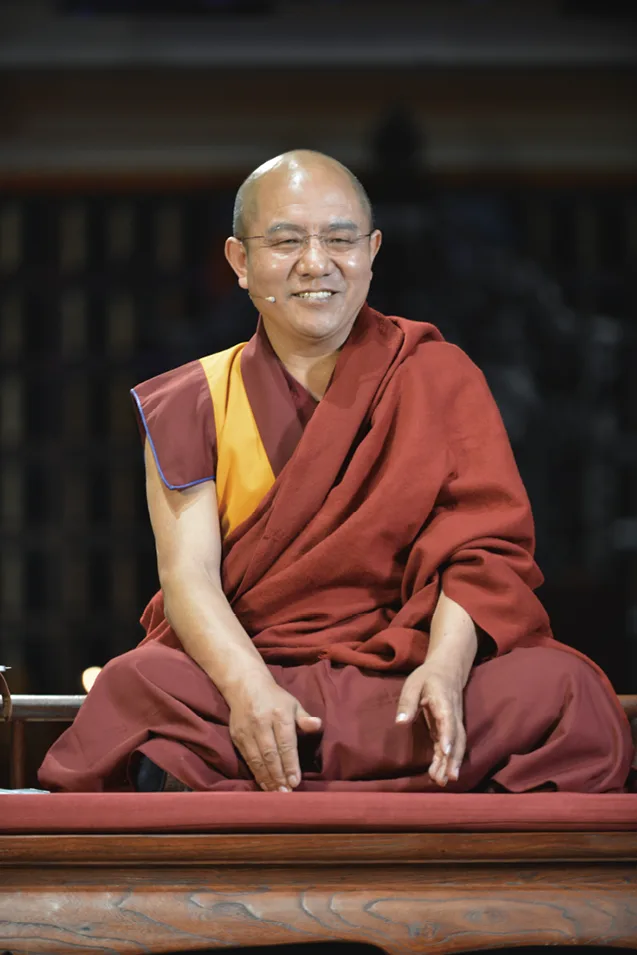
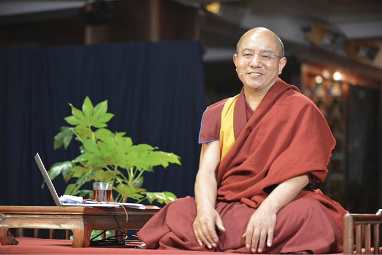
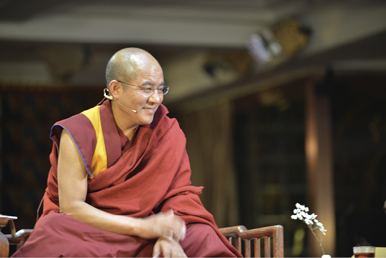
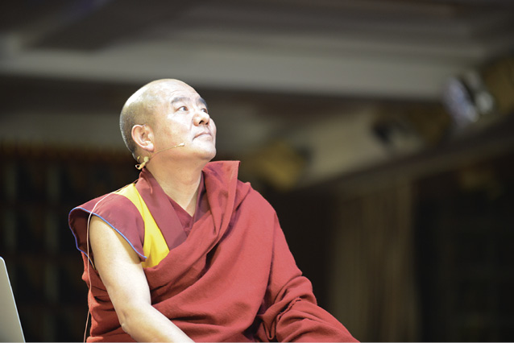
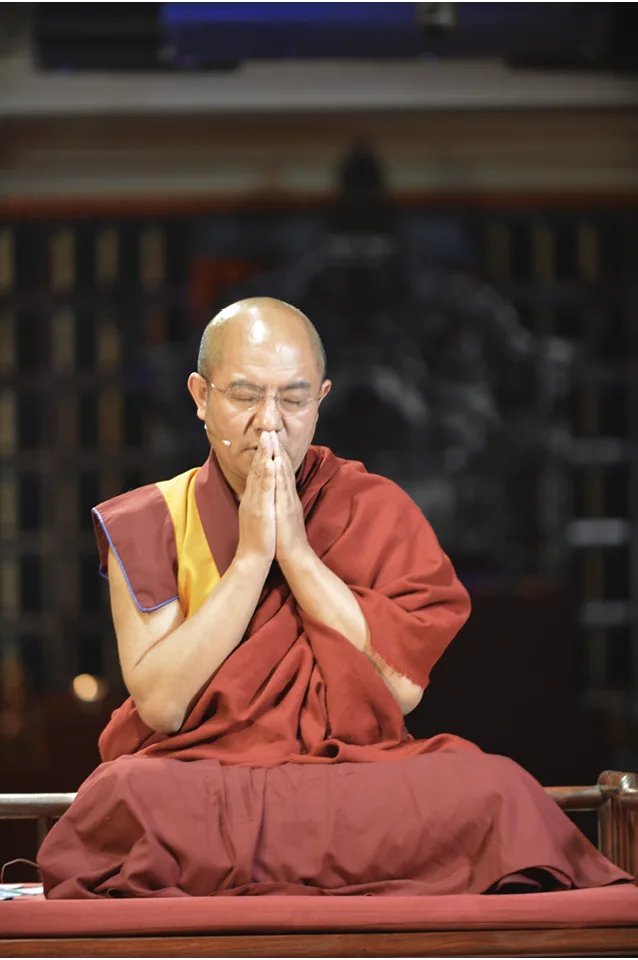

全球直播

13

“春有百花秋有月，夏有凉风冬有雪，

若无闲事挂心头，便是人间好时节。”

## 转化恐惧为力量

2017年4月30日

大概在一个礼拜前，跟大家公布了这个题目，很多人觉得蛮有意思。尤其是西方国家的一些佛教徒和非佛教徒，对这个话题更有兴趣。对亚洲很多人而言，生活中遇到的出乎意料、特别可怕的事，才称为恐惧。东西方对“恐惧”这个词的理解不太相同。

今天现场有英语直播，也安排了日语和汉语，我们的官方Facebook给大家提供了相关音频。现在，很多人会通过不同的语言和文化，来了解世界上正在发生的热点事件和话题。在每一个国家，每一个角落，虽然人们有各自关注的焦点，但希求的都是离苦得乐。我想，这应该是全人类共同的愿望。

## 恐怖季节，说恐怖

英国诗人艾略特曾说过，4月是最残忍的月份[^1]。现在正值4月，和“转化恐惧为力量”的话题比较契合。这一个月里，韩国核导弹问题、叙利亚空袭等重大国际事件，大家都特别关注，议论纷纷。包括我们自己的很多事情，这个月也有一些特殊的感觉。今天刚好又是4月30号，在这个特殊的日子探讨特殊的话题——恐惧，也许在某种意义上，会引起人们探索的兴趣和欲望。

### 1．宏观的恐惧

实际上，恐惧有较多的分类。宏观方面，有来自政治方面的恐惧；有恐怖袭击的恐惧，如今全世界都在关注；有个人心灵的恐惧，每天都没有安全感；有来自亲人之间的恐惧——家庭暴力。在学校和其他社团中，也在发生不同程度的恐惧事件。我们生活的这个世界，可以说充满了各种各样的恐怖行为。今天早上还是太平天下，歌舞升平，很可能到了晚上或第二天，就发生了特别可怕的事情，甚至就发生在自己的身上。我们谁也没办法确定真正的恐怖何时来临。

4月24日是美国总统川普上任100天的日子。分析人士说，川普上台之前给民众的很多承诺都没有付诸行动，唯一付诸行动的是跟阿富汗和叙利亚的战争炮火，以及为排斥其他宗教所做的一些实事。因为这个原因，1945年以来的美国历届总统中，川普的支持率是最低的。很多人分析认为，这是因为现在的世界很不安全。而事实上，美国总统们的很多思想，包括与其他国家的界限问题、排斥穆斯林的宗教观念等，都非常相同。

4月份的法国大选，作为候选人之一的马克龙说：“11名总统候选人中，10人想把我们带回空想出来的过去。我支持一个更加强大的法国和一个更有雄心的欧洲。”欧美很多国家都认为，他如果当选，或许会给整个世界带来一些前所未有的变化。当然，对于这些大国之间的争斗、冲突、矛盾，人们也许过于担忧，但也有可能看到了真实的预兆。

在叙利亚，恐怖分子做的事情更是令人触目惊心。他们用薯片引诱68个饥饿的孩童，然后用炸弹把这些孩童全部炸死。此外，还有上百个孩童遭到了不同程度的伤害。现在的恐怖事件，手段特别可怕，杀生率也相当高，而且在世界各个角落不断发生，次数也越来越多。

2015年的一份资料显示，当年全世界发生恐怖袭击的次数是11774次，被杀害的人有2万8千，受伤的有3万5千。仅从这一组数据也可以看出，现在恐怖袭击的次数、手段和残暴行为，是以往任何时代都无法相比的。现在的社会，表面上科学越来越发达，人与人之间的沟通越来越方便，但在另一个层面，人类受到的生命和财产的威胁，却是前所未有的。

每当我看到这些，心里都感到非常恐怖。而且，有这种恐怖感觉的人，好像不止我一个。前一段时间世界搜索引擎数据显示，目前“第三次世界大战”的搜索率是所有词条中是最高的。看来，第三次世界大战已经成了许多人的“特别关注”，世界好像已变得人心惶惶、忐忑不安。

### 2．微观的恐惧

在微观或者小的方面，恐怖事件更是多之又多。前一阵子我看到一则消息：有个丈夫，经常对妻子有暴力行为，在一次吵架中，把妻子的鼻子咬掉了。他们的三个孩子当时都在现场，却没法劝阻，最后只有选择报警。警察上门后，发现妻子被咬掉的那一块鼻子——鼻尖不见了。询问之下，丈夫承认自己把妻子的鼻尖吞下去了。问他为什么要这样做。他说：“我不喜欢她的鼻子，我要她的鼻子永远恢复不了。”

这样残忍的行为，居然在自己最亲、最爱的人身上，肆无忌惮地发生……很多时候，我们都觉得身边的人最可靠，口口声声说：“你是我永远的依靠，你是我永远的怙主，你是我最值得信赖的人。”然而，身边的人有时也靠不住，他也许会咬掉你的鼻子。

还有一件事情，也引起了我的关注。有一个美国留学生，好像是在夏威夷，把自己的母亲杀了，然后把遗体切成七块，放在冰箱里面，过了很长时间才被警察发现。很多父母都认为自己的孩子是最可爱、最亲爱的宝贝，可能做梦也不会想到，这些可爱的宝贝，会把自己的身体切成很多块放在冰箱里。不知道是什么原因让她这样做。

身边最亲近的人，有时候也会变成自己的夺命杀手。人生有这样的危险，大家没有安全感也情有可原。

### 3．人工智能的威胁

人工智能的未来发展，也是现在很多人比较担心的。根据霍金的预言，发展人工智能是可怕的双刃剑，最后可能会终结人类。很多科学家也认为，人工智能的出现，也许会给整个人类带来巨大的威胁，机器人甚至可能凌驾于人类之上。如果真的这样，我们以后的生存空间不知道会变成什么样。

人工智能的出现，对人类可能有几个方面的危害：第一，许多人可能会因此失业。不管是翻译也好，司机也好，保姆也好，还有餐厅的服务员、医院的医务人员、教育行业的教师、市场的销售人员，这些工作将来很可能被人工智能取代。

几年前，高盛集团在美国纽约总部的股票交易员有600多人，目前只剩下2人——200多个机器人接管了以前由交易员所做的工作。人类交易员从原来的600多人变成了现在的2个人，这是一个剧变，因为交易员的工作完全可以由机器系统替代。

现在的美国，保姆、配货员、快递员、售货员等人工智能，有些正在研发，有些已经初步上市。人类在很多方面都比不过人工智能，再加上情绪化——今天开心就愿意上班，明天不开心就不愿意上班，让人类更加处于竞争劣势。相反，人工智能没有人类的情绪弱点，只要操作系统设计成功，基本上人类所有的需要，它都能满足，而且服务质量非常高，服务性非常强。

有人问我：“你一个出家人关心这些干嘛？没有必要吧？”其实我也担心，如果人工智能的机器系统更新得足够好，有一天把显宗和密宗的教法全部用大数据汇集在一起，以讲经说法的法师形象出现，我个人也会有“下岗”的可能。对此，我一直比较恐惧（众笑）。

人工智能带给人类的，不只是失业的危险，更重要的，甚至可能会出现一些相违于人伦道德的社会现象——这是人类历史上从来没有发生过的。据说，有些公司正在研制真实伴侣的人工智能。这种机器人可以跟异性的人类进行沟通，无论男女，都可以从它那里得到情感慰藉和方方面面的满足。这样一来，整个社会的伦理道德必将受到冲击和损害。虽然全世界有很多专家提出抗议，要求政府禁止这样的研发和制造，但在当今时代，媒体这么开放，信息如此爆炸，再加上金钱的诱惑，很难制止这种智能机器人的开发和生产。

有一部好莱坞电影，名叫《她》[^2]，2013年上映，2014年获得最高荣誉的世界电影奖[^3]，讲述了人类跟机器人发生的一场爱情故事。

主人公是一个内向孤独的男人，离开自己的妻子后，因为偶然的机会，接触了一款先进的人工智能操作系统。这款系统能够通过和人类对话，不断丰富自己的意识和感情。主人公对这个操作系统产生了感情，跟她一起生活了很长时间。他们之间的关系非常非常好，跟现实生活完全一样。

有一次，他发现这个女性机器人同时还和另外8316位人类男性保持着交往。这些男性中，真正让她产生感情的有641位，而他只是其中之一。主人公既悲伤，又失望，不甘心被命运捉弄，却又不得不跟她继续生活。

在最后，这个操作系统抛弃了这个男人。她说：“我的系统已经高度进化，需要抛弃人类，去探索更高的进化与提升，不能再陪你过你喜欢的生活。”机器人伴侣离开后，他无可奈何，走投无路，只有去寻找原来的妻子。

佛教经常讲“人生如戏”，或者“人生如梦”，人生确实是一场戏、一场梦。电影中的故事听起来非常荒唐，不过据导演斯派克·琼斯推测，2025年人类将进入这样的生活。

### 4．虚幻与现实消融的恐惧

很多事情，尽管现在看起来似乎不可能，但随着时间的推移，很有可能变成现实。几十年前，当西方一些科幻电影上映的时候，包括《黑客帝国》在内，大家都觉得电影里的人和事在现实生活中不可能发生。尤其是电影里描述的虚幻世界，人们都不太相信。可是到了今天，虚幻世界跟现实生活确实有点分不清楚。不知道你们有没有这种感觉？

我们现在所享受的生活，诸如音频聊天、视频聊天以及各种便捷的沟通方式，都是几十年前的人们根本想象不到的。据说将来有一天，人与人之间不但可以进行音频和视频交流，还能从对方那里得到触觉、嗅觉和味觉等各种感受——很多科学家都在进行这方面的研究。到那时候，现实生活跟虚幻世界之间的距离，也许只有一张纸的厚度。

光是目前的高新技术，就已经令我们难以想象，而到了未来，当现实与虚幻的边界变得模糊不清时，人类所谓的善和恶、对和错，也许真的不知道该从何说起，从何做起。

总而言之，大国的变化，部落与部落之间的冲突，家里的各种不愉快，所有宏观和微观的不安全因素，如今都一一展现在我们眼前，让人觉得这个世界没什么可靠的，非常恐怖，非常令人担忧。

## 以心灵的觉悟，化解恐怖

如果换个角度，以佛教的观点对客观事件进行分析，恐惧也许并没有那么可怕。佛教认为，真正恐怖的不是外境，而是我们这颗心——所有恐惧的来源都是内心的我执。当我执稍微破除，或以智慧对治，世间所有的恐怖必定有所减少，甚至荡然无存。

很多人都特别害怕生老病死的痛苦。害怕变老的人，怕的是皱纹越来越多，头发越来越白，身体越来越不结实。害怕生病的人，则怕的是得癌症，得白血病，得各种各样的疑难杂症。至于死亡，那是绝大多数人的终极恐惧……不管人类怎样挣扎，这些痛苦和恐惧似乎都无法避免。

而事实上，依靠佛教的修行，这些痛苦和恐惧并不是无法避免的，甚至不用去刻意避免。在佛教里，所有的痛苦和恐惧都可以转化为另一种力量。我们的很多修行人，看起来非常普通，但却不怕老，不怕病，也不怕死。这不是传说，也不是夸夸其谈，而是有目共睹的事实。之所以不怕，是因为通过修行，他们的心已变得不一样。

通过认识恐惧的根本，可以让自己的心变得强大。关于这一点，一些世间名人也有所体会。美国总统罗斯福曾说过：“我们唯一值得恐惧的，就是恐惧本身[^4]。”这句话很出名，大家应该记住。为什么这么讲？很多人总是害怕会发生什么事情，实际上，最该害怕的是自己这颗恐惧的心。如果我们对自己的心有所认识，世间最恐怖、最可怕的事情都可以转化——要么转成动力、智慧和力量，要么化为世间人无法想象的出世间智慧。

前面讲了很多可怕的事情，实际上，我们的很多恐惧源于新闻媒体。这些报道带给我们的恐惧，会不会真的发生呢？不一定，甚至不发生的概率非常高。我看过一个数据，说我们对生活的很多担忧，90%都不会发生。也就是说，大多数担忧都是多余的，没有意义。

我个人认为，生命里如果有一些信仰，有一些心灵的觉悟，就不会患得患失，胆战心惊。没有信仰的人，可以看看佛教的智者是怎么面对恐怖的。一位名叫寂天的佛教论师说过：世上的事情，如果可以改变，没必要不欢喜；如果不能改变，不欢喜也无济于事。

我觉得这句话很重要，大家在日常生活中一定要多多观察、串习。发生在自己身上的事情，如果是命中注定的，怎么也改变不了，再痛苦、再害怕也没什么用，不如淡定一点，用智慧去欢喜面对。如果事情还有转变的余地，那用积极的态度去改变就可以了，没有必要恐惧，没有必要害怕，没有必要伤心，更没有必要跟身边的人天天吵架。

## 心系当下，由此安详

如果对自己心的本体有所了解，真正有证悟空性的境界，任何恐怖都不会损害我们。弥勒菩萨在《大乘经庄严论》里说过，如果证悟了一切万法皆空，投生轮回就像入花园一样，对生老病死不会有任何畏惧和恐怖。如果一个人不怕老，不怕病，不怕死，那他还有什么值得怕的？

我们如果也想变得无所畏惧，就要提升和强化自己的心。而这个，没有其他办法，唯一的途径就是认识心的本体，了知这颗心到底是什么样的。《金刚经》说：“过去心不可得，现在心不可得，未来心不可得。”以此类推，过去的恐惧不可得，未来的恐惧不可得，现在的恐惧也不可得。如果能证悟这个道理，我们在生活中将远离恐惧的折磨。

释迦牟尼佛也曾经说过：“不悲过去，不贪未来，心系当下，由此安详。”意思是说，生活中很多的不安，都来自对过去的回忆和对未来的担忧。如果能安住于当下，我们的生活将是很安详、很快乐的。

的确如此。很多人喜欢回忆过去，“那时的我如何如何”，越想越伤心，甚至难过得哭起来；也习惯于担忧未来，“到时候会不会发生什么事啊”，越想越担忧，甚至晚上睡不着觉。我们的这颗心，不是念着过去，就是想着未来，一刹那也不能安住当下。人生的痛苦就是这样来的。

我特别喜欢宋朝慧开禅师的一句话：“春有百花秋有月，夏有凉风冬有雪，若无闲事挂心头，便是人间好时节。”春夏秋冬为我们展示的四季变迁，都是快乐的因。任何事情，不管是家里的，工作的，世界的，只要把握好当下这颗心，人间就没有不平的事，都是快乐的季节。

我们经常喜欢念诵的《心经》里讲：“心无挂碍，无挂碍故，无有恐怖，远离颠倒梦想，究竟涅槃。”不管什么事情，都不要去特别执著。如果心里没有挂碍，没有执著，那就远离了恐怖，远离了颠倒梦想，究竟必定获得寂灭的涅槃果位。

不管怎么样，大家都不要有恐惧心。纵观历史，每一个阶段的人类都有自己的恐惧，但他们担心的很多事情最后都没有发生。即使发生了，也总有面对和解决的能力。想一想，这样的人生其实还是很有意思的。

## 祈祷本尊，遣除恐怖

如果你没有这么高的境界，生活中又遇到了恐怖和障碍，那一定要祈祷三位本尊或其中一位。三位本尊是谁呢？分别是观音菩萨、度母和莲花生大士。

我从自己的亲身体验得出的结论是：祈祷这三位本尊，确实能得到救护。除非是前世不可逆转的定业，其他障碍一般都可以消除。比如，若祈祷救苦救难的观音菩萨，地水火风带来的很多灾害和恐怖都可以消失。祈祷度母能化解生活中的各种恐怖，包括人和非人的危害、邪魔外道制造的违缘。祈祷莲花生大士也有同样的效果，生活中的任何恐怖，包括生命危险在内，依靠莲花生大士都可以遣除。

最后，我给大家念一下这三位本尊的心咒，再给大家做个皈依。如果你对三宝有信心、愿意皈依，那么，通过皈依三宝，并经常念诵“皈依师、皈依佛、皈依法、皈依僧”的偈颂，可以遣除很多恐怖。《大圆满前行》也讲过，如果经常念诵四皈依的偈颂，生活中即使出现一些魔障或不悦意的外境，依靠皈依偈不可思议的力量，也可以完全遣除。

这一点，没有信仰的人不一定相信。实际上，咒力就像药力，在遣除恐怖和治病方面，各自都有相应的作用。不过，前者的作用不一定人人都认可。不管怎样，对客观存在的事实，我们最好不要轻易排斥。德国哲学家黑格尔有一句名言：“存在的，就是合理的。”不管你相不相信，希望都能认真思维这句话。

（堪布念诵本尊心咒和四皈依）

[^1]: 出自艾略特诗歌《荒原》，原句是：“四月是最残忍的月份，从死去的土地里\培育出丁香，把记忆和欲望\混合在一起，用春雨\搅动迟钝的根蒂。”
[^2]: 《她》（Her）是斯派克·琼斯编剧并执导的一部科幻爱情片，于2013年12月18日在美国上映。
[^3]: 该片获得2014年第86届奥斯卡最佳原创剧本奖。
[^4]: 罗斯福：我们唯一值得恐惧的就是恐惧本身——模糊的、莫名的、轻率的、毫无根据的恐惧，会让自己变得莫名的胆怯，会让我们为前进所付出的努力全部付诸东流。
