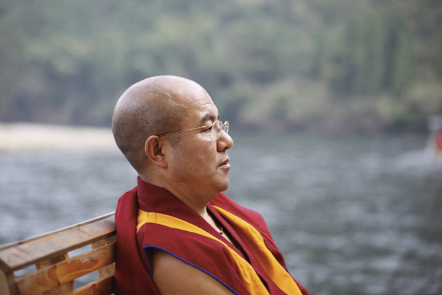
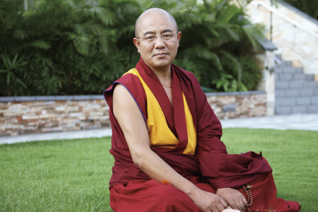

全球直播

4

心理疾病，

正凶猛地摧毁人类的正常生活，

践踏人类心灵的和谐与快乐。

## 遇见喜悦

——如何处理生活中的情绪问题

2014年9月13日

今天，我给大家交流的话题是：“遇见喜悦——如何处理生活中的情绪问题”。平时我为大家传讲的佛教经论，多是藏传佛教的传统内容，今天做一些改变，谈一谈当今人们共同追求的目标和面临的一些问题。

## 不识情绪的过患

生活中，不少人在寻找幸福，同时也被各种情绪困扰。其实，我们应该首先解决好情绪问题，至少应该知道不克制情绪的过患。在21世纪，人们的希求、意乐和爱好，跟以往任何一个时代都不相同。来自内心的情绪问题，不管你什么身份，也不管你来自东方还是西方，都会遇到，都需要认真对待。心态没有调整好，不要说获得幸福，连基本的生存也有一定困难。

情绪只是一种分别念，但如果没有认清它的本来面目，没有了解它的来龙去脉，一定会感受许许多多的痛苦。现代社会爆发的很多不正常心态，比如无聊、浮躁、孤独、抑郁，都是因为没有调整好内心的情绪。

### 1．碎片时代，认识情绪的能力在减弱

现代人追求的生活，看起来很精彩，实际上很无聊。最典型的，就是对碎片文化的追逐——每天都离不开手机，每天都沉迷其中。前不久我看过英国《每日邮报》的一则报道：现代人平均每隔6.5分钟就要看一下手机；每天醒着的时间如果按16个小时计算，一个人一天至少要看150次手机。“一天看150次手机”，这说明了什么？内心太无聊。

尤其是大城市里的人，每过一会儿就要看一下手机，甚至和最好的亲戚朋友相聚，好像也找不到共同语言，念念不忘的依然是自己的手机，彼此之间越来越疏远。虽然周围有很多人，但每个人的心里都充满了自我和自私，每一个人都过得那么热闹，又那么孤独。

现代人不再追求信仰，也不再追求艺术和哲学，只满足于低头，沉醉于手机，一个个都得了“低头症”。2012年，澳大利亚的国家新词典中收集了“低头症”这个新名词。虽然它最近几年才出现，但却后来居上，短短的时间内成了世界性问题，成为人类众多心理疾病的根源。

不管是电脑还是手机，我们本该善加利用，做一些非常有意义的事。但在这个特殊的时代，如果没有坚定的信仰，没有正确的价值观，我们很容易迷失在花花绿绿的网络世界，整天靠简单的词语、画面或者视频打发时间。如此浪费珍贵的人身，真的有点可惜。

### 2．成功的光芒，照不破内心的绝望

这是一个浮躁的时代，全世界的人心都非常浮躁。由于不能调整自己的情绪，抑郁症、孤独症、强迫症等各种各样的心理疾病，正凶猛地摧毁人类的正常生活，践踏人类心灵的和谐与快乐。很多成功人士表面风光，帮助了不少人，内心却充满困惑和焦虑，甚至陷入烦恼和绝望。

今年8月，美国著名的戏剧家威廉姆斯自杀身亡。活着的时候，他以出色的表演，给无数观众带来了欢悦和力量，自己的心态却没办法调整，深受抑郁症和各种烦恼的折磨，最终以这样的方式结束生命。

全世界有很多人对此感到震惊，包括美国总统奥巴马。他说：威廉姆斯的逝世对美国而言是一件很遗憾的事。他有时候让我们大笑，有时候又让我们流泪。不管怎样，他是无与伦比的戏剧天才，触动了所有人的心[^1]。

不管是在美国，还是其他国家，无数观众从他塑造的角色身上获得了欢悦、思想和力量。如今，全世界都在分析他的死因。我作为一个佛教徒，怎么看待这个问题呢？我认为，人活在这个世界上，不管有钱也好，有才华也好，有地位也好，如果内心没有得到调伏和净化，那么，他人生的终极选择不一定明智。

### 3．不合理的情绪，是毒药

我希望在座各位能经常观察自己的情绪，认识它的本体，这很重要。如果没有认识情绪的本体，心态很容易失去平衡，从而引发愤怒、贪婪等各种烦恼，扰乱心灵。这样一来，除了给自己的身心带来损害，还会给家庭，给社会，甚至给国家带来不良影响。再往大处说，国家与国家之间的矛盾和冲突，也可以说是情绪没有得到调整而导致的。

大家可以观察一下，自己家里的战争，不管是冷战，还是吵架，是不是都是由心态不平衡所导致的？至于国家之间的冲突，比如叙利亚、阿富汗、伊拉克这么多年一直战火不断，其根源也在于不合理的贪求，或者说在强烈的愤怒情绪下发生的。

心态的不平衡，让无数人感受了极大的痛苦。所有不合理的情绪，无聊、孤独、愤怒以及最可怕的欲望和贪婪，带给我们的痛苦和灾难，无穷无尽。其实，我们的内心世界非常丰富。它可以是正面的，比如生起欢喜心、慈悲心；也可以是负面的，比如贪婪、嗔怒、迷茫、嫉妒、傲慢。早在2500年前，佛陀就认识到负面心态的危害，因而把它们比作毒药，叫做三毒或者五毒[^2]。

我并不是因为自己是佛教徒才赞叹佛陀的。我研究佛教这么多年，对东西方的心理学也很感兴趣。在这个过程中，我觉得佛教里所讲的五毒，对个人，对家人，对社会，乃至对全世界的和平，的确都有着极大危害。这说明2000多年前，东方文化对心理学的研究已经非常成熟。

现在的时代非常开放，对任何一个理论，大家都有接受或不接受的自由。但无论什么样的人，追求和接受真理都是一个新鲜的话题，永远不会过时。只要是真理，无论是谁发现的，现代的科学家也好，古代的宗教创始人也好，现在和未来的人都不得不承认。如果不承认，那他就是一个否认客观事实的人。

人的一生，有信仰也可以，没有信仰也可以。但是，不管你是宗教人士，还是人文哲学或科学领域的专家，都应该尊重和承认真理。如果一味地怀疑真理，又不去认真探索，这样的态度可能值得观察。

## 调整情绪的利益

以上讲的是情绪没有调整好的过失，下面说一下调整情绪的利益和功德。

人类的心灵健康和身体健康实际上是密不可分的，身体的健康需要依靠心理的健康来维持。如果我们的心灵产生了贪婪、嗔怒等烦恼，会破坏或影响整个身体的免疫系统和四大平衡。所以，不管我们的生活遇到什么状况，都需要保持心灵的平静、安宁与柔和。如果能够这样，自然而然会促进身体的健康。

现在的科学家，包括研究神经系统的，研究脑科学的，以及研究心灵医学的，通过自己的实验都发现：一个心态平和的人，其免疫系统对抗外界不良因素的能力非常强；大多数身体强壮的人，都有一颗健康而清净的心灵。可见，心灵健康是身体健康的根本原因之一。

这一点，在汉地和藏地的佛教修行人身上，有着很多很多的验证。因为平时参禅念佛，心态平和，没有太多的烦恼和痛苦，佛教的高僧大德或普通修行人活到100岁的非常多。而且，他们即使年老了，身体也依然保持健康。历史或者现实的事例都说明，一个人的健康长寿和自己的心灵有极大关系。

平静的心态在成功学中也是一个重要因素。成功的人往往需要有高度的抉择能力，这样的抉择能力不可能由一颗浮躁、痛苦、烦恼的心来实现。绝大多数成功人士在事业前线，都能保持极其平静的内心状态。

很多研究成功学的专家认为，所谓的成功人士在成功之前，或者成功的过程中，都非常关注自己的心态。当他们察觉到自己的心此起彼伏，有所波动，总会及时调整，尽快恢复内心的平静，以免事业因此受损。为此，现代的成功学理论非常强调通过参禅或闭目思维，来获得心灵的澄清和明净。

我们今天举行了一场全球性的佛法考试。答题纸上，很多人引用了寂天菩萨的一句话：“智者纵历苦，不乱心澄明。”我觉得这句话特别有意义。不管是成功人士，还是普通人士，面临人生的困境时，心都要不被扰乱，不烦乱，坦然面对一切。这特别重要。这是我今天讲的第二点，对治情绪的重要性。

## 如何调整心态

知道了情绪烦乱的过失和调整情绪的功德，接下来跟大家分享的是如何调整自己的心态。我将把佛教的思想跟自己对生活的提炼结合起来阐述。

### 1．以慈悲观放大心量

任何一个人，当他的内心特别痛苦时，比如生起嗔恨、陷入盛怒等，都是心胸狭窄在捣鬼。这个时候，大乘佛教徒往往会用慈悲观进行对治。慈悲观可以放大我们的心量，让它趋向无限的宽广。有了这样的包容心，不管遇到的是大痛苦还是小痛苦，在自己的眼里，它们都是那么渺小，不值一提。

佛教的慈悲观是非常伟大的思想，能解决我们许许多多的情绪问题，是现代人最好的心灵妙药。当然，这样的心态，不那么容易获得，即便是修行了很长时间，也不一定成功。没有修过慈悲观的人，对身边发生的很多事情可能都看不惯，甚至觉得讨厌。而一旦有了真正的慈悲心，面对同样的问题，不但不会讨厌，反而会生起特别强烈的悲悯心，努力帮人们从麻烦和困扰中解脱出来。

比如，当我们对身边一个调皮的小孩生起厌烦心时，如果能及时转变心态，把他看作自己的孩子，心态则会发生改变。尽管他还是那么调皮，但是我们会耐心地教导他，不抛弃，不驱赶。

人的心里如果有一种慈悲的爱，不管发生什么事，即使有人骂，有人打，有人恨，情绪也不会失去控制，相反，他会理解甚至感谢骂他、打他以及恨他的这些人。这样的心态，一般人很难接受，然而却是这个世界非常需要的。

上个世纪，国家与国家之间，部落与部落之间，经常用战争来解决问题。而现在，虽然人类还没有到达佛教提倡的慈悲境界，但总体上还是通过对话，通过互相谦让、求同存异来共谋发展。将来，全世界的人如果能按照大乘佛教的慈悲理念，彼此相爱，相互奉献，人类历史将呈现出更加美好的景象。

无论是家庭内部，还是国家层面，人类在大大小小的冲突和战争中流下的眼泪和鲜血，大多数因自私而来。因此，不管是个人还是群体，都应该培养自己的爱心。学会原谅，学会忍让，学会包容，这是当前我们每个人都需要关心和重视的事。在全人类一致认可的各种普世思想中，这是最有价值的。

这种大爱的实现，需要我们每个人充分发挥自己的能力、才华和智慧。因为这不是哪一个人的事，需要有更多人发挥更多的作用。我特别喜欢佛教里的千手千眼观音菩萨，因为他心里装着全世界的苦难众生，所以化现了一千只眼睛；因为要亲手帮助这些众生脱离苦海，所以化现了一千只手。如果我们每个人都发这样的愿，都以实际行动去帮助身边的人，这个世界一定会充满乐趣。

为了培养大爱，我们不仅要学会人与人之间的慈悲，还要主动关心身边的动物。每个人身边都有很多动物，对它们的慈悲爱护也不能放弃。我们要好好保护动物，比如放生、吃素、念观音心咒等。

当一个人心怀广大的慈悲，自身的痛苦和烦恼，会像雨水或雪花融入大海一样，跟相续中的大悲心完全融为一体。这个时候，痛苦不再出现，恒时感受快乐。这才是真正的幸福。希望在座的各位有一天能真正抵达这种大爱和大悲的境界，也希望这样的慈悲心遍于所有的人、所有的众生。

前一段时间，我要求大家念1万遍以上的观音心咒“嗡玛呢巴美吽”。现在，我们共诵一两分钟。有兴趣的话，大家一起参与。念的时候这样想：“愿我能像观世音菩萨一样，真心实意地爱所有的众生。”经常念观音心咒，可以让我们的心处于爱的海洋，所有的负面情绪都了不可得。

（堪布带领大家一起念观音心咒）

### 2．以智慧观照

调整情绪的方法，除了慈悲心，还可以用智慧。

当负面情绪产生的时候，用智慧去观察当下的这颗心，这时我们会发现，不管是由嫉妒引起的贪婪，还是由嫉妒引起的嗔恨，都是不符合实相的一种心态。比如说，我们看到一朵花，第一个念头觉得很好，第二个念头再次觉得很好，第三个第四个念头不断地强化相同的贪念，情绪随之越来越夸张。到一定时候，必然会产生一种欲望，迫切地想把这美丽的花朵据为己有。这时，我们对这朵花的本来面目已经失去真实的了知。

同样，我们嗔恨的对境也是如此。任何一个敌人，我们对他产生的第一个念头都是中立的，但随着情绪的逐渐发展，他所有的功德会逐渐削弱，直至消失，最终成为我们眼中的坏人，以至要想消灭他，杀死他。这种嗔恨的念头也是不符合实际的，因为我们眼中的敌人事实上并没有我们后来想象得那么坏。

如果能随时用智慧来观察贪，观察嗔，我们很多不合理的情绪必定会逐渐断掉。这在佛教中，叫做世俗谛的智慧。

智慧如果再进一步细化，则有两种观察方法。第一种是对刚才讲的中立心态进行观察，观察它的未来、过去和现在，或者观察它的范围。这个时候会发现，原来所谓的嗔恨心和贪心，只是在暂时的显现中如梦如幻地存在，真正的实相中，它们都是了不可得——觉得自己被痛苦和烦恼所折磨，其实是一件非常可笑的事情。这是用胜义谛的第一种方法观察的结果：所有的情绪都是分别念，都了不可得。

这种观察方法，不仅佛教在用，现代科学也在用。比如这个茶杯，显现上它可以存在，但真正观察的时候，最后连所谓的能量场也找不到。关于这一点，现代科学是可以证明的。

第二种观察方法，让自己的心自然放松，直到完全静止。这个时候，心里的各种烦乱、浮躁、痛苦，都会慢慢趋于平静，最终荡然无存。我今天在微博上发了一句话，不知道你们看到没有。我是这么说的：“当我们的心乌云密布时，当下反观自己的内心，此时你会发现，原来它是晴空万里。”

让自己的心沉静下来，就是一杯浑水沉淀的过程。水浑浊之时，永远显不出清晰的影像；当水面平静时，澄清而无杂染的水的本性自然会呈现出来。我们的心也一样，当它真正安静下来的时候，所有的烦恼都会荡然无存。

我经常在想，不能让心安住的人，不能认识自心的人，表面上看来很正常，实际上跟疯狂者没有多大差别。

每个人都会有情绪上的波动，都要感受生活中的各种痛苦，但这一切就像天空的乌云，尽管有显现，却只是虚空的体性，而不是真实存在的。因此，当我们心态不平衡的时候，不要急着去做一些不明智的事，而应该努力让自己的心平静下来，好好观察它的本体——你会发现，令自己不开心的事情从来就没有发生过。

保持心情平静，心态纯洁，可以获得幸福的家庭生活。家庭的不幸，多数情况不是源于物质等客观条件，而是自己的内心充满波动，烦躁不安。内心清净的人，家庭生活会充满快乐。家庭如果和睦，社会的细胞就会健康，整个社会也将变得和谐快乐。再推而广之，全世界的人都会过上美满的生活，地球家园也将遍满阳光，灿烂无比。

今天是星期六，为了这堂课，国外很多人放弃了自己的休息时间。我在这里啰嗦这么久，有些人可能已经打瞌睡了，有些人虽然没瞌睡，但也觉得比较辛苦。不管怎么样，希望我今晚的开示能给你们带来内心的幸福和快乐。

[^1]: 美国时间2014年8月11日，美国演员罗宾·威廉姆斯在家中去世，初步判定为自杀，享年63岁。美国总统奥巴马就罗宾的死亡表示哀悼：“罗宾·威廉姆斯是飞行员、医生、妖怪、保姆，也是总统、教授、彼得·潘。他是所有这一切的角色。他以外星人的身份来到我们的生活中，却触动了所有的人心。他让我们大笑，也让我们流泪。他无私地奉献他的天赋，慷慨地将之赠与最需要它的人们——从驻扎国外的军人到生活中被边缘化的人们。奥巴马家族向罗宾家族、他的朋友们以及每个因罗宾而找到自己的人致以慰问。”
[^2]: 三毒指的是贪心、嗔心和痴心，五毒是在三毒基础上再加傲慢和嫉妒。
