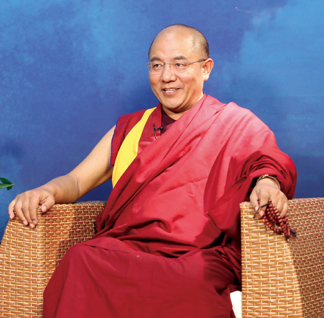

# 传递爱心 与时俱进

2018年2月28日

新年好，大家吉祥如意！今天，很高兴可以在慈慧的工作大会上给大家说几句话。

首先，我要特别感谢在座的所有工作人员。慈慧今年踏入第八个年头，这里有些人从开始到现在，一直都在默默无闻地奉献自己，对于你们为慈慧所做的一切事情，我们都会铭记于心。这里还有一些人是中途才加入我们关怀社会的团队的，各位也一直努力地学习和发心，为慈慧做了许许多多的事情。

总之，因为这里的每一位都在共同学习、共同努力，加上各种因缘聚合，所以从最初到现在，大家都做了许多非常有意义的事情。虽然那些充满爱心和利他心的人，并不需要别人的感谢，但我个人对知恩、感恩非常重视。

因此，今天我要在这里郑重地跟大家说一声：“非常感恩！”以表达我对大家的感激之情。

## 大乘佛教徒要利益众生

今天，我想说的第一点，就是你们在百忙之中，能够抽时间来慈慧发心，真的很不容易。

本来，你们都有自己的工作和家庭，也要处理生活上的各种事情。然而，你们在如此忙碌的生活中，还空出自己的时间来加入慈慧的团队，去关心和扶助社会上那些需要帮助的人，例如山区的贫困学生、孤寡老人和可怜的病人等。正因如此，我们在过去几年确实做了许多充满意义的事情。

从大乘佛教的角度来看，大家的行为实际上是在行菩萨道。有些佛教徒口口声声说自己要发菩提心、要去利益天下无边的一切众生，可是他们只是空口说白话而已，他们从来没有付诸实践，没有去关心身边那些需要帮助的可怜众生。

作为佛教徒，我们应该要把握机会去饶益贫苦的众生，我想，这也是在座各位自愿地加入慈慧的原因。事实上，依靠大家多年来的付出，许多众生已经获得了巨大的利益，这是有目共睹的。

## 要持之以恒地发心

第二点，我希望大家能够持续地在慈慧的志愿团队中发心。

当人们刚开始做一件事情时，通常都比较热情和积极，但是一段时间后，很多人都会因为遇到困难而放弃，轻易地退失初心。相反，我们可以看到世界上那些伟大的修行人、成就者，以及对人类社会非常有贡献的世间人，他们在面对困难和挑战时从不退缩，从不半途而废。他们只有在因缘不具足、走投无路，或者遇到特别大的困难和违缘时，才迫于无奈地放弃，否则他们都是不忘初心，勇往直前的。

在做事的过程中，我们每一位难免会遇上一些困难，或者一些自己感觉没法克服的困境。这时候我们需要有持之以恒的心态，再三地努力，因为只有坚持不懈，我们才能获得最终的成功。

## 发心团队要团结和合

第三点，在从事各项工作的过程中，我们慈慧的内部一定要团结，因为团结才是力量。

一个人的力量根本不能跟团结的力量相比。例如，我们当中的任何一个人，他自己是没有能力去帮助那么多学生的，不过，只要我们团结起来，个人的力量就会汇聚成一股超凡的力量，如此我们就能达成共同的目标，使很多众生受益。

## 追上时代，不断学习

第四点，希望大家能够不断学习。我们正处于一个特殊的时代，现在不仅是网络时代，也是人工智能的时代。如果我们的志愿者和工作人员停止学习，只懂闭关自守的话，那我们做事的时候，可能会遇上重重困难。

不管在座的各位是不是一位佛教徒，我们都必须跟上时代，学习各种知识和不同的管理方法，包括慈善法、信息管理等，如此我们既能适应现代的社会环境，又能满足个人的生存需要。如果慈慧的所有人员都热爱学习和做慈善，我们的团队将会非常有意义。

最后，我希望我们每一个人都能坚持下去，能够持之以恒地发心。

现在是2018年，去年是慈慧成立的七周年，今年它迈入第八个年头，对我们来说，这是一个特殊的时刻。一路走来，大家都非常不容易。在发心过程中，大家都遇到了许许多多的困难，如身体不好，也失去了一些闻思的时间，不过这些情况都是暂时的。

长期来看，坚持不懈的人能够做很多事情，半途而废的人则一事无成。我一个人也能从事翻译、管理和其他事情，包括参与学院的建设等，关键就在于自己的心力。如果我们有一定的心力，即使去做许多事情，也不会感到困难，这时候无论是自己的闻思修行，还是利益众生的善行，我们都能兼顾。

今天，我要特别感谢慈慧的所有工作人员。对我们来说，能够在慈慧发心的确是一个良好的机缘，希望我们继续努力，利益更多众生！
