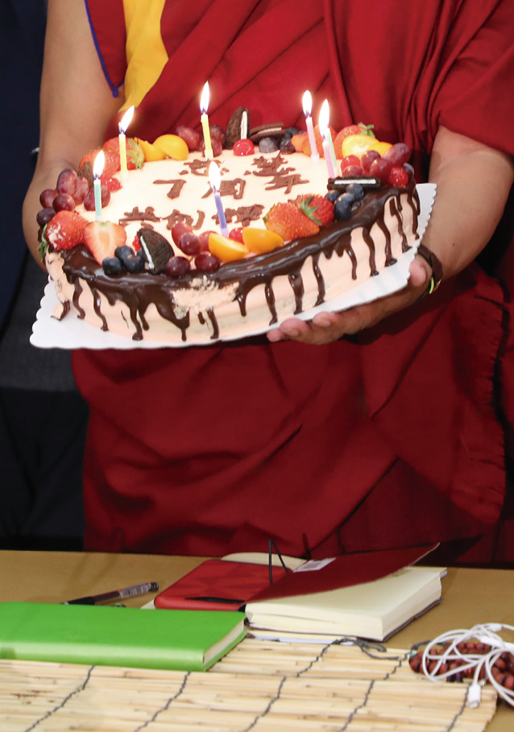
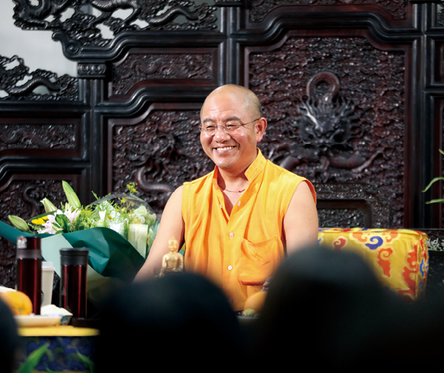
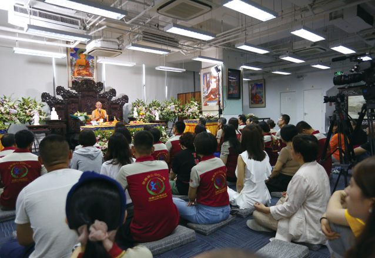
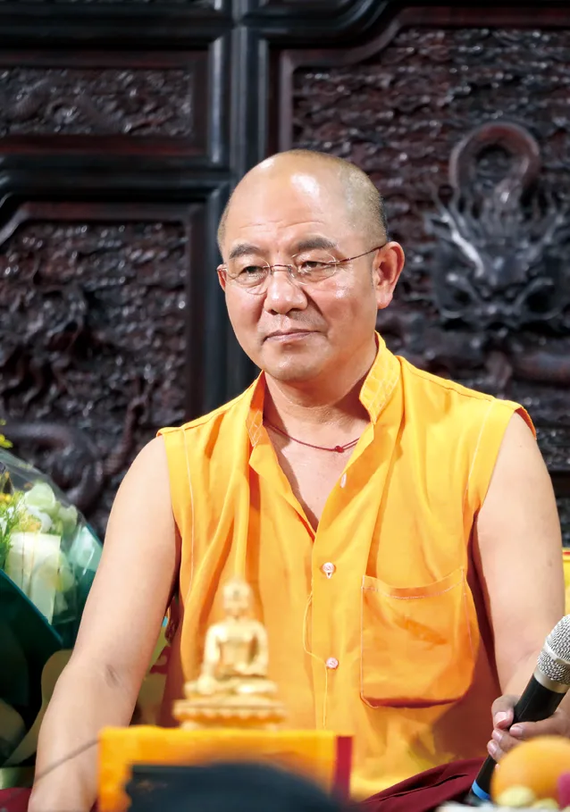
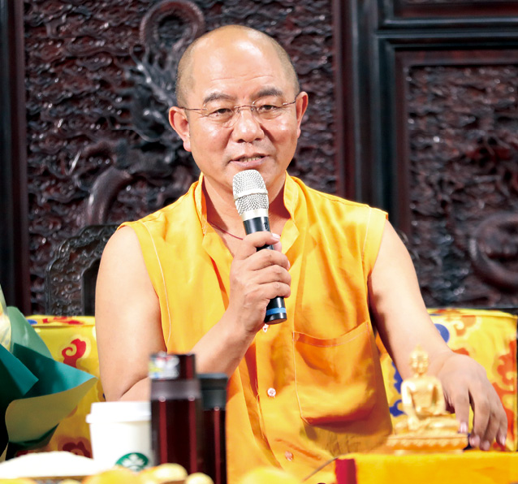
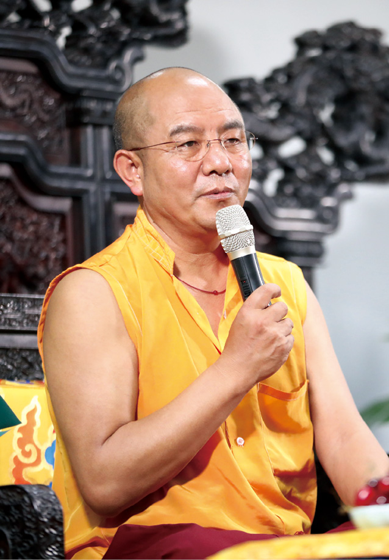
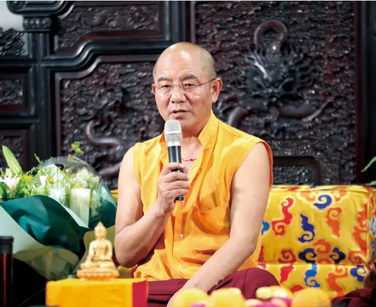

## 关怀社会， 不忘关爱慈慧家人

2019年6月26日

主持人：

欢迎大恩上师，感恩您！各位请就坐。今天，我们怀着特别激动的心情，迎接我们期盼已久的大恩上师来临慈慧的北京办公室。上师将会给北京慈慧的核心志愿者们做一个关于慈善的开示。首先，让我们怀着感恩的心来欢迎大恩上师，您辛苦了。有请我们的志愿者给上师献花，感谢上师。下面请大恩上师给我们慈悲开示——

今天，我们在慈慧的北京办事处，就是慈慧驻北京的“大使馆”，进行简单的交流。等会你们可以放松、随意地提出一些问题或者想法。

众所周知，慈慧走到今天并不容易。从成立至今，我们至少帮助了上万人士，包括病人、老年人和残疾人士。当然，我们最主要的目标群体是大学生，尤其是藏地的学生。由于外在条件的限制，许多藏地学生在高考后都面临辍学的困境，这是他们最大的困难。当初我们成立慈慧的最主要目的，就是帮助这些大学生完成学业。

总之，慈慧迄今为止确实帮助了许多人士，这一点是有目共睹的。

至于我们的北京分部，一直以来都像打游击战一样，没有一个固定的办事处。每次我们租了一个地方，租约期满后又要另觅他处。多年以来，我们北京的志愿者需要不断地更换工作地点。

后来，女众这边有极大的发心，给我们提供了巨大的帮助，使我们终于有了固定的北京办事处，从此大家的工作效率便大为提升。为什么每个国家要在其他地方设立大使馆、联络处或者办事处呢？因为有了稳定的办公地点，人们的做事效率确实会有所提高。北京寸土寸金，大家能够在此找到一个重要的位置，建立慈慧的道场，让志愿者们有一个安身之所，真的非常不容易。

在这个繁忙且事事与费用挂钩的时代，如果各位没有信仰的力量和利他的意乐，你们很难会自愿加入慈慧的队伍，去发心帮助众生。相反，正因为大家有共同的利他心，所以不管自己牺牲多少、付出多少，我们仍然心甘情愿、无怨无悔地在慈慧发心。我想，大家所体现的就是大乘佛教的伟大思想。

一般的世间人不可能长期地发心，可能做了一段日子就坚持不下去了。而我们的众多志愿者，自慈慧成立之初便一直发心到现在，当然在座之中，也有一些人员是中途加入的。不管怎样，各位哪怕是参加一次会议或者活动，背后都有某种程度的消耗，人力财力也好，精力时间也好，总之我们各自都有许许多多的付出。难得的是，大家仍然无怨无恨、非常乐意地在慈慧做事。

刚才我和李居士在车上也提到这个情况。现在由于各种因缘聚集，尤其是依靠大乘菩提心的力量、大家前世的发愿力和今生殊胜因缘的威力，如今慈慧的慈善事业可算非常成功。

## 克服痛苦，坚持发心

事实上，目前社会的总体环境并不是特别好。在整体经济下滑的情况下，不要说大额捐赠，如今就算是小额捐款，也会对大城市的人构成非常大的压力。在此瞬息万变的时代，慈善捐款会给各样身份的人带来不确定性，因为人们的生活、工作和财富一直都在变化。如果没有大乘菩萨行的力量，恐怕没有人会把自己的血汗钱捐出来，去帮助素不相识的人。

任何人，无论来自哪个国家或者地方，即便是一个普通的农村人，也会把与自己钱财有关的事情算得非常清楚，哪怕是兄弟姐妹之间也是如此。所以，从世间的观念来说，大家能够长期地投放大量金钱、时间在有需要的人身上，的确非常不可思议，这一点大家应该非常清楚。

一直以来，慈慧的形象及工作成效都比较理想。虽然国内也有很多基金会，可是相比之下，我们基金会的透明度非常高，这是相关部门也认可的。

当初我们成立慈慧时，很多人都以各种目光来看待，因为社会上有些人会用慈善、基金会等名义不合理地获取私利。不管是官方还是众多慈善人士，当时他们都抱着怀疑的态度来看待慈慧。

然而多年以来，我们已经消除了各方，特别是所有捐赠者的疑虑。慈慧一直按照基金会的流程，公布全部资金流向和资产项目。现在，社会上的佛教徒也好，非佛教徒也好，他们都对慈慧基金会有正面的认可和评价。

到目前为止，我没有听过关于慈慧的负面说法，即便是有也是正常的。毕竟我们做任何事情，要获得所有人的认可和赞叹是很难的。尤其在做企业的时候，当你的企业越来越成功，很多人都会不太欢喜。同样，如果我们的慈善事业做得比较成功，也许一些没有实力的人或者同行会产生嫉妒心和非理作意，对我们有各种说法，这种可能性是存在的。

不管怎样，我至今都认为慈慧的工作确实很有成效。今年我在海南的时候，对慈慧所帮助的学生和受助者数量做了一个粗略的统计，我对结果非常满意。虽然表面上我们只帮助了几千位学生，可是对每一位学生来说，他所得到的实际利益是别人难以想象的。

在座可能有些人曾经当过穷人，也有些人从未感受过贫困之苦。我个人在求学时期，曾经因为没有钱和资源而遭受歧视。每逢回想起来，我便非常愿意去帮助那些穷苦的孩子，这也是我们成立慈慧的最主要目的。

慈慧的另一个项目是安宁陪护。全国来讲，我知道北京团队在这方面做得最好，大家的付出也是最多的。不过，我听说一些发心人员因此感到一些痛苦。

例如，你在好长一段日子里陪伴了某位病人，彼此已经产生了感情，最后当他离开人世，你便感到非常难受；另外，如果你经常帮助很多病人，那可能需要减少自己的睡眠时间，所以你的身体会有很大消耗。除了身心的付出外，大家在与不同的家属和医护人员沟通时，也会遇到各种困难和问题。

有些佛教徒可能比较单纯和虔诚，在社会上未曾接触过很多复杂的事物。当他们在发心过程中一下子遇到很多前所未见的情况，心里便会有些压力，或者不能在短时间内把自己的心态调整过来。

其实，不仅是安宁陪护，大家做其他发心工作也会遇到困难、感到痛苦。无论我们做什么事情，都可能出现各种情况，这是正常的。一个人如果不做任何事情，他不会遇到任何困难；他一旦去做任何一件事情，便可能遇到各样的麻烦，这是一种规律。

我自己也处理着不同的事务，过程中也会遇到各种问题，这是非常正常的。所以，大家没有必要因为发心过程中的一些困难而感到特别痛苦。这是我在说今天的正事之前，想特别提醒大家的。

现场主要有慈慧的志愿者，也有极少数的专职人员。今天，我想跟大家说几件事情。首先，我非常感谢你们多年以来不断的付出。

大家平时在星期天或者假日都有很多事要处理，也要在夏天酷热的环境下做各样的事情，真的很不容易。尤其是参与西部助学的时候，我们的众多志愿者确实非常辛苦。

有些人只是为了表面上应付领导而做一些事情，做得并不乐意，因此他们的办事效率不高，而且也经常把事情做错。相反，你们都是真诚地在慈慧做事。所以，对于大家一直以来非常真诚的发心和各种付出，我真的非常感谢。这是我今天想说的第一点。

## 记录生活，以慧处事

第二点，我们每个人都要总结自己过去所做的工作。大家应该反观自己，在加入慈慧之后，自己在参与慈善的过程中做了些什么，然后做一个记录。你可以记录个人或者集体方面的事情，也可以记录自己于某天、某月所做过的工作，如此你会清楚自己做过什么选择、做过什么贡献。

我建议大家最好每天都去记录自己的生活，以及定时做每月和每年的总结，如此你会明确地了解自己和集体以往所做的工作，得出详细的总结。

第三点，大家要一如既往地发心，不能对慈慧的工作有所懈怠，该做的事情我们就该去做。

你看台湾、新加坡等地的一些慈善团队，他们有丰富的慈善经验，而且内部团结和合，在做事过程中也能有度地掌握分寸。希望慈慧将来在各方面都能达到那样的水平。

从年龄上讲，慈慧有部分志愿者是大学生，可以说年龄偏小。我们昨前天的主持人也比较年轻，不过我觉得他的思想还是成熟的。太年轻的人因为缺乏经验，在做慈善的时候可能会不太到位，但是总的来说是没有问题的。

慈慧现在的方向，是从大学时期就开始培养一些年轻人，使他们将来成为很有力量的利他者。如果我们大多数志愿者的年龄都是六七十岁以上，可能我们的许多工作都会因为发心人员的力不从心而不能完成。可喜的是，我看你们很多人的身体和心态都非常健康。在此基础上，大家发心的时候还要注重分寸，要有智慧。

的确，慈慧的志愿者多年来都以理性的智慧做事。希望大家能够珍惜这个非常难得的机会，继续认真地发心。

## 慈慧的专业性与发心人员的付出息息相关

第四点，大家要对未来有所规划。

以慈慧的拍卖为例，我经常听到上海团队筹了多少善款，成都团队又筹了多少……这时候你们可能会想：“如果我们北京团队筹得很少，那怎么办呢？”当然，你们在行善方面有竞争性是很好的。像我们寺院的德巴堪布，他年轻时跟另外一位堪布在背诵经论方面互相竞争，他们晚上各自偷偷背书，好让自己的背诵数量能够超过对方。

但是另一方面，如果我们经常与其他地方的团队比较，可能会让自己有很大压力。我早前跟总部的人员说：“以后慈慧所定的筹款目标，不一定要比前一年多。现在的经济状况一年比一年不景气，如果我们的筹款目标却定得一年比一年高，那是不符合逻辑的。当慈慧的发展到了某种程度，筹得的善款有时候多一点，有时候少一点，这是正常的现象。”

当然，现代人能够拿一些钱财出来做慈善，确实是很好的。尤其是在慈慧，我们的人员大多数都是佛教徒，因此一定会善用捐助者的资源。我们本来打算用10%的收入来给全职人员发工资，这是一个合理的水平，但最后我们在这方面也用不到10%，余下的金钱便全部用于助学了。

对社会上的很多人来说，慈慧是一个很好的平台，因为他们想做慈善，却经常遇不到真正需要帮助的人，而慈慧则有专职人员负责此事。昨天，我在微信上一直跟秋云老师联系，我们最近要对所有助学申请逐一审核。过两天他和团队放完假后，便马上到藏地走访每一个申请助学的家庭。

今年，慈慧助学的目标群体以藏地的孤儿和单亲家庭的学生为主。可以说，能够像我们这样认真地把关和善用捐款的基金会，确实不多。虽然很多基金会都有丰富的资源，但是一般来说，他们的程序都比较简单，没有什么把关，只是简单地给有一些需要的人发放资源。

在审核的过程中，我们也许会有一些差错，不过这是在所难免的，毕竟我们并不是全知的佛陀。但是从总体上讲，慈慧汉藏两地的团队确实付出了很多精力和时间来甄选孩子的资格，务求让我们的资源能够用得其所。这在现有的基金会之中算是少见的，也是我们引以为豪的地方。

多年以来，慈慧已经帮助了一批又一批的毕业生。其中有些人会给我们反馈，说自己已经毕业了，对我们非常感谢；而一些毕业生则不喜欢提及自己的过去，装着从小没有受过任何帮助，仅凭一己之力而成为一名成功人士。因此，他们不想其他人知道自己是在受助的情况下读完大学的。

我偶尔会认出一些以前是慈慧受助者的公务员，我会问问他们的过去以确认一下，这时候对方会感到非常不好意思。我遇到这种人的话，会故意逗他们，多问他们以前的状况。可能对他们来说，儿时的贫穷是一个伤口吧。成年之后他们想尽量抹掉这个伤口，于是便在别人面前装作没有受过伤的样子。其实，那些受助者将来对慈慧有什么看法并不重要，因为我们的目的并不是为了回报。

大家也知道，如今藏地的生活水平跟汉地的大城市有很大差距。比如平时供养上师，汉地的佛教徒可能会供养一百元或更多，藏地的佛教徒可能只供养五元或十元。一般来说，藏人乐于帮助他人，在信仰方面也非常虔诚。不过，由于藏地本身资源匮乏，加上现在它的整体经济不佳，如果没有大家的帮助，那里的很多学童根本无法读上大学或者完成学业。

现在学童的支出越来越高，许多学生不仅在学费方面感到压力，甚至连基本的生活也难以维持。所以，慈慧每年在提供助学金的同时，也为这些学生提供生活费用。起初，我们仅仅在学费上帮助他们，但后来发现，尤其是单亲家庭的学生，他们连维持日常生活都十分困难，于是我们就根据他们各自的情况，尽量为学生们提供必要的生活费用。

对某些有福报的捐赠者来说，几千甚至上万元的钱财不过是九牛一毛；但是对贫困的人来说，这样的金额足以改变他们的命运。

在过去的六七年里，我一直随同慈慧的团队去藏地发放助学金。可是自去年开始，由于相关部门的管理，在藏地集中大量学生变得不太方便，我们发放助学金的形式就变得小型且频繁，而我也只能参与部分的旅程。现在，随着受助学生人数的增加，加上我们每次只能为少量的学生发放助学费用，所以相关人员需要前往许多不同的地方，确实非常辛苦。

虽然我现在无法全程参与，但是每次参加的时候，我还是有很深的感受。因为我每次接触那些年轻人，都会首先观察他们的气色，这基本上反映了他们的身体和生活状况。多年以来，我确实看到一些原本气色很差的学生，由于慈慧的两三年帮助而顺利毕业，那时候他们的气色已经焕然一新，可以说，他们整个人在智慧和身体方面都发生了巨大的变化。

所以，我十分重视对大学生的资助。我自己不仅会为这个项目捐出一些钱财，如果有时间，我也会亲自参加发放费用的过程，或者参与相关的会议。即使不能参与所有会议，我也一直关注着这个项目的导向和理念。

我们成立慈慧基金会的初衷，就是以合理、合法和正规的管理来营运慈善项目。多年以来，依靠捐赠者和我们发心团队的努力，在各种因缘和合的情况下，慈慧得以平稳地发展。我希望北京分部的发展也能如此。其实对慈慧而言，北京和上海的团队都非常关键。

从现在的整体环境来看，我们不宜进行大规模或高调的宣传，应该低调、踏实地做好我们分内的工作。我们对外承诺的事情，不能光是口头上说说而已，这样的虚假宣传是不负责任的。我们应该凭良心实实在在地做事，兑现我们对大众的承诺。如此一来，人们会看到我们的诚信和可靠，这也是越来越多人士，尤其是捐赠者对慈慧放心的原因。

其实，一些有福报的人往往想亲自帮助别人，可是过程中他们会遇到各种情况。有一次，我遇到一位特别会说话的病人，当时我给他捐了一些钱，后来我才知道他不是真的需要这些钱，而且他在很多地方也用同样的方式来要钱。那时候我才明白：“哦，原来做善事的话，不能只听当事人的一面之词。”

我们的一些捐赠者可能也缺乏这方面的判断能力，所以他们选择将善款捐给慈慧，因为我们的团队有经验，会尽力观察受助者是否符合资助条件。事实上，慈慧在发放善款的整个流程中，一直都做得非常仔细，这对捐赠者来说是一个很好的保障，而对我们的发心人员来说，这是在生活中实修大乘菩提心的途径，也是积累资粮的好机会。

大家在发心做事的过程中，难免会遇到一些烦恼和问题，但为了利益众生，我认为经历这些困难是值得的。希望我们的团队能够继续坚持下去。以上是第四点。

## 有效地分配时间，减少散乱

第五点是关于时间管理方面的。慈慧的很多志愿者都是学会的学员，在座应该有很多佛教徒，你们要同时处理生活中的诸多事务，包括工作、家庭、发心和修行，对许多人来说，这些方面时常会有冲突。

我知道大家在平衡这些事情时经常感到很困扰。比如，你明白在志愿团队中发心是很好的，但也觉得这会影响到你的修行，或者减少自己陪伴家人的时间，从而跟他们产生矛盾。也许你们现在也面临着相同的困惑。

对于这个问题，我希望大家能够认真地安排自己的时间，或许你会找到一个平衡点。慈慧并不要求大家全天候24小时来发心，大家每个月的发心时间都是固定的。同样，学会的学习时间每周也是固定的，你们每周有一两堂课，共计一两个小时。因此，我认为大家每周安排一些时间来发心，并不会对你生活中的其他事务造成影响。

你们有些人可能觉得自己特别忙，但如果让我代入你的生活，我应该可以妥善地安排你在发心、闻思修、家庭和工作方面的时间。其实，你觉得“忙”可能是因为自己用了很多时间来散乱，当你之后发现没有时间做必要的事情，便用“发心”来顶替“散乱”的罪过。

比如，你花了半天时间来做各种散乱的事情，以致最后没有时间去修行，但你却认为发心是自己修行不足的原因，那就对“发心”太不公平了。

当然，有时我们确实会遇到所有事情突然集中在一起的情况。我在学院的时候，这种情况时有发生。比如一天之内，我要开三四个会议，见很多重要的人物，同时在翻译和讲课方面，当天也刚好碰上特别难的部分，自己要做很多思考和准备，此时我会想：“啊，今天怎么办呐，好像所有事情都变得麻烦了。”

不过，这种情况并不常见。一般来说，我能够很好地安排自己的时间。例如这次来汉地，我有时一天要讲两堂课，就是一天大概要站4个小时，但我不会觉得特别累，因为身体上的站立和课前的准备，例如思考如何引出我想让大家注意的事项，这些对我来说并不困难。

在学院的时候，我的任务确实很繁重，包括参加不同的会议、处理管理上的事务、接待领导或高僧大德、晚上讲课等。即便如此，我也尽量合理地安排时间，所以自己依然能够保持良好的心态。如果妥善地安排时间，减少散乱，其实我们可以处理很多工作。

可能很多道友都在为发心的事情纠结，苦恼着：“哎呦，我目前既要发心又要闻思，真的没有时间去做其他事情。现在，我的修行没有进展，而且家庭和工作上都有很多乱七八糟的事情需要处理，那怎么办呢？唯有退出发心团队，反正自己好好修行，最后获得解脱才是最重要的。”

实际上，获得解脱并不容易。发心也好，处理家庭事务也好，有些人无论处理什么事情都会让身边的人不满意，这类人的修行一般也不太好。相反，那些做事有条不紊的人，尽管面临巨大的压力和繁重的工作，他们也不会感到难受，因为他们能够有效地分配时间，安排好各种事情，包括修行。

## 团结就是力量

我们发心团队的整体素质非常不错。不管是慈慧的地方团队，还是学会的发心团队，我们的队伍都非常成功，因为大家都有利他心和责任感，这些品质对我们的团队至关重要。

在当今冷漠的社会中，无私奉献是罕见的，因为很多人非常现实，其行为只是为了个人利益而已。现在，大家愿意无私地付出，为社会作出贡献，真的非常难得。事实上，这样的行为就是一种修行。

可能一些道友会想：“我烦恼深重，修行和发心都很差劲，我该怎么办呢？”这种想法是不必要的，大家不应对自己过于失望。当然，每个人都应尽力履行自己的责任，但若过程中遇到困难，如身体不适、心态调整不来，导致事情没有做好，这也是正常的。重要的是，我们不能因此退缩，而应坚持下去。

另一方面，我们团队中的人员应该互相支持。我们都会踏入人生中比较难熬的时刻，可能个别的人员会在家庭、生活等各方面同时遇到诸多困难。作为当事人的道友，大家不应轻易地对他失去信任或排斥。例如，管理人员不要因为某位道友缺席了一两次活动，就立刻把他开除，这是不合理的。

我们不仅要对社会有利他心，也要对团队内部有利他心。我知道在座之中，一些有福报、有能力的人员经常给予其他志愿者各种支持和方便。对于他们的帮助，我衷心感谢。

在年初的慈慧理事会会议上，我跟相关的人员说，慈慧不仅要帮助世间中的有缘群体，更重要的是我们内部要相互扶持，无论是哪位慈慧人遇到精神上、身体上或者生活上的困难，我们都要共同伸出援手。

假如一位慈慧人员遇到困难，通过我们团队的帮助，他应该能够扛得住，不会感到特别难以应对。毕竟，每个人不可能一直陷在困境之中，他的困难只会是阶段性的，我们的共同努力一定可以帮他渡过难关。

正如我刚才所说，慈慧的受众群体分为两类：其一是社会上的有缘众生，其二是更为重要的慈慧内部人员。事实上，慈慧已经解决了很多道友的就业问题，而我也跟相关的管理者说了，我们以后要尽量为所有慈慧人员，包括全职、专职和志愿者，提供各种方便。这个功德跟我们做慈善一样，都是难以估量的。

现今社会的整体状况并不太好，大家愿意来慈慧发心确实不容易。当然，我们内部不能像一些世间人那样有贪污等不如法的行为。在此前提下，如果我们当中有些善心人士因为看到其他发心人员比较辛苦，而提供一些帮助，哪怕是一顿饭、一瓶矿泉水，这样的支持和鼓励是很有必要的。

我们不仅需要向外传递爱心，更需要在慈慧内部培养团队精神，就像台湾的慈济一样。多年以来，他们的慈善事业确实做得很成功。虽然近年由于老法师在显现上有健康等方面的状况，他们的活跃程度有所减少，但他们的团队成员还是会互相帮助、互相扶持，就是说，他们的内部仍然保持着很强的团队精神。

这种精神也是我们团队长远坚持下去的关键。即使慈慧对社会有贡献，但若其内部没有任何凝聚力，发心人员之间不团结、不和谐，甚至整天说是非、勾心斗角，那是不会有人愿意留下来的。

相反，如果慈慧的内部十分温馨、和谐，发心人员能够在语言、心灵或生活层面互相支持，我们的团队就会有凝聚力，这将使我们的利生事业更上一层楼。所以说，团结就是力量。确实，慈慧能否持续发展的关键在于其内部的团队建设，而后者的关键就在于团结。

与慈慧一样，我们佛学院也有两个面向：其一是全力以赴地向外弘扬佛法，其二是关注我们内部的发心人员。只要我们有任何资源，我们一定会首先考虑把它用在发心人员身上。

现在慈慧的人员比较多，我不可能去关注每一位的状况。但是，慈慧在各地的相关负责人，会经常关心我们团队中的每一位成员。在此科技时代，慈慧人员之间的沟通比以往更加便利，大家无论是商约开会，还是彼此表达一些关心、问候，如今都非常方便。

我们并不追求短期的发展速度或者那些不断上升的指标，我们的原则和目标就是细水长流，平稳前行。当然，如果我们的工作有一些差错，或者在利生过程中遇到一些挑战，那也是正常的。因为世间没有一个恒常的法，无常随时都会出现。

慈慧发展的道路肯定是曲折的，就像心电图一样，总有高低起伏。我们佛学院和世间的企业也是如此，不会有一条笔直向上的路径，这是人生的真实写照。因此，在慈慧传播爱心的路途上，我们团队中的每一位成员都应保持乐观的心态，无论遇到任何困难，大家都应该有欢喜心，就像《入行论》中所说：“遭遇任何事，莫扰欢喜心。”

大家可以坦诚地跟我们的团队，分享自己在发心过程中所遇到的问题，毕竟慈慧的大部分人员都是佛教徒，或者是你的金刚道友，因此我们成员之间的交流和思维方式，应该跟那些没有因果正见的世间人截然不同。

不过有时候，我们佛教徒的烦恼可能比一些没有信仰的人更深重，这一点值得大家注意。一些没有因果正见的人也能以平常心来面对困境，但是一些佛教徒却会陷入嗔恨等负面情绪之中，他们的烦恼甚至比世间人更加重。此时我们要学会控制自己的情绪，而其他道友也应该主动伸出援手，对吧？

我本来打算做个简短的开示，但是看到你们穿着整齐，而且听课时十分专注，所以今天就讲得比较多。一般来说，我的演讲时长跟对境息息相关，如果听众不专注，我的课时可能只有几分钟。有时候我在一些大学演讲，台下的所有大学生都在睡觉，我在那种情况根本无法演讲下去。

今天你们很专注，因此我多啰嗦了几句，把本来是几分钟的开示变成几十分钟。无论如何，我特别感谢大家对慈慧的付出，我们还要再接再厉，砥砺前行。

接下来我们会给大家每人发一串砗磲念珠。（堪布为念珠开光）

现场互动

主持人：

非常感谢上师慈悲的开示！慈慧基金会为我们提供了实修菩提心和积累福报的机会，我们一定会非常珍惜这个平台。我们期盼上师经常加持慈慧，使其事业圆满长久、顺利广大。同时，我们也祈请上师加持所有慈慧家人团结和合、身心健康，使我们每一位都有一颗金刚心，能够长久地坚持发心。现在进入互动环节。

⊙ 问：顶礼大恩上师！弟子是2018年第二届密法班的学员，目前在学会带新班，并在慈慧做安宁工作。弟子在关怀临终病人的时候遇到过一些情况，当时病人正值弥留之际，他的家人暂时不在身边，现场只有弟子和一些慈慧的陪伴者，那时候我们在纠结要不要为病人念佛号，或者做个简单的开示。因为从佛教的角度，这样可以利益病人，但是另一方面，如果他没有信仰，甚至是其他宗教的教徒，这种做法是否合适呢？这个问题一直困扰着弟子，请大恩上师慈悲开示。

堪布：慈慧不是一个佛教气息浓厚的团队，我们在社会中的角色并非是一个宗教组织，而是一个看起来没有宗教色彩的慈善团体。因此，当我们遇到其他宗教徒或非宗教徒时，我们可以在不发出声音的情况下，默默地为他们加持、念咒。总的来说，无论是病人还是其家属，我们都要善于处理与他们的关系。

例如，我们在一位临终的基督徒身旁拼命地念佛，他可能会生起嗔恨心，之后他很可能会因此堕落。在临终之际，一个人的信仰是非常关键的，他肯定不愿意在那一刻放弃自己的信仰。

各位佛教徒试想一下，如果一位基督徒在我们临终时拼命地念他们的仪轨，我们也不会愿意接受他的帮助。虽然我们认为佛教很好，但临终者可能无法接受，因为这不是他们生前的选择。所以，我们应该默默地为他们做佛事，善巧地处理这种情况。

事实上，慈慧的公众形象是没有宗教性的。昨天，一位教授表示他对《金刚经》没有共鸣，我们的主持人因此感到愤愤不平，并准备与他争论，我觉得这种反应有些过分。

我在佛学院的时候相对严肃，尤其是传法期间，会对各方面有严格的要求。另一方面，我在学院以外的地方会尽量随顺别人。我们做人处事要有灵活性，大家以后在其他宗教徒或非宗教徒面前，最好随顺他们。

显现上慈慧纯粹是一个基金会，没有任何宗教性质，因此大家接触不同人士的时候，一定要察言观色。如果对方不能接受佛教的思想或行为，你要学会退一步，千万不要勉强；如果对方能够接受，那你可以向他传播一些佛教的教义。

有时候佛教徒比较死板，因为我们对自宗很有信心，就像昨天我们的主持人一样。那位教授说自己无法接受“一切有为法如梦如幻”的观点，所以对《金刚经》没有信心，当时主持人显得不满意，有两次差点跟教授争辩起来，我看到后便故意转移了话题。我想，即使我们以道理来驳斥他的观点，他仍然会固执己见，这些人的人生道路其实早已注定好了。

总之，佛教徒要善于包容，这很重要。

⊙ 问：顶礼大恩上师！我现在在安宁陪护发心。二月底的时候，我亲眼看着一位宝宝离世。最初我没有特别的感觉，但是几个月后，我发现自己异常痛苦，每当提到这个孩子，我就会情不自禁地流泪，见到他的母亲时，我会感同身受地感到伤痛。虽然有些师兄告诉我，孩子去了一个非常美丽的地方，但我仍然不知道如何处理这种情感。恳请上师慈悲开示，谢谢。

堪布：这些师兄不一定能看到这位宝宝去了哪里，因为众生后世的去向是很难推测的。也许他还没有去到美丽的地方，而是在中阴身的阶段，这是谁也无法知道的。

不管怎样，我们做慈善的时候会遇到各种情况，所以在此之前，大家需要接受培训，这点非常重要。比如在台湾，慈善人士会接受全面的培训，包括受到谩骂时如何应对、遇到精神病人时如何自我保护、在面对可怜众生离世时如何守护自心等。

如果大家没有接受培训，那么在行善的过程中，你很有可能会感觉不踏实，以致情绪上有很大波动，也容易受伤和感到痛苦。本来你想去帮助别人，结果却需要别人来帮助自己。因此，大家在做慈善之前，需要接受各方面的培训，让自己有思想上的准备，这是非常必要的。

其实，大家没有必要对亡者过于执著。我们该做的已经做了，有生必有死，没有一个众生是例外的。当我遇到跟你相似的情况时，我能够坦然面对，因为我真正明白了无常的道理。所以说，大家在陪护之前有一些思想上的准备是很重要的。

⊙ 问：顶礼大恩上师！我是北京春华秋实项目的负责人，我有一个困惑。慈慧总部平时会邀请我们鼓励大学生出来发心，或者做一些志愿工作。另一方面，我自己在大学里工作，所以我也会关注他们的考试和学习。虽然慈慧希望大学生参加一些慈善活动，但我发现他们往往忙于毕业论文、学习或考试。如果我代入他们的处境，我也可能会暂停参与慈慧的活动，包括平时的发心工作。因此，当我邀请大学生参加慈慧的活动时，我感到矛盾。

对于那些做慈善意乐性很强的学生，我会重点培养；但对于那些不常参加活动的学生，我觉得我们需要更多人员去一对一地了解他们的状况。那些学生可能是内心没有打开，也有可能是学业上有很大的压力。关于大学生如何平衡学业和发心的问题，我觉得很难给予他们意见，因为当中的分寸难以把握，请上师开示。

堪布：慈慧现在的规模较大，服务范围也比较广，所以在具体实施的过程中，我们的工作可能在细节上存在一些问题，包括对大学生缺乏关注、未能鼓励他们参与活动等。我没有具体负责这些事情，对此并不是特别了解，但你们可以与总部和事业部的相关人员进行探讨。

我之前曾在慈慧发心人员面前发过脾气，批评他们的工作不够细致。这可能是因为我们投入的时间不足，以致在执行过程中出现一些问题。关于具体的改善方法，我现在也不是很清楚，但建议你与总部和北京这边的相关发心人员共同探讨。

实际上，慈慧的目标并不是培养大学生，而是帮助他们完成大学生涯。他们的学业成绩应该由他们的大学负责。目前慈慧的资源和人力有限，我们很难持续地关注那些大学生的学习效果和其他方面的发展。慈慧正在帮助几千名大学生，如果我们要一直关注他们各方面的发展，成本是很高的。至于我们如何具体地改进现有的做法，你可以跟相关的负责人商讨。

⊙ 问：顶礼大恩上师，我是安宁陪护项目的负责人。最近，我们团队正在探讨安宁陪护项目未来五年的发展规划，尤其是将来的使命和愿景，我们希望尽快把它确定下来。虽然这些使命和愿景可能会随着团队的发展而有所调整，但我们特别希望能够听到上师的建议。请上师赐予我们一个使命和愿景。这是我的第一个问题。

第二个问题是关于团队专业化和职业化方面的。刚才上师在开示中提到，慈慧要朝这个方向发展。我们特别希望上师能够多多加持我们，因为除了培训外，我们还需要社工和心理专家等专业人员，但是他们的日程、工资等问题仍然有待解决。如果我们要走专业化的路线，就必须解决部分职业化的问题。所以，希望上师加持我们，使我们能够解决这方面的问题。这是第二件事情。

第三点，目前我们在与北京儿童医院血液肿瘤科的周主任合作，在过去十年，她一直为建立临终儿童的关怀病房而努力。如今我们已经在跟一家医院合作，但是只有一间关怀病房，而外面等待陪伴的临终儿童则非常多，每位孩子都要等候一段日子才能入住。因此，我们非常希望得到上师的加持，使我们有能力建立更多临终儿童病房，或者与更多医院合作。这是第三件事情。

最后一点，在发心过程中，我们的部分队员确实有一些心理需求。就像刚才所说，我们需要有心理疏导方面的培训。不知我们能否从学院请一些有社工专业或心理专业背景的法师，来为我们进行这方面的培训？请上师开示。虽然我们团队中已有一些心理咨询师，但他们的指导毕竟是世间层面的，其意义比较短暂和有限。如果我们的心理疏导能够结合佛法，那么培训的效果将会更为理想。感恩上师。

堪布：关于北京安宁陪护的愿景和目标，最好由你们团队自行商议。你们可以根据团队的发心、当前的状况以及未来的计划来设定。我对你们的具体工作不是特别了解，只知道你们在这方面付出了很多努力，十分辛苦。所以，让我来完全确定你们的愿景有一定困难。总体来说，我们应该秉持利益众生的理念，去关怀、照顾垂危的生命，你们可以在此基础上确立未来的发展方向。

第二点，慈慧在逐步走向规范化和职业化，这方面会由总部来管理和推进，过程中他们会对相关人员的就业问题有所关注。确实，如果我们在这方面做得好，那将对我们的慈善事业带来很大帮助。关于安宁团队引入心理咨询师的问题，在慈慧推进职业化的过程中应该会得到有效的解决。

第三个方面，是关于增加关怀病房或医院的问题。你们自己要对此加持，尽力地推动，同时我也会为此加持。不过，我对具体情况缺乏概念，而且在北京增加一间关怀医院可能会有很大困难。所以，我会加持增加关怀病房吧。

第四点，是关于安排法师的问题。我们要专门安排法师来给你们培训，确实有一定困难。不过，慈慧有许多素质不错的佛教徒，一些道友有心理学专业的背景，一些道友在闻思修方面都很好，你们可以组织这些人员互相探讨。通过集体讨论，你们应该能够解决陪护时所遇到的心理问题。

⊙ 问：顶礼大恩上师！首先，非常感恩您对我们志愿者的关爱，照亮了我们正在走的夜路。我是慈慧宣传部的负责人，您刚才提到我们不适合做大宣传，应该保持低调。但是，作为宣传部的负责人，我需要请教大恩上师，我们如何把握宣传的力度？

第二个问题。我们最近打算与其他基金会团队合作，在彼此的公众号上进行联动。合作对象也包括一些国外的基金会，我们原来的想法是把他们的理念输入到慈慧的平台上。您提倡低调宣传，不知道此一规划是否符合这个标准？感恩上师。

堪布：事实上，所谓的低调并不是完全不宣传。尤其在当今时代，如果我们不做任何宣传，慈慧可能会逐渐从人们的视线下消失，最后被人遗忘。

不过，有时候即使我们不怎么宣传，仍然会受到大众欢迎，今年学会的招生情况就是如此。学会于年初已经决定不做任何宣传，但我们的新班人数并没有受到太大影响，反而有些地方的报名人数还增加了。

至于慈慧方面，我们还是会做某种程度的宣传，你们可以借鉴以往的经验，再配合现在的情况来制订宣传策略。总之，我们要避免过于高调和大规模的宣传方式。以前，学会的宣传队伍会到人烟稠密的十字路口派发传单，或者展示巨型的广告牌，这些做法如今不太合适。

学会也好，放生也好，现在很多事情都不适宜用大规模的宣传方式来推广。当然，慈慧是在民政部直接注册的机构，宣传方面应该较有弹性，但我们还是要谨慎地选择宣传方式。你们团队可以先与总部的相关人员沟通，再决定具体的宣传方案，这样会更好一些。

第二点，关于公众号的问题，我不是特别清楚。但现在是新媒体、短视频时代，我们确实需要在这方面有所投入。具体操作方面，你可以跟了解这个领域和处于时尚前沿的人士一起商量。其实在很多事情上，包括慈慧的事务，主要的工作人员有必要经常开会商量，这非常重要。

在商量的过程中，如果大家出现一些分歧，那可以通过民主投票的方式来解决。当然，你作为宣传部的负责人，还是要为团队的事情负责，可是在决策的时候，你应该吸纳其他人的意见。你们团队可以根据当前的状况和目标进行内部讨论，之后你们应能更好地制定宣传策略。总之，发心人员之间的经常性探讨和交流十分重要。

⊙ 问：顶礼大恩上师，我是北京事业部的负责人。我们在三十号有个拍卖会，祈请您加持我们超越上海（众笑）。老实说，我们事业部有很大压力，因为总部每年都会以上海的标准来给我们竖立一个标杆，然后告诉我们要超过他们。

之前我在上海参加学会的会议时，大恩上师曾说：“我们要立足学会，面向社会。”几年以来，我觉得学会若要立足北京，我们还有继续努力的空间。所以，请大恩上师多多加持，并在讲课时多提醒我们，感恩您。

在面向社会方面，我觉得学会中的部分学员，尤其是年资较深的道友，他们对慈慧的工作不太了解。他们很愿意参加放生或与佛教相关的活动，却没有兴趣参与助学或者其他的慈善活动。我想，很多人对做慈善仍然有偏见，就像您刚才所说，他们对善款的实际用途不放心。

事实上，慈慧是一个公开透明、非常专业的慈善机构，它的执行人员大部分是佛教徒，都具备因果正见，因此，慈慧是一个值得信赖的组织。可惜的是，许多学会的学员对慈慧的工作不太了解，希望上师能够在适当的时候给学员们提及一下，感恩您！

堪布：好。关于设定目标的事情，我明天给学会的负责人说一下。

（堪布念传承）
