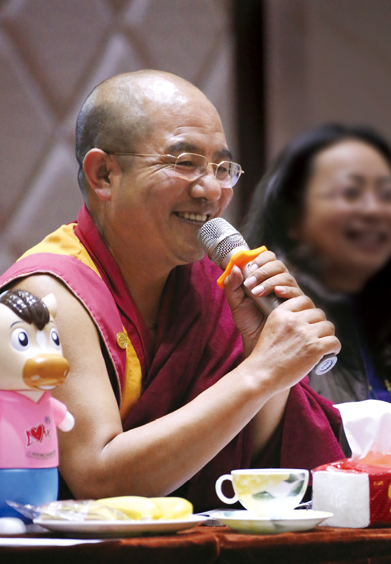
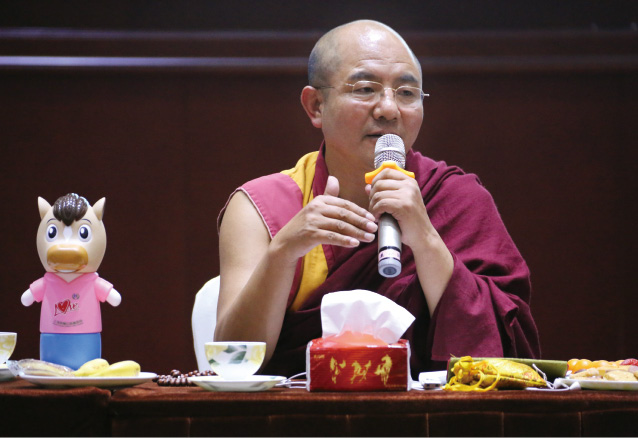

# 发心为利他（一）

——慈慧工作汇报会

2014年3月16日

慈慧各地的工作人员刚才作了一些汇报，这方面我没有任何疑问，他们的表达很清晰，关于将来的规划和需要实行的很多工作，他们都计划得非常清楚，有一定的思路；有些人员虽然没有明确的计划，但是从他们的汇报，可以看出他们有一个自我认识和自我反省的成长过程，这也是非常好的。

在座各位跟昨天来临的人并不相同，今天来现场的，都是慈慧在各地最核心的工作人员。因此大家应该清楚，我们所做的任何事情，都是围绕着一些重点来开展的。这不仅是慈慧的运作方式，世界上很多机构也围绕着他们所认为的最重要的东西来展开操作。

从前天到今天，我们分别用三天的时间，给不同的人士讲解慈慧最近所做的一些工作。我平时也要求慈慧的负责人，把慈慧当前最重要的工作汇报给我，如此我能适时提出一些建议。

那么，今天我们聚会的目的是什么呢？就是培训。除了慈慧总部的专职人员，今天来临现场的也有慈慧理事会的主要常委，以及相关的工作人员。我们没有特别通知上海区的所有人员来此聚会，你们之后应该把今天学到的思想和理念，跟其他人员分享，因为慈慧总部所定下的理念及其思路，对所有工作人员都很重要。

## 发心人员要不堕两边

可能大家都想对慈慧的管理和运作模式有所了解，所以我们刚才已经给大家做了一些工作汇报。此外，还有几件事情值得大家注意：

首先，我们在开展慈慧工作的时候，应该尽量淡化当中的宗教性，或者佛教元素。如果我们正在进行一些慈善活动，希望大家可以暂时放下一些佛教的行为，比如使用转经轮、拿唐卡等。

不管是在国内还是国外，我们的善行都要达成共赢的局面。在此前提下，我们做善行的时候不需要带有佛教色彩，只要我们所做的事情能够利益众生，那就符合了佛教中最高的精神。

佛教徒应该学会随顺世间，不过有时候我们太保守、太犟了，想把自己表现得像佛教中的圣者一样，对任何外境都如如不动。事实上，我们的见解不能动摇，但是我们的行为可以多式多样，文殊菩萨调化外道的时候就是如此。

以上是今天的第一个建议。

第二个建议，希望大家不堕两边。这是什么意思呢？各地的一些工作人员，对于搞活动特别热情，并且为此花上很多时间，完全忽略了自己的闻思修行，这是不合理的；另一方面，我们在慈善上也不能无所作为，如果你在半年内没有组织任何活动，只在年底总结的时候，为了向我们交代才随便搞一次，这也是不合理的。

大家做人做事都要不急不缓，有一定的规律。如果你不做任何事情，那就另当别论，否则你做事的时候，应该要有分寸，不能过于积极或者消极，要做到不堕两边。

此外，你们在处理与总部关系的时候，也要不堕两边。对于总部传达下来的所有思想和指示，各地的工作人员都应切实执行，不应无视，更不要按照自己的意思去做事，这是不合理的。

如果你在外面挂着慈慧的名义，却做着与总部指示无关的事情，万一出了什么情况，其他人都会把责任算到总部头上，最后慈慧的整个牌子就给搞砸了，这将会令人非常遗憾。所以，慈慧的工作人员一定要把总部的指导思想作为最重要的依靠，一定要按照总部的规划来办事。

与此同时，也不用就所有小问题来咨询总部的意见，有些事情你们还是要自己负责的，如果各地所面对的任何问题都由总部来处理，你们只是单纯地听指令，这也是不行的。

总之，我们的一些相关人员，包括项目部，会给大家明确的指点，希望你们能够按照他们的指示去行动，过程中要做到不堕两边。

第三个建议，慈慧的总部也好，其相关的团队也好，所有工作人员以后都要有自我反省的态度。

几天以来，不同的发言人都指出了慈慧不足的地方，前天汇报的人员说得比较多，昨天的两位发言人说得少一点，今天也有个别的人员指出了我们需要改善的地方，但是讲得也不多。

一般来说，我们都愿意听到别人对慈慧的赞叹，不愿意听到批评。可是，我们确实有很多需要改善的地方，比如服务不周。另外，我们的经验、筹备和能力都有待提升。

慈慧的所有部门，以及各层次的人员，现在都有一些不足的地方。因此，我担心在组织活动的时候，大家可能会遇上一些困难。我昨晚在忏悔，因为在慈慧发心的过程中，自己没有认识到当中的很多问题。

总之，慈慧的每个团队及其相关的所有人员，以后都要有自我反省的态度。我们在为别人服务的时候，应该把他们的批评看作是对自己的反复提醒。当前我国的一些会议总结，也经常强调自我反省的精神，这对每个人来说都很有必要。以上是第三点。

第四点，关于筹款活动，我们以后要安排妥当。

为什么这样说呢？因为有个别的地方团队，搞筹款的次数太多了，可能一年就有四五次。我也不时听到慈慧搞筹款的消息，而且那些筹款方式每次都不一样。

虽然大家的目标很美好，可是我们不能因为筹款而把所有资源挖空，甚至让别人生起厌烦心，那就不太好了。所以，我的建议是：慈慧和学会属下的所有地方团队，每年都不能举办超过两次筹款活动。

事实上，大家在筹款之前，一定要有很细致的规划，例如在什么地方、以什么方式来举行，还有如何宣传、拍卖什么东西等，这包括了很多方面，希望各地的团队以后能够仔细地安排。

即使你们最后没有达到预定的募款目标，那也不要紧，我们不愿意为了金钱，而损坏慈慧的名誉。大家应该以放松的心态来对待筹款，不要因为别人没有捐款，就对他看不惯。

那天我看到一条微博，它说：“基督教着重救护穷人，佛教着重救护富人”，但实际上不是这样的，佛教也关心穷人，只不过有些佛教徒可能为了上师的事业，或者所属组织的发展，才过于强调募款的事情。财富可以分为精神和物质两方面，不同人士对“富裕”有不同的理解也是正常的。

总部也好，各地的团队也好，这两天你们为来年所定下的筹款目标，都有上升的趋势。有些团队今年所募的金额很理想，他们不好意思把明年的目标定得比今年低，比如今年筹了50万，如果明年的目标只有30、40万，他们可能觉得不太好，尤其不想在会议上公布。不过，如果你们把筹款的目标定得太高，可能明年就要拼命地举办各种筹款活动。

各地学会的一些负责人，天天发动下面的人员搞筹款。我在喇荣山沟的时候，也收到这些信息，并且为此感到很不舒服，因为我很担心，要是我们的筹款方式做得不对，别人可能会对学会或者慈慧生起邪见。

众所周知，在慈慧还未成立的时候，我都没有特意为任何事情募款，包括一些建筑费用，我一般会用其他的一些善巧方便来解决问题。即使有人自愿捐款，我对金钱方面还是非常谨慎，大家在此问题上一定要有一些善巧方便。

其实，总部对募款的事情也有统一的指导思想，即使你们最后没有达到原先所定的筹款目标，那也不要紧。刚才，我看到不同地方所定的目标，已经把其中的一些记下来，例如广东是51万，如果你们明年达不到这些目标，那不要紧，到时候给我们一个理由就可以了。

比如，本来你以60万为目标，但是最后没有达成，那你可能有不同的解释：“今年经济不好，有金融危机啊”“我们老板最初答应捐款，不过后来改变了主意，我们也没办法，真的不好意思。”

大家在年初开会的时候，都会把来年规划得很美好，但我们不是非要强迫大家完全达成这些目标，如果你最后不能完成，也没有什么大不了。当然，过程中我们还是要努力，而努力跟过分不一样，希望大家能够从中找到分寸，以适当的力度来做事，这很重要。

## 发心人员应学会分配时间

第五点，大家要学会分配时间，妥善地安排生活中不同的事情。这是什么意思呢？你们当中有一部分是修行人，有一部分不是修行人，后者可能经常忙于工作。不过，无论你是什么身份，你都应该学会安排时间。在一年365天之中，你可以用多少个小时、多少天来发心呢？大家可以按照自己的情况来适当地安排。

这里很多人不仅是慈慧的人员，也同时在菩提学会发心，或者有自己的工作，你们应该好好地分配时间，不要把全部时间放在一件职责上。有些人经常说：“我天天都在干慈慧的事情，我现在没有时间修行、上班了。”事实上，若你妥善地分配时间，我不见得会有这种情况。

在现场所有人当中，我不敢说自己是最忙的那一位，可能是前十名吧。但是，我会合理地安排时间来做各项事情，例如慈慧的管理、翻译、修行、念经。同样，你们每个人都应该适当地分配时间来闭关、修行、修加行等。

有时候你可以跟其他发心人员说：“上午是我的修行时间，我们的事情可否改到下午处理呢？”我觉得这里的人员都会理解的。我们不会说：“哇，你一年365天都必须待在慈慧”“你整天24小时不开机的话，我们就要开除你。”

你们有些人觉得，慈慧的工作与生活上的其他事情有时间冲突，我跟很多人了解了相关的情况，实际上此二者不一定有矛盾，只不过很多人不会安排时间，或者花时间做了一些琐事。

发心对你生活上的其他事情有没有影响？有些许影响，这是理所当然的。不过，正如刚才杭州的代表所说，即使我们现在不让他发心，他也不愿意，他还想继续付出。这才是我最乐意听到的。现在很多人不愿意长期付出，这种想法比较幼稚。

本来我也打算管理慈慧两三年后就慢慢退下来，但是，现在我不想放弃，因为这是一个很好的机缘。如果我选择到某处闭关修行，最后不一定能够修得成功；而在慈慧发心，虽然自己会有点累，比如我们昨天一直都在开会，但这一定能够利益众生。

所以，希望大家正面地理解自己的发心工作。同时，你也要分配好时间来修行、上班和做生活上的其他事情。在座很多人在发心方面只是刚刚起步，此时个别的人会把大量的工作揽在身上，这是不合理的，你们需要一些时间来把发心与自己的生活磨合。

有些地方的负责人在分配工作方面做得不错，例如哪些人负责哪些项目、谁来汇报、谁来监督，甚至是监督者的定期目标，他们刚才都规划好了。我们学院的管理也是同样，无论是法师，还是关键的管理人员，他们的职责和工作都是预先定好的。如果他们中途退出发心的行列，那就是不负责任的表现。

我们应该做个有智慧的人，你看当今世间的很多成功人士和企业，他们都以智慧去规划未来，而且管理和处事方面都是井井有条的。

希望慈慧的工作人员可以善用自己的智慧和能力，同时也有一种承担感。你们回去之后，要看看怎样实践今天会议上所提倡的精神，比如现有的分工可否有更好的磨合、还没有分工的地方大家如何分配工作，这些都很重要。

## 做事要有计划

第六点，现在是21世纪的社会，我们光有一个美好的愿景并不足够，大家一定要有明确的计划，以求达到原先定下的目标。

刚才有些代表为自己地方的团队定下了一些目标，例如“三个需要”“两点期望”，如此大家都有共同的目标，是挺不错的，可是到了年底，也许这些点子、目标都未能达成。因此，你们在年初除了定下目标，还要思考之后如何推进，制定一些具体的计划，尤其是由谁来负责、谁来监督，否则大家只有一个大概的方向，最后是不会有成果的。

我自己在一年之中，会为不同的目标制定不同的执行计划。众所周知，现在国际上的很多成功人士，也会定出很好的执行方案、程序，来达成自己的目标。这些都是慈慧应该学习的地方，比如，总部先设计一些务实的计划，然后指挥各个团队有序地推进，那将会非常好。

今天，有些人员在会议上提到我们要关怀老人，这也是慈慧特别重视的事情。当然，我们组织大家探访一些老人是很好的，不过更重要的，是我们应该跟那些老人做好对接的工作。中国的人口正在老龄化，老人将会越来越多，如果慈慧能够为临终的孤独老人提供一些安慰，那我们的贡献是非常大的。为了这样的目标，我们现在就要思考如何推进，用什么方式来开展我们的工作。

以昨天的募款为例，我们不是非要强迫所有人捐钱，如果大家当时用较低调的方式来执行，在现场设置一些捐款箱，让大家随缘乐助，那所有人都会感到很舒服。

同样道理，慈慧不是非要你们去全职照顾老人，但是大家可以做好对接的工作，至少给那些孤独的老人留下你的联络方式。他们可能会把你当作是干儿子、干女儿，对那些老人来讲，有一个可以依靠的人确实是非常重要的财富。

总之，各地的团队在提倡某些精神的时候，最好同时思考如何落实，这是今天的第六点。

第七点是什么呢？一定要让现在的受助者变成慈慧将来的志愿者。刚才你们汇报的时候，我就想，慈慧的所有团队必须往这个方向推进。

大学生也好，老人家也好，我们的受助者以后都可以成为志愿者，如此我们便不用担心人才流失的问题了。其实，受助者也有责任在将来力所能及的范围内，帮助一些有需要的人。

从大乘佛教的角度来讲，让受助者自然而然加入我们的志愿团队，的确是当今度化众生的一种善巧方便。如果我们只是讲经说法，例如讲一些密法或者菩提心的道理，那不一定能够直接深入社会；但若我们服务社群，即使没有人去特意宣传，那些非佛教徒也自然会对大乘佛法和佛教徒感兴趣。

现在，国外的一些大德、学者在此方面做得非常成功，他们可以扮演各种角色，其目的就是让大家受益，这就是佛教最根本的精神。事实上，我们在帮助别人的过程中，自己也会受益，所有发心人员都应该先认识这一点。

慈慧的工作真的对你个人、对众生和对整个社会很有意义，这点大家一定要清楚，如此你会把慈慧视为自己的家，认识到自己在当中应该扮演什么角色。否则，你对自己所做的事没有信心，当然就会觉得无能为力，十分苦恼。

以上是第七点。

在讲第八点之前，可能大家也清楚，现在不同地方的慈慧人员都比较忙碌。因此，我们正在各地招募一些专职人员。除了慈慧总部，如今我们在北京、武汉、广东和杭州的分部都已经有一些专职人员，其他地方则暂时没有。

各地专职人员的工资由总部负责，我们平时会通过网络来考察他们的表现。专职人员的加入将会减轻现在很多兼职者的负担。当然，无论是专职还是兼职，所有人员都有责任亲身参与并且做好自己的工作，也要服从管理，接受上级的监督。

专职者要负责某一类的专业工作，而他们的人格、性格等各方面都应该是很好的。我们打算为各地的团队招募一两位专职人员，你们在会议后好好地考虑。如有兴趣，可以跟总部联系。

今天的第八点，慈慧的人员除了刚才提到的自我反省，还一定要非常恭敬地对待别人。毕竟我们在弘扬孝敬、知足的精神，我们的行为应该把这些精神体现出来。

希望所有工作人员注意，我们切记不能以傲慢的态度来接电话或者回复信息。之前有人跟我反馈，说他打电话去其他机构的话，别人都很热情，但是当他向慈慧查询的时候，我们的人员只是冷淡地说：“啊，对。你想亲身过来取件还是我们邮寄给你？其实我们是地方的分部，不是总部。”

于是他想：“藏传佛教不是天天都在讲菩提心吗？听说慈慧也有一些佛教徒，按理来讲他们待人应该比较有耐性，为什么他们的态度好像很冷漠？是不是佛教徒都是这样的？”

一般来说，我们并不在意别人的看法，而且大部分人对慈慧的评价都是正面的，有些人说：“慈慧的人员都是菩萨，他们给我们提供了很多帮助。”事实上，不管外面对慈慧的评价是好是坏，我们的人员以后都要用很谦虚的态度和欢喜心来对待他人，就像现在五星级宾馆的服务员一样。

有时候那些服务员心情不好，但是由于工作的原因，他们表面上还是十分客气，装得非常诚恳：“是的是的，对！”当客人离开后，他们便开始以嗔恨心来骂客人了，听说有些空姐也是同样。当然，我们不可以骂人，但是大家应该学习服务员招呼客人的态度。

总之，慈慧的工作人员应该有慈爱万物的心态。无论是心态上还是行为上，我们每个人都需要自我改进。

最后一点，大家在发心的过程中虽然会遇到重重困难，不过我们定能克服。大家在慈慧的目的是帮助有需要的人，如果你想到这一点，便会自然减轻很多压力。在处理问题的时候，各地的团队既要服从总部的指示，也要有自己独特的处事方法，因为各地的管理、运营方式和情况都不相同，我们不可能要求大家以一种模式来处理各自不同的问题。

但是，你们的做法也不能偏离总部的指示太远。如果某个地方团队多次不服从总部的指挥，所做的事情不符合慈慧的精神，我们会取消这个团队的资格，把它解散。这是有必要的，因为总部要为地方团队所做的事情负上一定的责任。如果你做得很好，那就十分理想；但若你做得不好，总部这边确实会负上某些责任。

因此，我今天非常明确地说，各地的团队都要配合总部的监督，否则我们会把这个地方的团队解散。另一方面，我们没有扩大慈慧规模的打算，如果大家在目前的几个城市做得很好，那我们最重要和合理的目标，就是让现有的团队继续发展下去。

## 明白发心的意义

虽然我们今年会议的时间比较短，但是大家应该都能畅所欲言吧。可能你们经常出差开会，作为世间的会议，最重要就是让大家有所收获。所以，我觉得这次会议很有意义。

我去讲学的时候，只是把自己的分别念传给别人，自己好像没有什么收获；在其他场合，我也甚少有听课的机会；而在这次会议，你们给我上了很多节课。法王圆寂之后，的确有很多人曾经给我上课，包括学院开会的时候。不过，这次会议跟学院的开会不一样，因为你们的很多内容，都直接涉及我们身边的老人和穷苦人，他们的故事真的非常有震撼力，让人十分感动，可能在座每一位也有相同的感受。

慈慧的大部分工作人员平时不会聚在一起，我们根本不知道，原来大家共聚开会，每个人都能收获满满。而你们还要从百忙之中，抽两三天来此开会，真的很不容易。所以，我特别感谢大家！

会议结束后，我们还要做慈慧的各种事情，过程当中，你们每个人第一要配合总部，第二要掌握分寸，第三要不断学习，第四要自我反省、总结经验，如此你所做的每一件事情都会非常有意义。

今天，现场有慈慧在各地的很多核心人物，你们的行动对我们在当地的工作非常重要。这里也有总部的工作人员，你们都十分辛苦，趁此机会，我要跟大家强调，西部助学是当前慈慧非常重要的一个项目。

个人来讲，我生于藏地，本应为藏族的很多贫穷地方做点事情。本来我很想为藏人传一些法，但是后来由于各方面的因缘，我就做了翻译和其他的事情，很多人因此对我有较多的看法。我想，如果自己能够改变藏地一些贫穷孩子的命运，那也是我对这片土地的一种回报。

再者，现在的一些政策也强调民族团结，我们开展西部助学应该比较方便。我们当前特别需要去弘扬一些传统文化，这对整个社会都是有益的。

慈慧西部助学的重点地区暂时是四川的西部，主要在炉霍，该地的受助学生人数，占了四川受助学生的大多数。另外，我们对其他地区，包括青海、云南的一些学生，也有提供帮助。

助学的事情自然涉及金钱，可能你们有些人在纠结：“如果我们要帮助很多学生，那是不是要募很多钱？我们募款的目标会不会定得很高？如此我们不一定能够达到目标。”其实，募款有很多善巧方便，而我们现在必须考虑的，是如何做好对上和对下的各种协调工作。

慈慧至今已经运作了好几年，老实说，在它成立之初，我没有什么信心。刚开始的时候，有些施主经常出资为我的一些学校和寺院提供帮助。后来我想，如果能够把他们的帮助常规化，建立一个可持续的机制，我们就能长远地帮助那些有需要的人。

如果她们两位所拥有的企业，都是上市公司的规模，那我觉得，她们多贡献一些也没有什么特别，但事实上，她们不是大企业家。难得的是，当我为成立慈善机构的事情左思右想的时候，她们提供了一个缘起，预先垫了部分资金，支持了慈慧初时的运作。

现在，慈慧基本上已经有自营的能力，早前我劝她们减少对慈慧的资助，因为我知道，她们还有很多需要用钱的地方，没有必要长期地大量捐款。不过我最近发现，到目前为止，她们还是慈慧最主要的捐助者。不能说是投资者吧，她们不是为了回报，也没有什么股份，只是纯粹的捐助，我由衷地感谢她们！

此外，慈慧中也有很多人付出了各种人力和财力。的确，我们只有汇聚大家的力量，才能帮助更多的人。

从个人来讲，慈慧是我人生一件非常重要的工程。我之前算了一下，昨天刚好是慈慧成立的第1111天，在昨天的会议上也跟大家说了。虽然时间飞逝，但是在此期间，我们还是照顾了一些需要帮助的人，比如你们刚才所介绍的那些老人们。我们来到人间，如果能够让一些众生真正受益，那的确非常有意义。

不管是翻译《释迦牟尼佛广传》，还是最近翻译《八大菩萨传》的时候，我对诸佛菩萨在因地时利益众生的每一个故事，都深有感触。我想，我们来到这个世界，的确有必要去帮助一些可怜众生。

同时，我们在过程中都需要自我批评、自我反省。以我为例，去年有次我把有些人骂哭了，现在也感到后悔。当时，我首先质疑他们的管理能力，然后批评他们的穿着和其他事情，弄得他们差点要退出我们的团队。其实，他们在处事和心态方面都很好，我当时不应那么着急。当某些事情涉及自己的时候，有些人可能会有过分的反应，之后一定要自我反省。

总的来讲，大家现在共同所做的事情很有意义，希望你们能够以恒常心来发心，至少在3至5年内不要退出，那就比较圆满。即使你真的待不下去，也不要说走就走，否则后续方面，与你岗位相关的工作都会受到影响。

如果有人实在要退出发心的团队，那你要在一年之前向我们提交书面申请。这方面我们以后要做得正规一些，特别是对于重要的发心人员。如果你真的要辞职或者换岗位，你要在一年前向管理层提出正式的书面申请，不能光在口头上说。在常委会和管理层审批、允许后，你的申请才算是正式通过。

以前我们在很多事情上都没有什么规范，大家只是在口头上说了算，有些人今天说自己想发心，就直接入职了，然后明天掉下一句“再见”就离职了。我们以后要制定一个可持续的管理机制，让慈慧的事情变得规范化，如此对众生也是有利的。

现在时间也不早了，刚好是中午12点，我本来不想讲太多，但是仍然讲了一些。总之，我们还要不断地努力，谢谢。

主持人：

感谢我们最尊敬的堪布，给我们做了最圆满、最重要的加持！我们再次热烈地感谢，同时也不要忘记堪布对我们的期望。大家不仅要领会刚才所提到的各项工作要求，还要把它们教育给各地团队的人员，让慈慧最珍贵的理念传递开去，好吗？接下来是午餐时间，大家可以做些总结和互相交流。
