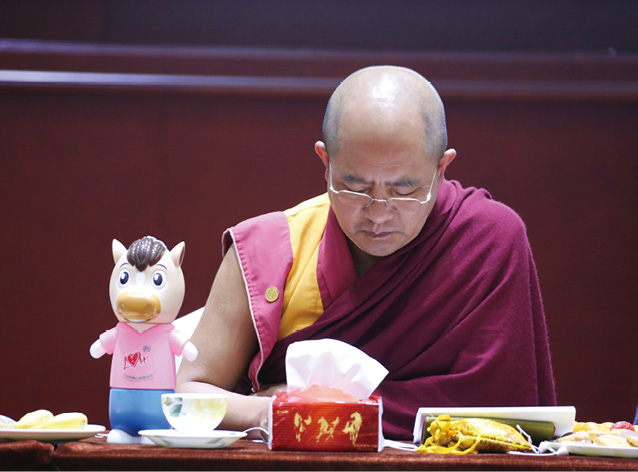

# 发心为利他（二）

——慈慧工作汇报会

2014年3月16日

三天以来，我已经演说了很多次，讲得太多可能不太好。让我总结这次会议的话，就是一个字——好！

可能大家现在都很累吧？很多发心人员都是前天、昨天乘飞机来此开会，而本地的工作人员也忙了很多天。所以，首先我要特别感谢大家。

在座一些人是因为对我有某种程度的信任才参与慈慧，几年以来，我们总算不负所望，向很多有需要的人士提供了帮助。我谨代表受助者们感恩大家，真的非常感谢。

作为忙碌的城市人，你们要抽三天时间来此开会，确实不容易，因此，感谢大家是我要讲的第一点。

第二点，不管是跟中国人，还是其他地方的人合作，如果我们以后在做事的过程中遇到重要的问题，我希望大家可以共同商量，一起作出决定。

麦彭仁波切在《君规教言论》中说[^1]，通过商议来决定的事情，如果获得成功，那是很好的；即使事情没能成办，那也不会有严重的祸患，大家也不会有怨言，不会后悔。

因此，慈慧将来若要决策重大的事情，大家都应跟相关的人员共同商议。当然，与会的人数要根据具体情况而定。很多时候，你们会依我的说话来办事，但是遇着重大的问题，我们应该一起商量，之后才作出决定，这是很重要的。

对于大家没能达成共识的事情，我们应该以民主的方式来解决，这是学院的做法，也是全世界的做法。很多人和团体在有重大分歧、问题的时候，都是以民主投票来解决的。慈慧是一个民主性的机构，所以，我们将来也要以民主的方式来运作和处理问题，这样很重要，希望在座的人记住。以上是第二点。

第三点，经过这几天的培训，大家应该有很多收获，这次我们只是以听课的方式来学习，也没有太多的资料发给大家，你们回去之后，还应不断地学习，并且付诸实践。

你们不要在培训的时候很感动，而过段日子就把这几天所学的东西全部忘掉。有时候我也有这种情况，在会议上承诺了某些事情，但是一个月后什么也没有兑现，真的很惭愧。我想，你们应该不会如此。希望大家能够把这次学习的所得，在实际行动中应用。

第四点，慈慧的慈善之路需要大家的支持，我非常希望一些有能力、有实力、有智慧的人，包括我们的工作人员，能够尽量参与。

当我们的负责人需要帮忙的时候，希望你们可以尽量提供协助。对你来讲，这是人生中难得的机缘。如果没有特殊的情况，我也希望你尽量不要退出我们的团队。慈慧不会因为你的退出而倒下，但是我们做善事的话，还是最好善始善终。

明天我就要离开上海，这次会议给我带来很多收获。我看大家对慈慧的事情都很认真，这几天很多人整天都在开会，很多小组昨天晚上十二点仍然在开会，开得很晚很晚。因此，最后我要特别感谢协助主办这次会议的所有人员。

你们为了准备这几天的会议，做了各方面的前期工作，真的很不容易。学院每次举办大型会议的时候，事前事后的工作也特别多，这方面我也有经验。所以，对于筹办这次会议的所有工作人员，志愿者也好，发心人员也好，我都特别感谢。

今天是学院持明法会的最后一天，大家会做大回向。我今早在想，我今天没有特别去做一些善法，不过这次慈慧开会的功德，应该比开法会的功德更加大。

之前学院举办法王如意宝圆寂十周年的涅槃法会，其间我们为了学院的管理工作，每天都在开会。后来我跟与会的人说了，虽然我们没有参与法王的纪念法会，甚至没有时间念《普贤行愿品》来回向法会的功德，但如果未来学院的管理、僧众的闻思修，特别是学习方面都非常圆满，那法王如意宝应该会非常欢喜，因为所有众生的利益都会因此逐渐得到成办，这才是法王所期待的，所以，我们这几天开会的功德，是远超于你以自私自利心在法会念诵的功德。

神变月是佛教中非常殊胜的日子，这次慈慧的会议就在此期间举行，我个人认为，大家这三天的功德确实非常大。我并不是因为自己参与其中，或者为了讨好你们、怕你们退出才这样说的。不过，凭我的智慧和了解，正如华智仁波切在《现观庄严论总义》中所说[^2]，我们成佛的目的是什么？就是利益众生，所以大家在慈慧发心的功德是非常大的，在座的各位一定要明白这个道理。

我们会默默地为大家这三天的功德回向，如果你是佛教徒，今晚应该念一遍《普贤行愿品》。我今天在微博上也说了，慈慧这三天会议的功德，比参加任何一个法会的功德都要大。这是我个人的想法，而我对此很有信心。

这几天大家都比较累，因为整天都要共同商量很多事情，这已经成了21世纪人们处事的一种特殊形式。我们在学院也经常开会，那天有位发心人员跟我说：“你不是真正的堪布，你是‘开会堪布’。”

他给我取名“开会堪布”，我也很乐意接受，因为开会之后，有时候大家做事的力度会更大，将来肯定会对众生有利。所以，我非常感谢你们所有人，噶珍切（藏音，意即“谢谢”）。

[^1]: 参见《君规教言论》第十五品“观察协商”。
[^2]: 《现观庄严论总义》：“无论从暂时还是究竟两方面而言，大乘道的主要追求目标，都是利益他众。”
