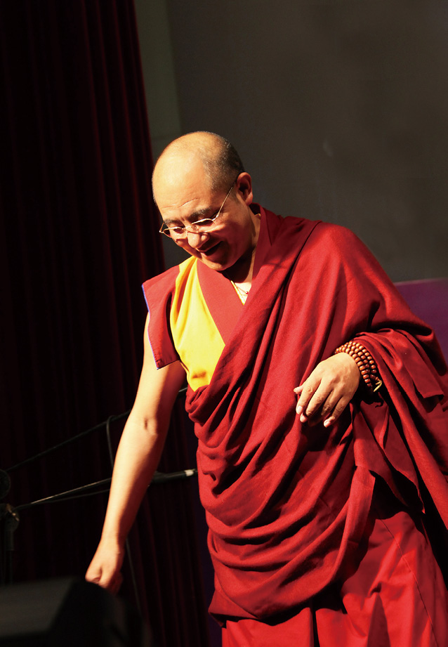

## 团圆共庆 齐心协力

2012年9月29日

今天，我们所有理事人员一起探讨慈慧基金会的相关事宜，这是一个非常好的沟通机会。我想在此和大家分享几件事情。

明天是中秋节，这是一个圆圆满满的时刻。在这样的节日里，希望我们的工作也能做得圆圆满满。今天，我这边的两百多位发心人员在学院提前过了中秋节。希望慈慧的所有家人们也能利用这个特别的日子，共享团圆的喜悦。

在此，我要特别感谢从基金会成立至今，所有无私奉献的人员。在这个过程中，我个人的付出是最少的，但我内心对慈善的热爱是真诚的。这不仅仅是口头上的表述，而是发自内心地想为众生做一些事情。

慈慧基金会是我们利益众生的一个方便方法。这一两年以来，慈慧的运作过程有顺利的时刻，也有不顺利的时刻，但不管遇到什么困难，我们都应坚持走下去。今天，我想借此机会与在座的各位分享几点。

## 坚持发心，绝不言弃

首先，我们应该认可自己在这一两年中的付出和努力。从世间的角度来看，慈慧所做的事情对国家和人民都是有益的；从佛法的角度来看，我们的工作是菩提心的具体体现。

为了慈慧的事情，大家可能牺牲了闻思修行的时间，或者放弃了一些其他有意义的事情。但我认为，在慈慧发心比这些事情更有意义和功德。因此，对于大家在慈慧的付出，我非常赞叹，也极其欢喜。

以慈慧的西部助学为例，如果没有我们的帮助，甘孜州的许多学生可能永远无法上大学，但是，依靠大家的共同努力，他们现在都有机会取得大学学位。最近，很多大学生及其家人、亲戚纷纷给我发信息、打电话，以表达对慈慧的由衷感谢。那些学生说：“如果没有慈慧的帮助，我绝对无法完成学业。”他们感谢的话语令我非常感动。

那天，慈慧的人员与那些受助学生在炉霍见面，当时我实在忍不住，流了很多眼泪。我看到我们的理事长、副理事长，还有许多发心人员也在流泪。这并不是我们在现场作秀，而是大家发自内心的情感。总之，慈慧所做的事情非常有意义，这一点大家一定要认可。

现在，我们需要做什么呢？我希望在座的所有人，包括发心人员和理事成员，都能共同齐心协力。我们在管理方面已经比过去有了一定进步，但我们仍需按照现代的企业和慈善机构的管理标准来运作，不断地创新和完善。

我在基金会刚成立的时候就意识到，慈慧若要持续发展，我们一定要关注两个方面。首先，慈慧必须在国家的法律框架下合法合规地运营。其次，为了使慈慧所做的事情真正有意义，我们不能半途而废。我希望所有的慈慧人员，无论遇到大大小小的困难，都能坚定地发心，不轻言放弃。

学院中的众多发心人员就是如此，除非因缘确实不具足，否则他们不会中途从现在的岗位上退下来。作为一个集体，我们应当对慈慧的事情保持热爱和热情。在座的所有理事人员，你们最初通过智慧观察，最后选择了加入这个群体，我希望你们能够坚持到底，至少在未来的三到五年内不要从现在的发心岗位上退下来。对个人来说，半途而废可能会对你的人生造成一个不好的缘起。

我不希望大家在发心做事的过程中，以疲累、不愿意等借口而中途放弃。慈慧的所有人员一定要有长期发心的意乐。如果大家没有这样的意乐和兴趣，慈慧的事业就难以持久。这是今天我想让大家注意的第一件事情。

## 以认真的态度发心

第二件事情，在座的大多数人都要兼顾学习和修行，在慈慧发心可能会与你的学修和世间生活产生冲突，然而，大家一定要用善巧的方法来解决这些冲突。我们不能完全为了做慈善而舍弃所有的修行和生活，但也不能为了修行和生活而放弃如此重要和有意义的慈善工作。

当然，我并不是说大家已经放弃了慈善，但有时候我们需要对此更加努力。希望每一位慈慧家人都愿意做慈善，并且对慈善事业充满热情。这是我想强调的第二件事情。

假如慈慧的工作跟你的生活和修学产生冲突，你的选择应该是以利益众生为主。我们修行是为了利益众生，而利益众生本身也是一种修行。所以，大家不要完全偏堕于个人的修行。

慈慧有许多专职人员，如果一年中只有少数人愿意发心做事，慈慧就不可能取得任何成就，我们所接收的一百多万费用也会被空耗，从因果方面来看，这是非常不合理的。因此，大家未来一定要对慈慧的工作更加认真负责。为了确保我们的工作效率，以后大家每个月要报上考勤记录。这是我特别希望大家能够如理如法地执行的事情。

前几天，我要求慈慧各部门提交过去半年的所有文件，但至今收到的资料数量令我甚不满意。按照佛学院发心人员的标准，慈慧的管理在某些方面可能还有欠缺。不过，我也理解大家生活在城市中，有家庭和各方面的烦恼。总的来说，大家仍需继续努力改进，以认真负责的态度对待慈慧的事务。这是我想说的第二件事情。

第三件事情，从今天开始，慈慧的所有人员应该减少夸夸其谈，而应多一些自我批评和自我反省，包括我自己在内。虽然我挂名理事长，但在某些事情上做得并不够好。比如在顾问的职责上，对于大家发来的资料，我有时候没有足够的重视和及时反馈。因此，我首先在这里向所有慈慧的发心人员作自我批评和忏悔。

那么，我会如何改进呢？从今天开始，我保证会阅读你们发给我的所有资料，若当中有需要我回复、反馈的地方，我会及时提出意见。同时，如果没有特殊情况，我保证通过电话或网络，每三个月参加一次你们的会议。

慈慧各部门的每一位工作人员，从今天开始都要进行自我忏悔和自我批评，并发愿自我改正。无论你是不是一位宗教徒，我们都需要有这种决心。这是我想说的第三点。

## 成立会务组

第四点，慈慧将要成立一个会务组，以确保会议的顺利进行和参会人员的有效沟通。刚才几位理事汇报的时候，我看不清楚你们上传的文件内容，其中一个原因是这边的网络不好，另一个原因是我们的交流内容存在问题。

各个部门在会议上不用多说无关痛痒的事情，应该把各自的重点事项向大家报告。而在开会之前，每个部门也要先准备好相关的书面资料。这样可以为我们的会议营造一个良好的氛围。

另外，我们以后需要限制每位人员的发言时间。例如，某位部长需要二十分钟来作报告，他应该预先跟会务组报备，然后会议期间他要在二十分钟内把他认为最重要的事情汇报完毕。

以上的安排将交由会务组负责。无论是会议前的准备、会议的流程还是会议后的跟进，会务组的职责就是确保我们的会议过程流畅且高效。长时间的会议并不一定意味着高效率，所以在学院中我也有类似的安排，毕竟每一个学术研讨会都是非常珍贵的交流机会。会务组应先学习并了解国际上的会议管理经验，然后将这些经验应用于实际操作中，如此慈慧的会议将更加正式、正规和高效。

另外，对于慈慧以后的每一次会议，我希望所有能参加的人都不要找借口缺席。尽管我非常忙碌，但是为了慈慧的会议，我绝不会推迟、迟到或早退，因为我知道这些会议涉及众生的利益。今天我也有很多重要的事情，可是我已经全部推到了后面，为的就是参加这次会议。

我希望慈慧今后的每一个会议都有严格的纪律，会务组将负责这方面的考勤。每次会议后，会务组会把所有人员的参会情况报告给我。如果有人缺席，他应该明确地说明缺席的原因。通过会务组的管理，慈慧的会议应该会变得正规。这是我要跟大家说的第四件事情。

## 事后要学习会议文件

第五件事情，慈慧的主要人员，不管你是否参加了当月或者当季的会议，我希望你们在会议结束后都能认真学习相关的会议文件。

你们不应把慈慧的会议视为世间团体或企业的会议，他们的会议目的仅为了一部分人今生的工作和生活，而我们开会的目的是为了众生究竟的利益。因此，作为佛教徒，我们必须重视慈慧的会议文件和内容。如果我们不重视，恐怕我们的发心是有问题的。

在慈慧的架构内，理事会是最高的领导班子，负责实施各项决策，而监事会则负责对其执行情况进行监督，并向大家反馈相关情况。对于慈慧各个项目的执行情况，监事会应保留完整的文字记录。与此同时，他们也应保留慈慧的所有会议记录，包括任何参会者的发言。无论是每半年一次还是每季度一次，我希望监事会能够定期把这些文件发送给我。

我现在所说的事情将会切实执行，这一点请大家注意。今天我并没有批评任何人，也没有任何批评的意思。不过，从下一次的季度会议开始，如果某个部门表现不理想，效率不高，工作进度令人不满意，我一定会在会议上公开指出。希望大家谨记这一点。

你们在各自的工作范围内，应该做的事情一定要做到。如果实在做不到，你也要说明原因。以上是今天的第五点。

第六点，我想跟大家汇报一下，今年甘孜州有一些新的领导，他们对慈善事业非常有热诚。从今年起，甘孜州将每年的11月19日，即1119，定为慈善日。他们还邀请慈诚罗珠堪布和“慈慧”参与甘孜州的慈善领导工作。

因此，我认为未来慈慧的西部助学和其他慈善项目不会遇到太大的阻力。相关部门已经对我们的理念和运作有所了解，政策上应该会比较宽松。所以，我希望理事会的各位成员不要在发心过程中感到胆战心惊或者担忧，这绝对没有必要。

为什么呢？因为大家都知道，慈慧是在民政局和相关部门的正式批准下成立的，它是一个合理合法的慈善平台。我的立场是，只要我们没有做任何非法的事情，那么在利益众生的过程中，我是不会对任何违缘和障碍低头的。因此，我希望慈慧理事会的所有成员不要有各种顾虑、担忧、怀疑，甚至退缩。这些都不是智者的选择，我们应该认真地做好慈慧的事情。这是第六点。

## 杜绝是非，团结和合

第七点，今天大家都很认真地学习，通过这次会议，慈慧理事会的所有成员不仅要有爱慈善的心，还要打从心底想做利生的事情。

作为一位学习佛法近三十年的佛教徒，我真的很想去帮助可怜的众生，这不是口头上的空谈，而是我心底里的真实想法。我希望在座的每一位理事人员也能对慈善充满意乐，把它看作比个人事务更为重要的事情。这样一来，我相信慈慧基金会的事业将会越来越圆满。

我今天的讲话并没有经过特别的准备，也无需准备，因为我与在座的各位彼此都非常熟悉。在你们发心处事的过程中，我希望大家能够借鉴国际上一些先进基金会的运作方式。它们都具备统一的集体意识和团体精神，这种精神对慈慧非常重要，值得我们所有的成员学习。更进一步说，要凝聚慈慧家人的团体精神，这里的许多负责人起着关键的作用。

我了解到，这里有些人经常谈论个人的事情。学会中的一些佛教徒也是如此，他们经常说别人对自己做了些什么，自己又如何反应。我们不应该讨论这些个人的事情，而应该探讨如何将慈慧的理念传达给所有人。

在基金会中，大家应尽量避免对别人产生嫉妒心，也最好不要谈论个人的得失或别人的过失。若任何人的言行违背了慈慧的规定，他必须进行自我检讨。我希望慈慧的团队以后少谈别人的过失和个人的私事，我们应该多去讨论如何齐心协力地成办基金会的事业。

我在学院也强调这一点，我们的发心人员都不允许谈论个人的事情，除非是特别重大的事件。我希望基金会的成员也不要谈论一些是是非非，大家应该将目光放远，心怀包容。作为真正的慈善工作者，我们聚集在此并不是为了个人的目的，我希望大家都能具备无私和无我的奉献精神。这是我今天要强调的最后一点。

我不清楚我已经讲了多长时间。不管怎样，今后会务组一定要严格掌控会议期间每个人的发言时间。无论是谁，包括我自己和最高层的领导，一旦他的发言时间结束，会务组都应通过铃声提醒。慈慧的会议不能像农民开会一样，任由演讲者随意发挥，没有时间限制，这样没有效率。

会务组应当有一套明确的章程，把上午和下午的讨论事项安排清楚，同时有效地控制会议时间。如此参会者不会感到疲累，能够更认真地开会，从而提高会议效率。

总而言之，我今天非常开心，非常感谢所有参会人员，谢谢大家。
