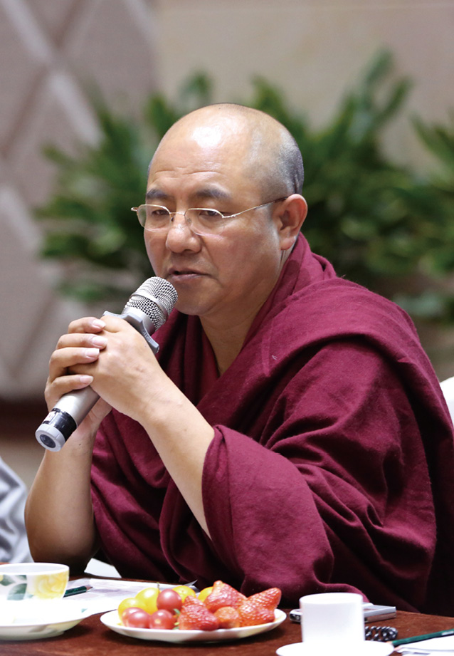

## 慈善不离心

——慈慧志愿者年会开示

2014年12月30日

今天是慈慧基金会的年会，本来我也想参与其中，但是由于种种原因而未能出席。实际上，我是否出席并不重要。在座的各位都曾发愿要做慈善，如今，你们通过发心来实践最初的承诺，把发愿付诸行动，这才是最关键的。

慈慧基金会的团队中既有佛教徒，也有非佛教徒。在参与慈善时，我们的信仰并不是最重要的，更重要的是我们都有一个共同的愿望——利用慈慧的各种资源来帮助有需要的人。

与其他基金会相比，慈慧的历史虽然不长，但在短短的几年间，我们的确切实地帮助了社会上不同的群体。不管是西部助学、敬老活动、大学生公益，还是帮助弱势群体的工作，慈慧的各个项目都取得了显著的效果。

## 坚持长期发心

我希望在座的工作人员和志愿者们都能一如既往地发心，并且长期坚持。不管是哪一种发心工作，在实践过程中，我们难免会遇到违缘和挫折，内心也可能会生起各种负面情绪。不过，只要你足够坚强，并且真心想去帮助别人，那么在发心过程中，无论遇到什么障碍，你都能够超越和面对。

我们的许多人员，包括志愿者，在刚开始发心的时候往往充满热情和期望，也非常积极地帮助他人。但随着时间的推移，有些人逐渐失去最初的热诚，最后甚至退出了发心的行列。

我以前写过一本书叫《做才是得到》，书名的意思是，人们无论做世间上任何一件有意义的事情，都一定要持之以恒地努力去做，如此才能取得真正的成果，一时的冲动和暂时的热情是无法解决很多问题的。因此，我希望慈慧的志愿者们能够以恒常不变的心来发心。

我们不难看到，国际上许多慈善人士都是数十年如一日地坚持做善事，而不是做了两三年或者十几年就停下来。我个人而言，如果没有遇到特殊的违缘，我也会一直坚持下去。确实，大家无论以后做任何事情，都需要具备恒常的努力。

## 以主动积极的态度发心

另外，我们有些人在做事的过程中可能比较被动，缺乏主动性。作为慈慧的志愿者，无论你的个性如何，我们都应将慈慧视为自己的家，积极主动地参与它的事务，而不是仅在别人的劝告下才出一点力。这种发心态度并不理想。

慈慧每年都举行年会，一些人为了得到参加的资格而勉强完成一些任务，这种行为实际上并不合理。对于慈慧的事务，我们不能仅仅是应付了事，不能只是为了完成而完成；我们每一个人都应把它视为最重要的事情，以认真的态度去做。

对在座的佛教徒来说，利益众生是生活中最关键的事情，因为你们曾经发过菩提心；对这里的非佛教徒来说，你们生活中最有意义的事情是什么呢？我认为是帮助他人。

每当我遇到一些贫困的学生时，我都深切感受到慈慧的存在确实意义重大。如果没有慈慧的帮助，许多农村的孩子根本无法完成他们的学业。另一方面，慈慧的事业需要大家的共同努力，单靠个别人的力量是不足以实现的。我们一定要汇聚大家的力量，整合各种资源，才能做出非常有意义的事情。

现在，慈慧逐渐得到社会的认可，它在公众中的信任度和知名度都越来越高。这时候，我们的志愿者和专职人员更不应该仅仅满足于完成工作，而是应该以真诚和认真的态度去做好每一件事情。只有这样，大家的发心才能真正变得非常有意义。

## 处事要有善巧方便

在发心过程中，我也希望大家，尤其是佛教徒，能够具有善巧方便。有些佛教徒经常把自己的宗教行为渗入到慈善活动中，我认为这并非必要。我们的目标是确保慈慧能够长期地顺利运作。虽然慈慧的理念离不开大乘佛教的利他精神，但在实际行动中，我们不必展示浓厚的宗教氛围。一些佛教徒或许认为这种方式欠缺意义，但实际上这是一种误解。

佛教并不强调在所有场合中展示其特殊的仪式和行为。佛教的核心意义在于帮助众生，只要我们能够做到这一点就足够了。因此，为了确保慈慧在各地的活动顺利进行，我们希望慈慧的任何活动能够尽量避免与宗教活动混杂。

慈慧的活动应该是纯粹的公益慈善活动，不含任何政治、宗教或其他经济目的。在实际操作中，慈慧应当以专业化、高透明度和高效率的方式运作。这样在接受有关部门的监督时，我们应该能够获得他们的高度认可。相反，如果一些佛教徒缺乏善巧，未能妥善地处理自己的情感、信仰和行为，那可能会引发一些不必要的问题。

## 把慈善的理念融入生活

今天，我特别感谢在座各位多年来在人力、金钱、智慧、技术等方面的付出。我相信，慈慧在未来的发展过程中，将会树立一个富有独特色彩的慈善形象。

与此同时，我们每个人都应该学习慈慧成立时所倡导的理念——慈善始于心。每个人都应该怀着这样的发心去做慈善，而不是仅在面临重大灾难时才出手相助。

在日常生活中，每一位慈慧的人员都应提醒自己：“我在任何时候，每一天、每一个月、每一年，都要怀着一颗主动助人之心。”我相信，只要我们保持这样的心态，我们在发心做事的时候就不会感到有压力。如果我们的行为仅仅是为了满足形式，或者满足个别领导或管理者的指示，那就太过被动了。

虽然我未能亲身参与这次年会，但其实我参加与否并不重要。我以前写过一本书叫《不离》，我取这个书名的原因是，无论是上师的加持还是任何超越的精神境界，我们希求的这些东西实际上从未离开过我们，不过在操作的过程中，我们仍需如理如法地努力。

在今天这个非常殊胜的日子里，我想借此机会特别呼吁和请求大家：在未来参与慈善的过程中，不要因为遇到一些个人或其他方面的违缘和困难而退缩。我们在做任何善事或伟大的事业时，路途都不一定是平坦的。可是，作为勇敢且有智慧的人，我们应当不畏艰难，勇往直前。

慈慧的所有志愿者和工作人员，包括一些特殊的发心人员，你们每一位都非常优秀，我对你们在慈慧的无私奉献特别感激。能够与大家一起参与慈善，我感到非常荣幸。虽然慈慧成立的时间并不长，但在这短短的时间里，我们已经帮助了许多人。

每当我参与西部助学的时候，我都感到特别开心。因为我看到一些贫困的孩子，通过大家的共同帮助终于完成了学业，找到了工作。有时我会遇到一些接受过慈慧帮助的年轻人，他们都发自内心地感谢我们。

今天，我也代表慈慧的所有受助者，向大家表示衷心的感谢。无论是捐款者、工作人员，还是相关的管理人员，我都特别感谢你们一直以来的付出。

希望在座的每一位今天能够和我共同发一个殊胜的愿：我们要持续不断地努力，使慈慧的事业越来越圆满。最后，愿我们能够暂时帮助众生，究竟令他们获得不同程度的解脱。

谢谢大家！
