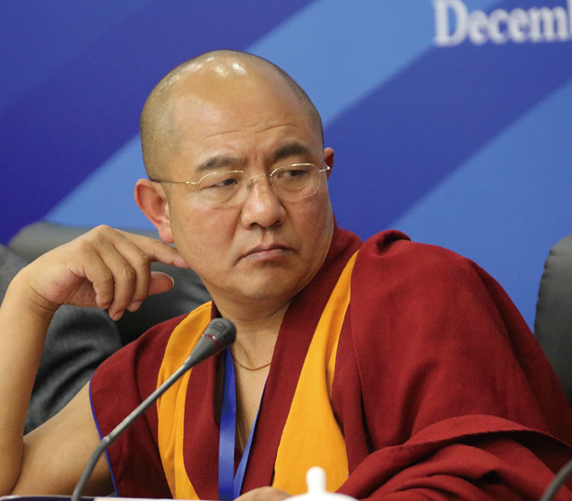

# 慈慧之路 勇往直前

——慈慧志愿者年会开示

2014年1月14日

今天是慈慧基金会志愿者的年会，我想利用这个机会跟我们的所有人员说几句话。我个人很想参加这次年会，但由于种种原因而未能出席。无论如何，我的心始终与大家在一起，因为我们都是慈慧家人。

慈慧基金会从无到有，从一个小小的组织发展成如今庞大的团队，这一切大家有目共睹。在众多慈善团体中，几年来我们的队伍越来越壮大，管理制度越来越完善，所涉及的领域也越来越广。更重要的是，我们的受助者人数也在不断增加。我认为，慈慧确实救护了许多人的生命，改变了许多人的人生。

在这短短的几年里，大家一路走来真的很不容易。慈慧的所有管理人员、发心人员、志愿者以及其他相关人员，都在不同程度上做出了无私的奉献。在筹办这次年会的过程中，我看到许多道友在过去一年对慈慧活动的参与度非常高。我们决定向那些在一年内参与了四次以上活动的道友发放加持品，以示鼓励。

另外，慈慧的一些管理人员和发心人员，尤其是来自上海和北京的个别道友，他们在过去一年非常努力，在自己的岗位上取得了显著的成就。因此，在我们的表彰大会上，我们将会向他们发放一些奖品，以表达我们的赞叹和鼓励。当我看到这份得奖名单时，也发自内心地非常随喜。希望其他的道友继续努力，让自己的名字来年出现在得奖名单上。

慈慧走过的路曲折艰难，并不平坦，可是大家一直坚定地勇往直前，排除万难，走到了现在。为此，我要特别感谢大家。

## 慈善可检验自己的修行

刚开始建立慈慧的时候，我想，作为大乘佛教的修行人，如果我们整天只在口头上说一些冠冕堂皇、高深莫测的法语，但在实际行动中却没有真正关心和帮助身边那些可怜、贫困的众生，那么在某种程度上，我们已经舍弃了菩萨的发心，违背了菩萨戒。

几年来我接触过很多慈慧的发心人员。其中一些人的发心过程就像吃甘蔗一样，起初甘蔗很甜，他们很愿意吃，但最后却吃不下去了。那些人在刚开始发心的时候兴致勃勃，非常活跃，不过日子一久，他们逐渐失去了热情，最后热情完全消失，他们就退出了发心的行列。

另一方面，有些人员自慈慧建立以来一直坚定地发心。对于我们所组织的任何活动，他们都乐于参加，而他们的参与并不像某些人那样只是为了应付领导，流于表面的形式，他们是打从心底发起了真正的菩提心，真诚地以实际行动来利益他人。

我认为，做慈善不仅是一种锻炼，更是修行上的一种检验。通过参与慈善，我们可以观察自己是否具有真正的利他心。我经常看到一些特别贫困、可怜的众生，此时我会反思：虽然自己多年来一直闻思修行大乘佛法，但当真正遇到可怜的对境时，却发现自己没有真正的利他心，未能把平时的修行落到实处。

其实，在座各位也能通过慈善来反观自己，它就像一个平静的水面，你们可以从中清楚地看到自己的人生影子。

当我看到这次年会的表彰名单时，内心非常随喜。你们所做的一切确实很不容易，我会通过念经、祈祷诸佛菩萨的方式为大家祈福和加持。

## 大乘佛教徒应坚持发心

目前，慈慧主要有西部助学、敬老活动、大学生公益等一些长期项目。此外，当社会出现一些突发灾难时，慈慧的人员总是齐心协力，共同去帮助那些在身心上受苦的众生。这就是每一位慈慧家人所发的愿，也是我们共同行持的事业。世界上许多慈善家和慈善组织也同样奉行着无私利他的原则。

借今天年会的机会，我们也应好好地发愿。2013年已经悄然离去，虽然慈慧在过去一年取得了成功，但我们仍然任重道远。展望2014年，慈慧已经制定了一系列的计划和目标，我们不仅要为此努力，还要将自己闻思修行的成果切实地应用在慈慧的利他事业中。

有些人经常担心，行持善法或者做慈善会影响自己的闻思修行。实际上，这些只是借口而已。我在慈慧也遇到过很多这样的人，他们已经退出了发心的行列，但是退出来后，他们的闻思修行并没有进步。相反，那些坚持留在慈慧的人，他们的闻思修行并没有受到影响，即便有些微的影响，但我觉得为了利益众生，这也是值得的。

自私自利的闻思修行与发起利他心的行为，两者在功德、本质和因缘上是截然不同的。为什么呢？因为由自私自利心所引发的一切行为都属于小乘，而由利他心所引发的一切善根则属于大乘。

在座的各位应该能够分析两者在本质上的差别。对于那些在慈慧发心多年，并拥有丰富经验的人员，特别是对因果取舍有所了解的道友，我希望你们来年能够继续发心。虽然你可能想暂时退下来休息一下，但这不见得对你的学修有真正的帮助。

我自己有一个原则：只要我发愿参与一件事情，除非前方实在是悬崖绝壁无法前进，否则我绝不后退。因此，只要我选择了去做一件善事，我一般都会坚持到底。希望在座的每一位也能秉持这一点。

相比两三年前慈慧刚起步的时候，现在的发心工作其实并不那么艰难。那时我们都处于摸索阶段，而现在，我们的很多人员已经累积了一定的经验和相关的知识。不过，我们未来恐怕难以找到那么多富有经验的新成员。即使有新成员加入，他们也不一定能够把事情做得圆满。所以，我希望大家能够继续发心，把你们已有的智慧和悲心充分发挥出来，这非常重要。

你们看看当今世界上许多慈善家身边的发心人员，他们在慈善方面的付出已经持续了二十年、三十年、四十年，这样的人比比皆是。而我们的一些人员，在发心两三年甚至一两年后就退出了。有时候我为此感到遗憾，毕竟我给大家传授了多年的大乘佛法，如果你们连一点苦行都不能忍受，那你们的菩提心到底在哪里呢？

我一直认为，慈慧是一个最佳的利他平台，而它为你们提供了一个绝佳的利他机会。哪怕你只是慈慧中一个默默无闻的小螺丝钉，但只要你的善根与众人的善根汇聚，最终你的功德将如涓涓细流般汇入菩提的大海。

因此，我特别希望一些老道友不要认为现在的发心工作让你感到疲累，也不要失去发心的意乐。其实，这是你们心态的问题。一个真正想做慈善的人，是不会在一两年内就对慈善生起厌倦心的。如果你在这么短的时间内就感到厌倦，那你如何在三大阿僧祇劫中修菩萨行？前辈大德们始终不懈地于百年、千年、万年中利益无量无边的众生，我们应该学习他们的菩萨行。

凡是利益他众的行为，只要我们还有一口气、还有一点能力，我们都不能轻易放弃。否则，也许你的修行是带着自私心的，这样对你的人生没有意义和价值。对于以上的道理，大家在有所领悟之前需要再三地反思。

## 与慈慧家人共同发愿

我特别希望从今年开始，我们能够进一步把慈慧打造成一个真正现代化、年轻化和知识化的团队。我也希望慈慧的所有成员能够秉持一种精神，什么精神呢？就是经常去思考如何让慈慧如理如法地持续运行、如何利益无边的有情，以及如何把慈慧的精神发扬光大。

这些方面不仅仅是几位负责人和主要理事人员所要思考的，在座的每一位成员都有重要的责任去关注。作为慈慧的一员，我们都要思考慈慧应该具备什么样的精神，以及如何有效地利他。在慈慧刚成立的时候，我已经向大家提出了一些重要的目标，也倡导过一些精神，你们可以从慈慧的会歌、愿景和它成立的历史背景中有所了解。

从一方面来说，你们有些人在过去一年参加了四次以上的慈善活动，确实非常了不起；但另一方面，与学院的许多法师或者在座的一部分人相比，这样的利生次数并不频繁，不算是什么稀有的成就。因为在一年365天之中，我们应该有很多次利生的机会。对大乘佛子来说，每年参与多次慈善活动并不是特别的成就；可是对从未发心的人来说，这样的行为已经是很大的成就和贡献。

我希望在座的每一位都能在今天这个殊胜的场合，在如此殊胜的对境面前发一个殊胜的誓愿：新的一年已经开始，我在明年之前要参加多少次慈慧的会议、做多少件对众生有利的善事。大家可以根据自己的情况来发愿。无论如何，每一个善愿都值得我们经常去发起。

事实上，慈慧的西部助学每年都在帮助许多贫困的孩子，让他们能够上学。现在，很多受益者已经完成了学业，找到了工作。他们从此摆脱了贫困，不会因为贫穷而去造恶业，慈慧的帮助已经在很大程度上改变了他们的今生和来世。

慈慧的团队如此庞大，哪怕我们每个人去做一件善事，其功德已经不可思议，更何况我们一起奋发图强开展利生的事业。众所周知，世间人为了自己的利益也会辛勤苦行。如今，我们为了众生的利益而在慈慧共同努力，虽然过程中会遇到困难，身心感到疲累，但为了让众生快乐，面对这些违缘和痛苦都是非常值得的。

个人而言，无论遇到什么困难和违缘，我也不会在慈慧的慈善之路上退转。希望你们也能同样发愿。

如果大家因为家里的阻拦、工作问题或与道友不和等原因而想退出发心的行列，那说明我们的自私自利心还是非常重。那些自私自利心不重并具有真正利他心的人，他们完全有能力去处理这些生活中的事情。而且对他们来说，这些问题都不是最重要的，最重要的是什么呢？就是抓住每一个利益众生的机会。

慈慧现在的各种利生项目都非常有意义。以养老活动为例，我们的众多参与者从开始到现在都见证着许许多多感人的故事。这些故事对许多人的修行有所启发，也鼓励了自他在菩提道上不要有厌倦心、怯懦心和退缩心，更不要对慈慧的光明之道产生障碍，例如发布不当的言论。

从佛教的因果观来看，任何人对利生的事情制造违缘都会有很大的过失。因此，我们千万不要让自己成为慈慧前进道路上的障碍，而对于他人所造的障碍，我们一定要予以遣除，这一点每个人都有责任。

## 发愿后还要身体力行

今年刚刚开始，除了发大愿外，我们还要制定一些大计划。慈慧一定要有创新精神，不能满足于现状。假如我们每年都只维持现有的几个项目，从2011年到2013年都没有变化，将来每一年也是如此，那我们就无法与时俱进，无法跟上时代的步伐。所以，大家在年初的时候不仅要发大愿，还要制定宏大的计划。

特别是慈慧每一个项目的负责人，你们不能故步自封，更不能光挂着一个职衔，但实际上在混时间，这是很不合理的。现场有很多志愿者和专职人员，大家一定要尽职尽责地做事，否则从善恶因果的角度来看也是不合理的。

我特别希望慈慧的所有人员都具备应有的责任感。如果你是一位志愿者，你应该扪心自问是否已经尽力去做好慈慧的事情。如果你是一位管理人员，你不能浑浑噩噩地度日和不思进取，而应为慈慧的事业做出实实在在的贡献。

作为大乘佛子，我们都应恒时观察自己的三门，反思自己日常的言行。如果我们都能在这方面努力，慈慧的前景一定会非常美好。我特别希望我们未来能够真正从内心发起利他之心，而不只是口头上的表面承诺。

老实说，我无法接受那些只说不做、空谈和光喊口号的行为。我很乐意在日常生活中做点点滴滴的善事，即使是为一位老人修剪指甲，我也十分愿意。每个人都可以根据自己的能力和愿力来做各种善事，大家不妨从小事做起，最重要的是不要半途而废。

我看到许多佛教徒起初怀着热情和激动来行善，但最后却变得冷淡，甚至因为绝望而放弃。我们不应该在做善事的过程中半途而废。任何困难都是可以面对和克服的。如果你在行善时中途放弃，这是你做人不成功的一种表现。其实，日常生活中有很多做善事的机会，我们一定要好好把握，否则，你可能永远也得不到这方面的善根。

## 毅力不可或缺

这次年会各方面的因缘都很殊胜，无论你是不是学会的学员，也无论你是不是一位佛教徒，我都希望在座的各位能够在此发一个殊胜的愿。

如今，社会上许多人感到特别空虚，因为他们没有精神的依靠。大多数人只懂追随富豪或明星，而他们的言行亦随之成为了现今的社会价值观。如果我们不行善，不弘扬传统文化，整个人类的价值观可能会走向非常可怕的境地。因此，无论是为了这个时代，还是为了我们自己的人生，每个人都需要具备坚韧不拔的毅力。

这种毅力在你的修行和生活中都是不可或缺的，而在做慈善的过程中更是必不可少。没有毅力的人无法完成任何善事，他们口头上的“利益众生”只能沦为空谈。所以，我们的内心一定要具备真正的毅力，坚定不移地致力于广大的慈善事业。

如果每个人都怀着这样的心来加入慈慧和做善事，我们一定能为社会和人类增添更加美好的氛围。我特别希望通过今天所发的善愿，大家能获得身心的健康，如此我们可以更好地利益众生。确实，利益众生是最好的修行，也是最好的法供养。所以，我们要发愿：用真诚的身心行持利他的行为，以此供养诸佛菩萨。

谢谢！
