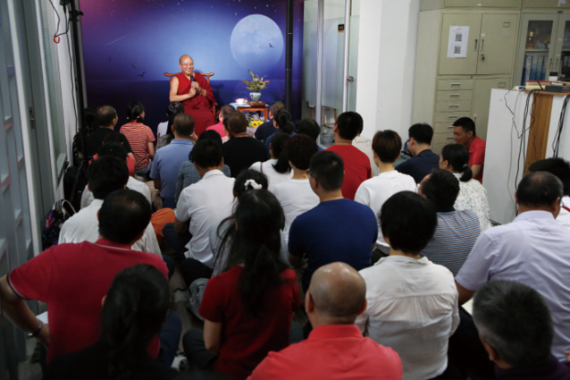
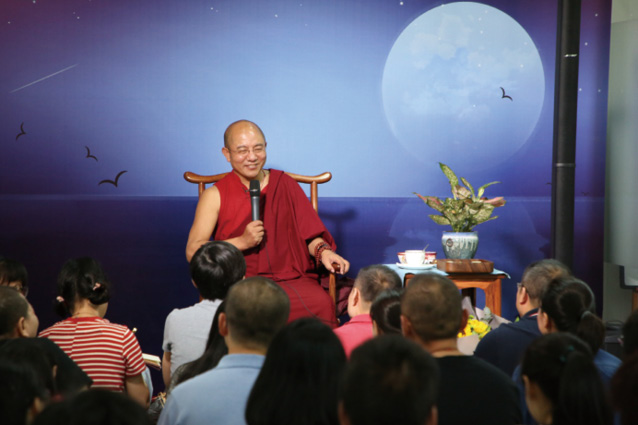
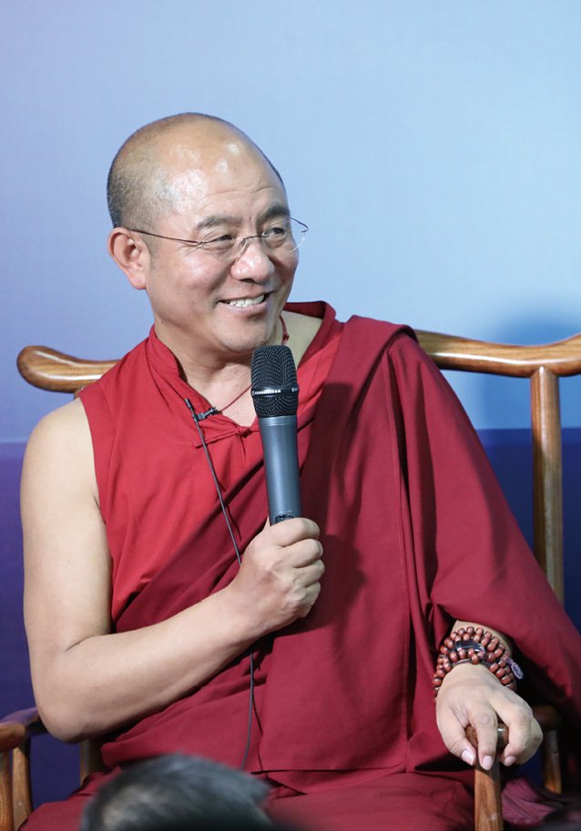
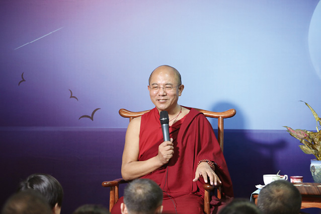

# 慈慧的和谐管理之道

2019年7月11日

主持人：

今天是一个非常殊胜的日子，大家都满怀欢喜，因为我们迎来了殊胜的上师。首先，让我们以热烈的掌声表示欢迎！这是慈慧基金会在新总部的第一次正式活动。今天，我们有机会聆听上师对慈慧的工作指导，真的非常难得。在座的不仅有慈慧的专职人员，还有一些在关键时刻对慈慧鼎力相助的老师们，以及我们的许多志愿者，你们在精神上和身体上都为慈慧付出了很多。现在，希望大家怀着虔诚的心，认真聆听上师的开示。

今天能够和大家在此见面，我感到非常开心。为什么呢？

第一个原因，慈慧的这个办公场所不仅宽敞，而且在各方面也相当正规，我一进来就感受到了这里的良好氛围。

第二个原因，慈慧在管理模式等各方面都比以往更加成熟，这说明我们的专职人员和核心志愿者都积累了许多宝贵的经验。

第三个原因，慈慧能够走到今天，实在很不容易。众所周知，做一件善事已经不容易，而慈善更是一种莫大的善事。若与世间知名的大型慈善基金会相比，慈慧的历史确实较短，但是我们能够坚持至今，从我们自身的角度来看，这些年来的努力是非常值得肯定的。

今天，我想简单分享我的一些想法。

前几天在北京的时候，我和那边的志愿者们探讨了一些关于慈慧志愿者和少数专职人员的问题。当时我讲了一些道理，其中有些你们可能听过，有些可能没有听过。今天，现场不仅有慈慧的上海人员，还有来自成都、无锡、杭州等地的志愿者和团队。

那天负责人问我，要不要让周边的慈慧管理人员都来参加今天的会议。我说：“千万不要来，来干嘛？我在这里最多待一个小时，而他们坐飞机过来要花很长时间，所以千万不要叫他们来。”当天是谁问我这个问题，我现在已经忘了。刚才我一看到来自不同地方的管理人员，还以为自己忘了通知负责人，或者是眼睛看花了。无论如何，你们真的来了，这也很好。

一般世间人为了自己的利益，例如做生意，也经常在各地奔波，比如从美国飞到中国，又从中国飞到澳大利亚。那我们为了利生的事业，为了帮助那么多的孩子、病人和老人而有一些付出，这也是必要的。此外，慈慧的志愿者和家人们也有必要适时聚一聚，这样能为我们每个人能带来巨大的正能量。

## 慈慧与学会必须建立良好关系

我稍后也会跟学会的一些负责人见面。事实上，慈慧和学会之间保持良好的沟通是非常重要的。因为慈慧是一个慈善平台，学会则是一个学习的平台，此二者相辅相成，互相支持。

今天早上，我向学院的教务处提出了一个建议，各地学会的理事会要指派一两位成员来分管慈慧。比如，成都学会的理事会要指派一名理事来负责当地慈慧的运作。无锡、武汉和杭州等地的学会理事会也需要做出类似的安排。这个建议将会在我回去之后正式落实。如此学会与慈慧之间的联系会更加紧密，这将有助于我们工作的顺利推进。

慈慧与学会的性质有所不同。慈慧是一家面向社会的公益慈善机构，而学会是一个面向佛教徒的闻思修行平台。如果我们把两者的事务混在一起，那是不合理的。慈慧不会关注它的工作人员和志愿者是否有信仰、是否学佛或是否有闻思修，社会上的任何人都可以参与慈慧的工作。

虽然慈慧与学会的性质不同，但它们之间的联系非常重要。与学会相比，慈慧的资源非常匮乏，所以学会应该在各方面支持慈慧的工作。否则，无论是在上海还是在其他地方，慈慧在开展工作时都会遇到一定的困难。

在处理慈慧与学会的关系时，我们要找到一个平衡点，相信大家现在都有这方面的经验。慈慧刚成立的时候，可能与学会的关系过于密切，但是之后就变得过于疏离，双方甚至产生了一些误解，导致慈慧的很多工作无法推进，毕竟它的资源是有限的。

慈慧的工作人员一定要弄清楚纵向和横向的关系，否则在处理不同的关系时，我们就容易陷入极端。纵向关系是指我们内部各层的管理，慈慧的大多数管理人员都是学会的学员，他们是佛教徒；横向关系是指我们与社会上的捐赠者或慈善人士的关系，他们不一定有信仰。从今年开始，我希望大家在处理各种关系时，能够比以往更加稳妥。

早前我去了北京，那边的慈慧负责人原本安排我做一个十几分钟的开示，但最后我给他们讲了很长时间。当时，我谈及了很多关于我对慈慧的态度、想法和理念。相关人员已经做了录音，之后你们可以听一听那个音频或者阅读相关的文字记录。现在我已经不太记得具体讲了些什么，但那些内容应该会对大家有帮助。

有时候虽然我特意准备了一个演讲，却可能会比预定时间提前很多结束。昨天，我本来计划要做一个小时的演讲，台下大部分是上市公司的大老板，不过他们看来都是很伤心的样子，我一上台就感觉到气氛不太对劲，于是便提醒他们把手机要么关掉，要么调至静音状态。

有次我在清华的总裁班演讲时，有些人在抽烟，也有些人在通电话。从那时起，我会习惯性地跟听众强调听课时的秩序。因为我来自传统的学院，我每天讲课的时候，听课的人都是规规矩矩的。所以，当我外出演讲时，如果听众不专注或者忙于自己的事情，我的思路会受到影响，然后就讲不下去了。

昨天，我的演讲时长预计是一个小时。刚开始我感觉有点讲不下去，后来稍微好了一些，但那时候已经临近结束，没有再多讲的时间了。昨天的听众是企业家，我原本想通过这次演讲来让他们的内心有所转变，如此对社会和对他们个人都有好处，所以我特意早起准备。结果在演讲过程中，我的思路似乎有些停滞，未能有效地发挥。

反而在北京的时候，我原本安排了一个十几分钟的开示，也没有做任何准备，不过因为现场的听众非常专注，我就情不自禁地讲了很长时间。至于当时具体讲了些什么，我现在已经想不起来了。你们可以听一听那个录音，当时我表达了一些对慈慧的想法，不知道你们会认同多少。不管怎样，今天我想简要地讲几件事情。

## 总结过去，感谢各方人士的付出

首先，慈慧能够走到今天，是因为各方面的因缘聚合，其中慈慧家人们的共同努力至关重要，因此我特别感恩大家。慈慧刚成立的时候，得到了许多人的帮助。他们之中有些人由于身体或工作的原因，现已不再参与慈慧的工作，但还有部分人一直坚持到今天。

无论如何，对于慈慧的所有工作人员，特别是从一开始就支持慈慧的前辈们，我都深深地感恩。这是我想讲的第一件事情。

第二件事情，是对慈慧走过的路做一个简单的回顾。总体来看，这是一条成功之路。从慈慧成立至今，我们做了很多事情，帮助了很多人，这些都有相关的文字和音视频记录，都是有目共睹的。回想六七年前，慈慧犹如一片空地，如今我们已经取得了很大的成就。

几天后，我会回到我的老家——炉霍的罗科玛。当地的一些人已经准备与我团聚。他们当中有许多是慈慧曾经帮助过的人，现在已经当上了公务员、老师、医生等。我没有具体的统计数字，但仅仅在我的部落中，就有很多年轻人因为慈慧的帮助而完成了学业，最后找到了稳定的工作。类似的情况在全国各地也非常多。

除了西部助学，慈慧的其他项目，如养老、大学生交流、陪护等，也取得了显著的成果。总的来说，一直以来我们做了许多非常好的抉择，慈慧的道路堪称是成功之路。对此，我特别随喜和感恩大家的努力和奉献。这是第二个方面。

## 无惧压力，坚持发心

第三个方面，慈慧的人员一定要有坚定的心，大家要坚持发心，这是我们的原则。

现在很多年轻人心不稳定，昨晚我在中科院时，一位研究所的教授也谈及了这个问题。他认为，现在年轻人的心定不下来，总是心思漂泊，今天想在这里找工作，明天又想到其他地方，这对他们研究所的工作也有影响。

所以，在慈慧工作的志愿者和全职人员，首先要有稳定的心态。这一点非常重要。我们的一些工作人员从慈慧成立至今一直在发心，虽然他们在身体上或心理上遇到过一些魔障、违缘和障碍，但是他们始终坚持了下来。我希望其他志愿者和新的专职人员也能把心定下来，持之以恒地在慈慧发心。

为什么这样说呢？从世间的角度来看，许多工作的薪酬可能比慈慧的更高；不过从佛教的角度来看，能够把慈善作为自己的工作是非常难得的，因为它不会让你造恶业。现在，虽然很多行业能够提供所谓的好工作，即有多一点的金钱回报，但这些工作可能会直接或间接地让你造下非常严重的业。作为一个有信仰的人，我们应该思考，为了赚钱而如此造业是否值得。

我跟大家强调心要稳定的其中一个原因，是因为当前的就业形势并不乐观。不管你是慈慧的专职人员，还是全职人员，现在要在外面找到一份工作并不容易，更莫说是一份有意义的工作了。光是慈慧的西部助学就有众多的受益者，这个功德已经不可思议，更不用说我们的其他项目了。因此，大家一定要有一颗稳定的心，坚定地在慈慧发心。

如果从因果、工作性质等多方面综合考量，其实慈慧所提供的工作是很好的。在待遇方面，慈慧处于中等的水平，既不是特别优越，也不是特别差。与我们学院和许多地方相比，慈慧的待遇更为优厚。然而，在北京、上海、广州和深圳等大城市，慈慧所提供的每月几千块薪酬可能只够人们勉强维持基本的生活。所以说，我们的待遇虽不算特别好，但也不算特别差。我们每年都会考虑各种因素而进行薪酬调整。目前来看，慈慧的待遇算是不错。

在工作方面，慈慧的人员确实会感到很大压力，这和很多企业的情况类似。我注意到这里的很多人员都有近视。大家也知道，我们需要准备的资料非常多，而且每天都有处理不完的事情。随着慈慧的发展，加上我们的人手不足，未来大家的工作量和压力应该会越来越大。可是在当今时代，没有压力的工作几乎是不存在的。有时候，我们的确需要一些压力来推动自己更好地完成任务。

我也会主动给自己增加一些压力。每次外出时，我的课程都安排得非常紧密，有时甚至是故意这样做的。例如，昨天我本来只有下午一堂课，但是临时在晚上也增加了一堂课；另外，当我确定后天的行程后，也临时在那个地方安排了两堂课。如此我在旅途之中，走路也好，坐飞机也好，都会有一些压力。

这次回到学院后，我会马上开始讲课。有人问我是否需要休息，我说还是增加一些压力可能更好。因此，我临时在回程途中增加了一些课，回到学院后，我在开会以外的日子每天都要讲课。我认为，一定的压力会对我们有益。

因此，我希望大家能够稳定自己的心，坚持发心，不要因为一些压力而动摇。当然，如果你的身体确实不好，那就需要休息。否则，我们应该多做一些事情，使自己的生活更加充实。如果你天天玩手机，或者整天无所事事，那就虚耗了宝贵的人身，没有任何意义。所以，我们还是让自己累一点比较好。我的思路清晰合理，对吧？以上是第三个方面。

## 总体策略是稳中求进

第四个方面是关于基金会的扩展问题。虽然慈慧理事会可能对此有不同的意见，但我个人认为，目前基金会的规模已经相当大，我们暂时不宜继续扩展，否则可能会对多个方面造成负面影响。

比如西部助学，去年我们资助的学生人数是四千七百多人，今年已经增加到五千多人，虽然我们目前在资金上能够暂时承担这样的增加趋势，但若我们的资助人数每年都继续增加，那可能会对我们的工作质量和效率等方面产生影响。因此，我建议在未来两三年内，慈慧的助学名额继续维持在大约五千人左右。

虽然最近几年，不管是在成都、北京、杭州、武汉，还是在无锡等地，大家在筹款方面都取得了很好的成绩，可是我也注意到，很多地方的工作人员都面临着很大的压力。比如，我前几天在北京的时候，就感觉到他们承受着不少压力，他们的筹款目标是要超过你们上海。后来总部这边下调了他们的目标，以减轻他们的压力。其实，北京和上海之间的这种竞争并没有必要。

不管怎样，我觉得他们的压力还是很大的。我在他们拍卖会的前几天离开北京，有几个人私下跟我说，千万不要在微博上透露行程，因为很多人早前听说我到了北京，所以准备去拍卖会。如果我把在机场喝咖啡的照片发到微博上，说要离开北京，可能那些人就不会去了。因此，当其他人问我会不会参加北京的拍卖会时，我都没有直接回答，只说根据情况而定。所以说，无论是拍卖还是其他活动，目前慈慧的工作人员确实面临着很大的压力。

当然，人们在现今社会做许多事情都会有一定压力，这是正常的。刚才有些道友跟我说，现在的经济状况并不算太差，仍然有很多人愿意参与慈善，例如捐赠物资，因为他们认为这是积累资粮的好机会，所以愿意持续地做善事。

现在，无论是政府还是社会大众都对慈慧十分信任，因为我们的工作透明，任何人都可以清楚地了解我们的管理和运作。因此，与刚开始时相比，现在慈慧的外部压力有所减轻。但是，如果我们资助的学生人数不断增加，我们专职人员的压力可能会变得更大。

我经常关注我们发心人员的办公环境，包括学院弘法部的办公室。这里是慈慧总部的新办公楼，现在大家的办公环境和食堂环境都比以前好了很多。如果慈慧继续扩展，总部这里就需要增加更多人手，到时候这个办公空间可能会变得拥挤。

当然，维持目前的助学人数只是我的个人建议，我在北京时已经提出来让他们考虑。如今慈慧西部助学在藏地的知名度越来越高，因此申请者也越来越多。西部助学的负责人秋云老师每年都要走访数千位受益者的家庭，以确认他们符合慈慧的资助条件。目前来看，他还能应付得来，因为他不需要休息——开玩笑，实际上，他的团队现在已经很辛苦。如果我们未来还要增加资助人数，那他们的工作压力一定会非常大。

西部助学是慈慧最主要的项目，它非常重要。此外，慈慧还有其他的项目，例如徒步活动。慈慧发展到了今天，我们需要认真思考它的发展方向。比如在未来的两三年，慈慧总体上是否应该采取稳中求进的发展策略，稳步前行。之后，我们可以根据情况再作调整。这是我想说的第四个方面。

## 制度化和人性化的管理

第五个方面，慈慧基金会的管理不仅要制度化，也要人性化，二者缺一不可，这非常重要。

最近我访问了很多企业，发现有些企业偏重于制度化的管理，管理方式非常机械，凡事都采取扣分制，没有任何弹性；而有些企业则偏重于人性化的管理，对员工的行为处处忍让，不立规矩，缺乏管理制度。我们一定要将西方的制度化管理和东方的人性化管理相结合，如此才能达到最佳的管理效果。

我之前也跟其他地方的慈慧人员说过，慈慧的管理者要长期关注我们的工作人员和发心人员，看看他们有没有遇到任何困难。另一方面，作为慈慧的一分子，我们的所有人员一定要在岗位上尽职尽责，做好自己的本分。如果你占据了某个位置，却没有尽到相应的责任，效率低下，那么你就会耽误团队的很多事情。

说到企业和员工的关系，日本稻盛和夫先生的经营理念就非常好，值得慈慧借鉴。他把“追求全体员工物质和精神两方面的幸福”作为企业的经营目的；同时，他认为企业应该承担社会责任，因此，他也将“为人类社会的进步发展做出贡献”作为经营理念。

这两个理念也适用于慈慧的管理。首先，我们的管理团队需要建立一个结合人性化和制度化的管理体系。在此基础上，我们对内要关注所有慈慧人员在物质和精神两方面的幸福，尽量满足他们在这两方面的愿望；对外则要为社会作出贡献，支援那些需要帮助的人群。

当然，我们也可以根据慈慧自身的情况，使用我们的语言来对稻盛和夫所宣扬的理念作出一些调整。他提到“物质和精神两方面”，我觉得以“身心两方面”来代替会更为合适；对于他的第二个理念，我们可以调整为“注重利他”，这就是慈慧的社会责任，因为慈慧成立的目的并不是为了任何人的个人利益，而是为了帮助众生。

总之，慈慧的理念是实现自他二利，即对内要惠及所有慈慧家人，对外要帮助社会上的贫苦大众。为了做到这一点，我们必须结合制度化和人性化的管理方式。这是第五个方面。

## 善巧方便非常重要

第六个方面，我们做事要有善巧方便，不能过于死板。虽然你们已有很多做慈善的经验，不过在宗教化方面，大家仍需灵活应对。我们不能过于宗教化，但也不能对有信仰的慈慧人员过于严格。

有些地方的慈慧管理者不允许我们的人员拿念珠，这未免过于偏堕。事实上，现在很多不同身份的人，包括企业家、公务员等，都会拿念珠。我们不必完全否定那些带有宗教色彩的事物。在临终关怀时，慈慧的一些团队会帮忙念佛，而某些地方的团队却不准我们的人员念佛号，这样的规定没有必要。

善巧方便的意思是，我们应该根据不同的场合和对象，适当地调整我们的做法。这主要有两个面向：

第一个面向是我们的服务对象。慈慧并不是一个宗教平台，如果我们在做慈善的过程中宣传自宗，一些没有信仰的人可能会误以为我们借助慈善来传教。另一方面，我们的部分服务对象也包括学会的学员，就是说，他们都有一定的宗教背景。事实上，我们的行为离不开我们的信仰，但我们可以根据不同的服务对象来调整我们的定位和做法。

第二个面向是各地政府的相关部门。虽然一些慈慧人员是修行很好的佛教徒，但是他们在与领导和政府部门沟通时，可能不够善巧。因此，我们需要寻找一些富有经验、具备人脉关系和法律法规知识的人来进行这些沟通，如此慈慧与相关部门的联络会更为顺畅。

实际上，政府经过多年来的观察，已经知道慈慧不会从事任何非法活动。因此，他们现在对慈慧的态度和看法与最初有所不同。特别是最近，一些国家级领导人在公开场合对我们的工作有所肯定，展现了他们对慈慧的信任。

为了与各地的相关部门有更好的沟通，慈慧的联络处应该聘请一些具备法律知识的人士，这是很重要的。现在，即使是小型企业也有自己的律师团队，以确保企业的运作符合法律的要求。不论是审计还是其他方面，慈慧的运作都必须符合法律和政策的规定。

此外，一些法律会随时代而变，尤其是慈善法，它相对较新，其法律条文未来可能会有所变化。我们必须掌握基本的法律知识，在合法的框架内开展慈善活动，这一点非常重要。

刚才，我看到我们办公室里有许多来自各地政府办公厅的认可文件，这些文件非常重要，因为它们能够确保慈慧在那些地方做慈善的合法性。如果我们得不到官方的承认，就无法名正言顺地开展工作。学院也十分重视法律法规，不论是个人行为，还是学院的整体运作，我们在许多方面都非常谨慎。

总之，我们一定要聘请具有法律知识的人士，并与相关部门保持对接。过去我们对法律上的要求已有相当的关注，未来仍然要格外注意，毕竟这是一件非常重要的事情。以上是第六个方面。

## 不能长期存在分歧，应经常沟通

第七点，我刚才也稍微提到过，就是沟通的重要性。

首先，在内部沟通方面，慈慧的专职人员应该定期召开会议，可能是每个月一次，或者像现在的企业一样每周一次。

至于慈慧的理事和其他高层人员，也应定期或不定期地召开内部会议，此外，你们还需与学会的分管法师保持沟通。如果慈慧的高层人员仅在有需要时，例如筹款，才偶尔联系学会的负责人，那是不足够的。慈慧的相关负责人要与学会保持密切的联系，因为无论是基金会的发展还是管理，未来都需要学会各方面的配合和支持。所以，慈慧与学会必须建立新的互动模式，否则以后两者的工作可能无法有效地开展。

前段时间我听说慈慧内部有一些理念上的分歧。当事人今天不在这里。事实上，我们的人员通过沟通来了解彼此的想法是很有必要的。如果一个团队中有两组人各有不同的思想，而彼此又没有良好的沟通，他们之间的矛盾会日益严重。最终的结果要么是一方胜利，另一方失败，要么就是两败俱伤，甚至导致整个团体的瓦解。

其实，不管是两个团体之间，还是团队的内部，我们的人员彼此有一些分歧是很正常的现象。在学院内部，大家经常会因为不同的思想和观点而产生分歧，这在辩论或工作的过程中时有发生。

在开会时，我和慈诚罗珠堪布有时会产生很大的分歧，有时甚至会出现互不交谈的情况。如果此时我们其中一方准备离开，参会的觉姆会立即把门关上，直到我们解决了分歧或者缓和了气氛，她们才会让我们出去。虽然我们内部偶尔因为一些分歧导致气氛比较紧张，但这种情况不会持续到第二天，因为我们会及时沟通，解决矛盾。

为了发心工作，我们有时需要进行激烈的辩论，这是有必要的。然而，如果我们的人员之间在思想上长期存在一些无法解决的矛盾，这对我们的工作是不利的。无论是慈慧内部，还是慈慧与学会之间，我们都应避免缺乏沟通的情况发生。如果大家遇到无法解决的问题，可以通过微信直接向我“告状”，或者说反映情况。总之，慈慧与学会之间需要保持良好的沟通，避免出现矛盾，否则两者的很多工作都不能顺利开展。我稍后也会跟学会的高层人员强调这一点。

如果学会与这边存在不同的意见，并且找各种理由来不推进慈慧的工作，甚至抵触，那慈慧的发展肯定会遇到困难。在上海地区，慈慧与学会之间的沟通尤为重要。因为慈慧的总部设在上海，有许多专职人员；而对学会来说，上海地区也很重要，虽然上海的学员不一定有其他地方那么多，但是这边的群体十分稳固。所以，慈慧和学会在上海地区的高层人员必须经常开会，保持沟通。

当然，我也希望慈慧的理事会能够经常开会。在发心过程中，你们可能会遇到各种困难，例如时间安排不来、身体不适或者失去发心的意乐，此时大家应该根据自己的发愿和实际情况进行调整。毕竟你在团队中担任了一个职位，你一定要发挥正面的作用，而不是起反作用，即给团队带来违缘和痛苦。如果内部成员都能对这个团队制造违缘，那外面的其他人或邪魔外道就更不用说了。

因此，如果我们的团队长期存在这方面的问题，最后我也只能亲自解决。到时的情况肯定不太好。以前，学院就有一些法师无法解决的问题由我来处理，结果很多人都哭了，这样的情形是我不愿意看到的。

我认为现在的慈慧，无论是整体的管理还是内部的团结都非常好。可是在某些方面，我们仍需更加注意，特别是在沟通方面。这是第七个方面。

## 以欢喜心来发心

第八个方面也是今天的最后一点。不论是慈慧的专职人员还是全职人员，我希望大家都能明白，慈慧是上师法王如意宝传承下的一个利他事业，也是我们实践利他的善巧方便。

我们很多人经常都在口头上说“要利益天下无边的一切众生”，但有时候只是空谈而已。如今，我们通过慈慧就能将利他之心付诸行动。事实上，慈慧已经拯救了很多人的慧命，也拯救了许多人的真实生命。

作为慈慧的一份子，如果你有信仰，你需要有菩提心；如果你没有信仰，也需要有公益慈善的心。总之，大家在慈慧所做的一切，都应以利他心为中心。如此你不会轻易感到疲累或者伤心，也不会因为工作中一些微不足道的问题而崩溃。

那些利他心不重或者自私自利的人，在自己的利益稍有受损时，往往会立即崩溃。然而，如果一个人有很强的利他心，只要能对众生有利，他就会勇往直前，即使在过程中弄得遍体鳞伤，他也会心甘情愿。这就是菩萨的一种行为。因此，我们一定要有利他心。

除了具备利他心，慈慧的成员还要有欢喜心。我认为，能够参与利他的工作对每个人来说都是一件令人开心的事情。比如我昨天出去讲课，站了大约5个小时，回来后我感觉身体有些疲惫，就让两位年轻人帮我按摩，他们也费了不少力气，但是效果很好，当时，不仅我的身体感到舒适，我的心也感到舒坦，因为自己在白天做了一些有意义的事情。

我看你们的劳累程度应该不及我。我不仅要翻译，每天写日记，还要写藏微博，并且经常到各地演讲。某些地方的发心人员说，每次我走了以后，他们需要休息好几天，因为我在的时候，他们总是跟着我上下奔波。前段时间我去了北京、青岛等地，我在每一个城市的行程都非常紧密，期间要不断地接待很多人，也要为他们加持、签名，或者与他们合影等等。在某种意义上，只要我力所能及，我都会尽量随顺他人，而我也一直在为此努力。

慈慧的所有人员不仅要充分利用好现有的资源，最重要的是我们要有坚强的心、利他心和欢喜心。人就是这样，对自己愿意做的事情，即使再累也不会觉得疲惫；但对自己不愿意做的事情，比如和不喜欢的人在一起、吃不喜欢的食物或者做不喜欢的工作，就会感到特别痛苦。因此，只要你找到发心的意义，即使再累你也可以克服。我今天的最后一点，就是希望大家都能怀着欢喜心来不断地发心。

慈慧今年有西部助学等许多项目，大家可能会比较辛苦。不过，我们已经积累了丰富的经验，并做好了规划。如果大家能够继续努力，慈慧的事业一定会非常成功。这对你们每个人来说都非常重要。

对我个人而言，慈慧是我晚年弘法利生事业的重要一环，因为慈慧能够真实地帮助很多人，特别是那些大学生。不管他们暂时能否找到工作，但至少已经拥有了大学学位。此外，慈慧还帮助了社会上的各种群体，包括老年人和病人。其实，在帮助众生的过程中，我自己也获益良多。所以说，做慈善也是一个宝贵的学习机会。

希望慈慧的工作人员今后能够养成写慈善笔记的习惯，把自己在慈慧所做的工作记录下来。我们计划为慈慧的志愿者和工作人员发放笔记本，方便大家把自己在慈慧的故事记录下来。

那天我在苏州大学演讲时，他们给一些人员颁发了最佳笔记奖和最佳提问奖等多个奖项。慈慧也可以借鉴这种做法，以鼓励大家养成每天记录自己工作情况的习惯，这将有助于我们日后的自我反思和总结。

我自己也坚持每天写日记，从2017年到现在从未间断。今天早上，我在出门前简单记录了昨天和前天发生的事情。虽然有时候我写得很草率，看似没有什么意义，但只要我每天坚持，也许在将来的某一刻，这些记录会显现出它的价值。

我希望慈慧的人员能够坚持发心和写笔记。无论你在慈慧发心了10年还是20年，将来你都可以根据自己的记录来写一本书，题目可以是“我在慈慧的20年”。希望大家到时候的主题不是“我在慈慧的20年好累哦”，而是“我在慈慧的20年好开心哦”，好吧？
