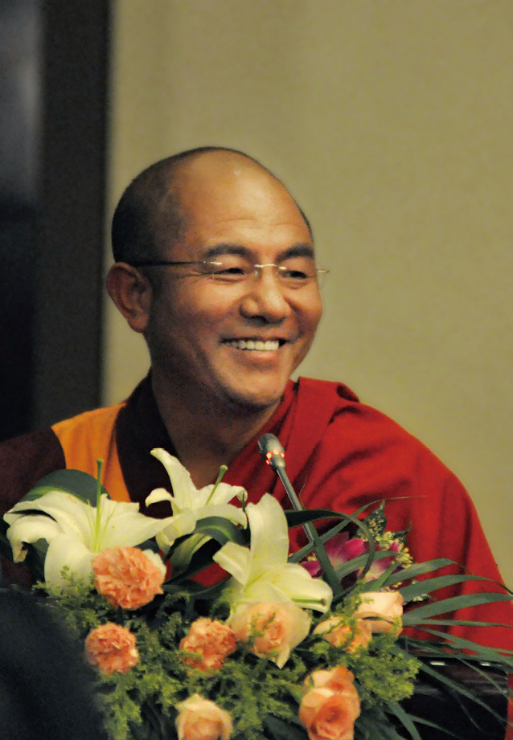
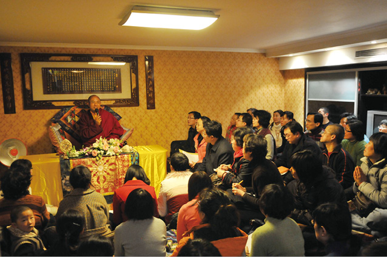

## 把握机遇 共创未来

2011年3月10日

今天，现场主要有上海地区佛学会的负责人和一些发心人员。基本上在座的大部分道友都学了五六年的大乘佛教，而且或多或少都在参与一些管理工作。这次我在上海的行程比较紧，需要参加很多不同的活动，因此今年没有机会跟上海的其他学员见面。我在过去两三年也因为各种原因未能跟这边的学员会面，很多人对此有意见，但是大家不用着急，以后会有机会的。

另一方面，我觉得有必要跟这边的负责人面对面地交流。这次学会在上海及其周边地区的发心人员基本上90%都来了。虽然我们最近要做的事情比较多，不过它们都非常有意义。你们今晚能够抽空来此非常不易，尤其是住在上海以外的道友。有些人在会议结束后需要好几个小时的车程才能返家，有些人甚至连回家的交通工具也找不到，但是为了利益众生、弘扬佛法，大家都愿意如此付出，真的十分难得。

当今时代，大家能够在城市中生存已经很不容易。我看你们不仅在生活上扛得过来，而且在学习方面也取得了不错的考试成绩。我经常在其他地方赞叹北京、上海和成都地区的学员，因为与个别偏僻的地方相比，这三个地区的考试成绩很不错。这一方面可能跟学员的整体素质有关，另一方面也与你们自己的努力有关。

前段时间，我们通过观察考试中获得一等奖的人数比例，发现上海学员的表现非常出色。有些地方可能有七百多位学员参加考试，但是获得一等奖的人数比例较少，只有13位，当时我问那边的道友：“为什么你们参加考试的人数那么多，但是得奖的人数那么少？”他们说：“因为我们经常说本地的方言，普通话说得不好，可能在学习上存在一些障碍。”他们有自己的原因。你们的普通话说得不错，所以相较之下，这边的学习成绩和得奖人数算是令人满意的。

我是弘法教务处的监督者，从管理的角度来看，上海地区的管理也做得不错。虽然去年我到这里的时候，你们有些书面工作、汇报和该实行的计划都没有如期完成，但总体上看，不管是爱心关怀、助念、德育教育，还是大家平时的闻思修行、修学统计，你们在各方面都表现得很好。

## 要持之以恒地学佛、发心

总的来说，大家始终都在努力，包括我自己。在教学方面，我要讲般若法门、净土法门，也要讲《大圆满前行》。我一个人要承担好几位老师的工作量，压力比较大，你们可能也感觉得到。从学员的角度来看，你们有些人可能比较自由，为什么呢？因为你们可以选择只学一门主课，其他的课可以兼修。即使你没有把兼修的课全部听完，别人也强迫不来。而对我来说，所有的课都是主课，不能落下。此外，我还要兼顾教学以外的各种事务，比如建学校、管理爱心小组等。相比之下，我的压力并不比你们小，但我一直都在努力。

今天跟大家见面的其中一个目的，是提醒大家要继续努力。有时候我们见面交流，对你们来说是一种“充电”。也许在之后的两三年、两三个月里，你们会有一些感觉，但是随着时间的流逝，这种感觉会逐渐消退，然后又需要再次充电。

我希望在座的大多数发心人员能够一直发心。去年我来上海的时候，曾要求大家在各自的组里发掘一些人才，尤其是年轻人，让他们担任副组长或发心人员，不然现有的发心道友会非常累。当今社会竞争激烈、非常复杂，很多道友要兼顾家庭和工作上的许多事情。如果你把所有精力都放在学佛和发心上，也许在刚开始的一两个月或者一年内还能坚持，但你最后一定会筋疲力尽，不再敢发心。

发心也好，学习也好，大家在初时不要过度精进，把自己弄得特别累。另一方面，我们也不能虎头蛇尾，而应以平衡、平稳的心态，持之以恒地去做每一件事情。无论是管理还是学习，你们都有一定的水平和能力，只要工作量不过多，你们应该能够持久地发心。希望我们的负责人在分工的过程中，不要让某一两位道友负担过重，以免他们疲惫不堪。

## 树立佛幢，千秋万代

此外，我们应该给年轻人提供一些发心的机会。这并不是说年老的道友要完全从发心岗位上退下，但我们最好在各岗位负责人的下面安排一些副手。在喇荣，我们不断培养新的发心人员，不同的发心岗位大概每两年便要换届。虽然学会暂时没有这样的安排，但从长远来看，我希望你们能够在负责人身边培养一些副手，以便在负责人生病、不愿意发心或者遇到突发情况时，学会小组的学习和大组的运作都能不受影响。

我一直强调“树立佛幢，千秋万代”，以前也专门为此给大家写过一封信。作为菩提学会的创始者，我非常希望，即使未来我不在管理团队，各个城市仍能看到菩提学会的影子，它还是能够如常运作。同样道理，如果一个小组的组长突然退出或者往生，他下面的副手可以继承他的职责，那么这个小组就不用解散了。以前学会的大组也有类似的情况，包括上海这边，虽然一些负责的居士生病或者往生，但是大组仍然能够正常运作。

学院的常住人数非常多，接近上万人，但是上师如意宝生前已经制定好管理框架，各个部门如教务、纪律、财务、办公室等都有相关的负责人。因此，即使上师突然涅槃，学院仍然可以如常运转。离学院不远的地方有一座寺院，以前该寺院的大小事情都由曲恰堪布一手管理，在他圆寂后的49天内，基本上大部分僧人都搬走了，寺院的管理交接不太理想。

所以，我今天特别要强调的是，千万不要因为一两位发心人员的消失而影响到我们组织的运作。希望大家都有这样的责任感，假如某些主要发心人员或总负责人因为特殊情况而退出，其他的发心道友一定要好好地商量，想办法让各组的学习继续下去。

也许这里的一些发心人员不太清楚，昨前天我们在上海成立了慈慧公益基金会。当中的缘起是我想在这边发心，成立基金会主要有两个目的：一是发展慈善事业，二是为这边的菩提学会组织一些学习、放生等活动。经过我们一段时间的努力，现在基金会已经获得当地民政局的正式许可。在前几天7号的时候，我们召开了新闻发布会，向公众介绍了慈慧。

一般来说，我们佛教徒不喜欢张扬或者刻意在媒体上出现。但是，为了奠定以后弘法利生的基础，这次我们策略性地接受了各大媒体的采访，为基金会做了适当的宣传。表面上这似乎是一种世间法，但我们毕竟生活在城市之中，很多事情需要依靠政府的监管才能进行。如果我们没有一个合法的机构身份，我们的利生工作会遇到一定的困难。

对住在上海的你们来说，基金会的成立应该是一大喜事。学会以后在开会、学习的时候，如果有人来查询，你们可以说自己是慈慧的义工或者志愿团队，大家在共同商量一些关于慈善的话题、进行公益培训等。事实上，我们在东北等地都曾尝试申请一些组织的许可，包括基金会、民间组织、非营利的公益组织。可是到目前为止，很多地方的民政局、宗教局经过多年还没有批下来。现在，由于各方面的因缘成熟，慈慧已经得到官方的许可，确实非常难得。

当然，你们可以自行决定是否要成为慈慧的会员，我们不会强迫。学会的学员也好，非学员也好，佛教徒也好，非佛教徒也好，任何人都可以加入慈慧基金会。它并不附属于菩提学会，是一个开放性较强的机构。

## 珍惜学会和慈慧所带来的机遇

慈慧基金会现已得到官方的认可，因此我今天特意跟大家说明一些意向，希望菩提学会的负责人能够给其他学员传达这些建议。

慈慧日后所举办的任何活动，如果参加的人数非常少，那我们安排起来会有一定的困难。当然，我们也会随缘，而你们也不需要每次都参加。我们的建议是，每位学员在一年365天之中，至少参加四次慈慧的活动，例如探访长者、残疾人士、孤儿，或者到医院照顾病人等，每次活动的时长只是几个小时，不会超过半天。这是我们的一个建议，待会大家可以自愿报名。菩提学会的负责人在向所有组员说明的时候，不要把参加慈慧的活动说得像世间的募捐，我们没有公开化缘的意思，慈慧的活动完全是自愿性质的。

慈慧基金会和学会都有共同的主要负责人。昨前天我来上海之前，那些负责人整天都要开会，他们同时也花了很多人力、物力和财力，到现在还是非常忙碌、非常辛苦。我想，成立基金会这样的机构很不容易，现在只是第一步，以后我们还要继续努力。慈慧的成立会让我们的利生事业变得广大，这样的机遇非常难得，学会中有兴趣的道友可以自愿参加。

我们的另一个想法是在每年年底或下一年的年初开一个总结会，其中会有颁奖仪式，那时候凡是慈慧的会员都可以参与。如果没有特殊情况，我也会尽量出席总结会。

刚才也说了，任何人不论是不是佛教徒，也不论是不是菩提学会的学员，他都可以成为慈慧基金会的会员，包括上海以外的人。因为现在除了上海，我们在其他地方如北京或东北，都暂时没有获得像慈慧这样的许可。至于我们会否在其他地区发展慈善组织，这方面只能容后再议。

慈慧现已在上海成立，你们将来共同行持善法会更方便、更有优势。至于我们会否把慈慧扩展到国外，就像慈济一样，在全世界有七千多个分会，这方面我们暂时不会讨论。如果各方面的因缘具足，慈慧要在这个信息时代扩展是很容易的；如果因缘不具足，它某些时候可能会自生自灭，这是谁也说不准的。

不管怎样，我们在注册慈慧基金会的初期做了一番努力，现在它已经获得官方的批准而正式成立。假如大家以后在小组学习的时候，遇到外面的人询问你们在干什么，你们可以说：“我们是上海慈慧基金会的会员，正在学习《弟子规》，准备给本地学校的老师做培训。你不相信的话，可以问一下我们的名誉会长。”（众笑）

有时候我们在城市中聚会，别人会有各种说法。现在随着基金会的成立，我们可以公开地说是在为慈善机构做事，如此别人会更容易接受和理解。之后，我们会为大家准备一些带有标识的衣服，好让别人知道我们是一个慈善组织，这对你们来讲是一种方便法。今后大家一方面做慈善，另一方面最主要的就是学习，在这个过程中不用胆战心惊。在当今社会，我们做事的确需要一些方便法。

菩提学会方面，它的管理暂时不会有大的变动。总的来说，我希望学会的学员和负责人都能跟弘法教务处的法师好好地协调，保持良好的沟通。如果学员遇到一些情况，要及时向上层反映；如果学会的管理层有什么要求，相关的负责人或者分管的发心人员要尽量通过各种途径来跟班级的道友衔接、对接。

全国各地都有学会的学员，人数非常多，我自己不可能逐一打电话去通知。弘法教务处的几位负责人真的特别辛苦，他们各自管理着好几个城市的学员。有些城市的道友配合得不错，有些则配合得不太好，对发心人员的工作构成障碍。不知道这是什么样的因缘，可能不同城市的人在因缘、性格上都有一些差别。

无论如何，今后弘法教务处的负责人有什么要求，各地的学员都一定要配合，当然，我们不会要求大家做一些超出你们能力的事情。比如学修统计，我们要求你们定时上报，这是你们力所能及的。不过有些学员对此没有重视，虽然我们很难保证所有学员都能100%按时报上，但是我们会尽力改进方法。

学院的道友每天要听四五堂课，除了我的课，还有堪布、法师和辅导员的课。相比之下，学会的道友每月大约只听四堂课。例如，你在学会主修《大圆满前行》，按照现有的要求，你每周只听一堂《前行》的课，一个月就是四堂课，至于其他的课，你可以自行选择听或者不听。如果你把听授佛法当作茶余饭后的事，我们的要求肯定会让你有压力；如果你把闻法看得特别重要，就像上班一样，那肯定不会觉得每周听一节课是困难的事情。

今年我访问了好几个地方，如汕头、厦门、东莞、海口、三亚、长沙，有些地方的学员一周只花一两个晚上陪伴家人，其余时间都用于学习、研讨和辅导。而你们一周只需花一天或半天来学习，确实比较轻松。另一方面，这边的学员一般都能跟上我们的修学进度，而其他某些地方的学员则跟不上。所以说，菩提学会对各学员的要求是统一的，但实际执行情况各地都有所不同。

在学习过程中，大家不要散乱，尤其是那些已经学习了五六年的道友，可能会有一些厌倦心。你们要想到，现在有如此共同学习的机会非常难得，它肯定是因为暂时的因缘聚合而出现的。这样的机会能够维持多少年，同时你们自己能够坚持多久，真的很难说。我也不可能像现在一样长期地坚持这种事业。

我们读大学的机缘只有短短的四年，大家现在的系统学习也是如此。老师也好，你们学员也好，从各方面的因缘来讲，我们现在共同学习的机缘是短暂的，肯定不会长久。因此，大家一定要珍惜这个改变自己命运和价值观的机会，把它作为人生中非常有意义、特别重要的一件事情来对待，这样我们在学习的时候便不会感到特别疲累。

我知道各位发心人员都有一定的压力，尤其是极个别的道友确实非常辛苦。即便如此，我希望大家履行自己的职责，不要在发心的过程中半途而废。学会以前有些组长任意而为，根本不考虑整体的利益，他们不想干的时候就立刻退出发心的行列，影响了所有组员的学习。可能他们不太重视因果，只把我们的共同学习看作是世间的聚会，这是不合理的。希望大家坚持发心，让我们的组织能够持之以恒地运作，这是我一直强调的，值得大家重视。

总体来说，学会的管理架构暂时不会有调整。昨天，我跟弘法教务处的负责人分享了一些看法，从今年开始，学会分成了五六个大组，每个大组下面也分了不同的中组、小组。我觉得现在的架构可能有点松散，以致学员们对学会作为一个整体的概念有些模糊。这方面我们会逐渐改善，虽然学会的主要负责人十分忙碌，也是基金会的主要负责人，承受着一定的压力，但是他做事很积极，大家在未来的一两年内至少要在宏观层面上配合他的工作，

如果一个组织的管理层在短时间内换来换去，或者管理架构经常改变，这是不合理的。在此基础上，我们未来要招募一些自愿发心的年轻道友。当今社会讲求知识化、专业化，一些年轻的发心人员会对学会的发展有帮助。此外，他们可以减轻现有发心人员的负担。如果你们正在负责很多发心工作，将来你们可以慢慢地把一些事情分配给新来的发心道友。

在我们学院，在某个岗位上的发心时限通常都是三年以上。如果三年后你不能继续在相同的岗位上发心，你需要与接替者交代好后续的工作。不管是几个月还是两三年，你一定要让接任人完全熟悉岗位的职责和日常操作才能离开。世间的企业也是如此，要是一位董事长在离职前没有任何交代，他的接任人将会无所适从。我希望新旧的发心人员都能长期地发心，大家不要抱着试一试、看一看的心态，然后在一两个月之后就退出了，这是不诚信的表现。

## 服从管理，团结和合

另外，我特别要求所有发心人员和睦相处，不要固执己见，也不要非让别人满足自己的所有要求，“我是总负责人，你们肯定要按照我的要求来办事”。对于教务处的安排，你们也要听从，因为他们直接向我负责。如果你觉得教务处给你安排的工作不适合自己，你首先要落实执行，然后在事后跟相关的负责人、法师甚至我本人反映。教务处对各层次的负责人，如大组、中组和小组的组长有不同的要求，所有发心人员必须听从教务处的安排，这样学会才能正常运作。

为什么军队是一个国家中最有组织性的团队呢？因为所有军人都服从上级的指示。最高的参谋长也好，军委主席也好，只要最高的领导下了命令，不管是进攻还是原地待命，也不论那个命令是对是错，所有士兵都必须严格执行，这就是军队有组织性的原因。

我们作为一个组织，组长和负责人等职位在某种程度上都是名望的象征，大家不要在背后说他们的过失。如果你们对某些事情有意见或者看法，可以在开会的时候跟负责人当面提出。可能有些负责人刚开始听到不同的意见会感到难受，但是之后应该能够平静下来。

先不说我们这些学习大乘佛法的人，就算是没有学过佛法的世间人，比如美国的一些领导，当台下的观众向他扔鞋子，他还是笑容满面的。如果佛教徒轻易与人吵架、打架，甚至用鞋子来打人，那我们还算是学习大乘佛教的人吗？之前有一位官员在耶鲁大学时说：“如果你们向我扔鞋子，最好给我扔一双，我的鞋码是42。”（众笑）

如果组员对管理层有什么建议或者看不惯的事情，希望大家与自己的组长或相关负责人当面讲清楚，而不要在背后说一些是是非非。有些人特别喜爱在背后说别人的过失，这不太好。如果你有意见，应该直接向当事人反映。

前段时间，学院的一些重要法师、活佛、堪布在开会，其中有些人在法王在世时就已经是常住了。虽然他们都是出家人，但是各自也对会议上的部分人有一些看法。在会议上，他们直接向当事人表达了自己的意见。初时，有些人听到别人的批评或看法时感到很不乐意，但是之后大家的心情都舒畅了，没有把一时的不快放在心上。这就是学院的原则：不要在背后说别人的是非，应该直接与当事人沟通。

你们都是学会的学员，总体上大家要团结和合，并且服从组织的管理。佛教的戒律中说，管家是僧众的代表。一般来说，学院的管家要求僧众做任何一件事情，大家都要服从。法王的要求是，即使管家的处事方法不恰当或不符戒律，下面的人也要先服从、不准违背，有意见的人可以事后向自己的上级反映。这就是学院历来的做法，菩提学会也好，慈慧基金会也好，希望大家以后能够服从负责人的安排。

从世间人的角度来讲，一家企业也需要有管理制度。如果员工没有按照领导的吩咐办事，他们会被罚款、被开除。虽然菩提学会没有明确的学员守则，但是大家应该有因果的观念，遵守上师三宝的吩咐，如此你会获得无形的加持。学院不会因为僧人的不服从而进行罚款，但是大家都会遵守管家和上师的吩咐。僧人们会想：“虽然管家和我都是出家人，大家平起平坐，但是管家是僧众的代表，如果发生什么事情，我还是要听他的。”

同样，菩提学会的发心人员和学员应该尊重组长和负责人的威信，听从他们的指挥。虽然佛教徒对任何众生都观平等心，可是在管理的时候，我们还是要分层次。昨前天我和慈慧的负责人开会，期间我们说到会长有会长的权利，秘书长、副秘书长等也有各自的权利，而名誉会长则只有名义上的权利（众笑）。总之，大家在不同岗位上应体现各自不同的意义和价值。

你们有些人多年来一直在发心，也有些人刚开始发心，对学会的运作还不熟悉。不管怎样，我希望菩提学会的所有发心人员都能坚持发心。我确实在学会的成立和运作方面下了很多功夫，不过有时候自己也感到心力不足，所以经常默默自问：“我在学会的发心能够坚持多久啊？”一个人要放弃做一件事是很容易的。再者，如果我退出菩提学会的管理层，学会能够坚持多少年也很难说。所以，我希望大家在发心方面能够继续努力。

## 佛教徒有必要做利益众生的事情

从总体上看，现在菩提学会的管理已经和正规的企业非常相似。学会刚成立的时候，许多负责人整天忙碌，十分辛苦，那时候我在学院也特别操劳。到了现在，基本上大家都把各自的时间表安排妥当，学习和发心已经成自己生活的一部分，因此执行起来不会特别困难。今后，所有发心人员和负责人一定要团结，这样我们的团队将会有很大的力量。大家平时不能松懈，该做的事情还是要做，毕竟我们的发心工作与弘扬佛法和利益众生息息相关。

世间人为了自己些微的利益都能拼命地付出，那我们为佛法和上师三宝做一点事情，就更应该视之为人生中很荣幸、很有意义的一件事。只要我们为此努力不懈，最后肯定会得到真实的利益。学习佛法也好，参与爱心小组也好，在不同的岗位发心也好，我希望学会的道友们都能持续不断地努力。

虽然你们不一定能够把岗位上的事情完全落实，但是一些必要的工作还是要做到位。尤其是慈慧基金会刚刚成立，我们希望这边学会的各个小组都能提供协助，毕竟建立一个慈善组织很不容易。现在，菩提学会的运作和发展算是平稳，而慈慧刚成立，大家应该共同看看有什么需要帮忙或者提供意见，就像当初学会成立的时候一样。

不管是爱心小组还是超度小组，大家都不要把任何一件发心工作看成是某一两位发心人员的事情。这方面成都的道友做得不错，可能与那边负责人的安排有关。比如在爱心行动中，他们各组每年要轮流出访几次，但负责人不会要求所有组员全部出席，因为不可能所有人都在同一天有空，然而，成都各组的活动参与率每次都达到70%以上。

对我们来说，现在最重要的是什么呢？就是闻思修行，这可以说是我们的“主流文化”和“主流思想”。菩提学会不可能要求你天天到长者中心去组织一些活动，但我们也不能把关怀众生的事情完全荒废。现在有些人只顾着发心，不想闻思；有些人则只顾着闻思，认为除此以外的事情都不重要。

闻思与其他事情相比确实很重要，但作为大乘佛法的修学者，我们也需要在一年365天里，安排一些时间去做利益众生的事情。昨天，我跟慈慧的管理人员说：“城市人除了关心自己的生活，还要去关心社会上的不同群体，例如老人、学生。对你们来说，这也是一种学习和修行。”

所以，学会一直为大家安排不同的发心活动。比如去年，成都的一些学员参加了由慈诚罗珠堪布组织的百日放生；那边的爱心小组全年共出访了七十多次，效果很好。我们为成都去年的发心活动专门做了一个杂志，已经寄给大家了，你们可以看看。

成都也好，北京也好，厦门也好，每个城市的学员在参与爱心小组的活动时都会感受到一定的压力。不可能上海的学员有压力，而广东的学员没有压力。当然，不同地方的人可能有不同程度的压力，但只要我们安排得当，再加上大家的积极性，其实70%以上的学员都能够在没有压力的情况下参与这些活动。

即使工作再忙，我觉得大家还是能够在一个季度里参加一两次学会的活动。尽管我的工作也很繁重，可是我总能在百忙之中安排大约一周的时间与大学生交流；在平时的周末，我会抽时间给藏地的老乡讲课；在学院的时候，我也要监督维修经堂的进度……总之，只要大家减少散乱的时间，拿出半天到一天的时间来做一些发心工作，应该是没有问题的。

## 给管理人员的建议

在管理方面，负责人应该尽早给大家安排好工作，让大家有充分的时间准备，不要在爱心活动的前一天才通知学员：“明天我们有出访，你可不可以来参加？”有时候负责人的语气像是在乞求学员来给他打工。如果没有学员参与爱心活动，负责人会很伤心，不知道你们有没有这种情况？其实，爱心活动的参与度低，是因为一些佛教徒不懂得发心的重要性，另一方面也跟信徒的整体素质有关。

我之前给负责人发了一封信，列出了今年准备执行的八九个重点项目。当然，我们今年会组织很多活动，不可能一一列举，但是我们给大家划定了一些重点，以便大家提前准备。到了年底，我们会做一个总结，看看哪些组在爱心行动的参与度特别低，或者闻思修行的进度不理想，然后为他们想办法解决问题。

事实上，组员的活动参与度低跟组长有一定的关系。在该谦让的时候，我们可以谦让，就像寂天菩萨那样；但是在当仁不让的时候，组长们应该发挥作用，不要害怕得罪别人。尤其是我们所做的事情并不是为了自己，而是为了众生和佛法，因此，组员若有需要改进的地方，组长应该及时指正。

我计划在今年年底或明年开春时再来上海，希望你们每位组长到时能够向我汇报，总结自己小组在过去一年中闻思修等方面的表现和进度。现在距离年底还有大概九个月，各组在这段时间应该至少可以参与两次或以上的爱心活动，对于某些组来说，即使只参加一次也是可以接受的。

在时间安排方面，你们不要把大部分的人力集中在一两件事情上。例如，在成都的百日放生之前，我跟那边学会的负责人说，不要在最初的几天安排所有组全部出席，以免后期没有人参与。同样，你们可以把今年余下的九个月分为前三个月、中三个月和后三个月，然后在每段时间里安排各组轮流参与活动。

除了学会的项目，慈慧今年在上海也会安排一些活动，例如到长者中心探望老年人。组长在知道活动日期后，应提前与组员安排时间，比如，大家在当天上午学习，下午去看望老人。如此组员可以有共同的意识，并且在事前充分准备。慈慧不是表面上的慈善机构，大家一定要通过实际行动去做一些利益众生的事情。

## 结语

学会的学员人数众多，因此不可能每次活动都安排到你的小组。我们不会安排你这周探望老人，下周看望有自闭症的孩子，不会那么频繁。但是，你们有时去不同的地方看看，真的会对自己有帮助。我也会出访不同的地方，关心不同的群体，无论是老人还是小孩，亲身目睹他们的生活状况，与从别人口中了解是不同的。可以说，这确实是修行的机会。

对于我们组织的任何活动，我希望大家不要视之为跟负责人打工。如果学员不服从负责人的要求，缺乏团队意识，那我会对大家失去信心，然后把慈慧的工作转移到杭州、成都等地方。到时候，你们可能会很后悔，并且求我：“我们以后一定会服从安排……”

昨天，我跟慈慧的负责人说：“我们的组织刚刚成立，不要特别张扬。要是我们刚开始的时候十分轰动，后来却销声匿迹，那是谁也不愿意见到的。”但是另一方面，该做的事情我们还是要做。其实，过去几年我们也有相似的活动，只是没有详细记录下来。

总之，我今天跟大家见面，是希望这边的所有组员和负责人关心两件事情。首先，你们要配合菩提学会的管理，跟上我们定下的学习进度，这是一直以来的要求，今天不用特别强调。第二件事情最为关键，你们要服从慈慧负责人的安排，参加慈慧所组织的活动。在过程中，你们既要有时间观念，也要有正确的态度。

我这次来上海最主要是为了慈慧基金会的开幕。原本安排行程时，我也计划与这里的学员见面。正如我访问其他城市时，会尽量安排与当地学员在晚上聚餐，做个简单的开示。不过，现在正值“两会”期间，人多聚集不太方便，而且我在这里的一些学校，如复旦大学，也有其他活动，时间上不太好安排。以后各方面因缘具足的时候，我还是会与这边的学员聚会。请大家把今天开会的内容传给下面的组员。
