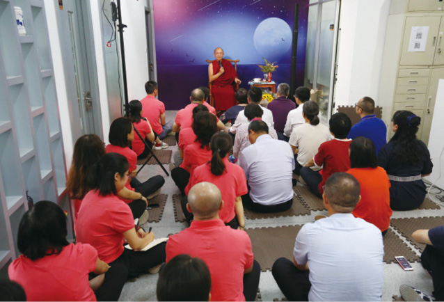
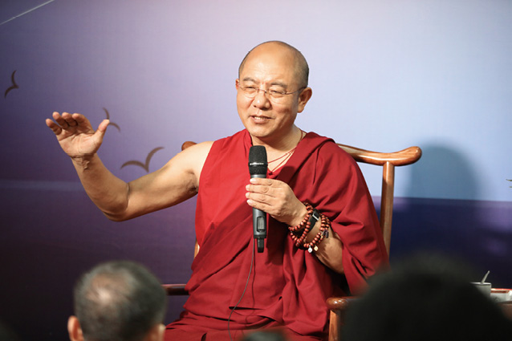
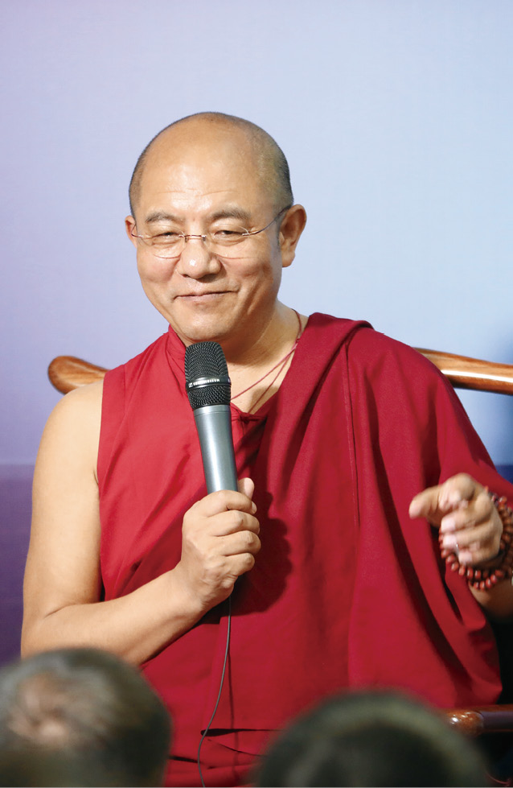
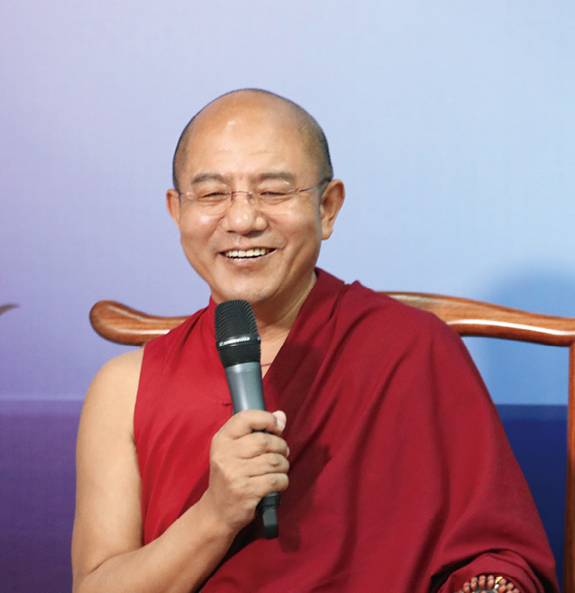

# 担责任 行正道

——对学会管理人员之开示

2019年7月11日

今天我们在慈慧的总部开会，我很高兴在这里和大家见面，这个缘起非常好。如果慈慧能够继续发展，它将来可能会成为一个世界性的机构，就像现在的佛光山一样。佛光山的总部设在一个地方，而其分支组织遍布世界各地，并轮流举办年度国际会议，他们的规模非常庞大。慈济也是如此，他们在全球有很多分部。现在我们开会的地方，未来可能是一个世界性机构的总部，这是一个很好的缘起。

1959年，27岁的稻盛和夫创立了自己的企业，当时只有8名员工，现在这家企业已经拥有大概7万名员工。学会最初在杭州成立时只有几位学员，而慈慧是从上海起步的，当时的成员也不多。时至今日，慈慧已经有为数不少的志愿者，虽然学会没有公开具体的学员人数，但我知道这个数字还是很大的。依靠我们今天在此开会的缘起，加上大家的不断努力，学会和慈慧将会慢慢地发展壮大。

刚才我们对慈慧的工作人员、专职人员和志愿者们作了简单的开示，现在的开示对象是在座的各位，也就是学会的重要发心人员。因为今天不是星期天，我考虑到大家的情况，便在早前特意交代，如果你们因为工作不能抽空来开会，那也不要紧，不知道负责人有没有转告大家。

我原本说其他地方的人今天不用来，但现在我看无锡、成都等地的人都来了；我也说上班的人不用来，但看来需要上班的人还是来了。今天的会议是出于管理的需要，你们能够在上班日来此出席，确实很不容易。

刚才他们向我介绍了在座的各位，你们是学会的高层人员，平时要处理繁重的发心工作，我对各位的付出特别感谢。你们每个人都有明确的分工，这一点很有必要。

本来我打算从苏州去重庆，但是因为航班的问题，我前两天要从苏州来上海，然后再去重庆。因此，我这两天在上海的讲座和会议都是临时安排的。昨天，我在某商学院和中科院的研究所各有一个讲座。今天，我的安排是跟慈慧和学会的发心人员做简单的交流。我想，上海学会的发心人员都比较资深，很多事情我也不用多说。

总的来讲，目前学会在上海地区运作得非常好。我昨天和这边的管理法师对上海学会的各个方面进行了探讨。以前，我每天都会跟学会的管理法师沟通，去了解我们在各地区的情况，包括管理人员的态度。但现在学会的规模越来越大，加上我在学院需要处理的事情越来越多，因此我有时候无法细致地了解学会的情况。

确实，我对学会的关注度没有以前那么高。不过另一方面，现在学会在各地的运作已经变得正规化，基本上不会出现大的问题，同时大家的学习效果也很不错。

招生方面，今年由于内外的特殊情况，我们曾经就要不要招生和怎样招生的问题商量过很多次。最后我们决定今年如期招生，但是以低调的方式来进行，即尽量不去宣传。本来我们预计新生人数会比以往少很多，可是最后各地的招生人数都跟去年差不多。今年的招生过程还算顺利，但是我们的管理人员要为新班找道场、安排辅导和管理人员，又要培训新来的发心成员，的确十分辛苦。

昨天，无锡和苏州的管理人员说，这两个地区的流失率较高，所以他们有些担心。事实上，各个地方都有这种现象，新班的人数一般较多，但有些人会慢慢离开，这是正常的，我们凡事尽力而为就好了。

今天来此参会的，主要是学会的高层负责人吧。我之前跟法师和这边的负责人再三商量，要不要与你们下一两级的管理人员一起开会，这样大家的工作会落实得更加到位。各位是“厅级干部”，你们的下面是“局长”和“科长”。由于学会在上海的规模比较大，“科长”的人数非常多。我们要在短时间内聚集那么多人有一定困难，所以我今天先跟在座的高层领导沟通。至于沟通的内容，主要有几个方面：

## 学会是一个专注于闻思修行的平台

首先，学会从开始到现在，唯一的目的就是闻思修行。各位要清楚的是，学会是一个闻思修行的平台，这是我们发展的大方向。虽然放生、做功德、做慈善等行为都很好，但是学会的存在价值就是闻思修行，这也是我们有别于其他一些道场、团体的地方。

学会的宗旨就是建立一个让有缘人持续闻思修行的道场，这一点大家一定要记住。我们不反对学员们自行组织一些朝圣和其他行持善法方面的活动，不过我们建议大家在安排这些活动时，应尽量不耽误自己的闻思修行。

一般来说，我的课程时间表会在一周之前在网上公布。现在是夏天，我知道很多人可能会出游或者出差，所以在这段时间我会提前两周发布课程时间表。比如这个月22号的课，我们已经在网上公布了。这么做是为了让大家有所准备，能够提前安排听课的时间，而我定好期限后，自己也有压力去备课。

所以说，学会的主线是闻思修行，我希望这里的每位领导都能对此重视。很多团队的传统是下属习惯看领导的方向。如果我们的管理法师不重视闻思修行，那么当地高层领导也不会重视，如此层层下去，最后所有发心人员都会忽略闻思修行。因此，我们领导的价值观非常重要。

我今天要跟大家说的第一点，就是各位必须清楚学会的存在价值及其成立的主要目的。现在，汉地很多人没有系统闻思修行的机会。虽然我们的入学门槛比较高，但是学员人数也比较多。如今，很多佛教团体对参加者没有任何要求，那些上师对任何人都会说“欢迎光临”。

但是学会可不一样，我们不欢迎不闻思修的人，尤其是在加行班和密法班。事实上，因为我们有入学门槛，所以人们更有意乐加入，并会更加珍惜和重视。如果我们没有门槛，人们可能不会那么在意。这也是西方的许多上师在传法时收取费用的原因。有时候收费越高，来听课的人反而越多；如果免费传法，反而没有人来听课。所以，有时候设立一些门槛反而更好。

学会一直都有门槛，特别是在密法班，我们对学员的学修要求十分严格。表面上看，我们严格的要求会让很多人望门却步，但事实并非如此，很多人不仅愿意加入，还一直坚持学习。总之，学会就是一个闻思修行的地方。以上是我今天要说的第一个方面。

## 发心人员更应闻思修行

第二个方面，希望在座的高层领导能够认真地闻思修行。我之前也跟苏州的管理人员说了相同的事情。

如果我们自己不闻思修行，那在管理和指导他人时会遇到很大的困难。况且，佛教的教义那么珍贵和让人受益，如果我们没有认真地学习和修炼，那实在非常可惜。

尤其是在大城市里，我觉得没有一点闻思基础的人非常可怜。也许我的价值观和城市人不太一样，可是你们学佛以后，应该也了解到正见的重要性吧。很多没有学佛的人没有任何因果正见，他们天天杀害众生，不断造业，确实十分可怜。

因此，我今天想说的第二件事情，就是学会的领导们一定要真正去闻思修行，而不仅仅是为了完成作业或者给法师一个交代。有些领导会在法师面前装模作样地做笔记、标重点，但实际上他们听课只是为了应付差事，他们对法师所布置的作业也只求勉强完成，这种态度是不应理的。

学会每周只有一两堂课，时间上你们应能安排得来。我希望大家听课时能够真正用心去学习。虽然我们在学修过程中可能会有一些压力，但是大家一定要坚持。这是我要说的第二件事情。

## 学会内部的各部门需要团结

第三件事情涉及团结方面。总体来看，学会的团结情况很良好，我们内部的管理和上下层的关系也很融洽，不过我们仍然有进步的空间。

学会内部的管理有纵向和横向两个方面。

纵向管理是指从上到下的管理结构，即每一层之间的管理。以学会的情况来说，就是从最高层的管理法师到最基层的各个小组，这个架构是层层分明的。

横向管理是指各个部门之间的协作，它比纵向管理更加重要。学会有很多不同的部门，比如刚才主持人提到的学修部、弘法部等。如果每个部门只管自己的事情，不与其他部门协调，学会就无法正常运作。所以，各部门之间的合作和沟通非常重要。

可能你们很多人都学过《善生经》，里面提到一个人该如何处理纵向和横向的关系[^1]。纵向关系的上方是婆罗门、上师等具有高尚行为的人，下方是我们的下属、仆人等；横向关系则包括了父母、师长、夫妻和其他亲人，经中分别以东、南、西、北四个方向来代表这些关系。

我觉得《善生经》的内容实际上是一种管理学，它讲了许多世间为人处事的道理，对我们学会的管理有一定启发。现在，有些人对上级的领导唯命是从，却忽略了与下属的关系；有些人则与上级和下级关系良好，却与同级或其他部门的人关系不佳，这样的人际关系是不可取的。

从今天开始，学会的所有发心人员不仅要处理好纵向的关系，也要处理好横向的关系。学会有很多部门，对外的有放生组、助念团队、功德会等，对内的有教学组、研讨班等。不管各位属于哪个部门，大家以后一定要跟其他部门保持良好的沟通和协调。

除了与其他部门协作，你们平时还需要处理许多繁琐的事务，例如准备各种表格、考虑许多执行细节。与那些没有发心的人相比，我知道大家确实很辛苦，因为你们承担了更多的责任，要做很多事情。有些道友可能觉得学会的表格太多了、执行指引的文字也太多了，大家千万不要对这些工作感到厌烦。假如我们没有这些管理和执行细节，前线人员在实际操作的时候将会困难重重。

为什么学会目前在各地的工作都能做得有声有色呢？主要是因为我们的管理团队非常认真，注重每一个细节。我们的管理团队不仅智慧甚深，而且非常有学问，因此最近几年，尤其是从2017、2018年到现在，学会的管理水平有了显著提升。同时，我们的许多发心人员都非常有责任心，这也是学会取得成功的关键。

## 学会与慈慧之间的关系非常重要

现在，我最主要的两个事业就是学会和慈慧基金会。今天我要特别强调的是，学会一定要跟慈慧建立良好的关系。众所周知，学会目前不仅在全国各地，甚至在很多国家都有分部。虽然学会的规模很庞大，但我们一直保持低调，尽量不公开学员人数。

当别人问我一些关于学会规模的问题时，我都会模糊地回答：“我们只在几个国家有分部。”“我们在上海只有几十位学员吧，我不知道具体的情况。”“我也不清楚北京的情况，好像有几位学员吧。”

实际上，学会在全球范围内设有很多分部，不过在某些西方国家，我们的学员人数非常有限，可能只有七八个人。尽管学会在这些国家的规模较小，我们的学员还是全力以赴，积极地推动学会在当地的工作。

就像刚开始时，学会在澳大利亚和新西兰只有一两位学员，她们都是家庭妇女。时至今日，她们已经在当地建立起一个有好几百人的道场。国外的华人本来就少，学会能够在那些地方建立起道场，真的很难得。

去年我们在俄罗斯只有一位学员，我鼓励他设法再招几位道友。今年，那边已经有十多位学员了。冰岛的情况也是如此，最初我们只有一位学员。一旦他找到一位志同道合的佛友，便感到如获至宝，非常高兴。

在国内的大城市，人口非常多，因此你们可能会觉得很多事情是理所当然的。即使我们聚集了几百位新学员，你们也不会感到特别高兴。相反，国外的学员们一听到有新的道友加入，他们都会兴奋不已。

不管怎样，如今学会在全世界都有很多道场，发展得很不错。而慈慧方面，目前只是在某些地方有一些临时的联络点而已。学会的发展已经上了轨道，如果政府没有什么反对，学会是能够正常运作下去的。但是慈慧不一样，如果没有学会的帮助，慈慧的发展将会非常困难。所以，今天我要特别强调学会和慈慧之间的关系。

现在慈慧的多个项目，特别是大学生助学，对社会意义重大。为此，我要特别感谢学会的负责人和相关人员，他们在筹款、管理等方面给予了慈慧许多帮助，尤其是一些有福报的捐赠者，他们在资源上提供了巨大的支持。慈慧成立至今，已经快十年了，这一路走来，离不开学会的支持和帮助。因此，我要特别感谢所有为慈慧做出贡献的学员。

展望未来，各地的学会在发展和运营上或许不会遇到大的困难，可是慈慧的发展仍然需要大家的支持。目前，慈慧的工作人员非常有限，他们在上海有十几位专职人员，而在其他地方就更少了，比如北京只有一两位，杭州只有一位，成都则完全没有。即使某些地方有专职人员，我们也无法为他们提供办公室，他们只能把自己家里的一间房子腾出来作为办公场所。与学会相比，慈慧在人力和物力上都非常有限，因此他们的压力还是很大的。

每年向慈慧申请资助的学生越来越多，因为很多孩子确实非常贫穷。今天我与慈慧的管理人员开会，讨论了筹款的问题。由于现在的经济环境不佳，我们筹得的善款可能没有以往那么多，所以慈慧面临的压力也越来越大。最后，我们决定维持去年的助学人数，不再增加资助名额。

这几天，很多家庭打电话向我求助，诉说了他们的困境。当我在电话中听到那些孩子的哭声时，我的心都软了。尽管如此，我也无法给他们一个明确的答复，只能让他们过一段时间再联系我。

慈慧助学的负责人名叫秋云老师，他经常提醒我不要轻易地分配资助名额，因为有些孩子的家庭条件并不算差。可能他自己出生于贫困家庭，故以他的生活标准来看，有些家庭尚算富裕。实际上，藏地的许多家庭还是很可怜的，许多孩子真的需要帮助，可是我们现在的能力确实有限。

我在北京的时候也跟慈慧的负责人提到，如果慈慧的助学人数不断上升，我们将会面临越来越大的压力，因此，我们决定将今年的资助人数维持在去年的水平。慈慧每年资助的学生人数大约在五千人左右，若这个数字持续增加，慈慧的总部和各地分部将会面临巨大的挑战。

除了上海、北京和杭州，慈慧目前在成都、无锡等地的人力资源相对匮乏，因此，我们要在全国各地组织筹款活动并不容易。此外，如今许多佛教徒甚至难以解决自己的基本生活需求，更不用说去做慈善了。所以，慈慧现在的发展原则并不是追求无止境的扩张。

由于缺乏足够的人力物力，慈慧总部和各分部的人员都面临着巨大的压力，确实非常辛苦。通过今天的会议，我希望学会的高层管理人员能够在合理合法的框架内，给予慈慧适当的支持。否则，他们将难以开展一些工作。

本来学会的管理层并没有专门负责慈慧的法师。现在，学会弘法教务处的法师也会兼任慈慧的管理法师。今天我和教务处也做了一个决定，以后学会要派一两位理事来分管慈慧。我希望上海的理事会能够就此展开讨论，确定哪位或者哪两位理事能够承担这一责任，如此学会的高层领导中就有专人与慈慧对接，两者的合作相信会更为顺畅。

以前学会也会关注一些慈慧的事务，但是总体上两者要保持一定距离，以免被过度关注。如果学会与慈慧的联系过于紧密，可能会对双方产生不利影响，这是我们以前的顾虑。然而，随着慈慧多年来的正常运行，它已经得到相关政府部门的认可。他们知道慈慧是一个纯粹的慈善机构，不会参与其他方面的活动，也不会以慈善的名义从事非法行为。因此，现在政府对慈慧的关注度降低了很多。在此背景下，慈慧和学会可以加强沟通。

我已经要求慈慧在一年之中不要举办过多的活动。例如，我们不必每个月都举办拍卖，因为频繁的活动会让很多人感到担忧。虽然有人告诉我，现在很多人想积累福报，对做善事很感兴趣，所以慈慧多举办一些活动也是好的。不管怎样，慈慧的很多活动都是短期性的，可能一年中只有一两次。因此，学会也不需要长期性地辅助慈慧，但在他们组织某些活动时，例如徒步活动、年会等，你们应该尽量提供协助。

其实，学会有很多想做功德的佛教徒，而慈慧则有很多非佛教徒的捐赠者。我们可以向前者提供慈慧这个平台，让他们的善款能够用得其所；如果后者对佛教有兴趣，我们可以推荐他们加入学会，系统地学佛。所以说，学会和慈慧之间的对接和沟通非常重要。

我这次来上海的目的，就是希望上海学会能够更多地关注和支持慈慧基金会，并且安排专人来分管慈慧。当然，上海学会的秘书长和理事长也可以直接关心慈慧的事务，但如果有专人对接，学会和慈慧的合作将会更加顺畅。

昨天，学会的负责人在商量今天会议的地点，我说不能在其他地方，必须在慈慧的总部。这样的安排自然会传达一个信息：学会与慈慧的关系非常紧密。另一方面，这也是给大家发愿的好机会。虽然这个总部看起来是一座平凡的小房子，但实际上它承载着观音菩萨救苦救难的精神，一直做着利生的事业。所以，只要你在发心或行为上参与慈慧的事业，你将会获得无量的功德。

以前，慈慧的总部设在李总的公司里，已经很多年了。今年它终于有了一个独立和固定的场所，我今天也是第一次来到这里。我刚才在想，建立一个合理合法的慈善平台真的非常不容易。

大家以后要保护这个平台，不能让它渗入太过浓厚的宗教色彩，因为它是一个纯粹的慈善机构，这一点慈慧的工作人员也会注意。另一方面，学会与慈慧也不能完全脱离。要是你们对慈慧的事情袖手旁观，他们的工作人员就会变得孤立无援，毕竟你们掌握着许多资源。

总之，如果学会与慈慧的关系不好，未来肯定会互相造成麻烦，而我的事业也无法展开。实际上，此二者都是为了利益众生而成立的，他们的事业都是菩萨行，只不过在方式、方法、分工和身份上有所不同而已。希望大家都能清楚这一点。以上是我要说的第三件事情。

今天，学会的高层人员在慈慧的总部开会，这是一个很好的缘起。从现在开始，我们要以善巧方便的方式来利益众生。我认为，慈慧的总部设在上海，这对众多上海人来说，确实是一个难得的利生机会。全国其他地方如广西、深圳等地的很多人都渴望参与慈善事业，包括学会的许多负责人也希望在各自的地方建立慈慧的分部，通过一个可靠的平台来做慈善。不过由于因缘不具足，他们目前还缺乏这样的机会。

要让因缘具足并不简单，尤其是建立一个国家认可的纯慈善平台，确实非常困难。既然我们已经有了这样的平台，就要善加利用。在做事的过程中，大家必须掌握分寸，不堕两边。我想，学会的理事会和慈慧的管理层都非常清楚这种态度和做法。你们一定要重视他们的指示，与他们紧密合作。

## 培养长远视野，坚持发心

第五点是关于学会的管理方面。现在大家的管理工作做得相当不错，我希望大家不要觉得太累或者辛苦。我知道你们有时候会感到劳累，但若与我相比，其实你们的辛苦程度还是较轻的，我刚才也跟慈慧的人员提到这一点。总之，我希望学会的发心人员能够继续努力，不断完善我们的管理工作。

在管理方面，我也跟慈慧那边强调了，我们要做到人性化和制度化。此二者缺一不可，它们的结合才是我们管理的正确方法。这是我想讲的第五点。

第六个方面，是关于学会的可持续发展。虽然学会已经运作了很多年，但它将来会变成什么样，这是谁也无法确定的，我不会知道，你们也不会清楚。不管怎样，正如我以前所说，即使有一天我离开人世，学会也要永远延续下去。我们需要有这样的精神。

当然，我不是说自己马上就要离开，而是我们每个人都应该有无常观，意识到生命的无常。大家要有一种决心，即便在我们离开人间的时候，学会仍然能够正常地运作下去。这种精神非常重要。

## 发菩提心至关重要

今天，我特别感谢在座的各位发心人员，这里有许多人多年来一直非常坚定地发心，也有一些人是新加入的。另外，我希望你们能够将这次会议的内容传递给学会的所有学员。有些人可能因为这次没有见到我而感到不高兴，或者有些意见。对于这些人，请大家告诉他们：“只有发大心的人才有机会见到上师，否则是见不到的。”

昨天，上海的一位出家人告诉我，有位道友希望与我见面。这位道友本来没有信仰，后来阅读了《苦才是人生》，逐渐对佛教产生了兴趣。他随后找到了这位出家人，并表达了希望与我会面的想法。这位出家人告诉他：“目前你的条件还不具足，你一定要修加行、看书、发心，当你积累了一定的资粮，才有机会见到上师。”于是，这位道友便努力地看书、修加行和发心。昨天，这位出家人告诉他因缘已到，可以在我去学校演讲时来见我。

所以，大家有必要让所有学员明白发心的重要性。你们之后可以通过开会的方式来向他们讲解，这是你们能力范围内可以做到的。一直以来，学会的发心人员在工作和企业管理等各方面，都展现出相当不错的处事能力。特别是在上海，你们的整体素质与其他一些地方的人完全不同。

我曾经说过，没有能力的人无法胜任任何工作，他们甚至连自己的温饱问题都解决不了。然而，上海学会中有很多有能之士，你们应该与他们保持良好的沟通，并鼓励他们参与发心。

其实，我也想跟学会的全体学员进行一次交流，这样可能会更有效果。不过，现在我们的学员人数非常多，要让那么多人集中起来非常困难。如今我出访任何一个地方，包括到学校演讲，基本上不会特意安排跟当地学会的负责人见面，但这次是个例外。这次我在北京、青岛、南京和苏州的时候，都分别与当地学会的负责人会面。

成都的负责人给我发了信息，说希望与我会面，但是我回复说这次安排不过来，因为这趟行程不包括成都。他的心态还是比较平稳。明天我经重庆回程，也不会经过那里，否则我可以与他见面。

你们也知道，以前我去各个学校时，基本上不会特意去见当地学会的负责人，即使见了也不一定起作用。昨天，我与苏州的管理人员开会时，引用了佛陀在《金刚经》中的一句话：“若以色见我，以音声求我，是人行邪道，不能见如来。”如果有人执著于佛陀的色身和音声，他就是走在邪道上，那执著跟我见面就更不用说了。我们该怎样做才是行正道呢？就是发菩提心。这才是最重要的，我们见不见面倒不重要。

今天，我对学会的高层管理人员有两个期望：

第一，为了让学会闻思修行的风气延续下去，你们应该不畏艰辛，坚持发心。你们在发心过程中肯定会感到辛苦，但是为了弘法利生，这是值得的。我经常想到，上师如意宝一生中也经历了许多艰辛，可是他始终为了弘法而努力，所以我们目前的一些辛劳是可以忍受的。虽然大家在精神上和身体上可能会受到一些压力，但这不算什么。我也很累，你们也很累，让我们一起发愿，坚持下去。

第二个期望，刚才也提到了，希望学会能够尽量为慈慧提供支持。与学会相比，慈慧的规模非常小。他们只有十几位专职人员，而学会的人员数量你们心中应该有数。

以前黄老师在学会里算是身材高大的，但是自从他去了慈慧发心后，明显有些消瘦。幸好慈慧的高老师身体还不错，他在现场吧？你们看，两位老师的身形有明显的对比。

如果学会能够为慈慧提供帮助，你们的服务范围就不仅限于学会内部，而是扩展到许多众生，因此大家应当感到开心。各位在学会的工作就是弘法利生的行为，我们一定要继续共同努力。

总的来看，我们拥有像慈慧这样的因缘，确实很难得。如今许多上师和佛教徒都想做慈善。昨天，有人说他与另一位堪布在做慈善，我对他说：“做慈善非常好，但这不是一件简单的事情哦。”确实，做慈善需要毅力和许多善巧方便，即便是建立一个基金会也并非易事。

所以，我希望在座的各位能够在各个方面继续努力，如此在诸佛菩萨的加持下，我们的利生事业一定会越来越圆满！

[^1]: 《佛说善生经》：“佛告善生：当知六方。云何为六方？父母为东方，师长为南方，妻妇为西方，亲党为北方，僮仆为下方，沙门、婆罗门诸高行者为上方。”
