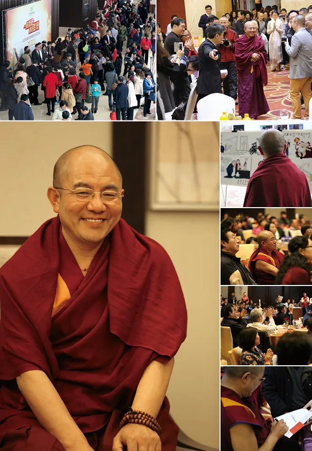
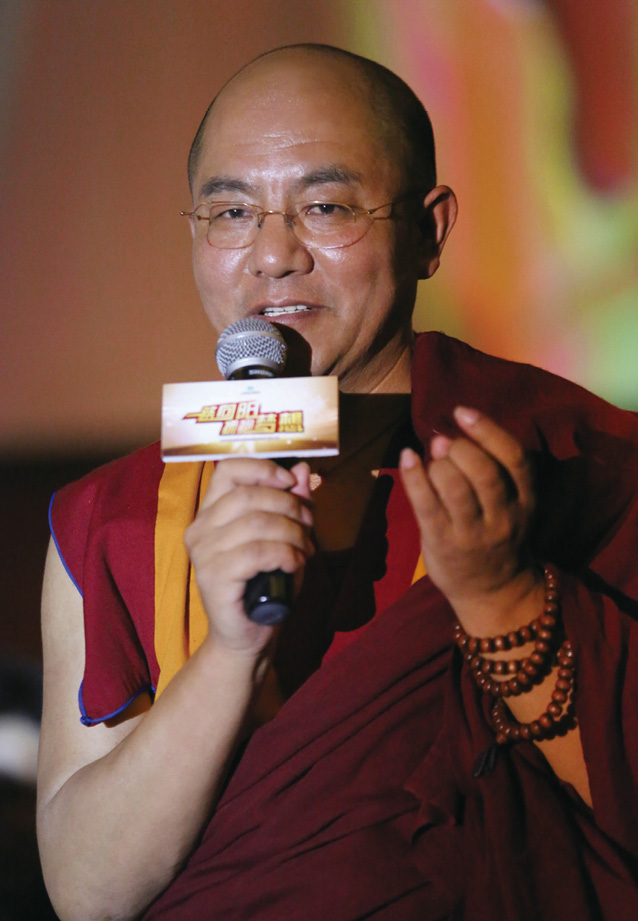
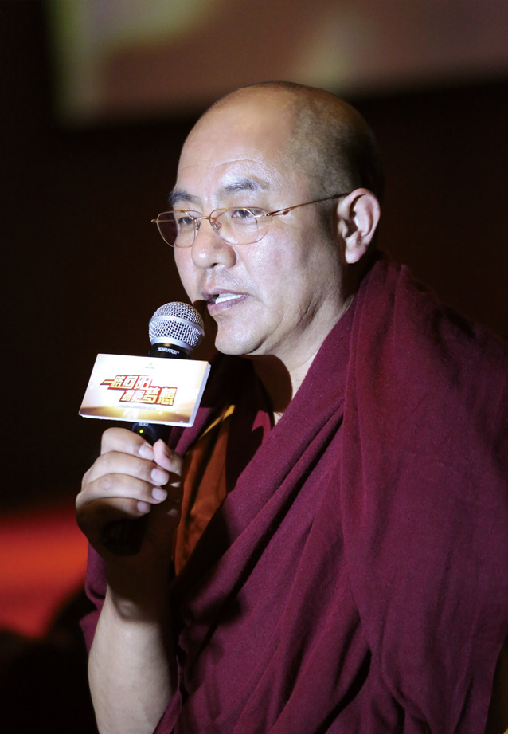

# 有善心就是慈善家

——慈慧三周年感恩汇报会问答

2014年3月15日

主持人：索达吉堪布，您好！您能够来到现场，我们真的非常高兴。索达吉堪布是一位佛学大师，也是一位非常活跃的慈善家。今天，我想向您请教几个问题。首先，您是怎么看待慈善的？此外，现在很多人都觉得，社会上充满着很多冷漠的行为，您对此有什么看法？

堪布：从我个人来说，今天听了台上演讲者的所有发言，确实非常感动，在座各位所付出的一切真的非常有意义。

从慈善方面来说，我们之前以“慈善是心，日行一善”作为慈慧的主导思想和理念，在此前提下，你不一定要具足丰厚的物质条件才能做慈善。即使你没有什么财物，但只要你有一颗想帮助他人的善心，愿意为此付出哪怕是一点一滴，你就是一位慈善家。可能很多人认为，所谓的慈善家一定要有几百万、几千万或者几亿人民币，甚至美金，但实际上不是这样的，如果一个人有想做善事的心，他就可以称为慈善家。

当今社会，很多人的道德水平和慈悲心的确需要提升，一些人经常说：“只要不违法，我做任何事情都是可以的。”相对于道德，其实法律的底线是很低的。我们生而为人，应该知道人生的价值远超于生存和不违法，法律只是我们做人的底线，在此基础上我们还要让自己的道德、行为和悲心有所提升。

我认为每个人一定要有一颗善心，而众多的善心可以逐渐形成一股暖流。昨天，我刚到这里的时候，听到一位藏族女孩子的故事：她在杭州的一家企业中上班，工资不高，但是她每个月会把剩下来的一些零钱，点点滴滴地积聚在一个储蓄罐内。后来，她把当中的所有金钱，约一千元捐到慈慧。

这笔善款对生活在大城市中的人来说，可能是极小的钱财，但是对生活在某些地方的穷苦人来说，确实是非常非常大的帮助。刚才，我们看到癌症俱乐部的一些人捐了十万元，这样的数目对一位企业家来讲，可能连一根汗毛都不如，不过，这笔善款却改变了一万三千多位癌症患者的命运。

无论是藏区还是汉地，我经常都去一些非常贫穷的地方。事实上，我在那里并不觉得自己给予了他们什么帮助，反而是他们让我上了一堂活生生的课。我学习很多不同的知识已经接近三十年，在理论上，我所明白的东西非常多，但是，通过实际行动去帮助众生，确实给我带来一种前所未有的收获。

因此，我不理解为什么有些人经常口口声声说要弘扬大乘佛法，可是他们反对做慈善，认为这是散乱的表现，没有意义。他们肯定有能力去帮助身边的众多可怜之人，却选择了袖手旁观。我不理解那些人的行为，也不理解现在的很多企业家，他们坐拥丰厚的财产，可是从来也不帮助一些有需要的人，在临死之时，他们连一针一线都带不走，更莫说巨额的财富了。

我想，我们的社会不能太冷漠。每个人的能力、智慧是有限的，但是，只要我们都有一颗善心，这个社会一定会变得非常温暖。

主持人：刚才说到我们每个人都有能力去帮助别人、去做善行，慈慧基金会在过去的三年确实付出了一些努力，今天我们已经为大家汇报了。请问堪布，您觉得慈慧这三年来的工作做得怎么样？对于未来，您有什么建议和期望呢？

堪布：刚才理事长说，慈慧已经成立了1095天，我用藏历来算的话，其实它已经成立了1111天，刚好是四个1。慈慧诞生于2011年2月26日，当天我们在上海民政局的批准下进行了揭牌仪式，我也在现场，如果从那天算起，到了今天便是四个1——1111天。

对我们的志愿者和爱心人士来讲，这1111天过得并不容易。如果我们无所事事，那三年的光阴应该一晃就过，但是这段日子，我们无时无刻都在做事情，也遇到了各种各样的社会现象，包括“郭美美事件”，再加上我们所经历的风风雨雨，三年来慈慧走过的路是弯弯曲曲的。

在此过程中，有些人非常坚定不移地弘扬我们的慈善理念，一直提供各种帮助；有些人则是虎头蛇尾，初时他们确实是出于好心，带着一种热情、冲动甚至是激动来发心做事，不过人的心态是变化的，日子一久，他们的热情逐渐冷却，最后就退出了发心的行列。

我们的工作人员也好，志愿者也好，包括所有的慈善爱好者，三年来都遇到了不同程度的各种违缘和障碍，但是当中有一群人，他们一直坚持下来，走到今天，真的很不容易。

个人而言，我从来没有想过退下来，因为我认为，凡是有智慧的人，都应该先用自己的智慧来观察任何一件事情，只要它对社会有意义、对一切生命有意义，那么，即使过程中遇到再大的困难、违缘，他还是会坚持下去的。

我觉得我们三年以来的工作，总体上是成功的。当然，很多人对我们的处事方式可能不太理解，而且过程中我们也不能满足所有人的期望，如果大家对我们有一些意见和批评，我们也乐意接受。

我自己只是慈慧千千万万个人中的一分子，我一人之力做不了什么事情。但是，我有一颗为慈慧付出的心，凡是我力所能及的一切事情，我都会为慈慧努力和奋斗，同时，我也经常在心里默默地祈愿，慈慧的事业将会非常圆满。

我今天在此就不用多说了，毕竟我们的很多行动，在座各位都非常清楚。通过今天的聚会和演讲，很多人应该了解到，作为真正的爱心人士，自己需要做些什么。对佛教徒来说，帮助众生是大乘佛教的基本修行；对世间的非宗教徒，或者善心人士来说，帮助众生正是当今社会所需要的。

最近，我们从上层所提倡的各种精神，不难看到我们以后做慈善、弘扬传统文化的空间将会越来越大。所以，我们现在就应在这些方面持之以恒、积极地努力，大家一定要共同奋斗。

主持人：

谢谢索达吉堪布！上海慈慧公益基金会一定会继续坚持、努力！同时，我们也期待大家的加入！
