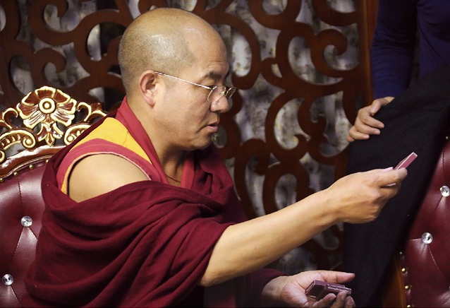

# 汇聚人才 共创未来

2016年1月4日

各位慈慧基金会的志愿者、各位同修、各位善士善女，今天是个非常吉祥的日子，慈慧基金会已经进入了第五个年头。

从慈慧成立至今，我们的很多志愿者一直都有坚定的信心、信念和发心，不断地做着慈善工作。当然，我们也有一些志愿者只是加入了三年、一年，也有一些是刚刚加入的。事实上，慈慧基金会的团队不分民族、不分宗教、不分信仰，任何人都可以参加，我们当中有些人是多年的佛教徒，也有一些人没有任何信仰。

不管怎样，现今社会很需要有一些慈善活动。众所周知，我们身边有许多老弱病残，也有一些没有机会读书的年轻人、无依无靠的孩童，以及需要人们关心和照顾的各类人士。

因此，我非常非常希望，慈慧的团队能够壮大，而所有志愿者都能以各自的人力、财力、物力，配合其坚定的信念和智慧等来帮助身边的人。

## 要持续、积极地发心

今天，我要趁此机会，去特别感谢那些长期不断地给慈慧提供协助的众多善男信女。同时，我也想跟大家说几件事情：

首先，我们的志愿团队很需要有凝聚力。每个人刚加入慈慧的时候，都会有一些热情，但是这种热情、初心会随时间而变。另一方面，慈慧所做的项目、活动将会越来越多，如果我们志愿者的参与度越来越高，同时人与人之间的关系也越来越好，那我们的慈善事业一定会越来越有意义。

所以，你们许多人不要认为自己已经在此工作了五年、三年，然后就感到足够，或者生起疲厌，有退出慈慧的打算，我很希望你们能够继续努力。从佛教的角度，我们利益众生、做善事是乃至菩提果之间都要行持的；从非佛教的角度，参与慈善实际上是你人生中最有意义的一件事情。

我经常都说，最好的企业家就是最成功的慈善家。如果一位企业家不是慈善家，他的企业只能对小范围的人有利益，那没有很大意义。所以，今天我要跟大家说的第一点，就是我们要不忘初心，如果你做了几年或者一点善事就想退出，那是不合理的。

至于第二点，我们在参与慈慧工作的时候，真的需要有一种主动性、积极性。

很多人员经常因为慈慧的几位负责人，包括我在内，想尽办法劝大家尽量参与慈慧的事情，他们才勉强出一分力。如此我们很尴尬，你们也很被动。我们很需要各位把慈善事业看成是自己的事情。

表面上看，我们是去帮助别人，但实际上，不管是今生还是来世，真正的受益者都是我们自己。我们十分希望，各类人士能够积极参与慈慧的工作，尤其是那些具有管理能力、执行能力，或者有不同文化背景、专长的人士。

慈慧的慈善事业将会越来越大，我们的团队需要各种人士的加入，希望上述那些人不要隐藏自己的智慧和潜能，不要觉得不好意思而深藏不露，这是一种不必要的谦虚。

要是你有某种专长，例如财务、管理方面的能力，那你应该主动站出来，分担慈慧的一些工作，我们的管理和负责人员，一定会尽可能让你在合适的岗位上发挥所长。

## 放下自我，重视慈慧

第三点，我们的所有发心人员，包括慈慧在全国各地的一些联络处或者分支机构中的人员，都应有统一的思想，大家要共同学习，并且把慈善当作是自己的事情。

世界上很多慈善机构的人员就是如此，慈善的理念已经深入他们的骨髓，他们真正把利益众生看作是自己的事情。那些人不一定是佛教徒，也不一定有信仰，但是，他们会共同做很多事情来帮助身边的人，这正是我们人类所需要的。

跟其他的慈善组织相比，现在慈慧的管理团队从各方面来看都不是很成熟，我们也知道自己在组织架构和管理上经验不足，而且在其他的很多方面还需要不断地学习和完善。

不过，我们都有一个共同的心愿，就是每一位发心人员都能把慈慧的事情当作是自己的事情，大家千万不要认为慈慧是某几位人士、堪布下面的慈善机构，也不要把慈慧的事情看成是几位负责人员的事情。实际上，志愿者才是慈慧基金会的主人，大家应该乐于成为这个团队的“持股者”。

最后一点，我们在发心过程中，应该放下自我和自己的一些想法，并且经常从团队或者别人的利益角度思考问题，大家千万不要把个人事情、私人恩怨或者一些是非，带进我们的志愿团队。

该管的我们会去管理，但若你在慈慧不讲慈善的理念，只懂经常讲一些人与人之间的矛盾、冲突，或者别人的一些得失、是非，那我们的管理团队可没有精力和时间来处理这些问题。所以，大家应该放下自我，全心全意地付出。

跟外面的一些团队相比，虽然慈慧如今在各方面，例如规模上、管理上都不一定能够比得上，但若跟另外一些非常不成熟的组织相比，慈慧的志愿团队还是有一定的凝聚力和团结力。只要我们共同努力，我们一定能够帮助许许多多的众生。

一直以来，慈慧基金会确实改变了很多人的命运，例如藏地的一些大学生。据我所见，他们本来一辈子都不会有读书的机会，但是因为慈慧的帮助、大家的共同发心，如今很多受益者已经在读大学，也有很多受益者已经大学毕业，找到工作了；虽然现在还有相当一部分人还未找到工作，但至少他们已经有了大学的文凭和水平。

总之，如果依靠自身的家庭背景，很多藏地的学生根本没有办法读上大学，不过，他们现已就读全国范围内不同的大学，可见慈慧真的利益了很多众生。此外，慈慧还有其他的项目，包括养老、大学生交流、扶贫互利等。

作为慈慧志愿团队中的一员，我们不仅自身要有修养，而且在做慈善的时候，一定要有智慧和善巧方便，尽量不要扰乱别人的心。法王如意宝接近圆寂的时候曾说：“莫舍己道，勿扰他心”，这就是慈慧团队的行为准则。

在发心过程中，我们应该对上下的所有组织，例如企业、政府等保持良好的沟通和关系；同时，我们应该调整自心，不要让很多身边人感到不高兴、不舒服。大家应该通过自身的行为，给周围的人带来与众不同的温暖、幸福和安康，这就是我们的心愿。

最后，趁新年这个特殊的节日，我祝大家2016新年快乐、一切圆满，同时愿我们的善心可以日益增长，能够帮助许许多多有需要的人！
