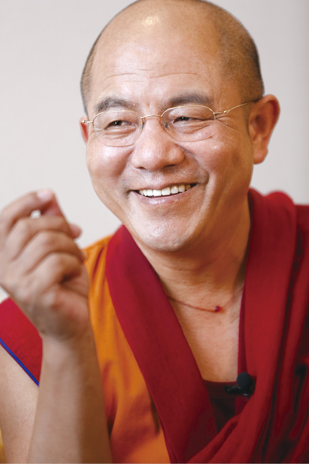
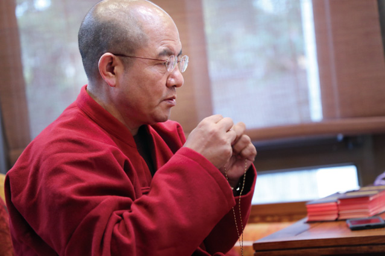

# 让利他细水长流

2016年11月25日

今天是慈慧基金会事业部的年度总结会议，我想跟参会的人员说一些事情。本来我很想参加这次会议，但是一来自己的事情比较多，二来慈慧现在的各项管理工作都能正常运作，故在某种意义上，我认为由你们亲自操作，自行举办各项筹备、管理相关的会议更加合适。所以，我现在只是以网络的方式来跟大家说一些话。

首先，我要特别感谢这里的所有参会者。今天，大部分来此开会的，都是慈慧理事会的核心人员和事业部的工作人员，也有一些是各地联络处的发心人员，正是因为你们的长期发心和努力，慈慧不仅能在那么多年非常顺利地运作，而且从各方面来看，慈慧的工作都非常有成效，这是有目共睹的。

今天，我想跟大家说的第一件事情，就是希望各位不要以辛苦，或者各种私人理由来退出我们的团队。不管你有没有信仰，只要你是一位利他者，那么对你来说，慈慧应该是一个非常好的平台，让你拥有也许是千载难逢的机会来利他。因此，大家应该珍惜在慈慧发心的机缘，这不仅是为了你自己，也是为了那些需要帮助的人。

随着慈慧的发展，我建议大家去进一步建设我们的团队，完善我们的管理，使慈慧的团队更加专业化和规范化，这是大家需要努力的方向。在某种意义上，慈慧现在确实运作得非常不错，但是，我们还有一些进步的空间和独特的发展机会。在开拓这些机遇之前，我们要先创造良好的团队文化，培养团队精神，然后在此基础上去做更多有意义的事情。

在团队建设方面，我们未来会请一些专业人士，为慈慧的管理人员进行培训。这包括学习一些佛教思想，因为管理人员有必要以这些理念来做利他的事；另外，他们也有必要学习一些现代的管理方式和先进的科技，否则在此日新月异的时代，我们很容易错过很多稍纵即逝的利他机会。以上是第一件事情。

第二件事情，从过去几年的运作模式来看，各地的慈慧人员确实非常努力，趁今天现场有各地联络处的人员，我想强调一点：各地团队的成功或者管理目标，并不是仅以筹款额来衡量的。

几年来慈慧在以上海、杭州为主的几个地方，所募的善款都特别多，而在其他的一些地方，则不一定有那么多。我们也明白，不同地方都有其各自不同的资源和限制。所以，只要我们的地方团队没有放弃自己当地的特色、文化和理念，我们不会特别提高各地的筹款目标。

我们不希望各地的团队在筹款方面相互竞争，否则某些团队很有可能做出一些不如法的行为，而且从现况来看，慈慧当前并不缺乏资金。因此，我们希望各地在筹款方面保持现状。我们也不会因为某些地方的筹款额太少，而认为那些团队做得不好。

在慈慧成立之初，我曾想过在全国各地甚至国外，建立慈慧的联络处或者分部，可是，现在我的想法是以低调为主，细水长流地利益众生才是我们的理念。所以，我希望各地的发心人员不要退失，这很重要。此外，大家也不要在短时间内失去做事的热情，应该不断地发心。

在操作方面，我希望总部不要在筹款额上给各地下一个硬性的指标，不要规定他们必须筹到某个数目的善款，因为不同地方的团队都有各自不同的文化和背景，包括团队的人数，毕竟学会在一些地方的影响力是有限的。这是今天需要提醒大家的第二点。

第三点，希望我们的管理人员能够不断学习。

尤其是理事会的各位，你们担任了多年的慈慧理事，这不仅是一种地位的象征，也代表了你们愿意承担相关的责任，就是说，你们应该在慈慧发挥自己的智慧和优势。

举例来说，如果你当了五年、十年的理事，却一直对慈慧的事情漠不关心，什么也不做，只是默默无闻地挂着理事的头衔，那你的行为并不符合管理者的身份。

作为一名理事，你应该勇于参与慈慧的工作，参与的方式可以是在开会的时候提建议，也可以是通过学习去提升自己的心灵，然后以不同的途径来把自己对众生的爱心发挥出来。

有些发心人员对慈慧的所有事情都无所谓，这不符合我们的利他精神。另一方面，有些人员在发心过程中则感到特别疲累。所以，管理人员应该多从不同的维度、角度来思考事情，特别在分配工作方面，我们要让每一个人都有适当的工作量，这是非常重要的。

就我个人而言，你们很多人的付出确实是对我的最大供养和帮助。因为我们的共同努力，如今无论在藏地还是汉地，许多学生、老人和需要帮助的人已经从痛苦中得到解救，这就是我们建立慈慧的最终目的。

虽然我们一路走来，也遇过一些风风雨雨，不过从大的方面来说，慈慧已经获得社会的认可。众所周知，在诸多非营利组织之中，慈慧有较高的知名度，而且我们的管理和很多理念，都是社会所认可的。

这时候我们千万不能放松，希望大家都能把慈慧当作是自己的事情。从佛教的层面来说，慈慧是你弘法利生的事业；从世间的层面来说，它是你慈善公益的事业。所以，慈慧的确是你人生中最有意义的事业。

等会还有很多人员将要发言，我就不占用过多的时间了。我非常希望，大家做任何事情都能善始善终。我们不愿意看到的，是你初时怀着美好的理想来发心，最后却变得虎头蛇尾；我们最愿意看到的，是你的发心、行为能够善始善终，事实上我们每一位都应该如是发愿。

虽然我今天没有亲自来到现场，但我的心是跟大家连在一起的，我的行为也是同样，都在跟大家一起做事。总之，希望我们共同努力，今天我也会与各位共同发愿，谢谢大家！
