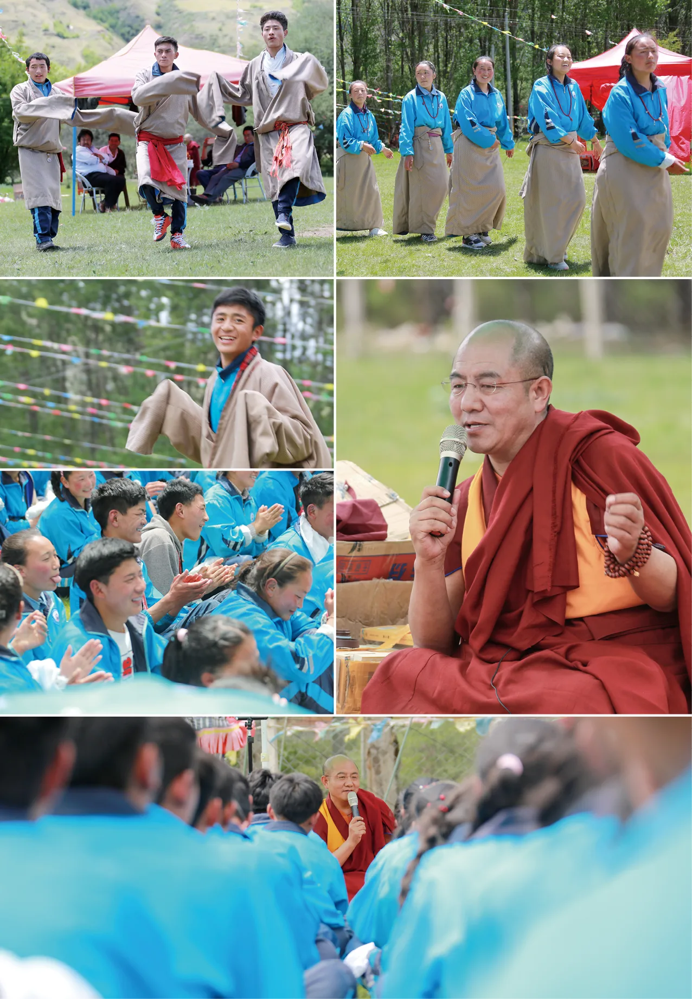
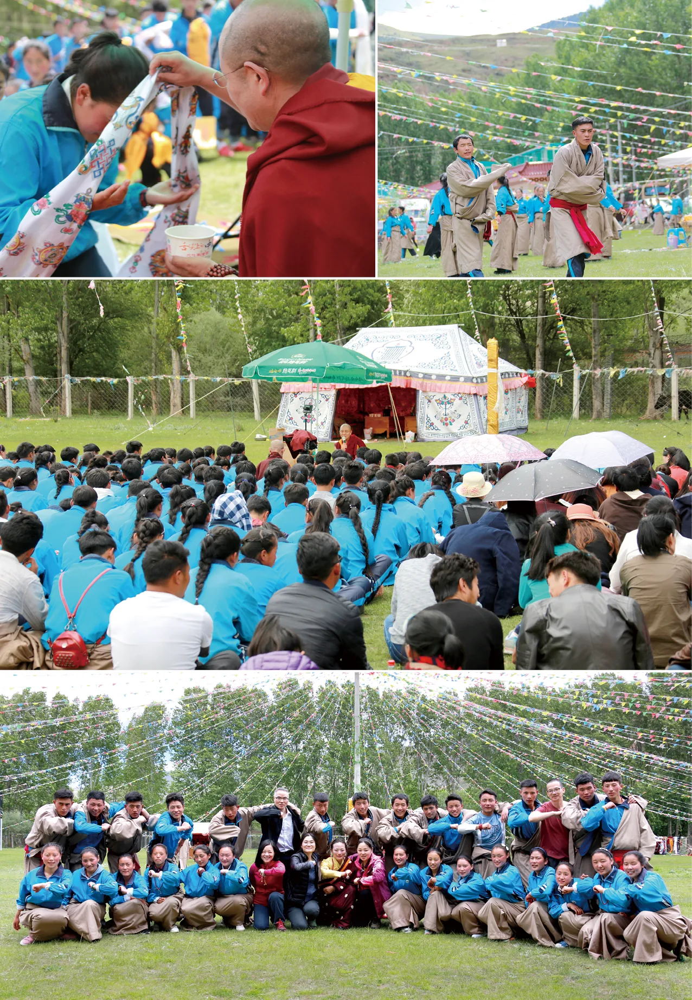

# 传承母校优良校风

——对上罗科玛中学毕业生开示

2017年5月28日

今天我的发言时间不会太长。昨天在演讲时，我因为听到前面许多学生的感人发言而变得激动，结果将原本安排的30分钟演讲延长到差不多一个半小时，真的十分抱歉。今天，我一定不会那么啰嗦。

确实，有时侯在发言过程中一旦有所感触，便容易不自觉地多说几句。今天，我还是要讲一些内容。因为在座有不少汉族老师，我将先用藏语讲解，随后亲自用汉语翻译。我会尽力控制时间，争取不超过15分钟。

首先，我想说明一下，今天下午大家可以自由安排活动，无需过于拘束，也不必穿着整齐的校服。从今天起，毕业生只需遵守学校的基本纪律，除此之外，老师将不再对大家进行严格管理。

至于你们的校服，我建议大家妥善保留，作为纪念。我于1993年跟随法王如意宝前往美国时所穿的一件衣服，至今仍在使用，已经接近三十年了。同样，如果你们现在将校服好好保存，三十年后，它将唤起你们在这里求学的回忆。更何况，我们的校服上绣有宝剑图案，具有一定的象征意义，值得大家珍藏。

今天，我特别为在座的每一位准备了一些礼物，其中包括一本藏文经典。这是一本古老的书籍，希望大家能够经常阅读。在一次演讲中，我也曾提及这本书的重要性，并鼓励大家多加阅读。

除了书籍之外，我还为大家准备了一串念珠及一颗单独的珠子。这些念珠和珠子，均由我亲自在佛堂的坛城中加持，寄托了我对大家的一份祝福。

希望你们能够将现在的校服妥善保存，作为纪念。至于这颗念珠，如果你觉得它并无任何特殊意义，可以自行处置，哪怕扔在草丛中，也没有人会注意到。但若你认为它具有纪念价值，那不妨将它保留下来。

1990年，法王亲自为我们一百位堪布每人赠送了一颗念珠。我至今仍将那颗念珠佩戴在脖子上。今天，我也特意为学校的每一位人员，无论是老师还是学生，准备了一颗念珠。这些念珠稍后将由两位老师负责分发。不知道今天学生们是否都已到齐，请老师确保每位同学都能领到这颗念珠。

此外，我还准备了一串水晶念珠。这些念珠已由我们佛学院加持。过去，学院曾发放过红色和白色的念珠，而在今年即将举行的金刚萨埵法会上，我们将会为参与者发放这串水晶念珠。它由真正的水晶制成，而水晶属于七宝之一，非常珍贵。

总之，今天我为大家准备了三份礼物：一颗念珠、一串水晶念珠，以及一本书。这本书由西藏民族出版社出版，是一部极具意义的著作。我希望大家能够认真阅读，并长期保存。各位最好能够将此书永久保留，不要丢失或者舍弃，因为它肯定会对你们的今生乃至来世都有所助益。这是我今天想说的第二件事。

昨天，同学们以三种不同的语言进行演讲，这让我深感羡慕。当时我在想，若我小时候也有如此良好的学习条件，也许如今在语言方面的能力会更加好。现在，我的语言能力可以说是杂乱无章，我的汉语既不是标准普通话，也不是四川话；英语我一窍不通；藏语也未学得精通。因此，我真心觉得你们在许多方面都非常优秀。昨天参与演讲的同学应该是校内最优秀的，但我知道，校内还有很多表现优异的学生。

今天想说的第三件事，是关于毕业生的后续跟进工作。希望各位班主任能够对此重视，承担起相应的责任。请你们统计班内未被任何学校录取的学生人数，并向我们反馈。与此同时，各位班主任需要对这些同学给予更多关注，并尽力提供帮助。去年，我校大多数学生的考试成绩和录取情况都颇为理想，但仍有三四位同学在录取过程中遇到了困难，需要我们的积极协调。

去年，我们毕业生的整体表现获得了许多中学的认可，其中包括我的母校——甘孜师范学校，以及康定的一些学校。今年，他们也特意来到这里进行招生宣传。我校第一批从小培养的学生于去年毕业，他们在各自的学校中普遍获得了良好的评价。我希望今年的毕业生，无论最终进入哪所学校，都能延续上罗科玛中学的优良作风，在行为、德育等方面继续保持优秀。

根据去年的反馈，多所学校对我校学生给予了不错的评价。他们普遍认为，我们的毕业生在学业方面表现全面，无论是藏语、汉语、英语，还是美术、音乐和体育等方面，都有不错的表现。

更为重要的是，他们高度评价我们的德育工作，认为我校学生品行端正、行为良好。与某些学校的学生相比，我们的毕业生没有为学校带来管理问题，因为我们的学生没有打架、饮酒、吸烟等不良行为。

你们当中的部分同学，今年一定能够顺利考入高中。进入新学校后，我希望大家能够继续保持优良的品行。过去，由于个别毕业生在中学曾发生打架等不当行为，我们的校誉并不太好。这个情况已经有所改善。现在，我校学生应当通过学习来提升自身的智慧和德行，从而为他人留下良好印象。请各班主任提醒学生们注意这一点。

我衷心感激学校的所有老师，感谢你们一直以来的辛勤付出。在学生即将离校之际，我注意到在座的一些老师流露出不舍与伤感。这正是佛教中所说的爱别离苦，对吧？当我们与自己感情深厚的人分别时，内心难免会感到强烈的痛苦，这是世间中的一种规律。

今天我们齐聚一堂，希望大家可以在此尽情玩耍、享用美食，以愉悦的心情共度这段时光。虽然今日的准备并不奢华，也没有安排特别的环节，但每一位工作人员都付出了最大的努力，为大家营造一个轻松的环境。希望大家可以在此放松身心，享受短暂的欢聚与交流。按照计划，今天的活动预计于下午5点结束。

今天，我要特别感谢所有班主任和任课老师。昨天，许多学生都真挚地表达了他们对老师的感激之情。在此，我还要感谢来自学院的众多发心人员。他们在学校负责餐饮、水电等工作，默默奉献，部分人员甚至今天也因事而未能前来。

最近，由于需要处理学院的各项事务，我的工作较为繁忙。但我认为，做任何事情都应有始有终。我们建立这所学校已有10年，今天确实是一个值得纪念的日子。我希望，大家将来无论做任何事情，即便面临艰辛，也能一如既往地努力，坚持走到最后。
