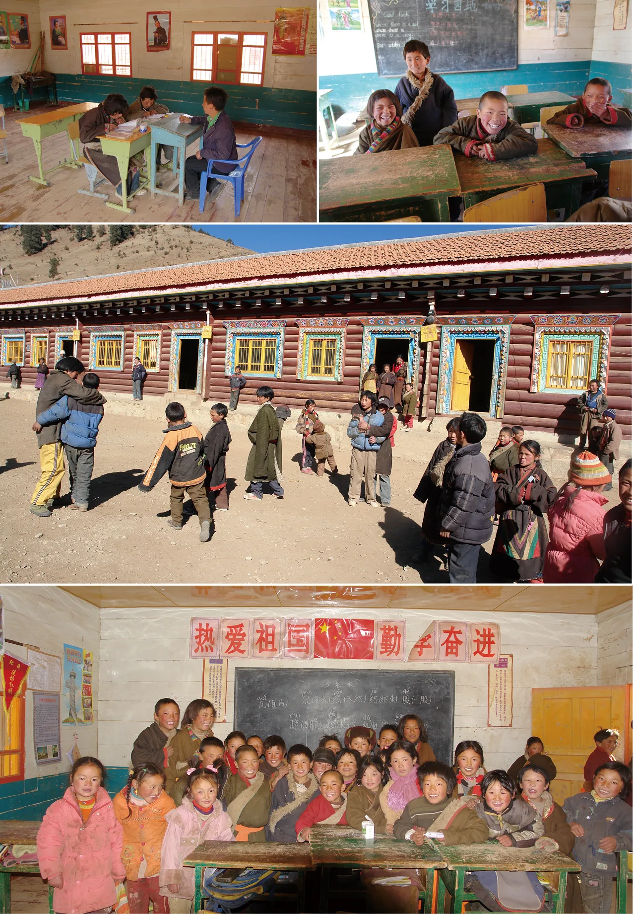
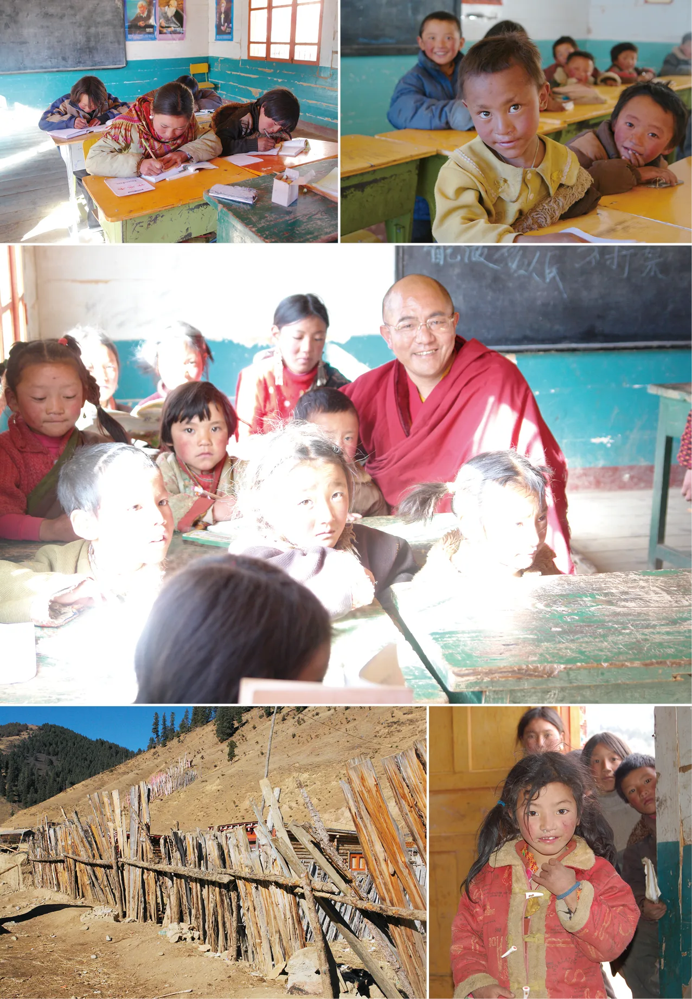
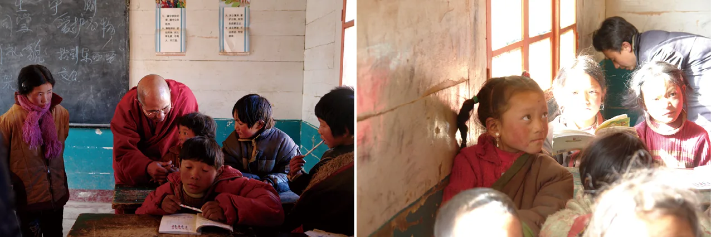
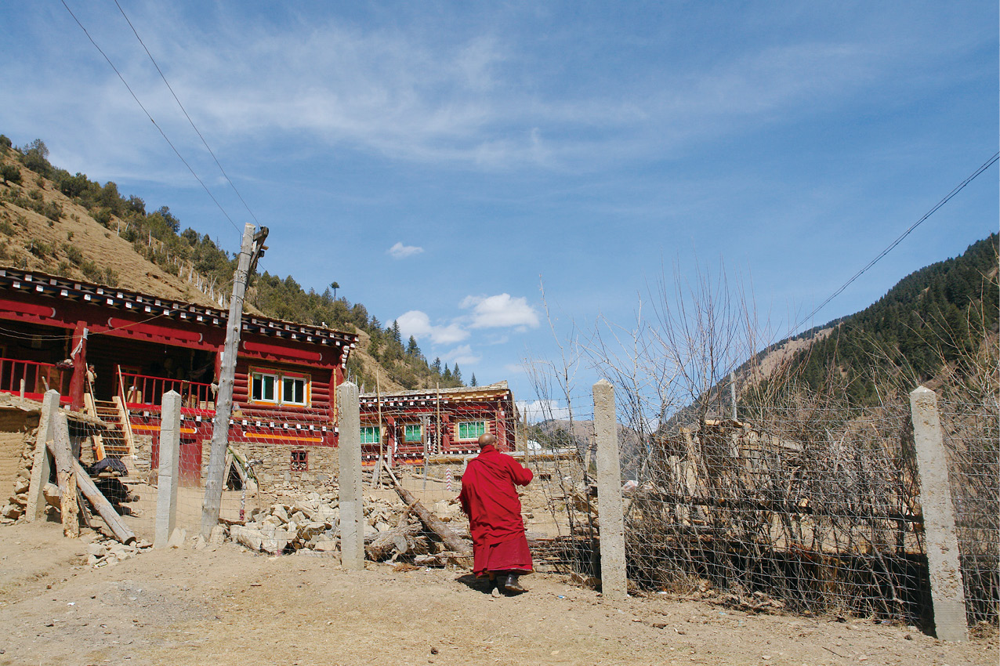
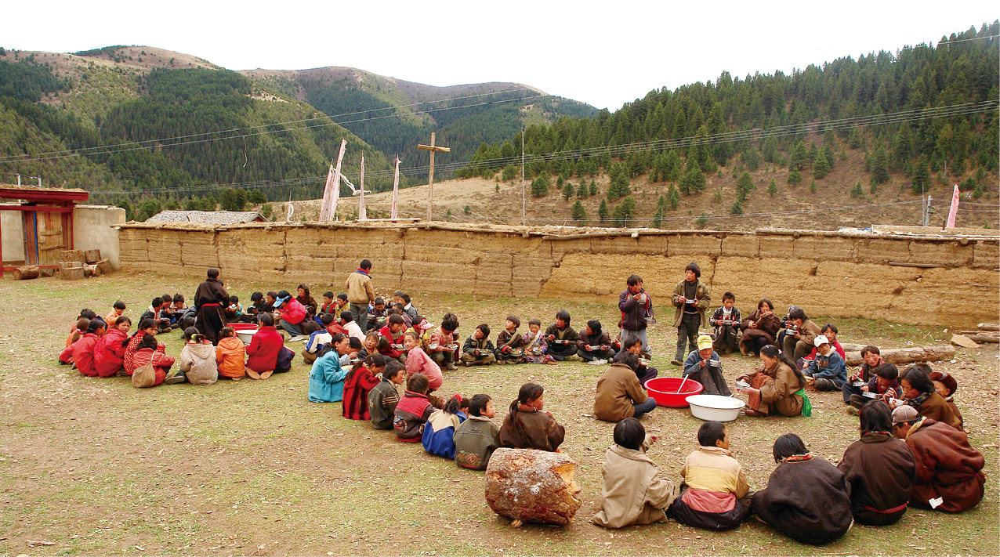
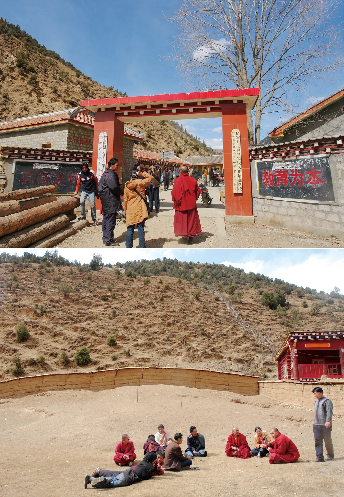

## 关于创办智悲学校的思路

时光的指针已经指向21世纪，整个世界都在发生着翻天覆地的变化，人类社会正在向一个高度数字化的高新技术时代迈进。然而，与这一切极不相称的，是边远牧区日趋严重的文盲化，及极端落后、窘困的教育现状。

## （一）教育现状

以上、下罗科玛乡为例：上罗科玛乡现有牧民459户，2134人；下罗科玛乡现有牧民551户，2825人。然而，两乡目前正在接受初中教育的仅为15人，高中教育的仅为13人，接受大学教育的人数为0。迄今为止，两个乡大专毕业的人数仅为8人，而正规全日制大学毕业的人数仅为3人。

另外，两乡基础教育的现状也十分令人担忧：虽然因为罚款等机制的制约，1—4年级的适龄儿童尚能接受一定程度的教育（上罗科玛小学现有学生178人，下罗科玛乡小学现有学生110人），但是一旦罚款监控期失效，大量生源当即流失。目前，上罗科玛乡小学五年级的学生为10人，六年级的学生人数仅有9人；下罗科玛乡小学五年级的学生人数仅有4人，六年级的学生人数仅为3人，由此可见生源流失的现象极为严重。

造成这一切的原因，一方面是因为资金短缺而导致的教室破漏、教具陈旧、师资力量薄弱。这些客观原因已严重影响了正常的教学，现有的条件不要说满足学生求知的愿望、个性的发展、视眼的拓展和综合素质的提高，就连基本的校舍安全问题都无法得到保障。另一方面，文化水平低下的家长目光短浅，宁可让孩子成为家中可有可无的劳动力，也不愿将子女送到距离遥远、设施简陋的学校去“学坏”，致使很多学龄儿童不得不面临着中途辍学的窘境。

## （二）办学目的

近年来，随着人口的不断增加，两乡文盲的比例和绝对数量都不断增长。不仅与外界日益发达的大都市之间的差距日渐加剧，新一代的年轻人也与往昔崇尚慈悲的父辈之间开始出现一种精神上的断层。淳朴的民风受到威胁，良好的校风受到干扰，学生没有真正学到该学的科学文化知识，而一些类似糟粕的所谓物质享受，却开始侵蚀着他们的头脑。长此以往，牧区的人口素质与经济水平不可能得到根本性的提高。

以我的家庭为例：我的父母和一个弟弟、三个妹妹都是目不识丁的文盲。众所周知，没有文化的人不要说为社会服务，连自己的生活都很难保证。由于没有文化，缺乏一技之长，所以没有更好的生存能力，只能以放牛羊为生。下一代中的大多数，也没有受到很好的教育。近年来过度放牧造成的草场纠纷日趋增多，他们的基本生存也面临着危机。如果不竭力挽回这些局面，牧民的前景将不堪设想。

我出身于贫苦的牧民家庭，年少时饱尝了失学之苦。直至14岁，我才有机会跨入学校的大门，在此之前一直充当着家中的劳力、父母的帮手。在学校就学期间，也时常面临着山穷水尽的景况。在以后的人生旅途中，面对纷繁的世界，我深切地感受到了科学文化知识的重要性。

兴国必先兴教，治穷必先治愚。孩子是一个家庭的寄托，也是一个民族、一个国家的希望。要改变牧区贫穷落后的面貌，只有从教育入手。作为一名宗教界人士，我对家乡目前的教育现状深感担忧，我十分愿意尽自己的绵薄之力，改善家乡的落后面貌。

## （三）初步设想

基于此，我打算尽己所能，建一所具有寄宿能力的扶贫学校。初步设想如下：

校址：拟建在原上罗科玛乡小学附近（因原校址狭窄、建筑设施陈旧，为了不影响现有的教学，故不得不迁移）。

设立班级：因为上、下罗科玛乡的失学儿童较多，宗塔、宗美两乡都没有初中，而珠委藏中与炉霍中学又路途遥远、交通不便，学生上学十分困难，很多家长都不愿意把孩子送到这两所中学，所以，本人次准备按照珠委藏中的办学模式，开设初中藏文部，旨在开展族语言和民族精神教育，提高藏民族的文化水平。

目前，前期建设的大部分资金已经筹备完毕。新校建设期间，旧校课程于原址照常进行。新校投入使用后，旧校舍并入新校使用。

该校建成后，能容纳500-600名失学儿童。这也意味着，将有500-600名牧民子弟能坐在窗明几净、桌椅整齐的教室里，接受思想品德过硬、知识水平超强的教师所传授的系统而规范的教育。相信他们也会像我当年一样珍惜得来不易的上学机会，不再担忧父母交不起学费，不再担心父母让自己回家协助抚养弟妹、牧羊放牛，不再担心教室屋梁倒塌、屋顶漏雨……

在正式行课之后，我们将拟定计划，针对品学兼优的学生与不慕荣利、治学严谨、有创新意识、工作认真负责的教师，设立不同层次的奖学金与奖金，意在鼓励学生能勤奋学习、健康向上、助人为乐，激励教师能不计个人得失、鞠躬尽瘁、踏踏实实地教书育人。

## （四）要求与愿望

为了保证学校的教育质量，实现本人办学的初衷，希望有关部门在学校的财务资产支配、教职人员的人事变更以及思想品德教育课等方面给予权力。

我这样做的目的，绝不是为了个人宣传，也不带有其他任何的功利色彩，只是因为自己的切身体会与佛教的教育，才以一颗相似的利他之心，从报效桑梓、造福故土做起，力争逐步改善一个乡、一个县、一个州，乃至整个牧区的教育现状。让生活在这片美丽土地上的每一个孩子都能完成学业，使孩子们能树立远大理想，养成优良品德，培养超胜本领，能够在学习和生活中学会慈爱、智慧、自信、自强，力求使下一代能改变自己的思想观念，并进一步影响他们的父母，从而带动大环境的转变，缩小与都市之间的差距，学会运用知识的力量来改变自己的命运与家乡面貌，力争从根本上改变贫困边远牧区的窘迫现状。愿他们都能走出愚昧、脱离贫困，实现自己的梦想，用自己的双手去拥抱美好的明天！

索达吉

2007年3月16日
