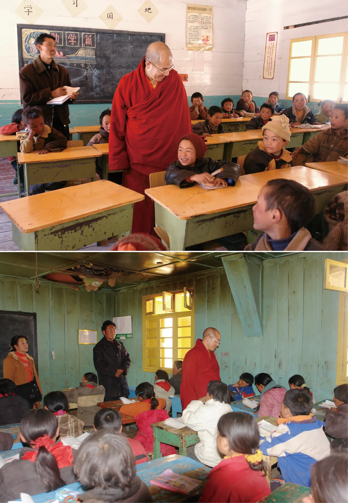

# 创立智悲学校的意义

2007年9月22日

我们创办智悲学校的主要目的，是为了改变炉霍地区的现状。由于历史原因和传统观念的影响，许多当地家长宁愿让孩子在家中照顾弟妹或者放牧，也不愿意将孩子送到学校接受教育。结果，这些孩子长大后甚至连自己的名字都不会写。一旦他们离开家乡，在外面生活时，他们也不懂如何乘车、购买物品、看病或点餐等在城市中必备的基本技能。

即使有些学生正在接受教育，但由于当地教学质量非常差，师资力量薄弱，他们也学不到很多知识。这些学生因为看不到好的出路，辍学的情况非常普遍。我们建立智悲学校的目的，就是为了改变这种现状和旧有的观念，为孩子们提供学习知识的机会，并创造良好的学习环境和条件。

通过多方的努力，智悲学校现已正式开学，目前有550多名学生。看到他们拥有了学习的机会，我感到非常高兴。当然，这一切离不开十方大德和信士们的鼎力相助，在此我衷心感谢他们的帮助和关爱。

事实上，办学校给我带来了巨大的压力，因为它与其他善事有所不同。其他善事，如放生、建经堂等，完成后便告一段落，不会有后续的压力。而办学校则需要长期的投入和努力，包括学校的管理、学生的生活费等诸多事务。但我相信，大众，尤其是十方信士，都乐意为这些可怜的孩子提供各种帮助。在大家的支持下，智悲学校一定会办得非常圆满。

那么，我对这所学校的愿景是什么呢？目前，智悲学校只有小学部，待因缘成熟时，我们会发展中学部。我们的主要目标是培养既有智慧又有悲心的人才，这正是“智悲学校”名称的由来。

在当今社会，有些人虽然拥有智慧，但缺乏对社会和他人的关爱心，这样的人不会对社会有很大贡献；而有些人虽然有悲心，但缺乏智慧，如此也难以成办任何事情。因此，我深深地希望，学校能够培养出这样的孩子：不仅精通世间的科学知识，还要具足对所有众生的关爱心和慈悲心。这就是我办学的目的。

在这次开学之前，我已经有些想法，就是把与藏地其他学校不同的教育和管理模式引入智悲学校。首先，在卫生方面，我们要求学生定期洗澡、洗头。为此，学校配备了一些与其他藏区学校不同的卫生和洗浴设施。另外，许多佛教徒为我们提供了大量的生活用品和学习用品，包括校服。今后，我们的学生将会穿统一的校服，这样会让别人对学校产生良好的印象和信任。

目前，我们学校的基本硬件设施已经完成。至于管理和理念方面，我们还需要做一些新的安排。现在，我们的教师都是炉霍县内比较优秀、素质较高的，他们对学生非常关心。如果我们做好了管理工作，就有信心培养出既有智慧又有悲心的学生。

我经常在想，我们大乘佛教徒口口声声说自己已经发了菩提心，可是发心不能仅停留在口头上，我们应该在实际行动中做一些有益众生的事情。这次办学校，我也是希望通过实际行动帮助一些可怜的孩子，为他们创造读书的机缘。虽然这只是一件微不足道的事情，但我的内心确实有这样的愿望。

在当今社会，没有知识的人，不要说完成闻思修行和成就佛果等出世间法，甚至连世间一些简单的事情都难以完成，他们的人生可以说是寸步难行，非常可怜。因此，我认为，为学生提供读书的机会，让偏僻地区的孩子们接受教育、开启智慧、遣除无明，这是非常有意义的。对出世间的佛教徒来说，参与这种善行非常重要；对关心社会、爱国爱众生的世间人士来说，这样的善行同样不可或缺。
