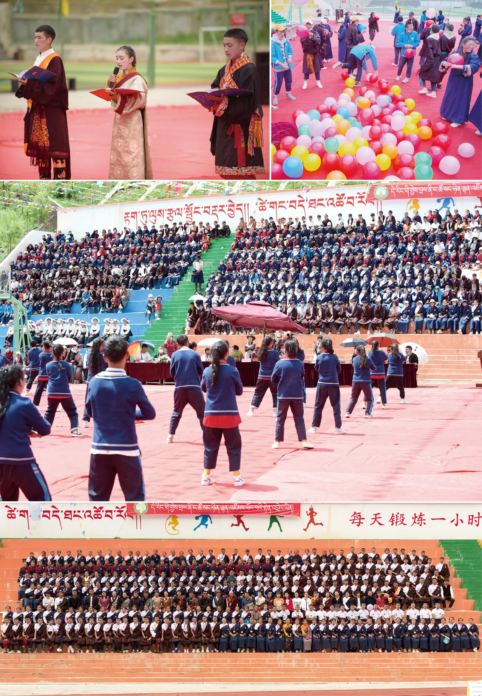
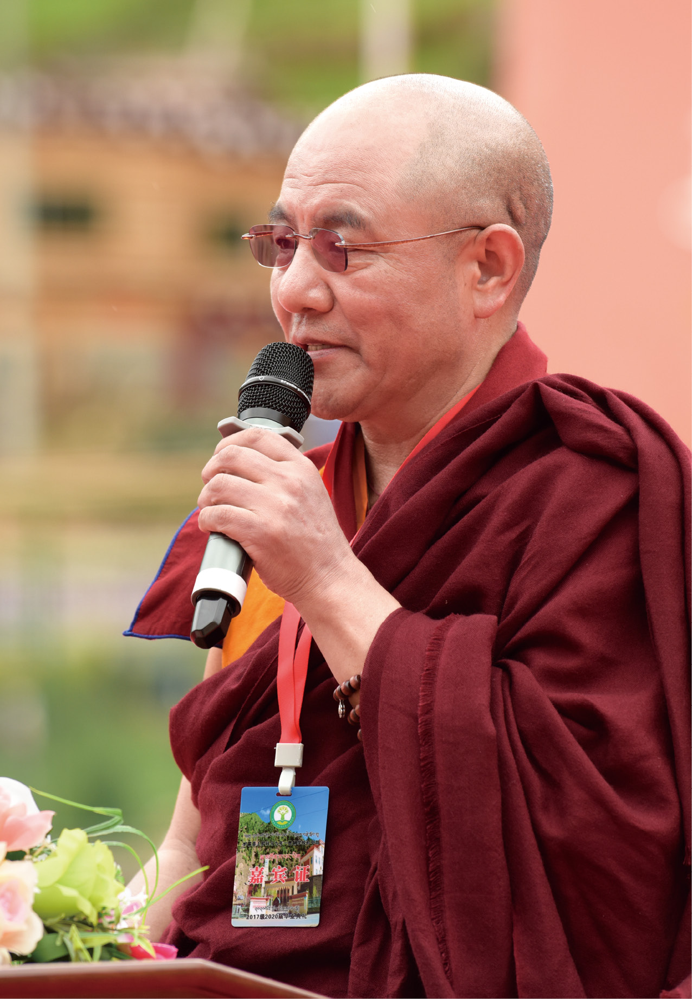
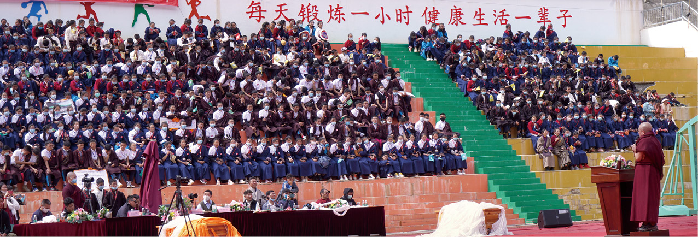

# 善聚善离

——上罗科玛智悲中学毕业典礼

2020年6月27日

今天，我们在这里举行2020年中学毕业班的毕业典礼。刚才，校方安排了多个环节，包括文艺表演和校长的致辞。毕业班的学生们也表达了对学校全体教师及志愿者的感恩之情，并为此献上了纯净、洁白的哈达。

现在，我按照学校的安排，跟大家简单地分享一些看法。接下来，我会像以往一样，用双语进行讲解，并自行翻译。在这个过程中，部分内容可能前后不完全一致，我会根据当时的想法随时表达。如果没有下大雨，今天我想给大家讲几句话。

首先，我想简单地表达我的感恩之情。我要感谢本地政府、校长、学校的所有老师，以及所有发心老师、志愿人士和其他教职员工。同时，我也要感谢整个上罗科玛学校的家长和所有相关人员。对于大家的支持与付出，我发自内心地表示感谢。

为什么要感谢呢？大家都知道，今天我们有280位毕业生。如此多的学生能够同时毕业，在我们罗科玛的历史上非常罕见。在座的毕业生可以说圆满了九年的求学梦想，而实现这样的梦想确实极不容易。如果没有刚才提到的各方面的帮助、支持和助缘，恐怕许多孩子的求学梦想难以圆满实现。

今天在这里，我谨代表我们九年级的二百多位同学，向所有在这九年中给予我们支持和帮助、使我们能够顺利完成学业的每一位人士，表达感恩之情。这不仅仅是一种仪式，也不仅仅是口头上的感谢，而是我发自内心的真挚感恩。

我先向大家介绍一下，学校自实行九年义务教育以来，已经有十几年时间。我们的首届毕业生于2016年毕业。到去年为止，学校已经有四届学生毕业，去年我统计过，毕业生的总人数为866人。今年，学校又有280位学生毕业。这样累计下来，我校的毕业生总人数已经达到1146人。这在整个罗科玛地区的历史上是绝无仅有的，可以说是非常罕见，几乎没有出现过这样的情况。

为什么这样说呢？其实，早在上世纪五六十年代，上罗科玛小学和下罗科玛小学就已经建立，但直到2007年以后，学校才以公办自助的方式运作。因此，这两所学校至今已有五六十年的历史。然而，根据我们查阅的历史档案，在学校以公办自助的方式运作之前，罗科玛地区从未有一位学生能够升读本科或者考上大学，可以说，在过去五六十年间，这样的情况从未出现过。

自从上罗科玛和下罗科玛小学以公办自助的方式运作以来，我们对校舍进行了重建。几年来，在大家的共同管理和努力下，学校已经有许多学生考上了大学，不仅仅是一般的大学，其中还包括中央民族大学、青海民族大学、西北民族大学、西南民族大学等在当地较为有名的学府。从我们这里毕业，并最终考入这些大学的学生大有人在。这实际上是大家共同努力的结果，也是老师们夜以继日辛勤奋斗的成果。我认为，这样的成绩是一件值得我们欢喜的事情。

早些时候，小学部的校长原本计划给老乡发言三十分钟，但实际上却讲了一个多小时。刚才，我问中学部的校长，他在今日毕业典礼的发言时长，他说大约十分钟，而实际上只讲了五分钟。此外，我还问了他关于我今天有多长的发言时间，他告诉我有十五分钟。我又问如果十五分钟讲不完怎么办，他表示可以随我发挥。所以，我自己也不太清楚到底能讲多长时间。今天我可能会多讲一些，相信大家不会介意。不管怎样，我还是希望能够与大家分享一些看法。

今天的毕业典礼确实非常特殊。为什么这样说呢？我们学校在第一届并没有举办毕业典礼，在之后的四年里，我们每年都举行了毕业典礼。然而，今年的毕业典礼尤为特殊，因为受到疫情的影响，大家都戴着口罩参加这次活动。所以说，这是非常特殊的一年。

我们每一年的毕业典礼都有不同的仪式。最初的时候，统筹的老师借鉴了世间上一些知名学校的感恩仪式和毕业典礼的方式，精心安排和布置了我们的毕业典礼。正因为如此，在刚开始的一两年里，许多参加毕业典礼的人士，包括老师和学生，都感动得流泪，内心充满了伤感。这些特殊的经历，大家应该都还记忆犹新。

虽然我们现在的毕业典礼相对平淡，但通过这样的仪式，学校能够向即将离开本校、迈向人生新阶段的学生们送上祝福，同时毕业生们也能够表达内心的感受和感恩之情。因此，我认为，今后只要没有特殊情况，学校都应该将每年的中学毕业典礼视为一项非常重要的活动来认真举办。对于即将离开学校的同学来说，毕业是非常特殊的一天，这一天会在他们的人生中留下深刻的印象。我也希望八年级、七年级的学生以及所有老师，都能够为将来的毕业典礼做好充分准备。

## 智慧应建立在德行之上

正如我刚才提到，今天对毕业班来说是一个非常特殊的日子。今年毕业的学生有两百多人，人数可以说是相当可观。就我个人而言，1982年我在宗塔的一所中学毕业。那时，我们班里没有上罗科玛和宗麦的学生，只有下罗科玛和宗塔的学生。毕业那天，学校没有举行正式的毕业典礼或其他仪式，只是大家一起拍了几张照片留作纪念。当时，我们班上只有大约十六七个学生。与那时候相比，我觉得现在大家在许多方面都比过去有了更多的机会。

我今天的第一个希望是，大家毕业后无论去到任何地方，都一定要追求智慧。如果没有智慧，在当今社会中可以说是寸步难行。尤其在我们罗科玛，人们对知识的渴望并不强烈，真正出色的人才也并不多见。

以我成长的地方为例，我出生在下罗科玛的一个山沟里，属于下罗科玛一村。我去年做过一次统计，下罗科玛一村大约有一百六十多户人家，总人口约有六百六十多人。然而，在整个村里，无论是本科大学毕业生，还是目前能够找到一份稳定工作的年轻人，竟然一个也没有。

如果大家觉得我的说法不实，同学们或者老师们都可以举手反驳。在人才培养方面，我们罗科玛确实还有很大的进步空间。这也是我今天想要和大家分享的第一件事情。

我今天要提出的第二个希望，无论我们是什么身份，不管是学生、老师、公务员、医生，还是普通的农民、牧民，每个人都应当具备崇高的德行。

如果一个人没有良好的德行，尽管他的智慧非常出众，比如有些老师，无论是英语、汉语、藏语，还是世间各种知识都能够精通无碍，但如果这个老师的行为不端、格局狭窄，并且他的行为对整个学校和学生都带来不良影响，每次因为他的行为，都会让许多学生或其他老师的内心留下阴影，那么，即使这个人拥有非常高超的智慧，许多人也未必会因此而羡慕他。人们会认为，虽然这个老师有学识、很聪明，各方面表现也非常优秀，但由于他的德行不佳、行为不如法，可能会对学校乃至整个群体造成不良影响。

同样的道理，比如一个高级公务员，如果他的德行不好，那么他的所作所为未必能够真正利益民众。再比如，一个普通人，农民也好，工人也好，牧民也好，即使他的智慧出众、非常富有，但若他的德行很差，行为极其恶劣，如杀人、偷盗、嫖赌，或者沉迷于吃喝玩乐等各种恶行，那么，他不仅在社会中难有前途，甚至也很难找到合适的伴侣。

大家都知道，无论是在汉地还是在藏地，如今世间人在选择终身伴侣时都非常慎重。例如，一个年轻人在寻找终身伴侣时，如果他的亲友发现他所选择的对象德行极其恶劣，大家都会劝告他说：“你不要和这个人在一起，否则你的人生一定会很痛苦。”诸如此类的现象表明，对于一个人来说，智慧固然不可或缺，但智慧应当建立在高尚德行的基础之上。

如果一个人的德行不好，大家都能一目了然。即使这个人聪明、有智慧，或者在能力、才华等各方面都非常出色，但由于德行不好，他的前途和命运也可能因此受到影响。正因如此，佛教中设有戒律，戒律是一切修行的基础。如果一个人没有自律、没有良好的德行，不管他多么了不起，他的前途也许是迷茫的。

在世间，一个人的德行确实非常重要。民间有一种说法，缺乏德行的人就像头上长有黄金牛角一样，这样的人非常可怕，最好远离他们。为什么这样说呢？因为缺乏德行的人，无论他是学生、医生还是其他身份，最初人们或许会认为他才华出众、能力卓越，但随着时间的推移，大家会逐渐发现他的行为所带来的不良影响。因此，如果一个人缺乏德行，即使他想要利益群体、利益社会，这也是根本无法实现的。

明天，同学们就要离开这个校园，离开母校，离开多年来为你们辛勤付出的老师们。老师们的希望和愿望是什么呢？就是希望你们变得更加优秀，在人生的道路上走得更加精彩。老师们所有的付出，都是为了这样的目标。事实上，如果你因为智慧有限，没有考上理想的学校，老师们并不会因此而责怪你。但如果你的行为恶劣，这才是真正让老师们感到非常失望的事情。

在本校以往的毕业生中，有些人在智慧和德行等各方面都非常优秀；但也有些人，连最基本的为人处世之道、连没有受过教育的人都能做到的基本行为，他们却完全做不到。对于这样的情况，我也深感失望。我们在这里培养学生，小学六年，中学三年，这个过程极为不易。如果有些毕业生在离开学校后，给家人和社会带来负面影响，甚至沦为囚犯，这实在是一件令人痛惜的事情。

## 心善地道善

我想和大家谈谈第三个希望。在座的九年级同学即将毕业，即将离开这所学校。你们每个人未来的道路都不相同，有些同学可能会考入优秀的学校，有些可能会考入中等的学校，有些可能会就读普通高中或技术学校，还有些同学可能暂时未能考上任何学校。

过去两年，我们的毕业生去向各不相同，从事各行各业的工作。我以前也说过，大家至少要完成九年的小学和中学学业，这对你们今后的人生确实会有很大帮助，这一点你们已经做到了。

无论你们将来从事什么样的工作，或者考上什么样的学校，我希望从今天开始，你们每一个人都能够保持一颗善良的心。什么是善良的心呢？就是在有生之年，尽量不去伤害任何众生，不管是亲朋好友，还是怨敌仇人，都尽力去帮助他们、饶益他们、利益他们。

如果各位能够以这样的心态去度过人生，我相信，即使你暂时未能考入理想的学校，你的梦想将来还是会成真，你的人生道路也将平安顺遂。相反，如果你经常怀有恶心，依靠这种恶心的力量，哪怕你现在考上了再好的学校，你未来的道路也未必能够走得长远，你的人生也可能会变得失败。这其中蕴含着非常甚深的因缘和因果关系。

关于这些道理，老师们在过去的三年或九年中，已经苦口婆心、谆谆教导过大家。当然，老师们主要传授的是知识性的内容，关于内心方面的教导可能相对较少。你们虽然学过《萨迦格言》、《水木格言》以及《君规教言论》等经典，对道德修养和内心善良方面的内容有所涉猎，但我今天还是要再次强调，希望你们能够以至诚善良的心来实践这些教诲。如此，你们的人生之路或将绽放出极为稀有的光明。

宗喀巴大师曾说：“心善地道善，心恶地道恶。”如果我们能够真正依教奉行，始终秉持一颗善良的心，那么我们的人生必定会十分辉煌。众所周知，毕业班的同学明天就要离开校园，告别母校。你们离校之后，此生之中未必还能再次与这里的许多老师相见，也不一定还能再次与我相会。

我们在过去九年中能够相聚，这是一种难得的因缘。我认为，这样的相聚非常美好，如今我们能够善聚善离，也是非常美好的。在你们即将离开之际，我真诚地希望每一位同学都能始终守持一颗善良的心。如此你们今后的人生之路也许会更加平安、更加快乐。这是我想要表达的第三个希望。

## 苦乐道用

原本学校为我安排的演讲时间是十五分钟，但刚才校长说，接下来除了拍照之外，并没有其他安排。拍照大概需要十五分钟，因此我的演讲时间可以适当延长。这样的安排更加好。

在此，我要特别感谢今年毕业典礼的组委会，衷心感谢你们，今天的典礼安排得非常好。最初的两届毕业典礼是由几位志愿者老师发心统筹，但后来他们感到特别辛苦，没有信心把典礼办好，最终便将统筹工作交由学校负责。现在的典礼虽然没有最初那样细致，但总体来说，组委会的安排还是非常好。你看，那边的哈达堆得像雪山一样，十分壮观。现在太阳出来了，天气比较好，所以我即兴说一些其他的话，但我还是会控制演讲时间的。

今天我对在座的学生和老师们提出的第四个希望，就是要学会将痛苦和快乐转为道用，这一点至关重要。也许我们当中的许多学生现在还比较年轻，对于真正将痛苦和快乐转为道用，暂时可能没有太大的兴趣。但无论如何，我们的人生确实充满了得失起伏，既有痛苦，也有快乐。

在座的一些同学，未来的人生也许会非常顺利，能够获得许多用之不尽的快乐；而有些同学则可能会经历比他人更为沉重的痛苦。无论未来的境遇如何，在今后的人生中，如果大家能够真正做到将痛苦和快乐转为道用，那么无论面对怎样的苦恼，你都能够变得无比坚强，不会因为困境而计较、敏感或悲伤，也不会因此而一蹶不振。

我们大多数人，如果不能将快乐转为道用，就很容易因此变得散漫、傲慢、懒惰，甚至轻视他人。这样的心态最终会导致自身的快乐在很短的时间内消失殆尽。

如果我们不能将痛苦转为道用，例如当家中遭遇变故、自己生病、未能考上大学，或者在感情、婚姻等方面遇到各种问题时，我们往往无法妥善面对这些困境。如今，许多大城市的年轻人正是因为不懂如何面对痛苦，常常以错误的方式，如服用安眠药、割腕，甚至选择轻生来应对，最终导致宝贵的生命在短暂的时间内结束。这种现象在当今社会比比皆是。

我衷心希望在座的年轻人能够认真学习丹毕尼玛尊者所著的《苦乐道用》。最近，我也在传讲并鼓励大家学习《苦乐道用》，其中的道理，无论是对出家人还是在家人，都非常适用。尤其是对于在家的年轻人来说，如果你们能够在步入社会、组建家庭之前，率先学习将苦乐转为道用的方法，那么无论今后遇到任何事情，你们都能够以从容淡定的心态，充满把握地去轻松应对。

《苦乐道用》这样的书对你们的人生确实非常重要。你们即将踏上人生的征途，而这条道路并不像你们想象得那样美好或平坦，实际上充满曲折和坎坷。人们在遇到苦难、灾难或痛苦时，如果没有坚强的心理，的确可能会感到走不下去，甚至丧失生活的勇气，这是一件非常可怜和可悲的事情。因此我建议大家，认真学习那些能够改善自己心态的知识。这一点同样适用于在座的老师，你们也实在需要这样的引导。

如果我们自己有一个非常坚强的心态，那么在人生中无论遇到怎样的悲欢离合或酸甜苦辣，都可以用各种方式去面对。例如，在遭遇痛苦时，我们可以思维这是自己前世的业障所致，或者想到这是因为轮回本身就是痛苦、无常的。佛教中有很多类似的观修和修行方法，如果大家能够以这些方法来面对人生的种种境遇，我认为各位同学在未来的人生道路上，一定能够走得非常圆满。

否则，有些同学可能因为无法完成学业，或者在遇到困难、实在走不下去的时候，产生各种各样的想法，甚至做出伤害自己的行为，这实在是极为令人痛惜的事情。因此，我希望大家能够努力学习心态方面转为道用的方法。这是我要表达的第四点。

## 继续学业

第五点是关于资助方面的情况。今年，由于一些新政策的实施以及基金会管理方式的调整，毕业班在资助方面将不再像往年那样得到全面的支持。目前，一家基金会将为我们九年级成绩排名前三十名的学生提供奖学金。也就是说，在上罗科玛中学的毕业班中，所有主要科目总成绩排名前三十的同学，在今后继续求学期间，每月都能获得定额的奖学金。这是资助方面的第一项内容。

第二项内容是关于家庭困难学生的资助问题。我们正在积极争取为每个班级中大约十名家庭特别困难的学生提供支持，这其中也包括非罗科玛本地的学生。申请资格不仅限于单亲家庭或孤儿，还包括那些家庭确实无力继续供孩子读书的学生。

各班主任和老师在推荐资助对象时，应秉持公平公正的原则，确保将资助机会分配给真正需要帮助的学生，不要因为私人关系而影响判断。每个班级大约有十个资助名额，老师可以根据学生的实际情况向我们提交申请。目前来看，不一定所有申请都能获批，但我们正在积极争取更多的资助名额。

如果家庭条件较好、能够自行解决的同学，请尽量不要提交申请。大家都清楚，金钱上的支持可能会让每个人都有申请的想法，因此九年级的班主任和老师们最好能够在内部充分商量，认真审视学生是否符合申请资格。

我也一直在为争取资助名额而努力，但由于多方面的因素，今年确实存在一定的困难。无论如何，我都希望毕业班的同学如果能够考上，一定要坚持继续学业，这是我的第五个希望。

## 老师应关注毕业生的升学情况

下面我再补充一件事情。九年级的同学即将毕业，我希望学校的班主任老师及各位任课老师，能够在接下来的时间里持续关注这些学生。成绩公布后，无论学生是否考上高中，老师都应鼓励他们继续学业。若有学生未能考上高中，或因各种原因选择放弃学业，我希望各位班主任，无论是汉族老师还是藏族老师，都能够持续跟进这些学生的情况。

大约在八九月份的时候，学生们的考试成绩和升学去向将会明确。届时，如果学校发现部分学生未能继续升学，或者因为各种原因辍学，老师、校领导以及教务科应该及时跟进，了解这些学生辍学的具体原因，例如是否因为家庭困难或其他因素所致。事实上，有些学生完全没有必要辍学，他们是可以继续升学的。老师们应积极鼓励学生坚持完成后续四五年或五六年的学业。至于学生此后的发展，不管是老师们还是我本人，都难以加以引导。

其实，从一年级到九年级，在这整整九年的时间里，各位老师对学生的培养确实非常不容易。现在，这些中学生可能还没有意识到在座老师们的付出，因为人在年轻的时候，对许多事情还不够清楚，思考也不够成熟。然而，再过十年、二十年，他们应该会明白读书的重要性。

正如我刚才所说，目前对于这里的毕业生而言，家中的各种事务，包括成家，并不是最重要的。现在对他们最重要的是什么呢？就是要继续学业。在他们小学毕业的时候，我曾经讲过，毕业并不是学习的终结，从一所学校毕业，实际上是另一所学校新征程的开端。这是一个新的开始，而不是终点。

我希望在座的各位老师在学生离开学校后，仍然能够给予他们悉心引导。同时，我也希望各位老师能够继续为学生们提供指引，特别是在选择高中时，他们往往不清楚如何报名，也不知道该选择哪所学校。

对学生们而言，尤其是对于我们这里的农牧民子女来说，他们在报考学校时往往无处咨询，不知道填报学校的手续，也不清楚该如何选择学校。对于各位班主任来说，虽然你们一个班有几十名学生，要处理班里学生的各种咨询，任务确实非常繁重，但不管怎样，你们在升学方面的经验和了解都比学生要多。关于学生的升学情况，我希望这里的校领导能够给予足够的重视。

去年，我曾向这里的一些领导了解过相关情况。我们学校的老师都曾亲身经历过升学的过程，理应能够体会学生在这一阶段的困难。不过，这里一些老师却非常不负责任，根本不关心学生的去向。无论学生报考什么高中、填写什么表格，这些老师都漠不关心。学校里有许多学生来自农民、牧民家庭，他们没有任何升学经验，也从未到过大城市。

我自己也曾在中学毕业时面临过填报志愿的困惑。当时，甘孜师范学校、巴塘师范学校和康定师范学校都录取了我，但我不知道该选择哪所学校。为此，我向多位老师寻求意见，有些老师没有给我任何回应，也有些老师对我说：“你自己看吧！”直到现在，我对当时的情景仍然记忆犹新，对这些老师的态度还是有些印象。我想，即使他们不了解具体情况，也应该以温和的语气与学生沟通，或者帮忙查找相关信息。虽然当时没有网络，但作为老师，他们应该不难获取那些资讯。

当时，一位老师建议我把巴塘师范作为第一志愿。另外，我还考上了一所农牧学校，但我不清楚什么是农牧学校，于是我向老师请教：“这是什么样的学校？是不是专门培养农民和牧民的学校？”可是有些老师根本没有给我解释。后来，有一位老师建议我选择甘孜师范，说一来甘孜离我家较近，二来听说这所学校还不错。经过一番考虑，我最终把甘孜师范学校填为第一志愿。可以说，作为学生的我在那个阶段感到非常迷茫。

我们有二百多位毕业生，老师在指导这么多学生填报志愿时确实会有一定困难。但我认为，作为老师，你们在升学方面都是过来人，以前也经历过类似的阶段。而且现在上网查询信息非常方便，很多相关情况你们应该比较清楚。因此，我希望老师们在学生填报志愿时，能够给予他们明确的指点和建议。这一点非常重要。

最后，我想作一个简单的总结。我非常感谢学校所有的公办老师和发心老师，尤其要感谢那些从远方来到这里的发心老师，你们的付出确实非常不容易。此外，无论是英语老师、德育老师、美术老师，还是负责水电、建筑等各方面工作的老师和人员，正是因为有了大家的发心和付出，学校才能顺利运作。

今天我们有280位学生毕业。对于我们这样一个偏僻的少数民族地区来说，这样的成绩确实非常难以想象，可以说是一项巨大的成就。能够取得这样的成就，离不开在座的每一位，也离不开所有发心人员和工作者的辛勤付出。

我非常希望在座的各位老师能够一如既往地精心培养学生。我认为，在社会的各行各业中，教师这一职业是最伟大、最光荣，也是最有深远意义的。我接触过一些富有的商人、高级公务员等在世人眼中非常成功的人士，但当我慢慢了解他们的工作和生活时，老实说，我对他们所做的事情并不感兴趣。我始终认为，在这个世界上，教师是最有意义的职业。

在座的许多老师或许会想：“教师这一职业并不理想，工资不高，学生们也不听话，常常都要与学生争吵，令人感到很痛苦。不如我去做公务员、医生、商人，或从事其他世人眼中令人羡慕的职业。”但实际上，当你真正进入那些岗位时，可能会感到后悔。所以，我希望在座的老师们能够坚守岗位，尽可能不断地培养我们的下一代。每一届毕业班离校后，又会有新的一批中学生进入学校，这需要大家持续的付出和管理。教师是一项非常不容易的工作，但却极具意义。

在此，我要特别感谢在座的发心人员。你们来自遥远的地方，跨越千山万水来到这里发心，确实非常辛苦。如果没有你们的支持、发心和努力，这么大的一所学校，仅仅依靠当地政府和极个别公办老师的力量，真的难以正常运转。

今天，我们要一再发愿，要持续发心，努力培养学生。如果大家都能在这方面立下坚定的誓言，我相信学校一定会越办越好。

虽然我个人因为身体等各方面的原因，内心有时会感到有些脆弱，但每当想到在这样一个偏僻的地方，我们能够为这么多学生提供受教育的机会，从佛教的角度来看，这是一种极为殊胜的修行，有莫大的功德。每念及此，我的内心便重新充满力量。我希望发心团队的老师们能够在校领导的带领下持续发心。我认为，这是一个极大的善根，能够积累这样的善根，没有深厚的福报是很难现前的。

最后，今天是一个非常吉祥的日子，祝愿大家一切圆满、开心、快乐、平安。谢谢大家！
