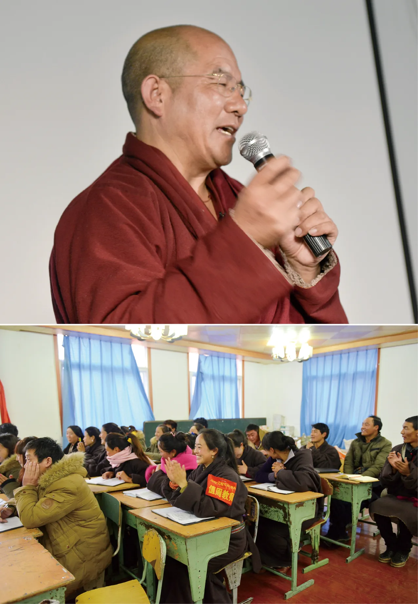
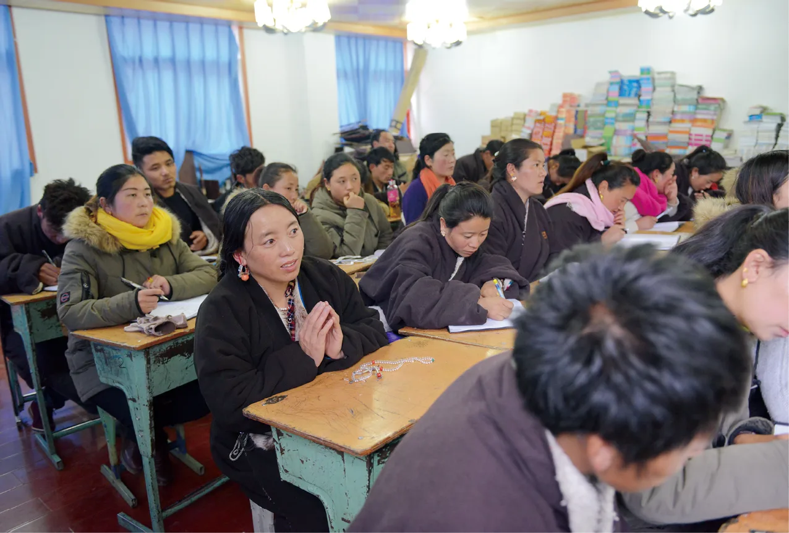
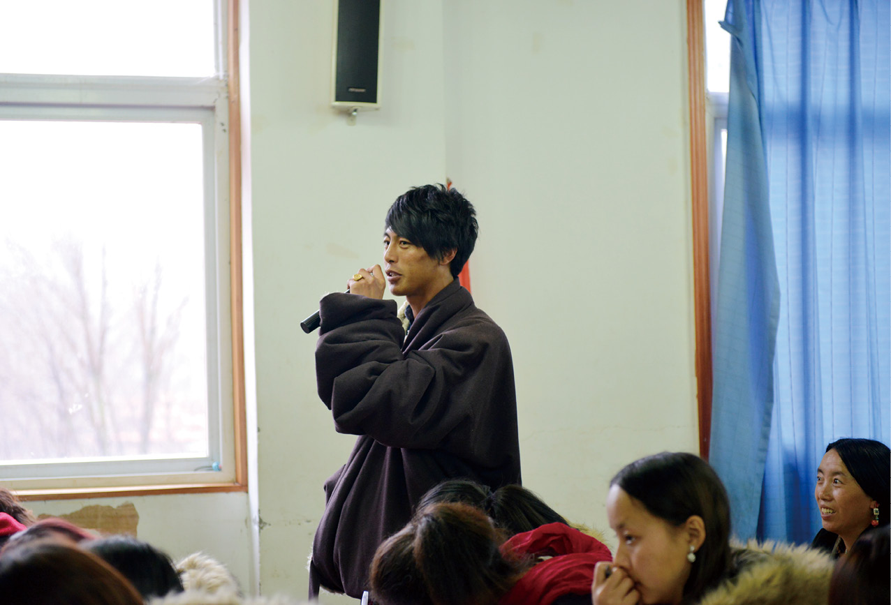
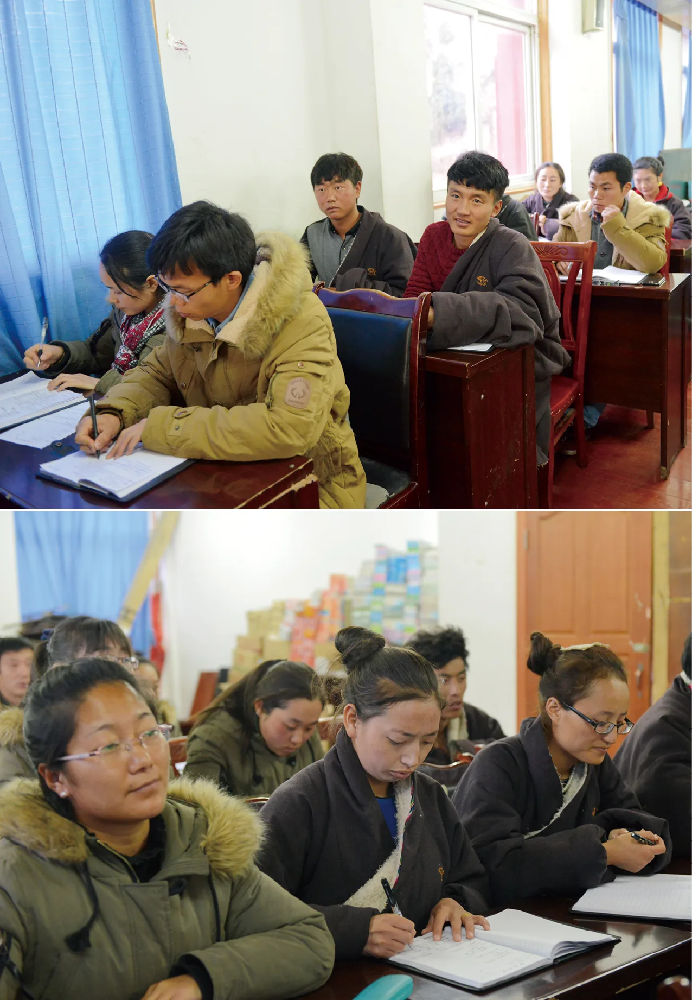
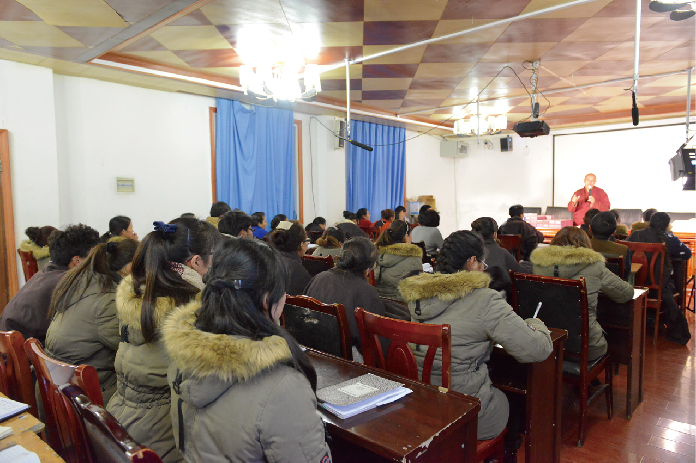

# 如何做好老师

——上罗科玛小学开示

2015年4月24日

很荣幸能够在此与各位老师交流。今天，我们将共同探讨一个话题：什么是老师。我会先简单分享一下我的看法，之后通过抽签的方式选出一些老师，请他们分享自己对这个话题的见解。此外，我也会提出一些与这个主题相关的问题，希望大家能够借此机会一同思考，互相交流。

## 传道、授业、解惑是老师的职责

我没有为今天的演讲做特别的准备，但在现场的所有老师中，我可能是教书资历最长的。我原本就读于师范学校，接近毕业时选择了出家。出家之后，我并没有放弃教师的岗位和责任。最初，我担任辅导员，除了讲授《文法三十颂》外，我还教授一些简单的藏文化传统知识。

从1985年到今天2015年，我一直致力于讲授与佛教相关的道理。在这30年的岁月中，除了必要的出访行程，我始终在学院坚持教学，几乎没有中断过。这并不是自赞自夸。事实上，即使我访问其他地方，也会尽量在当地安排一两堂课，否则我可能不会选择去那个地方。

个人而言，我一直在思考“老师”这个词的真正含义，以及老师在教育中的作用和影响。例如，尽责的老师能够带来怎样的功德、不尽责的老师会造成怎样的过患。多年以来，我一直在反复思考这些问题。

说实在的，“老师”是一个沉甸甸的名词，听起来令人尊敬，但要成为一位名副其实的老师，需要具备特殊的耐心，这并不容易。就像医生需要长期培养慈心和悲心一样，老师必须具备持久的忍耐心。如果一位老师轻易对学生失去耐性，那么，当学生对其不满或表现出调皮等行为时，这位老师可能难以接受。此外，缺乏忍耐心的老师在处理与其他老师或他人之间的各种怨言和抱怨时，也会遇到困难。

古人常说，老师的职责在于“传道、授业、解惑”，我认为这体现了老师三个重要的特点。

首先，老师要传授道德，教导学生如何做人。我们有责任向学生传递道德观念，培养他们的品性，指导他们在为人处世方面的行为。作为老师，大家一定要向学生传授做人的基本道理。

其次，老师需要通过教授技能、技术、智慧和知识，帮助学生最终能够展开自己的真正事业。也就是说，老师应该培养学生的生存技能，使他们能够在社会中以良性的方式实现长期发展，这就是所谓的“授业”。

最后，老师还要为学生“解惑”。在成长过程中，虽然学生可能已经在在父母面前解除了部分疑惑，但对于人生、生活、感情以及世间的许多事物，他们仍然缺乏深入的了解。因此，老师有责任帮助学生解除心中的疑惑，并启迪他们的智慧。

关于今天的流程，主持人建议我先进行演讲，然后再向大家提问。不过，我的计划是先讲述大约十几分钟，然后邀请在座的一位分享他对“老师”这一概念的理解和看法。待他发言完毕后，我将就其观点进行探讨。今天，我们会以这样轮番的方式进行交流。我想，通过穿插一些互动环节，可以避免大家在讲座期间出现犯困的情况。

作为老师的你们，不管口才如何，在面对众多学生时都能有效地表达。因此，今天在其他同事面前，你们应能毫无畏惧地分享自己对教师角色的理解。当然，大家的发言不必过于冗长，以免占用过多时间。无论稍后被抽到的老师是谁，都可以选择用藏语、汉语，甚至是英语来发言。虽然我对英语不太精通，但这里有许多英语老师可以进行同步翻译。

无论如何，我想再次强调一下，今天我们的讨论主题是“什么是老师”。在座的各位都是老师，但不知大家是否深入思考过这个问题。校方已经准备好了我们中学和小学所有老师的名字。接下来，我将抽出第一位发言者的名字……

## 老师应三门清净，竖立正面形象

（第一位老师发言……）

很好。我来翻译一下刚才那位老师的发言内容。他觉得自己很难对“老师”这一概念給出明确的界定。不过归根结底，他认为老师的真正作用或定义，不仅仅在于传授知识，还在于教导学生人文道德、如何做人以及如何生活。这就是他对老师这一概念的看法。

确实如此。我可以进一步阐述他的观点。老师可以分为“经师”和“智师”。在传统文化中，“善知识”一词常被提及，指的是那些不仅传授知识，还具备善良、贤善或清净品质的良师益友。而“经师”则是专注于传授传统美德和德行的老师。

大家可能都听说过萨迦班智达，他是藏传佛教中一位非常著名的大德，被称为“三大文殊”之一。那么，萨迦班智达是如何定义老师的呢？他认为，一位老师需要具备三个条件。

第一个条件，老师必须精通知识。如果一位老师不具备任何知识，他可能连维持自己的生活都有困难，因为缺乏做人所需的智慧和基本技能，那就更不用说教导他人了。

第二个条件，老师在身、语、意方面都需要保持清净。尤其是在学生面前，老师要展现出庄重和清净的威仪和行为。从今年开始，在座的各位老师需要更加注重自身的师德，在所有行为中遵循教师应有的德育和行为规范，这一点非常重要。

在座的老师大多是年轻人，不一定能够在所有场合中完全遵循一些行为规范，比如在任何时候都不喝酒、不抽烟、不打麻将等。对此，我们学校有明确的要求：在所有公共场合中，只要是学生能够看到或发现的地方，抽烟、喝酒等行为都是严格禁止的。事实上，每位老师的行为都在校方的管理范围之内，因此，学校每年都会通过严格的评分系统对教师的行为进行考核。

表面上看，学校的这种管理似乎对各位老师是一种约束，但实际上，它在做人方面对大家来说是一种提升。我们都知道，喝酒对身体的危害显而易见，而抽烟对肝脏、肺部及其他内脏都有不良影响。

此外，关于打麻将，大家可能也清楚，以前我们县城有个别老师特别喜欢打麻将，之后甚至参与其他赌博活动，最终赔光了所有家产，损失了二三十万。据说这导致他家破人亡，令人非常惋惜。我也接触过一些老师，他们因为赌博带来的问题向我哭诉。不过，他们寻求帮助时往往已经为时已晚。他们在真正拥有工作、家庭和生活的时候，没有抓住机遇去控制自己的行为，最终落入了悲惨的境地。

所以，我认为老师在学生面前树立一个正知正见的形象是非常必要的。从行为上来看，老师要有老师的形象，学生要有学生的形象。同样，医生、工人或农民也应该体现出符合各自身份的形象。这一点非常重要。

在座的各位，无论毕业自哪所院校，都应具备教师应有的资格、证书和德行。正如萨迦班智达所言，教师的第二个要求是在身、语、意，尤其是心态上，都要保持清净。

至于老师需要具备的第三个条件，萨迦班智达认为是利他心。我相信，大家选择成为老师不仅仅是为了获得几千块钱的工资，毕竟我们教师的工资水平确实不高。那么，我们当老师的唯一目的是什么呢？就是教书育人。大家应该清楚，老师的事业并不是耕地，也不是制造飞机等以盈利为目标的行业。

有些老师可能心中从未浮现过学生的面孔，脑海中只充满着人民币的影像。这样的人确实不配称为真正的教育者。因此，我希望各位能够不断学习、培养利他心并清净自己的身语意，以此来改善心态，增长智慧和德行。

事实上，学生很容易受到老师的影响，老师与学生之间存在一种关系：老师的言行如何，学生往往也会表现出相似的言行。如果老师的行为不如法，那么他所培养出来的学生大多数也会表现出类似的负面行为。我经常在想，老师不能仅仅依靠严厉的责骂和惩罚来教育学生；同时，老师也不能对学生过于友善，否则可能会出现与预期相反的效果。所以，老师应该掌握好分寸，找到教育学生的适当方式。

我希望各位老师能够认真思考自己与学生之间的关系。老师不应与学生过于亲密。如果你经常和学生说说笑笑，一起吃喝，甚至在生活上过于密切，可能会导致学生对老师失去应有的敬畏之心，这对他们的教育成长是不利的。

另一方面，老师和学生之间的关系也不应如仇人般敌对。一旦师生之间产生了深刻的隔阂，以至于彼此都不愿再见到对方，就像故事中乌鸦和猴子的关系一样，这是非常不好的。此外，一些老师甚至可能将今生的矛盾演变成生生世世的冤仇，他们可能会这样想：“你这么差的学生，不仅在这一辈子，我永远也不想再见到你，甚至连你的声音都不想听到。”发如此恶愿的老师，恐怕无法真正培养学生成才。

因此，我认为老师和学生之间的关系需要保持在不冷不热、不亲不疏的适度状态。任何事情都有其度，如果超越了这个度，就可能变得不合理了。在处理与学生的关系时，各位老师应当注意把握这种分寸。

## 以爱心对待学生

（第二位老师发言……）

刚才这位老师认为，能够善待学生并且对他们充满爱心，就是一位好老师。

我想，优秀的老师能够运用许多方法，引导学生进入真正的智慧殿堂。我中学时期有一位老师，他至今仍然住在炉霍，经常带着一台长长的摄像机。记得在六一儿童节时，他也来过这里。如今，他的头发已经全白了。虽然我上他的课已经是三十多年前的事情，但他讲课时的笑容，以及偶尔流露出的愤怒表情，至今仍然历历在目。

我觉得，他在教导学生方面有许多善巧方便。对于那些学习表现不佳的学生，他不会以讽刺或抛弃的态度来对待他们。相反，他常常对这些学生说：“你目前的状况确实不理想，可能其他班的同学也看不惯你的表现，但作为老师，我愿意接受你。我在求学时也经历过多次失败，因此我希望你能不断努力。其实，和上个学期相比，你已经有了很大的进步。”他会通过这种方式来提升学生的素质。

我在中学时曾经非常不守规矩。有一次，我在学校抽烟，结果被这位老师抓了个正着。当时，我以为这次肯定免不了在全班同学面前被批评，老师可能从此不再理我。然而，老师虽然批评了我，但并没有在公开场合，而是选择了私下与我交谈。批评过后，他要求我彻底断绝对烟草的贪欲，戒掉这个不良嗜好。想到老师对我的宽容，我觉得应该给他一个面子，于是自己暗下决心：至少在中学期间，我要尽力戒烟。最终，我成功改掉了这个不良习惯。

此外，这位老师经常与我们学生一起围着钢炉烤火，讲述一些关于汉地的事情，比如汉地有哪些美丽的公园。我记得他当时说：“重庆那一带有卧铺车，你们现在要好好读书，将来一定能坐上那些舒适的卧铺车。”他这些鼓励之言，让我和许多同学都深受激励。

作为一名老师，光有智慧是不够的。我注意到，这里有些老师虽然拥有很高的学历，但他们所教导的学生往往没有明显的进步。其中的原因是什么呢？在于教学方式和方法的单一性。如果大家能够不断尝试并调整教学方法，教学效果应该会有所提升。

目前，许多老师往往偏爱成绩优异的学生，而对成绩不佳的学生则表现出厌烦。实际上，真正优秀的老师会尽力去接纳和关怀那些成绩不佳的学生，帮助他们逐渐进步，最终成才。我们时常会看到，一些在小学阶段成绩较差的学生，到了中学却有显著的进步，反之亦然。即使在中专或大学阶段，学生的学业表现也可能起伏不定。因此，我们不能仅凭一两次考试的成绩来判定学生的真实能力。

在培养学生的方式方法上，在座的老师不应固守己见，认为自己历来的方法一定是最合适的。大家应该观察一下，自己的教学方法是否能够与当今的国际标准接轨。当然，国际上的一些教育方法也并非全然适合我们。例如，有些人认为美国的教学方式非常好，但实际上，无论是美国还是中国的教学方法，都有各自过于死板的地方。一般来说，欧洲的一些教学方式更具开放性，不过，这些方法也未必完全适用于东方的教育环境。

作为老师，我们需要根据实际情况，不断反思并调整最适合学生的教学方法。在不违背学校整体纪律框架的前提下，我们应充分运用各种方法来启发学生的智慧。正如刚才那位老师所言，我们不仅要培养学生的智慧和品德，还要教导他们做人的道理。在此过程中，我们应对学生无私付出。这几点确实非常重要。

我觉得今天这种交流方式非常好……

## 老师应平等对待每一位学生

（第三位老师发言……）

刚才这位老师提到，对于成绩不佳的学生，有些老师的确会自然而然地对他们产生轻视，甚至看不惯他们。这种现象确实存在，因为感官印象对人的影响很大。如果一位学生长相不佳，可能许多老师就不太喜爱，或者不愿意亲近他；相反，如果一位学生相貌端正，外表出众，可能许多老师都愿意在课后给予他更多的关注和指导。

在我的学生生涯中，也经常看到一些老师对那些在气质、相貌或智慧等方面与众不同的学生特别偏爱。这种现象也许源于人类的天性，难以完全避免。但作为老师，我们需要注意，不能单凭外在特征来评估一个学生的潜力。

历史上，一些伟人并不具备令人喜爱的外在条件。例如，美国前总统罗斯福，他的外貌并不出众，且从小就患有残疾。在他的学生时期，不仅同学们欺负他，连老师也看不起他。然而，这些侮辱和不公并没有击垮他，反而激励了他奋发努力。后来，他在二战期间发挥了出色的领导才能，并成为美国历史上唯一三次连任的总统。

我们不难发现，世界上的一些伟人或名人，往往并不具备引人注目的外表，但凭借他人给予的机会，他们最终获得了成功。现在中国的首富是谁呢？大家可能都知道，就是马云。

俞敏洪曾经取笑他说：“马云的长相很难看。”你们在电视或其他平台上可能也见过他的样貌，他的外表确实并不出众。一些资料提到，马云在求学时期不受老师的喜爱，而无论是中学还是大学的考试，他都频频落榜，一共经历了十几次甚至是二十多次的考试失败。然而，他如今竟成为了中国的首富，这让许多人大感意外。

在众多成功人士之中，许多人在求学阶段都经历过失败，包括辍学、被老师嫌弃，甚至被学校开除。例如，年轻时的周恩来，他在法国留学期间就曾被学校开除，然而，他最终在中国历史上成为了一个什么样的人物，这一点大家应该非常清楚。

从佛教的观点来说，我们不应欺凌或轻视任何人。有些人在学生时代比较愚笨、长相较难看，或者不受欢迎，但是多年以后，他们很可能成为同届毕业生中最为杰出的人。同样，你现在可能认为某位学生特别不济，不值得关心，可是再过二三十年，他或许会成为你最引以为傲的学生。这样的事例并不罕见。

现在，老师可能会觉得某位学生让自己丢脸，但将来一旦这位学生成名、发财或升官，老师往往会在不同场合中自豪地说：“他就是我的学生……”以此来为自己增光添彩。

刚才这位老师提到的情况确实存在，我们都需要反思自己过去的做法，毕竟每个班里肯定都有一些学生没有出众的外表。虽然我没有在此教学，但每当我参观你们的班级时，也难免会对不同学生的外表、智力等形成既定的看法和印象。例如，在今天向我们提问的学生中，我注意到有些人声音悦耳，有些人的普通话讲得非常好。当然，今天出来提问的学生，在他们的班级中都算是比较优秀的。

另外一点值得注意的是，各位老师不能忽视课堂上的纪律。对于那些经常打瞌睡或表现不佳的学生，除了适当的责罚外，我们还应采取有效的方法，帮助他们改正不良习惯。总的来说，我们要尽量做到对所有学生一视同仁，这一点至关重要。

## 师者如父母

（第四位老师发言……）

这位老师认为，老师就像学生的父母一样，我对此深表认同。

最初，我在佛学院主要负责给藏族僧众授课。大约教了三、四年后，我们的上师指派我为汉族人讲课。那时，我确实扮演了父亲的角色。我不仅要关心他们的教材和住宿情况，还要负责他们在学院中的纪律等各方面的事务。

与此同时，我也需要承担起母亲的角色，因为许多学生刚来学院时，生活物资匮乏，也欠缺基本的医疗保障。当时，我经常要处理他们学习以外的事情，比如亲自帮他们盖房子，梳理他们之间的人际关系等。

虽然在学院里我的工作未必得到每个人的认可，但至今为止，我可以有把握地说，大约70%到80%的汉僧都视我如父母。我不仅在学院的重大决策和规划中扮演重要角色，还需要出席各种内外部的大型会议和聚会。同时，我也负责管理僧众日常生活中的事务，比如用水、卫生和生活费等。因此，我在学院时非常忙碌。

在座的每一位老师都需要管理许多学生，肩负着重大的责任。现在，我们的两所学校，包括中学和小学，共有1494名学生，离1500人仅差6人。而这些学生的教育、日常生活，乃至他们生病时的照顾，全部依赖于在座的70多位“父母”。你们这70多位老师要管理近1500名学生，意味着每位老师平均要负责大约21名学生的成长和发展，扮演着21个孩子的“父母”角色，这一任务确实非常沉重。

正如我刚才所说，“老师”这个称谓听起来很光荣、威严且庄重，但实际上，它背负着沉重的责任。不知道在座的各位是否思考过：如果一位父母有21个孩子，他的操心和心理负担会有多大？此外，我们强调要对孩子们一视同仁，那么大家可以试想，当你需要照顾21个孩子时，这种责任和压力将会是怎样的。

无论是从佛教还是世间的角度来看，我们确实应该像对待亲生子女一样去对待学生。为什么呢？因为他们在学校中的一切苦乐，全部都依赖于各位老师。当然，老师并不是生养他们的人，而将来，他们也不一定会像对待自己的父母那样来照顾老师。据我所知，有些毕业生在碰到昔日的老师时，甚至连招呼都不打。

最近我遇到一位老师，他对我说：“我当了一辈子的老师，但如今在街上遇到那些我曾经辛苦教导过的学生，他们甚至不和我打招呼。即使他们提起我，也只会直接叫我的名字，完全不会称一声‘老师’，他们已经把我的付出忘得一干二净。这种情况真的让我难以理解。”我对他说：“这样的情况确实时有发生，但应该只是个别现象。你不要因此感到伤心，更不要有悲观的想法。”

所以，我们不应盲目期望学生将来会向我们报恩。然而，从当前的责任来看，我们有必要像对待自己的孩子一样对待他们，经常关注和关心他们在学业、生活以及行为举止等各方面的发展，这是非常重要的。

## 善巧引导学生

（第五位老师发言……）

这位老师没有发表自己的看法，而是提出了一个问题。他说，现在有许多老师认为，在教育学生的过程中，应该采取非常温和的方式来引导，而不是通过打骂等严厉手段，因为后者被认为是不合理的。他对此抱有疑问，希望我阐述一下自己的看法。

我认为他的顾虑是合理的。对于一些特别蛮不讲理或凶悍的学生，如果老师一味地采用赞赏、随顺和过度保护的方式，而不加以严厉管教，他们可能会变得更加不讲道理，最后甚至可能成为野蛮之徒。因此，老师们应当根据学生的不同性格和具体情况，灵活运用各种教导方法。

事实上，不管是教育学生还是处理世间事务，具足善巧方便都是极为重要的。佛教中也经常强调善巧方便的重要性。以前在藏地，有一位非常著名的静命论师，他无法调伏当地的野蛮鬼神和邪魔外道，于是迎请了印度的莲花生大士。莲师通过展现忿怒相，最终成功降伏了藏地的所有野蛮鬼神。

因此，有时候对于学生来说，无数次的赞扬可能不如一次严厉的惩罚来得有效。当然，老师在惩戒学生时，务必保持正知正念，确保自己的一切行为都发自利他心，真正是为了学生的长远利益着想。

否则，如果老师情绪失控，后果可能会非常严重。比如，一位老师在个人生活、情感、事业或人际关系中遇到麻烦，积累了愤怒的情绪，如果他将这种负面情绪带入教室，对全班学生一律施以体罚，这样的行为显然是极不合理的。

我也认同你们在某些情况下采取严厉的措施来教育学生。不过，刚才德育老师在晚餐时提到，现在学校更倾向于通过温和的方式来规劝学生，引导他们自我反省。虽然这种方式与以往稍有不同，但若学校的管理能够因此变得更加完善，那么这种改变还是需要的。

以前，我几次目睹老师在广场上责打学生，那场面让我感到非常害怕，但其他老师似乎没有什么反应，觉得这是理所当然的。当时，我实在看不下去，打算去劝阻那位老师，可是其他老师说：“这些学生的行为极其恶劣，包括打人、打架等，如果不在公众面前施以严厉的惩罚，我们很难纠正他们的行为，也难以管教其他学生。”

确实，有时候我也很难掌握其中的分寸。不过，在座的各位都是充满爱心的人，我希望大家能够怀着爱心去教育学生，尽量通过道理来引导他们。这种方式是最理想的。每位孩子都会犯错，我们不能总是依靠责打来纠正他们。

我自己在小时候也犯过很多错误。我记得有一位体育老师，常常对我施以责罚，我忍受了很长时间，没有任何反抗。有一天，我穿上了一件我非常喜欢的红色衣服，那是我好不容易才买得起的。然而，这位老师在一气之下，竟然把我的衣服前襟完全撕烂。

当时，我感觉心都要裂开了，因为这么好的一件衣服就这样被毁了。我看老师穿着一件漂亮的蓝色运动服，怒火中烧，便拼命地抓他的衣服，也把它撕破了。事后，我在班上写了一份检讨书。或许，每个人都曾有过一些不光彩的经历。

## 关注学生的精神世界

（第六位老师发言……）

这位老师讲得很好。他说，老师的工作不仅仅是在教室里高高在上地授课，而是应该走进学生的世界，了解他们真正的需求和想法，这才是一位成功老师应有的行为。

去年，我访问了一所西方高等学府。在交流中，我问到：“贵校的学生水平非常高，你们的成功秘诀是什么？”他们说：“第一个原因，我们不接收水平较低的学生，只录取顶尖人才。打个比方来说，我们的新生在其他地方已经成材，我们的任务只是对这些优质材料进行雕琢、打磨和组装，最后让他们成为本校的品牌和产品。

第二个原因，我们的老师会深入了解学生的精神和物质生活。这并不是说老师要与学生完全打成一片，而是老师在保持一定距离的同时，尽力去了解学生的心态、困惑、苦乐和烦恼等各个方面。正因为有了这种深入的了解，我们在处理学生问题时就变得更加得心应手了。”

当然，我明白各位的工作压力确实非常大。你们每天不仅要批改大量作业，还要备课，并且这里超过70%的老师需要教授两门以上的课程。我注意到一些老师显得比较疲惫，似乎总是处在一种迷迷糊糊的状态，这可能是由于来自学校和其他方面的压力所导致的。从校方的角度来看，师资短缺实在是一个难题。不过相对而言，我们学校的教师资源尚算充足，而其他一些学校的状况则不太乐观。

在此情况下，我明白各位要深入了解每个学生的精神世界并不容易。据我所知，我们的一个班级通常有超过40名学生，只有个别班级的学生人数相对较少。所以，大家要全面了解每位学生的兴趣和性格，确实有一定困难。

然而，作为一名优秀的老师，大家仍需尽量安排时间，深入了解学生的具体生活状况及他们所面对的困难。当我们真正从学生的视角去思考问题时，才能清楚地知道如何去帮助他们，这一点非常重要。

## 不断学习，自我成长

（第七位老师发言……）

这位老师认为，一名教师应具备三项核心素质：智慧、清净的行为和贤善的利他心。至于这三种特质是否合适，则由我来评定。

我完全赞同他的观点。的确，作为一名教师，首先必须具备智慧。不管是世间的各类学科，如数学、语文，还是出世间的各种学问，如果一位老师能够对这些领域精通无余，当然是最理想的。即使无法做到这一点，老师至少也要对自己的专业领域有深入的了解。

现实中，确实有些教师比较迟钝，思维不够清晰，甚至对自己教授的科目也不太了解。这样一来，学生在课堂上往往会听得云里雾里，学习的成效自然大受影响。所以，老师应尽量精通各类知识，即便无法做到样样精通，至少也要在自己所授的学科上有良好的造诣。

在座的各位老师大多非常年轻，能够加入我们，说明你们都具备了一定的智慧。毕竟，本校的入职要求非常严格，没有智慧的人是不会坐在这里的。即便如此，大家的智慧仍然有很大的提升空间，还有进步的余地。不论是常驻的正式教师，还是暂时发心来此的老师，我希望你们都能把这所学校看作是促进自身学习和提升的平台。我刚才与许多老师交谈，他们说：“我刚来到这所学校时，非常拘谨，不敢说话，感受到各方面的压力都非常大。但现在，我觉得自己有了显著的进步。”

确实，在一个良好的环境中锻炼成长的人，与普通人有着显著的区别。我想，大家在此与将近1500名学生及众多受过高等教育的学者型教师朝夕相处，如果你能经常与他们互动交流，必然会受到学术气氛的潜移默化。这在西方被称为“浸泡式教育”。当你沉浸在一个优良的环境中，生活在追求知识的氛围里，最终你会不知不觉地被这种氛围所熏陶和改变。

藏地有一位非常著名的智者，名叫晋美朗巴。他曾说过，一块普通的木头如果长时间置于檀香林中，最终也会散发出芬芳的香气。同样的道理，一个人即使最初行为不佳、智慧不足，但只要在良好的环境中得到熏陶，他自身的素质也会逐渐提升。这里的许多藏族老师，起初连电脑都不懂得操作，但现在他们几乎都能熟练地使用电脑，包括打字、制作表格、排版等。所以说，这个地方给我们提供了很多学习和进步的机会。

刚才这位老师提到的第二点是行为清净。正如我之前所说，我希望本校的老师们能够保持庄重，尤其是在学生面前。作为教师，大家需要展现出适当的威严。我们中学的一些老师，过去因为年轻而略显调皮，但我最近见到他们时，随着年龄的增长，他们的举止已经变得更加成熟，在学生面前也显得庄严。这一点非常重要。在我的求学生涯中，也遇到过一些很有威严的老师，他们让我既尊重又敬畏。

除了行为清净，刚才这位老师还提到了第三点，就是利他心。这不仅指老师对学生的爱心和利他心，也包括老师之间的利他精神。大家千万不要在下班后对其他同事有所抱怨。我听说在另一个县城的某所中学，一些老师在课后不专注于批改作业，反而聚在办公室里不停地抱怨和指责他人的过失。据说，后来这所学校出现了许多问题。

因此，我们应尽量避免在没有特殊必要的情况下在背后批评他人。如果遇到问题，大家应该当场提出，并提供合理且有针对性的建议，而不是私下议论。比如说，如果你们觉得我的某些行为或做法不妥，完全可以直接向我指出。虽然一开始我心里可能会感到不舒服，但实际上，这种做法对我来说是极有助益的。

不管是什么样的人，都不可能天天受到别人的赞叹。当别人指出你的过失时，你要反观自己，学会自我反省，如此你一定会有所进步。作为教师，大家应该通过各种方式来提升自己的职业道德。我希望，当你日后离开这里，去往别处发展时，你能够回想起：“我在上罗科玛学校执教时，不仅没有败坏师德，反而学到了许多知识和做人的道理。”所以说，这所学校是一个教导学生的地方，也是一个让大家不断学习和成长的平台。

## 老师的使命重大

（第八位老师发言……）

这位老师说，她是一个在农村长大且非常纯真的农民孩子。她认为，“老师”一词承载了很多意义，而老师的责任也非常沉重。她解释道，从个人的层面来看，老师对学生的成长和福祉有直接的影响；从更广泛的层面来看，老师对国家、民族乃至整个社会都起着非常重要的作用；而从全球视野来看，老师对整个人类，甚至对所有生命都有着极其重要的影响。因此，她认为，教师们如果能够履行好自己的职责，确实会对各个层面的繁荣与发展带来益处；相反，如果做得不好，则可能带来负面的影响。

这位老师说得非常对。正如刚才所讲，在座的每位老师平均要负责引导和管理20多名学生。更有甚者，一些老师要负责两个班级，管理的学生数量可能接近100名。（堪布向几位教师询问了他们所带班级的学生人数）你们看，有一位老师要带86个学生，另一位带80个，也有一位老师要带100个，他们对这些数字都一清二楚。

大家试想一下，如果这三位老师的人品较差，那么这接近300名学生在学校的9年时光——初中的3年和小学的6年——都将白白浪费。可以说，他们的人格和教育基础会被毁坏。相反，如果这三位老师非常优秀，时常关心学生的生活、学习、人格以及各个方面，那么在这9年里，学生们确实能够学到大量的知识，并在人文道德上得到提升。

因此，我希望每位老师都能认真地反省自身的情况。如果你觉得自己的表现未如理想，同时身心俱疲，再加上诸如薪资不高、工作繁重等因素，那么你选择离开这份职业也是可以理解的。

在现今社会，几乎没有听闻公务员转行成为教师的例子。然而，老师们报考公务员的现象却屡见不鲜。有些老师甚至假装生病，请假去投考公务员，或者通过各种人脉关系谋求公务员的职位，这样的事例并不在少数。为什么会有如此多的教师选择转行成为公务员呢？可能他们觉得，当今的学生实在难以调化，加上教师的工资不高，所以便选择了转行。

反过来说，我真的非常感谢在座的某些老师，尤其是这里的一些发心老师。他们在汉地的生活条件本已十分优越，无论是居住环境还是个人的生活品质。但是，他们愿意放下这一切，来到我们这个气候寒冷、贫困、且生活上面临诸多困难的地方。除了他们自愿的发心之外，没有任何其他原因促使他们做出如此的选择，甚至许多藏族老师也未必愿意付出这种牺牲。

很多藏族老师曾向我坦言，他们不愿意前往比目前生活环境更艰苦的地方，例如去非洲做志愿者，因为他们并不想吃苦。他们说，如果自己有钱，只想好好享受生活。所以，我深知在座的一些老师的确非常不容易，他们不但放弃了安逸的生活，还来到这里承担起重大的责任。

总而言之，老师的职责极为重大。目前，我们的中小学生人数既不算多也不算少，但今后我们不能再增加过多的学生，否则我和各位都会不堪重负。如果我们过于劳累，将无法应对很多方面的事务，甚至连现有的工作也可能难以维持。在目前的状况下，我特别希望在座的老师们能够多一份忍耐，累一点也不要紧。今天上午，我用藏语讲话时也提到过这一点。

你们看，昨天我讲了四堂课，今天又有三堂，每堂课大约两个小时，而且我都是站着授课的。作为一名老师，我经常站在许多人面前讲课。虽然我不确定自己的话语是否对听众有益，但不管怎样，我愿意为此付出。

我希望在座的每一位老师都能把自己的知识传递给学生，并将此视为一种幸福、一种快乐，乃至人生中最有意义的一段经历。这样一来，我相信我们学校在各方面都会有所进步。

接下来大家可以向我提问。

现场互动

（第一个提问……）

在回答这位老师的问题之前，我想先向各位说明一下我布置的作业要求。第一个作业是要求学生们在假期期间，记录他们在孝顺父母方面所做的一些事情，书写语言可以是汉语或藏语。学生们可以采用讲故事或列举案例的方式，汇集他们报答父母养育之恩或孝敬父母的具体事迹。除了低年级的学生外，其他学生都应尽量完成这份作业。

第二个作业，是希望学生们在非必要的情况下，尽量避免向父母索要钱财。长期以来，许多家长都承受着很大的经济压力。因此，今年在庆祝六一儿童节前，我们特别跟学生们强调不要在衣着上互相攀比，以此减轻家庭的经济压力。我希望班主任老师能够经常提醒学生，竞争应该体现在知识和学习上，而不是通过穿戴什么品牌的衣服或牛仔裤来比较。如果学生之间存在这样的攀比心，那说明我们的教育很不成功。

中学不庆祝六一儿童节，但小学有此活动。今后，各班的班主任应引导学生，不要在那个时候购买大量昂贵的衣物。今年虫草的收成似乎特别少，牧民和农民因此难以维持生计，有些人甚至债台高筑。所谓“夏虫不可语冰”，大家不一定能够体会到他们的困境。因此，我们学校有必要给全体学生发出公开提醒。

以上就是我给学生们布置的两个作业。

关于刚才那位老师的问题，我认为，无论是通过言传身教，还是用我们自身的经历去感动学生，如果每一位老师都真正怀有感恩心和利他心，那我们的言行自然会影响到这些孩子，让他们得到感化。

例如在尽孝方面，如果你对父母常怀感恩之情，虽然偶尔会对他们发脾气，但你平时也会以一些实际行动来表达对他们的关爱。我相信，当你与学生分享这些经历时，他们很容易受到启发，因为他们本身就具备爱的潜能。

因此，教师们应通过自己的亲身经历来引导学生，如此就无需借用其他事例来说明问题。假设你热爱知识，可以分享自己在知识的海洋中如何不断探索和成长的经历。总而言之，我认为老师的言传身教非常重要。

（第二个提问……）

我先将刚才校长的问题翻译一下。有个别学生的行为非常不当，且屡教不改，虽然学校并不打算开除初中以下的学生，但在无可奈何之下，学校只能将这些学生除名。最后，校长通知了家长，目送他们离去。面对这种情形，校长心里感到有些难受，也有些茫然无措，他问我如何看待这个问题。

首先我要说明的是，无论是老师还是学生，我们学校都不应像其他学校那样，因为个人理由而随意开除某人。但是，如果确实有学生频繁地给同学、老师以及学校带来诸多麻烦和不便，并且屡教不改，那我们可能别无选择，只能采取必要的措施。

不仅仅是在这所学校，像我们佛学院这样一个大乘佛教的清净道场，有时也不得不开除一些不守戒律的人。在我们的教师队伍中，如果有极少数老师非但没有任何进步，反而对其他老师的行为产生不良影响，我们也会考虑请他们离开。

我曾经劝过极个别老师不要继续待在这里，我对他们说：“本校不是让老师偷懒或混日子的地方。如果你想混日子，或许去其他地方会更为适合。这里的每位老师都非常辛勤，一个人的表现不佳会对整个学校的运作带来很大的影响和诸多麻烦。”

学生也是如此。如果某些学生的行为确实让老师无法接受，那么在特殊情况下，我们只能采取特殊的处理方式，例如开除。这或许是个人的因缘，但有时候我们也别无他法，只能做出这样的决定。校长也无需因此感到后悔。毕竟，我们要管理约1500名学生，在这样一个庞大的团体中，难免会有少数学生需要离开，这是无可避免的。当然，我们应该尽最大努力为每个学生提供继续读书的机会。

（第三个提问……）

这位老师说，虽然今天讨论了很多关于老师的话题，但他有一个疑问：作为老师，是该像渡船时的船长那样好呢，还是像船客那样好呢？

对此，我认为要根据老师的具体情况而定。如果这位老师具备掌舵的能力，拥有足够的智慧、爱心和德行，那么他可以像船长一样，带领船上所有的人共同驶向彼岸。这样的老师是最优秀的，因为除了引导学生外，他还能带领同船的所有人到达目的地。当然，如果一位老师不具备这样的能力，他选择做一个真正的船客也是可以的。最重要的是，老师在渡海期间不能中途放弃，不能自己跳船，否则他将很难抵达目的地。

现在，许多老师在职业生涯中途选择转行，我觉得这种现象并不太好。个人而言，我决心在有生之年坚守教师这一神圣的职业，不会有改变的念头。如果中途转变，就如同船行至半途时，自己没有与同船的人继续前行，而是跳入了大海，这会让许多人感到十分遗憾。

我曾认识一些老师，他们的教学表现非常优秀，但或许由于薪资、工时等原因，他们后来转向了其他行业。我认为，每个人应当在有生之年不断学习和提升自己。虽然教师这一职业确实有一定压力，可是我们也能从中获得成长。有些人因为不愿意承受这些压力而中途转行。用刚才的比喻来说，他们尚未抵达彼岸，便拿着救生圈跳入水中，但这救生圈未必能如他们所愿地发挥作用。

我认识一些已经转行的前教师。每当在各种场合遇见他们时，我不禁感叹：“他们曾是老师，投身于如此神圣的职业，如今却变成这样。”我听说，他们当教师时在行为举止等各方面都还不错，但现在却常常睡到中午，醒来后便与一些所谓“志同道合”的人混迹度日，看来他们的人生已经失去了意义。有时，我为他们的境况感到悲哀。

（第四个提问……）

关于孩子们的理想，今年我们计划在校园中设立一个“理想塔”，让每位准初中毕业生留下关于自己理想的作文。等到10年、20年后，我们将一同回顾这些作文，看看当年他们的理想是怎样的，以及他们是否实现了这些理想。事实上，很多孩子的理想，有时能够实现，有时则不一定能够如愿。

我有一位同学，我们在读书时一起写过《我未来的理想》。那时候他非常明确地写道，将来要成为一名飞行员。长大以后，有次我在山坡上看到他正在放牛。当时他骑着一头没角的牛，我便开玩笑说：“你当初在作文里写着要开飞机，这头牛是不是你的飞机？”所以说，每个人当初的理想最后会变成什么样，实在难以预料。

有一点需要各位老师注意，即使学生有出家的意愿，我认为在他们未完成初中教育之前，不应鼓励他们出家。因为出家并不意味着自身的痛苦会立刻得到解脱，许多出家人依然面临各种困惑。在佛学院里，不管是汉族还是藏族的出家人，都会产生不少烦恼。

以前，有位女生执意要去喇荣出家，我多次劝阻她不要冲动。可是她没有听从，反而对我有意见：“你作为一个出家人，我想要出家，你不但不赞叹，还想阻拦，你会遭受因果报应的。”但后来，她并没有成为一位清净的出家人，最后还是还俗了。我一直关注她的情况，听说她现在的日子过得并不如意。

我认为，学生的理想与老师的引导有一定关系。所以，不管是我们这里的发心教师，还是中学、小学的教师，都不能提倡让学生出家，因为他们没有必要在这个阶段放下对知识的学习。我们不仅要重视学生对理想的选择，更应提供积极的教育和引导，他们在适当的时候自然会找到自己的人生目标。

在我们为初中毕业生设立的“理想塔”内，我希望将所有曾经在此任教和现任教师的照片都放进去。再过10年、20年，我们可以一同回顾这些照片，看看大家发生了怎样的变化。此外，刚才有些老师提议，我们可以在小学的每个班级设立一个档案室或“经验塔”，这个建议非常好。

有一次，我和同学回到我们以前的中学，却发现学校早已被拆除。不过，当时的校长和老师仍然保留着我们几个班的毕业照。我们都觉得这些已经近20年的黑白照片非常珍贵，大家纷纷翻拍留念。或许再过10年、20年，这些照片将会更加珍贵和有意义。

（第五个提问……）

他大概的意思是，从世间的角度来看，如果一个人选择当一辈子的老师，这种决定背后的价值观是什么？他觉得，我和其他法师、堪布所讲授的是佛教真理，因此，尽管我们每天要讲很多课，十分劳累，我们仍然会坚持不懈。而他好奇的是，到底是什么样的价值观使得一些世间人愿意投入一辈子去做老师？

我认为，这可能源于几个方面的原因。

首先，他们认为当上老师是一件非常光荣的事情。从职能上讲，教师的作用是其他任何领域所无法替代的。

其次，他们有意继承并传承现有的文化和知识。在当今社会，我们时常见到有文化但缺乏知识，或者有知识却缺乏文化的现象。

我举一个简单的例子，比如在建筑学方面，美国和加拿大这些国家只有数百年的历史，他们虽然掌握了丰富的建筑知识，却缺乏深厚的文化底蕴。现在，汉地的许多大城市都在效仿西方的建筑风格，虽然这些建筑看起来现代，却往往失去了文化的内涵。所以说，一个人若选择当一辈子老师，他不但应致力于传递知识，还应肩负起传承文化的责任。

第三个原因是，他们希望以爱心来启发学生。如果缺乏这种爱心，教师很难在教学的道路上坚持到底，可能会半途而废。

因此我认为，一个人若决心当一辈子的老师，与上述几个方面有一定关系。

（第六个提问……）

非常感谢，这是今天的最后一个提问。

这位老师的问题大致是：虽然我们学校提倡德育和知识教育，且我们更重视德育，但在实际操作中，每个班级的老师却非常在意统考分数。因此，教师们的工作重心往往围绕着考试而转。如果这种情况持续，可能会让那些品德高尚但成绩一般的学生感到灰心，而那些成绩优异但德行较差的学生则得到更多机会和关注。这样一来，学校所看重的道德教育可能会沦为一种口头上的形式，对学生的成长产生负面影响。他想知道我对这方面的看法。

我同意这个问题确实存在。为了避免这种情况，之前我们曾在各班级中选出大约三分之一的学生，以德育为标准进行奖励。但是，这种做法的效果最后并不理想。因此，今年我们将在这方面进行一些改革。

首先，由于德育笔试未能发挥很大的作用，我们决定将德育纳入各班的综合评估体系中进行评分。事实上，我和校方也在探讨多种措施，以加强学生的道德教育，因为德育确实非常重要。然而，作为一所受教委管辖的学校，学生的分数直接关系到每位教师的工资和绩效考核。因此，我们也不能忽视学生的考试成绩。

其实，与其他学校和地方相比，我们学校对德育的重视程度已经相当高。这里的学生每天都有德育课，他们不仅学习汉地的传统思想，如《弟子规》，也学习藏地的文化传统。但是，在这个高度重视分数的大环境下，我们的各个学科仍然需要通过考试来量化学生的知识水平，否则学校便无法参与国家的统考，也难以符合教委的各种要求。

当然，我非常认同这位老师的看法。我希望各班的老师在关注学生成绩的同时，也能多向学生强调德育的重要性。对于那些在德育方面表现较好的学生，我们应尽量在不同的场合发挥他们的优势，并通过适当的方式予以奖励。今年，我们暂时采用这种方式来鼓励学生重视德行。长远来看，我们还需要探索更多有效的方法，希望校方能够与老师们共同商量。

今天，我为每位老师准备了一尊释迦牟尼佛的佛像。如果在座的老师有信仰，这尊佛像方便随身携带，且已经过装藏和开光，很有加持力。如果你没有信仰，可以将它作为一件纪念品，或者赠送给别人。

此外，我还为每位藏族老师准备了一本书。前段时间，一位老师将我在大学演讲的内容翻译成藏文，并由甘肃民族出版社出版。至于汉族老师，我也给大家带来了一本书，它收录了我在一些大学交流时的讲话内容。

另外，我还准备了一个小茶杯。之前，我在我们学院对面的一家商店看到这个茶杯。虽然我不太确定它的品质，但我个人颇为喜欢。当时我就想，等见到大家时，可以将它作为礼物送给各位。至于它的保温效果好不好，就看你们的福报了。

无论如何，这些都是今天我为每位老师、教工和发心人员准备的礼物。谢谢大家。
